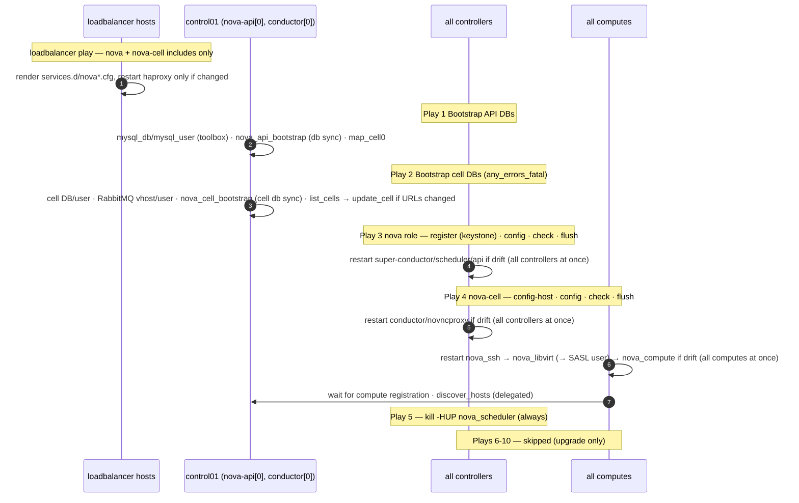

# Reconfigure Nova

What `kolla-ansible -t nova reconfigure` does on the loadbalancer hosts, on the controllers and on every compute, with
the
two narrower commands `-t nova-api reconfigure` (only the Nova control plane, no compute impact) and
`-t nova-cell reconfigure` (only the cell part: conductors, consoles, computes).

The scenario sections are written for the [assumed deployment](index.md#assumed-deployment); the page uses the
[conventions of the command sections](index.md#conventions-used-by-the-command-sections), the definition of
[drift](index.md#drift) and the notion of [code guarantees and environment
dependence](index.md#code-guarantees-and-environment-dependence).

> [!NOTE]
> **Key answers**
>
> - **`-t nova reconfigure` ([§2 to §6](#2-execution-sequence-kolla-ansible--t-nova-reconfigure)):** every compute runs
>   the tasks. Restarts happen only where drift is detected, in practice on no compute or on all of them, and
>   `nova_libvirt` and `nova_ssh` restart whenever `nova_compute` restarts because of config or image drift
>   ([§4](#4-are-all-compute-nodes-affected-does-nova-compute-restart-on-every-compute)). Whether running VMs survive is
>   [NOT AVAILABLE] ([§5](#5-running-vms-live-migration-scheduling)).
> - **Nova without touching computes:** `-t nova-api reconfigure`
>   ([§1.2](#12-reconfigure-only-the-nova-control-plane-no-compute-impact)).

> [!WARNING]
> [R1](../risk/risk-register.md#r1): a nova-compute drift restarts `nova_compute`, `nova_libvirt` and `nova_ssh` on
> each compute where it occurs, so a change common to all computes restarts them on every compute — see
> [§4](#4-are-all-compute-nodes-affected-does-nova-compute-restart-on-every-compute).

## 1. Commands

### 1.1 Reconfigure Nova (control plane and computes)

```bash
kolla-ansible -i multinode -t nova reconfigure
```

- **Scope:**
  - loadbalancer play (nova and nova-cell frontends; `site.yml:247-260`);
  - the 10 nova plays (`nova.yml:29-272`), the nova-cell play on **every compute**;
  - `common` no longer runs under `-t nova`: in 2023.1 it is its own play, tagged `common` only (`site.yml:86-97`).
- **One-shot:** 5 container runs (API DB sync, map_cell0, cell DB sync, list_cells ×2) plus RabbitMQ user/vhost,
  Keystone registration, SIGHUP of `nova_scheduler`, `discover_hosts` [CODE, when cell0 is mapped and the cell is
  unchanged: `roles/nova/tasks/bootstrap.yml:54-56`, `roles/nova-cell/tasks/bootstrap.yml:37-43`, `create_cells.yml:2`,
  `discover_computes.yml:5-18`; [Tags §3](../risk/tags.md#3-what-a-tag-really-executes-master-table)].
- **Restarts:** depend on the drift ([§2 to §6](#2-execution-sequence-kolla-ansible--t-nova-reconfigure)). A
  nova-compute drift restarts `nova_compute`, `nova_libvirt` and `nova_ssh` on each compute where it occurs, so a change
  common to all computes restarts them on every compute [CODE `roles/nova-cell/tasks/check-containers.yml:2-22`,
  loop-notify, [Tags §2.4](../risk/tags.md#24-loop-notify-one-changed-item-notifies-the-handlers-of-all-items-code)].

### 1.2 Reconfigure only the Nova control plane (no compute impact)

```bash
kolla-ansible -i multinode -t nova-api reconfigure
```

- **Scope:** the `nova-api`-tagged plays (API DB bootstrap, nova role, scheduler refresh) on controllers, plus the
  loadbalancer nova include (`site.yml:247-253`).
- **Not touched:** conductors and computes (`nova-cell` plays).

### 1.3 Reconfigure only the cell part (conductors, consoles, computes)

```bash
kolla-ansible -i multinode -t nova-cell reconfigure
```

## 2. Execution sequence (`kolla-ansible -t nova reconfigure`)



## 3. What changes, per type of change [CODE]

| Change | Files rewritten | Restarted on controllers | Restarted on **every compute** | Source |
|---|---|---|---|---|
| none | – | none unless a notifying task reports changed | none unless a notifying task reports changed | restart handlers run only when a notifying task reports changed ([Tags §2.4](../risk/tags.md#24-loop-notify-one-changed-item-notifies-the-handlers-of-all-items-code)), and `check-containers` reports changed only for a missing or not-running container, a differing compared parameter, a `kolla_set_configs --check` exit 1/137 or Docker client error, or (new in 2023.1) a missing or different systemd unit file `kolla-<container>-container.service`, which is the case on the first run that creates these units (`module_utils/kolla_container_worker.py:59-90`, `module_utils/kolla_docker_worker.py:155-189`, `module_utils/kolla_systemd_worker.py:149-162`; [Tags §3](../risk/tags.md#3-what-a-tag-really-executes-master-table)); [NOT AVAILABLE] whether every task reports unchanged on an unchanged cloud |
| `/etc/kolla/config/nova.conf` (global override) | `nova.conf` of every nova service | nova_api, nova_scheduler, nova_conductor, nova_novncproxy | **nova_compute, nova_libvirt, nova_ssh** | both `Copying over nova.conf` loops merge `{{ node_custom_config }}/nova.conf` (`roles/nova/tasks/config.yml:64-82`, `roles/nova-cell/tasks/config.yml:69-88`); [Tags §2.4](../risk/tags.md#24-loop-notify-one-changed-item-notifies-the-handlers-of-all-items-code) |
| `/etc/kolla/config/nova/nova-compute.conf` | `nova-compute/nova.conf` only | – | **nova_compute, nova_libvirt, nova_ssh** (libvirt and ssh by loop-notify) | `roles/nova-cell/tasks/config.yml:69-88`; [Tags §2.4](../risk/tags.md#24-loop-notify-one-changed-item-notifies-the-handlers-of-all-items-code) |
| `/etc/kolla/config/nova/nova-scheduler.conf` | `nova-scheduler/nova.conf` only | nova_scheduler **+ nova_api** (loop-notify) | – | `roles/nova/tasks/config.yml:64-82`; [Tags §2.4](../risk/tags.md#24-loop-notify-one-changed-item-notifies-the-handlers-of-all-items-code) |
| `enable_barbican: yes` (Barbican not even deployed) | `nova.conf` everywhere (adds `[barbican]`). `td-agent.conf` and `logrotate.conf` change too, but only when the `common` play runs (no tag or `-t common`), not under `-t nova` | all nova (fluentd, cron, kolla_toolbox only at the next `common` run) | all nova incl. libvirt (same for fluentd, cron, kolla_toolbox) | `roles/nova/templates/nova.conf.j2:204-209`, `roles/nova-cell/templates/nova.conf.j2:246-251`; `roles/common/defaults/main.yml:138-142`, `roles/common/tasks/config.yml:138-148`; `site.yml:86-97`; [Tags §2.4](../risk/tags.md#24-loop-notify-one-changed-item-notifies-the-handlers-of-all-items-code) |
| same as the global `nova.conf` override, with `kolla_serial=1` | same | one controller at a time | **one compute at a time**; API DB sync and map_cell0 repeated per batch (3×) | `nova.yml:39, :111, :132`; [Tags §2.5](../risk/tags.md#25-run_once-with-serial-code) |

## 4. Are all compute nodes affected? Does nova-compute restart on every compute?

- **Tasks:** yes. The nova-cell play targets the whole `compute` group (`nova.yml:117-135`). The Ussuri count of
  remote module invocations per compute (46, 53 on the first compute) included the `common` tasks, which no longer run
  under `-t nova`; read from the 2023.1 task files, the count is 26 per compute and 30 on compute001 ([Compute scaling
  §2](../concepts/compute-scaling-and-performance.md#2-work-per-compute-host-read-from-the-task-files)). Its number of
  task results is [NOT AVAILABLE].
- **Restarts:** only where drift is detected. But most Nova-related changes are global ([Component dependencies
  §5](../components/dependencies.md#5-compute-node-dependency-summary), [Nova deep dive
  §2.3](../components/nova-deep-dive.md#23-configuration-dependencies-inputs-that-change-novas-files)), so in practice
  either *no* compute restarts or *all* computes restart. They restart in the same handler step unless
  `ANSIBLE_SERIAL`/`kolla_serial` is set or `--limit` is used.
- **libvirt goes with it.** Whenever nova-compute restarts because of config or image drift, **nova-libvirt and nova-ssh
  restart too** (loop-notify, [Tags
  §2.4](../risk/tags.md#24-loop-notify-one-changed-item-notifies-the-handlers-of-all-items-code)). Kolla's own handler
  ordering restarts nova-ssh, then libvirt, *before* nova-compute [CODE] (`roles/nova-cell/handlers/main.yml:74-168`;
  handlers
  run in definition order: the iterator walks the play's handler list in order and runs each notified one, ansible-core
  2.14.18 `lib/ansible/executor/play_iterator.py:197, :430-453`). With `libvirt_enable_sasl`, the libvirt handler also
  notifies a readiness check and the SASL user creation, defined before the nova-compute handler
  (`roles/nova-cell/handlers/main.yml:96, :116-141`).

## 5. Running VMs, live migration, scheduling

| Effect | Guaranteed by code | Depends on environment |
|---|---|---|
| nova-compute stop/start (SIGKILL after `docker_graceful_timeout`, 60 s by default, `group_vars/all.yml:140`) | yes, when drift | [NOT AVAILABLE] Whether VMs are unaffected, whether in-flight operations on that host fail or are left mid-task, and whether the service is reported down only if the restart exceeds `service_down_time` ([Nova deep dive §5](../components/nova-deep-dive.md#5-nova-libvirt-why-its-restart-is-special)) |
| libvirtd stop/start | yes, whenever nova-compute drifts | [NOT AVAILABLE] Whether VMs survive. [CODE] The container has `pid_mode: host`, `cgroupns_mode: host` (new in 2023.1), the host `/run` bind mount and `/sys/fs/cgroup` mounted rw (`roles/nova-cell/defaults/main.yml:8-9, :374, :376`), and the image's start scripts do nothing to QEMU, cgroups or `/var/run/libvirt` (kolla `docker/base/start.sh`, `docker/nova/nova-libvirt/extend_start.sh`; [Kolla images §5](../concepts/kolla-images.md#5-per-image-start-behaviour)). The open questions are therefore libvirt and Docker behaviour: where libvirtd puts QEMU (for example a host `machine.slice` scope), the stop (in 2023.1 each container is run by a systemd unit `kolla-<name>-container.service` whose `ExecStop` is `docker stop <name> -t <graceful_timeout>`, 60 s by default; the module stops or restarts that unit, or calls the Docker `stop` with the same timeout when no unit file exists; `module_utils/kolla_systemd_worker.py:20-39, :63-73`, `module_utils/kolla_docker_worker.py:362-384, :436-482`, `group_vars/all.yml:140, :152`; on a container whose entrypoint is dumb-init, kolla `docker/base/Dockerfile.j2:353`; which signals Docker sends, at the stop and after the timeout, is [NOT AVAILABLE]) and libvirtd re-attaching to running domains when it starts. [NOT AVAILABLE] Whether live migrations in progress fail, and whether libvirt API calls fail until libvirtd is back ([Nova deep dive §5](../components/nova-deep-dive.md#5-nova-libvirt-why-its-restart-is-special)) |
| nova-ssh stop/start | yes, with the above | [NOT AVAILABLE] Whether resize or cold-migration disk copies over port 8022 (`roles/nova-cell/defaults/main.yml:473`) are interrupted |
| Scheduling | API and scheduler restarts are parallel on all controllers (serial 0) | [NOT AVAILABLE] Whether API calls fail during the restart window. [CODE] The scheduler gets SIGHUP on every run that reaches its hosts (cell-cache refresh, `nova.yml:140-156`); [NOT AVAILABLE] whether that is harmless |
| Host mapping | `discover_hosts` runs every time | runs `nova-manage cell_v2 discover_hosts --by-service` to map newly registered computes (`roles/nova-cell/tasks/discover_computes.yml:14-18`, through `kolla_container_engine exec nova_conductor`); [NOT AVAILABLE] whether it affects existing instances |

## 6. Operational risks and verification

- **Risks:** [R1](../risk/risk-register.md#r1), [R2](../risk/risk-register.md#r2), [R3](../risk/risk-register.md#r3),
  [R24](../risk/risk-register.md#r24) in [Risk register](../risk/risk-register.md).
- **Before:**
  - `kolla-ansible -t nova genconfig` (restarts nothing), then diff `/etc/kolla/nova-*/nova.conf` on one controller
    and one compute.
  - `docker exec -u root nova_compute /usr/local/bin/kolla_set_configs --check; echo $?` on a few computes: exit 1
    means the container *will* restart, and so will `nova_libvirt` and `nova_ssh`.
  - No active live migrations: `openstack server list --all-projects --status MIGRATING`.
- **Apply in batches:** `deploy-containers --limit` ([Write config first, apply in controlled batches
  §2](controlled-batches.md#2-separate-write-config-from-apply-recommended-pattern)) or `ANSIBLE_SERIAL`.
- **After:**
  - `openstack compute service list` (all up);
  - `docker ps --filter name=nova_ -a` (all `Up`, recent `Created`/`Started`);
  - `virsh list --all` inside `nova_libvirt` on a sample of computes (domains running), with guest pings;
  - `nova-manage cell_v2 list_hosts` count equals the number of computes.

## Related

- [Risk register](../risk/risk-register.md) — the risks this page names: [R1](../risk/risk-register.md#r1) (any config
  change touching nova-compute), [R2](../risk/risk-register.md#r2) (fleet-wide restarts after an `enable_*` change),
  [R3](../risk/risk-register.md#r3) (changing RabbitMQ group membership, password or port) and
  [R24](../risk/risk-register.md#r24) (container stop timeout: `docker_graceful_timeout`, 60 s by default in 2023.1)
- [Nova](../components/nova.md) — service cards of the roles `nova` and `nova-cell`, and where to look
- [Nova deep dive §5](../components/nova-deep-dive.md#5-nova-libvirt-why-its-restart-is-special) — nova-libvirt: why
  its restart is special
- [Pre-execution checklist](pre-execution-checklist.md) — the checks before every production run
- [Write config first, apply in controlled batches](controlled-batches.md) — `genconfig`, then
  `deploy-containers --limit` batch by batch, and rolling runs with `ANSIBLE_SERIAL`
- [Tags §2.4](../risk/tags.md#24-loop-notify-one-changed-item-notifies-the-handlers-of-all-items-code) — loop-notify:
  one changed item notifies the handlers of all items
- [Compute scaling
  §2](../concepts/compute-scaling-and-performance.md#2-work-per-compute-host-read-from-the-task-files) — work per
  compute host, read from the task files: the source of the per-compute counts of §4
