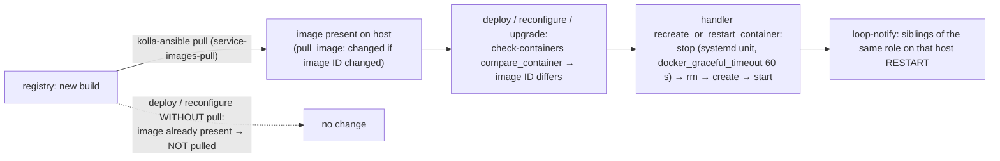

# Update container images

How `kolla-ansible pull`, `deploy`, `reconfigure` and `upgrade` treat container images: `pull` never changes running
containers, and after a `pull` that downloaded something the next `deploy`, `reconfigure` or `upgrade` recreates the
affected containers.

The image counts per host in [§2](#2-how-image-pulling-and-recreation-work-code) are for the service set of the [assumed
deployment](index.md#assumed-deployment).

> [!NOTE]
> **Key answers**
>
> - **Images ([§2 to §5](#2-how-image-pulling-and-recreation-work-code)):** a `deploy` without `pull` does not download
>   a rebuilt image, and a new `openstack_tag` applied with `deploy` recreates every container on every host [CODE]
>   ([§2](#2-how-image-pulling-and-recreation-work-code)). Risks of doing so: [§4](#4-risks).
> - **Images:** `pull` never changes running containers, and `deploy`/`reconfigure` never pull an image that is already
>   present locally [CODE] ([§1.1](#11-images)).

> [!CAUTION]
> [R12](../risk/risk-register.md#r12): changing the tag and running `deploy` (instead of `upgrade`) recreates the whole
> fleet in one go, without the upgrade-specific ordering — see [§4](#4-risks).

## 1. Commands

### 1.1 Images

```bash
kolla-ansible -i multinode pull                         # all enabled images on all hosts
kolla-ansible -i multinode -t nova pull --limit compute # nova-cell images on computes (common images: add -t common)
kolla-ansible -i multinode upgrade                      # recreate from new images (after pull)
ANSIBLE_SERIAL=20 kolla-ansible -i multinode -t nova upgrade
```

- `pull` never changes running containers [CODE `roles/service-images-pull/tasks/main.yml:2-18` (no `notify`),
  `module_utils/kolla_docker_worker.py:198-232`].
- `deploy`/`reconfigure` never pull an image that is already present locally, even if the registry has a newer
  build under the same tag: the module looks the `repo:tag` up among the local images and pulls only when it is
  missing [CODE `module_utils/kolla_docker_worker.py:80-88, :116-131, :378-379, :386-388`].
- After a `pull` that downloaded something, the next `deploy`, `reconfigure` or `upgrade` **recreates** the affected
  containers. Loop-notify restarts their siblings [CODE `module_utils/kolla_container_worker.py:59-90`,
  `module_utils/kolla_docker_worker.py:116-131, :362-384`; [Tags
  §2.4](../risk/tags.md#24-loop-notify-one-changed-item-notifies-the-handlers-of-all-items-code)].
- In 2023.1 `library/kolla_docker.py` only parses the arguments and calls `DockerWorker`
  (`library/kolla_docker.py:399-412`); the logic is in `module_utils/kolla_container_worker.py` and
  `module_utils/kolla_docker_worker.py`. `kolla_container_engine` defaults to `docker` (`group_vars/all.yml:92`).

## 2. How image pulling and recreation work [CODE]



The stop goes through the container's systemd unit `kolla-<name>-container.service` when it exists, whose `ExecStop`
is `docker stop <name> -t <graceful_timeout>` (`module_utils/kolla_docker_worker.py:436-452`,
`module_utils/kolla_systemd_worker.py:20-40, :66`); `graceful_timeout` comes from `docker_graceful_timeout: 60`
(`group_vars/all.yml:140, :152`).

| Case | Who downloads | What restarts | Source |
|---|---|---|---|
| Same tag, rebuilt image, `deploy` without `pull` | nobody (image already present) | nothing | the local tag still resolves to the image the container runs (`module_utils/kolla_docker_worker.py:80-88, :116-131`) |
| `-t nova pull` | every host in the nova plays, for nova images only; the common images (fluentd, kolla-toolbox, cron) are not pulled, because `common` is a separate play tagged `common` and no role declares it as a dependency any more (no `roles/*/meta` in 2023.1) | nothing | `site.yml:86-97`, `nova.yml:99-114, :117-135`, `roles/nova/tasks/pull.yml:1-3`, `roles/nova-cell/tasks/pull.yml:1-3`; `roles/service-images-pull/tasks/main.yml:2-18` (no `notify`) |
| `-t nova deploy` after that pull (only the nova-compute image rebuilt) | – | nova_compute **recreated**, nova_libvirt + nova_ssh **restarted** on every compute | recreate if the container differs, else restart (`module_utils/kolla_docker_worker.py:362-384`); [Tags §2.4](../risk/tags.md#24-loop-notify-one-changed-item-notifies-the-handlers-of-all-items-code) |
| New `openstack_tag`, `pull` | every host: 10 images per compute, 23 per controller, 11 per network node for this service set, counted as the enabled services mapped to each host | nothing | `roles/service-images-pull/tasks/main.yml:14`, `kolla_ansible/filters.py:60-109`; the hosts are mapped by the groups in `inventory/multinode` and the `<role>_services` defaults (e.g. `roles/mariadb/defaults/main.yml:42-45, :132` for `mariadb_clustercheck`); [Compute scaling §2](../concepts/compute-scaling-and-performance.md#2-work-per-compute-host-read-from-the-task-files) (per compute) |
| New `openstack_tag`, `deploy` | – | **every container on every host recreated**: fluentd, cron, kolla_toolbox, iscsid, all nova, OVS db + vswitchd, neutron agents, haproxy, keepalived, MariaDB (33 % batches), RabbitMQ (33 % batches)… | every `<svc>_tag` defaults to `openstack_tag` (e.g. `roles/nova/defaults/main.yml:104`); `module_utils/kolla_docker_worker.py:116-131`; `roles/mariadb/handlers/main.yml:56-63` + `mariadb.yml:14-26`, `roles/rabbitmq/handlers/main.yml:2-6` + `rabbitmq.yml:26-38` |

Image counts per host [CODE] (defaults of `group_vars/all.yml:621-742`, groups of `inventory/multinode`):

- compute (10): fluentd, kolla_toolbox, cron; iscsid (`roles/iscsi/defaults/main.yml:61-66`, Cinder/LVM);
  nova_libvirt, nova_ssh, nova_compute; openvswitch_db, openvswitch_vswitchd; neutron_openvswitch_agent;
- network node (11): fluentd, kolla_toolbox, cron; haproxy, keepalived (`proxysql` off, `group_vars/all.yml:742`);
  openvswitch_db, openvswitch_vswitchd; neutron_openvswitch_agent, neutron_dhcp_agent, neutron_l3_agent,
  neutron_metadata_agent;
- controller (23): fluentd, kolla_toolbox, cron; mariadb, mariadb_clustercheck; rabbitmq; memcached; keystone,
  keystone_ssh, keystone_fernet; glance_api; placement_api; nova_api, nova_scheduler, nova_conductor,
  nova_novncproxy (`nova_super_conductor` off: `enable_cells: "no"`, `group_vars/all.yml:646`); neutron_server;
  cinder_api, cinder_scheduler; heat_api, heat_api_cfn, heat_engine; horizon.

The Ussuri counts (11, 24, 12) included `chrony`, whose role no longer exists in 2023.1.

## 3. Which nodes download

Every host that runs at least one container whose image reference changed:

- **computes:** nova-compute, nova-libvirt, nova-ssh, OVS db/vswitchd, the neutron OVS agent, plus common and
  iscsid;
- **network nodes:** agents, OVS, haproxy, keepalived;
- **controllers:** everything else.

`pull` itself never restarts anything. It is safe to run in advance; the 2023.1 docs ask for `kolla-ansible pull`
before `upgrade` (kolla-ansible `doc/source/user/operating-kolla.rst:174-179`).

## 4. Risks

- **Changing the tag and running `deploy`** (instead of `upgrade`) recreates the whole fleet in one go, without the
  upgrade-specific ordering (one-shot containers per image: [Kolla images
  §4](../concepts/kolla-images.md#4-one-shot-containers-what-the-environment-variables-run)):
  - no `nova-status upgrade check`;
  - no RPC-pin reload plays;
  - no online data migrations, except Placement's: its bootstrap container (`KOLLA_BOOTSTRAP`,
    `roles/placement/tasks/bootstrap_service.yml:10-11`) runs `placement-manage db online_data_migrations` on every
    deploy (kolla `docker/placement/placement-api/extend_start.sh:5-9`). Ironic's does the same only with
    `ironic_enable_rolling_upgrade: no` (default `yes`, `roles/ironic/defaults/main.yml:286`;
    `roles/ironic/tasks/bootstrap_service.yml:5-16`, kolla `docker/ironic/ironic-api/extend_start.sh:5-9`);
  - RabbitMQ: no difference with `upgrade` in 2023.1. Both restart it in batches of 33 %, each node drained first
    (`roles/rabbitmq/handlers/main.yml:2-6`, `rabbitmq.yml:26-38`, `roles/rabbitmq/tasks/restart_services.yml:9-17`);
    `roles/rabbitmq/tasks/upgrade.yml:1-10` has no cluster-wide stop;
  - Neutron (default `neutron_enable_rolling_upgrade: yes`, `roles/neutron/defaults/main.yml:710`): instead of
    expand → restart → contract (`roles/neutron/tasks/rolling_upgrade.yml:13-89`), `bootstrap_neutron` runs
    `neutron-db-manage … upgrade head` for neutron and for each enabled subproject (`neutron_subprojects`:
    networking-sfc, neutron-dynamic-routing, neutron-vpnaas, vmware-nsx; none in the assumed deployment) with the new
    image **before** the handlers restart the old `neutron_server` containers (kolla
    `docker/neutron/neutron-server/extend_start.sh:5-13`; `roles/neutron/tasks/deploy.yml:20-23`,
    `roles/neutron/tasks/bootstrap_service.yml:2-21`, `roles/neutron/defaults/main.yml:656-664, :705`) [CODE].
    [NOT AVAILABLE] Whether `upgrade head` then applies contract migrations under live old-version servers, and what
    that does to them.
- **An OVS image change** recreates `openvswitch_vswitchd` on every OVS host simultaneously (serial 0). [NOT AVAILABLE]
  Whether VM networking is interrupted on every compute at the same time. Upgrade OVS per batch:

  ```bash
  ANSIBLE_SERIAL=<n> kolla-ansible -t openvswitch upgrade
  ```

  or use `--limit` batches.
- **Upgrade without a prior pull:** hosts download lazily inside the handler phase (`recreate_or_restart_container`
  pulls *before* stopping, `module_utils/kolla_docker_worker.py:374-382`), which lengthens and staggers the restart
  window.

## 5. Verification

- Before:
  - `docker images | grep <tag>` on a sample of hosts after `pull`;
  - the image IDs match the registry.
- After:
  - `docker ps --format '{{.Names}} {{.Image}}'` shows the new tag everywhere;
  - `docker inspect -f '{{.Image}}' nova_compute` equals the pulled image ID.

## Related

- [Risk register](../risk/risk-register.md) — the risk items for these operations: [R11](../risk/risk-register.md#r11)
  (`kolla-ansible pull`), [R12](../risk/risk-register.md#r12) (changing `openstack_tag` and running `deploy` instead of
  `upgrade`), [R13](../risk/risk-register.md#r13) (rebuilt image pushed under the same tag) and
  [R7](../risk/risk-register.md#r7) (`openvswitch_vswitchd` restart or recreate)
- [Open vSwitch](../components/openvswitch.md) — service card and where to look for the OVS image change of §4
- [Pre-execution checklist](pre-execution-checklist.md) — the checks before every production run, including "Pull
  first"
- [Write config first, apply in controlled batches
  §1.2](controlled-batches.md#12-rolling-reconfigure-with-ansible_serial) — which plays `ANSIBLE_SERIAL` runs in
  batches
- [Kolla images §4](../concepts/kolla-images.md#4-one-shot-containers-what-the-environment-variables-run) — one-shot
  containers per image: what the environment variables run
- [Repository architecture
  §6](../concepts/repository-architecture.md#6-custom-modules--container-lifecycle-via-kolla_docker) — how
  `kolla_docker` decides to pull an image and to recreate a container
- [Tags §2.4](../risk/tags.md#24-loop-notify-one-changed-item-notifies-the-handlers-of-all-items-code) — loop-notify,
  which restarts the siblings of a recreated container
