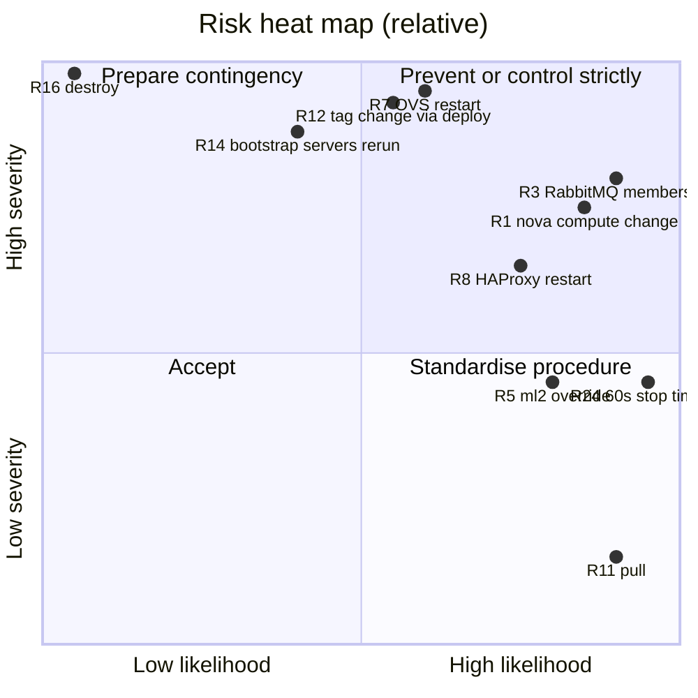

# Risk register

Potentially dangerous operations on a running Kolla-Ansible 2023.1 platform: their impact and the precautions to take
before running them. Ratings are relative to a production cloud with running VMs. The risk IDs are those of the Ussuri
study; each entry says whether the risk still applies to 2023.1, with the code that shows it.

> [!NOTE]
> **Key answers**
>
> - **25 risks (R1–R25)**, each with what actually happens, its blast radius, VM and API impact, likelihood, severity,
>   precautions and evidence ([Matrix](#matrix)).
> - **Rated Critical:** [R7](#r7) (`openvswitch_vswitchd` restart or recreate), [R12](#r12) (changing the image tag and
>   running `deploy` instead of `upgrade`), [R14](#r14) (`bootstrap-servers` re-run on a live host), [R15](#r15)
>   (`kolla-ansible stop`) and [R16](#r16) (`kolla-ansible destroy`).
> - **Computes and VMs:** [R1](#r1). Any config change touching nova-compute, followed by a `deploy`/`reconfigure` with
>   a nova tag or no tag, restarts `nova_compute`, `nova_libvirt` and `nova_ssh` on every affected compute, all at once
>   with the default serial 0; whether live migrations in flight fail and whether running VMs keep running are
>   [NOT AVAILABLE].
> - **Network data plane:** [R6](#r6) (with `enable_neutron_agent_ha: yes`, the L3 agent wrapper runs
>   `neutron-netns-cleanup --force --agent-type l3` before the agent starts) and [R7](#r7); whether VM traffic is
>   interrupted is [NOT AVAILABLE]. [R5](#r5) is narrower in 2023.1: an `ml2_conf.ini` override no longer reaches
>   `openvswitch_agent.ini`.
> - **Changed in 2023.1:** HAProxy restarts backups first, then the VIP holder ([R8](#r8)); MariaDB and RabbitMQ
>   restart in `serial: "33%"` plays ([R9](#r9), [R10](#r10)); containers run under systemd units whose stop timeout
>   is `docker_graceful_timeout` (60 s), so [R24](#r24) no longer holds as written; `common` is its own play with the
>   `common` tag, so [R25](#r25) no longer applies.
> - **Likelihood × severity at a glance:** the [heat map](#heat-map-likelihood--severity).

- **Likelihood** = how likely the operation is to cause the impact *when the triggering condition is present*.
- **Severity** = worst realistic outcome.
- **Evidence** cites the source lines, or the study section that cites them. Nothing was run. [NOT AVAILABLE] marks
  outcomes that the sources do not establish.

## Matrix

| # | Risk | Likelihood | Severity |
|---|---|---|---|
| [R1](#r1) | Config change touching nova-compute | High | High |
| [R2](#r2) | Enabling or disabling a service with a logrotate or fluentd entry | High | Medium–High |
| [R3](#r3) | Changing RabbitMQ membership, password or port | Certain | High |
| [R4](#r4) | Changing memcached membership | Certain | High |
| [R5](#r5) | `ml2_conf.ini` override meant for neutron-server | Certain (neutron-server hosts only) | Medium (High where agents share the neutron-server host) |
| [R6](#r6) | `neutron_l3_agent` restart with `enable_neutron_agent_ha: yes` | Certain (if HA flag) | High |
| [R7](#r7) | `openvswitch_vswitchd` restart or recreate | Certain on image change | Critical |
| [R8](#r8) | HAProxy config change | Certain if changed | High |
| [R9](#r9) | MariaDB config change or image change | Certain if changed | High |
| [R10](#r10) | RabbitMQ image change (`upgrade`) | Certain on upgrade | Medium–High |
| [R11](#r11) | `kolla-ansible pull` | – | Low (bandwidth) |
| [R12](#r12) | Image tag change run with `deploy` instead of `upgrade` | Certain | Critical |
| [R13](#r13) | Rebuilt image under the same tag, then `deploy`/`reconfigure` without `pull` | – | Medium (drift) |
| [R14](#r14) | `bootstrap-servers` re-run on a live host | Medium | Critical |
| [R15](#r15) | `kolla-ansible stop` | Certain | Critical |
| [R16](#r16) | `kolla-ansible destroy` | Certain | Critical |
| [R17](#r17) | `prune-images` | Low | Low |
| [R18](#r18) | `mariadb_recovery` | Certain | High |
| [R19](#r19) | Keystone `reconfigure` | Certain if changed | Medium–High |
| [R20](#r20) | Glance reconfigure / deploy | Certain | Medium |
| [R21](#r21) | Enabling Swift (or `glance_backend_ceph`) on a running cloud | High | High |
| [R22](#r22) | Inventory reordering | Medium | High |
| [R23](#r23) | Any run with `--limit` on a large inventory | Certain | Low (time), Medium (drift) |
| [R24](#r24) | Effective container stop timeout is 10 s (60 s in 2023.1) | Certain | Medium |
| [R25](#r25) | `-t common` believed to reconfigure fluentd/cron | Does not apply in 2023.1 | – |

### R1 — Config change touching nova-compute

**Still applies to 2023.1** [CODE].

| | |
|---|---|
| **Operation / trigger** | Any config change touching **nova-compute** (override, global flag, password, RabbitMQ list) followed by `deploy`/`reconfigure` with a nova tag or no tag |
| **What actually happens** | `nova_compute` **and `nova_libvirt` and `nova_ssh`** restart on every affected compute, **all at once** (serial 0). The cause is the loop-notify behaviour: `Check nova-cell containers` loops over `nova_cell_services` with `notify: "Restart {{ item.key }} container"`, and ansible-core notifies every item's handler when the task as a whole is changed. `nova_libvirt` is a container only when `enable_nova_libvirt_container` is true, which is the default for `nova_compute_virt_type` `kvm`/`qemu`; with a host libvirt (other virt types) there is no `nova_libvirt` restart |
| **Blast radius** | all computes |
| **VM impact** | libvirtd restart (container `nova_libvirt`, retried up to 5 times: "when guests running, nova_libvirt will raise error even though it is removed"); [NOT AVAILABLE] whether live migrations in flight fail and whether running VMs keep running |
| **API impact** | nova-compute restarts on each host; [NOT AVAILABLE] how long it is down |
| **Likelihood** | High |
| **Severity** | High |
| **Precautions** | `genconfig` + `diff`, then `deploy-containers --limit` in batches, or `ANSIBLE_SERIAL`; drain live migrations first; validate libvirt restart behaviour in staging |
| **Evidence** | `roles/nova-cell/tasks/check-containers.yml:2-21`, `roles/nova-cell/defaults/main.yml:3-63`, `roles/nova-cell/handlers/main.yml:74-168`, `group_vars/all.yml:731,1031`, `nova.yml:117-136` (`serial: '{{ kolla_serial\|default("0") }}'`); ansible-core 2.14.18 `lib/ansible/executor/playbook_executor.py:300-302` (serial 0 = one batch), `lib/ansible/executor/task_executor.py:128` and `lib/ansible/plugins/strategy/__init__.py:614-621` (one changed item marks the loop changed, then every item's `_ansible_notify` is processed); [Tags §2.4](tags.md#24-loop-notify-one-changed-item-notifies-the-handlers-of-all-items-code); [Nova deep dive §5](../components/nova-deep-dive.md#5-nova-libvirt-why-its-restart-is-special) |

### R2 — Enabling or disabling a service with a logrotate or fluentd entry

**Still applies to 2023.1, with a different reach** [CODE]: `common` is no longer pulled in by every service play. It is
its own play, tagged `common` only, on the `cron`, `fluentd`, `kolla-logs` and `kolla-toolbox` groups.

| | |
|---|---|
| **Operation / trigger** | Enabling or disabling a service that has a fluentd input entry (`fluentd_input_openstack_services`, e.g. barbican) or a logrotate entry (`enable_X` for most services) in `globals.yml`, then running the `common` play (an untagged run, or `-t common`) |
| **What actually happens** | `td-agent.conf` (its `00-global` input lists the enabled OpenStack services) and `logrotate.conf` render differently on **every host of the `common` play** → `Restart fluentd container` / `Restart cron container`; then `Check common containers` (`compare_container` runs `kolla_set_configs --check` in each container) reports changed and loop-notify also notifies **`kolla_toolbox`**. With the `multinode` inventory these are the `control`, `network`, `compute`, `storage` and `monitoring` hosts. A tagged service run (`-t nova`) does **not** run the `common` play: the files keep the old content until a later untagged or `-t common` run. Nova/Cinder/Glance configs gain sections (e.g. `[barbican]`) → those services restart when their play runs. Flags in neither list (e.g. `enable_ovn`, `enable_memcached`, `enable_redis`) leave both files unchanged; unlike Ussuri, `enable_prometheus`, `enable_openvswitch` and `enable_placement` now have logrotate entries, and `enable_prometheus_fluentd_integration` adds a fluentd input |
| **Blast radius** | fleet-wide (untagged run or `-t common`); none for fluentd/cron on a tagged service run |
| **VM impact** | fluentd, cron and kolla_toolbox are none of the containers that [Tags §3.1](tags.md#31-per-tag-answers-files-vms-apis-networkingstorage-safety-prerequisites) traces to running VMs [CODE]; [NOT AVAILABLE] whether their restart affects VMs another way ([Apply `common` changes (fluentd, cron, kolla_toolbox) §3](../operations/apply-common-changes.md#3-how-common-actually-reaches-hosts)); Nova restarts as R1 |
| **API impact** | the services whose configs changed restart (stop with the `docker_graceful_timeout` of 60 s, then start; [R24](#r24)); [NOT AVAILABLE] how long their APIs are unavailable, and whether the fluentd, cron and kolla_toolbox restarts affect APIs ([Apply `common` changes (fluentd, cron, kolla_toolbox) §3](../operations/apply-common-changes.md#3-how-common-actually-reaches-hosts)) |
| **Likelihood** | High |
| **Severity** | Medium–High |
| **Precautions** | Treat `enable_*` changes as fleet-wide changes. Roll out with `--limit` batches; apply the `common` side deliberately with `-t common` |
| **Evidence** | `site.yml:86-97` (`Apply role common`, hosts `cron`/`fluentd`/`kolla-logs`/`kolla-toolbox`, `tags: common`); `inventory/multinode:48-53,239-249`; `roles/common/tasks/config.yml:77-136` (td-agent.conf), `:138-209` (logrotate.conf), `roles/common/defaults/main.yml:138-202` (fluentd service list), `roles/common/tasks/check-containers.yml:2-17`, `roles/common/tasks/deploy.yml`; `module_utils/kolla_container_worker.py:20,59-66`, `module_utils/kolla_docker_worker.py:155-190` (config check); loop-notify ([Tags §2.4](tags.md#24-loop-notify-one-changed-item-notifies-the-handlers-of-all-items-code)); `roles/nova-cell/templates/nova.conf.j2:246-251`, `nova.yml:117-136` |

### R3 — Changing RabbitMQ membership, password or port

**Still applies to 2023.1** [CODE].

| | |
|---|---|
| **Operation / trigger** | Changing RabbitMQ group membership (adding/removing a controller), RabbitMQ password or port |
| **What actually happens** | `rpc_transport_url` and `notify_transport_url` (one entry per host of the `rabbitmq` group, with user, password and port) change in **every** messaging service on every host → all nova, neutron (and any compute-side agent) containers restart; `Update cell` rewrites the cell's MQ URL when it differs |
| **Blast radius** | all hosts |
| **VM impact** | as R1 plus neutron agent restart; [NOT AVAILABLE] its effect on flows |
| **API impact** | yes |
| **Likelihood** | Certain |
| **Severity** | High |
| **Precautions** | Plan as a maintenance; batch with `--limit`; verify RabbitMQ cluster health first |
| **Evidence** | `group_vars/all.yml:204-212,222`; `roles/nova-cell/tasks/create_cells.yml:31-55`; loop-notify ([Tags §2.4](tags.md#24-loop-notify-one-changed-item-notifies-the-handlers-of-all-items-code)) |

### R4 — Changing memcached membership

**Still applies to 2023.1** [CODE].

| | |
|---|---|
| **Operation / trigger** | Changing memcached membership |
| **What actually happens** | 34 roles loop over `groups['memcached']` in their templates or defaults (grep of `groups['memcached']` in `roles/*/templates` and `roles/*/defaults`; [fact sheet B §3.10](../reference/factsheets/b-mariadb-rabbitmq-keystone.md#310-runtime-dependency-of-other-services-on-keystone-grep-across-ansiblerolestemplates) and [Per-role fact sheets](../reference/factsheets/index.md) give the Ussuri counts), so their services restart when their plays run; [NOT AVAILABLE] whether cached tokens are lost. Not only the control plane: `neutron.conf` is rendered for every neutron agent, so `neutron_openvswitch_agent` restarts on every compute and network node, and the dhcp, l3 and metadata agents, which get the same file, restart on network nodes; `cinder.conf` reaches every cinder service (cinder-volume/backup included) and `ceilometer.conf` every ceilometer service (ceilometer-compute included). Compute `nova.conf` (nova-cell) has no memcached list |
| **Blast radius** | controllers + network nodes + all computes (+ storage) |
| **VM impact** | OVS agent restart; [NOT AVAILABLE] its effect on flows, and whether router/DHCP traffic is interrupted on network nodes; with `enable_neutron_agent_ha`, the R6 netns cleanup |
| **API impact** | memcached server list changes; [NOT AVAILABLE] effect on auth latency and Horizon sessions |
| **Likelihood** | Certain |
| **Severity** | High |
| **Precautions** | Plan as a dataplane change, like R3: batch with `--limit` or `ANSIBLE_SERIAL`, network nodes one at a time; low-traffic window |
| **Evidence** | [fact sheet B §3.9](../reference/factsheets/b-mariadb-rabbitmq-keystone.md#39-operationally-notable-behaviour-risks-and-oddities) item 2, [§3.10](../reference/factsheets/b-mariadb-rabbitmq-keystone.md#310-runtime-dependency-of-other-services-on-keystone-grep-across-ansiblerolestemplates); `roles/neutron/templates/neutron.conf.j2:125`, `roles/neutron/tasks/config.yml:87-122`; `roles/cinder/tasks/config.yml:75-93`, `roles/cinder/templates/cinder.conf.j2:127`; `roles/ceilometer/tasks/config.yml:196-214`, `roles/ceilometer/templates/ceilometer.conf.j2:59` |

### R5 — `ml2_conf.ini` override meant for neutron-server

**Narrower in 2023.1** [CODE]: `ml2_conf.ini` is rendered only for `neutron-server` and `neutron-infoblox-ipam-agent`;
`openvswitch_agent.ini` has its own template and its own override files, so an `ml2_conf.ini` override no longer
reaches the OVS agents.

| | |
|---|---|
| **Operation / trigger** | `/etc/kolla/config/neutron/ml2_conf.ini` override (meant for neutron-server) |
| **What actually happens** | `neutron_server` (and `neutron_infoblox_ipam_agent` if enabled) restarts. On a host that also runs neutron agents (e.g. control and network roles on the same host), loop-notify in `Check neutron containers` also restarts every neutron container of that host, the OVS, dhcp, l3 and metadata agents included. OVS agents on hosts without neutron-server are not touched by this override. The OVS agent override is now `neutron/openvswitch_agent.ini` |
| **Blast radius** | neutron-server hosts (and the agents that share them) |
| **VM impact** | none on hosts without neutron-server; where agents share the host: OVS agent restart, [NOT AVAILABLE] its effect on flows, and whether router/DHCP traffic is interrupted |
| **API impact** | neutron-server restart |
| **Likelihood** | Certain (neutron-server hosts only) |
| **Severity** | Medium (High where agents share the neutron-server host) |
| **Precautions** | Put server-only options in `neutron/neutron-server.conf` or `neutron/ml2_conf.ini`; agent options in `neutron/openvswitch_agent.ini`; check the rendered diff |
| **Evidence** | `roles/neutron/tasks/config.yml:158-178` (`services_need_ml2_conf_ini`), `:197-212` (`openvswitch_agent.ini`), `roles/neutron/tasks/check-containers.yml:2-19` (loop-notify, [Tags §2.4](tags.md#24-loop-notify-one-changed-item-notifies-the-handlers-of-all-items-code)) |

### R6 — `neutron_l3_agent` restart with `enable_neutron_agent_ha: yes`

**Still applies to 2023.1** [CODE]; 2023.1 adds `neutron_l3_agent_failover_delay` to stagger the restarts.

| | |
|---|---|
| **Operation / trigger** | Any restart of `neutron_l3_agent` with `enable_neutron_agent_ha: yes` (default `no`) |
| **What actually happens** | the wrapper runs `neutron-netns-cleanup --force --agent-type l3` **before** the agent starts (the wrapper's comment: "Remove all l3 related netns in case of multiple active routers in l3 high available mode"), then `neutron-l3-agent` starts [CODE]. The handler first starts stopped agents, then restarts running agents in a loop over the hosts of `neutron_l3_agent_running_True`, pausing `neutron_l3_agent_failover_delay` seconds between items (default `0`) [CODE]. [NOT AVAILABLE] What the command deletes: it is neutron code, which is not in these sources ([F12](../reference/findings.md#f12)) |
| **Blast radius** | network nodes (and computes with `enable_neutron_dvr`) |
| **VM impact** | [NOT AVAILABLE] whether north-south and floating-IP traffic of the routers on that node stops, whether and when `neutron-l3-agent` rebuilds the namespaces, and whether HA routers fail over |
| **API impact** | none |
| **Likelihood** | Certain (if HA flag) |
| **Severity** | High |
| **Precautions** | Restart network nodes one at a time; fail routers over first; set `neutron_l3_agent_failover_delay` to space the restarts |
| **Evidence** | `roles/neutron/templates/neutron-l3-agent-wrapper.sh.j2:5-16`; `group_vars/all.yml:721`; `roles/neutron/handlers/main.yml:90-157`, `roles/neutron/defaults/main.yml:77-88,631-633` |

### R7 — `openvswitch_vswitchd` restart or recreate

**Still applies to 2023.1** [CODE].

| | |
|---|---|
| **Operation / trigger** | `openvswitch_vswitchd` restart or recreate (image change, `start-ovs` change, `-t openvswitch` with a changed image; also any `openvswitch_db`-only drift, e.g. a `start-ovsdb-server` change or a db image, volume or dimension change: `check-containers` loops over both OVS services, so loop-notify ([Tags §2.4](tags.md#24-loop-notify-one-changed-item-notifies-the-handlers-of-all-items-code)) also notifies the vswitchd handler, which runs after the db restart and wait) |
| **What actually happens** | `ovs-vswitchd` (the userspace daemon) restarts. The image only runs `modprobe openvswitch` (the kernel module is loaded, never unloaded or reloaded), and `start-ovs` launches `ovs-vswitchd` with no flow save/restore. Bridges and ports persist in `conf.db` on the `openvswitch_db` volume. [NOT AVAILABLE] Whether the OpenFlow tables held by the old daemon are lost, and whether `neutron-openvswitch-agent` (or `ovn-controller` with OVN) reprograms them |
| **Blast radius** | per host (all OVS hosts at once with serial 0) |
| **VM impact** | [NOT AVAILABLE] whether **all VM network traffic on the host** is interrupted until flows are restored, and for how long |
| **API impact** | none |
| **Likelihood** | Certain on image change |
| **Severity** | Critical |
| **Precautions** | Upgrade or recreate OVS host by host with evacuation or acceptance; never fleet-wide with serial 0 |
| **Evidence** | `roles/openvswitch/handlers/main.yml:2-44`, `roles/openvswitch/tasks/check-containers.yml:2-18`, `roles/openvswitch/templates/start-ovs.j2:2`, `roles/openvswitch/defaults/main.yml:86`; kolla `docker/openvswitch/openvswitch-vswitchd/extend_start.sh:3`; [Kolla images §5](../concepts/kolla-images.md#5-per-image-start-behaviour) |

### R8 — HAProxy config change

**Still applies to 2023.1, with a staged restart** [CODE]: the `loadbalancer` role replaces the Ussuri `haproxy`
role, and its handlers restart the backups before the node that holds the VIP.

| | |
|---|---|
| **Operation / trigger** | HAProxy config change (any service frontend via `haproxy-config`, certs, `haproxy.cfg`) |
| **What actually happens** | `haproxy` is **stopped and started** (never reloaded). The handlers first find which host holds `kolla_internal_vip_address`; every backup host stops and restarts `haproxy` (all backups at once) and waits for `haproxy_monitor_port`; then the VIP holder stops `haproxy`, starts it and waits for the port. On a haproxy-only change keepalived is not stopped, so the VIP stays on a node whose haproxy is down until it is back; keepalived runs a `check_alive` track script (interval 2, fall 2) by default. [NOT AVAILABLE] whether that script moves the VIP during the master restart, and for how long the APIs are unreachable |
| **Blast radius** | all APIs + **all DB traffic** (`database_address` is `kolla_internal_fqdn`; `enable_proxysql` defaults to `no`) |
| **VM impact** | none directly; [NOT AVAILABLE] whether nova/neutron get DB errors while haproxy restarts |
| **API impact** | yes |
| **Likelihood** | Certain if changed |
| **Severity** | High |
| **Precautions** | `ANSIBLE_SERIAL=1` for haproxy changes; `--skip-tags haproxy` when you don't intend to change frontends |
| **Evidence** | `roles/loadbalancer/handlers/main.yml:1-34` (VIP lookup), `:54-68,90-118` (backups), `:179-193,224-252` (master), `:210-222` (master keepalived stopped only on `Restart keepalived container`); `roles/haproxy-config/tasks/main.yml:14-23`; `site.yml:99-110`; `roles/loadbalancer/templates/keepalived/keepalived.conf.j2:1-5,15`, `roles/loadbalancer/defaults/main.yml:152`; `group_vars/all.yml:83,622-624,742`; [fact sheet A §1.8](../reference/factsheets/a-infra-lb-ovn.md#18-operationally-notable-behaviour) |

### R9 — MariaDB config change or image change

**Still applies to 2023.1, with a different restart mechanism** [CODE]: the handlers only group hosts; the restart is a
separate play with `serial: "33%"`.

| | |
|---|---|
| **Operation / trigger** | MariaDB config change or image change |
| **What actually happens** | `restart mariadb` puts running nodes in group `mariadb_restart` and new nodes in `mariadb_start`. The `Restart mariadb services` play then restarts them in batches of `int(33% × hosts)` or at least 1 (one node at a time for 3 nodes); each node waits up to 10 × 6 s for its port and for WSREP `Synced`. If every host of a batch fails, ansible-core stops the playbook, so later batches are not restarted. HAProxy's single active backend is the first host of the default shard (the others are `backup`). [NOT AVAILABLE] In which order `group_by` places the hosts, hence whether the active backend restarts first |
| **Blast radius** | DB cluster |
| **VM impact** | none directly |
| **API impact** | DB connection resets |
| **Likelihood** | Certain if changed |
| **Severity** | High |
| **Precautions** | Check `wsrep_cluster_size` and `Synced` on all nodes before; take a backup (`mariadb_backup`); watch between batches |
| **Evidence** | `roles/mariadb/handlers/main.yml:56-73`, `mariadb.yml:14-52`, `roles/mariadb/tasks/restart_services.yml:2-51`, `roles/mariadb/defaults/main.yml:64`, `group_vars/all.yml:395`; ansible-core 2.14.18 `lib/ansible/utils/helpers.py:25-32` (percentage → `int(...) or 1`), `lib/ansible/executor/playbook_executor.py:207-208,218-219` (a fully failed batch ends the playbook); [fact sheet B §1.2](../reference/factsheets/b-mariadb-rabbitmq-keystone.md#12-mariadb_services-ansiblerolesmariadbdefaultsmainyml2-47), [§1.5](../reference/factsheets/b-mariadb-rabbitmq-keystone.md#15-handlers-ansiblerolesmariadbhandlersmainyml-in-definition-order), [§1.8](../reference/factsheets/b-mariadb-rabbitmq-keystone.md#18-operationally-notable-behaviour-risks-and-oddities) |

### R10 — RabbitMQ image change (`upgrade`)

**Changed in 2023.1** [CODE]: `upgrade` no longer stops all brokers; it renders the config, enables feature flags and
then restarts the brokers in `serial: "33%"` batches, draining each one first.

| | |
|---|---|
| **Operation / trigger** | RabbitMQ image change (`upgrade`), or `kolla-ansible rabbitmq-upgrade` |
| **What actually happens** | `upgrade.yml` runs `config`, `feature-flags` and `check-containers`; the restart handler only adds the host to `rabbitmq_restart`. The `Restart rabbitmq services` play then, per batch of `int(33% × hosts)` or at least 1, puts the node into maintenance mode (`rabbitmq_upgrade` `drain`), recreates the container and waits with `rabbitmqctl wait --timeout 60`. Without `om_enable_rabbitmq_high_availability`, `upgrade` first removes the `ha-all` policy. [NOT AVAILABLE] whether clients reconnect without errors while a broker is drained |
| **Blast radius** | all RPC |
| **VM impact** | [NOT AVAILABLE] whether nova-compute heartbeats are lost and services are reported down |
| **API impact** | [NOT AVAILABLE] whether API calls fail while a broker restarts |
| **Likelihood** | Certain on upgrade |
| **Severity** | Medium–High |
| **Precautions** | Maintenance window; watch for agent and compute services reported down |
| **Evidence** | `roles/rabbitmq/tasks/upgrade.yml:2-10`, `roles/rabbitmq/handlers/main.yml:2-6`, `rabbitmq.yml:26-41`, `roles/rabbitmq/tasks/restart_services.yml:2-39`, `rabbitmq-upgrade.yml:18-21`; [fact sheet B §2.8](../reference/factsheets/b-mariadb-rabbitmq-keystone.md#28-operationally-notable-behaviour-risks-and-oddities) (Ussuri) |

### R11 — `kolla-ansible pull`

**Still applies to 2023.1** [CODE].

| | |
|---|---|
| **Operation / trigger** | `kolla-ansible pull` |
| **What actually happens** | downloads images on every host: one `pull_image` per enabled container mapped to the host (retried `service_images_pull_retries` times) |
| **Blast radius** | registry + network |
| **VM impact** | none |
| **API impact** | none |
| **Likelihood** | – |
| **Severity** | Low (bandwidth) |
| **Precautions** | Run ahead of maintenance; rate-limit with `--forks`; local registry mirror |
| **Evidence** | `roles/service-images-pull/tasks/main.yml:2-18`; `module_utils/kolla_docker_worker.py:198-232` |

### R12 — Image tag change run with `deploy` instead of `upgrade`

**Still applies to 2023.1** [CODE].

| | |
|---|---|
| **Operation / trigger** | Changing `openstack_tag` / `*_tag` and running `deploy` instead of `upgrade` |
| **What actually happens** | every container is **recreated** (fleet-wide); upgrade-specific steps (RPC pin removal, nova-status check, online migrations except Placement's, which run inside `bootstrap_placement`, and, with the non-default `ironic_enable_rolling_upgrade: no`, Ironic's inside `bootstrap_ironic`) do **not** run. Neutron: instead of the rolling expand → restart → contract (default `neutron_enable_rolling_upgrade: yes`), `bootstrap_neutron` runs `neutron-db-manage … upgrade head` for neutron and for each enabled subproject (`networking-sfc`, `neutron-dynamic-routing`, `neutron-vpnaas`, `vmware-nsx`) with the new image **before** the handlers restart the old `neutron_server` containers; [NOT AVAILABLE] whether `upgrade head` applies the expand and contract branches together, which would run contract migrations under live old-version servers |
| **Blast radius** | fleet-wide |
| **VM impact** | as R1 + R7 + R8 together |
| **API impact** | yes |
| **Likelihood** | Certain |
| **Severity** | Critical |
| **Precautions** | Use `pull` then `upgrade` (2023.1 docs); per-service tags; `ANSIBLE_SERIAL` |
| **Evidence** | `module_utils/kolla_container_worker.py:68-90`, `module_utils/kolla_docker_worker.py:116-132,362-384` (new image → recreate); `doc/source/user/operating-kolla.rst:173-211`; `roles/neutron/tasks/deploy.yml:20-23`, `roles/neutron/tasks/bootstrap_service.yml:2-21`, `roles/neutron/defaults/main.yml:656-664,705,710`, `roles/neutron/tasks/upgrade.yml`, `roles/neutron/tasks/rolling_upgrade.yml:13-89`; kolla `docker/neutron/neutron-server/extend_start.sh:5-13`, `docker/placement/placement-api/extend_start.sh:5-9`, `docker/ironic/ironic-api/extend_start.sh:5-8`; `roles/ironic/tasks/bootstrap_service.yml:16`, `roles/ironic/defaults/main.yml:286`; [Kolla images §4](../concepts/kolla-images.md#4-one-shot-containers-what-the-environment-variables-run) |

### R13 — Rebuilt image under the same tag, then `deploy`/`reconfigure` without `pull`

**Still applies to 2023.1** [CODE].

| | |
|---|---|
| **Operation / trigger** | Rebuilt image pushed under the **same tag**, then `deploy`/`reconfigure` without `pull` |
| **What actually happens** | nothing changes (only absent images are pulled; the comparison uses the local image of that tag). After `pull`: recreate, plus loop-notify restarts |
| **Blast radius** | – / role-wide |
| **VM impact** | as R1 |
| **API impact** | – |
| **Likelihood** | – |
| **Severity** | Medium (drift) |
| **Precautions** | Use immutable tags; always `pull` deliberately |
| **Evidence** | `module_utils/kolla_docker_worker.py:80-89` (local image lookup), `:116-132` (image id compare), `:362-388` (pull only if absent); loop-notify ([Tags §2.4](tags.md#24-loop-notify-one-changed-item-notifies-the-handlers-of-all-items-code)) |

### R14 — `bootstrap-servers` re-run on a live host

**Still applies to 2023.1** [CODE]; the work now comes from ansible-collection-kolla (`openstack.kolla.baremetal`,
which imports `etc_hosts`, `packages`, `docker`, `kolla_user`, `docker_sdk` and `apparmor_libvirt`).

| | |
|---|---|
| **Operation / trigger** | `bootstrap-servers` re-run on a live host |
| **What actually happens** | can **restart the Docker daemon** (if `daemon.json` or the Docker unit changes; `docker_systemd_reload: false` by default, so the handler restarts rather than reloads) → [NOT AVAILABLE] whether every container on the host stops and how the `kolla-<name>-container.service` units bring them back; **all hosts at once** by default. Also disables firewalld/ufw (`disable_firewall: True`), sets SELinux permissive, and removes host packages: on Debian `lxd`, `lxc`, `open-iscsi` and, with the libvirt container, `libvirt-bin`; on RedHat, with the libvirt container, `libvirt`, `libvirt-daemon`, `iscsi-initiator-utils`. `chrony` is no longer removed |
| **Blast radius** | per host / fleet |
| **VM impact** | a Docker restart affects `nova_libvirt` and OVS → see R1/R7 |
| **API impact** | yes |
| **Likelihood** | Medium |
| **Severity** | Critical |
| **Precautions** | Run only with `--limit` on new hosts, or `-e kolla_serial=1`; diff `daemon.json` first |
| **Evidence** | `kolla-host.yml:4-10`; `tools/kolla-ansible:471-475`; ansible-collection-kolla `roles/baremetal/tasks/main.yml:2-9`, `roles/baremetal/tasks/install.yml:2-38`, `roles/baremetal/tasks/post-install.yml:21-27`, `roles/baremetal/defaults/main.yml:26-31`, `roles/packages/tasks/main.yml:15-22`, `roles/packages/defaults/main.yml:24-33`, `roles/docker/tasks/config.yml:36-47`, `roles/docker/handlers/main.yml:2-15`, `roles/docker/defaults/main.yml:63`; `module_utils/kolla_systemd_worker.py:20-39`; [fact sheet E §1–2](../reference/factsheets/e-host-bootstrap-ops-playbooks.md#1-ansiblekolla-hostyml-the-bootstrap-servers-command) (Ussuri) |

### R15 — `kolla-ansible stop`

**Still applies to 2023.1** [CODE].

| | |
|---|---|
| **Operation / trigger** | `kolla-ansible stop --yes-i-really-really-mean-it` |
| **What actually happens** | stops all Kolla containers (incl. nova_libvirt, OVS, MariaDB) on targeted hosts, except those named in `skip_stop_containers`; each stop goes through the container's systemd unit when it exists |
| **Blast radius** | targeted hosts |
| **VM impact** | `nova_libvirt` and OVS containers stopped; [NOT AVAILABLE] whether VM network traffic stops (see R7) |
| **API impact** | yes |
| **Likelihood** | Certain |
| **Severity** | Critical |
| **Precautions** | Use `--limit` + tags + `skip_stop_containers`; MariaDB then needs `mariadb_recovery` |
| **Evidence** | `tools/kolla-ansible:519-531`; `roles/service-stop/tasks/main.yml:2-12`; `module_utils/kolla_docker_worker.py:436-452`; [fact sheet B §1.3](../reference/factsheets/b-mariadb-rabbitmq-keystone.md#13-task-flow-per-kolla_action) (stop), [§1.8](../reference/factsheets/b-mariadb-rabbitmq-keystone.md#18-operationally-notable-behaviour-risks-and-oddities) item 4 |

### R16 — `kolla-ansible destroy`

**Still applies to 2023.1** [CODE].

| | |
|---|---|
| **Operation / trigger** | `kolla-ansible destroy --yes-i-really-really-mean-it` |
| **What actually happens** | stops and removes containers and their `kolla-*-container.service` units, volumes, `/etc/kolla/*` (except a few files), **all network namespaces and tap/brq/vxlan links** (`tools/cleanup-host`) |
| **Blast radius** | targeted hosts incl. deploy host (`hosts: all`) |
| **VM impact** | total |
| **API impact** | total |
| **Likelihood** | Certain |
| **Severity** | Critical |
| **Precautions** | Never on production; there is no `--limit` safety net beyond what you pass |
| **Evidence** | `destroy.yml:2-5`; `tools/kolla-ansible:452-470`; `roles/destroy/tasks/cleanup_containers.yml:2-3`, `roles/destroy/tasks/cleanup_host.yml`; `tools/cleanup-containers:45,57,63`, `tools/cleanup-host:5-22,71-88`; [fact sheet E §6](../reference/factsheets/e-host-bootstrap-ops-playbooks.md#6-destroy-ansibledestroyyml-role-destroy-toolscleanup-) |

### R17 — `prune-images`

**Still applies to 2023.1** [CODE].

| | |
|---|---|
| **Operation / trigger** | `prune-images --yes-i-really-really-mean-it` |
| **What actually happens** | runs `docker_prune` with `images: yes` and the filter `label: kolla_version` on the `baremetal` hosts. [NOT AVAILABLE] Whether only *dangling* images are removed: that is the default of the `docker_prune` module (community.docker), which is not in these sources |
| **Blast radius** | per host |
| **VM impact** | none |
| **API impact** | none |
| **Likelihood** | Low |
| **Severity** | Low |
| **Precautions** | – |
| **Evidence** | `tools/kolla-ansible:548-559`; `prune-images.yml:4-9`; `roles/prune-images/tasks/prune_images.yml:2-8`; [fact sheet E §7](../reference/factsheets/e-host-bootstrap-ops-playbooks.md#7-prune-images-ansibleprune-imagesyml-role-prune-images) |

### R18 — `mariadb_recovery`

**Still applies to 2023.1** [CODE].

| | |
|---|---|
| **Operation / trigger** | `mariadb_recovery` |
| **What actually happens** | **stops every MariaDB node**, even healthy ones, runs a wsrep recovery container on each, and bootstraps from the host with the highest seqno |
| **Blast radius** | DB cluster |
| **VM impact** | none directly |
| **API impact** | full DB outage |
| **Likelihood** | Certain |
| **Severity** | High |
| **Precautions** | Only when the cluster is fully down; identify the node with the highest seqno manually first |
| **Evidence** | `mariadb_recovery.yml:2-9`; `roles/mariadb/tasks/recover_cluster.yml:18-95`; [fact sheet B §1.3](../reference/factsheets/b-mariadb-rabbitmq-keystone.md#13-task-flow-per-kolla_action) (Recovery step 3), [§1.8](../reference/factsheets/b-mariadb-rabbitmq-keystone.md#18-operationally-notable-behaviour-risks-and-oddities) item 5 |

### R19 — Keystone `reconfigure`

**Still applies to 2023.1** [CODE].

| | |
|---|---|
| **Operation / trigger** | Keystone `reconfigure` (any keystone change, including memcached/RabbitMQ membership) |
| **What actually happens** | all keystone containers restart on all hosts at once (serial 0); fernet keys are pushed with `rsync --delete` from the first host where `keystone_fernet` runs (else the first keystone host), deleting others' keys; the bootstrap container (db sync) runs once |
| **Blast radius** | identity |
| **VM impact** | none |
| **API impact** | [NOT AVAILABLE] whether authentication fails while keystone restarts |
| **Likelihood** | Certain if changed |
| **Severity** | Medium–High |
| **Precautions** | `ANSIBLE_SERIAL`; verify fernet key consistency before and after |
| **Evidence** | `site.yml:450-458`; `roles/keystone/tasks/deploy.yml`, `roles/keystone/tasks/bootstrap_service.yml:32-49`, `roles/keystone/tasks/distribute_fernet.yml:12-18`, `roles/keystone/templates/fernet-push.sh.j2:20`, `roles/keystone/handlers/main.yml:2-96`; [fact sheet B §3.5](../reference/factsheets/b-mariadb-rabbitmq-keystone.md#35-handlers-ansibleroleskeystonehandlersmainyml-order-is-load-bearing-comment-2-3), [§3.6](../reference/factsheets/b-mariadb-rabbitmq-keystone.md#36-fernet-key-lifecycle-fact-unless-marked), [§3.7](../reference/factsheets/b-mariadb-rabbitmq-keystone.md#37-bootstrap-db-and-registration-what-re-runs-on-reconfigure), [§3.9](../reference/factsheets/b-mariadb-rabbitmq-keystone.md#39-operationally-notable-behaviour-risks-and-oddities) items 1–2 |

### R20 — Glance reconfigure / deploy

**Still applies to 2023.1** [CODE].

| | |
|---|---|
| **Operation / trigger** | Glance reconfigure / deploy |
| **What actually happens** | toggles **global** MariaDB `log_bin_trust_function_creators` 1→0 around db sync (unless `use_preconfigured_databases`); with the file backend on the default named volume (`glance_file_datadir_volume: "glance"`) only the first `glance-api` host runs glance-api → any restart is a full Image API outage |
| **Blast radius** | DB + glance |
| **VM impact** | [NOT AVAILABLE] whether snapshots in progress fail |
| **API impact** | Image API outage |
| **Likelihood** | Certain |
| **Severity** | Medium |
| **Precautions** | Avoid during image-heavy operations |
| **Evidence** | `roles/glance/tasks/bootstrap_service.yml:2-54`; `group_vars/all.yml:906,911,915`; `roles/glance/defaults/main.yml:6,84`; [fact sheet C §1](../reference/factsheets/c-glance-placement-cinder-horizon-heat.md#1-glance) |

### R21 — Enabling Swift (or `glance_backend_ceph`) on a running cloud

**Still applies to 2023.1** [CODE].

| | |
|---|---|
| **Operation / trigger** | Enabling Swift (or `glance_backend_ceph`) on a running cloud |
| **What actually happens** | silently switches Glance's backend (`glance_backend_swift` follows `enable_swift`, and `glance_backend_file` becomes false); [NOT AVAILABLE] whether existing file-store images stay readable |
| **Blast radius** | glance |
| **VM impact** | [NOT AVAILABLE] whether boots from existing images fail |
| **API impact** | yes |
| **Likelihood** | High |
| **Severity** | High |
| **Precautions** | Set `glance_backend_*` explicitly before enabling Swift |
| **Evidence** | `group_vars/all.yml:906-910`; [fact sheet C §1.8](../reference/factsheets/c-glance-placement-cinder-horizon-heat.md#18-operational-notes) |

### R22 — Inventory reordering

**Still applies to 2023.1** [CODE].

| | |
|---|---|
| **Operation / trigger** | Inventory reordering (loadbalancer, mariadb, glance, nova-conductor, keystone groups) |
| **What actually happens** | keepalived priorities change (priority = position in `loadbalancer` + 1); the MariaDB active HAProxy backend moves (first host of the default shard); glance moves (file backend: first `glance-api` host); bootstrap/discovery targets (`groups[...][0]`, e.g. cell creation on the first nova-conductor host, fernet push fallback to the first keystone host) change |
| **Blast radius** | per group |
| **VM impact** | indirect |
| **API impact** | possible |
| **Likelihood** | Medium |
| **Severity** | High |
| **Precautions** | Treat inventory order as configuration; never reorder casually |
| **Evidence** | `roles/loadbalancer/templates/keepalived/keepalived.conf.j2:15`; `roles/mariadb/defaults/main.yml:64`, `group_vars/all.yml:395,915`; `roles/nova-cell/tasks/create_cells.yml:4,28`; `roles/keystone/tasks/distribute_fernet.yml:16-18`; fact sheets [A §1.8](../reference/factsheets/a-infra-lb-ovn.md#18-operationally-notable-behaviour), [B §1.2](../reference/factsheets/b-mariadb-rabbitmq-keystone.md#12-mariadb_services-ansiblerolesmariadbdefaultsmainyml2-47), [§1.5](../reference/factsheets/b-mariadb-rabbitmq-keystone.md#15-handlers-ansiblerolesmariadbhandlersmainyml-in-definition-order), [C §1](../reference/factsheets/c-glance-placement-cinder-horizon-heat.md#1-glance) |

### R23 — Any run with `--limit` on a large inventory

**Still applies to 2023.1** [CODE].

| | |
|---|---|
| **Operation / trigger** | Any run **with `--limit`** on a large inventory |
| **What actually happens** | fact gathering for **all** hosts is executed **sequentially** by the limited hosts (delegated loop) → long runtime; cross-host files are not updated on non-limited hosts |
| **Blast radius** | – |
| **VM impact** | none |
| **API impact** | none |
| **Likelihood** | Certain |
| **Severity** | Low (time), Medium (drift) |
| **Precautions** | Enable fact caching (`ansible-tuning.rst`); follow up with a full run when cross-host config changed |
| **Evidence** | `gather-facts.yml:30-54` (each limited host loops over its share of `groups['all']`: one delegated `setup` per host without facts); ansible-core 2.14.18 `lib/ansible/executor/task_executor.py:287-381` (loop items run one after another) |

### R24 — Effective container stop timeout is 10 s

**No longer holds as written in 2023.1** [CODE]: containers (except one-shot ones) run under a systemd unit
`kolla-<name>-container.service` whose `ExecStop` is `docker stop <name> -t <graceful_timeout>`, and `graceful_timeout`
comes from `docker_common_options`, i.e. `docker_graceful_timeout` (60 s). The 10 s value remains only as the module
default when no `graceful_timeout` is passed, which plays using `docker_common_options` do not hit.

| | |
|---|---|
| **Operation / trigger** | Any container restart or stop (`recreate_or_restart_container`, `restart_container`, `stop_container`) |
| **What actually happens** | the restart goes through systemd `RestartUnit`/`StopUnit`; `docker stop -t 60` sends SIGTERM and kills a service still running after 60 s (heat-engine, cinder-volume copies, glance uploads); the module waits up to `client_timeout` (`docker_client_timeout`: 120 s) for the unit state and fails with "Container timed out" otherwise. A stop uses the timeout written in the existing unit file; a restart rewrites the unit first. [NOT AVAILABLE] systemd's own stop timeout for these units (the unit sets none, and systemd defaults are not in these sources). [NOT AVAILABLE] Whether services started by a shell wrapper that does not `exec` them (e.g. `neutron-l3-agent`, `haproxy`, `ovs-vswitchd`, `ovsdb-server`) receive SIGTERM at all ([Kolla images §2.6](../concepts/kolla-images.md#26-signals-and-pid-1)) |
| **Blast radius** | all restarts |
| **VM impact** | in-flight operations killed after 60 s |
| **API impact** | – |
| **Likelihood** | Certain |
| **Severity** | Medium |
| **Precautions** | Drain long operations before restarts; raise `docker_graceful_timeout` if needed (it reaches the unit on the next restart) |
| **Evidence** | `module_utils/kolla_systemd_worker.py:20-39,44-82,91-118,149-180`; `module_utils/kolla_docker_worker.py:362-384,436-481`; `library/kolla_docker.py:351-382`; `group_vars/all.yml:105,139-153`; [Repository architecture §6](../concepts/repository-architecture.md#6-custom-modules--container-lifecycle-via-kolla_docker); kolla `docker/base/Dockerfile.j2:353`, `docker/base/start.sh:24`; `roles/neutron/templates/neutron-l3-agent-wrapper.sh.j2:13`, `roles/openvswitch/templates/start-ovs.j2:2` |

### R25 — `-t common` believed to reconfigure fluentd/cron

**Does not apply to 2023.1** [CODE]: `common` is no longer a role dependency reached through a dynamic include; it is
the `Apply role common` play in `site.yml`, with play-level `tags: common`, so `-t common` runs its tasks on the
`cron`, `fluentd`, `kolla-logs` and `kolla-toolbox` hosts. The `chrony` role (the Ussuri workaround `-t chrony`) does
not exist in 2023.1.

| | |
|---|---|
| **Operation / trigger** | `-t common` believed to reconfigure fluentd/cron |
| **What actually happens** | `-t common` does reconfigure fluentd, cron and kolla_toolbox (config → check-containers → handlers). The reverse surprise exists instead: a tagged service run (e.g. `-t nova`) does not run the `common` play, so a fluentd/logrotate change waits for an untagged or `-t common` run ([R2](#r2)) |
| **Blast radius** | the `common` hosts |
| **VM impact** | – |
| **API impact** | – |
| **Likelihood** | Does not apply in 2023.1 |
| **Severity** | – |
| **Precautions** | Use `-t common` to apply fluentd/cron changes; verify with `docker exec … kolla_set_configs --check` |
| **Evidence** | `site.yml:86-97`; `roles/common/tasks/main.yml:1-2`, `roles/common/tasks/deploy.yml`; [Tags §2.1](tags.md#21-dynamic-include_tasks-and-tag-inheritance-code) |

## Heat map (likelihood × severity)

R25 is left out of the heat map: it does not apply to 2023.1.

## Related

- [Operations](../operations/index.md) — the scenario walk-throughs and the commands
- [Pre-execution checklist](../operations/pre-execution-checklist.md) — what to check before a run
- [Open questions](../troubleshooting/open-questions.md) — the open questions behind the [NOT AVAILABLE] cells
- [Tag index](tag-index.md) — from a tag to its component page, which lists the risks of the tag
- [What a tag really executes](tags.md) — loop-notify and the other tag semantics that the evidence cells cite
