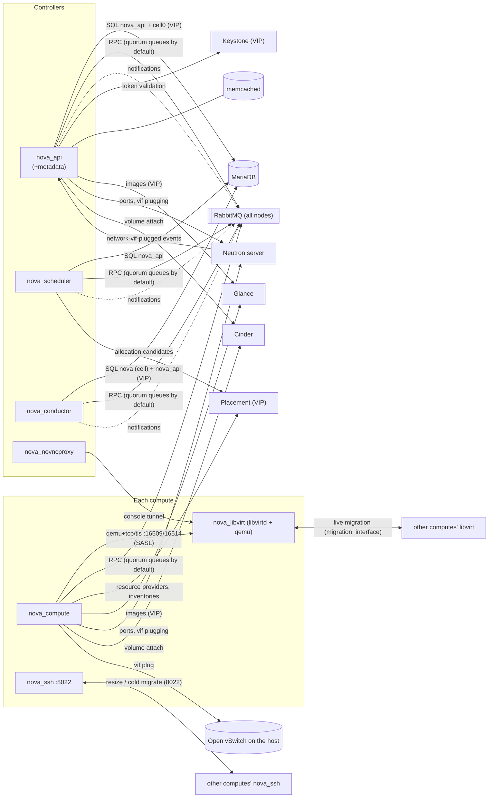

# Nova deep dive

Nova is split into two roles and ten plays. It is the component with the most hosts (every compute), the most coupling
(Glance, Neutron, Placement, Cinder, Keystone, RabbitMQ, MariaDB) and the highest VM-impact risk. This page is the
2024.1 study, read in the `2024.1-eom` sources; where it compares, it compares with 2023.1.

> [!NOTE]
> **Key answers**
>
> - **What restarts what:** any change of nova-compute's `nova.conf`, `config.json`, `hostnqn` file or image restarts
>   `nova_compute` and, through loop-notify, `nova_libvirt` and `nova_ssh` [CODE]
>   ([§2.4](#24-operational-dependencies-what-restarts-what)).
> - **New in 2024.1, on every compute:** a `hostnqn` file derived from the hostname, `rabbit_quorum_queue = true` in
>   `nova.conf` (quorum queues are on by default), and a new systemd unit text. Each of them makes the first 2024.1
>   run restart the three containers on a compute deployed by 2023.1 [CODE]
>   ([§2.3](#23-configuration-dependencies-inputs-that-change-novas-files),
>   [§2.4](#24-operational-dependencies-what-restarts-what)).
> - **Do running VMs survive a `nova_libvirt` restart?** [NOT AVAILABLE]. What the code shows about the container is
>   [CODE]: `pid_mode: host`, `cgroupns_mode: host`, state on named volumes, a start path that is passive towards
>   running guests, the 60 s stop timeout of its systemd unit, the restart handler's retries
>   ([§5](#5-nova-libvirt-why-its-restart-is-special)).
> - **Which inputs change `nova.conf` on every compute** (RabbitMQ group membership and queue flags, several global
>   `enable_*` flags, endpoints and service passwords, `nova_keystone_password` through `[service_user]`, operator
>   overrides) and which do not reach the nova containers on compute hosts (the memcached membership, MariaDB settings):
>   [§2.3](#23-configuration-dependencies-inputs-that-change-novas-files).
> - **The ten nova plays:** which play runs on which action (plays 6–10 run on upgrade only), what the bootstrap
>   one-shots run, how compute discovery works, once per batch, and the new `max_fail_percentage` and
>   `any_errors_fatal` settings ([§4](#4-the-nova-plays-step-by-step-ansiblenovayml)).
> - **Live migration, resize and consoles:** the containers each one depends on; whether a `nova_libvirt` or `nova_ssh`
>   restart interrupts operations in progress is [NOT AVAILABLE] ([§6](#6-live-migration-resize-and-consoles)).
> - **Upgrade:** the image pull is not part of `upgrade`; run `kolla-ansible pull` first
>   ([§7](#7-upgrade-path-specifics)).

---

## 1. Components, roles, containers and placement

| Component | Container | Role | Inventory group (default) | Placement variable | Notable container flags | Evidence |
|---|---|---|---|---|---|---|
| nova-api (+ metadata API) | `nova_api` | `nova` | `nova-api` → `nova` → `control` | `group: nova-api` | **privileged**, `/lib/modules`; runs under Apache (`nova-api.json.j2:4`) | `roles/nova/defaults/main.yml:3-42`, volumes `:163-170` |
| nova-scheduler | `nova_scheduler` | `nova` | `nova-scheduler` | `group` | – | `:43-50` |
| nova-super-conductor | `nova_super_conductor` | `nova` | `nova-super-conductor` | `enabled: enable_cells` (default `no`) | – | `:51-58` |
| nova-conductor (cell) | `nova_conductor` | `nova-cell` | `nova-conductor` | `group: nova_cell_conductor_group` | – | `roles/nova-cell/defaults/main.yml:45-52` |
| nova-novncproxy | `nova_novncproxy` | `nova-cell` | `nova-novncproxy` | `enabled: nova_console == 'novnc'` | – | `:22-29` |
| nova-spicehtml5proxy | `nova_spicehtml5proxy` | `nova-cell` | `nova-spicehtml5proxy` | `nova_console == 'spice'` | – | `:30-37` |
| nova-serialproxy | `nova_serialproxy` | `nova-cell` | `nova-serialproxy` | `enable_nova_serialconsole_proxy` | – | `:38-44` |
| nova-compute | `nova_compute` | `nova-cell` | `compute` | `group: nova_cell_compute_group`; `enabled: not enable_nova_fake` | **privileged**, **`ipc_mode: host`**, `LIBGUESTFS_BACKEND=direct`, `/dev`, `/run` (`:shared` with Docker only), `/lib/modules`, `iscsi_info` (if iscsid), `nova_instance_datadir_volume` on `/var/lib/nova` (the `nova_compute` volume while the libvirt container is enabled, `group_vars/all.yml:1128`), `nova_libvirt_volume` on `/var/lib/libvirt` (the `libvirtd` volume, same condition, `roles/nova-cell/defaults/main.yml:462`); with Podman, the `run_default_volumes_podman` sub-mounts instead of a shared `/run` (`group_vars/all.yml:165-172`) | `:53-64`, volumes `:420-432` |
| nova-libvirt | `nova_libvirt` | `nova-cell` | `compute` | `enabled: enable_nova_libvirt_container` (default `nova_compute_virt_type in ['kvm', 'qemu']`, `group_vars/all.yml:827`) | **privileged**, **`pid_mode: host`**, **`cgroupns_mode: host`**, `/dev`, `/run` (`:shared` with Docker only; Podman adds `devpts` on `/dev/pts` and the `/run` sub-mounts), **`/sys/fs/cgroup` (rw)**, `libvirtd:/var/lib/libvirt`, `nova_libvirt_qemu:/etc/libvirt/qemu`, instance datadir; healthcheck `virsh version --daemon` | `:3-13`, volumes `:369-383`, healthcheck `:282` |
| nova-ssh | `nova_ssh` | `nova-cell` | `compute` | `enable_nova_ssh` (default yes) | sshd on port 8022 (`nova_ssh_port`, `:480`), listening on `api_interface_address` and, when it differs, `migration_interface_address` | `:14-21`; `templates/sshd_config.j2:1-5` |
| nova-compute-ironic | `nova_compute_ironic` | `nova-cell` | `nova-compute-ironic` | `enable_ironic` and cell match | – | `:65-72` |

Cells: `nova_cell_name` is empty by default (a single cell named `''`, the pre-Train layout). For multi-cell, every
`nova_cell_*_group` variable points at a per-cell group (`roles/nova-cell/defaults/main.yml:102-141`). `enable_cells`
then deploys `nova_super_conductor` at the API level.

**Changed in 2024.1** [CODE]: the container engine is a choice (`kolla_container_engine`, default `docker`,
`group_vars/all.yml:92`). With Docker, `run_default_volumes_docker` is empty (`group_vars/all.yml:172`), so the nova
containers' mounts are those of 2023.1 apart from the optional `/dev/shm` mount of the queue manager
([§2.3](#23-configuration-dependencies-inputs-that-change-novas-files)). How the nova containers behave under Podman is
[NOT AVAILABLE] (source only; see [Repository architecture
§6](../concepts/repository-architecture.md#6-custom-modules--container-lifecycle-via-kolla_container)).

---

## 2. Dependency classification

### 2.1 Installation (deploy-time) dependencies

What must work **while Kolla runs** the nova plays:

| Dependency | Used by | Evidence | Failure mode |
|---|---|---|---|
| MariaDB (through the VIP) + `kolla_toolbox` on the first `nova-api` host (`run_once`) and the first `nova-conductor` host | `mysql_db` / `mysql_user` through `kolla_toolbox`, logged in as `nova_database_shard_root_user` (`root_shard_<id>` with ProxySQL, `database_user` otherwise) | `roles/nova/tasks/bootstrap.yml:2-47`; `roles/nova-cell/tasks/bootstrap.yml:2-35`; `roles/nova-cell/defaults/main.yml:176` | play aborts; cell play has `any_errors_fatal: true` (`nova.yml:79`) |
| RabbitMQ (first host of `nova_cell_rpc_group_name`) | vhost/user creation via `service-rabbitmq`, delegated | `roles/nova-cell/tasks/rabbitmq.yml:2-29` | cell bootstrap fails, all hosts fail |
| Keystone, through `keystone_internal_url` (`openstack_auth.auth_url`, `group_vars/all.yml:960,990-991`) | `service-ks-register`: service `nova` (`nova_legacy` only with `nova_enable_nova_legacy_service`, default `false`), user `nova` with role `admin` in project `service`, and role `service` granted to `nova` in project `service` | `roles/nova/tasks/register.yml:2-8`; `roles/nova/defaults/main.yml:227-256` | retries 5 × 10 s, then fail (`roles/service-ks-register/defaults/main.yml:38-40`) |
| Docker registry (only if the image is absent) | bootstrap and service containers | `start_container` pulls if the image is absent (`module_utils/kolla_docker_worker.py:366-367`) | fail |
| **Running `nova_conductor` on `groups[nova_cell_conductor_group][0]`** | `discover_hosts` uses `<engine> exec -t nova_conductor` (`kolla_container_engine`) | `roles/nova-cell/tasks/discover_computes.yml:14-21` | discovery fails (`any_errors_fatal`) |
| **Running `kolla_toolbox` on that conductor** + Keystone + nova-api | `openstack compute service list` to wait for compute registration | `roles/nova-cell/tasks/wait_discover_computes.yml:8-43` | 20 retries × 10 s, then fail only the hosts that did not register (`:47-69`) |
| Facts of all RabbitMQ, memcached and loadbalancer hosts | transport URLs, memcache lists, haproxy backends | `group_vars/all.yml:248,258`; `roles/nova-cell/defaults/main.yml:206-207` | templating error. This is why `gather-facts.yml` gathers facts for all hosts even with `--limit` (`gather-facts.yml:28-55`) |

**Changed in 2024.1** [CODE]: the nova role no longer passes `service_ks_register_roles`, so it no longer creates the
`service` role itself (2023.1 passed `nova_ks_roles: [service]`); it still grants `service` to `nova`
(`roles/nova/tasks/register.yml:2-8`, `roles/nova/defaults/main.yml:253-256`). `service-ks-register` creates only the
roles of its users (`admin` here) plus `service_ks_register_roles`, empty by default
(`roles/service-ks-register/tasks/main.yml:87-97`, `defaults/main.yml:29`). [NOT AVAILABLE] Which step creates the
`service` role in 2024.1: no Kolla-Ansible task found passes it, and the Keystone sources, where its own bootstrap
is defined, are not part of this study.

### 2.2 Runtime dependencies (what Nova needs to *operate*)

| Nova component | Requires at runtime | Evidence (template) |
|---|---|---|
| nova-api | MariaDB (`nova_api` and `nova_cell0`), RabbitMQ, Keystone (authtoken + memcached), Placement, Glance, Neutron, Cinder | `roles/nova/templates/nova.conf.j2:24,58-63,65-77,79-91,93-104,106-127,192-202` |
| nova-scheduler | MariaDB (`nova_api`), RabbitMQ, Placement. Filters: Kolla leaves `[filter_scheduler] enabled_filters` unset by default, so Nova's upstream default applies; [NOT AVAILABLE] that default list (upstream Nova is not in these sources) | `nova.conf.j2:26-34` overrides `enabled_filters` only when `enable_blazar` (adds `BlazarFilter`) or `enable_nova_fake` is set; both default to `no` (`group_vars/all.yml:742,863`). `discover_hosts_in_cells_interval = -1` (`nova.conf.j2:189`): **the scheduler never discovers hosts by itself** |
| nova-conductor (cell) | MariaDB (cell DB, and the API DB because `nova_cell_conductor_has_api_database: yes`), RabbitMQ | `roles/nova-cell/templates/nova.conf.j2:142-157` |
| nova-compute | RabbitMQ (**no DB access**: the `[database]` section is excluded for `nova-compute*`), Keystone, Placement, Glance, Neutron, Cinder, local libvirt, local OVS | `nova-cell/templates/nova.conf.j2:37,105-140,142,234-244,283-294`; libvirt `connection_uri` in `nova.conf.d/libvirt.conf.j2:1-9` |
| nova-libvirt | `/dev/kvm` (udev rule `99-kolla-kvm.rules`), the `br_netfilter` module, Ceph (if `nova_backend: rbd`: `ceph.conf`, secret XML/base64 in `nova-libvirt/secrets`) | `nova-cell/tasks/config-host.yml:2-53`, `external_ceph.yml:84-211` |
| nova-novncproxy | Reaches libvirt VNC on each compute (`server_listen`/`server_proxyclient_address = api_interface_address`) | `nova-cell/templates/nova.conf.j2:47-59` |

### 2.3 Configuration dependencies (inputs that change Nova's files)

These change `nova.conf` (or another file of nova-compute's `config.json`) on **every compute**. The result is a
restart of `nova_compute` (and, through loop-notify, `nova_libvirt` and `nova_ssh`) on every compute during the next
run that executes the nova-cell play:

| Input | Template line | Why it is "global" |
|---|---|---|
| RabbitMQ group membership, user, password, port | `transport_url` (`roles/nova-cell/templates/nova.conf.j2:37,184`) | `nova_cell_rpc_transport_url` / `nova_cell_notify_transport_url` list every host of `nova_cell_rpc_group_name`, default `om_rpc_group` = `rabbitmq` (`roles/nova-cell/defaults/main.yml:188-207`, `group_vars/all.yml:245`). Within Nova, the global `rpc_transport_url` (`group_vars/all.yml:248`) is used only by the API-level nova role (`roles/nova/templates/nova.conf.j2:24`), so overriding it does not change the compute `nova.conf` |
| **Queue flags (changed in 2024.1):** `om_enable_rabbitmq_quorum_queues` (default now `true`; 2023.1 `false`), `om_enable_rabbitmq_high_availability`, `om_enable_queue_manager` (new, default `false`) and the two flags derived from it, transient quorum queues and stream fanout, with `om_rabbitmq_qos_prefetch_count` | `[oslo_messaging_rabbit]` (`roles/nova-cell/templates/nova.conf.j2:192-216`; API level `roles/nova/templates/nova.conf.j2:141-165`) | global flags (`group_vars/all.yml:264-279`). With the defaults only `rabbit_quorum_queue = true` is added. A cloud that kept the 2023.1 default therefore gets a changed `nova.conf` for every nova service, computes included, on its first 2024.1 run ([F17](../reference/findings.md#f17)). The queue manager also adds `/dev/shm:/dev/shm` to the volumes of `nova_conductor`, the console proxies, `nova_compute_ironic` and the three API-level containers (`roles/nova-cell/defaults/main.yml:397,404,411,418,438`; `roles/nova/defaults/main.yml:169,176,183`), so those containers differ and are recreated; `nova_compute`, `nova_libvirt` and `nova_ssh` get no such mount (`roles/nova-cell/defaults/main.yml:369-391,420-432`) |
| `enable_ceilometer`, `enable_neutron_infoblox_ipam_agent`, `designate_enable_notifications_sink`, `enable_designate` | `[oslo_messaging_notifications]` driver/topics and `[notifications]` (`:183-190,246-249`); topics from `nova_notification_topics` (`roles/nova-cell/defaults/main.yml:528-534`) | global flags. **Changed in 2024.1:** `designate_enable_notifications_sink` is its own setting, default `"no"` (`group_vars/all.yml:1079`), where 2023.1 derived it from `enable_designate`; `enable_designate` still sets `notify_on_state_change` (`nova.conf.j2:247`). The `vitrage_notifications` topic and `enable_vitrage` are gone |
| `enable_watcher` (only with `enable_ceilometer`), `enable_cinder`, `enable_osprofiler`, `enable_barbican`, `enable_cells` | `:32-34,111,251,259,268` | global flags. `enable_barbican` also changes the `common` role's fluentd input list and cron `logrotate.conf` (`roles/common/defaults/main.yml:157-158`, `roles/common/tasks/config.yml:215`). `common` is still its own play tagged `common` (`site.yml:88-103`) and the nova roles still have no `meta/` (no role dependency), so a nova run does not touch `cron`, `fluentd` or `kolla_toolbox`; an untagged or `-t common` run restarts them on every host of the `common` play ([R2](../risk/risk-register.md#r2)) [CODE] |
| Glance, Neutron, Placement, Keystone endpoints and service passwords (`placement_keystone_password`, `neutron_keystone_password`, `cinder_keystone_password`, `nova_keystone_password`, `metadata_secret`) | `[glance]`, `[cinder]`, `[neutron]`, `[placement]`, `[service_user]` (`:105,111,125-126,234,283-294`) | `passwords.yml` and VIP/FQDN settings |
| `nova_console`, `enable_nova_serialconsole_proxy`, `kolla_external_fqdn`, `public_protocol`, and (new) `haproxy_single_external_frontend` | `[vnc]`/`[spice]`/`[serial_console]` (`:47-86`) | console URLs embed the external FQDN. **Changed in 2024.1:** they are built with the `kolla_url` filter from `<proxy>_public_port`, which becomes the single frontend's port when `haproxy_single_external_frontend` is on (default `false`) (`:57,69,82`; `group_vars/all.yml:520,524,528,931`). `kolla_url` omits only 80 on http and 443 on https (`kolla_ansible/kolla_url.py:33-39`), so with the default ports the rendered text is that of 2023.1 [CODE] |
| `libvirt_tls`, `libvirt_enable_sasl`, `migration_interface`, `nova_backend`, Ceph settings (now with `nova_ceph_cluster`, default `ceph`, `roles/nova-cell/defaults/main.yml:536`) | `nova.conf.d/libvirt.conf.j2`, `libvirtd.conf.j2`, `qemu.conf.j2`, `external_ceph.yml` | change the libvirt **and** compute containers |
| **New in 2024.1: the host name** (`ansible_facts.hostname`) | `hostnqn` file, `nqn.2014-08.org.nvmexpress:uuid:<hostname | to_uuid>`, written to `/etc/kolla/nova-compute/hostnqn` and copied to `/etc/nvme/hostnqn` (not optional) (`roles/nova-cell/tasks/config.yml:203-216`, `templates/hostnqn.j2:1`, `templates/nova-compute.json.j2:59-64`) | per host, not global, but written on every compute. `to_uuid` is a name-based UUID (ansible-core `lib/ansible/plugins/filter/core.py:346-354`), so the file changes only if the host name changes. The cinder role writes the same value for `cinder_volume` (`roles/cinder/tasks/config.yml:95-109`). What Nova does with the file is [NOT AVAILABLE] (upstream Nova and os-brick are not in these sources) |
| Operator overrides | `/etc/kolla/config/global.conf`, `nova.conf`, `nova/nova-compute.conf`, `nova/<host>/nova.conf` and, **new in 2024.1**, `nova/<host>/nova-compute.conf` | merge order in `nova-cell/tasks/config.yml:73-81` (the new per-host, per-service source is `:80`). The API-level role has no per-host, per-service source (`roles/nova/tasks/config.yml:68-75`) |

Inputs that do **not** reach the nova containers on compute hosts: the memcached membership (no memcache settings
in the nova-cell template; it does reach computes through `neutron.conf` of the Neutron agents and `ceilometer.conf`,
`roles/neutron/templates/neutron.conf.j2:123`, `roles/ceilometer/templates/ceilometer.conf.j2:69`) and MariaDB
settings (no `[database]` on computes, `nova.conf.j2:142`). **Still holds in 2024.1:** `nova_keystone_password`
reaches every compute. The nova-cell template renders it in `[service_user]` for every nova-cell service,
`nova_compute` included (`roles/nova-cell/templates/nova.conf.j2:283-294`), as the API-level template does for
`nova_api`, `nova_scheduler` and `nova_super_conductor` (`roles/nova/templates/nova.conf.j2:112-127,224-235`).
Rotating it therefore restarts `nova_compute`, and through loop-notify `nova_libvirt` and `nova_ssh`, on every compute.
It also reaches computes through the `[nova]` section of `neutron.conf`
(`roles/neutron/templates/neutron.conf.j2:80-88`),
which the neutron role renders for its agents, `neutron-openvswitch-agent` among them
(`roles/neutron/tasks/config.yml:87-121`).

> [!NOTE]
> Ceph file names line up only for the default cluster name [CODE]. `external_ceph.yml` now looks up
> `<nova_ceph_cluster>.conf` and `<nova_ceph_cluster>.<keyring>`, per host first
> (`roles/nova-cell/tasks/external_ceph.yml:2-30,84-105`). But nova-compute's `config.json` expects the keyring as
> `ceph.<keyring>` (`templates/nova-compute.json.j2:17-18`), nova-libvirt's expects `ceph.conf`
> (`templates/nova-libvirt.json.j2:52-57`) and `images_rbd_ceph_conf` stays `/etc/ceph/ceph.conf`
> (`templates/nova.conf.d/libvirt.conf.j2:13`). With the default `ceph`, the operator files and the destinations keep
> their 2023.1 names (2023.1 `ceph_nova_keyring` was `ceph.client.cinder.keyring`; 2024.1 `group_vars/all.yml:1182,1187`
> adds the `ceph.` prefix at use), so no Ceph-driven restart follows from the new layout. [NOT AVAILABLE] Whether a
> non-default `nova_ceph_cluster` works: `kolla_set_configs` raises an error for a missing non-optional source
> (kolla `docker/base/set_configs.py:136-141`), but a file left by an earlier run could still be present.

### 2.4 Operational dependencies (what restarts what)

| Trigger | Restarted on computes | Restarted on controllers | Evidence |
|---|---|---|---|
| Any change of `nova-compute`'s `nova.conf` / `config.json` / image | `nova_compute` **+ `nova_libvirt` + `nova_ssh`** (loop-notify), then "Checking libvirt container is ready" and "Create libvirt SASL user" | – | [CODE] `roles/nova-cell/tasks/config.yml:56-89`, `check-containers.yml:2-22`, `handlers/main.yml:74-168`; loop-notify, [Tags §2.4](../risk/tags.md#24-loop-notify-one-changed-item-notifies-the-handlers-of-all-items-code) |
| **New in 2024.1: first 2024.1 run on a compute deployed by 2023.1** | all three, for up to three independent reasons: the new `hostnqn` file (new source in `config.json`, no `/etc/nvme/hostnqn` in the container yet, so `kolla_set_configs --check` reports drift); the new systemd unit text, compared as a whole by each container's check ([F16](../reference/findings.md#f16)); and, if the 2023.1 quorum default was kept, `rabbit_quorum_queue = true` in `nova.conf` ([F17](../reference/findings.md#f17)) | `nova_api`, `nova_scheduler`, `nova_conductor`, the console proxies (unit text; quorum flag) | [CODE] `roles/nova-cell/tasks/config.yml:56-67,203-216`; `templates/nova-compute.json.j2:59-64`; kolla `docker/base/set_configs.py:165-169,220-242`; `module_utils/kolla_container_worker.py:58-65`; `module_utils/kolla_systemd_worker.py:20-39,154-167`; `group_vars/all.yml:268`. In an upgrade the new images recreate the containers anyway ([§7](#7-upgrade-path-specifics)) |
| Change of `/etc/kolla/config/nova.conf` or a global flag | all three on every compute | nova_api, nova_scheduler, nova_conductor, nova_novncproxy (+ super conductor if `enable_cells`) | [CODE] only the nova and nova-cell roles merge `/etc/kolla/config/nova.conf` (`roles/nova/tasks/config.yml:72`, `roles/nova-cell/tasks/config.yml:77`), so a plain override restarts only nova containers. A flag such as `enable_barbican` also changes `common`'s files, but `common` is not a role dependency of nova: its containers (`cron`, `fluentd`, `kolla_toolbox`) restart only when the `common` play runs (`site.yml:88-103`; [§2.3](#23-configuration-dependencies-inputs-that-change-novas-files)) |
| Host name change (new in 2024.1) | all three on that compute | – | [CODE] the `hostnqn` task notifies "Restart nova-compute container" (`roles/nova-cell/tasks/config.yml:203-216`), and the changed file makes the check loop-notify the other two (`check-containers.yml:2-22`) |
| Scheduler-only override | – | `nova_scheduler` **+ `nova_api`** (loop-notify; + `nova_super_conductor` on a host where it runs) | [CODE] `roles/nova/tasks/config.yml:64-82`, `roles/nova/tasks/check-containers.yml:2-21`; loop-notify, [Tags §2.4](../risk/tags.md#24-loop-notify-one-changed-item-notifies-the-handlers-of-all-items-code) |
| New image for nova-compute (after `pull`) | `nova_compute` recreated, `nova_libvirt` + `nova_ssh` restarted | – | [CODE] `compare_image` makes the check report changed (`module_utils/kolla_docker_worker.py:107-122`, `module_utils/kolla_container_worker.py:58-89`); `recreate_or_restart_container` recreates `nova_compute`, whose image differs, and restarts the other two through their systemd units under `COPY_ALWAYS` (`module_utils/kolla_docker_worker.py:341-363,439-459`, `group_vars/all.yml:43`); loop-notify, [Tags §2.4](../risk/tags.md#24-loop-notify-one-changed-item-notifies-the-handlers-of-all-items-code) |
| Any `deploy`/`reconfigure` with `nova` or `nova-api` tag, even with no change | – | `nova_scheduler` receives `SIGHUP` (cell-cache refresh) | `roles/nova/tasks/refresh_scheduler_cell_cache.yml:4-12`; play tags and `kolla_action` condition in `nova.yml:152-172` |
| Libvirt TLS certificate change | `nova_libvirt` + `nova_compute` (+ `nova_ssh` by loop-notify) | – | `nova-cell/tasks/config-libvirt-tls.yml:2-46` |
| Ceph keyring / `ceph.conf` / secret change | `nova_compute` **+ `nova_libvirt` + `nova_ssh`**, then the two libvirt handlers above. The files are listed in the `config.json` of nova-compute or nova-libvirt, so "Check nova-cell containers" finds `kolla_set_configs --check` drift and loop-notifies all three. A key change also changes the base64 secret in `nova-libvirt/secrets`, which notifies "Restart nova-libvirt container" directly | – | `nova-cell/tasks/external_ceph.yml:50-105,138-211`, `check-containers.yml:2-22`, `templates/nova-compute.json.j2:15-27`, `nova-libvirt.json.j2:45-58` (same mechanism as the first row). Without the libvirt container (`enable_nova_libvirt_container` false), `ceph.conf` goes to the host's `/etc/ceph` and the secrets to `/etc/libvirt/secrets`, which notify "Reload libvirtd" instead (`external_ceph.yml:107-136,199-211`, `handlers/main.yml:143-149`) |

How many computes restart at once is the batch size: every nova play has `serial: kolla_serial`, default `0` (all
hosts) unless `ANSIBLE_SERIAL` is set ([§4](#4-the-nova-plays-step-by-step-ansiblenovayml),
[Controlled batches](../operations/controlled-batches.md)).

---

## 3. What must be available before Nova can operate

Ordered by necessity. What Kolla configures is [CODE] (templates cited in
[§2.2](#22-runtime-dependencies-what-nova-needs-to-operate)); upstream Nova behaviour is not in these sources and is
marked [NOT AVAILABLE]:

1. **MariaDB (through HAProxy and the VIP; through ProxySQL with `enable_proxysql`, default `no`,
   `group_vars/all.yml:839`)** with the `nova_api`, `nova_cell0` and `nova` (cell) schemas migrated.
   [NOT AVAILABLE] Whether API, scheduler and conductor fail without it, and whether computes keep running VMs and
   whether their state reporting through the conductor fails.
2. **RabbitMQ** with the cell vhost and user, and, by default in 2024.1, quorum queues (`group_vars/all.yml:268`). All
   RPC between API, scheduler, conductor and compute uses it. [NOT AVAILABLE] Whether computes also report liveness
   over it, with the service heartbeat going through the conductor.
3. **Keystone + memcached.** The API-side `nova.conf` has `[keystone_authtoken]` with memcached as token cache
   (`roles/nova/templates/nova.conf.j2:112-127`); nova-compute's `[cinder]`, `[neutron]`, `[placement]` and
   `[service_user]` sections carry Keystone credentials (`roles/nova-cell/templates/nova.conf.j2:115,131,236,285`).
   [NOT AVAILABLE] Whether API requests, and nova-compute's calls to those services, fail without Keystone.
4. **Placement.** The scheduler's allocation candidates and nova-compute's resource-provider updates.
   [NOT AVAILABLE] Whether scheduling stops and computes log errors without it.
5. **Cell mapping and host mapping.** `map_cell0`, `create_cell` and **`discover_hosts`**. The scheduler does not
   discover hosts by itself (`discover_hosts_in_cells_interval = -1`). [NOT AVAILABLE] Whether a compute that was not
   discovered, and so is not in a host mapping, gets no instances.
6. **Neutron server + an L2 agent on the compute** (neutron-openvswitch-agent + OVS, or ovn-controller).
   [NOT AVAILABLE] Whether instance boot waits for the `network-vif-plugged` event: Kolla sets `vif_plugging_is_fatal`
   nowhere in 2024.1 (no match under `ansible/`), and Nova's default is not in these sources.
7. **Glance** for image-backed boots. **Cinder** for volume-backed boots.
8. **libvirt (+ KVM, `br_netfilter`, udev rule)** on the compute. [NOT AVAILABLE] Whether nova-compute fails to start
   its driver without libvirt.

---

## 4. The nova plays step by step (`ansible/nova.yml`)

| # | Play (lines) | Hosts | Runs on | Key tasks (evidence) |
|---|---|---|---|---|
| 1 | Bootstrap nova API databases (`29-65`) | `nova-api` | deploy, reconfigure; upgrade → `bootstrap_upgrade` | `mysql_db` nova_api/cell0 (`run_once`); grants; `nova-api-bootstrap` config; `nova_api_bootstrap` one-shot container (`run_once`, `roles/nova/tasks/bootstrap_service.yml:2-21`); `map_cell0`, a cell0 `list_cells` and, only if the cell0 DB connection changed, `update_cell` for cell0, delegated to `groups['nova-api'][0]`; `nova_api_bootstrap` runs again only if `map_cell0` reported changed (`map_cell0.yml:2-67`) |
| 2 | Bootstrap nova cell databases (`67-100`) | `nova-conductor` | deploy, reconfigure; upgrade | cell DB/user on the first conductor; RabbitMQ vhost/user; `nova_cell_bootstrap` one-shot (cell DB sync); `list_cells` → `create_cell` or `update_cell` (only if the MQ or DB URL changed) (`roles/nova-cell/tasks/bootstrap.yml:2-43`, `create_cells.yml:1-55`) |
| 3 | Apply role nova (`103-122`) | `nova-api`, `nova-scheduler`, `nova-super-conductor` | every action | standard role: register, config, check-containers, flush (`roles/nova/tasks/deploy.yml:1-9`) |
| 4 | Apply role nova-cell (`125-147`) | `compute`, `nova-compute-ironic`, `nova-conductor`, consoles | every action | config-host, config, check, flush, **wait for compute registration + discover_hosts**, post-config (removes the old `nova_libvirt_secrets` volume) (`roles/nova-cell/tasks/deploy.yml:1-39`, `post-config.yml:2-8`) |
| 5 | Refresh scheduler cell cache (`152-172`) | `nova-scheduler` | deploy, reconfigure | ``kill -HUP `<engine> inspect … nova_scheduler` `` |
| 6 | Reload global Nova super conductor services (`180-201`) | `nova-super-conductor` | upgrade | `recreate_or_restart` to drop the RPC pin |
| 7 | Reload Nova cell services (`203-229`) | computes, conductors, consoles | upgrade | same |
| 8 | Reload global Nova API services (`231-253`) | api, scheduler | upgrade | same |
| 9 | Run Nova API online data migrations (`258-277`) | `nova-api` (task `run_once`, delegated to the first) | upgrade | `nova_api_online_data_migrations` one-shot; **new `any_errors_fatal: true`** (`:270`) |
| 10 | Run Nova cell online data migrations (`283-302`) | `nova-conductor` (first of each cell) | upgrade | `any_errors_fatal` (`:295`) |

**Changed in 2024.1: failure settings** [CODE]. Plays 1 and 3–8 now set
`max_fail_percentage: {{ nova_max_fail_percentage | default(kolla_max_fail_percentage) | default(100) }}`, with
`nova_cell_max_fail_percentage` for plays 4 and 7 (`nova.yml:40-43,116-119,141-144,162-165,191-194,219-222,243-246`).
Plays 2, 9 and 10 set `any_errors_fatal: true` instead (`:79,270,295`); play 9 did not have it in 2023.1. With the
default 100 the setting changes nothing. A lower value is compared with the failures of the current batch only:
ansible-core 2.16.20 runs `TaskQueueManager.run()` once per batch and clears the failed hosts at its start
(`lib/ansible/executor/playbook_executor.py:184-190`, `lib/ansible/executor/task_queue_manager.py:330-338`), and the
linear strategy breaks the play when `failed / batch_size` exceeds the ratio
(`lib/ansible/plugins/strategy/linear.py:336-350`)
([Controlled batches §1.3](../operations/controlled-batches.md#13-stop-a-rolling-run-on-failures-max_fail_percentage)).

**Bootstrap one-shots.** `nova_api_bootstrap` and `nova_cell_bootstrap` run with `KOLLA_UPGRADE` set on deploy,
reconfigure and upgrade alike (`roles/nova/tasks/bootstrap_service.yml:11`,
`roles/nova-cell/tasks/bootstrap_service.yml:11`). The nova-api image then runs `nova-manage api_db sync` and
`nova-manage db sync --local_cell`, whose `[database]` is cell0 (kolla `docker/nova/nova-api/extend_start.sh:16-20`;
`roles/nova/templates/nova.conf.j2:93-94`). The nova-conductor image runs `nova-manage db sync --local_cell` (kolla
`docker/nova/nova-conductor/extend_start.sh:9-12`). Neither runs online data migrations. Only plays 9 and 10 do, on
upgrade, by setting `KOLLA_OSM` (`roles/nova/tasks/online_data_migrations.yml:11`,
`roles/nova-cell/tasks/online_data_migrations.yml:11`). No nova task sets `KOLLA_BOOTSTRAP`, so the images' bootstrap
branches, which would add online data migrations (kolla `docker/nova/nova-api/extend_start.sh:9-14`), are never used.
See [Kolla images §4](../concepts/kolla-images.md#4-one-shot-containers-what-the-environment-variables-run).

**Discovery mechanics** (`roles/nova-cell/tasks/deploy.yml:19-37`, `wait_discover_computes.yml`,
`discover_computes.yml`):

- It runs once per **batch** on the first compute of the batch (`all_computes_in_batch[0]`), delegated to the first
  conductor of the cell.
- It waits until `openstack compute service list --service nova-compute` contains every compute of the batch, keyed
  by `ansible_facts.nodename`. It tries 20 times at 10 s intervals (up to about 200 s)
  (`wait_discover_computes.yml:8-43`).
- Then it runs `nova-manage cell_v2 discover_hosts --by-service --cell_uuid …` once, now through
  `<engine> exec -t nova_conductor` (`discover_computes.yml:14-17`; 2023.1 had no `-t`).
- A compute that did not register **fails only that host**, unless `nova_compute_registration_fatal: true`
  (`wait_discover_computes.yml:47-69`; `roles/nova-cell/defaults/main.yml:521`).
- Discovery is part of `deploy.yml` only: the upgrade path (`rolling_upgrade.yml:1-18`) does not wait for
  registration nor run `discover_hosts` [CODE].

---

## 5. nova-libvirt: why its restart is special

Facts [CODE]:

- **`pid_mode: host`, `cgroupns_mode: host`, privileged, `/sys/fs/cgroup` mounted read-write**
  (`roles/nova-cell/defaults/main.yml:3-13,377`). The restart handler passes both modes (`handlers/main.yml:103-104`).
  QEMU processes are started by libvirtd *inside* this container. The container exists only while
  `enable_nova_libvirt_container` is true (default for `nova_compute_virt_type` `kvm`/`qemu`, `group_vars/all.yml:827`);
  otherwise Kolla expects a host libvirt and nothing below applies.
- **Persistent state lives on named volumes.** The `libvirtd` volume holds `/var/lib/libvirt` and the
  `nova_libvirt_qemu` volume holds domain XML in `/etc/libvirt/qemu`. Instance disks sit in
  `nova_instance_datadir_volume` (`/var/lib/nova`; the `nova_compute` named volume by default,
  `group_vars/all.yml:1128`). All of them survive a container recreate (`defaults/main.yml:379-382`). One more location
  matters for a restart and is not a named volume. With Docker, the host's `/run` is bind-mounted `:shared`
  (`defaults/main.yml:374`), so whatever libvirtd writes under `/run` is on the host and survives a restart or
  recreate; the readiness handler checks `/run/libvirtd.pid` (`handlers/main.yml:119-128`). **Changed in 2024.1:** with
  Podman, `/run` is mounted without `:shared` and only `/run/netns`, `/run/lock/nova`, `/run/libvirt`, `/run/nova` and
  `/run/openvswitch` are added as shared mounts (`defaults/main.yml:11,374`; `group_vars/all.yml:165-170`); what that
  means for libvirtd's state is [NOT AVAILABLE]. [NOT AVAILABLE] Whether the image's `/var/run` is a symlink to
  `/run`, which would put the running-domain state in `/var/run/libvirt` on that bind mount, lost only on a host
  reboot. The Dockerfiles do not show this. The SASL DB, by contrast, stays in the container layer (see below).
- **The image start path is passive towards running guests.** `kolla_start` runs `kolla_set_configs`,
  `kolla_copy_cacerts` and the nova-libvirt `extend_start.sh`, then `exec`s `/usr/sbin/libvirtd --listen` (kolla
  `docker/base/start.sh:11-24`; `templates/nova-libvirt.json.j2:2`). `kolla_set_configs` deletes and rewrites only the
  `dest` paths of `nova-libvirt.json.j2`, which are all config files, and merges `/etc/libvirt/secrets` (kolla
  `docker/base/set_configs.py:146-156`;
  [Kolla images §5.1](../concepts/kolla-images.md#51-nova-libvirt-the-start-path-is-passive)).
  `extend_start.sh` only mounts xenfs if that module is loaded and creates the log file (kolla
  `docker/nova/nova-libvirt/extend_start.sh:3-16`); `/dev/kvm` ownership comes from a host udev rule
  (`roles/nova-cell/tasks/config-host.yml:30-53`). None of these steps touches cgroups, QEMU processes,
  `/var/run/libvirt`, `/var/lib/libvirt` or `/etc/libvirt/qemu`, and `qemu.conf.j2`/`libvirtd.conf.j2` set no cgroup
  option. `start.sh` and `set_configs.py` are byte-identical to 2023.1. Whether guests survive is therefore decided by
  the stop path, by where libvirt's defaults placed QEMU, and by libvirtd's reconnect on start. Start path in detail:
  [Kolla images §5](../concepts/kolla-images.md#5-per-image-start-behaviour).
- **The restart handler retries 5 times.** "Restart nova-libvirt container" uses `retries: 5 / until: success`. The
  in-code note says: *"retry 5 to remove nova_libvirt container because when guests running, nova_libvirt will raise
  error even though it is removed"* (`roles/nova-cell/handlers/main.yml:92-116`). The authors therefore expect running
  guests during libvirt restarts.
- **After every libvirt restart or recreate, two handlers run** when `libvirt_enable_sasl` is true (the default):
  "Checking libvirt container is ready" (`<engine> exec -i nova_libvirt ls /run/libvirtd.pid`, up to 10 retries) and
  `Create libvirt SASL user` (`saslpasswd2` inside the container) (`handlers/main.yml:96,116,119-141`). The SASL DB is
  `/etc/libvirt/passwd.db` (`templates/sasl.conf.j2:2`). It is on no volume (under `/etc/libvirt` only `qemu/` is,
  `defaults/main.yml:382`) and no kolla image step creates it. It survives a plain restart (systemd restart of the same
  container) and is lost on every recreate: changed image or parameters, or `config_strategy: COPY_ONCE`
  (`module_utils/kolla_docker_worker.py:341-363`). The in-code note says the SASL user must exist for nova-compute to
  start (`handlers/main.yml:130`).
- **Effective stop timeout is 60 s** ([Repository architecture
  §6](../concepts/repository-architecture.md#6-custom-modules--container-lifecycle-via-kolla_container),
  [R24](../risk/risk-register.md#r24)), and both signals go to dumb-init. The container's main process is
  `dumb-init --single-child -- kolla_start` (kolla `docker/base/Dockerfile.j2:370,399`; `use-dumb-init` defaults to
  True, kolla `kolla/common/config.py:156`). `kolla_start` `exec`s libvirtd (kolla `docker/base/start.sh:24`), so
  libvirtd is dumb-init's direct child. The container runs under the systemd unit
  `kolla-nova_libvirt-container.service`, whose `ExecStop` is now
  `/usr/bin/<engine> stop nova_libvirt -t <graceful_timeout>`
  (`module_utils/kolla_systemd_worker.py:32,71,74`); `graceful_timeout` is `docker_graceful_timeout`, 60 s by default
  (`group_vars/all.yml:139,151`). A restart goes through systemd `RestartUnit`, a recreate through `StopUnit`
  (`module_utils/kolla_systemd_worker.py:106-125`; `module_utils/kolla_docker_worker.py:415-431,439-459`).
  `docker stop` sends SIGTERM to dumb-init and, after 60 s, SIGKILL to dumb-init (kolla-ansible's own comment,
  `group_vars/all.yml:138`). [NOT AVAILABLE] Whether libvirtd itself is SIGKILLed if it is still running then (the
  cgroup kill below), and systemd's own stop timeout for the unit (the unit sets none).
- **Libvirt is restarted before nova-compute.** In the handler order `nova-libvirt` comes before `nova-compute`
  (`handlers/main.yml:92,151`), so during the window nova-compute is still running against a libvirtd that is going
  away.
- **Kolla ships, but does not install by default, a guest shutdown helper.** `tools/kolla-libvirt-guests-docker.service`
  (and a podman variant, with `virt-guest-shutdown.target`) is for host shutdown: on stop it stops `nova_compute`, then
  runs `libvirt-guests.sh shutdown` inside `nova_libvirt` (`tools/kolla-libvirt-guests-docker.service:15-19`). The
  optional standalone playbook `tools/setup-compute-libvirt.yml` (hosts: `compute`) copies the unit named after a
  `container_engine` variable, which no Kolla-Ansible group_vars define as a top-level variable (only as a key of
  `docker_common_options`, `group_vars/all.yml:153`), plus the target, to `/usr/lib/systemd/system` and enables and
  starts them (`tools/setup-compute-libvirt.yml:5-24`). No kolla-ansible action runs it, and `setup.cfg` `data_files`
  leaves these files out of a pip install (`setup.cfg:29-41`). The units exist on a compute only if the operator runs
  that playbook by hand from a source checkout, passing `container_engine`.
- **`kolla-ansible nova-libvirt-cleanup` (still present in 2024.1).** It runs `ansible/nova-libvirt-cleanup.yml`
  (`tools/kolla-ansible:213,577-579`), the `nova-cell` tasks `libvirt-cleanup.yml`, meant for removing a *disabled*
  `nova_libvirt` container; by default it fails if VMs are running (`nova_libvirt_cleanup_running_vms_fatal: true`) and
  keeps the volumes (`nova_libvirt_cleanup_remove_volumes: false`) (`roles/nova-cell/defaults/main.yml:603,605`). New in
  2024.1, its play sets `max_fail_percentage` (`nova-libvirt-cleanup.yml:9-12`) and its stop and volume tasks pass
  `common_options`, so they use the configured engine (`roles/nova-cell/tasks/libvirt-cleanup.yml:37-55`).

What happens to running VMs is **not established by these sources** [NOT AVAILABLE]:

- [NOT AVAILABLE: dumb-init and containerd behaviour are not in these sources] Whether dumb-init forwards SIGTERM to
  libvirtd only and exits when libvirtd does, so that the 60 s SIGKILL matters only if libvirtd hangs; whether QEMU
  gets either signal directly; and whether, under `pid_mode: host`, the runtime kills whatever is still in the
  container's cgroup when its init exits, which would make VM survival depend on QEMU's cgroup membership at stop
  time rather than on the 60 s timer.
- [NOT AVAILABLE: libvirt and systemd behaviour are not in these sources] Where libvirtd puts QEMU processes, and so
  whether QEMU survives the stop of the libvirtd container: with libvirt's systemd integration, libvirtd may ask the
  host's systemd-machined over D-Bus to put each QEMU process in its own `machine.slice` scope on the *host* cgroup
  tree, or, without machined, write the cgroups directly. [CODE] Four settings give the container the host's view:
  the host `/run` bind mount (`defaults/main.yml:374`, shared with Docker), `pid_mode: host` (`:8`, QEMU PIDs are host
  PIDs), `cgroupns_mode: host` (`:9`, the host cgroup namespace) and `/sys/fs/cgroup` mounted rw (`:377`).
  [NOT AVAILABLE] Whether, on start, libvirtd re-attaches to running domains from the status XML under
  `/var/run/libvirt/qemu` (on the host `/run` only if `/var/run` is that symlink, see above) and the monitor sockets
  under `/var/lib/libvirt/qemu` (the `libvirtd` volume, `:379`) rather than from the persistent definitions in
  `/etc/libvirt/qemu`, and whether it stops a domain whose monitor it cannot reconnect to. [CODE]
  `stdio_handler = "file"` (`qemu.conf.j2:1`), and the container runs only `libvirtd --listen`
  (`templates/nova-libvirt.json.j2:2`), so Kolla starts no virtlogd in it. [NOT AVAILABLE] Whether running QEMU
  therefore does not depend on a virtlogd. [CODE] The handler note above and `tools/cleanup-containers:16-22` both
  expect QEMU processes to still be running when `nova_libvirt` is stopped or removed; the script refuses to go on
  while it finds them.
- [NOT AVAILABLE] Whether surviving QEMU processes keep the old container's mount namespace, so that after a recreate
  with a new image they keep running the old QEMU binary until the guest is stopped and started, hard-rebooted or
  migrated, and whether a reboot inside the guest keeps the same QEMU process.
- [NOT AVAILABLE] Possible risk windows, that is, whether:
  - live migrations in flight fail;
  - attach/detach and snapshot operations in progress fail;
  - `virsh` and nova-compute calls fail until libvirtd is back;
  - on cgroup v2 hosts, or wherever QEMU is still in the container's cgroup at stop, QEMU processes are killed;
  - a libvirtd that does not exit within 60 s of SIGTERM is killed with the container (SIGKILL to dumb-init, then
    the cgroup kill described above), possibly while it writes domain state.

nova-compute start [CODE]: with the default `config_strategy: COPY_ALWAYS` (`group_vars/all.yml:43`), every start of
`nova_compute`, a plain restart included, runs `kolla_set_configs`, and its `permissions` block chowns `/var/lib/nova`
to `nova:nova` recursively: one `chown` per directory and file of the instance datadir
(`roles/nova-cell/templates/nova-compute.json.j2:90-94`; kolla `docker/base/set_configs.py:334-386`). Under
`COPY_ONCE` this happens only on the container's first start. A failed chown is only logged (kolla
`docker/base/set_configs.py:351-355`). [NOT AVAILABLE] Whether, with `enable_shared_var_lib_nova_mnt` (cinder NFS or
Quobyte, `roles/nova-cell/defaults/main.yml:431,588`), the walk also enters the cinder shares still mounted under
`/var/lib/nova/mnt`, and whether start time grows with the number of files, in particular on NFS-backed trees such as
those shares ([Kolla images §6](../concepts/kolla-images.md#6-day-2-consequences) item 10).

nova-compute restart [NOT AVAILABLE: upstream Nova behaviour is not in these sources]:

- Whether running VMs are affected.
- Whether the service is marked down only if the restart exceeds `service_down_time` (Kolla does not set it).
- Whether in-flight operations owned by that compute (boot, resize, migration) fail or are left in a transitional
  task_state.
- Whether, on start, `init_host` reconciles instance state and power state.

---

## 6. Live migration, resize and consoles

| Function | Mechanism in 2024.1 Kolla | Dependency |
|---|---|---|
| Live migration | libvirt `qemu+tcp://<migration_interface_address>/system` (or `qemu+tls://<migration_hostname>` with `libvirt_tls`), SASL auth by default (`libvirt_enable_sasl: true`; mechanism `DIGEST-MD5`, or `SCRAM-SHA-256` with TLS) (`nova.conf.d/libvirt.conf.j2:1-9`, `roles/nova-cell/defaults/main.yml:552,569-574`) | `nova_libvirt` on **both** source and destination computes, the `migration_interface` network (default `api_interface`, `group_vars/all.yml:290`), matching SASL credentials, and with TLS, hostnames resolvable on every compute (`/etc/hosts` from `bootstrap-servers`, ansible-collection-kolla `roles/etc_hosts/tasks/etc-hosts.yml:25-41`, [fact sheet E §3](../reference/factsheets/e-host-bootstrap-ops-playbooks.md#3-etchosts-generation)) |
| Cold migration / resize | `nova_ssh` sshd on port 8022, with keys from `passwords.yml` (`nova_ssh_key`; `roles/nova-cell/templates/id_rsa:1`, `sshd_config.j2:1-5`). New in 2024.1: an `sftp` subsystem line for Debian and Ubuntu images too (`sshd_config.j2:9-13`) | `nova_ssh` on both hosts and a shared instance datadir layout |
| VNC console | `nova_novncproxy` (controllers) → compute `server_proxyclient_address` (`nova-cell/templates/nova.conf.j2:47-59`) | `api_interface` reachable from the proxy hosts. Public URL is built from `kolla_external_fqdn` (`nova_novncproxy_fqdn`, `group_vars/all.yml:517`) and `nova_novncproxy_public_port` |
| Scheduling | `nova_scheduler` + Placement + host mappings | discovery must have run for new computes |

Impact of a Kolla run on these:

- A run that restarts `nova_libvirt` (any nova-compute change, by loop-notify) does so on every affected compute.
  With `serial: 0` (`kolla_serial` unset, `nova.yml:140`), that is every compute at once. The first 2024.1 run on a
  2023.1 cloud is such a run ([§2.4](#24-operational-dependencies-what-restarts-what)). [NOT AVAILABLE] Whether this
  **interrupts every live migration in progress** there ([§5](#5-nova-libvirt-why-its-restart-is-special)).
- [NOT AVAILABLE] Whether a `nova_ssh` restart interrupts resizes or cold migrations that are copying disks.
- Every `deploy`/`reconfigure` with `-t nova` or no tag SIGHUPs the schedulers and runs `discover_hosts`
  (`-t nova-api` only SIGHUPs, `-t nova-cell` only discovers) (`nova.yml:125-172`). [NOT AVAILABLE] Whether either
  affects existing instances.

---

## 7. Upgrade path specifics

| Item | Behaviour | Evidence |
|---|---|---|
| `nova-status upgrade check` | Runs in a one-shot container `nova_upgrade_checks` (nova-api image, `KOLLA_UPGRADE_CHECK`, which runs `nova-status upgrade check`) on `nova-api[0]`. The play fails if rc ∉ {0,1}. Before it, the upgrade re-runs `service-ks-register` for the grant of `service` to `nova` (marked for removal in the Dalmatian cycle); **changed in 2024.1**, it no longer passes the role list, so it no longer creates the `service` role ([§2.1](#21-installation-deploy-time-dependencies)) | `roles/nova/tasks/upgrade.yml:1-39`; kolla `docker/nova/nova-api/extend_start.sh:27-30` |
| `nova_safety_upgrade: yes` | Stops `nova_api`, `nova_scheduler` and `nova_super_conductor`, and on the cell hosts `nova_conductor`, `nova_novncproxy`, `nova_spicehtml5proxy` and `nova_serialproxy`, before the upgrade. `nova_compute`, `nova_compute_ironic`, `nova_libvirt` and `nova_ssh` keep running, and their restart handlers are not skipped. Handlers skip restarts of the stopped services during upgrade; the reload plays start them again. Until then the API, the cell conductors and the consoles are all down | `roles/nova/tasks/upgrade.yml:41-51`; `roles/nova-cell/tasks/upgrade.yml:2-14`; handlers `when: kolla_action != "upgrade" or not nova_safety_upgrade` (`roles/nova/handlers/main.yml:18,36,54`; `roles/nova-cell/handlers/main.yml:18,36,54,72`), but only `kolla_action != "config"` for nova-ssh, nova-libvirt and nova-compute (`:89-90,114-115,167-168`); `group_vars/all.yml:1129` |
| Rolling upgrade | `config` → `check-containers` → `flush_handlers` (the cell role also runs `config-host` first and `post-config` last, and no compute discovery). Restarts happen per batch only if `ANSIBLE_SERIAL` is set (`tools/kolla-ansible:296,522`). The TODO in `rolling_upgrade.yml:7-10` admits they are not serialised | `roles/nova/tasks/rolling_upgrade.yml:1-16`; `roles/nova-cell/tasks/rolling_upgrade.yml:1-18` |
| What changes on the computes in the 2023.1 → 2024.1 upgrade | New images recreate `nova_compute` and, by loop-notify and their own image change, restart or recreate `nova_libvirt` and `nova_ssh`. The same run adds the `hostnqn` file, writes the new unit text and, with the 2024.1 default, `rabbit_quorum_queue = true`; a container recreated here gets the new unit and is not flagged again at the next check ([F16](../reference/findings.md#f16)). Because the recreate of `nova_libvirt` drops its SASL DB, the SASL handler re-creates the user ([§5](#5-nova-libvirt-why-its-restart-is-special)) | [CODE] [§2.4](#24-operational-dependencies-what-restarts-what); `roles/nova-cell/handlers/main.yml:92-141` |
| Queue type before the upgrade | With quorum queues on (the 2024.1 default), `kolla-ansible prechecks` asserts that every RabbitMQ queue except `reply_` and `_fanout` ones is a quorum queue, and it fails when HA and quorum are both on or both off; the migration of existing queues is described as manual. What oslo.messaging does with existing classic queues when nova restarts with `rabbit_quorum_queue = true` is [NOT AVAILABLE] ([F17](../reference/findings.md#f17), [RabbitMQ](rabbitmq.md)) | `roles/prechecks/tasks/service_checks.yml:67-72`; `roles/rabbitmq/tasks/precheck.yml:131-152,185-189`; `group_vars/all.yml:266-268` |
| RPC version pin removal | After upgrade, the reload plays restart the super conductor → cell services (conductors, computes, consoles) → API and scheduler (`recreate_or_restart`). On upgrade, the nova-compute restart handlers are followed by a pause of `nova_compute_startup_delay` (30 s) for computes to report versions | `nova.yml:174-253`; `roles/nova-cell/tasks/reload.yml:21-41`; `roles/nova-cell/handlers/main.yml:221-230`; `roles/nova-cell/defaults/main.yml:507` |
| Online data migrations | After all cells are upgraded; the API play now stops all hosts on a failure (`any_errors_fatal`) | `nova.yml:255-302` |
| Image pull | Not part of `upgrade`. `start_container` pulls only if the image is absent, and `recreate_or_restart_container` pulls a missing image just before stopping the old container. **Run `kolla-ansible pull` first.** Otherwise each host downloads lazily during the handler phase, which lengthens every restart window | `module_utils/kolla_docker_worker.py:353-358,366-367` |

## Related

- [Reconfigure Nova](../operations/reconfigure-nova.md) (reconfigure Nova, step by step)
- [Controlled batches](../operations/controlled-batches.md) (`ANSIBLE_SERIAL`, `max_fail_percentage`)
- [Tags §2.4](../risk/tags.md#24-loop-notify-one-changed-item-notifies-the-handlers-of-all-items-code) (loop-notify)
- [Technical findings](../reference/findings.md) ([F16](../reference/findings.md#f16) unit text,
  [F17](../reference/findings.md#f17) quorum queues)
- [Risk register](../risk/risk-register.md) ([R1](../risk/risk-register.md#r1))
- [Kolla images §5.1](../concepts/kolla-images.md#51-nova-libvirt-the-start-path-is-passive) (nova-libvirt start path)
- [RabbitMQ](rabbitmq.md) (queue types and prechecks)
- [Nova](nova.md#nova-api-level--role-nova) (service cards)
- [Conventions and evidence labels](../start/conventions.md#evidence-labels) (evidence labels)
