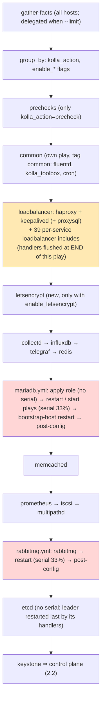
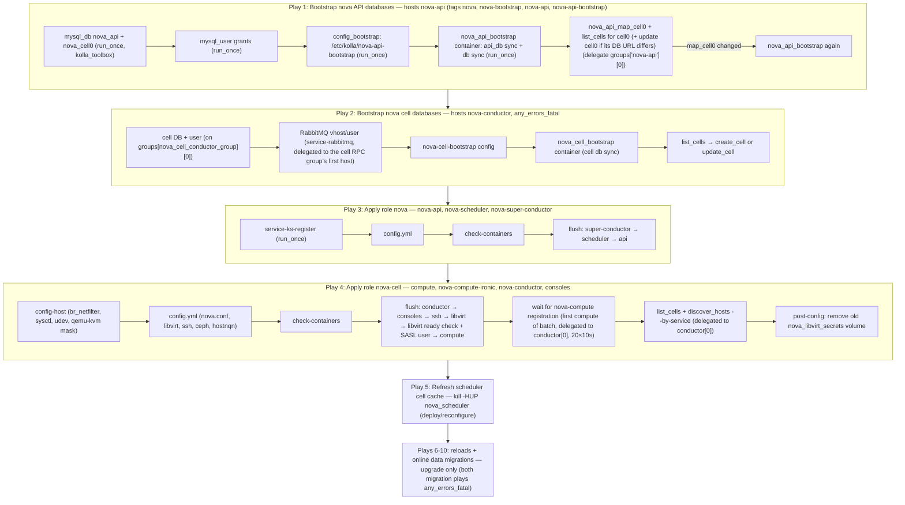
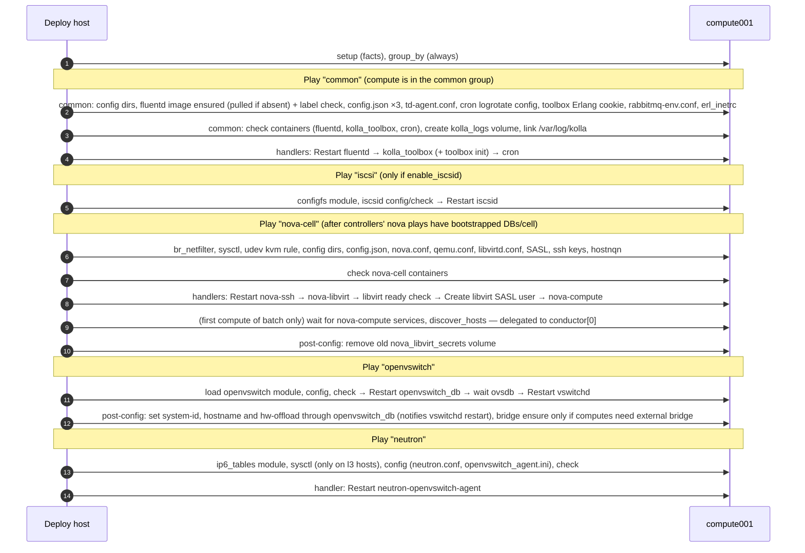
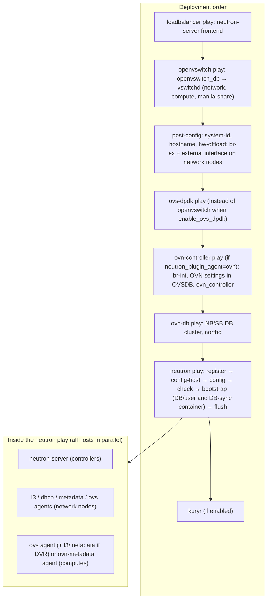

# Deployment execution flow

How Kolla-Ansible 2024.1 decides *what runs when*: play order, the steps inside each role, handler flush points,
batching, and how `deploy`, `reconfigure`, `upgrade`, `deploy-containers`, `genconfig`, `pull` and `stop` differ.

> [!NOTE]
> **Key answers**
>
> - **There is no dependency resolution.** Order comes from play order (`common` is a play of its own, not a role
>   dependency), task order inside a role, handler flush points, `serial`, the restart plays that MariaDB and RabbitMQ
>   handlers fill through `group_by`, and, new in 2024.1, the etcd handlers that restart the non-leaders before the
>   leader [CODE] ([§1](#1-how-the-order-is-decided)).
> - **What each action does** (`deploy`, `reconfigure`, `upgrade`, `deploy-containers`, `genconfig`, `pull`, `stop`,
>   `precheck`, `validate-config`; the wrapper still offers no `check`): the action matrix
>   ([§4](#4-action-matrix-what-each-kolla_action-does)). `genconfig`, then `deploy-containers --limit <batch>`, is the
>   only built-in way to separate "write the config" from "apply it". Changed in 2024.1: `genconfig` pulls the fluentd
>   image when it is absent ([§4](#4-action-matrix-what-each-kolla_action-does)).
> - **Batching:** a batch runs the complete play, handler restarts included, before the next batch starts, but each play
>   is still traversed batch by batch for the whole fleet before the next play starts. MariaDB and RabbitMQ apply their
>   role to all hosts in one batch, then restart the notified hosts in separate plays with `serial: "33%"`; the etcd
> play
>   has no `serial` any more. Every play now carries a `max_fail_percentage` that defaults to 100
>   ([§5](#5-batching-serial-and-its-interaction-with-order)).
> - **`reconfigure` on a running cloud still runs the DB sync containers** of keystone, glance, cinder, placement, nova,
>   neutron, heat and others [CODE] ([§6](#6-initial-deployment-vs-reconfiguration-what-actually-differs)).
> - **What one compute host goes through in a full `deploy`**, in order
>   ([§2.4](#24-compute-node-deployment-what-one-compute-host-experiences)). On a fresh compute, `nova_compute` is
>   started before `openvswitch` and `neutron_openvswitch_agent` exist on that host.
> - **Restart order is handler definition order**, not notification order [CODE], and the handlers of a play run on all
>   notified hosts in lockstep ([§7](#7-dependencies-introduced-by-handlers)).

> Deployment order (this page) ≠ runtime communication (see [Component
> dependencies](../components/dependencies.md)). Arrows in the diagrams below mean "runs before", unless a diagram
> explicitly says it shows runtime calls.

---

## 1. How the order is decided

There is **no dependency resolution** in Kolla-Ansible 2024.1. Order comes from these mechanisms only [CODE]:

| Mechanism | Effect | Evidence |
|---|---|---|
| Play order in `site.yml` / `nova.yml` / `mariadb.yml` / `rabbitmq.yml` | Services are applied strictly in file order. Ansible's default `linear` strategy runs play N on all its hosts (per batch) before play N+1 | `ansible/site.yml`, generated list in [Generated inventory §1](../reference/generated-inventory.md#1-plays-executed-by-siteyml-in-order) |
| Role meta dependency on `common` | **None in 2024.1.** No role has a `meta/` directory. `common` is the `Apply role common` play, run after the prechecks play and before the loadbalancer play, on the `cron`, `fluentd`, `kolla-logs` and `kolla-toolbox` hosts, tagged `common` | `site.yml:88-103`, `roles/common/tasks/main.yml:1-2` |
| Task order inside a role | Fixed sequence: register → config(-host) → check-containers → bootstrap → flush handlers ([§3](#3-inside-a-role-the-standard-deploy-sequence)) | `roles/*/tasks/deploy.yml` |
| Handler flush points | Restarts happen at `meta: flush_handlers` (end of most `deploy.yml`) or at the end of the play. The loadbalancer role deliberately defers to the end of its play | e.g. `roles/nova/tasks/deploy.yml:8-9`; `roles/loadbalancer/tasks/deploy.yml:8-11` |
| Restart plays filled by handlers | MariaDB and RabbitMQ handlers only put hosts into groups (`group_by`); the following plays of `mariadb.yml` / `rabbitmq.yml` restart those groups with `serial: "33%"` | `roles/mariadb/handlers/main.yml:51-73`, `mariadb.yml:18-68`; `roles/rabbitmq/handlers/main.yml:2-6`, `rabbitmq.yml:30-49` |
| Restart handlers that stage etcd (new in 2024.1) | The etcd handlers look up the cluster leader, restart the non-leaders through a handler that loops over `groups.etcd.index(host) % 4` (on `upgrade`, a loop over the etcd hosts), then restart the leader, whose handler is defined last; each restart waits for the client port and for `etcdctl endpoint health` | `roles/etcd/handlers/main.yml:9-65`, `roles/etcd/tasks/restart_services.yml:2-41` |
| `serial` / `kolla_serial` | Splits a play into batches; each batch completes the whole play, handlers included, before the next starts | `serial: '{{ kolla_serial\|default("0") }}'` on the gather-facts plays (`gather-facts.yml:11,40`), the common play and every service play, except the plays of `mariadb.yml` and `rabbitmq.yml` (no `serial`, or a fixed `"33%"` on the restart plays), the etcd play, which has no `serial` key in 2024.1 (`site.yml:470-481`), and cyborg, which reads `serial: '{{ serial\|default("0") }}'` (`site.yml:876`), so `kolla_serial` never batches it. The group_by and prechecks plays have no `serial` key either (`site.yml:7-86`) |

Conditions only *remove* work, never reorder it:

- `when: enable_<svc>` on the role;
- the host-pattern intersection `&enable_<svc>_True`;
- per-task `when:` on `kolla_action`;
- placement filters (`inventory_hostname in groups[...]` / `host_in_groups`).

`max_fail_percentage`, set on almost every play in 2024.1, does not reorder anything either: it can only stop a run
earlier ([§5](#5-batching-serial-and-its-interaction-with-order)).

---

## 2. The five diagrams

### 2.1 Infrastructure services (deployment order)

[CODE `gather-facts.yml`, `site.yml:1-481`, `mariadb.yml`, `rabbitmq.yml`]

Changed since 2023.1: a `letsencrypt` play now runs between the loadbalancer and collectd plays (`site.yml:328-340`),
`rabbitmq.yml` has no outward RabbitMQ play any more (`rabbitmq.yml:1-70`), and the loadbalancer play includes the
`loadbalancer` tasks of 39 roles, the letsencrypt one included (`site.yml:121-326`). OpenSearch still comes after
Keystone (`site.yml:483-509`).

### 2.2 OpenStack control plane (deployment order)

[CODE `site.yml:483-1074`, `nova.yml`]

```mermaid
flowchart LR
  KS["keystone"] --> OS["opensearch"] --> SW["swift → ceph-rgw"] --> GL["glance"] --> IR["ironic"] --> CI["cinder"] --> PL["placement"] --> NOVA["nova.yml (2.3)"]
  NOVA --> NET["openvswitch / ovs-dpdk → ovn-controller → ovn-db → neutron → kuryr (2.5)"]
  NET --> HC["hacluster"] --> HE["heat"] --> HO["horizon"] --> MISC["magnum → mistral"]
  MISC --> MA["manila"] --> TEL["gnocchi → ceilometer → aodh"] --> BA["barbican"] --> MORE["cyborg → designate → trove → watcher → grafana → cloudkitty → tacker"]
  MORE --> OC["octavia"] --> TAIL["zun → blazar → masakari → venus → skyline"]
```

The 2023.1 plays `murano`, `solum`, `sahara`, `freezer`, `senlin` and `vitrage` no longer exist in `site.yml`: it
has 50 `Apply role` plays, prechecks and common included (`site.yml:77-1074`).

Notable order facts [CODE]:

- **Keystone comes after MariaDB, RabbitMQ and memcached, but before any service that registers with it.**
  `service-ks-register` uses `openstack_interface` (`internal`) and authenticates against `keystone_internal_url`
  (`roles/service-ks-register/defaults/main.yml:5`, `group_vars/all.yml:710,960,990-991`).
- **Placement, Glance and Cinder come before Nova.** Neutron comes *after* Nova (see [§2.5](#25-networking-components)).
- **Barbican comes after Nova, Cinder and Glance**, even though they can be configured to use it as a key manager.
  With `enable_barbican`, Nova and Cinder render a `[barbican]` section (`roles/nova/templates/nova.conf.j2:217-222`,
  `roles/nova-cell/templates/nova.conf.j2:259-264`, `roles/cinder/templates/cinder.conf.j2:264-269`), and their
  plays run before the barbican play (`site.yml:576,609,853`). On a first deploy they therefore start configured
  with a `[barbican]` section before Barbican exists. [NOT AVAILABLE] Whether this has any effect before encrypted
  volumes are used.
- **Octavia is near the end.** With `octavia_auto_configure` (default: true when the amphora provider is enabled,
  `group_vars/all.yml:1323`), its play creates the amphora flavor, the keypair, the security groups and the
  management network and subnet (`roles/octavia/tasks/deploy.yml:4-5`, `prepare.yml:2-144`). No task of the role
  uploads the amphora image, and the certificates come from the separate `octavia-certificates` command
  (`tools/kolla-ansible:550-556`, which in 2024.1 also accepts `--check-expiry <days>`) ([fact
  sheet D](../reference/factsheets/d-barbican-octavia-swift-manila-compute-roles.md)).

### 2.3 Nova deployment (`ansible/nova.yml`)

[CODE `nova.yml:29-302`; `roles/nova/tasks/bootstrap.yml:2-56`, `config_bootstrap.yml`, `bootstrap_service.yml:2-21`,
`map_cell0.yml:2-67`; kolla `docker/nova/nova-api/extend_start.sh:16-20`; `roles/nova-cell/tasks/bootstrap.yml:2-43`,
`rabbitmq.yml:3-29`, `create_cells.yml:2-55`; `roles/nova-cell/tasks/config-host.yml:2-53`, `config.yml:203-217`;
`roles/nova-cell/tasks/deploy.yml:5-39`, `wait_discover_computes.yml:27-28,42-43,87-90`,
`discover_computes.yml:5,14-21`, `post-config.yml:3-8`; handler order `roles/nova/handlers/main.yml:2,20,38`,
`roles/nova-cell/handlers/main.yml:2-168`; `roles/nova/tasks/refresh_scheduler_cell_cache.yml:10`]

Changed since 2023.1: the "Run Nova API online data migrations" play now has `any_errors_fatal: true`, like the cell
one (`nova.yml:269-270,294-295`); nova-cell writes a `hostnqn` file for `nova_compute` (`config.yml:203-217`).

Details and Nova runtime dependencies: [Nova deep dive](../components/nova-deep-dive.md).

### 2.4 Compute node deployment (what one compute host experiences)

Sequence on one compute host during a full `deploy`, with the default enable flags and the `multinode` inventory
groups (`iscsi` only with `enable_iscsid`) [CODE: facts and `group_by` first (`site.yml:2,7-75`); play order
`site.yml:88-103,439-452`, `nova.yml:125-147` (imported at `site.yml:609`), `site.yml:611-625,671-693`; task and
handler order in each role's `tasks/deploy.yml` and `handlers/main.yml`; `common` in its own play
(`site.yml:88-103`, `roles/common/tasks/deploy.yml:2-9`); discovery on the first compute of the batch only, delegated
to the first conductor, `roles/nova-cell/tasks/wait_discover_computes.yml:42-43,87-90` and
`discover_computes.yml:21`]:

The common steps are `roles/common/tasks/config.yml`, `check-containers.yml:2-17` and `bootstrap.yml:2-16`. New in
2024.1: the common config step ensures the fluentd image is present (pulling it if absent) and reads its labels
before rendering the fluentd files (`roles/common/tasks/config.yml:42-91`,
`module_utils/kolla_docker_worker.py:501-503`).
The iscsi play loads `configfs` first (`roles/iscsi/tasks/config-host.yml:2-10`). The openvswitch
`post-config.yml:3-53` runs after the role's flush (`roles/openvswitch/tasks/deploy.yml:8-11`), so a vswitchd restart
it notifies runs at the end of the play. The neutron module and sysctl steps are
`roles/neutron/tasks/config-host.yml:2-34`.

[NOT AVAILABLE] How many task results, skips and handlers a compute host or a controller produces in a full
`deploy`: that depends on the inventory, the enable flags and the `when:` conditions met at run time. The first
controller also runs the `run_once` and delegated bootstrap tasks (e.g. `roles/nova/tasks/map_cell0.yml:63-64`).

**Ordering consequence:** on a fresh compute, `nova_compute` is started (and its registration awaited) *before*
`openvswitch` and `neutron_openvswitch_agent` exist on that host. [NOT AVAILABLE] Whether instances can be scheduled
there successfully before the later plays finish ([Nova deep dive
§3](../components/nova-deep-dive.md#3-what-must-be-available-before-nova-can-operate) item 6). On a running cloud this
ordering matters when you add computes with `--limit` (see [Add a compute node
§2](../operations/add-a-compute-node.md#2-add-a-compute-node)).

### 2.5 Networking components

[CODE `site.yml:611-707`; `inventory/multinode:105-108`; `roles/openvswitch/tasks/deploy.yml:2-11`,
`post-config.yml:3-53`; `roles/ovn-controller/tasks/deploy.yml:2-9`, `setup-ovs.yml`;
`roles/ovn-db/tasks/deploy.yml:2-22`;
`roles/neutron/tasks/deploy.yml:2-23`, `bootstrap.yml:38`, `bootstrap_service.yml:2-21`]

In 2024.1 the OVN controller play still runs *before* the OVN database play. The neutron play deploys the server and
*all* agents in a single play and a single handler flush. Agents are not deployed after the server has been verified.
[NOT AVAILABLE] Whether the RPC layer tolerates the agents starting first.

---

## 3. Inside a role: the standard `deploy` sequence

Typical `deploy.yml` (Nova shown; Neutron adds `config-host` and runs its bootstrap before the flush):

| Step | Typical task file | Scope | Runs on `reconfigure`? |
|---|---|---|---|
| 1. Keystone registration | `register.yml` → `service-ks-register` | `run_once` (per batch) via `kolla_toolbox` on the first host of the play | **yes** |
| 2. Host configuration | `config-host.yml` (sysctl, modules, udev) | per host | yes |
| 3. Config generation | `config.yml` (dirs, `config.json`, INI merges, policy, certs) | per host × per service × per file | yes |
| 4. Container check | `check-containers.yml` (`compare_container`: container parameters, systemd unit file, `kolla_set_configs --check`) | per host × per container | yes |
| 5. Bootstrap | `bootstrap.yml` (DB, user, grants) + `bootstrap_service.yml` (one-shot container: DB sync) | `run_once` / first host of the group | **yes** for most roles, Neutron included: its `bootstrap_neutron` DB-sync container has no `kolla_action` or `neutron_enable_rolling_upgrade` condition in 2024.1 (`roles/neutron/tasks/bootstrap.yml:38`, `bootstrap_service.yml:2-21`) |
| 6. Flush handlers | `meta: flush_handlers` | notified hosts, in handler definition order | yes |
| 7. Post steps | e.g. openvswitch `post-config.yml`, nova-cell discovery and `post-config.yml` | varies | yes |

[CODE `roles/nova/tasks/deploy.yml:2-9`; `roles/neutron/tasks/deploy.yml:2-23`;
`module_utils/kolla_container_worker.py:58-65`]

The containers are driven by the `kolla_container` module in 2024.1 (the 2023.1 `kolla_docker` module is gone from
`ansible/library/`). It hands the work to a Docker or a Podman worker, after `kolla_container_engine`, which defaults to
`docker` (`library/kolla_container.py:413-420`, `group_vars/all.yml:92`). The `module_utils/kolla_docker_worker.py`
lines cited on this page are those of the Docker worker.

Order caveats:

- **Some roles bootstrap *before* containers start, some after.** Nova bootstraps in separate plays before the service
  plays (`nova.yml:29-100`). Neutron runs its bootstrap *after* check-containers but *before* the flush
  (`roles/neutron/tasks/deploy.yml:13-23`). Keystone bootstraps before its flush and registers last, after Fernet
  key distribution (`roles/keystone/tasks/deploy.yml:2-21`). Glance and Cinder vary (fact sheets
  [B](../reference/factsheets/b-mariadb-rabbitmq-keystone.md),
  [C](../reference/factsheets/c-glance-placement-cinder-horizon-heat.md)).
- **The loadbalancer role does not flush in `deploy.yml`.** The NOTE in `roles/loadbalancer/tasks/deploy.yml:8-11`
  explains that site.yml handles all haproxy changes in that play, so the restart happens once, after all
  per-service frontends are rendered.

---

## 4. Action matrix: what each `kolla_action` does

| Action (CLI) | Config written | Containers compared | Handlers (restarts) | Bootstrap / DB sync | Keystone registration | Images pulled | Notes |
|---|---|---|---|---|---|---|---|
| `deploy` | yes | yes | yes | yes | yes | only if absent | Full flow (`tools/kolla-ansible:490-493`) |
| `reconfigure` | yes | yes | yes | yes (most roles) | yes | only if absent | Identical to deploy in 52 of the 54 roles that have a `reconfigure.yml` (swift and bifrost are the exceptions; skyline uses `include_tasks: deploy.yml`) ([Repository architecture §4.2](repository-architecture.md#42-reconfigure-is-deploy)). `kolla_serial` passed from `ANSIBLE_SERIAL` (`tools/kolla-ansible:529-532`) |
| `upgrade` | yes | yes | yes | yes: most roles re-run the deploy `KOLLA_BOOTSTRAP` one-shot with the new image (cinder, heat, barbican, octavia, manila, horizon, placement, legacy glance/neutron). Upgrade-only one-shots: keystone `KOLLA_UPGRADE` then `KOLLA_FINISH_UPGRADE`, run as handlers (`roles/keystone/tasks/upgrade.yml:23-34`, `handlers/main.yml:5-27,77-98`); neutron rolling (default, `roles/neutron/defaults/main.yml:732`) `NEUTRON_DB_EXPAND`/`NEUTRON_DB_CONTRACT`; glance rolling (opt-in, `glance_enable_rolling_upgrade: "no"`, `group_vars/all.yml:1008`) `GLANCE_DB_EXPAND`/`MIGRATE`/`CONTRACT` (`roles/glance/tasks/rolling_upgrade.yml:40,61,93`); mariadb `upgrade_mariadb` (`roles/mariadb/tasks/post-upgrade.yml:2-24`); `KOLLA_OSM` online migrations (nova, placement, cinder, rolling ironic). Nova `bootstrap_upgrade` re-runs its deploy db-sync container, minus DB creation and cell0 mapping (`roles/nova/tasks/bootstrap_upgrade.yml:5-6`, [Kolla images §4](kolla-images.md#4-one-shot-containers-what-the-environment-variables-run)) | yes (some roles) | only if absent → run `pull` first | Nova reload plays and the separate `KOLLA_OSM` online-migration containers are active only here. `kolla_serial` passed from `ANSIBLE_SERIAL` (`tools/kolla-ansible:520-523`). Placement's bootstrap container also runs `placement-manage db online_data_migrations` on every deploy/reconfigure (kolla `docker/placement/placement-api/extend_start.sh:5-9`); so does Ironic's with `ironic_enable_rolling_upgrade: no` (`roles/ironic/tasks/bootstrap_service.yml:16`, kolla `docker/ironic/ironic-api/extend_start.sh:5-9`; the default is `"yes"`, `roles/ironic/defaults/main.yml:310`) |
| `deploy-containers` | **no** | yes (incl. drift of the files listed in `config_files`; not `command`/`permissions` changes inside `config.json`, see below) | yes | no | no | only if absent | `tasks/deploy-containers.yml` = `check-containers.yml` (e.g. `roles/nova-cell/tasks/deploy-containers.yml:2`). Loadbalancer includes skipped (`site.yml:324-326`) |
| `genconfig` (`config`) | yes | no | **all container restarts skipped** (every handler that restarts or recreates a container has `when: kolla_action != "config"`. The handlers without that guard are waits, checks, `group_by` steps, steps chained from guarded handlers (e.g. zun's loopback copy, `roles/zun/handlers/main.yml:74-88`), upgrade-only steps (`roles/opensearch/handlers/main.yml:2-42`, `roles/etcd/handlers/main.yml:29-36`), and one-shot containers notified only outside `config.yml`: keystone's database-upgrade handlers, from `roles/keystone/tasks/upgrade.yml:23-31`, and MariaDB's first-node start, from `roles/mariadb/tasks/bootstrap_cluster.yml:2-23`, reached only through `deploy.yml`. Swift's handler is a no-op `debug` (`roles/swift/handlers/main.yml:2-4`). No handler restarts a container under `kolla_action=config`, [Pre-execution checklist](../operations/pre-execution-checklist.md)) | no | no | **fluentd only, if absent** (changed in 2024.1) | `tools/kolla-ansible:557-560`. The common config step runs `kolla_container` `ensure_image` on the fluentd image whenever `enable_fluentd` (default `yes`), which pulls it if it is not on the host (`roles/common/tasks/config.yml:42-51`, `module_utils/kolla_docker_worker.py:501-503`, `group_vars/all.yml:765`). With `octavia_auto_configure`, octavia's config tasks query the cloud through `kolla_toolbox` (`roles/octavia/tasks/config.yml:2-3`) |
| `pull` | no | no | no | no | no | **yes**, every enabled container mapped to the host, plus `common` (in its own play) | `service-images-pull` (`roles/service-images-pull/tasks/main.yml:2-18`) |
| `stop` | no | no | no | no | no | no | `stop_container` for every enabled container on the host, honouring `skip_stop_containers` (`roles/service-stop/tasks/main.yml:2-12`). The wrapper refuses to run it without `--yes-i-really-really-mean-it` (`tools/kolla-ansible:533-545`) |
| `precheck` | no | no | no | no | no | no | `prechecks` role + each role's `precheck.yml` (port checks, group validation) |
| `validate-config` (`config_validate`) | no | no | no | no | no | no | `tools/kolla-ansible:561-564`. Runs `oslo-config-validator` inside each running container that has a validation list, and writes the errors under `service_config_validate_output_dir` on the deploy host (`roles/service-config-validate/tasks/main.yml:2-13`, `validate.yml:2-49`) |
| `check` | – | – | – | – | – | – | **Still not a `kolla-ansible` command in 2024.1**: the wrapper has no `check` case (`tools/kolla-ansible:438-598`). 49 roles still carry a `check.yml`, reached only if `kolla_action=check` is passed to the playbooks some other way |

The combination **`genconfig` → (review the diff) → `deploy-containers --limit <batch>`** is the only built-in way to
separate "write the config" from "apply it", and to apply in controlled batches. It works because `compare_container`
detects drift in the files listed in each `config.json`'s `config_files` (content, mode, owner) through
`kolla_set_configs --check` [CODE `module_utils/kolla_container_worker.py:20,58-65`,
`module_utils/kolla_docker_worker.py:146-181`, kolla `docker/base/set_configs.py:165-198,220-242,556-559`]. With
Podman, the worker returns "changed" when the container is not running, then runs the same check
(`module_utils/kolla_podman_worker.py:428-453`).

Changes confined to `config.json` itself (`command`, `permissions`; e.g. every memcached setting,
`roles/memcached/templates/memcached.json.j2:2-3`) are NOT detected. `deploy-containers` therefore does not apply them
after `genconfig`, and a later `deploy`/`reconfigure` does not either: the config tasks that notify the restart, the
`config.json` template task included (memcached's only one, `roles/memcached/tasks/config.yml:13-26`), are then
unchanged. Such changes take effect only at the next restart for another reason.

An `optional` file that newly appears, and whose destination does not exist in the container yet, counts as drift:
`--check` exits 1 and the restart copies the file [CODE kolla
`docker/base/set_configs.py:36-39,165-171,220-242,576-578`,
`module_utils/kolla_docker_worker.py:164-177`]. `set_configs.py` is unchanged since 2023.1. See [Write config first,
apply in controlled batches
§2](../operations/controlled-batches.md#2-separate-write-config-from-apply-recommended-pattern)
and [Kolla images §3](kolla-images.md#3-kolla_set_configs---check-what-it-compares-and-its-exit-codes).

---

## 5. Batching (`serial`) and its interaction with order

```mermaid
gantt
  dateFormat X
  axisFormat %s
  title Play execution with kolla_serial=2 (illustrative, 4 computes)
  section nova-cell play
  batch 1 (compute001-002) config→check→flush→discover :a1, 0, 30s
  batch 2 (compute003-004) config→check→flush→discover :a2, after a1, 30s
  section openvswitch play
  batch 1 :b1, after a2, 15s
  batch 2 :b2, after b1, 15s
```

The bar lengths are illustrative only; no duration is known from the code.

- **A batch runs the complete play before the next batch starts.** That includes handler restarts and the compute
  discovery: ansible-core 2.16.20 runs the whole play once per batch, restricting the inventory to that batch
  (`lib/ansible/executor/playbook_executor.py:181-190`). Batches therefore bound the number of simultaneous restarts
  *per play*, but **each play is still traversed batch by batch for the whole fleet before the next play starts**.
  The neutron agents on compute001 are restarted only after *all* computes have finished the nova-cell and
  openvswitch plays.
- **`run_once` tasks run once per batch** ([Tags §2.5](../risk/tags.md#25-run_once-with-serial-code)): the linear
  strategy sends a `run_once` task to the first host of the current batch only
  (`lib/ansible/plugins/strategy/linear.py:181,207-209`). Examples: DB sync, Keystone registration, compute discovery
  (`wait_discover_computes.yml` runs for `all_computes_in_batch[0]`).
- **MariaDB and RabbitMQ are not batched by `kolla_serial`.** Their role plays run all hosts in one batch; their
  handlers only add the hosts to restart groups, and the next plays restart those groups with `serial: "33%"`
  (`mariadb.yml:18-52`, `rabbitmq.yml:30-49`). With three nodes that is one node per batch (ansible-core 2.16.20
  `lib/ansible/utils/helpers.py:30-32`). Each RabbitMQ node is put into maintenance mode before its restart
  (`roles/rabbitmq/tasks/restart_services.yml:9-17`)
  ([fact sheet B](../reference/factsheets/b-mariadb-rabbitmq-keystone.md)).
- **etcd is no longer batched by `kolla_serial` (changed in 2024.1).** Its play has no `serial` key
  (`site.yml:470-481`); its handlers stage the restarts instead ([§7](#7-dependencies-introduced-by-handlers) item 6).
  cyborg is not batched by `kolla_serial` either: its play reads `serial` instead (`site.yml:876`).
- **How `kolla_serial` is set depends on the action.** For `reconfigure` and `upgrade` the wrapper sets it from
  `ANSIBLE_SERIAL` (`tools/kolla-ansible:296,522,531`), after your own `-e` (`tools/kolla-ansible:366-369`), so use
  the environment variable. For `deploy` the wrapper does not set it (`tools/kolla-ansible:490-493`): pass
  `-e kolla_serial=N` yourself.
- **New in 2024.1: `max_fail_percentage` on the plays.** Every play of `site.yml`, `gather-facts.yml`, `mariadb.yml`
  and `rabbitmq.yml`, and every play of `nova.yml` except the cell bootstrap and the two online-migration plays (which
  use `any_errors_fatal: true`), sets `max_fail_percentage` from `<service>_max_fail_percentage`, then
  `kolla_max_fail_percentage`, then 100 (e.g. `site.yml:10-13,95-99`, `nova.yml:40-43,77-79`). `globals.yml` says
  that 100 is equivalent to not setting it (`etc/kolla/globals.yml:27-31`). In ansible-core 2.16.20 the check
  compares the hosts failed in the current batch with the batch size (`lib/ansible/plugins/strategy/linear.py:336-348`;
  the failed-host list is cleared at the start of each batch, `lib/ansible/executor/task_queue_manager.py:332-338`), so
  a lower value stops the play, and the rest of the run, once that share of a batch has failed
  (`lib/ansible/executor/playbook_executor.py:196-198,219-220`). Whatever the value, a batch in which every host failed
  ends the run (`playbook_executor.py:204-209`).

---

## 6. Initial deployment vs reconfiguration: what actually differs

| Aspect | Initial `deploy` (empty hosts) | `reconfigure` on a running cloud |
|---|---|---|
| Containers | All `create+start`: the container check finds no container, and the restart handler then starts a new one under its systemd unit [CODE `module_utils/kolla_container_worker.py:58-65`, `module_utils/kolla_docker_worker.py:341-350,365-389`]. Exception: on the bootstrap host (`groups[mariadb_shard_group][0]`), mariadb runs first as the one-shot `bootstrap_mariadb`, then a handler starts it with `--wsrep-new-cluster` and waits for its port and WSREP sync, and the "Restart bootstrap mariadb service" play runs `recreate_or_restart_container` on it (`roles/mariadb/tasks/bootstrap.yml:4-7`, `bootstrap_cluster.yml:2-27`, `roles/mariadb/handlers/main.yml:2-54`, `mariadb.yml:54-68`, `tasks/restart_services.yml:2-15`). [NOT AVAILABLE] Container counts, which depend on the inventory and the enable flags | Restart (config) or recreate (image or params) **only if** drift is detected; otherwise none [CODE `module_utils/kolla_container_worker.py:58-65`, `module_utils/kolla_docker_worker.py:341-363`] |
| One-shot containers | DB bootstrap for every service, MariaDB and RabbitMQ bootstrap, fernet key generation, cell creation | DB sync containers **still run** for keystone, glance, cinder, placement, nova (API and cell DB sync, plus map_cell0, list_cells for cell0 and list_cells ×2), neutron, heat, plus barbican, octavia and others [CODE: in these roles `reconfigure.yml` imports `deploy.yml` and the bootstrap containers have no `kolla_action` guard, e.g. `roles/keystone/tasks/bootstrap_service.yml:33-50`; nova: `nova.yml:49-55,85-91`, `roles/nova/tasks/map_cell0.yml:2-30`, `list_cells` from `roles/nova-cell/tasks/create_cells.yml:2` and `discover_computes.yml:5`; neutron: `roles/neutron/tasks/bootstrap_service.yml:2-21`]. MariaDB/RabbitMQ bootstrap and the keystone Fernet bootstrap (`when: groups['keystone_fernet_running'] is not defined`, `roles/keystone/tasks/bootstrap_service.yml:52-75`) are not re-run |
| Handler order effects | Every handler fires | Only notified handlers fire, but loop-notify widens them to all containers of the role on that host ([Tags §2.4](../risk/tags.md#24-loop-notify-one-changed-item-notifies-the-handlers-of-all-items-code)) |
| Neutron DB sync (`bootstrap_neutron`) | runs | **runs too** in 2024.1 (no condition on `kolla_action` or `neutron_enable_rolling_upgrade`, `roles/neutron/tasks/bootstrap_service.yml:2-21`). The DB/user/grant tasks run as well |
| Nova cell | `create_cell` | `update_cell` only if the transport URL or DB URL changed (`roles/nova-cell/tasks/create_cells.yml:31-55`) |
| Fernet keys | generated | **re-distributed** from the first running keystone_fernet node to the others ([fact sheet B §3.6](../reference/factsheets/b-mariadb-rabbitmq-keystone.md#36-fernet-key-lifecycle-fact-unless-marked), task flow in [§3.3](../reference/factsheets/b-mariadb-rabbitmq-keystone.md#33-task-flow-per-kolla_action)) |
| MariaDB | Galera bootstrap on the first host of the shard | cluster lookup; if config changed, restart plays with `serial: "33%"` (`mariadb.yml:18-52`) |
| Duration drivers | image pulls, first container starts | per-task SSH overhead across all hosts, `compare_container` exec per container (see [Compute scaling](compute-scaling-and-performance.md)). [NOT AVAILABLE] Any duration |

---

## 7. Dependencies introduced by handlers

Handlers create ordering that is not visible in task files:

1. **Within a role, restart order = handler definition order, not notification order.**
   - nova-cell restarts `nova_ssh` → `nova_libvirt` (→ libvirt ready check, SASL user) → `nova_compute`
     (`roles/nova-cell/handlers/main.yml:74-168`).
   - openvswitch restarts `openvswitch_db` → waits → `openvswitch_vswitchd`
     (`roles/openvswitch/handlers/main.yml:2-44`).
   - [CODE] ansible-core 2.16.20 keeps the play's handler list in definition order, copies it into each host's state
     at each flush, and walks it in that order, running only the handlers notified for the host
     (`lib/ansible/executor/play_iterator.py:195-200,426-445`).
2. **Handlers of a play run on all notified hosts in lockstep** (ansible-core 2.16.20: the linear strategy gives all
   hosts the same next task, and at a `flush_handlers` it inserts the play's handlers into that shared task list,
   `lib/ansible/plugins/strategy/linear.py:50-93`). With `serial: 0`, every compute restarts `nova_compute` (and,
   through loop-notify, `nova_libvirt` and `nova_ssh`) in the same step.
3. **Handler chains:**
   - Restart nova-libvirt → Checking libvirt container is ready → Create libvirt SASL user (with `libvirt_enable_sasl`,
     `roles/nova-cell/handlers/main.yml:96,116`).
   - Restart openvswitch-db → Waiting for openvswitch_db (`roles/openvswitch/handlers/main.yml:17-18`).
   - Restart kolla-toolbox → Initializing toolbox (`roles/common/handlers/main.yml:34-40`).
   - Restart haproxy / proxysql / keepalived container → handlers that `listen` to these names: check the API
     interface addresses, group the hosts by whether they hold the VIP, stop and start the backup hosts' containers,
     then the master's, then wait for HAProxy (and ProxySQL) to listen on the VIP
     (`roles/loadbalancer/handlers/main.yml:9-329`).
   - MariaDB and RabbitMQ: restart handlers only `group_by` the host; the restart itself is a later play (item 5).
4. **Handlers can cross roles.** `haproxy-config` (imported through `loadbalancer-config` by every service's
   `loadbalancer.yml`) notifies the loadbalancer role's `Restart haproxy container`
   (`roles/haproxy-config/tasks/main.yml:22-23`). This is why the loadbalancer play includes the loadbalancer role
   even for `-t <svc>`.
5. **The MariaDB restart is a sequence of plays, not of handler waves.** The handlers put running members into
   `mariadb_restart` and new members into `mariadb_start` (`roles/mariadb/handlers/main.yml:56-73`); the "Restart
   mariadb services" and "Start mariadb services" plays then run `restart_services.yml` (restart, port wait, WSREP sync
   wait) with `serial: "33%"` (`mariadb.yml:18-52`, `roles/mariadb/tasks/restart_services.yml:2-51`)
   ([fact sheet B §1.5][sheet-b-15]).
6. **The etcd restart is staged by its handlers (new in 2024.1).** `Restart etcd container` is now only a name that
   handlers `listen` to: they look up the leader, then restart the non-leaders (on `upgrade`, looping over the etcd
   hosts; otherwise looping over the four values of `groups.etcd.index(host) % 4`), then the leader, which comes last
   because its handler is defined last (`roles/etcd/handlers/main.yml:9-65`). Each restart waits for the client port
   and for `etcdctl endpoint health` (`roles/etcd/tasks/restart_services.yml:2-41`). [NOT AVAILABLE] How ansible-core
   orders the files included by one looped handler across hosts, so whether the `% 4` groups really restart one after
   another.

## Related

- [Component dependencies](../components/dependencies.md) (runtime dependencies)
- [Tags §2.5](../risk/tags.md#25-run_once-with-serial-code) (`run_once` with `serial`)
- [Nova deep dive](../components/nova-deep-dive.md) (the nova plays)
- [Write config first, apply in controlled batches
  §2](../operations/controlled-batches.md#2-separate-write-config-from-apply-recommended-pattern) (`genconfig` then
  `deploy-containers`)
- [Glossary](../reference/glossary.md) (glossary)

[sheet-b-15]: ../reference/factsheets/b-mariadb-rabbitmq-keystone.md#15-handlers-ansiblerolesmariadbhandlersmainyml-in-definition-order
