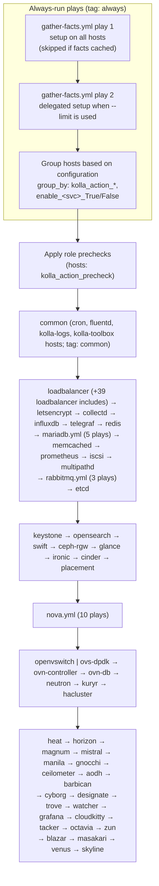
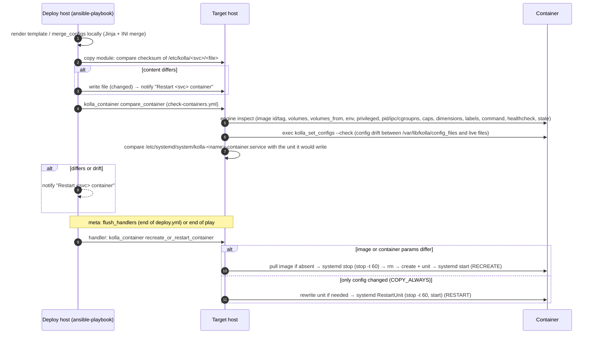

# Repository architecture

This page explains *how the machine is built*: which entry points exist, how a CLI command becomes an
`ansible-playbook` run, how `site.yml` is laid out, what every service role has in common, and which custom modules
actually touch the hosts. The other pages build on the vocabulary defined here.

> [!NOTE]
> **Key answers**
>
> - **`reconfigure` is `deploy`.** Of the 54 roles that have a `reconfigure.yml`, 51 only do `import_tasks: deploy.yml`,
>   so `reconfigure` re-runs Keystone registration, DB creation and the bootstrap (DB sync) container of most services
>   [CODE] ([§4.2](#42-reconfigure-is-deploy)).
> - **A config change is applied by a full stop/start, never a reload.** A changed file, a changed container definition,
>   a changed systemd unit or drift reported by `kolla_set_configs --check` notifies the restart handler, which
>   recreates the container when the image or parameters differ and otherwise restarts its systemd unit [CODE]
>   ([§4.3](#43-the-config--check--handler-pattern)).
> - **The stop timeout is the 60 s of `docker_graceful_timeout`.** The value from `docker_common_options` reaches the
>   module and is written into each container's systemd unit (`stop <name> -t 60`) [CODE]
>   ([§6](#6-custom-modules--container-lifecycle-via-kolla_container)).
> - **`deploy` and `reconfigure` pull an image only if it is absent locally** (`start_container`). A rebuilt image
>   pushed under the same tag is not fetched by `deploy` or `reconfigure`; it takes an explicit `pull` [CODE]
>   ([§6](#6-custom-modules--container-lifecycle-via-kolla_container)).
> - **Batching is off by default.** `ANSIBLE_SERIAL` defaults to 0, which means all hosts of a play in one batch, and
>   the wrapper passes `kolla_serial` only for `reconfigure` and `upgrade` [CODE]
>   ([§2](#2-from-cli-to-ansible-playbook)). New in 2024.1: every play of `site.yml` carries a `max_fail_percentage`
>   that defaults to 100, which never stops a play early [CODE] ([§3](#3-anatomy-of-siteyml)).
> - **Changed in 2024.1: the container module is `kolla_container`, for Docker or Podman.** `kolla_docker` is gone;
>   `kolla_container` picks a Docker or a Podman worker from `kolla_container_engine` (default `docker`) [CODE]
>   ([§6](#6-custom-modules--container-lifecycle-via-kolla_container)).
> - **`common` is a play of its own, tagged `common`.** No role has a meta dependency on it: `-t common reconfigure`
>   renders and restarts the common containers, and `-t nova` does not run `common` [CODE]
>   ([§5.1](#51-the-common-role-and-the-common_run-guard)).
> - **Host bootstrap lives outside the repository.** `bootstrap-servers` runs `openstack.kolla.baremetal` from
>   ansible-collection-kolla, which `kolla-ansible install-deps` installs from `requirements.yml`; the collection now
>   installs Docker or Podman [CODE] ([§1](#1-top-level-layout)).

> Scope: the `2024.1-eom` tag of `openstack/kolla-ansible` (commit `890396f`), with ansible-collection-kolla at the
> `stable/2024.1` branch that `requirements.yml` pins (studied at its `2024.1-eom` tag, commit `82a0f5c`). Every path
> below is relative to the root of the kolla-ansible checkout; paths prefixed `ansible-collection-kolla`, `kolla` or
> `ansible-core 2.16.20` point into the collection, the kolla image repository (`2024.1-eom`, commit `ed7a36a`) or the
> Ansible source. The evidence labels **[CODE]** and **[NOT AVAILABLE]** are defined once, in [Evidence
> labels](../start/conventions.md#evidence-labels).

---

## 1. Top-level layout

| Path | What it is | Why it matters for Day 2 |
|---|---|---|
| `tools/kolla-ansible` | Bash wrapper. Maps sub-commands to a playbook plus `-e kolla_action=<action>`; checks that ansible-core is between 2.15 and 2.16 (`tools/kolla-ansible:10-11`) | Decides which playbook runs and whether `kolla_serial` is passed ([§2](#2-from-cli-to-ansible-playbook)) |
| `requirements.yml` | Ansible Galaxy requirements: one collection, `https://opendev.org/openstack/ansible-collection-kolla`, `type: git`, `version: stable/2024.1` (`requirements.yml:2-5`) | Installed by `kolla-ansible install-deps` (`ansible-galaxy collection install -r requirements.yml --force`, `tools/kolla-ansible:131-144, :440-443`). Without it `bootstrap-servers` cannot find its role. A branch, not a tag: what is installed is whatever the branch holds at install time |
| `requirements-core.yml` | New in 2024.1. Seven Galaxy collections with upper bounds: `ansible.netcommon`, `ansible.posix`, `ansible.utils`, `community.crypto`, `community.general`, `community.docker`, `containers.podman` (`requirements-core.yml:2-23`) | `install-deps` installs it only when `pip show ansible` fails, i.e. when only ansible-core is installed (`tools/kolla-ansible:133-138`) |
| ansible-collection-kolla (`openstack.kolla`, `galaxy.yml:2-3`) | Separate repository, roles only (no modules or plugins): `apparmor_libvirt`, `baremetal`, `docker`, `docker_sdk`, `etc_hosts`, `kolla_user`, `packages`, and, new in 2024.1, `podman` and `podman_sdk` | Holds the host-bootstrap code. kolla-ansible references it in one place: `kolla-host.yml:13` (`role: openstack.kolla.baremetal`). `baremetal` imports `etc_hosts`, `packages`, `openstack.kolla.{{ container_engine }}`, `kolla_user`, `openstack.kolla.{{ container_engine }}_sdk` and `apparmor_libvirt`, with `container_engine` defaulting to `kolla_container_engine` or `docker` (ansible-collection-kolla `roles/baremetal/tasks/main.yml:2-3`, `install.yml:34-38`, `post-install.yml:2-19`, `defaults/main.yml:37`) |
| `ansible/site.yml` | The main playbook (71 plays once `gather-facts.yml`, `mariadb.yml`, `rabbitmq.yml` and `nova.yml` are expanded: 51 + 2 + 5 + 3 + 10) | Every `deploy`, `reconfigure`, `upgrade`, `pull`, `stop`, `prechecks`, `genconfig`, `validate-config`, `deploy-containers` run goes through it |
| `ansible/gather-facts.yml` | Imported first by `site.yml` (and by `kolla-host.yml`) | Fact gathering, including the special `--limit` path (see [Compute scaling](compute-scaling-and-performance.md)) |
| `ansible/mariadb.yml`, `ansible/rabbitmq.yml` | Imported by `site.yml:400` and `:468` | MariaDB in 5 plays, RabbitMQ in 3 plays (the outward RabbitMQ plays of 2023.1 are gone); the restart plays use `serial: "33%"` (`mariadb.yml:24, :42`; `rabbitmq.yml:36`) |
| `ansible/nova.yml` | Imported by `site.yml:609` | Nova is split into 10 plays (see [Nova deep dive](../components/nova-deep-dive.md)) |
| `ansible/kolla-host.yml` | `bootstrap-servers`: `gather-facts.yml`, then one play on `baremetal` with `serial: kolla_serial` applying `openstack.kolla.baremetal` (`kolla-host.yml:1-14`) | Installs the container engine and changes the host OS. Can restart the Docker daemon (ansible-collection-kolla `roles/docker/handlers/main.yml:10-15`) |
| `ansible/destroy.yml`, `prune-images.yml`, `mariadb_backup.yml`, `mariadb_recovery.yml`, `post-deploy.yml`, `certificates.yml`, `octavia-certificates.yml`, `bifrost.yml`, `nova-libvirt-cleanup.yml`, `rabbitmq-reset-state.yml`, `rabbitmq-upgrade.yml` | Single-purpose playbooks. `monasca_cleanup.yml` of 2023.1 is gone | See [Operations](../operations/index.md) |
| `ansible/roles/` | 71 roles, none with a `meta/` directory. 54 are applied by the plays of `site.yml` (51 service roles plus `prechecks`, `common` and `loadbalancer`); 5 by their own playbooks (`bifrost`, `certificates`, `octavia-certificates`, `destroy`, `prune-images`); 12 are helper roles imported by the others. Gone since 2023.1: `freezer`, `kafka`, `monasca`, `murano`, `sahara`, `senlin`, `solum`, `storm`, `vitrage`, `zookeeper`; new: `letsencrypt` (service) and `sysctl` (helper) | [§4](#4-anatomy-of-a-service-role) and [§5](#5-shared-helper-roles) |
| `ansible/group_vars/all.yml` | 1,383 lines of defaults (every `enable_*`, ports, transport URLs, container options, `kolla_container_engine: "docker"` at `:92`) | Lowest-priority defaults. `globals.yml` overrides them |
| `ansible/inventory/{all-in-one,multinode}` | Example inventories that define 180 groups each | Group membership drives where every container runs |
| `ansible/library/` | Custom modules: `kolla_container` (replaces `kolla_docker`), `kolla_toolbox`, `kolla_container_facts`, `kolla_container_volume_facts` | Main container interface: the service roles' container lifecycle goes through `kolla_container`. Many role tasks also run `{{ kolla_container_engine }} exec`/`inspect` directly ([§6](#6-custom-modules--container-lifecycle-via-kolla_container)) |
| `ansible/module_utils/` | `kolla_container_worker.py` (shared comparison logic), `kolla_docker_worker.py` (Docker SDK calls), `kolla_podman_worker.py` (Podman SDK calls, new), `kolla_systemd_worker.py` (one systemd unit per container) | Where `kolla_container` actually decides and acts ([§6](#6-custom-modules--container-lifecycle-via-kolla_container)) |
| `ansible/action_plugins/` | `merge_configs` (INI merge) and `merge_yaml` | How `/etc/kolla/config` overrides are merged ([§7](#7-configuration-generation-and-overrides)) |
| `ansible/filter_plugins/`, `kolla_ansible/*.py` | Jinja filters: `service_enabled_and_mapped_to_host`, `select_services_enabled_and_mapped_to_host`, `kolla_address`, `kolla_url` (new), `put_address_in_context`, `database_shards_info`; role-local `extract_cell` (nova-cell) and `customise_fluentd` (common) | Decide placement of a service on a host ([§4.4](#44-containers-and-placement)) |
| `etc/kolla/globals.yml`, `etc/kolla/passwords.yml` | Templates copied to `/etc/kolla/` by the operator | `globals.yml` (and every `*.yml` in `/etc/kolla/globals.d/`) is passed as **extra-vars** ([§2.1](#21-variable-precedence-that-matters)) |
| `tools/cleanup-*`, `tools/kolla-libvirt-guests-{docker,podman}.service`, `tools/virt-guest-shutdown.target` | Host utilities | `cleanup-host` deletes network namespaces and links (`tools/cleanup-host:5-23`; see [Risk register](../risk/risk-register.md)) |
| `doc/source/` | Documentation (`user/ansible-tuning.rst`, `reference/deployment-and-bootstrapping/bootstrap-servers.rst`, …) | Used only to cross-check, never as the source of truth |

No `ansible.cfg` is shipped for operators [CODE: no `ansible.cfg` in the kolla-ansible tree; [fact sheet E
§12](../reference/factsheets/e-host-bootstrap-ops-playbooks.md#12-ansible-configuration-and-documented-tuning)]. Forks,
pipelining, fact caching and SSH settings come from whatever `ansible.cfg` or environment the operator provides.

---

## 2. From CLI to `ansible-playbook`

`tools/kolla-ansible` builds a single command line (`tools/kolla-ansible:600-607`):

```bash
GLOBALS_DIR="${CONFIG_DIR}/globals.d"
EXTRA_GLOBALS=$([ -d "${GLOBALS_DIR}" ] && find ${GLOBALS_DIR} -maxdepth 1 -type f -name '*.yml' -printf ' -e @%p' || true 2>/dev/null)
PASSWORDS_FILE="${PASSWORDS_FILE:-${CONFIG_DIR}/passwords.yml}"
CONFIG_OPTS="-e @${CONFIG_DIR}/globals.yml ${EXTRA_GLOBALS} -e @${PASSWORDS_FILE} -e CONFIG_DIR=${CONFIG_DIR}"
CMD="ansible-playbook $CONFIG_OPTS $EXTRA_OPTS $PLAYBOOK $VERBOSITY"
for INVENTORY in ${INVENTORIES[@]}; do
    CMD="${CMD} --inventory $INVENTORY"
done
```

| Command | Playbook | Extra vars added | `kolla_serial` passed? | Evidence |
|---|---|---|---|---|
| `prechecks` | `site.yml` | `kolla_action=precheck` | no | `tools/kolla-ansible:444-447` |
| `check` | – | the sub-command does not exist; it falls to `usage` and exit 3 | – | `:595-597` |
| `bootstrap-servers` | `kolla-host.yml` | `kolla_action=bootstrap-servers` | no (the playbook has its own `serial: kolla_serial`) | `:485-489` |
| `deploy` | `site.yml` | `kolla_action=deploy` | **no** | `:490-493` |
| `deploy-containers` | `site.yml` | `kolla_action=deploy-containers` | no | `:499-502` |
| `pull` | `site.yml` | `kolla_action=pull` | no | `:516-519` |
| `upgrade` | `site.yml` | `kolla_action=upgrade -e kolla_serial=${ANSIBLE_SERIAL}` | **yes** | `:520-523` |
| `reconfigure` | `site.yml` | `kolla_action=reconfigure -e kolla_serial=${ANSIBLE_SERIAL}` | **yes** | `:529-532` |
| `genconfig` | `site.yml` | `kolla_action=config` | no | `:557-560` |
| `validate-config` | `site.yml` | `kolla_action=config_validate` | no | `:561-564` |
| `stop` | `site.yml` | `kolla_action=stop` (needs `--yes-i-really-really-mean-it`) | no | `:533-545` |
| `destroy` | `destroy.yml` | `inventories_comma_separated=<the -i paths>` (new in 2024.1), optional `destroy_include_images`/`destroy_include_dev` (needs `--yes-i-really-really-mean-it`) | no | `:458-484` |
| `mariadb_recovery` | `mariadb_recovery.yml` | `kolla_action=deploy` | no | `:448-452` |
| `mariadb_backup` | `mariadb_backup.yml` | `kolla_action=backup -e mariadb_backup_type=<full\|incremental>` | no | `:453-457` |
| `post-deploy` | `post-deploy.yml` | – | no | `:512-515` |
| `prune-images` | `prune-images.yml` | (needs `--yes-i-really-really-mean-it`) | no | `:565-576` |
| `install-deps` | – | runs `ansible-galaxy collection install -r requirements.yml --force` (plus `requirements-core.yml` when the `ansible` package is absent) and exits | – | `:131-144, :440-443` |

The 2024.1 wrapper also has `deploy-bifrost`, `deploy-servers`, `upgrade-bifrost`, `gather-facts`, `certificates`,
`octavia-certificates` (with a new `--check-expiry <days>` that adds `octavia_certs_check_expiry=yes`),
`nova-libvirt-cleanup`, `rabbitmq-reset-state` and `rabbitmq-upgrade` (`:494-498, :503-511, :524-528, :546-556,
:577-590`), none of which passes `kolla_serial`. `monasca_cleanup` no longer exists: it is not in the `case` and falls
to `usage` (`:595-597`).

Consequences [CODE]:

- **`ANSIBLE_SERIAL` defaults to 0** (`tools/kolla-ansible:294-296`), which means *all hosts of a play in one batch*:
  ansible-core turns a serial value of 0 or less into a single batch of every host (ansible-core 2.16.20
  `lib/ansible/executor/playbook_executor.py:295-302`). The comment in the wrapper reads "Serial is not recommended and
  disabled by default".
- **`kolla_serial` is overridden for `reconfigure` and `upgrade`.** The wrapper appends
  `-e kolla_serial=${ANSIBLE_SERIAL}` *after* the user's `-e` options. For those two commands a user-supplied
  `-e kolla_serial=N` is therefore silently replaced by `ANSIBLE_SERIAL`. Use the environment variable instead ([fact
  sheet E §11](../reference/factsheets/e-host-bootstrap-ops-playbooks.md#11-toolskolla-ansible-cli)).
- **Other commands default to 0.** For `deploy` and the rest, `kolla_serial` is not passed, and the plays fall back
  to `kolla_serial|default("0")`.
- **`--tags`, `--skip-tags`, `--limit`, `--forks`, `--check` and `--diff` pass straight through** (`:312-330`,
  `:376-384`). `EXTRA_OPTS` from the environment is passed through as well (`:287`), which is the only way to reach
  `--list-tasks`, `--list-tags` or `--list-hosts` through the wrapper.
- **`-i` can be given several times, and without it no inventory is passed.** Each `-i` adds a `--inventory`
  (`:302-305, :605-607`). The `INVENTORY` default to `ansible/inventory/all-in-one` (`:284`) is never used: the loop
  variable overwrites it, so a command without `-i` runs on whatever inventory the Ansible configuration names.
- **`/etc/kolla/globals.d/*.yml` are extra-vars too**, loaded after `globals.yml` and before `passwords.yml`
  (`:600-603`).
- **Bug: `--ask-vault-pass`.** The branch sets `VERBOSITY="$EXTRA_OPTS --ask-vault-pass"` (`:391-394`), which
  duplicates all options seen so far and drops earlier `-v` flags. Still present in 2024.1.

### 2.1 Variable precedence that matters

`globals.yml` and `passwords.yml` are passed with `-e @file`. That is **extra-vars, the highest precedence in Ansible**:
Ansible merges role defaults first, group vars and host vars later, and extra-vars last (ansible-core 2.16.20
`lib/ansible/vars/manager.py:202-221, :290-303, :421`). Consequences [CODE]:

- A value in `globals.yml` cannot be overridden per host or per group in the inventory. Per-host variation
  must come from variables that are *not* set in `globals.yml`. Inventory `host_vars` override role defaults and
  `group_vars/all.yml`, but not extra-vars.
- Anything placed in `globals.yml` (or `globals.d/`) applies to **every play and every host**. This is why "global"
  switches such as `enable_barbican`, `openstack_tag`, `nova_compute_virt_type` or `kolla_container_engine` have
  fleet-wide effects (see [Operations](../operations/index.md)).
- The same holds for the collection: `openstack.kolla.baremetal` and the roles it imports read the variables of the
  run, so a Docker, Podman or host setting placed in `globals.yml` overrides the collection's role defaults.

---

## 3. Anatomy of `site.yml`



Facts about the structure [CODE, `ansible/site.yml`]:

1. **One play per service, in a fixed order.** There is no dependency resolver. The deployment order *is* the order of
   plays in `site.yml` (see [Execution flow](deployment-execution-flow.md)). The only exception is the loadbalancer
   play (`site.yml:105-326`): it runs *before* the services it fronts, and configures all of their frontends in one
   place through 39 `include_role … tasks_from: loadbalancer`, run only when `enable_haproxy` is true and for
   `deploy`, `reconfigure`, `upgrade` and `config` (`site.yml:324-326`). The `murano`, `solum`, `sahara`, `freezer`,
   `senlin` and `vitrage` plays and includes of 2023.1 are gone; a `letsencrypt` play follows the loadbalancer play
   (`site.yml:328-340`).
2. **The "group by configuration" optimisation.** The play at `site.yml:7-75` puts every host into groups such as
   `enable_nova_True`. Every service play then intersects its host list with `&enable_<svc>_True`, for example
   `hosts: [compute, …, '&enable_neutron_True']` (`site.yml:671-685`). If a service is disabled, the play matches no
   host and Ansible skips it entirely, which avoids evaluating hundreds of `when:` clauses per host. The NOTE at
   `site.yml:4-6` says this exists because "in large environments, even tasks that are skipped can take a significant
   amount of time".
3. **Serial, failure threshold and tags differ between plays.** Almost every play has
   `serial: '{{ kolla_serial|default("0") }}'`.
   - **Exceptions:** the setup plays `Group hosts based on configuration` and `Apply role prechecks`
     (`site.yml:7-86`) have no `serial` key. **Changed in 2024.1:** the `etcd` play has no `serial` key either
     (`site.yml:470-481`). Outside `upgrade` (and `config`), etcd's handlers restart the non-leaders in four
     index-modulo-4 waves, then the leader (`roles/etcd/handlers/main.yml:40-65`); on `upgrade` a handler loops
     over the `etcd` group for the non-leaders without using the loop item, so each non-leader includes the restart
     tasks once per etcd member (`:28-36`); its comment says "one by one", but whether the members really restart one
     after another depends on how ansible-core orders those includes across hosts, which is [NOT AVAILABLE]. MariaDB and
     RabbitMQ are not single plays: their *apply* and
     *post-configuration* plays have no `serial` key (all members in one batch), while their *restart* plays use a
     fixed `serial: "33%"` that `ANSIBLE_SERIAL` does not change (`mariadb.yml:18-52`, `rabbitmq.yml:30-49`). The
     handlers only sort hosts into the `mariadb_restart`/`rabbitmq_restart` groups; the restart itself happens in
     those plays
     ([fact sheet B §1–2](../reference/factsheets/b-mariadb-rabbitmq-keystone.md#1-mariadb-ansiblerolesmariadb);
     [Tags](../risk/tags.md)).
   - **Bug: `cyborg` (`site.yml:876`)** uses `serial|default("0")`, not `kolla_serial`, so `ANSIBLE_SERIAL` has no
     effect on cyborg. Still present in 2024.1.
   - **New in 2024.1: `max_fail_percentage` on every play.** All 51 plays of `site.yml` (and those of `mariadb.yml`,
     `rabbitmq.yml`, `nova.yml` and `kolla-host.yml`) set `max_fail_percentage` to
     `<name>_max_fail_percentage | default(kolla_max_fail_percentage) | default(100)` (e.g. `site.yml:10-13, :96-99`).
     Neither variable is defined in `ansible/` (`kolla_max_fail_percentage` is only a commented example,
     `etc/kolla/globals.yml:31`), so the value is 100. ansible-core stops a batch only when the share of failed hosts
     is *greater than* the percentage (ansible-core 2.16.20 `lib/ansible/plugins/strategy/linear.py:336-350`), so by
     default no play is cut short by failures of other hosts.
   - **Tag placement varies:**
     - Most plays tag the *role*, e.g. `roles: - { role: kuryr, tags: kuryr }`.
     - The `common` and loadbalancer plays, the `mariadb.yml` and `rabbitmq.yml` plays and all `nova.yml` plays put
       tags at *play* level (`site.yml:100-101, :115-118`; `mariadb.yml:12-13`; `nova.yml:34-38`).
     - `memcached` has two tags, `[memcache, memcached]` (`site.yml:413-414`); `ovn-controller` and `ovn-db` share
       `ovn` (`site.yml:652-653, :668-669`).
     - The `prechecks` play has no tag at all (`site.yml:77-86`).
4. **`common` is a play, not a dependency.** No role has a `meta/` directory, so nothing pulls `common` in. It runs in
   its own play, `Apply role common`, on the hosts of `cron`, `fluentd`, `kolla-logs` and `kolla-toolbox`
   (`site.yml:88-103`), which in the example inventories are children of `common` = control, network, compute,
   storage, monitoring (`ansible/inventory/multinode:49-54, :203-213`)
   ([§5.1](#51-the-common-role-and-the-common_run-guard)).

The complete table of plays (hosts, tags, serial) is generated from the source in [Generated inventory
§1](../reference/generated-inventory.md#1-plays-executed-by-siteyml-in-order).

---

## 4. Anatomy of a service role

Every service role follows the same skeleton. `glance` is a typical example (in 2024.1 `nova` keeps its bootstrap in
separate `nova.yml` plays, so its `deploy.yml` has no bootstrap step, `roles/nova/tasks/deploy.yml:1-9`):

```text
roles/<svc>/
  defaults/main.yml      <svc>_services dict (containers), images, volumes, healthchecks, ks users/endpoints, ports
  vars/main.yml          project_name (and, for nova-cell, kolla_role_name)
  handlers/main.yml      "Restart <service-key> container" handlers (kolla_container recreate_or_restart_container)
  tasks/main.yml         - include_tasks: "{{ kolla_action }}.yml"          <-- dynamic dispatch
  tasks/deploy.yml       register.yml → config.yml → check-containers.yml → bootstrap.yml → flush_handlers
  tasks/reconfigure.yml  - import_tasks: deploy.yml                          <-- reconfigure == deploy
  tasks/upgrade.yml      service-specific (stop/rolling, DB migrations, check-containers, flush)
  tasks/deploy-containers.yml  - import_tasks: check-containers.yml
  tasks/pull.yml         import_role: service-images-pull
  tasks/stop.yml         import_role: service-stop
  tasks/precheck.yml     import_role: service-precheck + port checks
  tasks/check.yml        (in most roles, usually empty; glance has none)
  tasks/config.yml       (also run alone for kolla_action=config, i.e. `genconfig`)
  tasks/config_validate.yml  import_role: service-config-validate (kolla_action=config_validate, `validate-config`)
  tasks/copy-certs.yml   import_role: service-cert-copy (from config.yml, when CA copy or backend TLS is enabled)
  tasks/loadbalancer.yml import_role: loadbalancer-config (tags: always)  <-- called from the loadbalancer play
  templates/             <service>.json.j2 (kolla_set_configs manifest), <svc>.conf.j2, …
```

There is no `meta/main.yml`: no role in `ansible/roles/` has a `meta/` directory [CODE]. Evidence for glance:
`roles/glance/tasks/main.yml:2`, `deploy.yml:2-15`, `reconfigure.yml:2`, `pull.yml:2-3`, `precheck.yml:2-6`,
`config.yml:38-40`, `loadbalancer.yml:2-7`, `check-containers.yml:2-19`, `handlers/main.yml:2-18`; for nova:
`roles/nova/tasks/deploy.yml`, `config_validate.yml`, `vars/main.yml`.

### 4.1 `kolla_action` dispatch

`tasks/main.yml` is a **dynamic** `include_tasks: "{{ kolla_action }}.yml"`. Two consequences follow [CODE]:

- **`--list-tasks` is blind to role internals.** It shows only the `include_tasks` placeholder of every role: the
  listing walks the statically compiled play (`play.compile()`) and does not load dynamically included files
  (ansible-core 2.16.20 `lib/ansible/cli/playbook.py:193-219`); dynamic includes are loaded at run time
  (`lib/ansible/plugins/strategy/linear.py:252`). You cannot use `--list-tasks` to see what a tag will do in
  Kolla-Ansible. The linked [list-tasks-nova.txt](../reference/listings/list-tasks-nova.txt) is the Ussuri parse; it
  shows the same placeholders.
- **Tags reach the role's tasks only through inheritance.** The included tasks inherit the *role and play* tags (e.g.
  `nova`), not tags written on the `include_tasks` statement itself (see [Tags
  §2](../risk/tags.md#2-ansible-29-semantics-that-kolla-relies-on)). An include is not statically loaded, so the block
  of included tasks skips the include's tags and inherits those of the role, its dependency chain and the play
  (ansible-core 2.16.20 `lib/ansible/playbook/task_include.py:50`, `lib/ansible/playbook/block.py:310-361`).

### 4.2 `reconfigure` is `deploy`

Of the 54 roles that have a `reconfigure.yml`, 51 only do `import_tasks: deploy.yml`. `skyline` does the same with
`include_tasks` (`roles/skyline/tasks/reconfigure.yml:2`). `swift` and `bifrost` have their own reconfigure logic:
swift fails if a container is down, runs `kolla_set_configs --check` and restarts only drifted containers
(`roles/swift/tasks/reconfigure.yml:32-54` and following).

The bifrost copy cannot work and no `kolla-ansible` command runs it: it uses a group and a container named
`bifrost-deploy` (`roles/bifrost/tasks/reconfigure.yml:2-24`), but the container is `bifrost_deploy`
(`roles/bifrost/tasks/start.yml:8`), the example inventory has a `bifrost` group but no `bifrost-deploy` group
(`ansible/inventory/multinode:174`), `roles/bifrost/templates/` holds no `config.json` template, and the wrapper sends
`reconfigure` to `site.yml`, which has no bifrost play (`tools/kolla-ansible:529-532`). Still holds in 2024.1.

See the generated column "reconf→deploy" in [Generated inventory
§3](../reference/generated-inventory.md#3-role-task-structure-handlers-and-helper-role-usage). So `reconfigure` re-runs
Keystone registration, DB creation and the **bootstrap (DB sync) container** of most services, exactly like `deploy`
[CODE] (e.g. `roles/glance/tasks/reconfigure.yml:2`, `roles/glance/tasks/deploy.yml:2-15`). The only built-in
differences between `deploy` and `reconfigure` are:

- **`kolla_serial`** is passed from `ANSIBLE_SERIAL` ([§2](#2-from-cli-to-ansible-playbook)).
- **No `when: kolla_action == ...` condition separates them.** Every condition in `ansible/` that names `deploy` or
  `reconfigure` names both (`nova.yml:55, :91, :172`; `mariadb.yml:86`; `rabbitmq.yml:67`; `site.yml:326`).
  Neutron's DB-sync container (`bootstrap_neutron`) is imported without any condition
  (`roles/neutron/tasks/bootstrap.yml:38`, `roles/neutron/tasks/bootstrap_service.yml:2-21`), so it runs on every
  `deploy` and `reconfigure`; `neutron_enable_rolling_upgrade` (`roles/neutron/defaults/main.yml:732`) is read only
  by `roles/neutron/tasks/upgrade.yml:5, :8`. Nova's bootstrap plays run on both `deploy` and `reconfigure`
  (`ansible/nova.yml:49-55, :85-91`).

### 4.3 The config → check → handler pattern

This is the heart of Day-2 behaviour:



- **Files are rendered on the deploy host and copied.** The `template` and `merge_configs` steps render on the deploy
  host, then the `copy` logic compares checksums on the target (`ansible/action_plugins/merge_configs.py:168-216`). So
  *every* config task costs one SSH round trip per host per item, even when nothing changes (see [Compute
  scaling](compute-scaling-and-performance.md)).
- **Three independent triggers lead to the same handler.** A changed file notifies directly. The `compare_container`
  task (`module_utils/kolla_container_worker.py:58-65`) also notifies when:
  - the container's definition differs (`check_container_differs`, `kolla_container_worker.py:67-89`: capabilities,
    security options, image ID or tag, ipc/pid/cgroupns mode, labels, privileged, tmpfs, volumes, `volumes_from`,
    environment, state, dimensions, command, healthcheck); or
  - **`kolla_set_configs --check`** inside the running container reports drift. With Docker
    (`module_utils/kolla_docker_worker.py:146-181`) a container that cannot be exec'd into counts as drifted
    (`:155-163`) and so does exit code 137 (`:173-177`); with Podman (`module_utils/kolla_podman_worker.py:428-453`) a
    container that is not `running` counts as drifted (`:432-433`); or
  - the container's systemd unit file is missing or differs from the one the module would write
    (`module_utils/kolla_systemd_worker.py:154-167`), for example after `docker_graceful_timeout`,
    `docker_restart_policy` or `docker_client_timeout` changed, since all three are written into the unit
    (`kolla_systemd_worker.py:20-39, :50-79`); a policy change between `unless-stopped` and `always` renders the
    same `Restart=always` and changes nothing (`:56-58`).

  The `--check` path means a config file changed by an earlier `genconfig`, or by hand, will still restart the
  container on the next `deploy`/`reconfigure`/`deploy-containers` [CODE].
- **Restart and recreate are both full stop/start cycles.** A config change is applied only by stopping and starting
  the container; `kolla_container` has no reload action (`library/kolla_container.py:272-287`). The only signal
  Kolla-Ansible sends to a running containerised service is SIGHUP to `nova_scheduler` (cell-cache refresh), through
  `kill -HUP` on the PID read with `{{ kolla_container_engine }} inspect`. It is sent only on a `deploy`/`reconfigure`
  that runs the `nova`, `nova-api` or `nova-refresh-scheduler-cell-cache` tag (or no tag) and whose `--limit`, if any,
  includes the `nova-scheduler` hosts (`roles/nova/tasks/refresh_scheduler_cell_cache.yml:10-12`,
  `ansible/nova.yml:152-172`). It loads no new config files. (Outside containers, the `Reload libvirtd` handler
  reloads a *host* libvirtd when the external-Ceph tasks change its secrets and `enable_nova_libvirt_container` is
  false, `roles/nova-cell/handlers/main.yml:143-149`, `roles/nova-cell/tasks/external_ceph.yml:172, :197, :208-211`.)
  The handler calls `recreate_or_restart_container` (`module_utils/kolla_docker_worker.py:341-363`; Podman
  `kolla_podman_worker.py:507-524`):
  - **recreate** when the image or parameters differ (or `COPY_ONCE`): pull the image if absent, stop, remove, start;
  - otherwise **restart**: rewrite the unit if needed and ask systemd to restart it (`restart_container`,
    `kolla_docker_worker.py:439-459`, `kolla_podman_worker.py:602-617`; `kolla_systemd_worker.py:106-113`).

  The stop timeout is **`docker_graceful_timeout`, 60 s by default**
  ([§6](#6-custom-modules--container-lifecycle-via-kolla_container)).
- **Handlers run in definition order, on every notified host of the batch at once.** Unless `kolla_serial` is set,
  "Restart nova-compute container" restarts nova_compute on all notified computes in the same step [CODE: ansible-core
  2.16.20 `lib/ansible/executor/play_iterator.py:200` copies the play's handlers in definition order and `:427-443`
  walks them per host; the linear strategy runs tasks, and the handlers inserted at `flush_handlers`, in lockstep
  across the hosts of the batch, `lib/ansible/plugins/strategy/linear.py:50-93`].

### 4.4 Containers and placement

Each role's `defaults/main.yml` defines a `<role>_services` dict with an entry per container. The fields are
`container_name`, `group` *or* `host_in_groups`, `enabled`, `image`, `volumes`, `dimensions`, `privileged`,
`pid_mode`/`ipc_mode`/`cgroupns_mode`, `healthcheck` and `haproxy`. The filter `service_enabled_and_mapped_to_host`
(`kolla_ansible/filters.py:87-96`, with `service_mapped_to_host` at `:59-84`) decides placement:

- `host_in_groups` (a per-host boolean expression) wins over `group` (`filters.py:73-75`).
- `group: all` means every host (`filters.py:77-79`).

`select_services_enabled_and_mapped_to_host` (`filters.py:99-109`) applies the same test to a whole dict; the helper
roles `service-images-pull`, `service-stop`, `service-config-validate` and others loop over its result
(e.g. `roles/service-images-pull/tasks/main.yml:14`, `roles/service-stop/tasks/main.yml:12`).

The 2024.1 roles define 159 containers (188 in 2023.1, before the removal of the ten roles listed in
[§1](#1-top-level-layout)). They are listed in [Generated inventory
§2](../reference/generated-inventory.md#2-containers-defined-by-each-role-role_services-in-defaultsmainyml).

---

## 5. Shared helper roles

| Role | Used by | What it does | Scope |
|---|---|---|---|
| `common` | its own play (`site.yml:88-103`); no role depends on it | Deploys `fluentd`, `kolla_toolbox`, `cron` on the hosts of their groups (children of `common`: every host of the example inventory). Renders `td-agent.conf` and `logrotate.conf` | Once per host per run that executes the `common` play ([§5.1](#51-the-common-role-and-the-common_run-guard)) |
| `service-ks-register` | 31 roles | Creates the Keystone service, endpoints, project, user, role and grants through `kolla_toolbox` | `run_once`: once per play, or once per batch when `kolla_serial` is set (`roles/service-ks-register/tasks/main.yml:126`) |
| `service-rabbitmq` | nova-cell only (`roles/nova-cell/tasks/rabbitmq.yml:3-29`, imported from `bootstrap.yml:37`) | Creates RabbitMQ vhost and user through `kolla_toolbox`, delegated to the first host of the cell's RPC (or notify) RabbitMQ group | once per cell, on the cell's first nova-conductor host (the notify pass only when its group or users differ from RPC) |
| `service-images-pull` | the `pull.yml` of 51 roles | `kolla_container pull_image` for every enabled container mapped to the host, with retries (`roles/service-images-pull/tasks/main.yml:2-18`) | per host × per container |
| `service-stop` | the `stop.yml` of 51 roles | `kolla_container stop_container`, honouring `skip_stop_containers` (`roles/service-stop/tasks/main.yml:2-12`) | per host × per container |
| `service-precheck` | the `precheck.yml` of 48 roles | Validates that the inventory groups exist | per host |
| `service-cert-copy` | `copy-certs.yml` of 38 roles | Copies the CA (and backend certs) into each service config dir when `kolla_copy_ca_into_containers` or the service's backend TLS is set (e.g. `roles/glance/tasks/config.yml:38-40`) | per host × per service |
| `service-config-validate` | `config_validate.yml` of 28 roles | `validate-config`: runs the oslo-config validator for each enabled service mapped to the host (`roles/service-config-validate/tasks/main.yml:2-13`) | per host × per service |
| `loadbalancer-config` | every role's `loadbalancer.yml` (39 roles; nova-cell through `proxy_loadbalancer.yml`) | Imports `haproxy-config` (when `haproxy_config_install`) and `proxysql-config` (when `enable_proxysql`) (`roles/loadbalancer-config/tasks/main.yml:2-8`) | per loadbalancer host |
| `haproxy-config` | `loadbalancer-config` only | Renders `/etc/kolla/haproxy/services.d/<svc>.cfg` (custom templates under `/etc/kolla/config/haproxy-config/` win), adds the service to `external-frontend-map` when `haproxy_single_external_frontend` is set (new), and opens external ports in firewalld when enabled (`roles/haproxy-config/tasks/main.yml:2-71`) | per loadbalancer host |
| `proxysql-config` | `loadbalancer-config` only | Renders the ProxySQL users and rules files for the service | per loadbalancer host |
| `module-load` | nova-cell (`br_netfilter`), neutron, openvswitch, loadbalancer, ironic, iscsi (`configfs`), multipathd, from each role's `config-host.yml` | `modprobe` and persistence in `/etc/modules-load.d` | per host |
| `sysctl` | New in 2024.1: neutron and loadbalancer, from `config-host.yml` (`roles/neutron/tasks/config-host.yml:20-34`, `roles/loadbalancer/tasks/config-host.yml:8-17`) | Sets or removes kernel parameters in `kolla_sysctl_conf_path`; a value `KOLLA_UNSET` removes the key, `KOLLA_SKIP` leaves it alone (`roles/sysctl/tasks/main.yml:7-20`) | per host |

### 5.1 The `common` role and the `common_run` guard

The guard does not exist in 2024.1. `roles/common/tasks/main.yml:1-2` is only:

```yaml
- include_tasks: "{{ kolla_action }}.yml"
```

No file in `ansible/` or `tools/` mentions `common_run`, and `roles/common/defaults/main.yml` starts directly with
`common_services` [CODE]. How `common` runs:

- **`common` runs in one play of its own** (`site.yml:88-103`: hosts `cron`, `fluentd`, `kolla-logs`,
  `kolla-toolbox`; `serial: kolla_serial`; play tag `common`). It runs before the loadbalancer play and before any
  service play, on every host of those groups, once per run.
- **`-t common` selects that play and nothing else.** The included tasks inherit the play tag `common` (ansible-core
  2.16.20 `lib/ansible/playbook/block.py:352-361`; included blocks are filtered by tag at
  `lib/ansible/plugins/strategy/linear.py:272`), so `-t common reconfigure` renders the common configs and restarts
  what changed [CODE].
- **Service tags do not drag `common` in.** No role has a `meta/` directory, so `-t nova` (or any service tag)
  skips the common play, which carries only `common` [CODE; [Tags
  §2.1](../risk/tags.md#21-dynamic-include_tasks-and-tag-inheritance-code)].
- **`fluentd` and `cron` configs are global.** `td-agent.conf` and `logrotate.conf` are rendered from the **global**
  `enable_*` flags (`roles/common/tasks/config.yml:140-270`). Enabling a service listed in
  `fluentd_input_openstack_services` (`roles/common/defaults/main.yml:154-210`) and/or `cron_logrotate_services`
  (`roles/common/tasks/config.yml:212-261`), such as nova, neutron or barbican, changes `td-agent.conf` and/or
  `logrotate.conf` on *every* host. Services only in the logrotate list (e.g. mariadb, rabbitmq, zun, prometheus,
  redis) change only `logrotate.conf`. **Changed in 2024.1:** `enable_redis` now changes `logrotate.conf`
  (`config.yml:254`), `enable_ovn` now changes `td-agent.conf`
  (`roles/common/templates/conf/input/10-openvswitch.conf.j2:31`), and `enable_letsencrypt` adds an input file to
  `td-agent.conf` (`config.yml:166-167`); a flag such as `enable_memcached` still changes neither file (no mention in
  the `common` role).

  Since `common` does not run with a service tag, enabling a service with `-t <svc> deploy` does **not** update
  these files; they change on the next run that executes the common play (a full run or `-t common`). That run
  restarts the container whose file changed (`fluentd` and/or `cron`). Through loop-notify on the looped
  `Check common containers` task (`roles/common/tasks/check-containers.yml:2-17`) it also restarts the other common
  containers (`kolla_toolbox`, plus `fluentd` or `cron` when only one of the two files changed), although their config
  did not change [CODE: when any item of a looped task changes, Ansible marks the whole task changed and notifies the
  handlers of every item that was not skipped, ansible-core 2.16.20 `lib/ansible/executor/task_executor.py:126-130,
  :483, :819-820`, `lib/ansible/plugins/strategy/__init__.py:648-671`; see [Tags
  §2.4](../risk/tags.md#24-loop-notify-one-changed-item-notifies-the-handlers-of-all-items-code)].

---

<a id="6-custom-modules--container-lifecycle-via-kolla_docker"></a>

## 6. Custom modules — container lifecycle via `kolla_container`

**Changed in 2024.1:** `ansible/library/kolla_docker.py` no longer exists. Its successor, `kolla_container`, keeps the
same actions and the same comparison logic, and adds a Podman back end.

| Module | Purpose | Key behaviour (evidence) |
|---|---|---|
| `kolla_container` (`ansible/library/kolla_container.py`, 433 lines, plus `module_utils/kolla_container_worker.py` 578, `kolla_docker_worker.py` 503, `kolla_podman_worker.py` 677, `kolla_systemd_worker.py` 216) | Every container lifecycle operation of the service roles (364 `kolla_container:` tasks under `ansible/roles/`) | Actions: `compare_container`, `compare_image`, `create_volume`, `ensure_image`, `get_container_env`, `get_container_state`, `pull_image`, `recreate_or_restart_container`, `remove_container`, `remove_image`, `remove_volume`, `restart_container`, `start_container`, `stop_container`, `stop_and_remove_container` (`kolla_container.py:272-287`). Picks `DockerWorker` when `container_engine` is `docker`, `PodmanWorker` otherwise (`kolla_container.py:415-420`); `container_engine` comes from `docker_common_options` (`group_vars/all.yml:153`) and defaults to `docker` in the module (`kolla_container.py:372`). Uses host networking with both engines (`kolla_docker_worker.py:278-279`; `kolla_podman_worker.py:75-78`). Every non-oneshot container gets a systemd unit `kolla-<name>-container.service` that starts, stops and restarts it ([below](#how-kolla_container-decides)) |
| `kolla_toolbox` (`library/kolla_toolbox.py`) | Runs an Ansible module *inside* the `kolla_toolbox` container (`ansible localhost -m <module>`, `kolla_toolbox.py:113-114`; Docker `exec_create`, `:163`; Podman `exec_run`, `:225`) | Used for MySQL, Keystone (`os_*`) and RabbitMQ (`rabbitmq_user/vhost`) operations. Takes a required `container_engine` parameter, `docker` or `podman` (`:255, :265-269`). Needs a running `kolla_toolbox` on the target |
| `kolla_container_facts` | Returns the containers by name; takes a required `container_engine` (`kolla_container_facts.py:117, :123-126`) | Used by prechecks and upgrade logic (e.g. `roles/glance/tasks/precheck.yml:8-14`) |
| `kolla_container_volume_facts` | Returns container volume facts | Used by `roles/neutron/tasks/neutron_plugin_agent_check.yml` and `roles/ovn-db/tasks/lookup_cluster.yml` |

The `bslurp` module of Ussuri is still absent from `ansible/library/`. Swift rings are copied from
`{{ node_custom_config }}/swift` (`roles/swift/tasks/config.yml:183-197`), and Fernet keys are distributed by
`fernet-push.sh`, run with `{{ kolla_container_engine }} exec` in the keystone_fernet container
(`roles/keystone/tasks/distribute_fernet.yml:14`).

These modules are not the only container interface. Many role tasks call the container CLI directly through
`command`/`shell` as `{{ kolla_container_engine }} exec|inspect` (21 roles, among them keystone, mariadb, rabbitmq,
etcd, openvswitch, ovn-db, nova-cell, swift and bifrost): `fernet-push.sh`, `ovs-vsctl`, `kolla_set_configs --check`
(swift, bifrost), the `mysql`/`rabbitmqctl` calls of the MariaDB and RabbitMQ roles (e.g.
`roles/mariadb/tasks/restart_services.yml:34`), `etcdctl` (`roles/etcd/tasks/restart_services.yml:32-34`), and
`inspect` plus `kill -HUP` for `nova_scheduler`. Outside the service roles, `destroy` stops and removes containers with
the `tools/cleanup-containers` script, passing the engine (`roles/destroy/tasks/cleanup_containers.yml:3`; the script
accepts `docker` or `podman`, `tools/cleanup-containers:4-10`); `prune-images` uses the `docker_prune` module with
Docker and `podman image prune` with Podman (`roles/prune-images/tasks/prune_images.yml:2-16`). `docker_prune` is
not part of ansible-core 2.16.20 (`lib/ansible/modules/` has no docker module); `requirements-core.yml:18-20` lists
`community.docker`, but which collection provides `docker_prune` is not read in this study [NOT AVAILABLE]. And
`bootstrap-servers` runs `docker start` on the previously running containers after a Docker package upgrade
(ansible-collection-kolla `roles/docker/tasks/install.yml:44-72`) [CODE].

<a id="how-kolla_container-decides"></a><a id="how-kolla_docker-decides"></a>How `kolla_container` decides [CODE]:

- **`start_container`** pulls the image **only if it is absent locally** (Docker
  `module_utils/kolla_docker_worker.py:366-367`, where `check_image` looks for the exact `repository:tag` among the
  local images, `:71-79`; Podman `ensure_image`, `kolla_podman_worker.py:527, :675-677`). A rebuilt image pushed
  under the same tag is therefore *not* fetched by `deploy` or `reconfigure`. It takes an explicit `pull`
  (`kolla-ansible pull`) to download it, after which `compare_image` sees a new image ID and recreates the container
  (`kolla_docker_worker.py:107-122, :341-363`). It then creates the container and its unit if needed and starts it
  through systemd, failing with "Container timed out" if the unit is not `running` within `client_timeout` (120 s)
  (`kolla_docker_worker.py:369-389`; `kolla_systemd_worker.py:64, :97-104, :205-216`). One-shot containers
  (`restart_policy: oneshot`) get no unit and are started directly (`kolla_docker_worker.py:338-339, :381-382`).
- **`compare_image` compares image ID and tag**, using the local image for that reference
  (`kolla_docker_worker.py:107-122`).
- **`pull_image` reports changed only if the local image changed** (Docker: image ID, `kolla_docker_worker.py:189-223`;
  Podman: image attributes, `kolla_podman_worker.py:455-474`).
- **`docker_graceful_timeout` and `docker_client_timeout` take effect.**
  - `generate_module()` starts from `common_options` (= `docker_common_options`, which carries
    `graceful_timeout: "{{ docker_graceful_timeout }}"`, `client_timeout: "{{ docker_client_timeout }}"` and
    `container_engine: "{{ kolla_container_engine }}"`, `group_vars/all.yml:142-153`). It overwrites a key only when
    the task sets that parameter; a parameter the task leaves unset keeps the `common_options` value, and only when
    that is absent too does the module default (10 s, 120 s, `docker`) apply (`kolla_container.py:361-407`).
  - `graceful_timeout` and `client_timeout` have no default in the argument spec (`kolla_container.py:313, :335`).
    Handlers pass `common_options` (e.g. `roles/nova-cell/handlers/main.yml:151-169`), so the effective stop timeout
    is `docker_graceful_timeout`, **60 s** by default (`group_vars/all.yml:139`).
  - The value is written into the unit: `ExecStop=/usr/bin/<engine> stop <name> -t <graceful_timeout>`
    (`kolla_systemd_worker.py:32, :74`). With Docker, `stop_container` uses systemd when the unit exists and
    `docker stop` with the same timeout otherwise (`kolla_docker_worker.py:415-431`); with Podman, it writes the unit
    if needed and stops through systemd for every non-oneshot container (`kolla_podman_worker.py:575-593`).
    `restart_container` asks systemd to restart the unit (`kolla_docker_worker.py:439-459`,
    `kolla_podman_worker.py:602-617`).
  - Practical effect: a container still running 60 s after SIGTERM is killed. This holds for handler restarts,
    recreates and `stop` [CODE; the SIGTERM-then-SIGKILL meaning of the timeout is kolla-ansible's own comment,
    `ansible/group_vars/all.yml:138`: "Timeout after Docker sends SIGTERM before sending SIGKILL."]. The unit sets no
    `TimeoutStopSec`, so systemd's own stop timeout also applies; its value is host configuration [NOT AVAILABLE].
- **The restart policy lives in the unit, not in the engine.** Docker's `build_host_config` passes no restart policy
  (`kolla_docker_worker.py:277-311`) and the Podman worker drops it (`kolla_podman_worker.py:142`);
  `docker_restart_policy: "unless-stopped"` (`group_vars/all.yml:117`) becomes `Restart=always` in the unit, with
  `StartLimitBurst` = `docker_restart_policy_retry` (`kolla_systemd_worker.py:28, :33, :56-58`). The FIXME
  "restart_policy is *not* checked in the container" now sits in `kolla_container.py:19`, but a changed policy
  changes the unit, which `compare_container` does detect ([§4.3](#43-the-config--check--handler-pattern)).
- **Changed in 2024.1: the unit names its engine.** The template writes `Description=<engine> …`,
  `ExecStart=/usr/bin/<engine> start -a <name>` and `ExecStop=/usr/bin/<engine> stop …`; `After=`/`Wants=` are
  `docker.service` for Docker and `network-online.target` for Podman; the start-limit line is
  `StartLimitInterval=` (`kolla_systemd_worker.py:20-39, :50-54, :69-79`). Because `compare_container` compares the
  whole unit text (`:154-167`), a unit file whose text differs from this template, such as one written by 2023.1 (whose
  template hard-coded `docker`, so with Docker only its `StartLimitIntervalSec=` line and the blank line after it
  differ), is reported as changed and its container is restarted by the handler, which rewrites the
  unit first [CODE].
- **`kolla_container_engine` is an engine switch.** It defaults to `"docker"` (`group_vars/all.yml:92`). It selects
  the worker of `kolla_container`, the engine of `kolla_toolbox`, `kolla_container_facts` and
  `kolla_container_volume_facts`, the CLI of the `exec`/`inspect` tasks, the volume path
  (`container_engine_volumes_path`, `group_vars/all.yml:156-158`), engine-specific dimensions and `/run` mounts
  (`group_vars/all.yml:165-172, :187-201`), and, in ansible-collection-kolla, which engine `bootstrap-servers`
  installs. How the Podman path behaves on a real host is [NOT AVAILABLE] (source only, nothing was run).

---

## 7. Configuration generation and overrides

1. **INI files go through `merge_configs`.** `merge_configs` (`ansible/action_plugins/merge_configs.py`) renders each
   listed source as a Jinja template *on the deploy host*, merges them as INI (later sources win), then calls the
   `copy` action (`merge_configs.py:168-216`). For nova-compute the sources are
   (`roles/nova-cell/tasks/config.yml:69-89`): `templates/nova.conf.j2` → `/etc/kolla/config/global.conf` →
   `/etc/kolla/config/nova.conf` → `/etc/kolla/config/nova/nova-compute.conf` →
   `/etc/kolla/config/nova/<inventory_hostname>/nova.conf` →
   `/etc/kolla/config/nova/<inventory_hostname>/nova-compute.conf`.
   The last, per-host per-service source is new in 2024.1 and exists only in `nova-cell`; the `nova` role stops at
   `nova/<inventory_hostname>/nova.conf` (`roles/nova/tasks/config.yml:64-82`).
2. **Overrides are scoped by file location.** Putting a value into `/etc/kolla/config/nova.conf` affects **every nova
   container that has a `nova.conf` on every host** (nova-api, scheduler, super-conductor, conductor, novncproxy and
   every nova-compute). The content of `/etc/kolla/config/nova/nova-compute.conf` is merged only into nova-compute's
   `nova.conf`, so the control-plane nova services are untouched [CODE: the `nova` and `nova-cell` roles each merge
   `nova/<service>.conf` only into that service's own `nova.conf`, `roles/nova/tasks/config.yml:64-82`,
   `roles/nova-cell/tasks/config.yml:69-89`, `roles/nova/defaults/main.yml:2-58`,
   `roles/nova-cell/defaults/main.yml:485-491`]. Operationally, `-t nova reconfigure` after changing it still restarts
   `nova_compute`, `nova_libvirt` and `nova_ssh` on every compute host [CODE]. The changed file makes
   `kolla_set_configs --check` report drift in `nova_compute` (`module_utils/kolla_docker_worker.py:146-181`).
   libvirt and ssh restart through loop-notify in the looped "Check nova-cell containers" task
   (`roles/nova-cell/tasks/check-containers.yml:2-22`, handlers `roles/nova-cell/handlers/main.yml:74-169`; Ansible
   lines in [§5.1](#51-the-common-role-and-the-common_run-guard)), not because their config changed.
3. **Some overrides leak to other services.** Neutron's `ml2_conf.ini` (template plus `neutron/ml2_conf.ini` and
   `neutron/<host>/ml2_conf.ini` overrides) is rendered only for `neutron-server` and `neutron-infoblox-ipam-agent`
   (`roles/neutron/tasks/config.yml:159-179`), and `openvswitch_agent.ini` merges only its own template and
   `neutron/openvswitch_agent.ini` overrides (`:198-213`). A change meant for `neutron-server` therefore does not
   restart `neutron_openvswitch_agent` [CODE; [Reconfigure Neutron](../operations/reconfigure-neutron.md)]. Still
   holds in 2024.1. The file-location scoping of point 2 is still the rule: `/etc/kolla/config/neutron.conf` or
   `global.conf` reach every container whose template merges them.
4. **The container receives its config through a manifest.** The `config.json` (rendered from `<service>.json.j2`) tells
   `kolla_set_configs`, inside the image, which files to copy from `/var/lib/kolla/config_files` (bind-mounted from
   `/etc/kolla/<service>/`) to their final location. It also names the command to start. With `config_strategy:
   COPY_ALWAYS` (`group_vars/all.yml:43`) the copy happens at every container start. That is why a restart is enough to
   apply a changed or added config file, and why Kolla-Ansible never applies config by reloading a service.

   In 2024.1 a restart also applies most removals [CODE]. Before copying, `kolla_set_configs` (kolla 2024.1-eom)
   reads a state file kept inside the container, `/etc/kolla/defaults/state`, and for every destination it has ever
   written either restores the image's original file (saved under `/etc/kolla/defaults/`) or deletes it when the image
   had none; it then records any new destinations (kolla `docker/base/set_configs.py:32-33, :452-474, :477-513,
   :516-532, :535-553`). So a file whose entry was dropped from `config.json` (e.g. a removed Keystone policy file,
   `roles/keystone/templates/keystone.json.j2:31-37`), or whose optional source is gone (the copy then skips it,
   `set_configs.py:143-145`), returns to the image default or disappears at the next start. Limits:
   - The state lives in the container's own filesystem, so a **recreate** starts with an empty state. A stale file on a
     **named volume** (e.g. nova-compute's SASL `auth.conf` under `/var/lib/nova`,
     `roles/nova-cell/templates/nova-compute.json.j2:64-70`, which is the `nova_compute` volume when libvirt runs in a
     container, `group_vars/all.yml:1128`) whose entry was dropped is then neither restored nor deleted.
   - `kolla_set_configs --check` compares only the entries of the current `config.json`
     (`set_configs.py:556-559, :220-243`), so a dropped entry alone does not report drift; the restart comes from the
     changed `config.json` file itself.
   - Deleting a custom file such as `/etc/kolla/config/keystone/keystone-paste.ini` leaves its rendered copy in
     `/etc/kolla/keystone/` (`roles/keystone/tasks/config.yml:169-193`), and the optional manifest entry
     (`keystone.json.j2:18-24`) keeps copying it in, even after a recreate.

   The image-side start path and `--check` are described in [Kolla images
   §2-§3](kolla-images.md#2-start-path-common-to-every-image).

---

## 8. Inventory model

- **Groups are mostly aliases of a few physical groups.** The physical groups are `control`, `network`, `compute`,
  `storage`, `monitoring` and `deployment` (`ansible/inventory/multinode:3-33`). Service groups are defined as
  children. Examples:
  - `[nova-api:children] nova`, `[nova:children] control` (`multinode:227-228, :99-100`).
  - `[loadbalancer:children] network` (`multinode:84-85`). In the 2024.1 example inventory, HAProxy and keepalived
    sit on the **network** nodes; there is no `haproxy` group. The new `[letsencrypt:children]` is `loadbalancer`
    (`multinode:192-193`).
  - `[openvswitch:children] network, compute, manila-share` (`multinode:105-108`).
  - `[common:children]` = control, network, compute, storage, monitoring, and `cron`, `fluentd`, `kolla-logs`,
    `kolla-toolbox` are children of `common` (`multinode:49-54, :203-213`).
- **Groups that include `compute` in the example inventory** (29 in total, counted from `ansible/inventory/multinode`):
  - `compute` itself and the groups that list it directly as a child: `baremetal`, `common`, `collectd`, `telegraf`,
    `hacluster-remote`, `openvswitch`, `cyborg`, `neutron-ovn-metadata-agent`, `neutron-ovn-agent`, `iscsid`,
    `ceilometer-compute`, `ceilometer-ipmi`, `cyborg-agent`, `multipathd`, `zun-compute`, `zun-cni-daemon`,
    `prometheus-node-exporter`, `prometheus-cadvisor`, `prometheus-libvirt-exporter`, `masakari-instancemonitor`,
    `ovn-controller-compute`.
  - Through nesting: `cron`, `fluentd`, `kolla-logs` and `kolla-toolbox` (via `common`), `cyborg-api` and
    `cyborg-conductor` (children of `cyborg`, which is control + compute, so they also land on compute hosts), and
    `ovn-controller` (via `ovn-controller-compute`). The `monasca-agent` groups of 2023.1 are gone with the role.
- **The neutron play also targets every compute host.** It lists `compute` and `manila-share` explicitly
  (`site.yml:671-685`); the agents' `host_in_groups` decides what lands there.
- **Inventory order is semantically significant** [CODE]. `groups['<grp>'][0]` is the target of almost every
  `run_once`/`delegate_to` bootstrap step. Examples: `groups[nova_cell_conductor_group][0]` for cell creation and
  compute discovery (`roles/nova-cell/tasks/bootstrap.yml:15, :34`); the first `glance-api` host as the only glance
  host with the default file backend (`group_vars/all.yml:1011`; [fact sheet
  C](../reference/factsheets/c-glance-placement-cinder-horizon-heat.md)). Other index-sensitive logic:
  - keepalived priority is the index in `groups['loadbalancer']` plus 1
    (`roles/loadbalancer/templates/keepalived/keepalived.conf.j2:15`; [fact sheet A
    §1.8](../reference/factsheets/a-infra-lb-ovn.md#18-operationally-notable-behaviour) C);
  - HAProxy's single active MariaDB backend is the first host of the default shard, the others being `backup`
    (`roles/mariadb/defaults/main.yml:64`). MariaDB restarts in the `serial: "33%"` batches of the
    `Restart mariadb services` play (`mariadb.yml:18-34`); in which batch the active backend restarts is
    [NOT AVAILABLE] ([R9](../risk/risk-register.md#r9); [fact sheet B §1.5][sheet-b-15]);
  - outside `upgrade` and `config`, etcd's rolling restart waves of non-leaders are
    `groups.etcd.index(inventory_hostname) % 4`, and the leader restarts after them
    (`roles/etcd/handlers/main.yml:40-65`).

## Related

- [Tags](../risk/tags.md) (how tags select this work)
- [Execution flow](deployment-execution-flow.md) (execution order and the action matrix)
- [Generated inventory](../reference/generated-inventory.md) (every play, container, role and handler)
- [Tag index](../risk/tag-index.md), [Components](../components/index.md) and [Glossary](../reference/glossary.md) (tag
  index, service index, glossary)

[sheet-b-15]: ../reference/factsheets/b-mariadb-rabbitmq-keystone.md#15-handlers-ansiblerolesmariadbhandlersmainyml-in-definition-order
