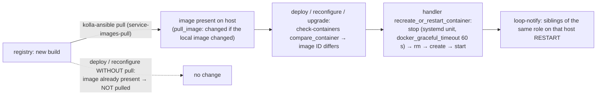

# Update container images

How `kolla-ansible pull`, `deploy`, `reconfigure` and `upgrade` treat container images in 2024.1, with the Docker and
the new Podman back end: `pull` never changes running containers, and after a `pull` that downloaded something the next
`deploy`, `reconfigure` or `upgrade` recreates the affected containers. The page also covers `prune-images`.

The image counts per host in [§2](#2-how-image-pulling-and-recreation-work-code) are for the service set of the [assumed
deployment](index.md#assumed-deployment).

> [!NOTE]
> **Key answers**
>
> - **Images ([§2 to §5](#2-how-image-pulling-and-recreation-work-code)):** a `deploy` without `pull` does not download
>   a rebuilt image, and a new `openstack_tag` applied with `deploy` recreates every container on every host [CODE]
>   ([§2](#2-how-image-pulling-and-recreation-work-code)). Risks of doing so: [§4](#4-risks).
> - **Images:** `pull` never changes running containers, and `deploy`/`reconfigure` never pull an image that is already
>   present locally [CODE] ([§1.1](#11-images)). Both still hold in 2024.1, for the Docker worker and for the new
>   Podman worker.
> - **Changed in 2024.1** [CODE]: the module is `kolla_container`, which drives Docker or Podman
>   (`kolla_container_engine`, default `docker`); the common play's config step now pulls the fluentd image when it is
>   absent, so `deploy`, `reconfigure` and `genconfig` can download that image ([§1.1](#11-images)); `prune-images` has
> a
>   Podman branch ([§1.2](#12-prune-old-images)).

> [!CAUTION]
> [R12](../risk/risk-register.md#r12): changing the tag and running `deploy` (instead of `upgrade`) recreates the whole
> fleet in one go, without the upgrade-specific ordering — see [§4](#4-risks).

## 1. Commands

### 1.1 Images

```bash
kolla-ansible -i multinode pull                         # all enabled images on all hosts
kolla-ansible -i multinode -t nova pull --limit compute # nova-cell images on computes (common images: add -t common)
kolla-ansible -i multinode upgrade                      # recreate from new images (after pull)
ANSIBLE_SERIAL=20 kolla-ansible -i multinode -t nova upgrade
```

- `pull` runs `site.yml` with `kolla_action=pull` (`tools/kolla-ansible:285, :516-519`). It never changes running
  containers [CODE]: the only task of `service-images-pull` runs `kolla_container` `pull_image` for each enabled
  container mapped to the host and notifies no handler (`roles/service-images-pull/tasks/main.yml:2-18`). With Docker,
  `pull_image` pulls the `repository:tag` and reports changed only when the local image ID of that reference changed
  (`module_utils/kolla_docker_worker.py:189-223`); with Podman, when the image attributes changed
  (`module_utils/kolla_podman_worker.py:455-474`).
- `deploy`/`reconfigure` never pull an image that is already present locally, even if the registry has a newer
  build under the same tag [CODE]. With Docker, `check_image` looks the `repository:tag` up among the local images
  (`module_utils/kolla_docker_worker.py:71-79`), and `start_container` and `recreate_or_restart_container` pull only
  when it is missing (`:353-358, :365-367`). With Podman, `check_image` asks the engine for the local image of that
  name, and both paths go through `ensure_image`, which pulls only an absent image
  (`module_utils/kolla_podman_worker.py:257-270, :516-517, :526-527, :675-677`).
- **Changed in 2024.1:** the common play's config step runs `kolla_container` `ensure_image` on the fluentd image
  when `enable_fluentd` is on (`roles/common/tasks/config.yml:42-51`), to read its labels (`:53-91`).
  `ensure_image` pulls the image only when it is absent (`module_utils/kolla_docker_worker.py:501-503`,
  `module_utils/kolla_podman_worker.py:675-677`). So after a tag change, `deploy`, `reconfigure`, `upgrade` and
  `genconfig` runs that include the common play download the new fluentd image before any handler runs; the running
  fluentd container does not change at that step [CODE]. In `deploy`, `reconfigure` and `upgrade`, the RabbitMQ version
  check does the same for the
  rabbitmq image once the `rabbitmq` container exists: it starts a one-shot container from the configured image
  (`roles/rabbitmq/tasks/version-check.yml:18-36, :75`; `roles/rabbitmq/tasks/reconfigure.yml:2`), and
  `start_container` pulls an absent image first.
- After a `pull` that downloaded something, the next `deploy`, `reconfigure` or `upgrade` **recreates** the affected
  containers. Loop-notify restarts their siblings [CODE `module_utils/kolla_container_worker.py:58-89`,
  `module_utils/kolla_docker_worker.py:107-122, :341-363`, `module_utils/kolla_podman_worker.py:317-335, :507-524`;
  [Tags §2.4](../risk/tags.md#24-loop-notify-one-changed-item-notifies-the-handlers-of-all-items-code)].
- **Changed in 2024.1:** `library/kolla_docker.py` no longer exists. `library/kolla_container.py` parses the arguments
  and picks `DockerWorker` when `container_engine` is `docker`, `PodmanWorker` otherwise
  (`library/kolla_container.py:410-420`); the engine comes from `docker_common_options`
  (`group_vars/all.yml:153`), and `kolla_container_engine` defaults to `docker` (`group_vars/all.yml:92`). The logic is
  in `module_utils/kolla_container_worker.py`, `module_utils/kolla_docker_worker.py` and
  `module_utils/kolla_podman_worker.py` ([Repository architecture
  §6](../concepts/repository-architecture.md#6-custom-modules--container-lifecycle-via-kolla_container)).
- `ANSIBLE_SERIAL` reaches only `upgrade` and `reconfigure`, as `-e kolla_serial=…` (`tools/kolla-ansible:294-296,
  :520-523, :529-532`). With `pull` and `deploy` the plays that set `serial: kolla_serial` run their hosts in one
  batch (default `"0"`, e.g. `site.yml:95`, `nova.yml:140`); the MariaDB and RabbitMQ restart plays keep their fixed
  `serial: "33%"` (`mariadb.yml:24`, `rabbitmq.yml:36`).

### 1.2 Prune old images

```bash
kolla-ansible -i multinode prune-images --yes-i-really-really-mean-it
```

- The command refuses to run without `--yes-i-really-really-mean-it` and runs `prune-images.yml`
  (`tools/kolla-ansible:565-576`) [CODE].
- The playbook imports `gather-facts.yml`, then applies the role `prune-images` to the `baremetal` hosts, with
  `serial: kolla_serial` (default `"0"`, one batch: the CLI does not pass `kolla_serial` for this command) and
  `max_fail_percentage` (`prune-images.yml:1-13`) [CODE]. `baremetal` holds the control, network, compute, storage
  and monitoring groups, not the deploy host (`inventory/multinode:32-40`).
- The role first checks that `sudo <engine> ps` works (`roles/prune-images/tasks/validate_docker_execute.yml:2-5`,
  `tools/validate-docker-execute.sh:7-15`). Then, **changed in 2024.1**, it branches on the engine
  (`roles/prune-images/tasks/prune_images.yml:2-16`) [CODE]:
  - Docker: the `docker_prune` module with `images: yes`, the filter `label: kolla_version` and a timeout of
    `docker_image_prune_timeout` (300 s, `roles/prune-images/defaults/main.yml:2`). `docker_prune` is not an
    ansible-core module: ansible-core 2.16.20 redirects it to `community.docker.docker_prune`
    (`lib/ansible/config/ansible_builtin_runtime.yml:745-746`), which `requirements-core.yml:18-20` pins below 4.
  - Podman: `podman image prune --force --filter 'label=kolla_version'`, as a `command` task; the comment says that
    Podman has no equivalent of `docker_prune` and that `podman_image` has no label filter (`:11-16`).
  - Any other value of `kolla_container_engine` prunes nothing (both tasks are guarded by `when`).
- [NOT AVAILABLE] What either prune removes exactly: whether only dangling images go, and so whether the images of the
  previous release are kept after an upgrade, is the behaviour of the `community.docker` collection and of Podman, which
  are not in these sources. The kolla-ansible docs call the command a prune of "orphaned Docker images"
  (`doc/source/user/operating-kolla.rst:256-257`). `tools/cleanup-images --image-version <value>` removes, on the host
  where it runs, the images whose `kolla_version` label equals that value (`tools/cleanup-images:75-78, :94`); which
  value the images carry is [NOT AVAILABLE] here.

## 2. How image pulling and recreation work [CODE]



The diagram holds for both engines: `compare_container` is the same test in the Docker and the Podman worker
(`module_utils/kolla_container_worker.py:58-65`, `module_utils/kolla_podman_worker.py:294-301`), and so is the
recreate branch (`module_utils/kolla_docker_worker.py:353-361`, `module_utils/kolla_podman_worker.py:516-521`). The
stop goes through the container's systemd unit `kolla-<name>-container.service`, whose `ExecStop` is
`/usr/bin/<engine> stop <name> -t <graceful_timeout>` (`module_utils/kolla_systemd_worker.py:20-39, :71-74`). With
Docker the unit is used when it exists, `docker stop` with the same timeout otherwise
(`module_utils/kolla_docker_worker.py:415-431`); with Podman the worker writes the unit if needed and always stops
through it, except for one-shot containers (`module_utils/kolla_podman_worker.py:575-593`). `graceful_timeout` comes
from `docker_graceful_timeout: 60` (`group_vars/all.yml:139, :151`).

**New in 2024.1:** the unit text changed from the 2023.1 template (with Docker, only the start-limit line differs:
`StartLimitInterval=` where 2023.1 wrote `StartLimitIntervalSec=`), and `compare_container` compares the whole unit
file (`module_utils/kolla_systemd_worker.py:20-39, :154-167`). A container recreated from a new image gets the new
unit when it is created (`module_utils/kolla_docker_worker.py:334-339`), and a restart rewrites it (`:439-459`); a
container that no 2024.1 run has created, recreated or restarted yet is reported as changed at its first 2024.1 check
(Swift `deploy` has none) if its unit was written by 2023.1 code
([F16](../reference/findings.md#f16)).

| Case | Who downloads | What restarts | Source |
|---|---|---|---|
| Same tag, rebuilt image, `deploy` without `pull` | nobody (image already present) | nothing | the local tag still resolves to the image the container runs (`module_utils/kolla_docker_worker.py:71-79, :107-122`; Podman `module_utils/kolla_podman_worker.py:257-270, :317-335`) |
| `-t nova pull` | every host in the nova plays, for nova images only; the common images (fluentd, kolla-toolbox, cron) are not pulled, because `common` is a separate play tagged `common` and no role declares it as a dependency (no `roles/*/meta` in 2024.1) | nothing | `site.yml:88-103`, `nova.yml:103-122, :125-147`, `roles/nova/tasks/pull.yml:1-3`, `roles/nova-cell/tasks/pull.yml:1-3`; `roles/service-images-pull/tasks/main.yml:2-18` (no `notify`) |
| `-t nova deploy` after that pull (only the nova-compute image rebuilt) | – | nova_compute **recreated**, nova_libvirt + nova_ssh **restarted** on every compute | recreate if the container differs, else restart (`module_utils/kolla_docker_worker.py:341-363`); the check loop notifies `Restart <item> container` (`roles/nova-cell/tasks/check-containers.yml:2-22`); [Tags §2.4](../risk/tags.md#24-loop-notify-one-changed-item-notifies-the-handlers-of-all-items-code) |
| New `openstack_tag`, `pull` | every host: 10 images per compute, 23 per controller, 11 per network node for this service set, counted as the enabled services mapped to each host | nothing | `roles/service-images-pull/tasks/main.yml:14`, `kolla_ansible/filters.py:60-109`; the hosts are mapped by the groups in `inventory/multinode` and the `<role>_services` defaults (e.g. `roles/mariadb/defaults/main.yml:42-45, :132` for `mariadb_clustercheck`); [Compute scaling §2](../concepts/compute-scaling-and-performance.md#2-work-per-compute-host-read-from-the-task-files) (per compute) |
| New `openstack_tag`, `deploy` | the fluentd image (common config step) and the rabbitmq image (version check) are pulled lazily if `pull` was not run; the others in the handlers | **every container on every host recreated**: fluentd, cron, kolla_toolbox, iscsid, all nova, OVS db + vswitchd, neutron agents, haproxy, keepalived, MariaDB (33 % batches), RabbitMQ (33 % batches)… | `openstack_tag` is built from `openstack_release` (`group_vars/all.yml:679-682`) and every `<svc>_tag` defaults to it (e.g. `roles/nova/defaults/main.yml:106`); `module_utils/kolla_docker_worker.py:107-122`; `roles/mariadb/handlers/main.yml:56-63` + `mariadb.yml:18-35`, `roles/rabbitmq/handlers/main.yml:2-6` + `rabbitmq.yml:30-49`; `roles/common/tasks/config.yml:42-51`, `roles/rabbitmq/tasks/version-check.yml:18-36` |

Image counts per host [CODE] (defaults of `group_vars/all.yml:718-839`, groups of `inventory/multinode`); they are the
same as in 2023.1:

- compute (10): fluentd, kolla_toolbox, cron; iscsid (`roles/iscsi/defaults/main.yml:62-67`, Cinder/LVM);
  nova_libvirt, nova_ssh, nova_compute; openvswitch_db, openvswitch_vswitchd; neutron_openvswitch_agent;
- network node (11): fluentd, kolla_toolbox, cron; haproxy, keepalived (`proxysql` off, `group_vars/all.yml:839`;
  the new `haproxy_ssh` only with `enable_letsencrypt`, off by default: `roles/loadbalancer/defaults/main.yml:29-36`,
  `group_vars/all.yml:796`); openvswitch_db, openvswitch_vswitchd; neutron_openvswitch_agent, neutron_dhcp_agent,
  neutron_l3_agent, neutron_metadata_agent;
- controller (23): fluentd, kolla_toolbox, cron; mariadb, mariadb_clustercheck; rabbitmq; memcached; keystone,
  keystone_ssh, keystone_fernet; glance_api; placement_api; nova_api, nova_scheduler, nova_conductor,
  nova_novncproxy (`nova_super_conductor` off: `enable_cells: "no"`, `group_vars/all.yml:746`); neutron_server;
  cinder_api, cinder_scheduler; heat_api, heat_api_cfn, heat_engine; horizon.

## 3. Which nodes download

Every host that runs at least one container whose image reference changed:

- **computes:** nova-compute, nova-libvirt, nova-ssh, OVS db/vswitchd, the neutron OVS agent, plus common and
  iscsid;
- **network nodes:** agents, OVS, haproxy, keepalived;
- **controllers:** everything else.

`pull` itself never restarts anything. It is safe to run in advance; the 2024.1 docs ask for `kolla-ansible pull`
before `upgrade` (kolla-ansible `doc/source/user/operating-kolla.rst:164-168`).

## 4. Risks

- **Changing the tag and running `deploy`** (instead of `upgrade`) recreates the whole fleet in one go, without the
  upgrade-specific ordering (one-shot containers per image: [Kolla images
  §4](../concepts/kolla-images.md#4-one-shot-containers-what-the-environment-variables-run)):
  - no `nova-status upgrade check` (the `nova_upgrade_checks` container runs in `roles/nova/tasks/upgrade.yml:9-39`
    only);
  - no RPC-pin reload plays (`nova.yml:180-256`, each with `kolla_action == 'upgrade'`);
  - no online data migrations (`nova.yml:258-302`, same condition), except Placement's: its bootstrap container
    (`KOLLA_BOOTSTRAP`, `roles/placement/tasks/bootstrap_service.yml:10-11`) runs `placement-manage db
    online_data_migrations` on every deploy (kolla `docker/placement/placement-api/extend_start.sh:5-9`). Ironic's
    does the same only with `ironic_enable_rolling_upgrade: no` (default `yes`, `roles/ironic/defaults/main.yml:310`;
    `roles/ironic/tasks/bootstrap_service.yml:5-16`, kolla `docker/ironic/ironic-api/extend_start.sh:5-9`);
  - RabbitMQ: both `deploy` and `upgrade` restart it in batches of 33 %, each node drained first
    (`roles/rabbitmq/handlers/main.yml:2-6`, `rabbitmq.yml:30-49`, `roles/rabbitmq/tasks/restart_services.yml:9-17`),
    and **new in 2024.1** both run the version check, which refuses a jump of more than one minor version and a
    downgrade (`roles/rabbitmq/tasks/deploy.yml:2`, `roles/rabbitmq/tasks/upgrade.yml:2`,
    `roles/rabbitmq/tasks/version-check.yml:44-73`). The differences: `upgrade` also enables all stable feature flags on
    the running nodes before the check (`roles/rabbitmq/tasks/upgrade.yml:10`,
    `roles/rabbitmq/tasks/feature-flags.yml:2-5`), and `deploy` runs `bootstrap.yml`
    (`roles/rabbitmq/tasks/deploy.yml:12`). Neither has a cluster-wide stop. Quorum queues are on by default in 2024.1
    ([F17](../reference/findings.md#f17));
  - Neutron (default `neutron_enable_rolling_upgrade: yes`, `roles/neutron/defaults/main.yml:732`): instead of
    expand → restart → contract (`roles/neutron/tasks/rolling_upgrade.yml:13-89`), `bootstrap_neutron` runs
    `neutron-db-manage … upgrade head` for neutron and for each enabled subproject with the new image **before** the
    handlers restart the old `neutron_server` containers (kolla `docker/neutron/neutron-server/extend_start.sh:5-13`;
    `roles/neutron/tasks/deploy.yml:20-23`, `roles/neutron/tasks/bootstrap_service.yml:2-21`,
    `roles/neutron/defaults/main.yml:727`) [CODE]. **Changed in 2024.1:** `neutron_subprojects` lists neutron-fwaas,
    networking-sfc, neutron-dynamic-routing, neutron-vpnaas, vmware-nsx and tap-as-a-service
    (`roles/neutron/defaults/main.yml:674-686`); none is enabled in the assumed deployment. [NOT AVAILABLE] Whether
    `upgrade head` then applies contract migrations under live old-version servers, and what that does to them.
- **An OVS image change** recreates `openvswitch_vswitchd` on every OVS host simultaneously (serial 0 unless
  `ANSIBLE_SERIAL` is set: `site.yml:611-624`). [NOT AVAILABLE] Whether VM networking is interrupted on every compute
  at the same time. Upgrade OVS per batch:

  ```bash
  ANSIBLE_SERIAL=<n> kolla-ansible -t openvswitch upgrade
  ```

  or use `--limit` batches.
- **Upgrade without a prior pull:** hosts download lazily inside the handler phase (`recreate_or_restart_container`
  pulls *before* stopping: Docker `module_utils/kolla_docker_worker.py:353-359`, Podman
  `module_utils/kolla_podman_worker.py:516-519`), which lengthens and staggers the restart window. The fluentd and
  rabbitmq images are pulled earlier, in the config step and in the version check ([§1.1](#11-images)).
- **Podman back end:** the code paths above are read in `module_utils/kolla_podman_worker.py`; how they behave on a real
  Podman host is [NOT AVAILABLE] (source only, nothing was run).

## 5. Verification

- Before:
  - `docker images | grep <tag>` (or `podman images`) on a sample of hosts after `pull`;
  - the image IDs match the registry.
- After:
  - `docker ps --format '{{.Names}} {{.Image}}'` (or `podman ps`) shows the new tag everywhere;
  - `docker inspect -f '{{.Image}}' nova_compute` equals the pulled image ID.

## Related

- [Risk register](../risk/risk-register.md) — the risk items for these operations: [R11](../risk/risk-register.md#r11)
  (`kolla-ansible pull`), [R12](../risk/risk-register.md#r12) (changing `openstack_tag` and running `deploy` instead of
  `upgrade`), [R13](../risk/risk-register.md#r13) (rebuilt image pushed under the same tag),
  [R17](../risk/risk-register.md#r17) (`prune-images`) and [R7](../risk/risk-register.md#r7) (`openvswitch_vswitchd`
  restart or recreate)
- [Technical findings](../reference/findings.md) — [F4](../reference/findings.md#f4) (same-tag rebuilds are not picked
  up) and [F16](../reference/findings.md#f16) (the first 2024.1 check of a container whose unit 2023.1 wrote)
- [Open vSwitch](../components/openvswitch.md) — service card and where to look for the OVS image change of §4
- [Pre-execution checklist](pre-execution-checklist.md) — the checks before every production run, including "Pull
  first"
- [Write config first, apply in controlled batches
  §1.2](controlled-batches.md#12-rolling-reconfigure-with-ansible_serial) — which plays `ANSIBLE_SERIAL` runs in
  batches
- [Stop and destroy](stop-and-destroy.md) — `destroy --include-images`, which removes every Kolla image of the hosts
- [Kolla images §4](../concepts/kolla-images.md#4-one-shot-containers-what-the-environment-variables-run) — one-shot
  containers per image: what the environment variables run
- [Repository architecture
  §6](../concepts/repository-architecture.md#6-custom-modules--container-lifecycle-via-kolla_container) — how
  `kolla_container` decides to pull an image and to recreate a container, with Docker and with Podman
- [Tags §2.4](../risk/tags.md#24-loop-notify-one-changed-item-notifies-the-handlers-of-all-items-code) — loop-notify,
  which restarts the siblings of a recreated container
