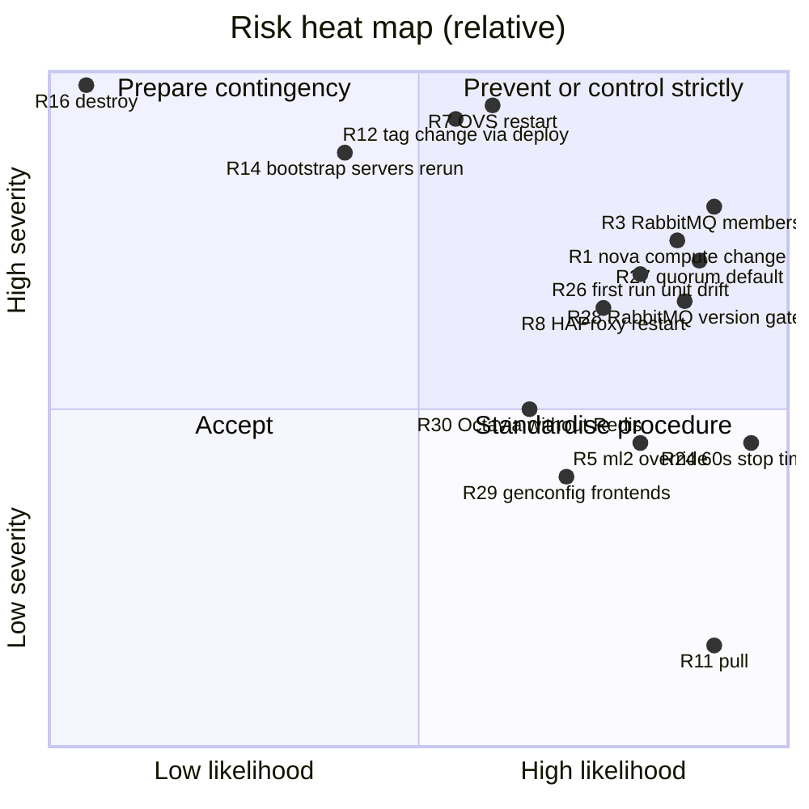

# Risk register

Potentially dangerous operations on a running Kolla-Ansible 2024.1 platform: their impact and the precautions to take
before running them. Ratings are relative to a production cloud with running VMs. The risk IDs are those of the earlier
studies; each entry says whether the risk still applies to 2024.1, with the code that shows it. R26 to R30 are new in
this study.

> [!NOTE]
> **Key answers**
>
> - **30 risks (R1–R30)**, each with what actually happens, its blast radius, VM and API impact, likelihood, severity,
>   precautions and evidence ([Matrix](#matrix)).
> - **Rated Critical:** [R7](#r7) (`openvswitch_vswitchd` restart or recreate), [R12](#r12) (changing the image tag and
>   running `deploy` instead of `upgrade`), [R14](#r14) (`bootstrap-servers` re-run on a live host), [R15](#r15)
>   (`kolla-ansible stop`) and [R16](#r16) (`kolla-ansible destroy`). None of the new risks is rated Critical.
> - **Computes and VMs:** [R1](#r1). Any config change touching nova-compute, followed by a `deploy`/`reconfigure` with
>   a nova tag or no tag, restarts `nova_compute`, `nova_libvirt` and `nova_ssh` on every affected compute, all at once
>   with the default serial 0; whether live migrations in flight fail and whether running VMs keep running are
>   [NOT AVAILABLE].
> - **Network data plane:** [R6](#r6) (with `enable_neutron_agent_ha: yes`, the L3 agent wrapper runs
>   `neutron-netns-cleanup --force --agent-type l3` before the agent starts) and [R7](#r7); whether VM traffic is
>   interrupted is [NOT AVAILABLE].
> - **New in 2024.1:** the first 2024.1 check restarts containers whose systemd unit 2023.1 wrote ([R26](#r26),
>   [F16](../reference/findings.md#f16)); quorum queues are on by default ([R27](#r27),
>   [F17](../reference/findings.md#f17)); `upgrade` refuses a RabbitMQ minor version skip ([R28](#r28)); `genconfig`
>   writes HAProxy frontends that no later tagged run applies ([R29](#r29)); the Octavia jobboard needs Redis
>   ([R30](#r30)).
> - **Changed in 2024.1:** fewer roles read the memcached list ([R4](#r4), 28 instead of 34); `upgrade` now runs the
>   RabbitMQ version check ([R10](#r10)); `bootstrap-servers` installs the engine named by `kolla_container_engine`
>   ([R14](#r14)); `destroy` keeps the inventory paths under `/etc/kolla` and disables the units ([R16](#r16));
>   `prune-images` has a Podman branch ([R17](#r17)). [R24](#r24) still does not hold as written and [R25](#r25)
>   still does not apply.
> - **Likelihood × severity at a glance:** the [heat map](#heat-map-likelihood--severity).

- **Likelihood** = how likely the operation is to cause the impact *when the triggering condition is present*.
- **Severity** = worst realistic outcome.
- **Evidence** cites the 2024.1 source lines, or the study section that cites them. Nothing was run. [NOT AVAILABLE]
  marks outcomes that the sources do not establish.

## Matrix

| # | Risk | Likelihood | Severity |
|---|---|---|---|
| [R1](#r1) | Config change touching nova-compute | High | High |
| [R2](#r2) | Enabling or disabling a service with a logrotate or fluentd entry | High | Medium–High |
| [R3](#r3) | Changing RabbitMQ membership, password or port | Certain | High |
| [R4](#r4) | Changing memcached membership | Certain | High |
| [R5](#r5) | `ml2_conf.ini` override meant for neutron-server | Certain (neutron-server hosts only) | Medium (High where agents share the neutron-server host) |
| [R6](#r6) | `neutron_l3_agent` restart with `enable_neutron_agent_ha: yes` | Certain (if HA flag) | High |
| [R7](#r7) | `openvswitch_vswitchd` restart or recreate | Certain on image change | Critical |
| [R8](#r8) | HAProxy config change | Certain if changed | High |
| [R9](#r9) | MariaDB config change or image change | Certain if changed | High |
| [R10](#r10) | RabbitMQ image change (`upgrade`) | Certain on upgrade | Medium–High |
| [R11](#r11) | `kolla-ansible pull` | – | Low (bandwidth) |
| [R12](#r12) | Image tag change run with `deploy` instead of `upgrade` | Certain | Critical |
| [R13](#r13) | Rebuilt image under the same tag, then `deploy`/`reconfigure` without `pull` | – | Medium (drift) |
| [R14](#r14) | `bootstrap-servers` re-run on a live host | Medium | Critical |
| [R15](#r15) | `kolla-ansible stop` | Certain | Critical |
| [R16](#r16) | `kolla-ansible destroy` | Certain | Critical |
| [R17](#r17) | `prune-images` | Low | Low |
| [R18](#r18) | `mariadb_recovery` | Certain | High |
| [R19](#r19) | Keystone `reconfigure` | Certain if changed | Medium–High |
| [R20](#r20) | Glance reconfigure / deploy | Certain | Medium |
| [R21](#r21) | Enabling Swift (or another Glance backend) on a running cloud | High | High |
| [R22](#r22) | Inventory reordering | Medium | High |
| [R23](#r23) | Any run with `--limit` on a large inventory | Certain | Low (time), Medium (drift) |
| [R24](#r24) | Effective container stop timeout is 10 s (60 s since 2023.1) | Certain | Medium |
| [R25](#r25) | `-t common` believed to reconfigure fluentd/cron | Does not apply in 2024.1 | – |
| [R26](#r26) | First 2024.1 `deploy`/`reconfigure` on containers whose unit 2023.1 wrote (new) | Certain (such containers) | High |
| [R27](#r27) | Quorum-queue default on a cloud with classic queues (new) | Certain (default kept) | High |
| [R28](#r28) | `upgrade` with RabbitMQ more than one minor version behind (new) | Certain on the 2023.1 default image; otherwise [NOT AVAILABLE] | High |
| [R29](#r29) | HAProxy frontend change written by `genconfig` (new) | High (with `genconfig`) | Medium (drift) |
| [R30](#r30) | Octavia with the amphora provider and no Redis (new) | Certain (default) | Medium |

### R1 — Config change touching nova-compute

**Still applies to 2024.1** [CODE].

| | |
|---|---|
| **Operation / trigger** | Any config change touching **nova-compute** (override, global flag, password, RabbitMQ list, the 2024.1 quorum-queue default of [R27](#r27)) followed by `deploy`/`reconfigure` with a nova tag or no tag |
| **What actually happens** | `nova_compute` **and `nova_libvirt` and `nova_ssh`** restart on every affected compute, **all at once** (serial 0). The cause is the loop-notify behaviour: `Check nova-cell containers` loops over `nova_cell_services` with `notify: "Restart {{ item.key }} container"`, and ansible-core 2.16.20 processes every executed item's `_ansible_notify` when the loop as a whole is changed. `nova_libvirt` is a container only when `enable_nova_libvirt_container` is true, which is the default for `nova_compute_virt_type` `kvm`/`qemu`; with a host libvirt (other virt types) there is no `nova_libvirt` restart |
| **Blast radius** | all computes |
| **VM impact** | libvirtd restart (container `nova_libvirt`, retried up to 5 times: "when guests running, nova_libvirt will raise error even though it is removed"); [NOT AVAILABLE] whether live migrations in flight fail and whether running VMs keep running |
| **API impact** | nova-compute restarts on each host; [NOT AVAILABLE] how long it is down |
| **Likelihood** | High |
| **Severity** | High |
| **Precautions** | `genconfig` + `diff`, then `deploy-containers --limit` in batches, or `ANSIBLE_SERIAL` (honoured by `reconfigure` and `upgrade`) / `-e kolla_serial=<n>`; drain live migrations first; validate libvirt restart behaviour in staging |
| **Evidence** | `roles/nova-cell/tasks/check-containers.yml:2-22`, `roles/nova-cell/defaults/main.yml:2-64`, `roles/nova-cell/handlers/main.yml:74-117,151-168` (retries at `:110-113`), `group_vars/all.yml:827,1127`, `nova.yml:125-147` (`serial: '{{ kolla_serial\|default("0") }}'` at `:140`), `tools/kolla-ansible:490-493,522,531`; ansible-core 2.16.20 `lib/ansible/executor/playbook_executor.py:300-302` (serial 0 = one batch), `lib/ansible/executor/task_executor.py:126-130` and `lib/ansible/plugins/strategy/__init__.py:648-673` (one changed item marks the loop changed, then every item's `_ansible_notify` is processed); [Tags §2.4](tags.md#24-loop-notify-one-changed-item-notifies-the-handlers-of-all-items-code); [Nova deep dive §5](../components/nova-deep-dive.md#5-nova-libvirt-why-its-restart-is-special) |

### R2 — Enabling or disabling a service with a logrotate or fluentd entry

**Still applies to 2024.1** [CODE], with the reach it has had since 2023.1: `common` is its own play, tagged `common`
only, on the `cron`, `fluentd`, `kolla-logs` and `kolla-toolbox` groups. The lists changed (removed services gone,
`redis` logrotate entry added) and the common config step now makes sure the fluentd image is present.

| | |
|---|---|
| **Operation / trigger** | Enabling or disabling a service that has a fluentd input entry (`fluentd_input_openstack_services`, e.g. barbican) or a logrotate entry (`enable_X` for most services) in `globals.yml`, then running the `common` play (an untagged run, or `-t common`) |
| **What actually happens** | `td-agent.conf` (its `00-global` input lists the enabled OpenStack services) and `logrotate.conf` render differently on **every host of the `common` play** → `Restart fluentd container` / `Restart cron container`; then `Check common containers` (`compare_container` runs `kolla_set_configs --check` in each container) reports changed and loop-notify also notifies **`kolla_toolbox`**. With the `multinode` inventory these are the `control`, `network`, `compute`, `storage` and `monitoring` hosts. A tagged service run (`-t nova`) does **not** run the `common` play: the files keep the old content until a later untagged or `-t common` run. Nova/Cinder/Glance configs gain sections (e.g. `[barbican]`) → those services restart when their play runs. Flags in neither list (e.g. `enable_ovn`, `enable_memcached`) leave both files unchanged; in 2024.1 `enable_redis` has a logrotate entry, and `enable_prometheus_fluentd_integration`, `enable_letsencrypt` and `enable_fluentd_systemd` add fluentd inputs. **New in 2024.1:** before rendering, the play runs `ensure_image` on the fluentd image (pulled when absent) and reads its labels |
| **Blast radius** | fleet-wide (untagged run or `-t common`); none for fluentd/cron on a tagged service run |
| **VM impact** | fluentd, cron and kolla_toolbox are none of the containers that [Tags §3.1](tags.md#31-per-tag-answers-files-vms-apis-networkingstorage-safety-prerequisites) traces to running VMs [CODE]; [NOT AVAILABLE] whether their restart affects VMs another way ([Apply `common` changes (fluentd, cron, kolla_toolbox) §3](../operations/apply-common-changes.md#3-how-common-actually-reaches-hosts)); Nova restarts as R1 |
| **API impact** | the services whose configs changed restart (stop with the `docker_graceful_timeout` of 60 s, then start; [R24](#r24)); [NOT AVAILABLE] how long their APIs are unavailable, and whether the fluentd, cron and kolla_toolbox restarts affect APIs |
| **Likelihood** | High |
| **Severity** | Medium–High |
| **Precautions** | Treat `enable_*` changes as fleet-wide changes. Roll out with `--limit` batches; apply the `common` side deliberately with `-t common`; make sure the fluentd image is in the registry before a `-t common` run or `genconfig` |
| **Evidence** | `site.yml:88-103` (`Apply role common`, hosts `cron`/`fluentd`/`kolla-logs`/`kolla-toolbox`, `tags: common`); `inventory/multinode:49-54,203-213`; `roles/common/tasks/config.yml:42-91` (fluentd image and labels), `:140-203` (td-agent.conf), `:205-270` (logrotate.conf), `roles/common/defaults/main.yml:154-210` (fluentd service list), `roles/common/tasks/check-containers.yml:2-17`, `roles/common/tasks/deploy.yml:1-9`; `module_utils/kolla_container_worker.py:20`, `:58-65`, `module_utils/kolla_docker_worker.py:146-181` (config check); loop-notify ([Tags §2.4](tags.md#24-loop-notify-one-changed-item-notifies-the-handlers-of-all-items-code)); `roles/nova-cell/templates/nova.conf.j2:259-264`, `nova.yml:125-147` |

### R3 — Changing RabbitMQ membership, password or port

**Still applies to 2024.1** [CODE].

| | |
|---|---|
| **Operation / trigger** | Changing RabbitMQ group membership (adding/removing a controller), RabbitMQ password or port |
| **What actually happens** | `rpc_transport_url` and `notify_transport_url` (one entry per host of the `rabbitmq` group, with user, password and port) change in **every** messaging service on every host → all nova, neutron (and any compute-side agent) containers restart; `Update cell` rewrites the cell's MQ URL when it differs |
| **Blast radius** | all hosts |
| **VM impact** | as R1 plus neutron agent restart; [NOT AVAILABLE] its effect on flows |
| **API impact** | yes |
| **Likelihood** | Certain |
| **Severity** | High |
| **Precautions** | Plan as a maintenance; batch with `--limit`; verify RabbitMQ cluster health first |
| **Evidence** | `group_vars/all.yml:241-258`; `roles/nova-cell/tasks/create_cells.yml:31-55`; loop-notify ([Tags §2.4](tags.md#24-loop-notify-one-changed-item-notifies-the-handlers-of-all-items-code)) |

### R4 — Changing memcached membership

**Still applies to 2024.1** [CODE]; 27 roles loop over the list instead of 33 (freezer, murano, sahara, senlin, solum
and
vitrage are gone); a 28th, telegraf, names the group only to test whether its own host runs memcached
(`roles/telegraf/templates/telegraf.conf.j2:54-57`).

| | |
|---|---|
| **Operation / trigger** | Changing memcached membership |
| **What actually happens** | 27 roles loop over `groups['memcached']` in their templates (grep of `groups['memcached']` in `roles/*/templates` and `roles/*/defaults` gives 28 roles, telegraf only testing its own host: aodh, barbican, blazar, ceilometer, cinder, cloudkitty, cyborg, designate, glance, gnocchi, heat, horizon, ironic, keystone, magnum, manila, masakari, mistral, neutron, nova, octavia, placement, swift, tacker, telegraf, venus, watcher, zun), so their services restart when their plays run; [NOT AVAILABLE] whether cached tokens are lost. Not only the control plane: `neutron.conf` is rendered for every neutron agent, so `neutron_openvswitch_agent` restarts on every compute and network node, and the dhcp, l3 and metadata agents, which get the same file, restart on network nodes; `cinder.conf` reaches every cinder service (cinder-volume/backup included) and `ceilometer.conf` every ceilometer service (ceilometer-compute included). Compute `nova.conf` (nova-cell) has no memcached list |
| **Blast radius** | controllers + network nodes + all computes (+ storage) |
| **VM impact** | OVS agent restart; [NOT AVAILABLE] its effect on flows, and whether router/DHCP traffic is interrupted on network nodes; with `enable_neutron_agent_ha`, the R6 netns cleanup |
| **API impact** | memcached server list changes; [NOT AVAILABLE] effect on auth latency and Horizon sessions |
| **Likelihood** | Certain |
| **Severity** | High |
| **Precautions** | Plan as a dataplane change, like R3: batch with `--limit` or `ANSIBLE_SERIAL`, network nodes one at a time; low-traffic window |
| **Evidence** | [fact sheet B §3.9](../reference/factsheets/b-mariadb-rabbitmq-keystone.md#39-operationally-notable-behaviour-risks-and-oddities) item 2, [§3.10](../reference/factsheets/b-mariadb-rabbitmq-keystone.md#310-runtime-dependency-of-other-services-on-keystone-grep-across-ansiblerolestemplates); [Memcached](../components/memcached.md); `roles/neutron/templates/neutron.conf.j2:123`, `roles/neutron/tasks/config.yml:87-122`; `roles/cinder/tasks/config.yml:75-93`, `roles/cinder/templates/cinder.conf.j2:146`; `roles/ceilometer/tasks/config.yml:196-214`, `roles/ceilometer/templates/ceilometer.conf.j2:69` |

### R5 — `ml2_conf.ini` override meant for neutron-server

**Still applies to 2024.1, as narrowed in 2023.1** [CODE]: `ml2_conf.ini` is rendered only for `neutron-server` and
`neutron-infoblox-ipam-agent`; `openvswitch_agent.ini` has its own template and its own override files, so an
`ml2_conf.ini` override does not reach the OVS agents ([F11](../reference/findings.md#f11)).

| | |
|---|---|
| **Operation / trigger** | `/etc/kolla/config/neutron/ml2_conf.ini` override (meant for neutron-server) |
| **What actually happens** | `neutron_server` (and `neutron_infoblox_ipam_agent` if enabled) restarts. On a host that also runs neutron agents (e.g. control and network roles on the same host), loop-notify in `Check neutron containers` also restarts every neutron container of that host, the OVS, dhcp, l3 and metadata agents included. OVS agents on hosts without neutron-server are not touched by this override. The OVS agent override is `neutron/openvswitch_agent.ini` |
| **Blast radius** | neutron-server hosts (and the agents that share them) |
| **VM impact** | none on hosts without neutron-server; where agents share the host: OVS agent restart, [NOT AVAILABLE] its effect on flows, and whether router/DHCP traffic is interrupted |
| **API impact** | neutron-server restart |
| **Likelihood** | Certain (neutron-server hosts only) |
| **Severity** | Medium (High where agents share the neutron-server host) |
| **Precautions** | Put server-only options in `neutron/neutron-server.conf` or `neutron/ml2_conf.ini`; agent options in `neutron/openvswitch_agent.ini`; check the rendered diff |
| **Evidence** | `roles/neutron/tasks/config.yml:159-179` (`services_need_ml2_conf_ini`), `:198-213` (`openvswitch_agent.ini`), `roles/neutron/tasks/check-containers.yml:2-19` (loop-notify, [Tags §2.4](tags.md#24-loop-notify-one-changed-item-notifies-the-handlers-of-all-items-code)) |

### R6 — `neutron_l3_agent` restart with `enable_neutron_agent_ha: yes`

**Still applies to 2024.1** [CODE]; `neutron_l3_agent_failover_delay` (default `0`) can stagger the restarts, and the
cleanup also reads `fwaas_driver.ini` when FWaaS is enabled ([F12](../reference/findings.md#f12)).

| | |
|---|---|
| **Operation / trigger** | Any restart of `neutron_l3_agent` with `enable_neutron_agent_ha: yes` (default `no`) |
| **What actually happens** | the wrapper runs `neutron-netns-cleanup --force --agent-type l3` **before** the agent starts (the wrapper's comment: "Remove all l3 related netns in case of multiple active routers in l3 high available mode"), then `neutron-l3-agent` starts [CODE]. The handler first starts stopped agents, then restarts running agents in a loop over the hosts of `neutron_l3_agent_running_True`, pausing `neutron_l3_agent_failover_delay` seconds between items (default `0`: no spacing) [CODE]. [NOT AVAILABLE] What the command deletes: it is neutron code, which is not in these sources ([F12](../reference/findings.md#f12)) |
| **Blast radius** | network nodes (and computes with `enable_neutron_dvr`) |
| **VM impact** | [NOT AVAILABLE] whether north-south and floating-IP traffic of the routers on that node stops, whether and when `neutron-l3-agent` rebuilds the namespaces, and whether HA routers fail over |
| **API impact** | none |
| **Likelihood** | Certain (if HA flag) |
| **Severity** | High |
| **Precautions** | Restart network nodes one at a time; fail routers over first; set `neutron_l3_agent_failover_delay` to space the restarts |
| **Evidence** | `roles/neutron/templates/neutron-l3-agent-wrapper.sh.j2:5-20`; `group_vars/all.yml:813,816`; `roles/neutron/handlers/main.yml:90-157`, `roles/neutron/defaults/main.yml:78-92`, `:649-651` |

### R7 — `openvswitch_vswitchd` restart or recreate

**Still applies to 2024.1** [CODE]. New in the 2024.1 image: `openvswitch_db` converts `conf.db` at start when
`ovsdb-tool needs-conversion` says so.

| | |
|---|---|
| **Operation / trigger** | `openvswitch_vswitchd` restart or recreate (image change, `start-ovs` change, `-t openvswitch` with a changed image, the first 2024.1 check of a container whose unit 2023.1 wrote ([R26](#r26)); also any `openvswitch_db`-only drift, e.g. a `start-ovsdb-server` change or a db image, volume or dimension change: `check-containers` loops over both OVS services, so loop-notify ([Tags §2.4](tags.md#24-loop-notify-one-changed-item-notifies-the-handlers-of-all-items-code)) also notifies the vswitchd handler, which runs after the db restart and wait) |
| **What actually happens** | `ovs-vswitchd` (the userspace daemon) restarts. The image only runs `modprobe openvswitch` (the kernel module is loaded, never unloaded or reloaded), and `start-ovs` launches `ovs-vswitchd` with no flow save/restore. Bridges and ports persist in `conf.db` on the `openvswitch_db` volume; the db image creates `conf.db` if absent and runs `ovsdb-tool convert` when a conversion is needed. [NOT AVAILABLE] Whether the OpenFlow tables held by the old daemon are lost, and whether `neutron-openvswitch-agent` (or `ovn-controller` with OVN) reprograms them |
| **Blast radius** | per host (all OVS hosts at once with serial 0) |
| **VM impact** | [NOT AVAILABLE] whether **all VM network traffic on the host** is interrupted until flows are restored, and for how long |
| **API impact** | none |
| **Likelihood** | Certain on image change |
| **Severity** | Critical |
| **Precautions** | Upgrade or recreate OVS host by host with evacuation or acceptance; never fleet-wide with serial 0 |
| **Evidence** | `roles/openvswitch/handlers/main.yml:2-44`, `roles/openvswitch/tasks/check-containers.yml:2-18`, `roles/openvswitch/templates/start-ovs.j2:2`, `roles/openvswitch/defaults/main.yml:86`; kolla `docker/openvswitch/openvswitch-vswitchd/extend_start.sh:8`, `docker/openvswitch/openvswitch-db-server/extend_start.sh:3-10`; [Open vSwitch](../components/openvswitch.md); [Kolla images §5](../concepts/kolla-images.md#5-per-image-start-behaviour) |

### R8 — HAProxy config change

**Still applies to 2024.1, with the staged restart of 2023.1** [CODE]: the `loadbalancer` handlers restart the
backups before the node that holds the VIP. New in 2024.1: a `Restart haproxy-ssh container` handler (Let's Encrypt
only) runs last, on every host at once, and the single external frontend (off by default) adds a map file that also
notifies the restart.

| | |
|---|---|
| **Operation / trigger** | HAProxy config change (any service frontend via `haproxy-config`, the `external-frontend-map` block, certs, `haproxy.cfg`); also the first 2024.1 run on a 2023.1 cloud: the haproxy container definition gained a volume, and its unit was written by 2023.1 ([R26](#r26)) |
| **What actually happens** | `haproxy` is **stopped and started** (never reloaded). The handlers first find which host holds `kolla_internal_vip_address`; every backup host stops and restarts `haproxy` (all backups at once) and waits for `haproxy_monitor_port`; then the VIP holder stops `haproxy`, starts it and waits for the port. On a haproxy-only change keepalived is not stopped, so the VIP stays on a node whose haproxy is down until it is back; keepalived runs a `check_alive` track script (interval 2, fall 2) by default. Every stop and start handler is skipped under `kolla_action` `config` ([R29](#r29)). [NOT AVAILABLE] whether that script moves the VIP during the master restart, and for how long the APIs are unreachable |
| **Blast radius** | all APIs + **all DB traffic** (`database_address` is `kolla_internal_fqdn`; `enable_proxysql` defaults to `no`) |
| **VM impact** | none directly; [NOT AVAILABLE] whether nova/neutron get DB errors while haproxy restarts |
| **API impact** | yes |
| **Likelihood** | Certain if changed |
| **Severity** | High |
| **Precautions** | `ANSIBLE_SERIAL=1` for haproxy changes; `--skip-tags haproxy` when you don't intend to change frontends |
| **Evidence** | `roles/loadbalancer/handlers/main.yml:1-34` (VIP lookup), `:54-68,90-118` (backups), `:179-193,224-252` (master), `:210-222` (master keepalived stopped only on `Restart keepalived container`), `:331-345` (haproxy-ssh); `roles/haproxy-config/tasks/main.yml:2-23`, `:25-53` (single external frontend); `site.yml:105-327`; `roles/loadbalancer/templates/keepalived/keepalived.conf.j2:1-8`, `:15`, `roles/loadbalancer/defaults/main.yml:121` (new haproxy volume), `:187`; `group_vars/all.yml:49,83,839`; [HAProxy and keepalived](../components/haproxy-keepalived.md); [fact sheet A §1.8](../reference/factsheets/a-infra-lb-ovn.md#18-operationally-notable-behaviour) |

### R9 — MariaDB config change or image change

**Still applies to 2024.1, with the restart mechanism of 2023.1** [CODE]: the handlers only group hosts; the restart is
a separate play with `serial: "33%"`. Every MariaDB play now sets `max_fail_percentage`, default 100, which stops
nothing early.

| | |
|---|---|
| **Operation / trigger** | MariaDB config change or image change |
| **What actually happens** | `restart mariadb` puts running nodes in group `mariadb_restart` and new nodes in `mariadb_start`. The `Restart mariadb services` play then restarts them in batches of `int(33% × hosts)` or at least 1 (one node at a time for 3 nodes); each node waits up to 10 × 6 s for its port and for WSREP `Synced`. If every host of a batch fails, ansible-core stops the playbook, so later batches are not restarted. HAProxy's single active backend is the first host of the default shard (the others are `backup`). [NOT AVAILABLE] In which order `group_by` places the hosts, hence whether the active backend restarts first |
| **Blast radius** | DB cluster |
| **VM impact** | none directly |
| **API impact** | DB connection resets |
| **Likelihood** | Certain if changed |
| **Severity** | High |
| **Precautions** | Check `wsrep_cluster_size` and `Synced` on all nodes before; take a backup (`mariadb_backup`); watch between batches |
| **Evidence** | `roles/mariadb/handlers/main.yml:56-73`, `mariadb.yml:18-52`, `roles/mariadb/tasks/restart_services.yml:2-51`, `roles/mariadb/defaults/main.yml:64`, `group_vars/all.yml:477`; ansible-core 2.16.20 `lib/ansible/utils/helpers.py:25-34` (percentage → `int(...) or 1`), `lib/ansible/executor/playbook_executor.py:207-209`, `:219-220` (a fully failed batch ends the playbook); [MariaDB](../components/mariadb.md); [fact sheet B §1.2](../reference/factsheets/b-mariadb-rabbitmq-keystone.md#12-mariadb_services-ansiblerolesmariadbdefaultsmainyml2-47), [§1.5](../reference/factsheets/b-mariadb-rabbitmq-keystone.md#15-handlers-ansiblerolesmariadbhandlersmainyml-in-definition-order), [§1.8](../reference/factsheets/b-mariadb-rabbitmq-keystone.md#18-operationally-notable-behaviour-risks-and-oddities) |

### R10 — RabbitMQ image change (`upgrade`)

**Still applies to 2024.1, with the rolling restart of 2023.1** [CODE]: `upgrade` does not stop all brokers; it
restarts them in `serial: "33%"` batches, draining each one first. **Changed in 2024.1:** `upgrade` now runs the
RabbitMQ version check first ([R28](#r28)).

| | |
|---|---|
| **Operation / trigger** | RabbitMQ image change (`upgrade`), or `kolla-ansible rabbitmq-upgrade <version>` |
| **What actually happens** | `upgrade.yml` runs `version-check`, then (without `om_enable_rabbitmq_high_availability`, the default) removes the `ha-all` policy, then `config`, `feature-flags` and `check-containers`; the restart handler only adds the host to `rabbitmq_restart`. The `Restart rabbitmq services` play then, per batch of `int(33% × hosts)` or at least 1, puts the node into maintenance mode (`rabbitmq_upgrade` `drain`), recreates the container and waits with `rabbitmqctl wait --timeout 60`. `rabbitmq-upgrade` runs the same plays with the image `rabbitmq-<version>`. [NOT AVAILABLE] whether clients reconnect without errors while a broker is drained |
| **Blast radius** | all RPC |
| **VM impact** | [NOT AVAILABLE] whether nova-compute heartbeats are lost and services are reported down |
| **API impact** | [NOT AVAILABLE] whether API calls fail while a broker restarts |
| **Likelihood** | Certain on upgrade |
| **Severity** | Medium–High |
| **Precautions** | Maintenance window; watch for agent and compute services reported down; check the running RabbitMQ version first ([R28](#r28)) |
| **Evidence** | `roles/rabbitmq/tasks/upgrade.yml:1-12`, `roles/rabbitmq/tasks/remove-ha-all-policy.yml:2-29`, `roles/rabbitmq/handlers/main.yml:2-6`, `rabbitmq.yml:30-49`, `roles/rabbitmq/tasks/restart_services.yml:2-39`, `rabbitmq-upgrade.yml:18-21`, `tools/kolla-ansible:585-590`; [RabbitMQ](../components/rabbitmq.md); [fact sheet B §2.8](../reference/factsheets/b-mariadb-rabbitmq-keystone.md#28-operationally-notable-behaviour-risks-and-oddities) |

### R11 — `kolla-ansible pull`

**Still applies to 2024.1** [CODE]; the pull goes to Docker or Podman per `kolla_container_engine`.

| | |
|---|---|
| **Operation / trigger** | `kolla-ansible pull` |
| **What actually happens** | downloads images on every host: one `pull_image` per enabled container mapped to the host (retried `service_images_pull_retries` times, default 3) |
| **Blast radius** | registry + network |
| **VM impact** | none |
| **API impact** | none |
| **Likelihood** | – |
| **Severity** | Low (bandwidth) |
| **Precautions** | Run ahead of maintenance; rate-limit with `--forks`; local registry mirror |
| **Evidence** | `roles/service-images-pull/tasks/main.yml:2-18`, `roles/service-images-pull/defaults/main.yml:6`; `module_utils/kolla_docker_worker.py:189-223`; `module_utils/kolla_podman_worker.py:455-474`; `library/kolla_container.py:410-420` (engine dispatch) |

### R12 — Image tag change run with `deploy` instead of `upgrade`

**Still applies to 2024.1** [CODE].

| | |
|---|---|
| **Operation / trigger** | Changing `openstack_tag` / `*_tag` and running `deploy` instead of `upgrade` |
| **What actually happens** | every container is **recreated** (fleet-wide); upgrade-specific steps (the `nova-status` upgrade check, the Nova reload plays, online migrations except Placement's, which run inside `bootstrap_placement`, and, with the non-default `ironic_enable_rolling_upgrade: no`, Ironic's inside `bootstrap_ironic`) do **not** run. Neutron: instead of the rolling expand → restart → contract (default `neutron_enable_rolling_upgrade: yes`), `bootstrap_neutron` runs `neutron-db-manage … upgrade head` for neutron and for each enabled subproject (`neutron-fwaas`, `networking-sfc`, `neutron-dynamic-routing`, `neutron-vpnaas`, `vmware-nsx`, `tap-as-a-service`) with the new image **before** the handlers restart the old `neutron_server` containers; [NOT AVAILABLE] whether `upgrade head` applies the expand and contract branches together, which would run contract migrations under live old-version servers |
| **Blast radius** | fleet-wide |
| **VM impact** | as R1 + R7 + R8 together |
| **API impact** | yes |
| **Likelihood** | Certain |
| **Severity** | Critical |
| **Precautions** | Use `pull` then `upgrade` (2024.1 docs, which also recommend `prechecks` before it); per-service tags; `ANSIBLE_SERIAL` |
| **Evidence** | `module_utils/kolla_container_worker.py:67-89`, `module_utils/kolla_docker_worker.py:107-122`, `:341-363` (new image → recreate); `doc/source/user/operating-kolla.rst:164-199`; `nova.yml:180-302` (reload and online-migration plays, `kolla_action == 'upgrade'` only), `roles/nova/tasks/upgrade.yml:9-39`; `roles/neutron/tasks/deploy.yml:20-23`, `roles/neutron/tasks/bootstrap_service.yml:2-21`, `roles/neutron/defaults/main.yml:674-687`, `:727-733`, `roles/neutron/tasks/upgrade.yml:4-8`, `roles/neutron/tasks/rolling_upgrade.yml:13-89`; kolla `docker/neutron/neutron-server/extend_start.sh:5-13`, `docker/placement/placement-api/extend_start.sh:5-9`, `docker/ironic/ironic-api/extend_start.sh:5-8`; `roles/ironic/tasks/bootstrap_service.yml:16`, `roles/ironic/defaults/main.yml:310`; [Kolla images §4](../concepts/kolla-images.md#4-one-shot-containers-what-the-environment-variables-run); [F15](../reference/findings.md#f15) |

### R13 — Rebuilt image under the same tag, then `deploy`/`reconfigure` without `pull`

**Still applies to 2024.1** [CODE], with Docker and with Podman ([F4](../reference/findings.md#f4)).

| | |
|---|---|
| **Operation / trigger** | Rebuilt image pushed under the **same tag**, then `deploy`/`reconfigure` without `pull` |
| **What actually happens** | nothing changes (only absent images are pulled; the comparison uses the local image of that tag). After `pull`: recreate, plus loop-notify restarts |
| **Blast radius** | – / role-wide |
| **VM impact** | as R1 |
| **API impact** | – |
| **Likelihood** | – |
| **Severity** | Medium (drift) |
| **Precautions** | Use immutable tags; always `pull` deliberately |
| **Evidence** | `module_utils/kolla_docker_worker.py:71-79` (local image lookup), `:107-122` (image id compare), `:341-372` (pull only if absent); `module_utils/kolla_podman_worker.py:257-271`, `:507-527`; loop-notify ([Tags §2.4](tags.md#24-loop-notify-one-changed-item-notifies-the-handlers-of-all-items-code)) |

### R14 — `bootstrap-servers` re-run on a live host

**Still applies to 2024.1** [CODE]; the work comes from ansible-collection-kolla (`openstack.kolla.baremetal`). New in
2024.1, the engine role and its SDK role follow `kolla_container_engine` (`docker` by default, or `podman`).

| | |
|---|---|
| **Operation / trigger** | `bootstrap-servers` re-run on a live host |
| **What actually happens** | with Docker, can **restart the Docker daemon** (if `daemon.json` or the Docker unit changes; `docker_systemd_reload: false` by default, so the handler restarts rather than reloads) → [NOT AVAILABLE] whether every container on the host stops and how the `kolla-<name>-container.service` units (which declare `After=`/`Wants=docker.service`) bring them back; **all hosts at once** by default. Also disables firewalld/ufw (`disable_firewall: True`), sets SELinux permissive, and removes host packages: on Debian `lxd`, `lxc`, `open-iscsi` and, with the libvirt container, `libvirt-bin`; on RedHat, with the libvirt container, `libvirt`, `libvirt-daemon`, `iscsi-initiator-utils` |
| **Blast radius** | per host / fleet |
| **VM impact** | a Docker restart affects `nova_libvirt` and OVS → see R1/R7 |
| **API impact** | yes |
| **Likelihood** | Medium |
| **Severity** | Critical |
| **Precautions** | Run only with `--limit` on new hosts, or `-e kolla_serial=1`; diff `daemon.json` first |
| **Evidence** | `kolla-host.yml:4-14`; `tools/kolla-ansible:485-489`; ansible-collection-kolla `roles/baremetal/tasks/main.yml:2-9`, `roles/baremetal/tasks/install.yml:3-38`, `roles/baremetal/tasks/post-install.yml:2-28`, `roles/baremetal/defaults/main.yml:25-37`, `roles/packages/tasks/main.yml:15-23`, `roles/packages/defaults/main.yml:25-34`, `roles/docker/tasks/config.yml:9-53`, `roles/docker/handlers/main.yml:2-15`, `roles/docker/defaults/main.yml:65`; `module_utils/kolla_systemd_worker.py:20-39`, `:50-54`; [fact sheet E §1–2](../reference/factsheets/e-host-bootstrap-ops-playbooks.md#1-ansiblekolla-hostyml-the-bootstrap-servers-command) |

### R15 — `kolla-ansible stop`

**Still applies to 2024.1** [CODE].

| | |
|---|---|
| **Operation / trigger** | `kolla-ansible stop --yes-i-really-really-mean-it` |
| **What actually happens** | stops all Kolla containers (incl. nova_libvirt, OVS, MariaDB) on targeted hosts, except those named in `skip_stop_containers`; each stop goes through the container's systemd unit when it exists |
| **Blast radius** | targeted hosts |
| **VM impact** | `nova_libvirt` and OVS containers stopped; [NOT AVAILABLE] whether VM network traffic stops (see R7) |
| **API impact** | yes |
| **Likelihood** | Certain |
| **Severity** | Critical |
| **Precautions** | Use `--limit` + tags + `skip_stop_containers`; MariaDB then needs `mariadb_recovery` |
| **Evidence** | `tools/kolla-ansible:533-545`; `roles/service-stop/tasks/main.yml:2-12`; `module_utils/kolla_docker_worker.py:415-431`; [Stop and destroy](../operations/stop-and-destroy.md); [fact sheet B §1.3](../reference/factsheets/b-mariadb-rabbitmq-keystone.md#13-task-flow-per-kolla_action) (stop), [§1.8](../reference/factsheets/b-mariadb-rabbitmq-keystone.md#18-operationally-notable-behaviour-risks-and-oddities) item 4 |

### R16 — `kolla-ansible destroy`

**Still applies to 2024.1** [CODE]. Changed in 2024.1: the inventory paths passed to the command are kept under
`/etc/kolla`, and the container units are disabled before they are stopped.

| | |
|---|---|
| **Operation / trigger** | `kolla-ansible destroy --yes-i-really-really-mean-it` |
| **What actually happens** | disables, stops and removes containers and their `kolla-*-container.service` units, volumes, `/etc/kolla/*` (except `passwords.yml`, `globals.yml`, `globals.d`, `kolla-build.conf`, `config`, `certificates` and the inventories passed with `-i`), **all network namespaces and tap/brq/vxlan links** (`tools/cleanup-host`). `tools/cleanup-containers` stops before anything when qemu processes run next to `nova_libvirt` |
| **Blast radius** | targeted hosts incl. deploy host (`hosts: all`) |
| **VM impact** | total |
| **API impact** | total |
| **Likelihood** | Certain |
| **Severity** | Critical |
| **Precautions** | Never on production; there is no `--limit` safety net beyond what you pass |
| **Evidence** | `destroy.yml:2-9`; `tools/kolla-ansible:458-484`; `roles/destroy/tasks/cleanup_containers.yml:2-3`, `roles/destroy/tasks/cleanup_host.yml:2-17`; `tools/cleanup-containers:16-22`, `:43-67`, `tools/cleanup-host:5-23`, `:71-103`; [Stop and destroy](../operations/stop-and-destroy.md); [fact sheet E §6](../reference/factsheets/e-host-bootstrap-ops-playbooks.md#6-destroy-ansibledestroyyml-role-destroy-toolscleanup-) |

### R17 — `prune-images`

**Still applies to 2024.1** [CODE]; new Podman branch.

| | |
|---|---|
| **Operation / trigger** | `prune-images --yes-i-really-really-mean-it` |
| **What actually happens** | with Docker, runs `docker_prune` with `images: yes` and the filter `label: kolla_version` on the `baremetal` hosts; with Podman, `podman image prune --force --filter 'label=kolla_version'`. [NOT AVAILABLE] Whether only *dangling* images are removed: that is the behaviour of the `docker_prune` module (community.docker) and of Podman, neither of which is in these sources |
| **Blast radius** | per host |
| **VM impact** | none |
| **API impact** | none |
| **Likelihood** | Low |
| **Severity** | Low |
| **Precautions** | – |
| **Evidence** | `tools/kolla-ansible:565-576`; `prune-images.yml:4-13`; `roles/prune-images/tasks/prune_images.yml:2-16`; [fact sheet E §7](../reference/factsheets/e-host-bootstrap-ops-playbooks.md#7-prune-images-ansibleprune-imagesyml-role-prune-images) |

### R18 — `mariadb_recovery`

**Still applies to 2024.1** [CODE].

| | |
|---|---|
| **Operation / trigger** | `mariadb_recovery` |
| **What actually happens** | unless `mariadb_recover_inventory_name` is given, **stops every MariaDB node**, even healthy ones, runs a wsrep recovery container on each, and bootstraps from the host with the highest seqno |
| **Blast radius** | DB cluster |
| **VM impact** | none directly |
| **API impact** | full DB outage |
| **Likelihood** | Certain |
| **Severity** | High |
| **Precautions** | Only when the cluster is fully down; identify the node with the highest seqno manually first |
| **Evidence** | `mariadb_recovery.yml:2-13`; `roles/mariadb/tasks/recover_cluster.yml:18-96`, `:98-100`; [Database operations](../operations/database-operations.md); [fact sheet B §1.3](../reference/factsheets/b-mariadb-rabbitmq-keystone.md#13-task-flow-per-kolla_action) (Recovery), [§1.8](../reference/factsheets/b-mariadb-rabbitmq-keystone.md#18-operationally-notable-behaviour-risks-and-oddities) item 5 |

### R19 — Keystone `reconfigure`

**Still applies to 2024.1** [CODE].

| | |
|---|---|
| **Operation / trigger** | Keystone `reconfigure` (any keystone change, including memcached/RabbitMQ membership) |
| **What actually happens** | all keystone containers restart on all hosts at once (serial 0); fernet keys are pushed with `rsync --delete` from the first host where `keystone_fernet` runs (else the first keystone host), deleting others' keys; the bootstrap container (db sync) runs once |
| **Blast radius** | identity |
| **VM impact** | none |
| **API impact** | [NOT AVAILABLE] whether authentication fails while keystone restarts |
| **Likelihood** | Certain if changed |
| **Severity** | Medium–High |
| **Precautions** | `ANSIBLE_SERIAL`; verify fernet key consistency before and after |
| **Evidence** | `site.yml:483-495`; `roles/keystone/tasks/deploy.yml:1-15`, `roles/keystone/tasks/bootstrap_service.yml:33-51`, `roles/keystone/tasks/distribute_fernet.yml:12-18`, `roles/keystone/templates/fernet-push.sh.j2:20`, `roles/keystone/handlers/main.yml:2-98`; [Keystone](../components/keystone.md); [fact sheet B §3.5](../reference/factsheets/b-mariadb-rabbitmq-keystone.md#35-handlers-ansibleroleskeystonehandlersmainyml-order-is-load-bearing-comment-2-3), [§3.6](../reference/factsheets/b-mariadb-rabbitmq-keystone.md#36-fernet-key-lifecycle-fact-unless-marked), [§3.7](../reference/factsheets/b-mariadb-rabbitmq-keystone.md#37-bootstrap-db-and-registration-what-re-runs-on-reconfigure), [§3.9](../reference/factsheets/b-mariadb-rabbitmq-keystone.md#39-operationally-notable-behaviour-risks-and-oddities) items 1–2 |

### R20 — Glance reconfigure / deploy

**Still applies to 2024.1** [CODE].

| | |
|---|---|
| **Operation / trigger** | Glance reconfigure / deploy |
| **What actually happens** | toggles **global** MariaDB `log_bin_trust_function_creators` 1→0 around db sync (unless `use_preconfigured_databases`); with the file backend on the default named volume (`glance_file_datadir_volume: "glance"`) only the first `glance-api` host runs glance-api → any restart is a full Image API outage |
| **Blast radius** | DB + glance |
| **VM impact** | [NOT AVAILABLE] whether snapshots in progress fail |
| **API impact** | Image API outage |
| **Likelihood** | Certain |
| **Severity** | Medium |
| **Precautions** | Avoid during image-heavy operations |
| **Evidence** | `roles/glance/tasks/bootstrap_service.yml:2-54`; `group_vars/all.yml:1001,1007,1011`; `roles/glance/defaults/main.yml:6`, `:86`; [Glance](../components/glance.md); [fact sheet C §1](../reference/factsheets/c-glance-placement-cinder-horizon-heat.md#1-glance) |

### R21 — Enabling Swift (or `glance_backend_ceph`) on a running cloud

**Still applies to 2024.1** [CODE]; the new S3 backend (`glance_backend_s3`) takes part in the same switch.

| | |
|---|---|
| **Operation / trigger** | Enabling Swift (or setting `glance_backend_ceph`, `glance_backend_s3` or `glance_backend_vmware`) on a running cloud |
| **What actually happens** | silently switches Glance's backend (`glance_backend_swift` follows `enable_swift`, and `glance_backend_file` becomes false as soon as any other backend is on); [NOT AVAILABLE] whether existing file-store images stay readable |
| **Blast radius** | glance |
| **VM impact** | [NOT AVAILABLE] whether boots from existing images fail |
| **API impact** | yes |
| **Likelihood** | High |
| **Severity** | High |
| **Precautions** | Set `glance_backend_*` explicitly before enabling Swift |
| **Evidence** | `group_vars/all.yml:842`, `:1001-1006`; [fact sheet C §1.8](../reference/factsheets/c-glance-placement-cinder-horizon-heat.md#18-operational-notes) |

### R22 — Inventory reordering

**Still applies to 2024.1** [CODE].

| | |
|---|---|
| **Operation / trigger** | Inventory reordering (loadbalancer, mariadb, glance, nova-conductor, keystone groups) |
| **What actually happens** | keepalived priorities change (priority = position in `loadbalancer` + 1); the MariaDB active HAProxy backend moves (first host of the default shard); glance moves (file backend: first `glance-api` host); bootstrap/discovery targets (`groups[...][0]`, e.g. cell creation on the first nova-conductor host, fernet push fallback to the first keystone host) change |
| **Blast radius** | per group |
| **VM impact** | indirect |
| **API impact** | possible |
| **Likelihood** | Medium |
| **Severity** | High |
| **Precautions** | Treat inventory order as configuration; never reorder casually |
| **Evidence** | `roles/loadbalancer/templates/keepalived/keepalived.conf.j2:15`; `roles/mariadb/defaults/main.yml:64`, `group_vars/all.yml:477`, `:1011`; `roles/nova-cell/tasks/create_cells.yml:4`, `:28`; `roles/keystone/tasks/distribute_fernet.yml:16-18`; fact sheets [A §1.8](../reference/factsheets/a-infra-lb-ovn.md#18-operationally-notable-behaviour), [B §1.2](../reference/factsheets/b-mariadb-rabbitmq-keystone.md#12-mariadb_services-ansiblerolesmariadbdefaultsmainyml2-47), [§1.5](../reference/factsheets/b-mariadb-rabbitmq-keystone.md#15-handlers-ansiblerolesmariadbhandlersmainyml-in-definition-order), [C §1](../reference/factsheets/c-glance-placement-cinder-horizon-heat.md#1-glance) |

### R23 — Any run with `--limit` on a large inventory

**Still applies to 2024.1** [CODE] ([F9](../reference/findings.md#f9)).

| | |
|---|---|
| **Operation / trigger** | Any run **with `--limit`** on a large inventory |
| **What actually happens** | fact gathering for **all** hosts is executed **sequentially** by the limited hosts (delegated loop) → long runtime; cross-host files are not updated on non-limited hosts |
| **Blast radius** | – |
| **VM impact** | none |
| **API impact** | none |
| **Likelihood** | Certain |
| **Severity** | Low (time), Medium (drift) |
| **Precautions** | Enable fact caching (`ansible-tuning.rst`, section "Fact caching"); follow up with a full run when cross-host config changed |
| **Evidence** | `gather-facts.yml:34-62` (each limited host loops over its share of `groups['all']`: one delegated `setup` per host without facts); ansible-core 2.16.20 `lib/ansible/executor/task_executor.py:259-413` (loop items run one after another, `:288`); `doc/source/user/ansible-tuning.rst:36-60` |

### R24 — Effective container stop timeout is 10 s

**No longer holds as written in 2024.1** [CODE], as in 2023.1: containers (except one-shot ones) run under a systemd
unit `kolla-<name>-container.service` whose `ExecStop` is `/usr/bin/<engine> stop <name> -t <graceful_timeout>`
(`docker` or `podman`), and `graceful_timeout` comes from `docker_common_options`, i.e. `docker_graceful_timeout`
(60 s). The 10 s value remains only as the module default when no `graceful_timeout` is passed, which plays using
`docker_common_options` do not hit ([F3](../reference/findings.md#f3)).

| | |
|---|---|
| **Operation / trigger** | Any container restart or stop (`recreate_or_restart_container`, `restart_container`, `stop_container`) |
| **What actually happens** | the restart goes through systemd `RestartUnit`/`StopUnit`; `<engine> stop -t 60` sends SIGTERM and kills a service still running after 60 s (heat-engine, cinder-volume copies, glance uploads); the module waits up to `client_timeout` (`docker_client_timeout`: 120 s) for the unit state and fails with "Container timed out" otherwise. A stop uses the timeout written in the existing unit file; a restart rewrites the unit first. Changing `docker_graceful_timeout` changes the unit text, so the next check restarts every long-running container whose role runs a check task (Swift `deploy` does not) ([R26](#r26)). [NOT AVAILABLE] systemd's own stop timeout for these units (the unit sets none, and systemd defaults are not in these sources). [NOT AVAILABLE] Whether services started by a shell wrapper that does not `exec` them (e.g. `neutron-l3-agent`, `haproxy`, `ovs-vswitchd`, `ovsdb-server`) receive SIGTERM at all ([Kolla images §2.6](../concepts/kolla-images.md#26-signals-and-pid-1)) |
| **Blast radius** | all restarts |
| **VM impact** | in-flight operations killed after 60 s |
| **API impact** | – |
| **Likelihood** | Certain |
| **Severity** | Medium |
| **Precautions** | Drain long operations before restarts; raise `docker_graceful_timeout` if needed (it reaches the unit on the next restart, and restarts every container whose unit it changes) |
| **Evidence** | `module_utils/kolla_systemd_worker.py:20-39`, `:42-87`, `:97-125`, `:149-185`, `:205-216`; `module_utils/kolla_docker_worker.py:341-363`, `:415-459`; `library/kolla_container.py:361-373`; `group_vars/all.yml:105,139,142-153`; [Repository architecture §6](../concepts/repository-architecture.md#6-custom-modules--container-lifecycle-via-kolla_container); kolla `docker/base/Dockerfile.j2:370`, `docker/base/start.sh:24`; `roles/neutron/templates/neutron-l3-agent-wrapper.sh.j2:16`, `roles/openvswitch/templates/start-ovs.j2:2` |

### R25 — `-t common` believed to reconfigure fluentd/cron

**Does not apply to 2024.1** [CODE], as in 2023.1: `common` is the `Apply role common` play in `site.yml`, with
play-level `tags: common`, so `-t common` runs its tasks on the `cron`, `fluentd`, `kolla-logs` and `kolla-toolbox`
hosts ([F2](../reference/findings.md#f2)). There is still no `chrony` role (the Ussuri workaround `-t chrony`).

| | |
|---|---|
| **Operation / trigger** | `-t common` believed to reconfigure fluentd/cron |
| **What actually happens** | `-t common` does reconfigure fluentd, cron and kolla_toolbox (config → check-containers → handlers), and in 2024.1 its config step also makes sure the fluentd image is present. The reverse surprise exists instead: a tagged service run (e.g. `-t nova`) does not run the `common` play, so a fluentd/logrotate change waits for an untagged or `-t common` run ([R2](#r2)) |
| **Blast radius** | the `common` hosts |
| **VM impact** | – |
| **API impact** | – |
| **Likelihood** | Does not apply in 2024.1 |
| **Severity** | – |
| **Precautions** | Use `-t common` to apply fluentd/cron changes; verify with `docker exec … kolla_set_configs --check` |
| **Evidence** | `site.yml:88-103`; `roles/common/tasks/main.yml:1-2`, `roles/common/tasks/deploy.yml:1-9`, `roles/common/tasks/config.yml:42-51`; [Tags §2.1](tags.md#21-dynamic-include_tasks-and-tag-inheritance-code) |

### R26 — First 2024.1 `deploy`/`reconfigure` on containers whose unit 2023.1 wrote

**New in 2024.1** [CODE] ([F16](../reference/findings.md#f16)).

| | |
|---|---|
| **Operation / trigger** | The first 2024.1 run that checks a container whose `kolla-<name>-container.service` unit was written by 2023.1 code and that no 2024.1 run has created, recreated or restarted yet: e.g. a service left out of a tagged or `--limit` upgrade, then any `deploy`, `reconfigure`, `deploy-containers` or `upgrade` that reaches its role. Later, any change of `docker_graceful_timeout`, `docker_client_timeout`, `docker_restart_policy_retry`, or of `docker_restart_policy` to a value that renders differently, has the same effect (`unless-stopped` and `always` both render `Restart=always`) |
| **What actually happens** | `compare_container` reports drift when `check_unit_change` finds that the unit file on disk differs from the rendered template, whole text compared. The 2024.1 template writes `StartLimitInterval=` where 2023.1 wrote `StartLimitIntervalSec=` followed by a blank line; with Docker the other lines render as in 2023.1 (the 2023.1 template hard-coded `docker`; 2024.1 names the engine, which is `docker` here), so this one line makes every such unit differ. `Check <role> containers` then notifies the restart handlers, and through loop-notify every container of that role on that host; with `COPY_ALWAYS`, `restart_container` rewrites the unit, reloads systemd, enables the unit and restarts it (the loadbalancer handlers stop and start instead, and `start_container` writes the new unit). A container that a 2024.1 run creates, recreates or restarts (an upgrade that reaches its role does one of these) gets the new unit then and is not flagged again; one-shot containers have no unit. Swift has no check task: its `deploy` calls `start_container`, which does not compare the unit, so a running Swift container keeps its 2023.1 unit (its `reconfigure` restarts every Swift container anyway) |
| **Blast radius** | every host of the run, role by role; on computes `nova_libvirt` and, through the `openvswitch` role, `openvswitch_vswitchd` |
| **VM impact** | as R1 and R7 for the containers concerned; [NOT AVAILABLE] whether running VMs or their traffic are affected |
| **API impact** | the restarted services; [NOT AVAILABLE] for how long |
| **Likelihood** | Certain (for such containers) |
| **Severity** | High |
| **Precautions** | After an upgrade from 2023.1, treat the first `deploy`/`reconfigure` of every role the upgrade did not reach as a restart of that role: run it per role (`-t`), in `--limit` batches or with `ANSIBLE_SERIAL` / `-e kolla_serial`, OVS hosts one at a time; prefer an untagged `upgrade`, which recreates every container whose image changed and, through the unit check, restarts those whose image did not. Treat a change of the `docker_*` timeouts or restart policy the same way |
| **Evidence** | `module_utils/kolla_systemd_worker.py:20-39` (template), `:50-54` (engine dependency), `:154-167` (`check_unit_change`: whole text), `:172-185` (`create_unit_file`: write, reload, enable); `module_utils/kolla_container_worker.py:58-65` (`compare_container`); `module_utils/kolla_podman_worker.py:294-301` (same for Podman); `module_utils/kolla_docker_worker.py:334-339` (unit written at creation, none for a one-shot), `:341-363`, `:365-389` (`start_container`: unit written only when the container is not up), `:439-459`; `module_utils/kolla_systemd_worker.py:56-58` (`unless-stopped` becomes `always`); `group_vars/all.yml:105,117,120,139,142-153`; e.g. `roles/nova-cell/tasks/check-containers.yml:2-22`, `roles/openvswitch/tasks/check-containers.yml:2-18`; `roles/swift/tasks/deploy.yml:1-10`, `roles/swift/tasks/start.yml:36-49`; `roles/loadbalancer/handlers/main.yml:54-68`; 2023.1 template: 2023.1 kolla-ansible tree, ansible/module_utils/kolla_systemd_worker.py, lines 20-40 (TEMPLATE hard-codes docker); [Repository architecture §6](../concepts/repository-architecture.md#6-custom-modules--container-lifecycle-via-kolla_container) |

### R27 — Quorum-queue default on a cloud with classic queues

**New in 2024.1** [CODE] ([F17](../reference/findings.md#f17)).

| | |
|---|---|
| **Operation / trigger** | The first 2024.1 `upgrade`, `deploy` or `reconfigure` on a cloud that kept the 2023.1 RabbitMQ defaults (`om_enable_rabbitmq_high_availability: false`, `om_enable_rabbitmq_quorum_queues: false`) and does not set them in `globals.yml`; also `kolla-ansible prechecks` on such a cloud |
| **What actually happens** | `om_enable_rabbitmq_quorum_queues` now defaults to `true`, so every service template that renders `[oslo_messaging_rabbit]` writes `rabbit_quorum_queue = true` (26 templates in 24 roles, e.g. nova, nova-cell, neutron): the config changes and those services restart when their plays run, computes included (nova-cell's `nova.conf`, neutron's `neutron.conf`), with the reach of R3. The RabbitMQ role removes the `ha-all` policy on `deploy`, `reconfigure` and `upgrade` when HA is off. `prechecks` fails when HA and quorum are **equal** (so also when both are set to `false`), and, when a `rabbitmq` container exists and quorum is on, asserts that every queue except `reply_` and `_fanout` ones is a quorum queue, so it fails while classic queues exist; its message calls the migration manual. `upgrade`, `deploy` and `reconfigure` do not run these checks. [NOT AVAILABLE] What oslo.messaging does with existing classic queues when the services restart with `rabbit_quorum_queue = true` |
| **Blast radius** | all hosts that run a messaging service |
| **VM impact** | as R1 plus neutron agent restart; [NOT AVAILABLE] their effect on VMs |
| **API impact** | [NOT AVAILABLE] whether RPC fails while queues are redeclared |
| **Likelihood** | Certain (default kept) |
| **Severity** | High |
| **Precautions** | Run `prechecks` before the upgrade (the 2024.1 docs recommend it); decide on the queue type first: migrate to quorum queues, or keep classic queues with `om_enable_rabbitmq_high_availability: true` and the `ha-all` policy in place, the only classic-queue setting that passes `prechecks`. On a cloud that kept the 2023.1 default (HA off), 2023.1 runs removed `ha-all` (2023.1 kolla-ansible tree: ansible/roles/rabbitmq/tasks/deploy.yml, lines 4-6), so this path too needs the manual migration that the HA precheck message describes (`roles/rabbitmq/tasks/precheck.yml:115-123`); then roll the messaging config out like R3 |
| **Evidence** | `group_vars/all.yml:266-279`; `roles/nova-cell/templates/nova.conf.j2:207-216`, `roles/neutron/templates/neutron.conf.j2:146-155`; `roles/rabbitmq/tasks/deploy.yml:4-6`, `roles/rabbitmq/tasks/upgrade.yml:4-6`, `roles/rabbitmq/tasks/remove-ha-all-policy.yml:18-22`; `roles/prechecks/tasks/service_checks.yml:67-81`; `roles/rabbitmq/tasks/precheck.yml:107-129`, `:131-189`; `site.yml:77-86` (the prechecks play runs only for `kolla_action` `precheck`), `tools/kolla-ansible:444-447`; `doc/source/user/operating-kolla.rst:170-175`; [RabbitMQ](../components/rabbitmq.md) |

### R28 — `upgrade` with RabbitMQ more than one minor version behind

**New in 2024.1** [CODE]: `upgrade.yml` now imports `version-check.yml` (`deploy` and `reconfigure` already did in
2023.1).

| | |
|---|---|
| **Operation / trigger** | `kolla-ansible upgrade` (or `deploy`/`reconfigure`) while the running RabbitMQ is more than one minor version behind the target image, e.g. a cloud still on the 2023.1 default image (RabbitMQ 3.11) against the 2024.1 one (3.13) |
| **What actually happens** | when a `rabbitmq` container exists, once on the first host of the group (`run_once`), the check reads the running version with `rabbitmqctl --version` and the new one from a one-shot `rabbitmq_version_check` container of the target image, then asserts at most one minor version between them (or 3.13 → 4.0/4.1); a second assert refuses a downgrade. Under `--check` none of this runs: the `Get container facts` task that gates the block has no `check_mode: false`, and `kolla_container_facts` declares no check-mode support, so it is skipped and the block's condition is false (the one-shot task's own `check_mode: false` is never reached). A failed `run_once` task fails every host of the play, so the whole batch fails and ansible-core ends the playbook. The RabbitMQ plays come after the common, loadbalancer, redis, MariaDB, memcached and other plays of `site.yml`, which an untagged run has already applied. The 2024.1 kolla tree has no `rabbitmq-3-12` image (only `rabbitmq` and `rabbitmq-4-1`). [NOT AVAILABLE] Which version a given cloud runs, and which image a `rabbitmq-upgrade 3.12` run would find in the registry |
| **Blast radius** | the run: every play after the RabbitMQ play is not applied |
| **VM impact** | none directly; [NOT AVAILABLE] the effect of a cloud left half-upgraded |
| **API impact** | [NOT AVAILABLE] |
| **Likelihood** | Certain for a cloud still on the 2023.1 default RabbitMQ image (3.11); otherwise [NOT AVAILABLE] (depends on the running version) |
| **Severity** | High |
| **Precautions** | Before the upgrade, read the running RabbitMQ version (`rabbitmqctl --version`); step it with `kolla-ansible rabbitmq-upgrade <version>` first, as the failure message and the docs ("SLURP extra preparations") say. Running the upgrade with `-t rabbitmq` first does not replace that step: it runs the same check and fails the same way on a skip, but before any other play has run. `--skip-tags rabbitmq-version-check` skips the check entirely |
| **Evidence** | `roles/rabbitmq/tasks/upgrade.yml:2`, `roles/rabbitmq/tasks/version-check.yml:2-82` (asserts at `:44-64` and `:66-73`, tag at `:79`); `site.yml:468`, `:88-466` (earlier plays); ansible-core 2.16.20 `lib/ansible/plugins/strategy/__init__.py:598-602` (`run_once` failure marks every host failed), `lib/ansible/executor/playbook_executor.py:207-209`, `:219-220`; kolla `docker/rabbitmq/rabbitmq/apt_preferences_rabbitmq.ubuntu:1-3`, `docker/rabbitmq/rabbitmq/rabbitmq_packages_rpm.rocky:1-4`; 3.11 in 2023.1: 2023.1 kolla tree, docker/rabbitmq/rabbitmq/apt_preferences_rabbitmq.ubuntu, line 2 (`Pin: version 3.11.*`); `roles/rabbitmq/tasks/version-check.yml:3-9`, `:36`, `:75` (facts task, one-shot `check_mode: false`, block condition); `library/kolla_container_facts.py:120` (no `supports_check_mode`); ansible-core 2.16.20 `lib/ansible/module_utils/basic.py:506-507` (such a module is skipped under `--check`); `rabbitmq.yml:12-13` (play tag `rabbitmq`); `rabbitmq-upgrade.yml:18-21`; `doc/source/user/operating-kolla.rst:179-187`; [RabbitMQ](../components/rabbitmq.md) |

### R29 — HAProxy frontend change written by `genconfig`

**New in this register** [CODE]: the mechanism is not specific to 2024.1, but no earlier entry covered it.

| | |
|---|---|
| **Operation / trigger** | A change that alters a service's HAProxy frontend (port, TLS, external FQDN, single external frontend), written first with `genconfig` (`kolla_action=config`), then applied with `-t <svc> reconfigure` or `-t <svc> deploy-containers` |
| **What actually happens** | `genconfig` runs the service includes of the loadbalancer play (`kolla_action` `config` is in their list), and each service's `loadbalancer.yml` imports `loadbalancer-config` with `tags: always`, so `/etc/kolla/haproxy/services.d/<svc>.cfg` (and the `external-frontend-map` block) are rewritten. Their `notify: Restart haproxy container` is lost: every stop and start handler of the loadbalancer role is skipped under `config`. A later `-t <svc>` reconfigure finds the file unchanged and notifies nothing; `deploy-containers` runs no loadbalancer include. HAProxy keeps the old frontend until `-t haproxy reconfigure` or an untagged run, whose check compares `services.d` and restarts HAProxy (staged, [R8](#r8)) |
| **Blast radius** | the service's API (old frontend) |
| **VM impact** | none |
| **API impact** | the old frontend stays live; [NOT AVAILABLE] whether clients fail against it |
| **Likelihood** | High (with `genconfig`) |
| **Severity** | Medium (drift), then R8 at the next untagged run |
| **Precautions** | Copy `/etc/kolla/haproxy/services.d/` before `genconfig` and diff after; apply a frontend change deliberately with `-t haproxy reconfigure` (staged restart, R8) |
| **Evidence** | `tools/kolla-ansible:557-560`; `site.yml:105-327` (service includes, condition at `:324-326`); e.g. `roles/nova/tasks/loadbalancer.yml:2-7`; `roles/loadbalancer-config/tasks/main.yml:2-4`; `roles/haproxy-config/tasks/main.yml:2-23`, `:25-53`; `roles/loadbalancer/handlers/main.yml:9-34` (`kolla_action != "config"` at `:16-17`); `roles/loadbalancer/templates/haproxy/haproxy.json.j2:17`, `roles/loadbalancer/tasks/check-containers.yml:2-18`; [Predict and inspect a run](../operations/predict-a-run.md); [Controlled batches](../operations/controlled-batches.md) |

### R30 — Octavia with the amphora provider and no Redis

**New in 2024.1** [CODE].

| | |
|---|---|
| **Operation / trigger** | `prechecks`, `deploy`, `reconfigure` or `upgrade` with `enable_octavia: yes`, the default amphora provider, and `enable_redis` left at `no` |
| **What actually happens** | `enable_octavia_jobboard` is on by default with the amphora provider, so `octavia.conf` gets a `[task_flow]` section whose `jobboard_backend_hosts` lists the `redis` group, and a `persistence_connection` to a new `octavia_persistence` database, which `upgrade` creates. `prechecks` fails with "Redis must be enabled when using octavia jobboard"; `deploy`, `reconfigure` and `upgrade` do not run that assert and render the section whether or not the redis play runs (it runs only where `enable_redis` is true). [NOT AVAILABLE] How Octavia behaves when the jobboard points at hosts with no Redis |
| **Blast radius** | Octavia (load balancer create/update) |
| **VM impact** | [NOT AVAILABLE] for amphora instances |
| **API impact** | [NOT AVAILABLE] |
| **Likelihood** | Certain (default) |
| **Severity** | Medium |
| **Precautions** | Before the upgrade, choose: `enable_redis: yes` (Redis is deployed by its own play, before Octavia) or `enable_octavia_jobboard: no`; make sure `passwords.yml` has `octavia_persistence_database_password`; run `prechecks` |
| **Evidence** | `group_vars/all.yml:830-840`; `roles/octavia/defaults/main.yml:386`; `roles/octavia/templates/octavia.conf.j2:177-189`; `roles/octavia/tasks/precheck.yml:67-73`; `roles/octavia/tasks/upgrade.yml:6-41`; `site.yml:384-396`; [Octavia](../components/octavia.md#what-changed-in-20241) |

## Heat map (likelihood × severity)

R25 is left out of the heat map: it does not apply to 2024.1.

## Related

- [Operations](../operations/index.md) — the scenario walk-throughs and the commands
- [Pre-execution checklist](../operations/pre-execution-checklist.md) — what to check before a run
- [Technical findings](../reference/findings.md) — F16 and F17 behind R26 and R27
- [Open questions](../troubleshooting/open-questions.md) — the open questions behind the [NOT AVAILABLE] cells
- [Tag index](tag-index.md) — from a tag to its component page, which lists the risks of the tag
- [What a tag really executes](tags.md) — loop-notify and the other tag semantics that the evidence cells cite
