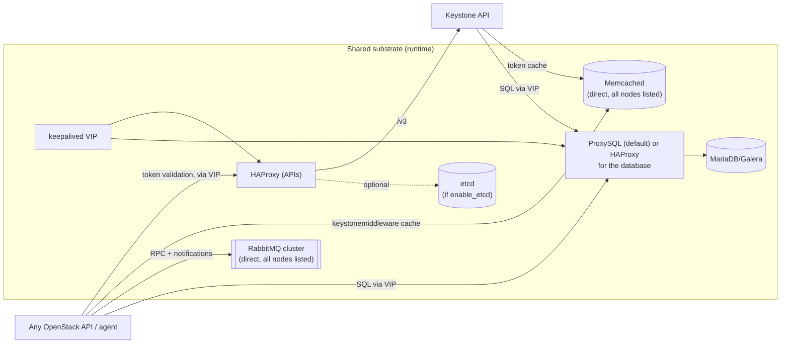
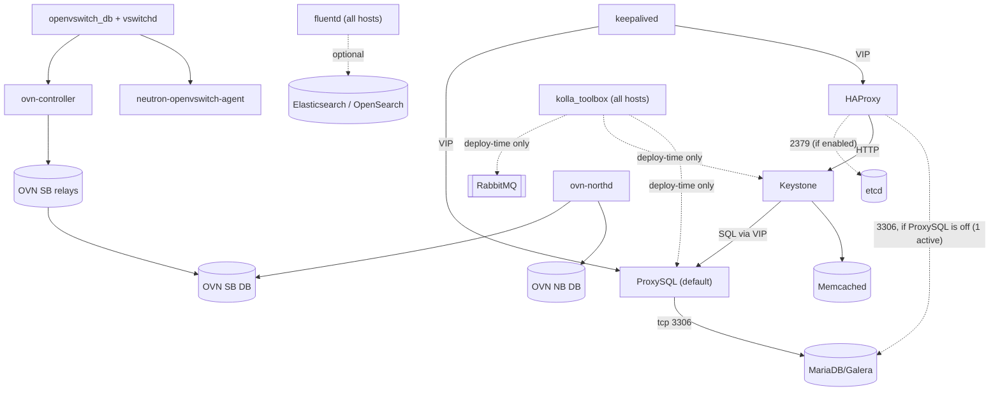
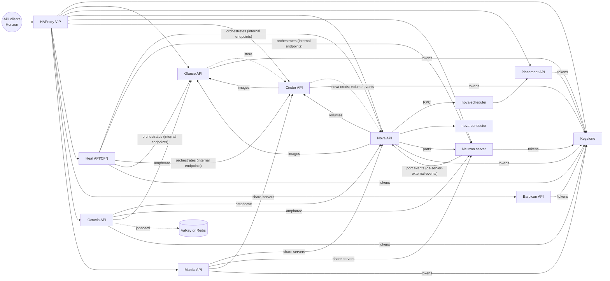
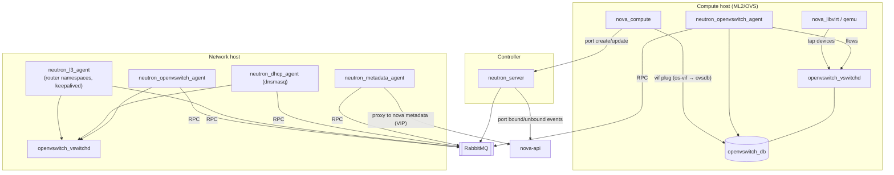

# Component dependencies

This page maps **what depends on what**, and keeps four kinds of dependency apart:

| Kind | Question it answers | Where it lives in the code |
|---|---|---|
| **Installation (deploy-time) dependency** | What must already run for the *role* to succeed? | `kolla_toolbox` calls to MariaDB, Keystone and RabbitMQ in `bootstrap.yml`/`register.yml`, bootstrap containers, `delegate_to` targets |
| **Configuration dependency** | Whose hosts, addresses, flags or passwords end up in *my* config files? | `templates/*.j2`, `group_vars/all.yml` (e.g. `rpc_transport_url`) |
| **Runtime dependency** | What must be reachable for the *service* to work? | The same templates (URLs, connections); upstream OpenStack behaviour |
| **Operational dependency** | Which Kolla action on X changes or restarts Y? | Handlers, the container check, global `enable_*` flags, `common`, the loadbalancer play (see [Operations](../operations/index.md)) |

Kolla-Ansible **never declares inter-service dependencies** explicitly. As before, no role under `ansible/roles/` has a
`meta` directory, and `common` is its own play (`site.yml:88-103`) [CODE]. Every dependency below is implicit: play
order in `site.yml`, a variable, a template, or a `delegate_to`.

> [!NOTE]
> **Key answers**
>
> - **The database and etcd are reached through the internal VIP; RabbitMQ and memcached hosts are listed one by one in
>   the configs of the services that use them.** Adding or removing a RabbitMQ node therefore changes the config of
>   every messaging service, including `nova-compute` and the neutron agents on every compute; 26 roles loop over the
>   memcached group (27 in 2024.1, Swift is gone) [CODE] ([§1](#1-the-shared-substrate-what-every-openstack-service-uses)).
> - **Changed in 2025.1:** ProxySQL is the default database load balancer ([MariaDB](mariadb.md)); the queue settings
>   (quorum and transient quorum queues, `use_queue_manager`) are always rendered ([F17](../reference/findings.md#f17));
>   Valkey is a new optional backend, preferred over Redis and etcd for coordination and over Redis for Octavia's
>   jobboard; Swift is removed ([Swift](swift.md)); `ovn-controller` and the metadata agents talk to SB relays by
>   default [CODE] ([§1](#1-the-shared-substrate-what-every-openstack-service-uses), [§2](#2-infrastructure-components),
>   [§3](#3-control-plane-services)).
> - **A compute host's configuration depends on global state** (enabled services, the membership of the RabbitMQ and
>   memcached groups, the internal VIP, service passwords), not only on the compute host itself. That is why changes
>   that look small trigger fleet-wide restarts [CODE] ([§5](#5-compute-node-dependency-summary)).
> - **What lands on a compute host**, container by container, with the global config source of each
>   ([§5](#5-compute-node-dependency-summary)).
> - **Per-service dependencies:** control-plane services with their use of the DB, RabbitMQ, memcached and Keystone and
>   their deploy-time actions ([§3](#3-control-plane-services)); infrastructure components
>   ([§2](#2-infrastructure-components)); networking containers and their placement
>   ([§4](#4-networking-components-ml2ovs-default-ml2ovn-optional)).
> - **L3 agent:** with `enable_neutron_agent_ha: yes` and the default `neutron_agents_wrappers: "no"`, the L3 agent
>   wrapper runs `neutron-netns-cleanup --force --agent-type l3` before the agent starts, on every restart or recreate of
>   `neutron_l3_agent` on that host [CODE]; what that command deletes, and the DHCP and router outage per agent
>   restart, are [NOT AVAILABLE] ([§4](#4-networking-components-ml2ovs-default-ml2ovn-optional)).
> - **Deployment order mostly respects runtime dependencies, with caveats:** Nova is deployed before Open vSwitch, OVN
>   and Neutron, and nothing enforces a dependency when you use tags [CODE]
>   ([§6](#6-deployment-order-vs-runtime-dependency)).

A compact card per service (role, play, tags, task flow, templates, handlers, key variables, node types) is in
[Components](index.md). Per-role detail with line references is in the fact sheets
([A](../reference/factsheets/a-infra-lb-ovn.md), [B](../reference/factsheets/b-mariadb-rabbitmq-keystone.md),
[C](../reference/factsheets/c-glance-placement-cinder-horizon-heat.md),
[D](../reference/factsheets/d-barbican-octavia-swift-manila-compute-roles.md),
[E](../reference/factsheets/e-host-bootstrap-ops-playbooks.md)). Nova is covered in depth in [Nova deep
dive](nova-deep-dive.md).

---

## 1. The shared substrate: what every OpenStack service uses

| Shared component | How services reach it | Evidence | Consequence |
|---|---|---|---|
| **MariaDB / Galera** | `database_address: "{{ kolla_internal_fqdn }}"`, i.e. through the **internal VIP**. **Changed in 2025.1:** the load balancer behind the VIP is **ProxySQL by default** (`enable_proxysql: "yes"`, `group_vars/all.yml:958`; `mariadb_loadbalancer`, `group_vars/all.yml:554`) | `ansible/group_vars/all.yml:55, :89` | Every DB connection depends on keepalived and the database load balancer (ProxySQL, or HAProxy with `enable_proxysql: "no"`) as well as on Galera. With HAProxy, DB traffic goes to **one** active backend; the others are `backup` (`roles/mariadb/defaults/main.yml:29, :64`). A 2024.1 cloud that did not set `enable_proxysql` moves to ProxySQL with its upgrade ([MariaDB](mariadb.md), [fact sheet B §1](../reference/factsheets/b-mariadb-rabbitmq-keystone.md#1-mariadb-ansiblerolesmariadb)) |
| **RabbitMQ** | `rpc_transport_url` / `notify_transport_url` loop over **every host** of `groups['rabbitmq']` (`om_rpc_group`, `om_notify_group`). Clients use their own failover, **not** the VIP | `ansible/group_vars/all.yml:270, :274, :280, :284`; nova-cell builds its own URLs from the same group by default (`roles/nova-cell/defaults/main.yml:202, :211, :217-218`) | Adding or removing a RabbitMQ node changes the config of every messaging service, including `nova-compute` and the neutron agents on **every compute** ([Change control-plane membership §2](../operations/change-control-plane-membership.md#2-change-control-plane-membership-add-or-remove-a-controller)). **Changed in 2025.1:** `use_queue_manager`, `rabbit_quorum_queue = true` and `rabbit_transient_quorum_queue = true` are always rendered, with no variable to turn them off, and stream fanout follows `om_enable_rabbitmq_stream_fanout` (default `true`, `group_vars/all.yml:292`) (e.g. `roles/nova-cell/templates/nova.conf.j2:191-206`) ([F17](../reference/findings.md#f17)) |
| **Memcached** | Templates loop `` for `keystone_authtoken` / `[cache]` | e.g. `roles/ceilometer/templates/ceilometer.conf.j2:60`; the templates of **26 roles** contain this loop (27 in 2024.1: Swift is gone). Telegraf only tests whether the host itself is in the group (`roles/telegraf/templates/telegraf.conf.j2:54`) | Membership change = config change in 26 services ([Memcached](memcached.md)). [NOT AVAILABLE] Whether a memcached restart empties the token caches and the Horizon sessions kept there ([fact sheet A §3.8](../reference/factsheets/a-infra-lb-ovn.md#38-operationally-notable), [Kolla images §6](../concepts/kolla-images.md#6-day-2-consequences)) |
| **Keystone** | `auth_url` → internal VIP endpoint (`keystone_internal_url`, `group_vars/all.yml:1096`); `www_authenticate_uri` is now the **public** URL in most services ([Keystone](keystone.md)); `service-ks-register` at deploy time | `roles/service-ks-register/tasks/main.yml` (30 roles use it; 31 in 2024.1) | Hard deploy-time dependency: registration runs `run_once` (`roles/service-ks-register/tasks/main.yml:129`) with the `auth` each role passes, e.g. `openstack_nova_auth` (`roles/nova/tasks/register.yml:5`), which is `openstack_auth` (`roles/nova/defaults/main.yml:252`), whose `auth_url` is `keystone_internal_url` (`group_vars/all.yml:1126-1127`). Runtime: the services' `[keystone_authtoken]` sections point keystonemiddleware at Keystone, with memcached as token cache (e.g. `roles/nova/templates/nova.conf.j2:112-127`); [NOT AVAILABLE] whether API requests fail while Keystone is down |
| **etcd** (optional, `enable_etcd: "no"`, `group_vars/all.yml:878`) | Through the **internal VIP**: `backend_url = etcd3+…://{{ kolla_internal_fqdn }}:{{ etcd_client_port }}`; the etcd role defines an internal HAProxy frontend | `roles/cinder/templates/cinder.conf.j2:269-280`, `roles/masakari/templates/masakari.conf.j2:82-90`, `roles/ironic/templates/ironic-inspector.conf.j2:85-96`; frontend `roles/etcd/defaults/main.yml:11-17`. **Changed in 2025.1:** the coordination backend is Valkey first, then Redis, then etcd (`cinder_coordination_backend`, `group_vars/all.yml:1178`; masakari `:573`, ironic `:1403`) | etcd membership is **not** embedded in service configs: outside the etcd role, only Prometheus's config loops over `groups["etcd"]` (`roles/prometheus/templates/prometheus.yml.j2:221`). Valkey and Redis, when chosen, list **every host** of their group in the connection string (`group_vars/all.yml:1010, :1016`). The etcd play has no `serial` (`site.yml:485-496`), and its handlers restart non-leaders in `% 4` waves, then the leader (`roles/etcd/handlers/main.yml:38-62`); on upgrade the order across hosts is [NOT AVAILABLE] (`roles/etcd/handlers/main.yml:26-34`) ([Change control-plane membership](../operations/change-control-plane-membership.md)) |
| **HAProxy, ProxySQL + keepalived** | Every internal/admin/public endpoint and the DB address resolve to the VIPs | `roles/*/defaults/main.yml` `haproxy:` dicts → each role's `tasks/loadbalancer.yml` → `roles/loadbalancer-config` → `roles/haproxy-config`, and `roles/proxysql-config` with `enable_proxysql` (`roles/loadbalancer-config/tasks/main.yml:1-8`) | A single point of *path* failure for APIs, DB and etcd. HAProxy and ProxySQL are **restarted, never reloaded**: the handlers stop and start them on the backup hosts first, then on the host that holds the VIP (`roles/loadbalancer/handlers/main.yml:36-180, :181-332`) ([fact sheet A §1.8](../reference/factsheets/a-infra-lb-ovn.md#18-operationally-notable-behaviour)). **Changed in 2025.1:** `-t <service>` renders the service's HAProxy file but no longer restarts HAProxy ([F18](../reference/findings.md#f18)). A `Restart haproxy-ssh container` handler (`:333-347`) serves the `haproxy_ssh` container, enabled only with `enable_letsencrypt` (`roles/loadbalancer/defaults/main.yml:29-36`) ([HAProxy and keepalived](haproxy-keepalived.md)) |
| **fluentd / cron / kolla_toolbox** (`common`) | Deployed on the hosts of the groups `fluentd`, `kolla-toolbox` and `cron` (children of `common`: control, network, compute, storage, monitoring) | `roles/common/defaults/main.yml:5, :14, :26`; `site.yml:88-103`; `inventory/multinode:49-54, :202-212` | `kolla_toolbox` is a **deploy-time** dependency of every role that touches MySQL, Keystone, RabbitMQ or the OVS database (`kolla_toolbox` module needs it running). fluentd is runtime-optional (logging only) ([Common](common.md)) |

---

## 2. Infrastructure components

| Component | Role / play | Hosts (example inventory) | Deploy-time needs | Runtime needs | Who depends on it |
|---|---|---|---|---|---|
| **Keepalived** | `loadbalancer` role, `site.yml:105-121` | `loadbalancer` → `network` (`inventory/multinode:84-85`) | `ip_vs` module, sysctl `ip_nonlocal_bind`, set through the `sysctl` role (`roles/loadbalancer/tasks/config-host.yml:8-16`) | VRRP between loadbalancer hosts (multicast default, `roles/loadbalancer/defaults/main.yml:62`; router id 51, `group_vars/all.yml:247`) | Everything addressed by VIP |
| **HAProxy** | `loadbalancer` role + 38 `loadbalancer.yml` includes (`site.yml:105-327`; 39 in 2024.1, Swift is gone); **new in 2025.1**, the play ends with a loadbalancer check-containers step (`site.yml:320-327`) | `loadbalancer` | facts of **all backend hosts** (backend lists use `hostvars[host].ansible_facts.hostname`, `roles/haproxy-config/templates/haproxy_single_service_split.cfg.j2:102`) | backends | All APIs, etcd, and MariaDB when ProxySQL is off |
| **ProxySQL** (default in 2025.1) | `loadbalancer` role, through `proxysql-config` (`roles/loadbalancer-config/tasks/main.yml:6-8`) | `loadbalancer` | `enable_proxysql` (default `"yes"`, `group_vars/all.yml:958`) | the MariaDB shards | Every service with a DB ([MariaDB](mariadb.md)) |
| **Let's Encrypt** | `letsencrypt` play, right after the loadbalancer play (`site.yml:329-341`) | `letsencrypt` → `loadbalancer` (`inventory/multinode:188-189`) | only if `enable_letsencrypt` (default `no`, `group_vars/all.yml:913`) | – | HAProxy certificates (`haproxy_ssh`) |
| **MariaDB/Galera** | `mariadb` role, `mariadb.yml:3-16` (no `serial`; restarts in separate plays with `serial: "33%"`, `mariadb.yml:18-52`) | `mariadb` → `control` | `kolla_toolbox`; Galera bootstrap logic ([fact sheet B §1](../reference/factsheets/b-mariadb-rabbitmq-keystone.md#1-mariadb-ansiblerolesmariadb)) | ProxySQL or HAProxy (clustercheck on port 4569 for HAProxy, `group_vars/all.yml:542`) | Every service with a DB |
| **RabbitMQ** | `rabbitmq` role, `ansible/rabbitmq.yml:3-28` (no `serial`; restarts with `serial: "33%"`, `ansible/rabbitmq.yml:30-49`; then a post-configuration play, `ansible/rabbitmq.yml:51-70`) | `rabbitmq` → `control` | erlang cookie, `/etc/hosts` (from `bootstrap-servers`, ansible-collection-kolla `roles/baremetal/tasks/main.yml:3`, role `etc_hosts`) | – | Every service with RPC/notifications ([RabbitMQ](rabbitmq.md)) |
| **Memcached** | `memcached` role, `site.yml:417-429` | `memcached` → `control` | – | – | Keystone, all keystonemiddleware users, Horizon sessions |
| **etcd** | `etcd` role, `site.yml:485-496` (no `serial`) | `etcd` → `control` (`inventory/multinode:62-63`) | only if `enable_etcd` | – | Cinder, Masakari, ironic-inspector coordination when chosen ([§1](#1-the-shared-substrate-what-every-openstack-service-uses)) |
| **Redis** | `redis` role, `site.yml:385-398` | `redis` → `control` (`inventory/multinode:179-180`) | only if `enable_redis` (default `no`, `group_vars/all.yml:959`) | – | Coordination backends and the **Octavia jobboard** when Valkey is off ([§3](#3-control-plane-services)) |
| **Valkey** (new in 2025.1) | `valkey` role, `site.yml:399-413` | `valkey` → `control` (`inventory/multinode:191-192`) | only if `enable_valkey` (default `no`, `group_vars/all.yml:965`) | – | Preferred coordination backend and **Octavia jobboard** backend when enabled ([§3](#3-control-plane-services)) |
| **Fluentd** | `common` play, `site.yml:88-103` | `fluentd` → `common` (all node types) | **changed in 2025.1:** no image pull or label read in the config step any more ([Common](common.md)) | (optional) Elasticsearch or OpenSearch outputs (`roles/common/tasks/config.yml:104-169`) | Logging only. HAProxy syslogs to fluentd UDP (`roles/loadbalancer/templates/haproxy/haproxy_main.cfg.j2:7`, `group_vars/all.yml:731`) |
| **Open vSwitch** | `openvswitch` role, `site.yml:605-618` | `openvswitch` → `network`, `compute`, `manila-share` (`inventory/multinode:105-108`) | kernel module `openvswitch` (`roles/openvswitch/tasks/config-host.yml:2-7`); `neutron_bridge_name`/`neutron_external_interface` on network nodes (and computes if `computes_need_external_bridge`) | – | neutron-openvswitch-agent, OVN controller, DHCP/L3 agents |
| **OVN** (if `neutron_plugin_agent: ovn`) | `ovn-controller` role, `site.yml:635`, and `ovn-db` role, `site.yml:649` | `ovn-database` → `control`, with the NB, SB and, **new in 2025.1**, SB relay groups under it; `ovn-controller` → `compute`, `network` (`inventory/multinode:579-603`) | OVS running (ovn-controller's setup creates `br-int` and writes OVS `external_ids` through the `openvswitch_bridge` and `openvswitch_db` modules in `kolla_toolbox`, `roles/ovn-controller/tasks/setup-ovs.yml:2-45`) | NB/SB DB cluster (Raft); **changed in 2025.1**, `ovn-remote` points at the SB relays by default (`enable_ovn_sb_db_relay`, `group_vars/all.yml:646, :953`) | neutron-server (ML2/OVN), neutron-ovn-metadata-agent ([OVN](ovn.md)) |
| **Chrony** | **none**: no `roles/chrony`, no chrony play in `site.yml`, no `chrony` group in `inventory/multinode` ([Chrony](chrony.md)) | – (host NTP daemon, outside Kolla-Ansible) | `kolla-ansible prechecks` checks that a host NTP daemon is active and the clock synchronised (`roles/prechecks/tasks/timesync_checks.yml:1-47`) | the host's NTP daemon | [NOT AVAILABLE] in the code: which services need synchronised clocks |
| **iscsid / tgtd** | `iscsi` role, `site.yml:454-467` | `iscsid` → `compute`, `storage`, `ironic`; `tgtd` → `storage` (`inventory/multinode:307-313`) | only if `enable_iscsid` (cinder with the iSCSI backend, `group_vars/all.yml:911`) | – | nova-compute (volume attach), cinder-volume (LVM) ([iSCSI](iscsi.md)) |

### 2.1 Infrastructure dependency graph (runtime)

---

## 3. Control-plane services

Legend: **DB** = MariaDB through the VIP (ProxySQL by default), **MQ** = RabbitMQ (all nodes listed), **MC** =
memcached, **KS** = Keystone. A ✔ means the role's config templates (`roles/<role>/templates/*.j2`) reference it
[CODE]. Every role below runs its deploy steps on `reconfigure` too: its `reconfigure.yml` imports `deploy.yml` (e.g.
`roles/keystone/tasks/reconfigure.yml:2`) [CODE]. What each bootstrap container runs inside the image is listed in
[Kolla images §4](../concepts/kolla-images.md#4-one-shot-containers-what-the-environment-variables-run).

| Service | DB | MQ | MC | KS | Other services referenced in config | Deploy-time actions | Notes (fact sheet) |
|---|---|---|---|---|---|---|---|
| **Keystone** | ✔ | ✔ (`roles/keystone/templates/keystone.conf.j2:4, :54`) | ✔ | – | – | bootstrap container (db sync) **every deploy/reconfigure**, no condition (`roles/keystone/tasks/bootstrap_service.yml:34-52`); fernet keys pushed from the first host where `keystone_fernet` runs (`roles/keystone/tasks/distribute_fernet.yml:12-16`); admin bootstrap through `kolla_keystone_bootstrap` (`roles/keystone/tasks/register.yml:2-12`) | [B §3.6–3.10](../reference/factsheets/b-mariadb-rabbitmq-keystone.md#36-fernet-key-lifecycle-fact-unless-marked), [Keystone](keystone.md) |
| **Glance** | ✔ | ✔ | ✔ | ✔ | Cinder (store), Ceph, S3 (`glance_backend_s3`, default `no`, `group_vars/all.yml:1140`), Barbican; **the Swift store is removed in 2025.1** | db sync + `db_load_metadefs` on every deploy/reconfigure (kolla `docker/glance/glance-api/extend_start.sh:5-9`); toggles **global** MariaDB `log_bin_trust_function_creators` (`roles/glance/tasks/bootstrap_service.yml:2-12, :39-49`) | [C §1](../reference/factsheets/c-glance-placement-cinder-horizon-heat.md#1-glance). With the file backend only `groups['glance-api'][0]` runs glance (`group_vars/all.yml:1146`) |
| **Placement** | ✔ | – | ✔ | ✔ | (Nova credentials in the migration helper, `roles/placement/templates/migrate-db.rc.j2:1-3`) | db sync **and online data migrations** on every deploy/reconfigure (one `KOLLA_BOOTSTRAP` container, kolla `docker/placement/placement-api/extend_start.sh:5-9`) | [C §2](../reference/factsheets/c-glance-placement-cinder-horizon-heat.md#2-placement). The placement templates have no `transport_url` |
| **Nova** | ✔ | ✔ | ✔ (API side only; nova-cell's `nova.conf` has no memcached list) | ✔ | Glance, Neutron, Placement, Cinder (now looked up as `block-storage`), Barbican, Ceph | API/cell0/cell DB sync on every deploy/reconfigure; cell create/update; host discovery | [Nova deep dive](nova-deep-dive.md) |
| **Neutron** | ✔ (server) | ✔ | ✔ | ✔ | Nova (notifications to Nova), Placement, OVN | DB, user and grants, and the `bootstrap_neutron` db sync container, on every deploy/reconfigure (`roles/neutron/tasks/bootstrap.yml:38`, `roles/neutron/tasks/bootstrap_service.yml:2-21`, no condition; `neutron_enable_rolling_upgrade` only selects the upgrade path, `roles/neutron/tasks/upgrade.yml:4-8`) | [§4](#4-networking-components-ml2ovs-default-ml2ovn-optional) below |
| **Cinder** | ✔ | ✔ | ✔ | ✔ | Glance, Nova (uses **nova** credentials), Barbican, Ceph; **the Swift backup driver is removed in 2025.1**; coordination through Valkey or Redis (all hosts listed) or etcd (internal VIP), in that order (`roles/cinder/templates/cinder.conf.j2:269-280`, `group_vars/all.yml:1178`) | db sync on every deploy/reconfigure (`roles/cinder/tasks/deploy.yml:11`); **new in 2025.1**, prechecks that can block a run ([Cinder](cinder.md)) | [C §3](../reference/factsheets/c-glance-placement-cinder-horizon-heat.md#3-cinder) |
| **Horizon** | only if `horizon_backend_database` (default `false`, `group_vars/all.yml:1267`) | – | ✔ (sessions, `roles/horizon/templates/_9998-kolla-settings.py.j2:19-23`) | ✔ | every enabled API (internal endpoint type, `_9998-kolla-settings.py.j2:131`) | no Keystone registration | [C §4](../reference/factsheets/c-glance-placement-cinder-horizon-heat.md#4-horizon); the Swift settings are gone in 2025.1 |
| **Heat** | ✔ | ✔ | ✔ | ✔ | every API used by templates (internal); instances need the **external** CFN endpoint | db sync on every deploy/reconfigure; heat domain admin setup only when `heat_user_domain` does not exist yet (kolla `docker/heat/heat-api/extend_start.sh:8-14`): a changed `heat_domain_admin_password` reaches `heat.conf` (`roles/heat/templates/heat.conf.j2:12`) but is never applied in Keystone | [C §5](../reference/factsheets/c-glance-placement-cinder-horizon-heat.md#5-heat) |
| **Barbican** | ✔ | ✔ | ✔ | ✔ | – | db sync on every deploy/reconfigure (`roles/barbican/tasks/deploy.yml:11`); `barbican_crypto_key` from `passwords.yml` | [D §1](../reference/factsheets/d-barbican-octavia-swift-manila-compute-roles.md#1-barbican) |
| **Octavia** | ✔ (two databases: main and persistence, `roles/octavia/tasks/bootstrap.yml:2-72`; **changed in 2025.1**, `upgrade` no longer creates the persistence database) | ✔ | ✔ | ✔ | Nova, Neutron, Glance (amphora image, flavor, network, secgroup); **Valkey or Redis** for the jobboard (every host of `groups['valkey']`, else `groups['redis']`, `roles/octavia/templates/octavia.conf.j2:168-186`) | db sync; with `octavia_auto_configure` (true when the `amphora` provider is listed, the default; `group_vars/all.yml:1411`, `roles/octavia/defaults/main.yml:387`) `prepare.yml` creates the amphora flavor, keypair, security groups and management network, subnet and router (`roles/octavia/tasks/deploy.yml:4-5`, `roles/octavia/tasks/prepare.yml:2-161`); the amphora image stays manual. `enable_octavia_jobboard` is on whenever Octavia uses the amphora provider (`group_vars/all.yml:950`) and the precheck fails unless Valkey or Redis is enabled (`roles/octavia/tasks/precheck.yml:68-74`; both default to `no`, `group_vars/all.yml:959, :965`) | [D §2](../reference/factsheets/d-barbican-octavia-swift-manila-compute-roles.md#2-octavia) |
| **Swift** | **removed in 2025.1**: no role, play or image; a deployed Swift is not stopped or cleaned up | – | – | – | – | – | [Swift](swift.md), [D §3](../reference/factsheets/d-barbican-octavia-swift-manila-compute-roles.md#3-swift) |
| **Manila** | ✔ | ✔ | ✔ | ✔ | Glance, Neutron, Nova, Cinder, Ceph (CephFS) | db sync; manila-share hosts also get the Open vSwitch agent with the generic backend (`roles/neutron/defaults/main.yml:40`) | [D §4](../reference/factsheets/d-barbican-octavia-swift-manila-compute-roles.md#4-manila) |

### 3.1 Control-plane runtime graph

The dotted edges are configuration couplings that are easy to overlook:

- **Cinder → Nova** with Nova's own credentials (`roles/cinder/templates/cinder.conf.j2:98-108`).
- **Glance → Cinder** as an image store. **Changed in 2025.1:** the Swift store is gone, with no check, and
  `glance_default_backend` is `vmware`, else the first Ceph entry, else `s3`, else `file`
  (`roles/glance/defaults/main.yml:250`): a cloud whose only store was Swift gets `file` on its first 2025.1 run
  ([Glance](glance.md), [fact sheet C §1](../reference/factsheets/c-glance-placement-cinder-horizon-heat.md#1-glance)).
- **Nova and Neutron → Placement** with the placement user (`roles/nova-cell/templates/nova.conf.j2:224-234`).
- **Octavia → Valkey or Redis**: the jobboard lists every host of the chosen group, and it is on by default with the
  amphora provider (`roles/octavia/templates/octavia.conf.j2:168-186`, `group_vars/all.yml:950`).

---

## 4. Networking components (ML2/OVS default, ML2/OVN optional)

**Changed in 2025.1:** the Linux Bridge agent is gone ([Neutron](neutron.md)).

| Container | Placement rule (`host_in_groups`) | Needs | Data-plane role |
|---|---|---|---|
| `openvswitch_db`, `openvswitch_vswitchd` | compute, manila-share (generic backend), dhcp/l3/metadata agent hosts (`roles/openvswitch/defaults/main.yml:2-34`) | kernel module, `/run/openvswitch` | **Forwards all VM traffic** |
| `neutron_openvswitch_agent` | compute, manila-share (generic), dhcp/l3/metadata hosts (`roles/neutron/defaults/main.yml:30-50`; with `enable_nova_fake` only the dhcp/l3/metadata hosts) | OVS, RabbitMQ, (neutron-server via RPC) | Programs OVS flows; [NOT AVAILABLE] whether and how it resyncs them after a restart ([Kolla images §5](../concepts/kolla-images.md#5-per-image-start-behaviour)) |
| `neutron_l3_agent` | `neutron-l3-agent`; **plus every compute** when `enable_neutron_dvr` (`roles/neutron/defaults/main.yml:70-89`) | OVS, `/run/netns` | Routers (namespaces, keepalived for HA routers) |
| `neutron_dhcp_agent` | `neutron-dhcp-agent` | OVS | dnsmasq per network |
| `neutron_metadata_agent` | `neutron-metadata-agent`; plus computes with DVR and ML2/OVS (`roles/neutron/defaults/main.yml:115-124`) | nova-api metadata via VIP (`nova_metadata`) | metadata proxy |
| `neutron_server` | `neutron-server` | DB, MQ, KS, Nova, Placement | control plane only |
| `ovn_controller` (OVN) | `ovn-controller` (compute + network; role `ovn-controller`) | OVS, SB DB through the SB relays by default | Programs OVS from SB DB |
| `neutron_ovn_metadata_agent` (OVN) | `neutron-ovn-metadata-agent` → compute, network (`inventory/multinode:266-268`; `roles/neutron/defaults/main.yml:133`) | OVS, SB DB | metadata per chassis |

Runtime facts [CODE]:

- **The L3 agent wrapper runs a namespace cleanup on start.** With `enable_neutron_agent_ha: yes` (default `no`,
  `group_vars/all.yml:934`), its start wrapper runs `neutron-netns-cleanup --force --agent-type l3` *before* starting
  the agent, on every restart or recreate of `neutron_l3_agent` on such a host (the wrapper's comment: "Remove all l3
  related netns"). **Changed in 2025.1:** it does so only when `neutron_agents_wrappers` is off, which is the default
  (`roles/neutron/templates/neutron-l3-agent-wrapper.sh.j2:5-16`; `roles/neutron/defaults/main.yml:646`). [NOT
  AVAILABLE] What the command deletes: it is neutron code, which is not in these sources
  ([F12](../reference/findings.md#f12)); whether and when `neutron-l3-agent` rebuilds the namespaces ([Risk register
  R6](../risk/risk-register.md#r6)).
- **Agent containers do not share the host PID namespace by default.** With the default `neutron_agents_wrappers: "no"`
  they have no `pid_mode` (`roles/neutron/defaults/main.yml:54-90`). Processes they spawn (dnsmasq, keepalived, haproxy
  for metadata) live in the container's PID namespace. **New in 2025.1:** with `neutron_agents_wrappers: "yes"` the DHCP
  and L3 agents run those processes in child containers, with `pid_mode: host` and `cgroupns_mode: host`
  ([Neutron](neutron.md)). [NOT AVAILABLE] Whether, without wrappers, the spawned processes die with the container and
  are respawned by the agent on start. For the L3 agent, its wrapper starts `neutron-l3-agent` without `exec`, and
  dumb-init runs with `--single-child` (kolla `docker/base/Dockerfile.j2:398`;
  `roles/neutron/templates/neutron-l3-agent-wrapper.sh.j2:18-22`) [CODE]. [NOT AVAILABLE] Whether the SIGTERM of the
  stop then reaches only bash and not the agent, and so whether the agent gets a graceful shutdown: that depends on how
  dumb-init forwards signals, which these sources do not show ([Kolla images
  §2.6](../concepts/kolla-images.md#26-signals-and-pid-1),
  [§5.3](../concepts/kolla-images.md#53-neutron-l3-agent-the-wrapper)). [NOT AVAILABLE] The DHCP and router outage per
  agent restart.
- **The OVS bridge layout is set in a post-config step through `kolla_toolbox` modules.** On every deploy/reconfigure
  (`roles/openvswitch/tasks/deploy.yml:11`; `reconfigure.yml` imports `deploy.yml`), on network hosts (and computes
  with `computes_need_external_bridge`), the bridges are ensured by the `openvswitch_bridge` module
  (`fail_mode: standalone`) and their ports by `openvswitch_port`
  (`roles/openvswitch/tasks/post-config.yml:25-53`). The same file first sets `external_ids:system-id`,
  `external_ids:hostname` (the host's FQDN, `roles/openvswitch/defaults/main.yml:106`) and `other_config:hw-offload`;
  a change there notifies `Restart openvswitch-vswitchd container` (`roles/openvswitch/tasks/post-config.yml:3-23`)
  [CODE] ([Open vSwitch](openvswitch.md)).

---

## 5. Compute-node dependency summary

Everything that lands on a compute host in a default 2025.1 deployment (`enable_*` defaults in
`ansible/group_vars/all.yml:829-984`, placement from each role's `<role>_services`):

| Container | Role | Config source that is *global* (changes fleet-wide) |
|---|---|---|
| `fluentd`, `cron`, `kolla_toolbox` | common | `fluentd.conf` and the logrotate config built from **all** `enable_*` flags (`roles/common/tasks/config.yml:104-169`, `:171`) |
| `chrony` | none | no chrony container or `chrony.conf`: there is no `roles/chrony` and no chrony play ([Chrony](chrony.md)); time sync is the host's NTP daemon |
| `iscsid` | iscsi (if cinder with the iSCSI backend, `group_vars/all.yml:911`) | – |
| `nova_libvirt`, `nova_ssh`, `nova_compute` | nova-cell | `nova.conf`: `transport_url` (all RabbitMQ hosts, `roles/nova-cell/templates/nova.conf.j2:37, :183`), the queue settings (`roles/nova-cell/templates/nova.conf.j2:191-206`), `enable_ceilometer/watcher/cinder/osprofiler/barbican…` sections, Glance, Neutron and Placement endpoints, service passwords |
| `openvswitch_db`, `openvswitch_vswitchd` | openvswitch | – (bridge mappings only if `computes_need_external_bridge`) |
| `neutron_openvswitch_agent` | neutron | `neutron.conf` (all RabbitMQ hosts, memcached list, `roles/neutron/templates/neutron.conf.j2:121`) **and** `openvswitch_agent.ini` (merged from the role template, the operator's `openvswitch_agent.ini` and the per-host `<inventory_hostname>/openvswitch_agent.ini`; no `ml2_conf.ini` override, `roles/neutron/tasks/config.yml:152-164`) |

With OVN instead of ML2/OVS, `ovn_controller` and `neutron_ovn_metadata_agent` replace the OVS agent; their SB
connection points at the SB relays by default in 2025.1 ([fact sheet D
§5.14](../reference/factsheets/d-barbican-octavia-swift-manila-compute-roles.md#514-cross-reference-ovn-controller-on-compute)).

Optional compute-side containers come from ceilometer, collectd, telegraf, prometheus exporters, masakari, zun, kuryr
and cyborg (skydive and monasca have no role) ([fact sheet D
§5](../reference/factsheets/d-barbican-octavia-swift-manila-compute-roles.md#50-summary-table-compute-side)). Several of
them embed host lists from other groups in their config: memcached (ceilometer, masakari, zun, cyborg), RabbitMQ
through the transport URLs, and for telegraf the `influxdb` group among others (`grep` of `groups[...]` in
`roles/<role>/templates`) [CODE]. No compute-side template lists the etcd hosts (see
[§1](#1-the-shared-substrate-what-every-openstack-service-uses)). The full list of templates that loop over groups is
in [Generated inventory §4](../reference/generated-inventory.md#4-templates-that-reference-inventory-groups).

**Rule of thumb [CODE]:** a compute host's configuration depends on *global* state (enabled services, the membership of
the RabbitMQ and memcached groups, the internal VIP, service passwords), not only on the compute host itself. That is
why changes that look small trigger fleet-wide restarts ([Compute
scaling](../concepts/compute-scaling-and-performance.md), [F6](../reference/findings.md#f6),
[Operations](../operations/index.md)). In 2025.1 the first run after the upgrade also flags every container whose
systemd unit 2024.1 wrote ([F16](../reference/findings.md#f16)).

---

## 6. Deployment order vs runtime dependency

Deployment order is the play order in `site.yml` ([Execution flow](../concepts/deployment-execution-flow.md)). It mostly
respects runtime dependencies, with these caveats [CODE]:

| Observation | Evidence | Effect |
|---|---|---|
| HAProxy and ProxySQL are configured for **all** services before any of them exists | `site.yml:105-327` (the loadbalancer play, right after `common`), then Let's Encrypt (`site.yml:329-341`) | The first deploy puts frontends in place for backends not yet started. Each backend server is health-checked (`check inter 2000 rise 2 fall 5`, `roles/haproxy-config/defaults/main.yml:14`); how HAProxy treats a backend that is not up yet is [NOT AVAILABLE] |
| Redis, Valkey, MariaDB, memcached, RabbitMQ and etcd come before Keystone | `site.yml:385` (redis), `:399` (valkey), `:415` (`mariadb.yml`), `:417` (memcached), `:483` (`rabbitmq.yml`), `:485` (etcd), `:498` (keystone) | The substrate exists when the first service registers and syncs its DB |
| **Placement is deployed before Nova; Glance and Cinder too** | `site.yml:542-604` (glance `:542`, cinder `:574`, placement `:591`; `nova.yml` at `:667`) | Nova bootstrap can use Placement and Glance at once |
| **Nova is deployed *before* Open vSwitch, OVN and Neutron** | `site.yml:667` (`nova.yml`) vs `site.yml:605-692` (openvswitch `:605`, ovn-controller `:635`, ovn-db `:649`, neutron `:669`) | On a first deploy nova-compute starts before the OVS agent exists, and Kolla waits for its registration in the nova-cell play, before the OVS and Neutron plays run (`roles/nova-cell/tasks/deploy.yml:21-39`, `roles/nova-cell/tasks/wait_discover_computes.yml:8-29`) ([F13](../reference/findings.md#f13)). [NOT AVAILABLE] Whether instances can be scheduled there before those plays finish ([Execution flow §2.4](../concepts/deployment-execution-flow.md#24-compute-node-deployment-what-one-compute-host-experiences)) |
| Heat, Horizon and Octavia come after Nova and Neutron | `site.yml:722-994` (heat `:722`, horizon `:738`, octavia `:979`) | – |
| Nothing enforces a dependency when you **use tags** | `--tags` filters plays | `-t nova` on a fresh cloud reaches Keystone registration (`service-ks-register`, against `keystone_internal_url`) with no Keystone deployed. On an existing cloud it assumes MariaDB, RabbitMQ and Keystone are healthy. With `-t octavia` and the 2025.1 defaults, the Octavia config lists the Valkey or Redis hosts whether or not that backend was deployed |
| Bootstrap and registration tasks target `groups[...][0]` | e.g. `roles/nova-cell/tasks/bootstrap.yml:15, :34`; `roles/keystone/tasks/bootstrap.yml:14, :34` | The first host of a group is a hidden dependency: it must be reachable and have `kolla_toolbox` running |

## Related

- [Nova deep dive](nova-deep-dive.md) (Nova in depth)
- [Operations](../operations/index.md) (what these dependencies do to a Day-2 run)
- [Execution flow](../concepts/deployment-execution-flow.md) (deployment order)
- [Components](index.md) (service index)
- [2024.1 component dependencies](../../2024.1/components/dependencies/) (the previous release)
