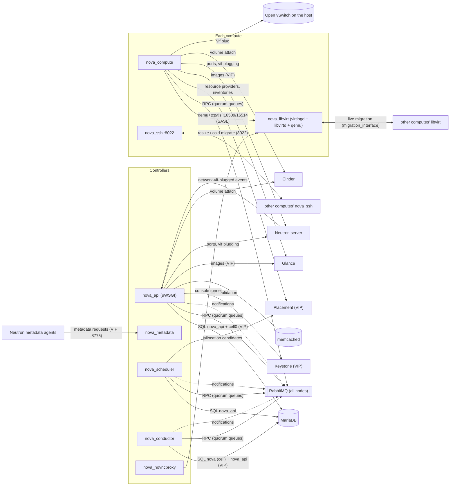

# Nova deep dive

Nova is split into two roles and ten plays. It is the component with the most hosts (every compute), the most coupling
(Glance, Neutron, Placement, Cinder, Keystone, RabbitMQ, MariaDB) and the highest VM-impact risk. This page is the
2025.1 study, read in the `2025.1-eom` sources; where it compares, it compares with 2024.1. `nova.yml` is unchanged
since 2024.1, so the play line numbers below are the same.

> [!NOTE]
> **Key answers**
>
> - **What restarts what:** loop-notify is gone. A change of nova-compute's `nova.conf`, `config.json`, `hostnqn` or
>   `compute_id` file or image restarts `nova_compute` only; `nova_libvirt` and `nova_ssh` restart only when their own
>   files, image or unit change [CODE] ([§2.4](#24-operational-dependencies-what-restarts-what)).
> - **New in 2025.1, on every compute:** a `compute_id` file built from a Nova API answer
>   ([F20](../reference/findings.md#f20)); new `nova.conf` options; virtlogd in `nova_libvirt` with
>   `stdio_handler = "logd"`, and new `libvirtd.conf` limits; a new unit text. The first 2025.1 run therefore restarts
>   the three containers on every compute, each for its own reasons [CODE]
>   ([§2.4](#24-operational-dependencies-what-restarts-what)).
> - **New in 2025.1, on the controllers:** the metadata API moves to its own `nova_metadata` container in a new
>   `nova-metadata` inventory group, and `nova_api` runs under uWSGI instead of Apache [CODE]
>   ([§1](#1-components-roles-containers-and-placement), [§7](#7-upgrade-path-specifics)).
> - **Do running VMs survive a `nova_libvirt` restart?** [NOT AVAILABLE]. What the code shows about the container is
>   [CODE]: `pid_mode: host`, `cgroupns_mode: host`, state on named volumes, a start path that is passive towards
>   running guests, virtlogd now inside the container, the 60 s stop timeout of its systemd unit, the restart handler's
>   retries ([§5](#5-nova-libvirt-why-its-restart-is-special)).
> - **Which inputs change `nova.conf` on every compute** and which do not reach the nova containers on compute hosts:
>   [§2.3](#23-configuration-dependencies-inputs-that-change-novas-files).
> - **The ten nova plays:** which play runs on which action (plays 6–10 run on upgrade only), what the bootstrap
>   one-shots run, how compute discovery works, the new libvirt version checks
>   ([§4](#4-the-nova-plays-step-by-step-ansiblenovayml)).
> - **Batches:** `reconfigure` and `upgrade` always run with `kolla_serial=0`
>   ([F19](../reference/findings.md#f19)); a batched Nova change is `deploy -e kolla_serial=N`.
> - **Upgrade:** the image pull is not part of `upgrade`; run `kolla-ansible pull` first, and add the `nova-metadata`
>   group to the inventory ([§7](#7-upgrade-path-specifics)).

---

## 1. Components, roles, containers and placement

| Component | Container | Role | Inventory group (default) | Placement variable | Notable container flags | Evidence |
|---|---|---|---|---|---|---|
| nova-api | `nova_api` | `nova` | `nova-api` → `nova` → `control` | `group: nova-api` | **privileged**, `/lib/modules`; **changed in 2025.1:** runs `uwsgi /etc/nova/nova-api-uwsgi.ini` (WSGI module `nova.wsgi.osapi_compute:application`) unless `nova_wsgi_provider` is `apache` (default `uwsgi`), and no longer serves the metadata API | `roles/nova/defaults/main.yml:3-32`, `:323-324`, volumes `:196-203`; `roles/nova/templates/nova-api.json.j2:3`; `roles/nova/tasks/config.yml:119-138` |
| nova-metadata (**new in 2025.1**) | `nova_metadata` | `nova` | `nova-metadata` → `nova` (`inventory/multinode:232-233`) | `group: nova-metadata` | nova-api image, not privileged, no `/dev/shm`; WSGI module `nova.wsgi.metadata:application` on `nova_metadata_listen_port` (8775). The external metadata frontend is off by default (`nova_enable_external_metadata: "no"`) | `roles/nova/defaults/main.yml:33-61`, `:258`, volumes `:204-209`; `group_vars/all.yml:604-605` |
| nova-scheduler | `nova_scheduler` | `nova` | `nova-scheduler` | `group` | – | `roles/nova/defaults/main.yml:62-69` |
| nova-super-conductor | `nova_super_conductor` | `nova` | `nova-super-conductor` | `enabled: enable_cells` (default `no`, `group_vars/all.yml:859`) | – | `:70-77` |
| nova-conductor (cell) | `nova_conductor` | `nova-cell` | `nova-conductor` | `group: nova_cell_conductor_group` | – | `roles/nova-cell/defaults/main.yml:47-54` |
| nova-novncproxy | `nova_novncproxy` | `nova-cell` | `nova-novncproxy` | `enabled: nova_console == 'novnc'` | – | `:24-31` |
| nova-spicehtml5proxy | `nova_spicehtml5proxy` | `nova-cell` | `nova-spicehtml5proxy` | `nova_console == 'spice'` | – | `:32-39` |
| nova-serialproxy | `nova_serialproxy` | `nova-cell` | `nova-serialproxy` | `enable_nova_serialconsole_proxy` | – | `:40-46` |
| nova-compute | `nova_compute` | `nova-cell` | `compute` | `group: nova_cell_compute_group`; `enabled: not enable_nova_fake` | **privileged**, **`ipc_mode: host`**, `LIBGUESTFS_BACKEND=direct`, `/dev`, `/run` (`:shared` with Docker only), `/lib/modules`, `iscsi_info` (if iscsid), `nova_instance_datadir_volume` on `/var/lib/nova` (the `nova_compute` volume while the libvirt container is enabled, `group_vars/all.yml:1254`), `nova_libvirt_volume` on `/var/lib/libvirt` (`roles/nova-cell/defaults/main.yml:473`); with Podman, the `run_default_volumes_podman` sub-mounts (`group_vars/all.yml:174-181`) | `:55-66`, volumes `:431-443` |
| nova-libvirt | `nova_libvirt` | `nova-cell` | `compute` | `enabled: enable_nova_libvirt_container` (default `nova_compute_virt_type in ['kvm', 'qemu']`, `group_vars/all.yml:945`) | **privileged**, **`pid_mode: host`**, **`cgroupns_mode: host`**, `/dev`, `/run` (`:shared` with Docker only; Podman adds `devpts` on `/dev/pts`), **`/sys/fs/cgroup` (rw)**, `libvirtd:/var/lib/libvirt`, `nova_libvirt_qemu:/etc/libvirt/qemu`, instance datadir; healthcheck `virsh version --daemon`; **changed in 2025.1:** command `kolla_nova_libvirt_start` (virtlogd + libvirtd) | `roles/nova-cell/defaults/main.yml:5-15`, volumes `roles/nova-cell/defaults/main.yml:380-394`, healthcheck `roles/nova-cell/defaults/main.yml:293`; `roles/nova-cell/templates/nova-libvirt.json.j2:2` |
| nova-ssh | `nova_ssh` | `nova-cell` | `compute` | `enable_nova_ssh` (default yes, `group_vars/all.yml:947`) | sshd on port 8022 (`nova_ssh_port`, `roles/nova-cell/defaults/main.yml:491`), listening on `api_interface_address` and, when it differs, `migration_interface_address` | `roles/nova-cell/defaults/main.yml:16-23`; `roles/nova-cell/templates/sshd_config.j2:1-5` |
| nova-compute-ironic | `nova_compute_ironic` | `nova-cell` | `nova-compute-ironic` | `enable_ironic` and cell match | – | `roles/nova-cell/defaults/main.yml:67-74` |

Cells: `nova_cell_name` is empty by default (a single cell named `''`, the pre-Train layout). For multi-cell, every
`nova_cell_*_group` variable points at a per-cell group (`roles/nova-cell/defaults/main.yml:117-152`). `enable_cells`
then deploys `nova_super_conductor` at the API level.

**The `nova-metadata` group and the plays** [CODE]. The "Apply role nova" play targets `nova-api`, `nova-scheduler` and
`nova-super-conductor` (`nova.yml:103-122`), not `nova-metadata`. A container is deployed on a host only if that host
is in its service's group (`kolla_ansible/filters.py:77-79`), so `nova_metadata` runs only on hosts that are in both
`nova-metadata` and one of the play's groups. In the example inventory both `nova-api` and `nova-metadata` are children
of `nova` (`inventory/multinode:226-233`), so they coincide. A 2024.1 inventory has no `nova-metadata` group (no match in
2024.1 `inventory/multinode`); see [§7](#7-upgrade-path-specifics).

---

## 2. Dependency classification

### 2.1 Installation (deploy-time) dependencies

What must work **while Kolla runs** the nova plays:

| Dependency | Used by | Evidence | Failure mode |
|---|---|---|---|
| MariaDB (through the VIP, ProxySQL by default) + `kolla_toolbox` on the first `nova-api` host (`run_once`) and the first `nova-conductor` host | `mysql_db` / `mysql_user` through `kolla_toolbox`, logged in as the shard root user (`root_shard_<id>` with ProxySQL, the default, `database_user` otherwise) | `roles/nova/tasks/bootstrap.yml:2-47`; `roles/nova-cell/tasks/bootstrap.yml:2-35`; `roles/nova-cell/defaults/main.yml:187`; `group_vars/all.yml:958` | play aborts; cell play has `any_errors_fatal: true` (`nova.yml:79`) |
| RabbitMQ (first host of `nova_cell_rpc_group_name`) | vhost/user creation via `service-rabbitmq`, delegated | `roles/nova-cell/tasks/rabbitmq.yml:2-29` | cell bootstrap fails, all hosts fail |
| Keystone, through `keystone_internal_url` (`openstack_auth.auth_url`, `group_vars/all.yml:1096,1126-1132`) | `service-ks-register`: service `nova` (`nova_legacy` only with `nova_enable_nova_legacy_service`, default `false`), user `nova` with role `admin` in project `service`, and role `service` granted to `nova` in project `service` | `roles/nova/tasks/register.yml:2-8`; `roles/nova/defaults/main.yml:270-294` | retries 5 × 10 s, then fail (`roles/service-ks-register/defaults/main.yml:37-40`) |
| **Nova API, through `kolla_toolbox` on the first conductor (new in 2025.1)** | the `compute_id` task lists every hypervisor for each compute, during `config.yml` (so also in `genconfig`) | `roles/nova-cell/tasks/config.yml:53-110` ([F20](../reference/findings.md#f20)) | the task has no `failed_when`: the host fails |
| Container registry (only if the image is absent) | bootstrap and service containers; the libvirt version checks start one-shots from the new `nova_libvirt` image on the first compute | `start_container` pulls if the image is absent (`module_utils/kolla_docker_worker.py:376-378`); `roles/nova-cell/tasks/version-check.yml:3-21,80-98` | fail |
| **Running `nova_conductor` on `groups[nova_cell_conductor_group][0]`** | `discover_hosts` uses `<engine> exec -t nova_conductor` | `roles/nova-cell/tasks/discover_computes.yml:14-21` | discovery fails (`any_errors_fatal`) |
| **Running `kolla_toolbox` on that conductor** + Keystone + nova-api | `openstack compute service list` to wait for compute registration | `roles/nova-cell/tasks/wait_discover_computes.yml:8-43` | 20 retries × 10 s, then fail only the hosts that did not register (`:47-69`) |
| Facts of all RabbitMQ, memcached and loadbalancer hosts | transport URLs, memcache lists, haproxy backends | `group_vars/all.yml:274,284`; `roles/nova-cell/defaults/main.yml:199-217` | templating error. This is why `gather-facts.yml` gathers facts for all hosts even with `--limit` (`gather-facts.yml:34-57`) |

`service-ks-register` still creates only the roles of its users (`admin` here) plus `service_ks_register_roles`, empty
by default (`roles/service-ks-register/tasks/main.yml:89-104`, `roles/service-ks-register/defaults/main.yml:29`); the
nova role passes none and grants `service` to `nova` (`roles/nova/defaults/main.yml:291-294`). [NOT AVAILABLE] Which
step creates the `service` role: no Kolla-Ansible task found passes it.

### 2.2 Runtime dependencies (what Nova needs to *operate*)

| Nova component | Requires at runtime | Evidence (template) |
|---|---|---|
| nova-api, nova-metadata | MariaDB (`nova_api` and `nova_cell0`), RabbitMQ, Keystone (authtoken + memcached), Placement, Glance, Neutron, Cinder. Both render the same `nova.conf` template; only the log file differs | `roles/nova/templates/nova.conf.j2:5-10,26,58-127,180-190` |
| nova-scheduler | MariaDB (`nova_api`), RabbitMQ, Placement. Filters: Kolla leaves `[filter_scheduler] enabled_filters` unset by default, so Nova's upstream default applies; [NOT AVAILABLE] that default list | `nova.conf.j2:28-36` overrides `enabled_filters` only when `enable_blazar` or `enable_nova_fake` is set; both default to `no` (`group_vars/all.yml:855,980`). `discover_hosts_in_cells_interval = -1` (`roles/nova/templates/nova.conf.j2:177`): **the scheduler never discovers hosts by itself** |
| nova-conductor (cell) | MariaDB (cell DB, and the API DB because `nova_cell_conductor_has_api_database: yes`), RabbitMQ | `roles/nova-cell/templates/nova.conf.j2:141-156` |
| nova-compute | RabbitMQ (**no DB access**: the `[database]` section is excluded for `nova-compute*`), Keystone, Placement, Glance, Neutron, Cinder, local libvirt, local OVS | `roles/nova-cell/templates/nova.conf.j2:37,104-140,141,224-234,273-284`; libvirt `connection_uri` in `roles/nova-cell/templates/nova.conf.d/libvirt.conf.j2:1-9` |
| nova-libvirt | `/dev/kvm` (udev rule `99-kolla-kvm.rules`), the `br_netfilter` module, Ceph (if `nova_backend: rbd`: `<cluster>.conf`, secret XML/base64 in `nova-libvirt/secrets`) | `roles/nova-cell/tasks/config-host.yml:2-53`, `roles/nova-cell/tasks/external_ceph.yml:78-205` |
| nova-novncproxy | Reaches libvirt VNC on each compute (`server_listen`/`server_proxyclient_address = api_interface_address`) | `roles/nova-cell/templates/nova.conf.j2:48-59` |

### 2.3 Configuration dependencies (inputs that change Nova's files)

These change `nova.conf` (or another file of nova-compute's `config.json`) on **every compute**. The result is a
restart of `nova_compute` on every compute during the next run that executes the nova-cell play; **changed in
2025.1:** `nova_libvirt` and `nova_ssh` no longer restart with it ([§2.4](#24-operational-dependencies-what-restarts-what)):

| Input | Template line | Why it is "global" |
|---|---|---|
| RabbitMQ group membership, user, password, port | `transport_url` (`roles/nova-cell/templates/nova.conf.j2:37,183`) | `nova_cell_rpc_transport_url` / `nova_cell_notify_transport_url` list every host of `nova_cell_rpc_group_name`, default `om_rpc_group` = `rabbitmq` (`roles/nova-cell/defaults/main.yml:199-217`, `group_vars/all.yml:271`). Within Nova, the global `rpc_transport_url` (`group_vars/all.yml:274`) is used only by the API-level nova role (`roles/nova/templates/nova.conf.j2:26`) |
| **Queue settings (changed in 2025.1):** the 2024.1 switches are gone; `use_queue_manager`, `rabbit_quorum_queue` and `rabbit_transient_quorum_queue` are always `true`, and `rabbit_stream_fanout` plus `rabbit_qos_prefetch_count` follow `om_enable_rabbitmq_stream_fanout` (default `true`) | `[oslo_messaging_rabbit]` (`roles/nova-cell/templates/nova.conf.j2:191-206`; API level `roles/nova/templates/nova.conf.j2:141-157`) | global (`group_vars/all.yml:290,292`). On a 2024.1 cloud with the defaults, the first 2025.1 run adds the queue manager, transient quorum and stream lines to every nova `nova.conf` ([F17](../reference/findings.md#f17)). `/dev/shm` is now always mounted in `nova_conductor`, the console proxies, `nova_compute_ironic`, `nova_api`, `nova_scheduler` and `nova_super_conductor` (`roles/nova-cell/defaults/main.yml:408,415,422,429,449`; `roles/nova/defaults/main.yml:202,215,222`), not in `nova_compute`, `nova_libvirt`, `nova_ssh` or `nova_metadata` |
| `[cinder] catalog_info` (**changed in 2025.1**) | `block-storage::internalURL` instead of `volumev3:cinderv3:internalURL` (`roles/nova-cell/templates/nova.conf.j2:112`, `roles/nova/templates/nova.conf.j2:67`) | not an input, but a template change that every nova `nova.conf` sees on the first 2025.1 run. [NOT AVAILABLE] Whether the Keystone catalogue of an upgraded cloud has a `block-storage` service type entry that Nova then finds; to be confirmed by the community |
| `enable_ceilometer`, `enable_neutron_infoblox_ipam_agent`, `designate_enable_notifications_sink`, `enable_designate` | `[oslo_messaging_notifications]` driver/topics and `[notifications]` (`roles/nova-cell/templates/nova.conf.j2:182-189,236-240`); topics from `nova_notification_topics` (`roles/nova-cell/defaults/main.yml:539-545`) | global flags (`group_vars/all.yml:856,943,1207,877`) |
| `enable_watcher` (only with `enable_ceilometer`), `enable_cinder`, `enable_osprofiler`, `enable_barbican`, `enable_cells` | `roles/nova-cell/templates/nova.conf.j2:30-34,111,242-258` | global flags. `common` is still its own play tagged `common` (`site.yml:88-103`) and the nova roles still have no `meta/` (no role dependency), so a nova run does not touch `cron`, `fluentd` or `kolla_toolbox` [CODE] |
| Glance, Neutron, Placement, Keystone endpoints and service passwords (`placement_keystone_password`, `neutron_keystone_password`, `cinder_keystone_password`, `nova_keystone_password`, `metadata_secret`) | `[glance]`, `[cinder]`, `[neutron]`, `[placement]`, `[service_user]` (`roles/nova-cell/templates/nova.conf.j2:104-140,224-234,273-284`) | `passwords.yml` and VIP/FQDN settings |
| `nova_console`, `enable_nova_serialconsole_proxy`, `kolla_external_fqdn`, `public_protocol`, `haproxy_single_external_frontend` | `[vnc]`/`[spice]`/`[serial_console]` (`roles/nova-cell/templates/nova.conf.j2:48-86`) | console URLs embed the external FQDN, built with the `kolla_url` filter from `<proxy>_public_port` (`roles/nova-cell/templates/nova.conf.j2:57,69,82`; `group_vars/all.yml:606-617,1067`) |
| `libvirt_tls`, `libvirt_enable_sasl`, `migration_interface`, `nova_backend`, Ceph settings (**changed in 2025.1:** `nova_cell_ceph_backend` with `cluster`, `vms.user/pool` and `volumes.user/pool`, from `ceph_cluster`, `ceph_nova_user`, `ceph_cinder_user`; `roles/nova-cell/defaults/main.yml:90-97`) | `nova.conf.d/libvirt.conf.j2`, `libvirtd.conf.j2`, `qemu.conf.j2`, `external_ceph.yml` | change the libvirt **and** compute containers |
| The host name (`ansible_facts.hostname`) | `hostnqn` file, `nqn.2014-08.org.nvmexpress:uuid:<hostname | to_uuid>`, written to `/etc/kolla/nova-compute/hostnqn` and copied to `/etc/nvme/hostnqn` (`roles/nova-cell/tasks/config.yml:248-257`, `templates/nova-compute.json.j2:64-69`) | per host. `to_uuid` is a name-based UUID (ansible-core 2.18.20 `lib/ansible/plugins/filter/core.py:350-358`). What Nova does with the file is [NOT AVAILABLE] |
| **New in 2025.1: the hypervisor list** (`ansible_facts.nodename`) | `compute_id` file, copied to `/var/lib/nova/compute_id` (`roles/nova-cell/tasks/config.yml:53-110`, `templates/nova-compute.json.j2:9-14`) | the id of the hypervisor whose name equals the node name, or `nodename | to_uuid` when none matches; the run fails when several match ([F20](../reference/findings.md#f20)). [NOT AVAILABLE] What Nova does when the file differs from the id it already uses |
| Operator overrides | `/etc/kolla/config/global.conf`, `nova.conf`, `nova/nova-compute.conf`, `nova/<host>/nova.conf`, `nova/<host>/nova-compute.conf`; **new in 2025.1:** `qemu.conf.j2` and `libvirtd.conf.j2` can be replaced per host or globally under `/etc/kolla/config/nova/` | merge order in `roles/nova-cell/tasks/config.yml:120-136`; `:150-180` |

Inputs that do **not** reach the nova containers on compute hosts: the memcached membership (no memcache settings in
the nova-cell template; it does reach computes through `neutron.conf` of the Neutron agents and `ceilometer.conf`,
`roles/neutron/templates/neutron.conf.j2:118-121`, `roles/ceilometer/templates/ceilometer.conf.j2:60`) and MariaDB
settings (no `[database]` on computes, `roles/nova-cell/templates/nova.conf.j2:141`). **Still holds in 2025.1:**
`nova_keystone_password` reaches every compute through `[service_user]` (`roles/nova-cell/templates/nova.conf.j2:273-284`),
as it reaches the API-level services (`roles/nova/templates/nova.conf.j2:112-127,212-223`), so rotating it restarts
`nova_compute` on every compute. It also reaches computes through the `[nova]` section of `neutron.conf`
(`roles/neutron/templates/neutron.conf.j2:78-87`), rendered for `neutron-openvswitch-agent` among others
(`roles/neutron/tasks/config.yml:73-103`).

> [!NOTE]
> **Changed in 2025.1: the Ceph file names line up for any cluster name** [CODE]. `external_ceph.yml` looks up
> `<cluster>.conf` and `<cluster>.client.<user>.keyring` (`roles/nova-cell/tasks/external_ceph.yml:2-30,78-99`), and
> nova-compute's and nova-libvirt's `config.json` and `images_rbd_ceph_conf` use the same names
> (`templates/nova-compute.json.j2:23-30`, `templates/nova-libvirt.json.j2:54-55`,
> `templates/nova.conf.d/libvirt.conf.j2:12-14`), which removes the 2024.1 mismatch for a non-default cluster. With the
> defaults (`ceph_cluster: ceph`, `ceph_nova_user` = `ceph_cinder_user` = `cinder`, `group_vars/all.yml:1290,1300,1304`)
> the file names are those of 2024.1. The libvirt secrets get a new usage name (`ceph-ephemeral-nova`,
> `ceph-persistent-cinder`) and a description (`external_ceph.yml:150-170`; `templates/secret.xml.j2:3-5`), so their
> XML changes on the first 2025.1 run. [NOT AVAILABLE: libvirt semantics] How libvirtd handles a secret whose UUID is
> unchanged but whose usage name differs.

### 2.4 Operational dependencies (what restarts what)

**Changed in 2025.1: loop-notify is gone** [CODE]. The config tasks no longer notify; `check-containers.yml` imports
the shared `service-check-containers` role, which notifies `Restart <service> container` only for the containers its
compare reports changed (`roles/nova-cell/tasks/check-containers.yml:2-3`, `roles/nova/tasks/check-containers.yml:2-3`;
[Tags §2.4](../risk/tags.md#24-loop-notify-is-gone-in-20251-code)).

| Trigger | Restarted on computes | Restarted on controllers | Evidence |
|---|---|---|---|
| Change of `nova-compute`'s `nova.conf` / `config.json` / `hostnqn` / `compute_id` / image | **`nova_compute` only**, then nothing else (the SASL handlers follow only a libvirt restart) | – | [CODE] `roles/nova-cell/tasks/config.yml:112-136`; `roles/service-check-containers/tasks/main.yml:4-41`; `roles/nova-cell/handlers/main.yml:143-158` |
| **First 2025.1 run on a compute deployed by 2024.1** | **all three, each for its own reasons:** `nova_compute` (new `nova.conf` lines, the new `compute_id` source in `config.json`, unit text); `nova_libvirt` (new command, `qemu.conf` `stdio_handler = "logd"`, new `max_workers`/`max_client_requests` in `libvirtd.conf`, unit text; with Ceph also the secret XML); `nova_ssh` (unit text) | every nova container (unit text; `nova.conf`); `nova_api` gets uWSGI files; `nova_metadata` is created | [CODE] `roles/nova-cell/templates/nova-libvirt.json.j2:2`; `templates/qemu.conf.j2:1`; `templates/libvirtd.conf.j2:36-37`; `roles/nova-cell/defaults/main.yml:594-595`; [F16](../reference/findings.md#f16); [F17](../reference/findings.md#f17). In an upgrade the new images recreate the containers anyway ([§7](#7-upgrade-path-specifics)) |
| Change of `/etc/kolla/config/nova.conf` or a global flag | `nova_compute` on every compute | every nova container that reads `nova.conf` | [CODE] only the nova and nova-cell roles merge `/etc/kolla/config/nova.conf` (`roles/nova/tasks/config.yml:56-69`, `roles/nova-cell/tasks/config.yml:120-136`) |
| Change of `qemu.conf`, `libvirtd.conf`, libvirt TLS or SASL files | `nova_libvirt` (and `nova_compute` for the files it also gets), then "Checking libvirt container is ready" and "Create libvirt SASL user" | – | `roles/nova-cell/tasks/config.yml:150-205`; `roles/nova-cell/tasks/config-libvirt-tls.yml:2-27`; `roles/nova-cell/handlers/main.yml:86-133` |
| Host name change | `nova_compute` on that compute (new `hostnqn`; new `compute_id` if no hypervisor matches the new name) | – | [CODE] `roles/nova-cell/tasks/config.yml:53-110,248-257` |
| Scheduler-only override | – | **`nova_scheduler` only** (2024.1 also restarted `nova_api` by loop-notify) | [CODE] `roles/nova/tasks/config.yml:56-69`; [Tags §2.4](../risk/tags.md#24-loop-notify-is-gone-in-20251-code) |
| New image for nova-compute (after `pull`) | `nova_compute` recreated | – | [CODE] `compare_image` makes the compare report changed (`module_utils/kolla_docker_worker.py:107-121`, `module_utils/kolla_container_worker.py:58-65`); `recreate_or_restart_container` recreates it, pulling first if needed (`module_utils/kolla_docker_worker.py:352-374`) |
| Any `deploy`/`reconfigure` with `nova` or `nova-api` tag, even with no change | – | `nova_scheduler` receives `SIGHUP` (cell-cache refresh) | `roles/nova/tasks/refresh_scheduler_cell_cache.yml:4-12`; `nova.yml:152-172` |
| Ceph keyring / `<cluster>.conf` / secret change | `nova_compute` and/or `nova_libvirt`, each only if a file of its own `config.json` changed. Without the libvirt container (`enable_nova_libvirt_container` false), `<cluster>.conf` goes to the host's `/etc/ceph` and the secrets to `/etc/libvirt/secrets`, which notify "Reload libvirtd" | – | `roles/nova-cell/tasks/external_ceph.yml:46-205`; `templates/nova-compute.json.j2:21-34`; `templates/nova-libvirt.json.j2:45-58`; `roles/nova-cell/handlers/main.yml:135-141` |

How many computes restart at once is the batch size: every nova play has `serial: kolla_serial`, default `0` (all
hosts) (`nova.yml:140`). **Changed in 2025.1:** `reconfigure` and `upgrade` always pass `kolla_serial=0`, so only
`deploy -e kolla_serial=N` (and the other actions that leave it unset) restarts the computes in batches
([F19](../reference/findings.md#f19), [Controlled batches](../operations/controlled-batches.md)).

---

## 3. What must be available before Nova can operate

Ordered by necessity. What Kolla configures is [CODE] (templates cited in
[§2.2](#22-runtime-dependencies-what-nova-needs-to-operate)); upstream Nova behaviour is not in these sources and is
marked [NOT AVAILABLE]:

1. **MariaDB (through ProxySQL on the VIP by default in 2025.1, `enable_proxysql: "yes"`, `group_vars/all.yml:958`)**
   with the `nova_api`, `nova_cell0` and `nova` (cell) schemas migrated. [NOT AVAILABLE] Whether API, scheduler and
   conductor fail without it, and whether computes keep running VMs and whether their state reporting through the
   conductor fails.
2. **RabbitMQ** with the cell vhost and user, and quorum, transient quorum and stream queues. All RPC between API,
   scheduler, conductor and compute uses it. [NOT AVAILABLE] Whether computes also report liveness over it.
3. **Keystone + memcached.** The API-side `nova.conf` has `[keystone_authtoken]` with memcached as token cache
   (`roles/nova/templates/nova.conf.j2:112-127`); nova-compute's `[cinder]`, `[neutron]`, `[placement]` and
   `[service_user]` sections carry Keystone credentials (`roles/nova-cell/templates/nova.conf.j2:111-140,224-234,273-284`).
   [NOT AVAILABLE] Whether API requests, and nova-compute's calls to those services, fail without Keystone.
4. **Placement.** The scheduler's allocation candidates and nova-compute's resource-provider updates.
   [NOT AVAILABLE] Whether scheduling stops and computes log errors without it.
5. **Cell mapping and host mapping.** `map_cell0`, `create_cell` and **`discover_hosts`**. The scheduler does not
   discover hosts by itself (`discover_hosts_in_cells_interval = -1`). [NOT AVAILABLE] Whether a compute that was not
   discovered gets no instances.
6. **Neutron server + an L2 agent on the compute** (neutron-openvswitch-agent + OVS, or ovn-controller), and the
   **`nova_metadata`** container for the metadata agents (`roles/neutron/templates/metadata_agent.ini.j2:4-5`,
   `roles/neutron/templates/neutron_ovn_metadata_agent.ini.j2:5-6`). [NOT AVAILABLE] Whether instance boot waits for
   the `network-vif-plugged` event: Kolla sets `vif_plugging_is_fatal` nowhere (no match under `ansible/`).
7. **Glance** for image-backed boots. **Cinder** for volume-backed boots.
8. **libvirt (+ KVM, `br_netfilter`, udev rule)** on the compute. [NOT AVAILABLE] Whether nova-compute fails to start
   its driver without libvirt.

---

## 4. The nova plays step by step (`ansible/nova.yml`)

| # | Play (lines) | Hosts | Runs on | Key tasks (evidence) |
|---|---|---|---|---|
| 1 | Bootstrap nova API databases (`29-65`) | `nova-api` | deploy, reconfigure; upgrade → `bootstrap_upgrade` | `mysql_db` nova_api/cell0 (`run_once`); grants; `nova-api-bootstrap` config; `nova_api_bootstrap` one-shot container (`run_once`, `roles/nova/tasks/bootstrap_service.yml:2-21`); `map_cell0`, a cell0 `list_cells` and, only if the cell0 DB connection changed, `update_cell` for cell0; `nova_api_bootstrap` runs again only if `map_cell0` reported changed (`roles/nova/tasks/map_cell0.yml:2-67`) |
| 2 | Bootstrap nova cell databases (`67-100`) | `nova-conductor` | deploy, reconfigure; upgrade | cell DB/user on the first conductor; RabbitMQ vhost/user; `nova_cell_bootstrap` one-shot (cell DB sync); `list_cells` → `create_cell` or `update_cell` (`roles/nova-cell/tasks/bootstrap.yml:2-43`, `create_cells.yml:1-55`) |
| 3 | Apply role nova (`103-122`) | `nova-api`, `nova-scheduler`, `nova-super-conductor` | every action | register, config, check-containers, flush (`roles/nova/tasks/deploy.yml:1-9`) |
| 4 | Apply role nova-cell (`125-147`) | `compute`, `nova-compute-ironic`, `nova-conductor`, consoles | every action | **new:** libvirt version checks; config-host, config (with the per-compute hypervisor list), check-containers, flush, **wait for compute registration + discover_hosts** (`roles/nova-cell/tasks/deploy.yml:1-39`). The 2024.1 `post-config.yml` is gone |
| 5 | Refresh scheduler cell cache (`152-172`) | `nova-scheduler` | deploy, reconfigure | ``kill -HUP `<engine> inspect … nova_scheduler` `` |
| 6 | Reload global Nova super conductor services (`180-201`) | `nova-super-conductor` | upgrade | `recreate_or_restart` to drop the RPC pin |
| 7 | Reload Nova cell services (`203-229`) | computes, conductors, consoles | upgrade | same (`roles/nova-cell/tasks/reload.yml:21-40`) |
| 8 | Reload global Nova API services (`231-253`) | api, scheduler | upgrade | same, for `nova-scheduler` and `nova-api` only (`roles/nova/tasks/reload_api.yml:5-23`); `nova_metadata` is not in the list [CODE] |
| 9 | Run Nova API online data migrations (`258-277`) | `nova-api` (task `run_once`, delegated to the first) | upgrade | `nova_api_online_data_migrations` one-shot; `any_errors_fatal: true` (`nova.yml:270`) |
| 10 | Run Nova cell online data migrations (`283-302`) | `nova-conductor` (first of each cell) | upgrade | `any_errors_fatal` (`nova.yml:295`) |

**Failure settings** (unchanged since 2024.1) [CODE]. Plays 1 and 3–8 set
`max_fail_percentage: {{ nova_max_fail_percentage | default(kolla_max_fail_percentage) | default(100) }}`, with
`nova_cell_max_fail_percentage` for plays 4 and 7 (`nova.yml:40-43,116-119,141-144,162-165,191-194,219-222,243-246`).
Plays 2, 9 and 10 set `any_errors_fatal: true` (`:79,270,295`). With the default 100 the setting changes nothing. A
lower value is compared with the failures of the current batch only: ansible-core 2.18.20 runs each batch as a separate
`TaskQueueManager.run()` (`lib/ansible/executor/playbook_executor.py:183-188`,
`lib/ansible/executor/task_queue_manager.py:322-334`), and the linear strategy breaks the play when
`failed / batch_size` exceeds the ratio (`lib/ansible/plugins/strategy/linear.py:335-349`)
([Controlled batches §1.3](../operations/controlled-batches.md#13-stop-a-rolling-run-on-failures-max_fail_percentage)).

**New in 2025.1: libvirt version checks** [CODE]. `deploy.yml` and `upgrade.yml` first import `version-check.yml`
(`roles/nova-cell/tasks/deploy.yml:5`, `roles/nova-cell/tasks/upgrade.yml:2`). With the libvirt container enabled it
starts two one-shot containers from the configured `nova_libvirt` image, `run_once` on the first compute: one reads
`libvirtd --version`, the other looks for `/usr/local/bin/kolla_nova_libvirt_start` (`version-check.yml:3-21,80-98`).
The run fails on every host (`any_errors_fatal`) when a compute whose `nova_libvirt` runs another image has a newer
libvirt than the new image (`:45-71`), and fails when the image lacks the start script (`:100-115`). The two blocks
carry the tags `nova-libvirt-version-check` and `nova-libvirt-script-check`, which the failure messages tell the
operator to skip (`:73,116`). The one-shots run on the first compute even under `--limit`, because `run_once` with
`delegate_to` targets that host ([Tags §2.5](../risk/tags.md#25-run_once-with-serial-code)).

**Bootstrap one-shots** (unchanged). `nova_api_bootstrap` and `nova_cell_bootstrap` run with `KOLLA_UPGRADE` set on
deploy, reconfigure and upgrade alike (`roles/nova/tasks/bootstrap_service.yml:11`,
`roles/nova-cell/tasks/bootstrap_service.yml:11`). The nova-api image then runs `nova-manage api_db sync` and
`nova-manage db sync --local_cell`, whose `[database]` is cell0 (kolla `docker/nova/nova-api/extend_start.sh:16-20`;
`roles/nova/templates/nova.conf.j2:93-94`). The nova-conductor image runs `nova-manage db sync --local_cell` (kolla
`docker/nova/nova-conductor/extend_start.sh:9-12`). Only plays 9 and 10 run online data migrations, on upgrade, by
setting `KOLLA_OSM` (`roles/nova/tasks/online_data_migrations.yml:11`,
`roles/nova-cell/tasks/online_data_migrations.yml:11`). See
[Kolla images §4](../concepts/kolla-images.md#4-one-shot-containers-what-the-environment-variables-run).

**Discovery mechanics** (`roles/nova-cell/tasks/deploy.yml:21-39`, `wait_discover_computes.yml`,
`discover_computes.yml`, all unchanged):

- It runs once per **batch** on the first compute of the batch (`all_computes_in_batch[0]`), delegated to the first
  conductor of the cell.
- It waits until `openstack compute service list --service nova-compute` contains every compute of the batch, keyed
  by `ansible_facts.nodename`. It tries 20 times at 10 s intervals (`wait_discover_computes.yml:8-43`).
- Then it runs `nova-manage cell_v2 discover_hosts --by-service --cell_uuid …` once, through
  `<engine> exec -t nova_conductor` (`discover_computes.yml:14-17`).
- A compute that did not register **fails only that host**, unless `nova_compute_registration_fatal: true`
  (`wait_discover_computes.yml:47-69`; `roles/nova-cell/defaults/main.yml:532`).
- Discovery is part of `deploy.yml` only: the upgrade path (`roles/nova-cell/tasks/rolling_upgrade.yml:1-16`) does not
  wait for registration nor run `discover_hosts` [CODE].

---

## 5. nova-libvirt: why its restart is special

Facts [CODE]:

- **`pid_mode: host`, `cgroupns_mode: host`, privileged, `/sys/fs/cgroup` mounted read-write**
  (`roles/nova-cell/defaults/main.yml:5-15,388`). The restart handler passes both modes (`handlers/main.yml:97-98`).
  QEMU processes are started by libvirtd *inside* this container. The container exists only while
  `enable_nova_libvirt_container` is true (`group_vars/all.yml:945`); otherwise Kolla expects a host libvirt and
  nothing below applies.
- **Persistent state lives on named volumes.** The `libvirtd` volume holds `/var/lib/libvirt` and the
  `nova_libvirt_qemu` volume holds domain XML in `/etc/libvirt/qemu`. Instance disks sit in
  `nova_instance_datadir_volume` (`/var/lib/nova`; the `nova_compute` named volume by default,
  `group_vars/all.yml:1254`). All of them survive a container recreate (`roles/nova-cell/defaults/main.yml:390-393`). With Docker, the
  host's `/run` is bind-mounted `:shared` (`roles/nova-cell/defaults/main.yml:385`), so whatever libvirtd writes under `/run` is on the
  host; the readiness handler checks `/run/libvirtd.pid` (`roles/nova-cell/handlers/main.yml:111-120`). With Podman, `/run` is mounted
  without `:shared` (`roles/nova-cell/defaults/main.yml:385`); what that means for libvirtd's state is [NOT AVAILABLE]. The SASL DB
  stays in the container layer (see below).
- **The image start path is passive towards running guests.** `kolla_start` runs `kolla_set_configs`,
  `kolla_copy_cacerts`, `kolla_install_projects` and the nova-libvirt `extend_start.sh`, then `exec`s the command
  (kolla `docker/base/start.sh:11-27`). **Changed in 2025.1:** the command is `kolla_nova_libvirt_start`
  (`roles/nova-cell/templates/nova-libvirt.json.j2:2`), which starts `/usr/sbin/virtlogd &` and then `exec /usr/sbin/libvirtd --listen`
  (kolla `docker/nova/nova-libvirt/kolla_nova_libvirt_start.sh:9,12`), and `qemu.conf` sets `stdio_handler = "logd"`
  (`roles/nova-cell/templates/qemu.conf.j2:1`): QEMU console output now goes through virtlogd, which lives in the container. None of
  the start steps touches cgroups, QEMU processes, `/var/run/libvirt`, `/var/lib/libvirt` or `/etc/libvirt/qemu`
  ([Kolla images §5.1](../concepts/kolla-images.md#51-nova-libvirt-the-start-path-is-passive)).
- **New libvirtd limits.** `libvirtd.conf` sets `max_workers = 50` and `max_client_requests = 20`
  (`roles/nova-cell/templates/libvirtd.conf.j2:36-37`; `roles/nova-cell/defaults/main.yml:594-595`). The comment gives the reason:
  libvirt's default of 5 requests per client starves keepalive replies under concurrent builds, and libvirtd then
  drops nova-compute's connection (`defaults/main.yml:584-593`).
- **The restart handler retries 5 times.** "Restart nova-libvirt container" uses `retries: 5 / until: success`, with
  the in-code note *"retry 5 to remove nova_libvirt container because when guests running, nova_libvirt will raise
  error even though it is removed"* (`roles/nova-cell/handlers/main.yml:86-108`).
- **After every libvirt restart or recreate, two handlers run** when `libvirt_enable_sasl` is true (the default):
  "Checking libvirt container is ready" (`<engine> exec -i nova_libvirt ls /run/libvirtd.pid`, up to 10 retries) and
  `Create libvirt SASL user` (`saslpasswd2` inside the container) (`handlers/main.yml:90,108,111-133`). The SASL DB is
  `/etc/libvirt/passwd.db` (`templates/sasl.conf.j2:2`). It is on no volume and is lost on every recreate: changed
  image or parameters, or `config_strategy: COPY_ONCE` (`module_utils/kolla_docker_worker.py:352-374`). The in-code
  note says the SASL user must exist for nova-compute to start (`roles/nova-cell/handlers/main.yml:122`).
- **Effective stop timeout is 60 s** ([R24](../risk/risk-register.md#r24)), and both signals go to dumb-init. The
  container's main process is `dumb-init --single-child -- kolla_start` (kolla `docker/base/Dockerfile.j2:398,432`;
  `use-dumb-init` defaults to True, kolla `kolla/common/config.py:155`). libvirtd is dumb-init's direct child;
  virtlogd is a background child of the start script and is not. The unit's `ExecStop` is
  `/usr/bin/<engine> stop nova_libvirt -t <graceful_timeout>` (`module_utils/kolla_systemd_worker.py:33`), with
  `docker_graceful_timeout` 60 s (`group_vars/all.yml:148,160`). A restart goes through systemd `RestartUnit`, a
  recreate through `StopUnit` (`module_utils/kolla_systemd_worker.py:107-125`). [NOT AVAILABLE] Whether libvirtd and
  virtlogd are SIGKILLed if still running when the timeout ends, and systemd's own stop timeout for the unit.
- **Libvirt is restarted before nova-compute.** In the handler order `nova-libvirt` comes before `nova-compute`
  (`roles/nova-cell/handlers/main.yml:86,143`).
- **Kolla ships, but does not install by default, a guest shutdown helper** (unchanged).
  `tools/kolla-libvirt-guests-docker.service` (and a podman variant, with `virt-guest-shutdown.target`) is for host
  shutdown: on stop it stops `nova_compute`, then runs `libvirt-guests.sh shutdown` inside `nova_libvirt`
  (`tools/kolla-libvirt-guests-docker.service:15-19`). Only the standalone playbook `tools/setup-compute-libvirt.yml`
  installs it (`tools/setup-compute-libvirt.yml:5-24`), and `setup.cfg` `data_files` leaves these files out of a pip install (`setup.cfg:28-40`).
- **`kolla-ansible nova-libvirt-cleanup`** is now a CLI command (`setup.cfg:74`, `kolla_ansible/cli/commands.py:484-490`)
  that runs `ansible/nova-libvirt-cleanup.yml`, the `nova-cell` tasks `libvirt-cleanup.yml`, meant for removing a
  *disabled* `nova_libvirt` container; by default it fails if VMs are running and keeps the volumes
  (`roles/nova-cell/defaults/main.yml:623,625`).

What happens to running VMs is **not established by these sources** [NOT AVAILABLE]:

- [NOT AVAILABLE: dumb-init and container runtime behaviour] Whether dumb-init forwards SIGTERM to libvirtd only, and
  whether the runtime kills whatever is still in the container's cgroup when its init exits, which would make VM
  survival depend on QEMU's cgroup membership at stop time.
- [NOT AVAILABLE: libvirt and systemd behaviour] Where libvirtd puts QEMU processes (host `machine.slice` through
  systemd-machined, or cgroups written directly), and so whether QEMU survives the stop of the container. [CODE] Four
  settings give the container the host's view: the host `/run` bind mount (`defaults/main.yml:385`), `pid_mode: host`
  (`:10`), `cgroupns_mode: host` (`:11`) and `/sys/fs/cgroup` mounted rw (`:388`).
- **New in 2025.1** [NOT AVAILABLE: libvirt and QEMU semantics]: what happens to the console output of guests started
  before a `nova_libvirt` restart, now that it goes through the virtlogd of the old container, and whether a restarted
  libvirtd reconnects them to the new virtlogd ([Q22](../troubleshooting/open-questions.md#q22)). On the first 2025.1
  run, guests started by 2024.1 used `stdio_handler = "file"`.
- [NOT AVAILABLE] Whether surviving QEMU processes keep the old container's mount namespace, so that after a recreate
  with a new image they keep running the old QEMU binary until the guest is stopped and started, hard-rebooted or
  migrated.
- [NOT AVAILABLE] Possible risk windows: live migrations in flight; attach/detach and snapshot operations in progress;
  `virsh` and nova-compute calls until libvirtd is back; QEMU processes on cgroup v2 hosts; a libvirtd that does not
  exit within 60 s.

nova-compute start [CODE]: with the default `config_strategy: COPY_ALWAYS` (`group_vars/all.yml:49`), every start of
`nova_compute`, a plain restart included, runs `kolla_set_configs`, whose `permissions` block chowns `/var/lib/nova`
recursively, one `chown` per file of the instance datadir (`roles/nova-cell/templates/nova-compute.json.j2:102-113`;
[Kolla images §6](../concepts/kolla-images.md#6-day-2-consequences) item 10). It also copies the `compute_id` file to
`/var/lib/nova/compute_id` on every start (`nova-compute.json.j2:9-14`). [NOT AVAILABLE] Whether start time grows with
the number of files, in particular on NFS-backed trees such as the cinder shares under `/var/lib/nova/mnt`.

nova-compute restart [NOT AVAILABLE: upstream Nova behaviour]: whether running VMs are affected; whether the service is
marked down only if the restart exceeds `service_down_time`; whether in-flight operations owned by that compute fail
or are left in a transitional task_state; whether `init_host` reconciles instance and power state on start.

---

## 6. Live migration, resize and consoles

| Function | Mechanism in 2025.1 Kolla | Dependency |
|---|---|---|
| Live migration | libvirt `qemu+tcp://<migration_interface_address>/system` (or `qemu+tls://<migration_hostname>` with `libvirt_tls`), SASL auth by default (`libvirt_enable_sasl: true`; mechanism `DIGEST-MD5`, or `SCRAM-SHA-256` with TLS) (`roles/nova-cell/templates/nova.conf.d/libvirt.conf.j2:1-9`, `roles/nova-cell/defaults/main.yml:561,578-583`) | `nova_libvirt` on **both** source and destination computes, the `migration_interface` network (default `api_interface`, `group_vars/all.yml:301`), matching SASL credentials, and with TLS, hostnames resolvable on every compute (`/etc/hosts` from `bootstrap-servers`, ansible-collection-kolla `roles/etc_hosts/tasks/etc-hosts.yml:25-41`, [fact sheet E §3](../reference/factsheets/e-host-bootstrap-ops-playbooks.md#3-etchosts-generation)) |
| Cold migration / resize | `nova_ssh` sshd on port 8022, with keys from `passwords.yml` (`nova_ssh_key`; `roles/nova-cell/templates/id_rsa:1`, `sshd_config.j2:1-5`) | `nova_ssh` on both hosts and a shared instance datadir layout |
| VNC console | `nova_novncproxy` (controllers) → compute `server_proxyclient_address` (`roles/nova-cell/templates/nova.conf.j2:48-59`) | `api_interface` reachable from the proxy hosts. Public URL built from `kolla_external_fqdn` (`nova_novncproxy_fqdn`, `group_vars/all.yml:606`) and `nova_novncproxy_public_port` |
| Metadata | Neutron metadata agents → `nova_internal_fqdn:8775` (the internal VIP) → `nova_metadata` (**new container in 2025.1**) | `nova_metadata` on the hosts of `nova-metadata`; the HAProxy `nova_metadata` backend lists them (`roles/nova/defaults/main.yml:42-61`) |
| Scheduling | `nova_scheduler` + Placement + host mappings | discovery must have run for new computes |

Impact of a Kolla run on these:

- A run that restarts `nova_libvirt` does so on every affected compute at once, since `reconfigure` and `upgrade` run
  with `kolla_serial=0` ([F19](../reference/findings.md#f19)). The first 2025.1 run on a 2024.1 cloud is such a run
  ([§2.4](#24-operational-dependencies-what-restarts-what)). [NOT AVAILABLE] Whether this **interrupts every live
  migration in progress** there ([§5](#5-nova-libvirt-why-its-restart-is-special)). A change that concerns
  `nova_compute` only no longer restarts `nova_libvirt` [CODE].
- [NOT AVAILABLE] Whether a `nova_ssh` restart interrupts resizes or cold migrations that are copying disks.
- Every `deploy`/`reconfigure` with `-t nova` or no tag SIGHUPs the schedulers and runs `discover_hosts`
  (`-t nova-api` only SIGHUPs, `-t nova-cell` only discovers) (`nova.yml:125-172`). [NOT AVAILABLE] Whether either
  affects existing instances.

---

## 7. Upgrade path specifics

| Item | Behaviour | Evidence |
|---|---|---|
| **Inventory: the `nova-metadata` group (new in 2025.1)** | The `nova_metadata` container is deployed only on hosts of `nova-metadata` (`kolla_ansible/filters.py:77-79`), and the HAProxy template loops over `groups[<service group>]` for each backend (`roles/haproxy-config/templates/haproxy_single_service_split.cfg.j2:101`). A 2024.1 inventory has no such group. Add it before the upgrade (in the example inventory, `[nova-metadata:children]` with `nova`). [NOT AVAILABLE] The exact failure with an inventory that lacks it (a template error in the loadbalancer play, or a run without any metadata API); to be confirmed by the community | `inventory/multinode:232-233`; `roles/nova/defaults/main.yml:33-61` |
| **Metadata split and uWSGI** | `nova_api` gets a uWSGI command and no longer serves port 8775; `nova_metadata` serves it. The `Restart nova-api container` handler runs before `Restart nova-metadata container` (`roles/nova/handlers/main.yml:36,53`). The external metadata frontend is removed by default (`nova_enable_external_metadata: "no"`). [NOT AVAILABLE] How long the metadata API is unavailable between the two restarts | `roles/nova/templates/nova-api.json.j2:3`; `roles/nova/defaults/main.yml:53,258` |
| `nova-status upgrade check` | One-shot `nova_upgrade_checks` (nova-api image, `KOLLA_UPGRADE_CHECK`) on `nova-api[0]`; the play fails if rc ∉ {0,1} | `roles/nova/tasks/upgrade.yml:5-35`; kolla `docker/nova/nova-api/extend_start.sh:27-30` |
| `nova_safety_upgrade: yes` | Stops the top-level services (now `nova_metadata` too) and, on the cell hosts, the services that read `nova.conf` except nova-compute, before the upgrade. Their handlers skip restarts during upgrade (`kolla_action != "upgrade" or not nova_safety_upgrade`); the reload plays start them again, except `nova_metadata`, which is not in `reload_api.yml` [CODE]. [NOT AVAILABLE] Whether `nova_metadata` then stays stopped until the next deploy; to be confirmed by the community | `roles/nova/tasks/upgrade.yml:37-45`; `roles/nova-cell/tasks/upgrade.yml:4-14`; `roles/nova/handlers/main.yml:17,34,51,68`; `roles/nova-cell/handlers/main.yml:17,34,51,68`; `roles/nova/tasks/reload_api.yml:21-23`; `group_vars/all.yml:1255` |
| Rolling upgrade | **Changed in 2025.1:** the nova role's `rolling_upgrade.yml` is gone; `upgrade.yml` renders config, runs the upgrade check, stops services if `nova_safety_upgrade`, then check-containers and flush (`roles/nova/tasks/upgrade.yml:1-55`). The cell role runs the version checks, then config-host, config, check-containers and flush (`roles/nova-cell/tasks/upgrade.yml:1-16`, `rolling_upgrade.yml:1-16`). The plays cannot be batched: `upgrade` passes `kolla_serial=0` ([F19](../reference/findings.md#f19)). The TODO about serialising the handler flush is still there (`roles/nova/tasks/upgrade.yml:49-52`) | as listed |
| What changes on the computes in the 2024.1 → 2025.1 upgrade | New images recreate `nova_compute`, `nova_libvirt` and `nova_ssh`, each through its own compare. `nova_libvirt` starts virtlogd; the SASL handler re-creates the user dropped with the old container ([§5](#5-nova-libvirt-why-its-restart-is-special)). `nova_compute` gets its `compute_id` file | [CODE] [§2.4](#24-operational-dependencies-what-restarts-what) |
| Queues | The 2024.1 switches are gone; every nova service renders quorum and transient quorum queues and, by default, stream fanout ([F17](../reference/findings.md#f17), [RabbitMQ](rabbitmq.md)). [NOT AVAILABLE] What oslo.messaging does with the queues of 2024.1 | `roles/nova-cell/templates/nova.conf.j2:191-206` |
| RPC version pin removal | After upgrade, the reload plays restart the super conductor → cell services → API and scheduler (`recreate_or_restart`). On upgrade, the nova-compute restart handlers are followed by a pause of `nova_compute_startup_delay` (30 s) | `nova.yml:174-253`; `roles/nova-cell/tasks/reload.yml:21-40`; `roles/nova-cell/handlers/main.yml:207-216`; `roles/nova-cell/defaults/main.yml:518` |
| Online data migrations | After all cells are upgraded; the API play stops all hosts on a failure (`any_errors_fatal`) | `nova.yml:255-302` |
| Image pull | Not part of `upgrade`. `start_container` pulls only if the image is absent, and `recreate_or_restart_container` pulls a missing image just before stopping the old container. **Run `kolla-ansible pull` first.** The libvirt version check also starts a one-shot from the new image on the first compute | `module_utils/kolla_docker_worker.py:352-378`; `roles/nova-cell/tasks/version-check.yml:3-21` |

## Related

- [Reconfigure Nova](../operations/reconfigure-nova.md) (reconfigure Nova, step by step)
- [Controlled batches](../operations/controlled-batches.md) (`kolla_serial`, `max_fail_percentage`)
- [Tags §2.4](../risk/tags.md#24-loop-notify-is-gone-in-20251-code) (loop-notify is gone)
- [Technical findings](../reference/findings.md) ([F16](../reference/findings.md#f16) unit text,
  [F17](../reference/findings.md#f17) queues, [F19](../reference/findings.md#f19) batches,
  [F20](../reference/findings.md#f20) hypervisor list)
- [Risk register](../risk/risk-register.md) ([R1](../risk/risk-register.md#r1))
- [Kolla images §5.1](../concepts/kolla-images.md#51-nova-libvirt-the-start-path-is-passive) (nova-libvirt start path)
- [RabbitMQ](rabbitmq.md) (queue types and prechecks)
- [Nova](nova.md#nova-api-level--role-nova) (service cards)
- [Conventions and evidence labels](../start/conventions.md#evidence-labels) (evidence labels)
