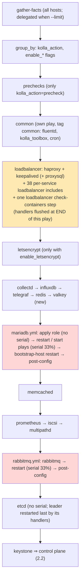
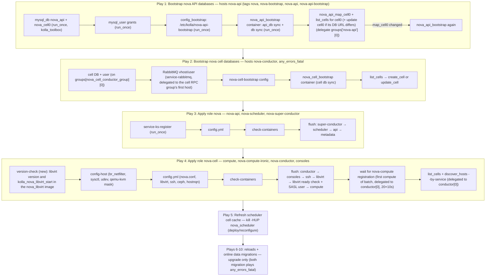
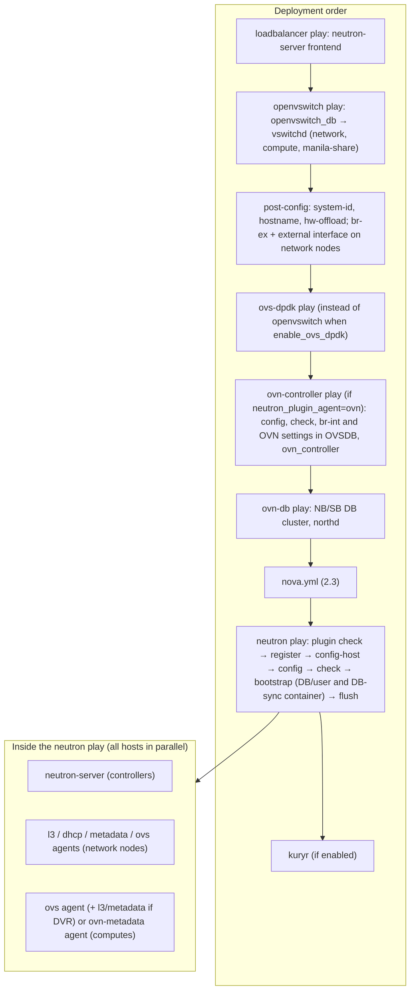

# Deployment execution flow

How Kolla-Ansible 2025.1 decides *what runs when*: play order, the steps inside each role, handler flush points,
batching, and how `deploy`, `reconfigure`, `upgrade`, `deploy-containers`, `genconfig`, `pull`, `stop` and the new
`check` differ.

> [!NOTE]
> **Key answers**
>
> - **There is no dependency resolution.** Order comes from play order (`common` is a play of its own, not a role
>   dependency), task order inside a role, handler flush points, `serial`, the restart plays that MariaDB and RabbitMQ
>   handlers fill through `group_by`, and the etcd handlers that restart the non-leaders before the leader [CODE]
>   ([§1](#1-how-the-order-is-decided)).
> - **Changed in 2025.1: the network plays come before Nova.** `openvswitch`, `ovs-dpdk`, `ovn-controller` and
>   `ovn-db` run before `nova.yml`, and `neutron` right after it [CODE]
>   ([§2.2](#22-openstack-control-plane-deployment-order)).
> - **What each action does** (`deploy`, `reconfigure`, `upgrade`, `deploy-containers`, `genconfig`, `pull`, `stop`,
>   `prechecks`, `validate-config` and, **new in 2025.1**, `check`): the action matrix
>   ([§4](#4-action-matrix-what-each-kolla_action-does)). `genconfig`, then `deploy-containers --limit <batch>`, is
>   still the only built-in way to separate "write the config" from "apply it". Changed in 2025.1: `genconfig` no
>   longer pulls the fluentd image.
> - **Changed in 2025.1: one shared step decides every restart.** The config tasks no longer notify handlers; each
>   role's `check-containers` step notifies only the containers that `compare_container` found changed [CODE]
>   ([§3](#3-inside-a-role-the-standard-deploy-sequence)).
> - **Batching:** a batch runs the complete play, handler restarts included, before the next batch starts, but each play
>   is still traversed batch by batch for the whole fleet before the next play starts. MariaDB and RabbitMQ apply their
>   role to all hosts in one batch, then restart the notified hosts in separate plays with `serial: "33%"`; the etcd
>   play has no `serial`. **Changed in 2025.1:** `reconfigure` and `upgrade` always pass `kolla_serial=0`, after your
>   own `-e`, so `kolla_serial` batches only the other commands ([§5](#5-batching-serial-and-its-interaction-with-order)).
> - **`reconfigure` on a running cloud still runs the DB sync containers** of keystone, glance, cinder, placement, nova,
>   neutron, heat and others [CODE] ([§6](#6-initial-deployment-vs-reconfiguration-what-actually-differs)).
> - **What one compute host goes through in a full `deploy`**, in order
>   ([§2.4](#24-compute-node-deployment-what-one-compute-host-experiences)). On a fresh compute, `openvswitch` now
>   starts before `nova_compute`; `neutron_openvswitch_agent` still starts after it.
> - **Changed in 2025.1: `-t <svc>` no longer restarts HAProxy.** The loadbalancer play's final check step carries only
>   the `haproxy`, `keepalived` and `loadbalancer` tags, so a run limited to a service tag rewrites its frontend file
>   but leaves HAProxy running the old configuration until a later run reaches that step [CODE]
>   ([§7](#7-dependencies-introduced-by-handlers) item 4).
> - **Restart order is handler definition order**, not notification order [CODE], and the handlers of a play run on all
>   notified hosts in lockstep ([§7](#7-dependencies-introduced-by-handlers)).

> Deployment order (this page) ≠ runtime communication (see [Component
> dependencies](../components/dependencies.md)). Arrows in the diagrams below mean "runs before", unless a diagram
> explicitly says it shows runtime calls.

---

## 1. How the order is decided

There is **no dependency resolution** in Kolla-Ansible 2025.1. Order comes from these mechanisms only [CODE]:

| Mechanism | Effect | Evidence |
|---|---|---|
| Play order in `site.yml` / `nova.yml` / `mariadb.yml` / `rabbitmq.yml` | Services are applied strictly in file order. Ansible's default `linear` strategy runs play N on all its hosts (per batch) before play N+1 | `ansible/site.yml`, generated list in [Generated inventory §1](../reference/generated-inventory.md#1-plays-executed-by-siteyml-in-order) |
| Role meta dependency on `common` | **None.** No role has a `meta/` directory. `common` is the `Apply role common` play, run after the prechecks play and before the loadbalancer play, on the `cron`, `fluentd`, `kolla-logs` and `kolla-toolbox` hosts, tagged `common` | `site.yml:88-103`, `roles/common/tasks/main.yml:1-2` |
| Task order inside a role | Fixed sequence: register → config(-host) → check-containers → bootstrap → flush handlers ([§3](#3-inside-a-role-the-standard-deploy-sequence)) | `roles/*/tasks/deploy.yml` |
| Handler flush points | Restarts happen at `meta: flush_handlers` (end of most `deploy.yml`) or at the end of the play. The loadbalancer role deliberately defers to the end of its play | e.g. `roles/nova/tasks/deploy.yml:8-9`; `roles/loadbalancer/tasks/deploy.yml:8-11` |
| Restart plays filled by handlers | MariaDB and RabbitMQ handlers only put hosts into groups (`group_by`); the following plays of `mariadb.yml` / `rabbitmq.yml` restart those groups with `serial: "33%"` | `roles/mariadb/handlers/main.yml:59-74`, `mariadb.yml:18-68`; `roles/rabbitmq/handlers/main.yml:2-4`, `rabbitmq.yml:30-49` |
| Restart handlers that stage etcd | The etcd handlers look up the cluster leader, restart the non-leaders through a handler that loops over `groups.etcd.index(host) % 4` (on `upgrade`, a loop over the etcd hosts), then restart the leader, whose handler is defined after them; each restart waits for the client port and for `etcdctl endpoint health` | `roles/etcd/handlers/main.yml:9-61`, `roles/etcd/tasks/restart_services.yml:2-41` |
| `serial` / `kolla_serial` | Splits a play into batches; each batch completes the whole play, handlers included, before the next starts | `serial: '{{ kolla_serial\|default("0") }}'` on the gather-facts plays (`gather-facts.yml:11,40`), the common play and every service play, except the plays of `mariadb.yml` and `rabbitmq.yml` (no `serial`, or a fixed `"33%"` on the restart plays), the etcd play, which has no `serial` key (`site.yml:485-496`), and cyborg, which reads `serial: '{{ serial\|default("0") }}'` (`site.yml:874`), so `kolla_serial` never batches it. The group_by and prechecks plays have no `serial` key either (`site.yml:7-86`) |

Conditions only *remove* work, never reorder it:

- `when: enable_<svc>` on the role;
- the host-pattern intersection `&enable_<svc>_True`;
- per-task `when:` on `kolla_action`;
- placement filters (`inventory_hostname in groups[...]`, `service_enabled_and_mapped_to_host`, and the
  `select_services_enabled_and_mapped_to_host` filter that the shared roles of 2025.1 loop over).

`max_fail_percentage`, set on almost every play, does not reorder anything either: it can only stop a run earlier
([§5](#5-batching-serial-and-its-interaction-with-order)).

---

## 2. The five diagrams

### 2.1 Infrastructure services (deployment order)

[CODE `gather-facts.yml`, `site.yml:1-496`, `mariadb.yml`, `rabbitmq.yml`]



Changed since 2024.1:

- A `valkey` play runs after the `redis` play (`site.yml:399-411`).
- The loadbalancer play includes the `loadbalancer` tasks of 38 roles (39 in 2024.1: the `swift` role is gone), then
  runs the `loadbalancer` role's `check-containers` once, skipped for `genconfig` (`site.yml:121-327`, final step at
  `:319-324`). The whole block runs only for `deploy`, `reconfigure`, `upgrade` and `genconfig` (`:325-327`).
- Under `--limit`, the hosts that facts are delegated to come from the new `kolla_ansible_delegate_facts_hosts`, which
  defaults to `groups['all']` (`gather-facts.yml:47`, `group_vars/all.yml:43`); see [Compute
  scaling](compute-scaling-and-performance.md).

`mariadb.yml`, `rabbitmq.yml` and `nova.yml` are unchanged since 2024.1 (same text). OpenSearch still comes after
Keystone (`site.yml:512-524`).

### 2.2 OpenStack control plane (deployment order)

[CODE `site.yml:498-1072`, `nova.yml`]

```mermaid
flowchart LR
  KS["keystone"] --> OS["opensearch"] --> RGW["ceph-rgw"] --> GL["glance"] --> IR["ironic"] --> CI["cinder"] --> PL["placement"]
  PL --> NET1["openvswitch / ovs-dpdk → ovn-controller → ovn-db (2.5)"] --> NOVA["nova.yml (2.3)"]
  NOVA --> NET2["neutron → kuryr (2.5)"]
  NET2 --> HC["hacluster"] --> HE["heat"] --> HO["horizon"] --> MISC["magnum → mistral"]
  MISC --> MA["manila"] --> TEL["gnocchi → ceilometer → aodh"] --> BA["barbican"] --> MORE["cyborg → designate → trove → watcher → grafana → cloudkitty → tacker"]
  MORE --> OC["octavia"] --> TAIL["zun → blazar → masakari → venus → skyline"]
```



`site.yml` has 50 `Apply role` plays, prechecks and common included (`site.yml:77-1072`). **Changed since 2024.1:**
the `swift` play is gone, a `valkey` play is added, and the `openvswitch`, `ovs-dpdk`, `ovn-controller` and `ovn-db`
plays moved from after `nova.yml` to before it (`site.yml:605-665`, import of `nova.yml` at `:667`); `neutron` follows
`nova.yml` directly (`:669-691`).

Notable order facts [CODE]:

- **Keystone comes after MariaDB, RabbitMQ and memcached, but before any service that registers with it.**
  `service-ks-register` uses `openstack_interface` (`internal`) and authenticates against `keystone_internal_url`
  (`roles/service-ks-register/defaults/main.yml:5`, `group_vars/all.yml:823, :1096, :1126-1127`).
- **Placement, Glance and Cinder come before Nova.** Open vSwitch and OVN now come before Nova too; Neutron still comes
  *after* Nova (see [§2.5](#25-networking-components)).
- **Barbican comes after Nova, Cinder and Glance**, even though they can be configured to use it as a key manager.
  With `enable_barbican`, Nova and Cinder render a `[barbican]` section (`roles/nova/templates/nova.conf.j2:205-210`,
  `roles/nova-cell/templates/nova.conf.j2:249-254`, `roles/cinder/templates/cinder.conf.j2:262-267`), and their
  plays run before the barbican play (`site.yml:574, :667, :851`). On a first deploy they therefore start configured
  with a `[barbican]` section before Barbican exists. [NOT AVAILABLE] Whether this has any effect before encrypted
  volumes are used.
- **Octavia is near the end.** With `octavia_auto_configure` (default: true when the amphora provider is enabled,
  `group_vars/all.yml:1411`), its play creates the amphora flavor, the keypair, the security groups and the
  management network, subnet and (for IPv6) router (`roles/octavia/tasks/deploy.yml:4-5`, `prepare.yml:2-161`). No
  task of the role uploads the amphora image, and the certificates come from the separate `octavia-certificates`
  command, which also accepts `--check-expiry <days>` (`kolla_ansible/cli/commands.py:198-228`) ([fact
  sheet D](../reference/factsheets/d-barbican-octavia-swift-manila-compute-roles.md)).

### 2.3 Nova deployment (`ansible/nova.yml`)



[CODE `nova.yml:29-302`; `roles/nova/tasks/bootstrap.yml:2-56`, `config_bootstrap.yml`, `bootstrap_service.yml:2-21`,
`map_cell0.yml:2-67`; kolla `docker/nova/nova-api/extend_start.sh:16-20`; `roles/nova-cell/tasks/bootstrap.yml:2-43`,
`roles/nova-cell/tasks/rabbitmq.yml:3-29`, `roles/nova-cell/tasks/create_cells.yml:2-55`;
`roles/nova-cell/tasks/version-check.yml:2-120`, `roles/nova-cell/tasks/config-host.yml:2-53`,
`roles/nova-cell/tasks/config.yml:248-257`; `roles/nova-cell/tasks/deploy.yml:5-39`,
`roles/nova-cell/tasks/wait_discover_computes.yml:27-28,42-43,87-90`, `roles/nova-cell/tasks/discover_computes.yml:5,14-21`;
handler order `roles/nova/handlers/main.yml:2,19,36,53`, `roles/nova-cell/handlers/main.yml:2-159`;
`roles/nova/tasks/refresh_scheduler_cell_cache.yml:10`]

Changed since 2024.1 (`nova.yml` itself is unchanged):

- The nova-cell play starts with `version-check.yml` (`roles/nova-cell/tasks/deploy.yml:5`). It runs one-shot
  containers from the target `nova_libvirt` image on the first `nova-libvirt` host (`run_once`, `delegate_to`), fails
  the play if the new libvirt is older than the running one (tag `nova-libvirt-version-check`,
  `roles/nova-cell/tasks/version-check.yml:2-77`), and fails it if the image lacks `/usr/local/bin/kolla_nova_libvirt_start`
  (tag `nova-libvirt-script-check`, `:79-120`). Both asserts can be bypassed only by skipping their tag.
- The nova-cell `post-config.yml` step, which removed the old `nova_libvirt_secrets` volume, is gone; the volume is
  now only removed by `nova-libvirt-cleanup` (`roles/nova-cell/tasks/libvirt-cleanup.yml:52-55`).
- The nova role has a `Restart nova-metadata container` handler after the API one (`roles/nova/handlers/main.yml:53`).

Details and Nova runtime dependencies: [Nova deep dive](../components/nova-deep-dive.md).

### 2.4 Compute node deployment (what one compute host experiences)

Sequence on one compute host during a full `deploy`, with the default enable flags (`neutron_plugin_agent:
"openvswitch"`, `group_vars/all.yml:332`) and the `multinode` inventory groups (`iscsi` only with `enable_iscsid`)
[CODE: facts and `group_by` first (`site.yml:2,7-75`); play order `site.yml:88-103, :454-467, :605-619`,
`nova.yml:125-147` (imported at `site.yml:667`), `site.yml:669-691`; task and handler order in each role's
`tasks/deploy.yml` and `handlers/main.yml`; `common` in its own play (`site.yml:88-103`,
`roles/common/tasks/deploy.yml:2-9`); discovery on the first compute of the batch only, delegated to the first
conductor, `roles/nova-cell/tasks/wait_discover_computes.yml:42-43,87-90` and `discover_computes.yml:21`]:

```mermaid
sequenceDiagram
  autonumber
  participant D as Deploy host
  participant C as compute001
  D->>C: setup (facts), group_by (always)
  Note over D,C: Play "common" (compute is in the common group)
  D->>C: common: config dirs, kolla.target, config.json ×3, fluentd.conf, cron logrotate config, toolbox Erlang cookie, rabbitmq-env.conf, erl_inetrc
  D->>C: common: check containers (fluentd, kolla_toolbox, cron), create kolla_logs volume, link /var/log/kolla
  D->>C: handlers (changed containers only): Restart fluentd → kolla_toolbox (+ toolbox init) → cron
  Note over D,C: Play "iscsi" (only if enable_iscsid)
  D->>C: configfs module, iscsid config/check → Restart iscsid
  Note over D,C: Play "openvswitch" (now before Nova)
  D->>C: load openvswitch module, config, check → Restart openvswitch_db → wait ovsdb → Restart vswitchd
  D->>C: post-config: set system-id, hostname and hw-offload through openvswitch_db (notifies vswitchd restart), bridge ensure only if computes need external bridge
  Note over D,C: Play "nova-cell" (after controllers' nova plays have bootstrapped DBs/cell)
  D->>C: version check (one-shot libvirt containers on the first nova-libvirt host; per host, libvirtd --version in the running nova_libvirt if its image differs)
  D->>C: br_netfilter, sysctl, udev kvm rule, config dirs, config.json, nova.conf, qemu.conf, libvirtd.conf, SASL, ssh keys, hostnqn
  D->>C: check nova-cell containers
  D->>C: handlers: Restart nova-ssh → nova-libvirt → libvirt ready check → Create libvirt SASL user → nova-compute
  D->>C: (first compute of batch only) wait for nova-compute services, discover_hosts — delegated to conductor[0]
  Note over D,C: Play "neutron"
  D->>C: plugin/agent check, ip6_tables module, sysctl (only on l3 hosts), config (neutron.conf, openvswitch_agent.ini), check
  D->>C: handler: Restart neutron-openvswitch-agent
```

The common steps are `roles/common/tasks/config.yml`, `check-containers.yml:2-3` (the shared
`service-check-containers` role) and `bootstrap.yml:2-16`. **Changed in 2025.1:** the common config step installs
`/etc/systemd/system/kolla.target` (`roles/common/tasks/config.yml:54-58`) and no longer ensures or pulls the fluentd
image (no `ensure_image` task in the file). The iscsi play loads `configfs` first (`roles/iscsi/tasks/config-host.yml:2-10`).
The openvswitch `roles/openvswitch/tasks/post-config.yml:3-53` runs after the role's flush (`roles/openvswitch/tasks/deploy.yml:8-11`), so a
vswitchd restart it notifies runs at the end of the play. The neutron play starts with
`neutron_plugin_agent_check.yml` (`roles/neutron/tasks/deploy.yml:2`); its module and sysctl steps are
`roles/neutron/tasks/config-host.yml:2-34`.

[NOT AVAILABLE] How many task results, skips and handlers a compute host or a controller produces in a full
`deploy`: that depends on the inventory, the enable flags and the `when:` conditions met at run time. The first
controller also runs the `run_once` and delegated bootstrap tasks (e.g. `roles/nova/tasks/map_cell0.yml:63-64`).

**Ordering consequence (changed in 2025.1):** on a fresh compute, `openvswitch_db` and `openvswitch_vswitchd` now
exist before `nova_compute` is started and its registration awaited, but `neutron_openvswitch_agent` is still started
after them. [NOT AVAILABLE] Whether instances can be scheduled there successfully before the neutron play finishes
([Nova deep dive §3](../components/nova-deep-dive.md#3-what-must-be-available-before-nova-can-operate) item 6). On a
running cloud this ordering matters when you add computes with `--limit` (see [Add a compute node
§2](../operations/add-a-compute-node.md#2-add-a-compute-node)). With `neutron_plugin_agent: ovn`, the
`ovn-controller` play also runs before Nova (`site.yml:635-647`).

### 2.5 Networking components



[CODE `site.yml:605-705`; `inventory/multinode:105-108`; `roles/openvswitch/tasks/deploy.yml:2-11`,
`roles/openvswitch/tasks/post-config.yml:3-53`; `roles/ovn-controller/tasks/deploy.yml:2-9`, `setup-ovs.yml`;
`roles/ovn-db/tasks/deploy.yml:2-22`;
`roles/neutron/tasks/deploy.yml:2-23`, `roles/neutron/tasks/bootstrap.yml:38`, `roles/neutron/tasks/bootstrap_service.yml:2-21`]

The OVN controller play still runs *before* the OVN database play (`site.yml:635-647` then `:649-665`), and both now
run before Nova. The neutron play deploys the server and *all* agents in a single play and a single handler flush.
Agents are not deployed after the server has been verified. [NOT AVAILABLE] Whether the RPC layer tolerates the agents
starting first. The OVN southbound relay group `ovn-sb-db-relay` is covered on the [OVN](../components/ovn.md) page.

---

## 3. Inside a role: the standard `deploy` sequence

Typical `deploy.yml` (Nova shown; Neutron adds a plugin check and `config-host` and runs its bootstrap before the
flush; nova-cell adds the version check):

| Step | Typical task file | Scope | Runs on `reconfigure`? |
|---|---|---|---|
| 1. Keystone registration | `register.yml` → `service-ks-register` | `run_once` (per batch) via `kolla_toolbox` on the first host of the play | **yes** |
| 2. Host configuration | `config-host.yml` (sysctl, modules, udev) | per host | yes |
| 3. Config generation | `config.yml` (dirs, `config.json`, INI merges, policy, certs). **Changed in 2025.1:** it notifies no handler, apart from two narrow cases ([Conventions](../start/conventions.md#operation-impact-classes), row `writes-config`) | per host × per service × per file | yes |
| 4. Container check | `check-containers.yml` → shared `service-check-containers` role: `compare_container` once per enabled container mapped to the host (container parameters, image, systemd unit file, `kolla_set_configs --check`), then notify `Restart <service> container` for the changed ones only | per host × per container | yes |
| 5. Bootstrap | `bootstrap.yml` (DB, user, grants) + `bootstrap_service.yml` (one-shot container: DB sync) | `run_once` / first host of the group | **yes** for most roles, Neutron included: its `bootstrap_neutron` DB-sync container has no `kolla_action` or `neutron_enable_rolling_upgrade` condition (`roles/neutron/tasks/bootstrap.yml:38`, `bootstrap_service.yml:2-21`) |
| 6. Flush handlers | `meta: flush_handlers` | notified hosts, in handler definition order | yes |
| 7. Post steps | e.g. openvswitch `post-config.yml`, nova-cell discovery | varies | yes |

[CODE `roles/nova/tasks/deploy.yml:2-9`; `roles/neutron/tasks/deploy.yml:2-23`;
`roles/service-check-containers/tasks/main.yml:4-41`; `module_utils/kolla_container_worker.py:58-65`]

The containers are driven by the `kolla_container` module, which hands the work to a Docker or a Podman worker, after
`kolla_container_engine`, which defaults to `docker` (`library/kolla_container.py:409-416`, `group_vars/all.yml:100`).
The `module_utils/kolla_docker_worker.py` lines cited on this page are those of the Docker worker. How the restart is
decided, step by step, is in [Repository architecture §4.3](repository-architecture.md#43-the-config--check--handler-pattern).

Order caveats:

- **Some roles bootstrap *before* containers start, some after.** Nova bootstraps in separate plays before the service
  plays (`nova.yml:29-100`). Neutron runs its bootstrap *after* check-containers but *before* the flush
  (`roles/neutron/tasks/deploy.yml:13-23`). Keystone bootstraps before its flush and registers last, after Fernet
  key distribution (`roles/keystone/tasks/deploy.yml:2-21`). Glance and Cinder vary (fact sheets
  [B](../reference/factsheets/b-mariadb-rabbitmq-keystone.md),
  [C](../reference/factsheets/c-glance-placement-cinder-horizon-heat.md)).
- **The loadbalancer role does not flush in `deploy.yml`.** The NOTE in `roles/loadbalancer/tasks/deploy.yml:8-11`
  explains that site.yml handles all haproxy changes in that play, so the restart happens once, at the end of the play,
  after all per-service frontends are rendered and the play's last `check-containers` step has compared the
  loadbalancer containers (`site.yml:319-324`).

---

## 4. Action matrix: what each `kolla_action` does

| Action (CLI) | Config written | Containers compared | Handlers (restarts) | Bootstrap / DB sync | Keystone registration | Images pulled | Notes |
|---|---|---|---|---|---|---|---|
| `deploy` | yes | yes | yes | yes | yes | only if absent | Full flow (`kolla_ansible/cli/commands.py:231-242`) |
| `reconfigure` | yes | yes | yes | yes (most roles) | yes | only if absent | Identical to deploy in 53 of the 54 roles that have a `reconfigure.yml` (bifrost is the exception; skyline uses `include_tasks: deploy.yml`) ([Repository architecture §4.2](repository-architecture.md#42-reconfigure-is-deploy)). The command always adds `kolla_serial=0` (`kolla_ansible/cli/commands.py:20-22, :128-140`) |
| `upgrade` | yes | yes | yes | yes: most roles re-run the deploy `KOLLA_BOOTSTRAP` one-shot with the new image (cinder, heat, barbican, octavia, manila, horizon, placement, legacy glance/neutron). Upgrade-only one-shots: keystone `KOLLA_UPGRADE` then `KOLLA_FINISH_UPGRADE`, run as handlers (`roles/keystone/tasks/upgrade.yml:23-34`, `roles/keystone/handlers/main.yml:5-27, :71-92`); neutron rolling (default, `roles/neutron/defaults/main.yml:707`) `NEUTRON_DB_EXPAND`/`NEUTRON_DB_CONTRACT`; glance rolling (opt-in, `glance_enable_rolling_upgrade: "no"`, `group_vars/all.yml:1143`) `GLANCE_DB_EXPAND`/`MIGRATE`/`CONTRACT` (`roles/glance/tasks/rolling_upgrade.yml:40,61,93`); mariadb `upgrade_mariadb` (`roles/mariadb/tasks/post-upgrade.yml:2-24`); `KOLLA_OSM` online migrations (nova, placement, cinder, rolling ironic). Nova `bootstrap_upgrade` re-runs its deploy db-sync container, minus DB creation and cell0 mapping (`roles/nova/tasks/bootstrap_upgrade.yml:5-6`, [Kolla images §4](kolla-images.md#4-one-shot-containers-what-the-environment-variables-run)) | yes (some roles) | only if absent → run `pull` first | Nova reload plays and the separate `KOLLA_OSM` online-migration containers are active only here. The command always adds `kolla_serial=0` (`kolla_ansible/cli/commands.py:270-282`). Placement's bootstrap container also runs `placement-manage db online_data_migrations` on every deploy/reconfigure (kolla `docker/placement/placement-api/extend_start.sh:5-9`); so does Ironic's with `ironic_enable_rolling_upgrade: no` (`roles/ironic/tasks/bootstrap_service.yml:16`, kolla `docker/ironic/ironic-api/extend_start.sh:5-9`; the default is `"yes"`, `roles/ironic/defaults/main.yml:316`) |
| `deploy-containers` | **no** | yes (incl. drift of the files listed in `config_files` and, new in 2025.1, of the `command` in `config.json`; not `permissions` changes, see below) | yes | no | no | only if absent | `tasks/deploy-containers.yml` = `check-containers.yml` (e.g. `roles/nova-cell/tasks/deploy-containers.yml:2`). The loadbalancer includes and their final check are skipped (`site.yml:325-327`) (`kolla_ansible/cli/commands.py:245-256`) |
| `genconfig` (`config`) | yes | no | **none, apart from two narrow cases** (changed in 2025.1): the config tasks no longer notify handlers, so most handlers lost their `kolla_action != "config"` guard; the two config tasks that still notify can restart `placement-api` (with `placement_wsgi_provider: apache`) and `cinder-volume` (with Huawei XML files) ([Conventions](../start/conventions.md#operation-impact-classes), row `writes-config`). The loadbalancer play's `check-containers` step is skipped (`site.yml:319-324`) | no | no | **no** (changed in 2025.1: 2024.1 pulled the fluentd image if absent; 2025.1 `roles/common/tasks/config.yml` has no `ensure_image` task) | `kolla_ansible/cli/commands.py:113-125`. With `octavia_auto_configure`, octavia's config tasks still query the cloud through `kolla_toolbox` (`roles/octavia/tasks/config.yml:2-3`) |
| `pull` | no | no | no | no | no | **yes**, every enabled container mapped to the host, plus `common` (in its own play) | `service-images-pull` (`roles/service-images-pull/tasks/main.yml:2-18`); `kolla_ansible/cli/commands.py:173-184` |
| `stop` | no | no | no | no | no | no | `stop_container` for every enabled container on the host, honouring `skip_stop_containers`; **new in 2025.1**, `--ignore-missing` passes `kolla_action_stop_ignore_missing` so missing containers do not fail the task (`roles/service-stop/tasks/main.yml:2-25`). The command refuses to run without `--yes-i-really-really-mean-it` (`kolla_ansible/cli/commands.py:285-315`) |
| `prechecks` (`precheck`) | no | no | no | no | no | no | `prechecks` role + each role's `precheck.yml` (port checks, group validation) (`kolla_ansible/cli/commands.py:99-110`) |
| `validate-config` (`config_validate`) | no | no | no | no | no | no | `kolla_ansible/cli/commands.py:143-155`. Runs `oslo-config-validator` inside each running container that has a validation list, and writes the errors under `service_config_validate_output_dir` on the deploy host (`roles/service-config-validate/tasks/main.yml:2-13`, `validate.yml:2-50`) |
| `check` (**new in 2025.1**) | no | no | no | no | no | no | `kolla_ansible/cli/commands.py:495-506`. 52 roles have a `check.yml` that imports `service-check`, which reads the role's containers with `kolla_container_facts` and **fails the host** when one is missing, not running or unhealthy (`roles/service-check/tasks/main.yml:2-40`). A failed host counts for `max_fail_percentage` like in any other run ([§5](#5-batching-serial-and-its-interaction-with-order)). [NOT AVAILABLE] Real output, and how far a `check` run goes after the first failure (lab test) |

The combination **`genconfig` → (review the diff) → `deploy-containers --limit <batch>`** is the only built-in way to
separate "write the config" from "apply it", and to apply in controlled batches. It works because `compare_container`
detects drift in the files listed in each `config.json`'s `config_files` (content, mode, owner) through
`kolla_set_configs --check` [CODE `module_utils/kolla_container_worker.py:58-65`,
`module_utils/kolla_docker_worker.py:146-181`, kolla `docker/base/set_configs.py:178-211, :233-255, :655-657`]. With
Podman, the worker returns "changed" when the container is not running, then runs the same check
(`module_utils/kolla_podman_worker.py:524-552`).

**Changed in 2025.1: a change of `command` in `config.json` is now detected.** `--check` compares the `command` of
`config.json` with the command the container was started with (`/run_command`) and exits 1 when they differ
(`ConfigFileCommandDiffers`, kolla `docker/base/set_configs.py:41-44, :580-586`; `/run_command` is written at start,
`:324-330`). Every memcached setting, for example, is in its `command` (`roles/memcached/templates/memcached.json.j2:2`),
so in 2025.1 a memcached setting change written by `genconfig` is applied by the next `deploy-containers`,
`deploy` or `reconfigure`; in 2024.1 `deploy-containers` never applied it. A change confined to the `permissions` list of `config.json` is still not
compared: the check path runs only the command check and the file check (`set_configs.py:655-657`), not
`handle_permissions` (`:347`). [NOT AVAILABLE] Which existing containers report a command difference at the first 2025.1
run (lab test).

An `optional` file that newly appears, and whose destination does not exist in the container yet, counts as drift:
`--check` exits 1 and the restart copies the file [CODE kolla `docker/base/set_configs.py:178-185, :237-255,
:660-662`, `module_utils/kolla_docker_worker.py:164-177`]. **New in 2025.1:** a file that was listed earlier and is no
longer listed in `config.json` counts as drift too (`StateMismatch`, `set_configs.py:589-636`). See [Write config
first, apply in controlled batches
§2](../operations/controlled-batches.md#2-separate-write-config-from-apply-recommended-pattern)
and [Kolla images §3](kolla-images.md#3-kolla_set_configs---check-what-it-compares-and-its-exit-codes).

---

## 5. Batching (`serial`) and its interaction with order

```mermaid
gantt
  dateFormat X
  axisFormat %s
  title Play execution with kolla_serial=2 (illustrative, 4 computes, deploy)
  section openvswitch play
  batch 1 (compute001-002) :b1, 0, 15s
  batch 2 (compute003-004) :b2, after b1, 15s
  section nova-cell play
  batch 1 (compute001-002) config→check→flush→discover :a1, after b2, 30s
  batch 2 (compute003-004) config→check→flush→discover :a2, after a1, 30s
```



The bar lengths are illustrative only; no duration is known from the code.

- **A batch runs the complete play before the next batch starts.** That includes handler restarts and the compute
  discovery: ansible-core 2.18.20 runs the whole play once per batch, restricting the inventory to that batch
  (`lib/ansible/executor/playbook_executor.py:183-191`). Batches therefore bound the number of simultaneous restarts
  *per play*, but **each play is still traversed batch by batch for the whole fleet before the next play starts**.
  The neutron agents on compute001 are restarted only after *all* computes have finished the openvswitch and nova-cell
  plays.
- **`run_once` tasks run once per batch** ([Tags §2.5](../risk/tags.md#25-run_once-with-serial-code)): the linear
  strategy sends a `run_once` task to the first host of the current batch only
  (`lib/ansible/plugins/strategy/linear.py:178, :205-206`). Examples: DB sync, Keystone registration, compute discovery
  (`wait_discover_computes.yml` runs for `all_computes_in_batch[0]`), and the new nova-cell version check.
- **MariaDB and RabbitMQ are not batched by `kolla_serial`.** Their role plays run all hosts in one batch; their
  handlers only add the hosts to restart groups, and the next plays restart those groups with `serial: "33%"`
  (`mariadb.yml:18-52`, `rabbitmq.yml:30-49`). With three nodes that is one node per batch (ansible-core 2.18.20
  `lib/ansible/utils/helpers.py:28-30`). Each RabbitMQ node is put into maintenance mode before its restart
  (`roles/rabbitmq/tasks/restart_services.yml:10-20`)
  ([fact sheet B](../reference/factsheets/b-mariadb-rabbitmq-keystone.md)).
- **etcd is not batched by `kolla_serial`.** Its play has no `serial` key (`site.yml:485-496`); its handlers stage the
  restarts instead ([§7](#7-dependencies-introduced-by-handlers) item 6). cyborg is not batched by `kolla_serial`
  either: its play reads `serial` instead (`site.yml:874`).
- **How `kolla_serial` is set depends on the command (changed in 2025.1).** The `ANSIBLE_SERIAL` environment variable
  of 2024.1 is gone: `ANSIBLE_SERIAL = 0` is now a constant (`kolla_ansible/cli/commands.py:20-22`), and `reconfigure`
  and `upgrade` always add `kolla_serial=0` (`:136, :278`). That value is passed after your own `-e`
  (`kolla_ansible/ansible.py:261-266`), and ansible-core keeps the last value of a repeated extra var
  (`lib/ansible/utils/vars.py:94-105, :198-224`), so `kolla-ansible reconfigure -e kolla_serial=1` runs every play
  with `kolla_serial=0` [CODE; a lab run has not confirmed it]. `deploy`, `deploy-containers`, `pull`, `genconfig`,
  `stop`, `check` and the others add no `kolla_serial`, so `-e kolla_serial=N` batches them
  (`kolla_ansible/cli/commands.py:231-256`). To batch a reconfiguration, use `genconfig` then `deploy-containers -e
  kolla_serial=N`, or `--limit` ([Controlled batches](../operations/controlled-batches.md)).
- **`max_fail_percentage` on the plays.** Every play of `site.yml`, `gather-facts.yml`, `mariadb.yml` and
  `rabbitmq.yml`, and every play of `nova.yml` except the cell bootstrap and the two online-migration plays (which
  use `any_errors_fatal: true`), sets `max_fail_percentage` from `<service>_max_fail_percentage`, then
  `kolla_max_fail_percentage`, then 100 (e.g. `site.yml:10-13,95-99`, `nova.yml:40-43,77-79`). `globals.yml` says
  that 100 is equivalent to not setting it (`etc/kolla/globals.yml:27-31`). In ansible-core 2.18.20 the check
  compares the hosts failed in the current batch with the batch size (`lib/ansible/plugins/strategy/linear.py:336-347`;
  the failed-host list is cleared at the start of each batch, `lib/ansible/executor/task_queue_manager.py:334, :386-387`),
  so a lower value stops the play, and the rest of the run, once that share of a batch has failed
  (`lib/ansible/executor/playbook_executor.py:194-196, :214-215`). Whatever the value, a batch in which every host
  failed ends the run (`playbook_executor.py:199-204`). This applies to `check` too, where a failed host is a host
  with a missing, stopped or unhealthy container.

---

## 6. Initial deployment vs reconfiguration: what actually differs

| Aspect | Initial `deploy` (empty hosts) | `reconfigure` on a running cloud |
|---|---|---|
| Containers | All `create+start`: the container check finds no container, and the restart handler then starts a new one under its systemd unit [CODE `module_utils/kolla_container_worker.py:58-65`, `module_utils/kolla_docker_worker.py:352-361, :376-400`]. Exception: on the bootstrap host (`groups[mariadb_shard_group][0]`), mariadb runs first as the one-shot `bootstrap_mariadb`, then a handler starts it with `--wsrep-new-cluster` and waits for its port and WSREP sync, and the "Restart bootstrap mariadb service" play runs `recreate_or_restart_container` on it (`roles/mariadb/tasks/bootstrap.yml:4-7`, `bootstrap_cluster.yml:2-27`, `roles/mariadb/handlers/main.yml:2-57`, `mariadb.yml:54-68`, `roles/mariadb/tasks/restart_services.yml:2-15`). [NOT AVAILABLE] Container counts, which depend on the inventory and the enable flags | Restart (config) or recreate (image or params) **only if** drift is detected; otherwise none [CODE `module_utils/kolla_container_worker.py:58-65`, `module_utils/kolla_docker_worker.py:352-374`]. **At the first run after an upgrade from 2024.1**, some differences come from 2025.1 itself (the systemd unit, the default `ulimits` with Docker): see [Repository architecture §4.3](repository-architecture.md#43-the-config--check--handler-pattern) |
| One-shot containers | DB bootstrap for every service, MariaDB and RabbitMQ bootstrap, fernet key generation, cell creation | DB sync containers **still run** for keystone, glance, cinder, placement, nova (API and cell DB sync, plus map_cell0, list_cells for cell0 and list_cells ×2), neutron, heat, plus barbican, octavia and others [CODE: in these roles `reconfigure.yml` imports `deploy.yml` and the bootstrap containers have no `kolla_action` guard, e.g. `roles/keystone/tasks/bootstrap_service.yml:34-51`; nova: `nova.yml:49-55,85-91`, `roles/nova/tasks/map_cell0.yml:2-30`, `list_cells` from `roles/nova-cell/tasks/create_cells.yml:2` and `discover_computes.yml:5`; neutron: `roles/neutron/tasks/bootstrap_service.yml:2-21`]. MariaDB/RabbitMQ bootstrap and the keystone Fernet bootstrap (`when: groups['keystone_fernet_running_True'] is not defined`, `roles/keystone/tasks/bootstrap_service.yml:53-76`) are not re-run |
| Handler order effects | Every handler fires | Only notified handlers fire, and **changed in 2025.1**, only for the containers reported changed: the loop-notify of 2024.1 is gone ([Tags §2.4](../risk/tags.md#24-loop-notify-is-gone-in-20251-code)) |
| Neutron DB sync (`bootstrap_neutron`) | runs | **runs too** (no condition on `kolla_action` or `neutron_enable_rolling_upgrade`, `roles/neutron/tasks/bootstrap_service.yml:2-21`). The DB/user/grant tasks run as well |
| Nova cell | `create_cell` | `update_cell` only if the transport URL or DB URL changed (`roles/nova-cell/tasks/create_cells.yml:31-55`) |
| Fernet keys | generated | **re-distributed** from the first running keystone_fernet node to the others ([fact sheet B §3.6](../reference/factsheets/b-mariadb-rabbitmq-keystone.md#36-fernet-key-lifecycle-fact-unless-marked), task flow in [§3.3](../reference/factsheets/b-mariadb-rabbitmq-keystone.md#33-task-flow-per-kolla_action)) |
| MariaDB | Galera bootstrap on the first host of the shard | cluster lookup; if the container changed, restart plays with `serial: "33%"` (`mariadb.yml:18-52`) |
| Duration drivers | image pulls, first container starts | per-task SSH overhead across all hosts, `compare_container` exec per container (see [Compute scaling](compute-scaling-and-performance.md)). [NOT AVAILABLE] Any duration |

---

## 7. Dependencies introduced by handlers

Handlers create ordering that is not visible in task files:

1. **Within a role, restart order = handler definition order, not notification order.**
   - nova-cell restarts `nova_ssh` → `nova_libvirt` (→ libvirt ready check, SASL user) → `nova_compute`
     (`roles/nova-cell/handlers/main.yml:70-159`).
   - openvswitch restarts `openvswitch_db` → waits → `openvswitch_vswitchd`
     (`roles/openvswitch/handlers/main.yml:2-40`).
   - [CODE] ansible-core 2.18.20 keeps the play's handler list in definition order, copies it into each host's state
     at each flush, and walks it in that order, running only the handlers notified for the host
     (`lib/ansible/executor/play_iterator.py:193-198, :424-438`).
2. **Handlers of a play run on all notified hosts in lockstep** (ansible-core 2.18.20: the linear strategy gives all
   hosts the same next task, and at a `flush_handlers` it inserts the play's handlers into that shared task list,
   `lib/ansible/plugins/strategy/linear.py:47-90`). With `serial: 0`, every compute whose `nova_compute` changed
   restarts it in the same step. **Changed in 2025.1:** `nova_libvirt` and `nova_ssh` restart with it only if they
   changed too; the loop-notify that restarted them along in 2024.1 is gone.
3. **Handler chains:**
   - Restart nova-libvirt → Checking libvirt container is ready → Create libvirt SASL user (with `libvirt_enable_sasl`,
     `roles/nova-cell/handlers/main.yml:90, :108`).
   - Restart openvswitch-db → Waiting for openvswitch_db (`roles/openvswitch/handlers/main.yml:15-16`).
   - Restart kolla-toolbox → Initializing toolbox (`roles/common/handlers/main.yml:30-36`).
   - Restart haproxy / proxysql / keepalived container → handlers that `listen` to these names: check the API
     interface addresses, group the hosts by whether they hold the VIP, stop and start the backup hosts' containers,
     then the master's, then wait for HAProxy (and ProxySQL) to listen on the VIP
     (`roles/loadbalancer/handlers/main.yml:9-332`).
   - MariaDB and RabbitMQ: restart handlers only `group_by` the host; the restart itself is a later play (item 5).
4. **The loadbalancer restart is decided once, at the end of its play (changed in 2025.1).** In 2024.1 each service's
   `haproxy-config` task notified the loadbalancer handler. In 2025.1 `roles/haproxy-config/tasks/main.yml` has no
   `notify`; the per-service frontends are files under `services.d/`, which the HAProxy `config.json` lists
   (`roles/loadbalancer/templates/haproxy/haproxy.json.j2:16-21`), and the play's last step, the `loadbalancer`
   role's `check-containers`, compares the HAProxy container and notifies its restart (`site.yml:319-324`).
   **Consequence with `-t <svc>`:** the play still runs that service's `loadbalancer` include, which carries the
   service tag, but the final `check-containers` include has no tag of its own, so it inherits only the play's tags
   `haproxy`, `keepalived` and `loadbalancer` (`site.yml:115-118, :319-324`) and is skipped. ansible-core lists it
   that way: under `--list-tasks -t nova` the loadbalancer play shows only the two `nova` and `nova-cell` includes
   ([listings](../reference/listings/list-tasks-nova.txt), play #6). So `kolla-ansible reconfigure -t nova` rewrites
   a changed Nova frontend file under `services.d/` but does not restart HAProxy in that run; the change is applied by
   the next run that reaches the check step (no `-t`, or `-t loadbalancer`, `haproxy` or `keepalived`) [CODE].
   [NOT AVAILABLE] Confirmation on a lab (lab test).
5. **The MariaDB restart is a sequence of plays, not of handler waves.** The handlers put running members into
   `mariadb_restart` and new members into `mariadb_start` (`roles/mariadb/handlers/main.yml:59-74`); the "Restart
   mariadb services" and "Start mariadb services" plays then run `restart_services.yml` (restart, port wait, WSREP sync
   wait) with `serial: "33%"` (`mariadb.yml:18-52`, `roles/mariadb/tasks/restart_services.yml:2-53`)
   ([fact sheet B §1.5][sheet-b-15]). Changed in 2025.1: the handlers now `listen` to `Restart mariadb container`,
   the name the shared check step notifies (`roles/mariadb/handlers/main.yml:65, :74`), and the WSREP wait queries
   through `kolla_toolbox` instead of `mysql` inside the container (`roles/mariadb/tasks/restart_services.yml:31-53`).
6. **The etcd restart is staged by its handlers.** `Restart etcd container` is only a name that handlers `listen` to:
   they look up the leader, then restart the non-leaders (on `upgrade`, looping over the etcd hosts; otherwise
   looping over the four values of `groups.etcd.index(host) % 4`), then the leader, which comes after them because
   its handler is defined after theirs (`roles/etcd/handlers/main.yml:9-61`). Each restart waits for the client port
   and for `etcdctl endpoint health` (`roles/etcd/tasks/restart_services.yml:2-41`). [NOT AVAILABLE] How ansible-core
   orders the files included by one looped handler across hosts, so whether the `% 4` groups really restart one after
   another.

## Related

- [Component dependencies](../components/dependencies.md) (runtime dependencies)
- [Repository architecture §4.3](repository-architecture.md#43-the-config--check--handler-pattern) (how a
  restart is decided)
- [Tags §2.5](../risk/tags.md#25-run_once-with-serial-code) (`run_once` with `serial`)
- [Nova deep dive](../components/nova-deep-dive.md) (the nova plays)
- [Write config first, apply in controlled batches
  §2](../operations/controlled-batches.md#2-separate-write-config-from-apply-recommended-pattern) (`genconfig` then
  `deploy-containers`)
- [Glossary](../reference/glossary.md) (glossary)

[sheet-b-15]: ../reference/factsheets/b-mariadb-rabbitmq-keystone.md#15-handlers-ansiblerolesmariadbhandlersmainyml-in-definition-order
