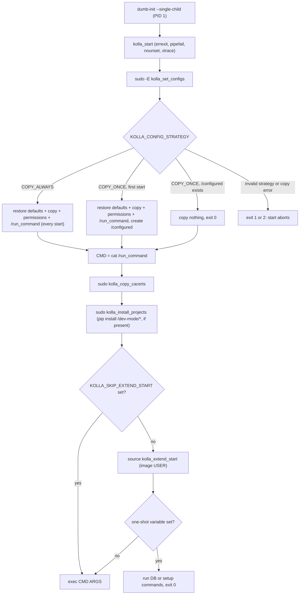

# Kolla images: start path and one-shot containers

This page answers open question [Q14](../troubleshooting/open-questions.md#q14) of the [Open
questions](../troubleshooting/open-questions.md): what the kolla images do when a container starts, and what the
one-shot containers that Kolla-Ansible starts with `KOLLA_BOOTSTRAP`, `KOLLA_UPGRADE`, `KOLLA_OSM` and similar variables
actually run. It was read from the kolla image repository (`openstack/kolla`, tag `2025.1-eom`, commit `c4b53a2`) and
matched against Kolla-Ansible `2025.1-eom` (`7222f0f`). The images were read, not built or run.

> [!NOTE]
> **Key answers**
>
> - **What every container start does:** `kolla_start` runs `kolla_set_configs`, `kolla_copy_cacerts`, the new
>   `kolla_install_projects` and the image's `kolla_extend_start`, then execs the service command, with `errexit`,
>   `pipefail` and `nounset` ([§2.2](#22-kolla_start-step-by-step)). Changed in 2025.1 in kolla `docker/base`:
>   `start.sh`, `set_configs.py`, `copy_cacerts.sh` (rewritten), `sudoers` and `Dockerfile.j2`; `install_projects.sh`
>   and `kolla_patch.sh` are new.
> - **`kolla_set_configs --check`, changed in 2025.1:** it now compares the `command` with `/run_command`, fails when a
>   destination recorded in the defaults state is no longer in `config.json`, then compares the `config_files` entries
>   (content, mode, owner) as before [CODE] ([§3.1](#31-what-is-compared)). It still never compares `permissions`
>   ([§3.2](#32-what-is-still-not-compared)). Exit codes 0, 1, 2 and 137, and what `kolla_container` does with each,
>   with Docker and with Podman: [§3.3](#33-exit-codes). Run by hand, it needs `exec -u root`
>   ([§3.4](#34-running-it-by-hand-needs-root)).
> - **New in 2025.1 on the Kolla-Ansible side:** the config step no longer notifies restart handlers; the shared
>   `service-check-containers` step runs `compare_container`, `--check` included, for every container and restarts
>   only those reported changed ([Repository architecture
>   §4.3](repository-architecture.md#43-the-config--check--handler-pattern)). 131 of the 163 `config.json` templates
>   now copy the custom CA directory to `/var/lib/kolla/share/ca-certificates`, so a CA change is seen by `--check`
>   ([§2.4](#24-kolla_copy_cacerts-and-kolla_httpd_setup)).
> - **What a `COPY_ALWAYS` restart applies:** changed or added files, mode and owner changes and a changed command
>   [CODE]. As before, `kolla_set_configs` records the state of each destination at the container's first start and,
>   at every later start, deletes or restores those destinations before copying: most removals apply too, with
>   exceptions ([§3.5](#35-what-a-restart-applies)).
> - **One-shot containers:** what `KOLLA_BOOTSTRAP`, `KOLLA_UPGRADE`, `KOLLA_OSM` and the other variables run in each
>   image, and which Kolla-Ansible task sets them ([§4](#4-one-shot-containers-what-the-environment-variables-run)).
>   Swift is gone from both repositories.
> - **Per-image start behaviour:** the table in [§5](#5-per-image-start-behaviour). Changed in 2025.1: Open vSwitch
>   runs under `ovs_wrapper` (Kolla-Ansible's own `start-ovs` scripts are gone), HAProxy is `exec`'d, the MariaDB
>   clustercheck runs under `socat_wrapper`, nova-libvirt starts `virtlogd` beside `libvirtd`, and the opt-in
>   `neutron_agents_wrappers` runs dnsmasq, haproxy, keepalived and radvd of the DHCP and L3 agents in child
>   containers. The nova-libvirt start path is still passive towards running guests
>   ([§5.1](#51-nova-libvirt-the-start-path-is-passive)).
> - **Day-2 consequences:** 20 items ([§6](#6-day-2-consequences)). **What is not available from the sources:**
>   [§7](#7-what-is-not-available-from-the-sources).

Citation convention: kolla image paths carry a `kolla` prefix (kolla `docker/base/start.sh:11`). Kolla-Ansible paths
have
no prefix and are relative to its `ansible/` directory (`roles/nova/tasks/bootstrap_service.yml:11`,
`module_utils/kolla_docker_worker.py:146-181`, `nova.yml:29-65`), except `kolla_ansible/...`. Ansible source paths
carry an `ansible-core 2.18.20` prefix. Evidence labels are those of [Conventions and evidence
labels](../start/conventions.md#evidence-labels): [CODE] (a kolla or Ansible path counts as [CODE]) and [NOT AVAILABLE]
(the sources do not establish it).

---

## 1. Scope and method

- **Read in full** [CODE]: kolla `docker/base` (`Dockerfile.j2`, `start.sh`, `set_configs.py`, `copy_cacerts.sh`,
  `install_projects.sh`, `kolla_patch.sh`, `httpd_setup.sh`, `sudoers`, `healthcheck_*`), and the `Dockerfile.j2`
  and start scripts of the images in [§5](#5-per-image-start-behaviour): Keystone, Glance, Placement, Cinder, Heat,
  Horizon, Barbican, Octavia, Manila, Nova (with the new `kolla_nova_libvirt_start.sh`), Neutron (with the
  neutron-base wrappers), Open vSwitch (with `ovs_wrapper.sh`), OVN, MariaDB (server and clustercheck, with
  `socat_wrapper.sh`), RabbitMQ, memcached, HAProxy, keepalived (with `check_alive.sh`), fluentd, cron, kolla-toolbox,
  iscsid and tgtd. `diff -rq` of kolla `docker/base` between `2024.1-eom` and `2025.1-eom` shows changes in
  `Dockerfile.j2`, `start.sh`, `set_configs.py`, `copy_cacerts.sh`, `sudoers` and repository files, and two new
  scripts; `httpd_setup.sh` and the healthcheck scripts are byte-identical. The `swift` images are gone and a `valkey`
  image is new. The chrony image and role are still absent. Of the other images only the `ironic-api` bootstrap
  branch ([§4](#4-one-shot-containers-what-the-environment-variables-run)) and the `bifrost-deploy`
  `ENTRYPOINT`/`CMD` ([§2.1](#21-image-wiring)) were read, and every Dockerfile was searched for `HEALTHCHECK`
  ([§2.7](#27-healthcheck-scripts)) and for `ENTRYPOINT`/`CMD` overrides. The rest were not.
- **Matched to Kolla-Ansible.** Each one-shot variable was traced to the task that sets it
  ([§4](#4-one-shot-containers-what-the-environment-variables-run)) [CODE]. Every role calls the `kolla_container`
  module, which loads `DockerWorker` when `container_engine` is `docker` and `PodmanWorker` otherwise
  (`library/kolla_container.py:406-416`).
  The engine comes from `kolla_container_engine`, default `docker` (`group_vars/all.yml:100,162`). Both workers share
  `ContainerWorker` (`module_utils/kolla_container_worker.py`) and drive long-running containers through systemd units
  (`module_utils/kolla_systemd_worker.py:20-40`), which are now `PartOf=kolla.target` (`:27`). This page cites the
  Docker worker first and gives the Podman differences where they change what a start, stop or check does. The drift
  logic is in Kolla-Ansible's own `module_utils/`, not in ansible-collection-kolla: a grep of the collection
  `2025.1-eom` for `set_configs`, `compare_container` and `check_container` finds nothing.
- **`kolla_set_configs --check` was read, not run**: exit codes 0, 1 and 2 of [§3.3](#33-exit-codes) are read from kolla
  `docker/base/set_configs.py`; 137 and the exec client error are `kolla_container` outcomes
  (`module_utils/kolla_docker_worker.py:146-181`, `module_utils/kolla_podman_worker.py:524-552`).
- **Not covered**: behaviour against real services and data, signal delivery, timing. These are [NOT AVAILABLE] and
  are listed in [§7](#7-what-is-not-available-from-the-sources).

---

## 2. Start path common to every image

### 2.1 Image wiring

Every kolla image inherits from kolla `docker/base/Dockerfile.j2` [CODE]:

- `ENTRYPOINT ["dumb-init", "--single-child", "--"]` when `use_dumb_init` is on (kolla `docker/base/Dockerfile.j2:397-399`;
  default True, kolla `kolla/common/config.py:155`), and `CMD ["kolla_start"]` (kolla `docker/base/Dockerfile.j2:432`). The MariaDB server image drops `--single-child`
  ([§2.6](#26-signals-and-pid-1)). bifrost-deploy resets both (`ENTRYPOINT []`, `CMD [ "/sbin/init" ]`, kolla
  `docker/bifrost/bifrost-deploy/Dockerfile.j2:29-30`), so `bifrost_deploy` never runs `kolla_start` or
  `kolla_set_configs`.
- The base scripts are installed as `kolla_set_configs` (`set_configs.py`), `kolla_start` (`start.sh`),
  `kolla_copy_cacerts` (`copy_cacerts.sh`), `kolla_httpd_setup` (`httpd_setup.sh`) and, new in 2025.1,
  `kolla_install_projects` (`install_projects.sh`) and `kolla_patch` (`kolla_patch.sh`); `sudoers` becomes
  `/etc/sudoers`, mode 0440 (kolla `docker/base/Dockerfile.j2:389-395,410-417`). `kolla_patch` is a build-time step:
  it applies the patch files of the build's `patches-path` option and runs only when that option is set (kolla
  `docker/macros.j2:92-97`, `kolla/common/config.py:180-181`, `docker/base/kolla_patch.sh:14-40`). It does nothing at
  container start.
- `/usr/local/bin/kolla_extend_start` is created empty by `touch` (kolla `docker/base/Dockerfile.j2:410`). An image
  gets start logic only by overwriting it.
- `/var/log/kolla` gets group `kolla` and mode 2775 (kolla `docker/base/Dockerfile.j2:418-420`).
- Service users are added to group `kolla` (kolla `docker/macros.j2:53`). The base `sudoers` lets members of that
  group run three commands as root without a password, keeping their environment: `kolla_set_configs`,
  `kolla_copy_cacerts` and, new in 2025.1, `kolla_install_projects` (kolla `docker/base/sudoers:7,18,21,24`). It sets a `secure_path` that puts
  `/var/lib/kolla/venv/bin` first (`:9`) and includes `/etc/sudoers.d` (`:26`), where many images add entries of their
  own, e.g. cinder-volume's `chown -R` and `chmod` (kolla `docker/cinder/cinder-volume/cinder_sudoers:2-5`, installed
  as `kolla_cinder_volume_sudoers`, `docker/cinder/cinder-volume/Dockerfile.j2:46`) and mariadb's
  `kolla_security_reset` (kolla `docker/mariadb/mariadb-server/mariadb_sudoers:1`). The `kolla_set_configs` entry
  restricts no arguments, so `sudo kolla_set_configs --check` is allowed.
- Kolla-Ansible passes `KOLLA_CONFIG_STRATEGY` to every container through `docker_common_options`
  (`group_vars/all.yml:49,151-162`; default `COPY_ALWAYS`). `kolla_container` merges the task's `environment` over the
  one of `common_options` (`library/kolla_container.py:371-393`).

### 2.2 `kolla_start` step by step

1. `set -o errexit; set -o pipefail; set -o nounset; set -o xtrace` (kolla `docker/base/start.sh:3-6`). Any failing
   command ends the container, including commands in the sourced `kolla_extend_start`; a failing command inside a
   pipeline, or a reference to an unset variable, also ends it. The start scripts give defaults to the variables
   Kolla-Ansible does not always set (e.g. kolla `docker/keystone/keystone/extend_start.sh:21`,
   `docker/neutron/neutron-base/extend_start.sh:22`, `docker/horizon/extend_start.sh:5`) [CODE]. xtrace is on in that
   script, and in the `kolla_<service>_extend_start` it sources ([§2.5](#25-the-extend_start-chain)), where one-shots
   put a secret on a command line: heat's `--password ${HEAT_DOMAIN_ADMIN_PASSWORD}` (kolla
   `docker/heat/heat-api/extend_start.sh:12`) and the MariaDB upgrade
   `mysql_upgrade ... --password="${DB_ROOT_PASSWORD}"`
   (kolla `docker/mariadb/mariadb-server/extend_start.sh:55`). As in 2024.1, that `mysql_upgrade` pipes its
   output into `tee -a ${MARIADB_LOG_DIR}/mariadb-upgrade.log` (`:3,55`), so with `pipefail` its failure still ends
   the one-shot. The MariaDB bootstrap turns xtrace off around its root-password commands (`set +o xtrace` ...
   `set -o xtrace`, `:24-28`) [CODE]. [NOT AVAILABLE: bash semantics, not in these sources] Whether the trace on stderr
   shows the remaining commands with their variables expanded, and so writes the secret there.

   `kolla_container` returns the container's rc, stdout and stderr in the task result when it waits for a one-shot
   (`module_utils/kolla_docker_worker.py:402-424`, `module_utils/kolla_podman_worker.py:654-675`,
   `library/kolla_container.py:421-425`). Ansible's default callback prints a failed result, `stderr` included, and an
   ok or changed one only with `-v` (ansible-core 2.18.20 `lib/ansible/plugins/callback/default.py:49-70,72-105`,
   `lib/ansible/plugins/callback/__init__.py:210-212`); a task with `no_log` reaches the callback with its result
   replaced by a `censored` message (ansible-core 2.18.20 `lib/ansible/executor/task_queue_manager.py:447`,
   `lib/ansible/executor/task_result.py:130-139`). `bootstrap_heat` sets no `no_log`
   (`roles/heat/tasks/bootstrap_service.yml:2-30`); `upgrade_mariadb` does (`roles/mariadb/tasks/post-upgrade.yml:2-24`)
   [CODE].
2. `sudo -E kolla_set_configs` (`:11`) runs as root whatever the image `USER`, copies the configuration
   ([§2.3](#23-kolla_set_configs-copy-and-permissions)) and writes `config.json`'s `command` to `/run_command`.
3. `CMD=$(cat /run_command)` and `ARGS=""` (`:12-13`).
4. `sudo kolla_copy_cacerts` (`:16`, [§2.4](#24-kolla_copy_cacerts-and-kolla_httpd_setup)), on every start whatever the
   strategy.
5. New in 2025.1: `sudo kolla_install_projects` (`:19`). If `/dev-mode` exists, it runs `pip install -U` on each entry
   below it (kolla `docker/base/install_projects.sh:8-12`). Kolla-Ansible mounts a project's source there only when its
   `<project>_dev_mode` is on (e.g. `roles/aodh/defaults/main.yml:185`). The loop runs on every start, as root. The script
   sets no errexit, so its exit status is that of the last `pip install`: a failure on the last entry ends the start
   through `kolla_start`'s errexit, a failure on an earlier one does not [CODE; pip and network behaviour NOT
   AVAILABLE].
6. Unless `KOLLA_SKIP_EXTEND_START` is set, `. kolla_extend_start` (kolla `docker/base/start.sh:21-24`). The script is
   sourced: it runs in the same shell, as the image `USER`, with errexit on. It can set `ARGS` or `CMD`, or `exit`. An
   `exit 0` ends the container before the service starts, which is how every one-shot branch in
   [§4](#4-one-shot-containers-what-the-environment-variables-run) works. The test is `${!KOLLA_SKIP_EXTEND_START[@]}`,
   the idiom that kolla's own comments describe as catching "all cases of the ... variable being set, including empty"
   (kolla `docker/keystone/keystone/extend_start.sh:41-42`), so any value, even empty or `false`, skips the script and
   every one-shot branch with it [CODE]. Kolla-Ansible never sets this variable (grep of `ansible/`).
7. `echo "Running command: '${CMD}${ARGS:+ $ARGS}'"`, then `exec ${CMD} ${ARGS}`, unquoted (kolla
   `docker/base/start.sh:26-27`). The service replaces the shell and becomes dumb-init's only child.

### 2.3 `kolla_set_configs`: copy and permissions

Without arguments, `kolla_set_configs` loads `/var/lib/kolla/config_files/config.json`, validates it (`command` is
required; each `config_files` entry needs `source` and `dest`, plus `owner` and `perm` unless `preserve_properties`) and
applies the strategy (kolla `docker/base/set_configs.py:258-273,292-312,559-577`) [CODE]:

- `COPY_ALWAYS` (`:562-565`): defaults handling, copy and permissions on every start.
- `COPY_ONCE` (`:566-575`): on the first start, defaults handling, copy, permissions and `mknod /configured`. On any
  later start of the same container `ImmutableConfig` is raised with exit code 0: nothing is copied, permissions are not
  re-applied and `/run_command` keeps its first value. `kolla_start` continues normally.
- Unset or any other value: `InvalidConfig`, exit 1 (`:576-577`).

Defaults handling (`handle_defaults`, `:540-556`; the same code as in 2024.1), before the copy:

- The state lives in `/etc/kolla/defaults/state`, a JSON file in the container layer (`:37-38,453-458,461-473`).
- **Restore** (`remove_or_restore_configs`, `:476-498`): for every destination recorded in the state, the file or tree
  is deleted if it did not exist when it was recorded, or copied back from its saved original under
  `/etc/kolla/defaults/` if it did.
- **Record** (`backup_configs`, `:501-537`): every `config_files` entry not yet in the state is added, but only if its
  `source` path exists as written (`os.path.exists`, `:526`, so a glob source such as `extras/*` is never recorded, and
  an optional entry is recorded only once its source exists). A destination that exists at that moment, from the image
  or from a volume, is first saved under `/etc/kolla/defaults/<dest>`; one that does not exist is recorded as absent. A
  destination already in the state is never re-recorded (`:518-519`), and **no entry is ever removed from the state**:
  neither function deletes a key, and the state is rewritten whole after each start (`:553-556`).
- **The restore swaps the saved entry in place.** For a destination that had an original, the restore swaps the
  entry's `source` and `dest` to copy the original back (`:496-498`), and the swapped entry is what is written back to
  the state (`:553-556`). At the next start the swap reverses it, and that start copies the destination as it is then,
  the file rendered by Kolla-Ansible for the previous start, over the saved original. From the container's third
  start on, the saved "original" is therefore an earlier rendered file, and odd starts do not restore at all [CODE].
  A run of the 2025.1 functions outside a container, on one file present in the image, confirms the sequence: the
  saved copy holds the image file after starts 1 and 2, then rendered files; once the entry is dropped, the
  destination keeps an earlier rendered file instead of the image's. The 2024.1 code is the same. [NOT AVAILABLE]
  Whether this was intended, and how it behaves in a real container; a lab test is listed in [§7](#7-what-is-not-available-from-the-sources).

Copy, per `config_files` entry (`ConfigFile.copy`, `:149-176`):

- The source is a glob. A non-optional entry that matches nothing raises `MissingRequiredSource` (exit 1). An optional
  one is skipped silently (`:151-157`).
- A `dest` ending in `/` means `dest/<basename of source>` (`:163-164`).
- Unless `merge` is set, the destination is deleted first, a whole tree for a directory, then parent directories are
  created (`:165-167`). Each file is still deleted before it is copied, `merge` or not (`:91-92`). In 2025.1 three
  Kolla-Ansible manifests use `merge`, as in 2024.1: Keystone's OIDC metadata and certificate directories
  (`roles/keystone/templates/keystone.json.j2:57-70`), nova-libvirt's `/etc/libvirt/secrets`
  (`roles/nova-cell/templates/nova-libvirt.json.j2:45-52`) and skyline-console's custom logos copied into its
  `static` directory (`roles/skyline/templates/skyline-console.json.j2:15-22`) (grep of `roles/*/templates/*.json.j2`).
- Directory sources are copied recursively. Every directory and file gets the entry's `owner` and `perm` (so
  directories get the file mode, plus the execute bit wherever the read bit is set), or the source's mode and owner
  with `preserve_properties` (kolla `docker/base/set_configs.py:91-116,132-147,378-385`).
- An `OSError` during the copy is logged and re-raised: exit 2 (`:168-176,663-665`).
- Finally `command` is written to `/run_command`, mode 0644 (`:324-334`).

Permissions, per `permissions` entry (`handle_permissions`, kolla `docker/base/set_configs.py:347-410`):

- `path` is a glob. A path that matches nothing is skipped without a warning (`:403`).
- `owner` is `user[:group]`, the group defaulting to the user (`:337-344`). An unknown user or group raises
  `KeyError`: exit 2 (`:355-357,663-665`).
- `chown` always, `chmod` only if `perm` is given. A failing chown or chmod is only logged (`:359-391`).
- With `recurse`, the same is applied to every directory and file below, one unconditional `os.chown` per entry
  (`:403-410`). Several manifests do this on data volumes ([§6](#6-day-2-consequences) item 10).
- New in 2025.1: an `exclude` list of regular expressions (`:353`) is tested against each path below a recursive
  entry (`handle_exclusion`, `:393-401`). With one pattern, a matching path is skipped. With several, the permissions
  are applied once for every pattern the path does *not* match, so a path is skipped only when it matches all of them
  [CODE]. No Kolla-Ansible 2025.1 manifest uses `exclude` (grep of `roles/*/templates/*.json.j2`).

A failure here (missing required source, bad JSON, unknown user) aborts `kolla_start` through errexit. The container
then exits non-zero. The default `unless-stopped` policy (`group_vars/all.yml:126`) is not given to the engine: the
Docker worker builds the host config without a restart policy (`module_utils/kolla_docker_worker.py:285-319`) and the
Podman worker drops it (`module_utils/kolla_podman_worker.py:57,143`). It is written into the container's systemd unit
as `Restart=always`, with `RestartSec` 11 s, `StartLimitInterval` 120 and `StartLimitBurst` 10 from
`docker_client_timeout` 120 and `docker_restart_policy_retry` 10 (`module_utils/kolla_systemd_worker.py:20-40,57-67`,
`group_vars/all.yml:114,129,158-161`) [CODE]. The unit names the engine in `ExecStart`/`ExecStop` and depends on
`docker.service` for Docker or `network-online.target` otherwise (`module_utils/kolla_systemd_worker.py:24-33,51-55`).
New in 2025.1, every unit is `PartOf=kolla.target` (`:27`), a target that the `common` role writes to
`/etc/systemd/system/kolla.target` (`roles/common/tasks/config.yml:54-58`) and that no task enables or starts (grep of
`ansible/`) [CODE]. [NOT AVAILABLE: systemd semantics] Whether the unit restarts the container in a loop until the
input is fixed, or stops after the start limit is reached, and whether a `systemctl stop` or `restart` of
`kolla.target` then stops or restarts every Kolla container of the host.

### 2.4 `kolla_copy_cacerts` and `kolla_httpd_setup`

- `kolla_copy_cacerts` was rewritten in 2025.1 (kolla `docker/base/copy_cacerts.sh:6-48`) [CODE]:
  1. It picks the Debian family (`/etc/debian_version`: `/usr/local/share/ca-certificates`,
     `update-ca-certificates`) or the Red Hat family (`/etc/redhat-release`: `/etc/pki/ca-trust/source/anchors`,
     `update-ca-trust`), and otherwise prints "Unsupported OS" and exits 1 (`:6-15`), which ends the start through
     errexit.
  2. It deletes every file named `kolla*` under `/etc/ssl/certs/`, `/usr/local/share/ca-certificates/` and
     `/etc/pki/ca-trust/source/anchors/` in one `find` (`:21-26`).
  3. The source is `/var/lib/kolla/share/ca-certificates` when the defaults state
     ([§2.3](#23-kolla_set_configs-copy-and-permissions)) records that path, otherwise
     `/var/lib/kolla/config_files/ca-certificates` (`:29-33`). In 2025.1, 131 of the 163 Kolla-Ansible `config.json`
     templates copy `{{ container_config_directory }}/ca-certificates` to `/var/lib/kolla/share/ca-certificates`, as a
     normal `config_files` entry, when `kolla_copy_ca_into_containers` (default `no`) or the service's own TLS
     setting asks for it (e.g. `roles/nova/templates/nova-api.json.j2:49-54`,
     `roles/keystone/templates/keystone.json.j2:70-76`, `group_vars/all.yml:1064`; grep of
     `roles/*/templates/*.json.j2`). The certificates are then compared by `--check` like any other file
     ([§3.1](#31-what-is-compared)).
  4. Each file of the source is copied as `kolla-customca-<name>` (`:36-43`).
  5. The update command runs only if `find` succeeded or a file was copied (`update_needed`, `:18,25,41,46-48`).
     [NOT AVAILABLE: `find` semantics and image contents] Whether `find` reports success when one of its three start
     directories does not exist, which decides whether the bundle is regenerated after the last custom CA is
     removed, and so whether the container keeps trusting it until it is recreated.
- `kolla_httpd_setup` acts on httpd only when the shell runs as root (`whoami`, kolla `docker/base/httpd_setup.sh:7`).
  It empties `/var/run/apache2/` (Debian/Ubuntu) or removes `/var/run/httpd/*`, `/run/httpd/*` and `/tmp/httpd*`, so a
  restarted httpd does not trip on stale run files. On CentOS/Rocky it also writes a `/server-status` handler limited
  to local requests (`99-server-status.conf`) and creates `localhost.crt` if missing (`:10-40`). Whatever the user, it
  then sets `LANG=C.UTF-8` and sources the distribution's locale file if present (`:43-51`). In images that run as a
  service user (barbican-api, manila-api) the httpd part does nothing. nova-api and octavia-api set no `USER` and run it
  as root ([§5](#5-per-image-start-behaviour)).

### 2.5 The extend_start chain

Most service families layer two scripts [CODE]. The service base image installs its `extend_start.sh` as
`kolla_extend_start`, creates an empty `/usr/local/bin/kolla_<service>_extend_start`, and its last line sources that
file (e.g. kolla `docker/cinder/cinder-base/Dockerfile.j2:44,54-55`, `docker/cinder/cinder-base/extend_start.sh:13`).
The API image overwrites `kolla_<service>_extend_start` with the one-shot branches. On those images
`kolla_extend_start` prepares the log directory (neutron-base also selects the iptables backend,
[§5](#5-per-image-start-behaviour)), and the DB commands are in `kolla_<service>_extend_start`. Keystone,
keystone-fernet, keystone-ssh, horizon, mariadb-server, mariadb-clustercheck, rabbitmq, keepalived,
iscsid, fluentd, cron, kolla-toolbox, nova-libvirt and nova-ssh put everything in `kolla_extend_start` instead.

Since 2024.1, ovn-base layers too: it replaces the openvswitch-base script with its own and sources
`kolla_ovn_extend_start` (kolla `docker/ovn/ovn-base/Dockerfile.j2:29`, `docker/ovn/ovn-base/extend_start.sh:13`),
which each of ovn-controller, ovn-northd, ovn-nb-db-server and ovn-sb-db-server installs (e.g.
`docker/ovn/ovn-controller/Dockerfile.j2:29`) [CODE].

Neutron agents, changed in 2025.1 [CODE]:

- **neutron-dhcp-agent** still replaces the neutron-base script with its own (kolla
  `docker/neutron/neutron-dhcp-agent/Dockerfile.j2:17`): it creates `/var/log/kolla/neutron` and `dnsmasq.log`, so the
  neutron-base log-dir mode and iptables-backend steps do not run in that image.
- **neutron-l3-agent** now does the same (kolla `docker/neutron/neutron-l3-agent/Dockerfile.j2:27`). Its script
  repeats the neutron-base log-dir and iptables-backend steps (`docker/neutron/neutron-l3-agent/extend_start.sh:2-29`).
- Both scripts then copy or delete the **neutron agent wrappers** according to `KOLLA_NEUTRON_WRAPPERS`, through
  `sudo -E` entries of the neutron sudoers file, and source the empty `kolla_neutron_extend_start`
  (`docker/neutron/neutron-dhcp-agent/extend_start.sh:9-17`, `docker/neutron/neutron-l3-agent/extend_start.sh:31-39`,
  `docker/neutron/neutron-base/neutron_sudoers:11`, `docker/neutron/neutron-base/Dockerfile.j2:126-127`). The
  wrappers replace `dnsmasq`, `haproxy`, `keepalived`, `neutron-keepalived-state-change` and `radvd` in
  `/usr/local/bin` with scripts that start each process in a child container of the agent's image, through the host's
  Docker or Podman socket (`docker/neutron/neutron-base/copy-wrappers:2-9`, `docker/neutron/neutron-base/dnsmasq:13-40`).
  Kolla-Ansible sets `KOLLA_NEUTRON_WRAPPERS` from `neutron_agents_wrappers`, default `no`; when it is on, the two
  agents also get host PID and cgroup namespaces and the engine socket
  (`roles/neutron/defaults/main.yml:55,65-69,71,80,89,492-494,646`). [NOT AVAILABLE] How the child containers behave
  across an agent restart; they are not in Kolla-Ansible's inventory of containers.

### 2.6 Signals and PID 1

- PID 1 is `dumb-init --single-child`, and `kolla_start` execs the service, so the service is dumb-init's direct
  child (kolla `docker/base/Dockerfile.j2:398`, `docker/base/start.sh:27`) [CODE]. [NOT AVAILABLE: dumb-init
  semantics, not in these sources] Whether in this mode dumb-init forwards the engine's stop signal only to that child.
  A comment in the mariadb image describes the other mode: without `--single-child`, "the TERM signal is sent to all
  subprocesses" (kolla `docker/mariadb/mariadb-server/Dockerfile.j2:67-71`).
- MariaDB overrides the entrypoint to `dumb-init --` without `--single-child` (kolla
  `docker/mariadb/mariadb-server/Dockerfile.j2:65-74`) [CODE]. Its comment gives the reason: `mysqld_safe` ignores
  SIGTERM, and without `--single-child` TERM also reaches `mysqld` [CODE for the comment; NOT AVAILABLE: dumb-init and
  mysqld_safe semantics].
- Changed in 2025.1: one Kolla-Ansible command is still a shell wrapper that does not `exec` the service, so
  dumb-init's child is bash: `neutron-l3-agent-wrapper.sh` (`roles/neutron/templates/neutron-l3-agent-wrapper.sh.j2:18-22`)
  [CODE]. `haproxy_run.sh` now ends with `exec /usr/sbin/haproxy ... -f /etc/haproxy/services.d/`
  (`roles/loadbalancer/templates/haproxy/haproxy_run.sh.j2:38`), where 2024.1 started haproxy through a
  `find | xargs | xargs` pipeline, and Kolla-Ansible's own `start-ovs` and `start-ovsdb-server` scripts are gone from
  the `openvswitch` role (the `ovs-dpdk` role still uses `start-ovsdb-server`,
  `roles/ovs-dpdk/templates/ovsdpdk-db.json.j2:2`). [NOT AVAILABLE] Whether the L3 agent gets any SIGTERM before the
  container stops.
- Kolla-Ansible 2025.1 now uses the three signal-trapping wrappers that kolla added in 2024.1 [CODE]:
  - `ovs_wrapper` runs the Open vSwitch daemons (`roles/openvswitch/templates/openvswitch-vswitchd.json.j2:2`,
    `openvswitch-db-server.json.j2:2`). It starts the daemon in the background, waits for it, and on TERM or QUIT runs
    `ovs-appctl -T1 -t /run/openvswitch/$1.$child.ctl exit`, then exits 0 (kolla
    `docker/openvswitch/openvswitch-base/ovs_wrapper.sh:3-19`). **`$1` there is the handler function's first
    argument, and `trap` calls the handler with none**, so the path is `/run/openvswitch/.<pid>.ctl` instead of
    `ovs-vswitchd.<pid>.ctl` or `ovsdb-server.<pid>.ctl` [CODE; a bash run of the same handler pattern prints
    `/run/openvswitch/.<pid>.ctl`]. [NOT AVAILABLE] Whether the daemon then exits only when the container's PID
    namespace is torn down, without its own clean shutdown.
  - `socat_wrapper` runs the MariaDB clustercheck (`roles/mariadb/templates/mariadb-clustercheck.json.j2:2`) and
    forwards TERM or QUIT to `socat` (kolla `docker/mariadb/mariadb-clustercheck/socat_wrapper.sh:3-19`).
  - `kolla_toolbox` is the kolla-toolbox command, as in 2024.1 (`roles/common/templates/kolla-toolbox.json.j2:2`): a
    `sleep 1` loop that exits 0 on TERM or QUIT (kolla `docker/kolla-toolbox/kolla_toolbox.sh:3-16`).
- New in 2025.1, nova-libvirt's command is `kolla_nova_libvirt_start`
  (`roles/nova-cell/templates/nova-libvirt.json.j2:2`), which starts `virtlogd` in the background and then
  `exec`s `libvirtd --listen` (kolla `docker/nova/nova-libvirt/kolla_nova_libvirt_start.sh:9,12`), so libvirtd is
  still dumb-init's direct child and virtlogd is a second process of the container
  ([§5.1](#51-nova-libvirt-the-start-path-is-passive)) [CODE].
- A long-running container is stopped through its systemd unit, whose `ExecStop` is
  `<engine> stop <name> -t <graceful_timeout>`, `docker_graceful_timeout` 60 s by default
  (`module_utils/kolla_systemd_worker.py:33`, `group_vars/all.yml:148,160`). The Docker worker calls the client's `stop`
  directly only for a container without a unit file, such as a one-shot (`module_utils/kolla_docker_worker.py:426-442`);
  the Podman worker stops through systemd unless the task's `restart_policy` is `oneshot`
  (`module_utils/kolla_podman_worker.py:677-695`) ([Repository architecture
  §6](repository-architecture.md#6-custom-modules--container-lifecycle-via-kolla_docker)) [CODE].

### 2.7 Healthcheck scripts

The base image installs `healthcheck_curl` (`curl --fail`, 10 s maximum), `healthcheck_filemod`,
`healthcheck_listen`, `healthcheck_port` and `healthcheck_socket` when `docker_healthchecks` is on (kolla
`docker/base/Dockerfile.j2:401-408`, `docker/base/healthcheck_curl:2,8-12`; default True, kolla
`kolla/common/config.py:251`). No kolla Dockerfile has a `HEALTHCHECK` instruction (grep of `docker/`) [CODE].

Kolla-Ansible wires container healthchecks itself: `enable_container_healthchecks` defaults to `yes` with interval
30 s, timeout 30 s, 3 retries and a 5 s start period (`group_vars/all.yml:229-235`); service definitions carry a
`healthcheck` dict, e.g. memcached's `healthcheck_listen memcached <port>`
(`roles/memcached/defaults/main.yml:10,32-43`)
and MariaDB's `/usr/bin/clustercheck` (`roles/mariadb/defaults/main.yml:96-107`). `kolla_container` passes it at
container creation and compares it, so a changed healthcheck recreates the container
(`module_utils/kolla_docker_worker.py:336-338`, `module_utils/kolla_podman_worker.py:101-105`,
`module_utils/kolla_container_worker.py:88,348-370`) [CODE]. No deploy, reconfigure or upgrade task waits on the
resulting health status. New in 2025.1, the `kolla-ansible check` command reads it: the `check.yml` of 52 roles imports
`service-check`, which fails the host when a container of the role is missing, not running or reported `unhealthy`
(`roles/service-check/tasks/main.yml:2-40`, `kolla_ansible/cli/commands.py:495-506`; [Execution flow
§4](deployment-execution-flow.md#4-action-matrix-what-each-kolla_action-does)). Besides that, the only hits for
`healthy` in `roles/*/tasks`, `roles/*/handlers`, `library/` and `module_utils/` are the etcd tasks, which run
`etcdctl endpoint health` in the container (`roles/etcd/tasks/restart_services.yml:27-39`), and an OpenSearch cluster
wait (`roles/opensearch/tasks/post-config.yml:18`)
[CODE]. [NOT AVAILABLE: Docker and Podman semantics] What the engine does with an unhealthy container beyond
reporting it. The mariadb image's own `healthcheck_mariadb` exits 1 when the node is not synced (kolla
`docker/mariadb/mariadb-server/healthcheck_mariadb:10-19`); Kolla-Ansible does not use it.

---

## 3. `kolla_set_configs --check`: what it compares and its exit codes

`kolla_container`'s `compare_container` reports drift when the container is missing or differs, when the systemd unit
file would change, or when `/usr/local/bin/kolla_set_configs --check`, run inside the container as root, says so
(`module_utils/kolla_container_worker.py:20,58-65`, `module_utils/kolla_podman_worker.py:301-308`,
`module_utils/kolla_systemd_worker.py:155-168`, `module_utils/kolla_docker_worker.py:146-181`; [Repository architecture
§4.3](repository-architecture.md#43-the-config--check--handler-pattern)). Changed in 2025.1, every role's
`check-containers.yml` imports the shared `service-check-containers` step, which runs it for each enabled container
and notifies the restart handler of the changed ones only (e.g. `roles/memcached/tasks/check-containers.yml:2-3`,
`roles/service-check-containers/tasks/main.yml:4-41`). `--check` loads and validates `config.json` like a normal
start, then, new in 2025.1, runs two checks in turn (kolla `docker/base/set_configs.py:645-666`) [CODE]:

1. **Command check** (`execute_command_check`, `:580-586`): the `command` of `config.json` must equal the content of
   `/run_command`, written at the last start that copied the configuration; otherwise `ConfigFileCommandDiffers`,
   exit 1.
2. **Config check** (`execute_config_check`, `:589-642`): it reads the defaults state
   ([§2.3](#23-kolla_set_configs-copy-and-permissions)) and raises `StateMismatch`, exit 1, if a destination recorded
   there is not a destination of `config.json` any more (`:610-636`). It then calls `ConfigFile.check` for each
   `config_files` entry, as in 2024.1 (`:640-642`).

It does no restore and no copy, but it creates `/etc/kolla/defaults` if it is missing (`:453`).

### 3.1 What is compared

- **The command** against `/run_command` (above) [CODE].
- **Dropped entries**: any destination that the defaults state records and `config.json` no longer lists [CODE].
  The state is never pruned ([§2.3](#23-kolla_set_configs-copy-and-permissions)), so once an entry has been recorded
  and then dropped, every later `--check` of that container exits 1, restart or not, until the container is
  recreated with a new state ([§6](#6-day-2-consequences) item 4).

Then, for each entry whose source glob matches something (`:233-255`) [CODE]:

- **File source** (`_cmp_file`, `:178-211`): destination missing (drift), for `optional` entries too (`:180-182`);
  byte-for-byte content; mode, as the last four octal digits of `st_mode` against the entry's `perm` string; owner user
  and group names.
- **Directory source** (`_cmp_dir`, `:213-231`): every file below, as above. For subdirectories the `relpath`
  arguments are reversed (`:217-218`), so the mode checked is that of the destination's parent against the file
  `perm`. A directory source that contains a subdirectory therefore reports drift on every run.
- **`preserve_properties` entries** carry no `perm` (`:77-85`), so the mode test always fails (`:195`) and they report
  drift on every run. Example: `prometheus_server`'s `extras/*` entry whenever extras exist
  (`roles/prometheus/templates/prometheus-server.json.j2:16-21`).
- **CA certificates**, new in 2025.1 for most services: the `/var/lib/kolla/share/ca-certificates` entry is a flat
  directory source ([§2.4](#24-kolla_copy_cacerts-and-kolla_httpd_setup)), so a CA added or changed under
  `/etc/kolla/<service>/ca-certificates/` is drift, and the container restarts on the next run.

### 3.2 What is still not compared

- `config.json`'s `permissions`: `--check` reads only `command` and `config_files` (kolla
  `docker/base/set_configs.py:580-642`). A `permissions`-only
  change applies at the next start for another reason.
- Destinations that were never recorded: those of glob sources such as `extras/*` (`:526`), and those of optional
  entries whose source never existed while the container ran. Their removal is neither detected nor applied.
- Optional entries whose source no longer exists (`:239-240`): the entry is skipped, so its old destination is not
  compared; if the entry was recorded and is still listed, the state check does not flag it either.
- Extra files in a destination directory, and the mode and owner of the destination directories themselves (for
  subdirectories `_cmp_dir` checks the mode of a directory above the destination instead, [§3.1](#31-what-is-compared)).
  A file destination's mode and owner are compared ([§3.1](#31-what-is-compared)). A CA removed from
  `/etc/kolla/<service>/ca-certificates/` therefore does not show as drift ([§3.5](#35-what-a-restart-applies)).

### 3.3 Exit codes

| Exit code | Raised when | What `kolla_container` does (Docker) | Day-2 meaning |
|---|---|---|---|
| 0 | The command matches, no recorded destination was dropped and every listed entry matches. Also any difference confined to `permissions`, unrecorded destinations or optional entries without a source | no drift (`module_utils/kolla_docker_worker.py:169-170`) | "No drift" no longer ignores the command or recorded entries, but still ignores `permissions` ([§6](#6-day-2-consequences) item 1) |
| 1 | `ConfigFileCommandDiffers` (new): the command differs from `/run_command`. `StateMismatch` (new): a recorded destination is no longer listed. `ConfigFileBadState`: a listed file differs in content, mode or owner, or a destination is missing, `optional` entries included (e.g. a newly rendered nova-compute `release` file, `roles/nova-cell/templates/nova-compute.json.j2:58-63`). Also `MissingRequiredSource` (a non-optional source matches nothing, `set_configs.py:237-238`) and `InvalidConfig` (bad JSON, no `command`, an entry without `owner`/`perm`; `:258-273,301-306`) | drift: the handler restarts the container (`module_utils/kolla_docker_worker.py:171-172`) | Usually real drift; the restart copies the new file. A `StateMismatch` comes back on every run until the container is recreated ([§6](#6-day-2-consequences) item 4). For a missing source or an invalid `config.json` the restarted container then fails in `kolla_set_configs` at every start (errexit; what systemd then does is [NOT AVAILABLE], [§2.3](#23-kolla_set_configs-copy-and-permissions)). `preserve_properties` entries and directory sources with subdirectories return 1 on every run |
| 2 | Any other exception (`set_configs.py:663-665`): a `config.json` that cannot be opened (`:298`, outside the inner `try`, e.g. run as a service user); a missing `/run_command` (`:582`, e.g. a container whose first start failed before the copy); a uid or gid with no passwd or group entry (`:201,206`) | raises: the check task fails on that host (`module_utils/kolla_docker_worker.py:178-181`, `library/kolla_container.py:423-425`) | An environment problem, not drift. Checks run in order and the first difference ends the check (`set_configs.py:655-657,640-642`) |
| 137 | the exec was killed because the container exited | drift (`module_utils/kolla_docker_worker.py:173-177`) | the container is unstable; Kolla restarts it |
| none | the exec call fails with a client error (container stopped or restarting) | drift (`module_utils/kolla_docker_worker.py:155-163`) | a stopped container is restarted by the next run |

Read from `main` (kolla `docker/base/set_configs.py:645-666`) [CODE]: rc 0 for a match, for an optional entry without
a source (`:239-240`), and for a flat directory with an extra file in the destination (`_cmp_dir` walks the source
only, `:213-231`); rc 1 for a changed command (`:584-586`), a dropped recorded destination (`:631-636`), a content,
mode or missing destination difference, optional or not (`:180-210`), a missing required source (`:237-238`), a
`preserve_properties` entry (`:195`), a directory with a subdirectory (`:217-218`), a missing `command` (`:261-262`)
and bad JSON (`:301-303`); rc 2 for a missing or unreadable `config.json` (`:298`) or `/run_command` (`:582`).

**With Podman** the same exec runs as root, but the outcomes differ [CODE]
(`module_utils/kolla_podman_worker.py:524-552`):

- a container whose status is not `running` is reported as drift before any exec (`:528-529`);
- rc 0 is no drift and rc 1 is drift (`:545-548`);
- any other rc, 137 included, raises "Failed to compare container configuration", which fails the task (`:549-552`);
- a client error from the API is drift (`:536-538`).

### 3.4 Running it by hand needs root

Kolla-Ansible writes the files in `/etc/kolla/<service>/` with mode 0660 into directories with mode 0770, owned by
`config_owner_user` `root` (`group_vars/all.yml:20-21`; e.g. `roles/nova/tasks/config.yml:2-9`,
`roles/keystone/tasks/config.yml:42-47`), and mounts them read-only (e.g. `roles/nova-cell/defaults/main.yml:432`).
In an image with a service `USER` (e.g. `USER nova`, kolla `docker/nova/nova-compute/Dockerfile.j2:112`) a plain
`docker exec <c> kolla_set_configs --check` cannot open them and exits 2. `kolla_container` execs as root
(`module_utils/kolla_docker_worker.py:148-152`, `module_utils/kolla_podman_worker.py:531-532`). By hand, use
`docker exec -u root` (or `podman exec -u root`), or `sudo kolla_set_configs --check` inside the container
([§2.1](#21-image-wiring)). Its log lines now carry a timestamp and level (kolla `docker/base/set_configs.py:27-34`), and
the failing check names its class, e.g. `StateMismatch: The following config files are tracked in state but missing
from config.json` (`:632-636,661`). The swift role, whose reconfigure ran it that way, is gone in 2025.1. The bifrost
reconfigure omits `-u root` (`roles/bifrost/tasks/reconfigure.yml:18`), but its check cannot work anyway: it execs
into `bifrost-deploy`, while the container is `bifrost_deploy` (`roles/bifrost/tasks/start.yml:8`), which runs
`/sbin/init` and mounts no `config.json` ([§2.1](#21-image-wiring)). No `kolla-ansible` command runs that file: the
bifrost role includes `<kolla_action>.yml` (`roles/bifrost/tasks/main.yml:2`) and is reached only through
`deploy-bifrost`, `deploy-servers` and `upgrade-bifrost`, which set `kolla_action` to `deploy`, `deploy-servers` and
`upgrade` (`kolla_ansible/cli/commands.py:391,405,419`).

### 3.5 What a restart applies

- A `COPY_ALWAYS` restart (systemd `RestartUnit` of the same container; with Docker, stop and start for a unit-less
  one-shot; `module_utils/kolla_docker_worker.py:450-470`, `module_utils/kolla_podman_worker.py:704-719`,
  `module_utils/kolla_systemd_worker.py:107-114`) re-copies the listed entries and rewrites `/run_command`. Changed or
  added files, mode and owner changes and a changed command apply [CODE]. Stale files inside a listed directory
  destination go too, because the destination is deleted first (except for `merge` entries,
  [§2.3](#23-kolla_set_configs-copy-and-permissions)).
- Removals apply in most cases. Before copying, every start deletes each recorded destination that did not exist at
  the container's first start, and restores each one that did (from the image or a volume) to the saved copy, which
  from the third start on is an earlier rendered file ([§2.3](#23-kolla_set_configs-copy-and-permissions)) (kolla
  `docker/base/set_configs.py:476-498,540-556,562-565`) [CODE]. So the destination of an entry dropped from
  `config.json`, or of an optional source that is gone, is removed (or reset to the saved copy) at the next start,
  provided it was recorded. Exceptions [CODE]:
  - Glob sources are never recorded (`:526`), so their destinations still stay, e.g. prometheus `extras/*`
    (`roles/prometheus/templates/prometheus-server.json.j2:16-21`).
  - The state and the saved originals are in `/etc/kolla/defaults`, in the container layer (`:37-38`). A recreate
    starts a new state. A destination on a volume that already holds a file at the new container's first start is
    saved as the "original" and restored on later starts. Example: nova-compute's SASL `auth.conf`
    (`roles/nova-cell/templates/nova-compute.json.j2:70-76`) is under `/var/lib/nova`, the `nova_compute` volume when
    the libvirt container is used (`roles/nova-cell/defaults/main.yml:391`, `group_vars/all.yml:945,1254`). Turned off
    by `libvirt_enable_sasl` after a restart-only history, it is deleted at the next start; turned off after the
    container was recreated while SASL was on, the copy found on the volume at that recreate is restored instead.
  - Under `COPY_ONCE` nothing happens after the first start ([§2.3](#23-kolla_set_configs-copy-and-permissions)).

  Changed in 2025.1: `--check` now flags a dropped entry once it is recorded, so the next run restarts the container
  and the removal applies; but the state keeps the entry, so the check keeps failing on every later run until the
  container is recreated ([§3.1](#31-what-is-compared), [§6](#6-day-2-consequences) item 4) [CODE]. Unrecorded
  destinations (glob sources) are still neither flagged nor removed ([§3.2](#32-what-is-still-not-compared)).
- CA certificates are purged and re-added on every start ([§2.4](#24-kolla_copy_cacerts-and-kolla_httpd_setup)), from
  `/var/lib/kolla/share/ca-certificates`, itself a copy of `/etc/kolla/<svc>/ca-certificates/` made by
  `kolla_set_configs`. A CA deleted from `kolla_certificates_dir/ca/` stays in that host directory, because the `copy`
  task never deletes files (`roles/service-cert-copy/tasks/main.yml:2-10`; the copy action only walks the source tree,
  ansible-core 2.18.20 `lib/ansible/plugins/action/copy.py:409-599`) [CODE], so it is re-added at every start until it
  is deleted there by hand. Changed in 2025.1: that copy task no longer notifies a restart handler; a CA added there
  is drift for `--check` ([§3.1](#31-what-is-compared)), a CA removed there is not ([§3.2](#32-what-is-still-not-compared)). [NOT AVAILABLE] Whether, once the last custom CA is removed there, the generated trust bundle keeps it
  ([§2.4](#24-kolla_copy_cacerts-and-kolla_httpd_setup)).
- `COPY_ONCE`: `/configured` lives in the container layer, so only a recreate re-applies config. Both workers always
  recreate under `COPY_ONCE` (`module_utils/kolla_docker_worker.py:352-374`,
  `module_utils/kolla_podman_worker.py:609-626`).

---

## 4. One-shot containers: what the environment variables run

Kolla-Ansible starts one-shot containers with `kolla_container` `start_container`, `detach: False`,
`restart_policy: oneshot`, a label such as `BOOTSTRAP` or `UPGRADE`, and a variable that selects a branch of the
image's start script. With Docker a `oneshot` container gets no systemd unit and is started with the Docker client
directly (`module_utils/kolla_docker_worker.py:342-350,390-393`). With Podman the worker writes and enables a unit file
at creation for every container, one-shots included, but still starts a one-shot directly
(`module_utils/kolla_podman_worker.py:596-607,641-645`); [NOT AVAILABLE: systemd semantics] what systemd does with such
a unit for a container left in place. Either way the module waits for the container and returns its rc, stdout and
stderr (`module_utils/kolla_docker_worker.py:402-424`, `module_utils/kolla_podman_worker.py:654-675`). The variables are
sent with an empty value (`module_utils/kolla_container_worker.py:552-554`) and every branch tests only whether they
are set (`${!VAR[@]}`). The one-shot runs the whole of `kolla_start` first: `kolla_set_configs` with the config
directory mounted into it, `kolla_copy_cacerts`, `kolla_install_projects`, then the branch, which ends in `exit 0` before the service command
([§2.2](#22-kolla_start-step-by-step)) [CODE]. That directory is the service's own, except for Nova: its bootstrap and
online-migration one-shots mount a dedicated `nova-api-bootstrap` or `nova-cell-bootstrap` directory whose `command` is
`"false"` (`roles/nova/defaults/main.yml:224-226`, `roles/nova-cell/defaults/main.yml:451-453`,
`roles/nova/templates/nova-api-bootstrap.json.j2:2`). New in 2025.1, every nova-cell deploy and upgrade with
`enable_nova_libvirt_container` also starts two one-shots on the first nova-libvirt host, `libvirt_version_check` and
`nova_libvirt_script_check`, whose commands replace `kolla_start` altogether
([§4.1](#41-one-shots-that-bypass-kolla_start)).

| Image | `KOLLA_BOOTSTRAP` | `KOLLA_UPGRADE` / other one-shot variables | Set by Kolla-Ansible (task, action) | Day-2 note |
|---|---|---|---|---|
| keystone | `keystone-manage db_sync`, as user keystone (kolla `docker/keystone/keystone/extend_start.sh:43-46`) | `KOLLA_UPGRADE`: `db_sync --expand`, then `--migrate` (`:24-31`). `KOLLA_FINISH_UPGRADE`: `db_sync --contract` (`:36-39`) | `bootstrap_keystone`, deploy/reconfigure, run_once (`roles/keystone/tasks/bootstrap_service.yml:34-51`). Handlers `init_upgrade_database` and `finish_upgrade_database`, upgrade only (`roles/keystone/handlers/main.yml:5-27,71-92`) | Schema sync on every deploy/reconfigure. `EXTRA_KEYSTONE_MANAGE_ARGS` (`:21`) is never set by Kolla-Ansible |
| glance-api | `glance-manage db_sync`, then `db_load_metadefs` (kolla `docker/glance/glance-api/extend_start.sh:5-9`) | `KOLLA_UPGRADE` with `GLANCE_DB_EXPAND`, `GLANCE_DB_MIGRATE` or `GLANCE_DB_CONTRACT`: `glance-manage db expand`, `migrate` or `contract` (`:13-27`) | `bootstrap_glance`, deploy/reconfigure and legacy upgrade (`roles/glance/tasks/bootstrap_service.yml:19-37`, `legacy_upgrade.yml:6`). Rolling containers only with `glance_enable_rolling_upgrade` (default `no`, `group_vars/all.yml:1143`; `roles/glance/tasks/upgrade.yml:2-6`, `roles/glance/tasks/rolling_upgrade.yml:30-102`) | `glance-manage db_load_metadefs` runs on every deploy/reconfigure; whether, without `--merge`, it only adds namespaces not yet in the DB is [NOT AVAILABLE] |
| placement-api | `placement-manage db sync`, then `db online_data_migrations` (kolla `docker/placement/placement-api/extend_start.sh:5-9`) | `KOLLA_UPGRADE`: `db sync` only (`:12-15`), never used. `KOLLA_OSM`: `db online_data_migrations` (`:18-21`) | `bootstrap_placement`, deploy/reconfigure and upgrade (`roles/placement/tasks/bootstrap_service.yml:2-20`, `deploy.yml:11`, `reconfigure.yml:2`, `upgrade.yml:11`). `KOLLA_OSM` after the handlers are flushed, upgrade only (`roles/placement/tasks/upgrade.yml:13-34`) | Online data migrations on every deploy/reconfigure, and twice on upgrade |
| cinder-api | `cinder-manage db sync` (kolla `docker/cinder/cinder-api/extend_start.sh:6-9`) | No `KOLLA_UPGRADE`. `KOLLA_OSM`: `db online_data_migrations`, unbounded (`:11-14`) | `bootstrap_cinder`, deploy/reconfigure and upgrade (`roles/cinder/tasks/bootstrap_service.yml:2-20`, `upgrade.yml:7`). `KOLLA_OSM`, upgrade only (`roles/cinder/tasks/upgrade.yml:18-36`) | A tag change applied by deploy/reconfigure syncs the schema without the online migrations |
| heat-api | `heat-manage db_sync`, then, only if `heat_user_domain` is absent, creates that domain, user `heat_domain_admin` (password `HEAT_DOMAIN_ADMIN_PASSWORD`) and its `admin` role (kolla `docker/heat/heat-api/extend_start.sh:5-17`) | none; upgrade re-runs the bootstrap | `bootstrap_heat` with admin `OS_*` credentials, deploy/reconfigure and upgrade (`roles/heat/tasks/bootstrap_service.yml:10-22`, `upgrade.yml:6`) | Needs a reachable Keystone. A changed `heat_domain_admin_password` never reaches Keystone ([§6](#6-day-2-consequences) item 7) |
| horizon | `manage.py migrate --noinput`, after the settings symlinks (kolla `docker/horizon/extend_start.sh:12-30`) | none; `FORCE_GENERATE` is a start-time switch ([§5.2](#52-horizon-static-assets)) | `bootstrap_horizon` only when `horizon_backend_database`, now a plain default `false` (`group_vars/all.yml:1267`; the 2023.1 link to `enable_murano` is gone with the murano role; `roles/horizon/tasks/deploy.yml:10-11`, `upgrade.yml:10-11`) | Never runs unless the operator sets `horizon_backend_database` |
| barbican-api | `barbican-db-manage upgrade` (kolla `docker/barbican/barbican-api/extend_start.sh:5-8`) | none | `bootstrap_barbican`, deploy/reconfigure and upgrade (`roles/barbican/tasks/bootstrap_service.yml:2-20`, `upgrade.yml:6`) | Schema upgrade on every deploy/reconfigure |
| octavia-api | `octavia-db-manage upgrade head`, then `octavia-db-manage upgrade_persistence` (kolla `docker/octavia/octavia-api/extend_start.sh:5-9`) | none | `bootstrap_octavia`, deploy/reconfigure and upgrade (`roles/octavia/tasks/bootstrap_service.yml:2-20`, `upgrade.yml:6`). Changed in 2025.1: the persistence database and its user are created by deploy's `bootstrap.yml` (`roles/octavia/tasks/bootstrap.yml:18-33,54-73`, `deploy.yml:16`), no longer by the upgrade; `octavia.conf` points `persistence_connection` at it (`roles/octavia/templates/octavia.conf.j2:185`) | Schema upgrade of both databases on every deploy/reconfigure |
| manila-api | `manila-manage db sync` (kolla `docker/manila/manila-api/extend_start.sh:6-9`) | none | `bootstrap_manila`, deploy/reconfigure and upgrade (`roles/manila/tasks/bootstrap_service.yml:2-20`, `upgrade.yml:6`) | Schema sync on every deploy/reconfigure |
| nova-api | `nova-manage api_db sync`, `db sync --local_cell`, `db online_data_migrations` (kolla `docker/nova/nova-api/extend_start.sh:9-14`). Unreachable: Kolla-Ansible never sets it for Nova | `KOLLA_UPGRADE`: `api_db sync`, `db sync --local_cell` (`:16-20`). `KOLLA_OSM`: `db online_data_migrations` (`:22-25`). `KOLLA_UPGRADE_CHECK`: `nova-status upgrade check`, exiting with its code (`:27-30`) | `nova_api_bootstrap` with `KOLLA_UPGRADE`, run_once, deploy/reconfigure and upgrade (`roles/nova/tasks/bootstrap_service.yml:2-21`, `nova.yml:29-65`), again when `map_cell0` reports a change (`roles/nova/tasks/map_cell0.yml:66-67`). `KOLLA_OSM`, upgrade only (`nova.yml:258-277`, `roles/nova/tasks/online_data_migrations.yml:2-20`). `nova_upgrade_checks` with `KOLLA_UPGRADE_CHECK` and the normal nova-api config, upgrade only; the run fails unless rc is 0 or 1 (`roles/nova/tasks/upgrade.yml:5-35`) | `db sync --local_cell` targets cell0: the bootstrap `nova.conf` has `[database]` = cell0 (`roles/nova/templates/nova.conf.j2:93-94`, `roles/nova/tasks/config_bootstrap.yml:22-35`). The bootstrap command is `"false"` (`nova-api-bootstrap.json.j2:2`), so success relies on the `exit 0` |
| nova-conductor | `nova-manage db sync --local_cell`, `db online_data_migrations` (kolla `docker/nova/nova-conductor/extend_start.sh:3-7`). Unreachable | `KOLLA_UPGRADE`: `db sync --local_cell` (`:9-12`). `KOLLA_OSM`: `db online_data_migrations` (`:14-17`) | `nova_cell_bootstrap` with `KOLLA_UPGRADE` on the first conductor, deploy/reconfigure and upgrade (`roles/nova-cell/tasks/bootstrap_service.yml:2-21`, `nova.yml:67-100`). `KOLLA_OSM`, upgrade only (`nova.yml:283-302`, `roles/nova-cell/tasks/online_data_migrations.yml:2-19`) | The same image runs `nova_super_conductor` (`roles/nova/defaults/main.yml:71,74,127`) |
| neutron-server | `neutron-db-manage --subproject neutron upgrade head`, then `upgrade head` for each `NEUTRON_BOOTSTRAP_SERVICES` entry (kolla `docker/neutron/neutron-server/extend_start.sh:5-13`); no `--config-file` | `KOLLA_UPGRADE` with `NEUTRON_DB_EXPAND` or `NEUTRON_DB_CONTRACT`: `upgrade --expand` or `--contract` for neutron, then for each `NEUTRON_ROLLING_UPGRADE_SERVICES` entry (`:17-34`) | `bootstrap_neutron` on every deploy/reconfigure, and on upgrade only when `neutron_enable_rolling_upgrade` is off (default `yes`) (`roles/neutron/tasks/bootstrap_service.yml:2-21`, `deploy.yml:20`, `bootstrap.yml:38`, `legacy_upgrade.yml:13`, `upgrade.yml:4-8`, `roles/neutron/defaults/main.yml:707`). Both lists are the enabled `neutron_subprojects`, which in 2025.1 are still neutron-fwaas, networking-sfc, neutron-dynamic-routing, neutron-vpnaas, vmware-nsx and tap-as-a-service (`roles/neutron/defaults/main.yml:651-663,702,708`). Expand and contract containers in `rolling_upgrade.yml:13-33,65-85` | Only enabled subprojects are migrated, on deploy and on upgrade alike ([§6](#6-day-2-consequences) item 8) |
| mariadb | `mysql_install_db`, a temporary `mysqld_safe --wsrep-new-cluster --skip-networking --wsrep-on=OFF`, `kolla_security_reset` (root password), grants to `root@localhost` and `root@'%'`, shutdown; both steps' output is appended to `mariadb-bootstrap.log` (kolla `docker/mariadb/mariadb-server/extend_start.sh:5-29,40-44`) | `KOLLA_UPGRADE`: removes `/var/lib/mysql/.pki`, runs `mysql_upgrade` over TCP against the running local server, its output now appended to `mariadb-upgrade.log` (`:47-57`). `BOOTSTRAP_ARGS`: appended to `mysqld_safe` on any start (`:59-61`) | `bootstrap_mariadb` when a new cluster is bootstrapped (`roles/mariadb/tasks/bootstrap_cluster.yml:2-23`), then a handler starts `mariadb` with `BOOTSTRAP_ARGS=--wsrep-new-cluster` (`roles/mariadb/handlers/main.yml:2-20`). `upgrade_mariadb` on every MariaDB host, upgrade only, in the post-configuration play (`roles/mariadb/tasks/post-upgrade.yml:2-24`, `mariadb.yml:88-92`); `roles/mariadb/tasks/upgrade.yml` only imports `deploy.yml`. `--wsrep-recover` and `--wsrep-new-cluster` in `mariadb_recovery` (`roles/mariadb/tasks/recover_cluster.yml:37,121`) | The image forms no cluster itself and has no Galera recovery logic ([§5.4](#54-mariadb-what-the-image-does-not-do)) |
| rabbitmq | writes `RABBITMQ_CLUSTER_COOKIE` to `/var/lib/rabbitmq/.erlang.cookie`, mode 400; nothing else: no `rabbitmqctl`, no join, no users (kolla `docker/rabbitmq/rabbitmq/extend_start.sh:7-18`; Kolla-Ansible uses the `rabbitmq` image, now with the `docker_image_name_prefix`, `roles/rabbitmq/defaults/main.yml:30`) | none | `<project_name>_bootstrap`, only when the volume was just created on that host (`roles/rabbitmq/tasks/bootstrap.yml:2-26`) | A normal start never rewrites the cookie ([§6](#6-day-2-consequences) item 9) |

No one-shot branch exists in: keystone-fernet, keystone-ssh, cinder-volume, cinder-scheduler, cinder-backup,
heat-api-cfn, heat-engine, the barbican, octavia and manila worker images, nova-scheduler,
nova-compute, nova-compute-ironic, nova-libvirt, nova-ssh, the Nova console proxies, every neutron agent,
openvswitch, ovn, mariadb-clustercheck, memcached, haproxy, keepalived, fluentd, cron, kolla-toolbox, iscsid and tgtd
(grep of their start scripts for `${!...[@]}`) [CODE]. The only DB steps in the OVS and OVN images are at start
([§5](#5-per-image-start-behaviour)).

Note on ironic (only this branch was read): `ironic-api`'s `KOLLA_BOOTSTRAP` runs `ironic-dbsync upgrade` and
`online_data_migrations`, `KOLLA_UPGRADE` only `upgrade`, `KOLLA_OSM` only `online_data_migrations` (kolla
`docker/ironic/ironic-api/extend_start.sh:5-19`). `bootstrap_ironic` sends `KOLLA_UPGRADE` unless
`ironic_enable_rolling_upgrade` (default `yes`) is turned off (`roles/ironic/tasks/bootstrap_service.yml:2-25`,
`roles/ironic/defaults/main.yml:316`).

### 4.1 One-shots that bypass `kolla_start`

A few one-shots replace the container command with `bash -c 'sudo -E kolla_set_configs && ...'` [CODE]. The config
is copied, but `kolla_copy_cacerts`, `kolla_install_projects` and `kolla_extend_start` do not run, and the `config.json` `command` is written to
`/run_command` but never executed. Custom CA certificates are therefore not installed in these containers.

| Container | Image | What runs after `kolla_set_configs` | Kolla-Ansible task |
|---|---|---|---|
| `bootstrap_keystone_fernet` | keystone-fernet | `keystone-manage fernet_setup` | `roles/keystone/tasks/bootstrap_service.yml:53-76` |
| `nova_api_map_cell0` | nova-api | `nova-manage cell_v2 map_cell0`; new in 2024.1, a second run under the same name, `cell_v2 update_cell` for cell0, when the recorded cell0 database connection differs from the configured one | `roles/nova/tasks/map_cell0.yml:3-22,32-62` |
| `nova_list_cells`, cell create and update | nova-conductor (nova-api for the cell0 lookup) | `nova-manage cell_v2 list_cells`, `create_cell`, `update_cell` | `roles/nova-cell/tasks/get_cell_settings.yml:8`, `create_cells.yml:12,38`, `roles/nova/tasks/map_cell0.yml:24-30` |
| `mariabackup` | mariadb-server, the image of the running `mariadb` container when known (now read from `container_facts.containers[...]`) | `/usr/local/bin/kolla_mariadb_backup.sh` ([§5](#5-per-image-start-behaviour)); the container is removed on exit | `roles/mariadb/tasks/backup.yml:2-36` |
| `libvirt_version_check` (new) | the configured nova-libvirt image | Nothing: the command `libvirtd --version` replaces `kolla_start`, so no config is copied at all; the container is removed on exit. Where the running `nova_libvirt` uses another image, its own `libvirtd --version` is compared, and the run stops if the new version is lower, unless the tag `nova-libvirt-version-check` is skipped | `roles/nova-cell/tasks/version-check.yml:2-77`, imported by `deploy.yml:5` and `upgrade.yml:2` |
| `nova_libvirt_script_check` (new) | the configured nova-libvirt image | `ls /usr/local/bin/kolla_nova_libvirt_start`, instead of `kolla_start`. The run stops if the image lacks that script, which the 2025.1 command needs ([§5.1](#51-nova-libvirt-the-start-path-is-passive)), unless the tag `nova-libvirt-script-check` is skipped | `roles/nova-cell/tasks/version-check.yml:79-120` |

The keystone-fernet image ships its own `kolla_keystone_bootstrap`, a `fernet_setup` wrapper, which Kolla-Ansible does
not use. Its changed detection is inverted: it reports `changed` when "Key repository is already initialized"
appears (kolla `docker/keystone/keystone-fernet/keystone_bootstrap.sh:35-41`). In this pairing that is dead code. The
new mariadb `kolla_mariadb_backup_replica.sh` (kolla `docker/mariadb/mariadb-server/Dockerfile.j2:42`) is not used by
Kolla-Ansible either (grep of `ansible/` for `backup_replica`). `discover_hosts` is an exec into the running
`nova_conductor`, not a one-shot (`roles/nova-cell/tasks/discover_computes.yml:14-18`).

---

## 5. Per-image start behaviour

"Runs as" is the image `USER`; root when the image and its parents set none. Every row starts with the common path of
[§2](#2-start-path-common-to-every-image). "Log dir" means: create `/var/log/kolla/<service>` if missing and set
mode 755.

| Image | Runs as | What its start script does on every start | Day-2 note |
|---|---|---|---|
| base, openstack-base | root | Nothing: empty `kolla_extend_start` (kolla `docker/base/Dockerfile.j2:410`) | No `USER` in base, openstack-base or nova-base |
| keystone | root | Log dir and `keystone.log` with owners fixed, `kolla_httpd_setup`, `ARGS=-DFOREGROUND` (kolla `docker/keystone/keystone/extend_start.sh:3-19,48-50`). The command `keystone-startup.sh` waits up to 36 × 5 s for fernet key 0, then execs httpd (`roles/keystone/templates/keystone-startup.sh.j2:9-24`) | Stale httpd run files are removed, so a restart is safe |
| keystone-fernet | root | Runs `/usr/bin/fernet-node-sync.sh` if present, then chowns the key directory (kolla `docker/keystone/keystone-fernet/extend_start.sh:6-12`). Kolla-Ansible installs that script; it waits up to 10 × 60 s for key 0, then exits 1 (`roles/keystone/templates/fernet-node-sync.sh.j2:15-28`) | Without key 0 on the node the start waits up to 10 × 60 s and the script exits 1 before the cron command is exec'd ([§2.2](#22-kolla_start-step-by-step)), so no rotation cron runs there meanwhile [CODE]; what systemd then does is [NOT AVAILABLE] ([§2.3](#23-kolla_set_configs-copy-and-permissions)) |
| keystone-ssh | root | Generates any missing SSH host key: rsa, ecdsa and ed25519, plus dsa except on CentOS and Rocky (changed in 2025.1); creates `/var/lib/keystone/.ssh` (kolla `docker/keystone/keystone-ssh/extend_start.sh:3-21`) | `/etc/ssh` is on no volume (`roles/keystone/defaults/main.yml:38-43`): new host keys on every recreate ([§6](#6-day-2-consequences) item 18) |
| glance-api | glance | Log dir (kolla `docker/glance/glance-base/extend_start.sh:3-8`); no httpd step. `kolla_set_configs` recursively chowns `/var/lib/glance` and `/var/log/kolla/glance` (`roles/glance/templates/glance-api.json.j2:47-58`) | With the file backend `/var/lib/glance` is the image store: one chown per file on every start ([§6](#6-day-2-consequences) item 10) |
| placement-api | root | Log dir and `placement-api.log`; `chown -R` only if the top-level owner differs (kolla `docker/placement/placement-base/extend_start.sh:3-13`); `kolla_httpd_setup` (`docker/placement/placement-api/extend_start.sh:23`) | – |
| cinder-api | root | Log dir, now also `chown -R cinder:kolla` of it when its owner differs (kolla `docker/cinder/cinder-base/extend_start.sh:3-11`); `kolla_httpd_setup` (`docker/cinder/cinder-api/extend_start.sh:16`) | – |
| cinder-volume | cinder | Log dir; `sudo chown -R cinder:kolla` of `/var/lib/cinder` and `/etc/iscsi` only if the top-level owner differs, `chmod 2775` if needed (kolla `docker/cinder/cinder-volume/extend_start.sh:3-14`) | Not only on a fresh volume: `kolla_set_configs` first chowns `/var/lib/cinder` recursively to `cinder:cinder` (`roles/cinder/templates/cinder-volume.json.j2:49-54`), so the `cinder:kolla` test always fails and `chown -R` walks the `cinder` volume a second time on every start |
| cinder-scheduler, cinder-backup | cinder | Log dir only (empty `kolla_cinder_extend_start`, kolla `docker/cinder/cinder-base/Dockerfile.j2:54`) | – |
| heat-api, heat-api-cfn, heat-engine | root (APIs), heat (engine) | Log dir (kolla `docker/heat/heat-base/extend_start.sh:3-8`); the two API images run `kolla_httpd_setup` (`docker/heat/heat-api/extend_start.sh:19`, `docker/heat/heat-api-cfn/extend_start.sh:3`) | – |
| horizon | root | Settings symlinks, plugin files from `ENABLE_*`, conditional static-asset regeneration, log dir, secret-key-store owner, `kolla_httpd_setup` (kolla `docker/horizon/extend_start.sh:12-23,32-264`; [§5.2](#52-horizon-static-assets)) | Assets are regenerated after a recreate or a settings change, and, changed in 2025.1, a single `compress` failure fails the start ([§5.2](#52-horizon-static-assets)); how long that start takes is [NOT AVAILABLE] |
| barbican, octavia and manila images | barbican, manila (all images); octavia workers; octavia-api root | Log dir (barbican chowns it, kolla `docker/barbican/barbican-base/extend_start.sh:4-13`; octavia chowns it recursively when the owner differs, `docker/octavia/octavia-base/extend_start.sh:5-15`). The API images call `kolla_httpd_setup` (`docker/barbican/barbican-api/extend_start.sh:10`, `docker/octavia/octavia-api/extend_start.sh:11`, `docker/manila/manila-api/extend_start.sh:11`): a no-op for httpd as a service user (`docker/barbican/barbican-api/Dockerfile.j2:19`, `docker/manila/manila-api/Dockerfile.j2:26`); octavia-api sets no `USER` (grep of `docker/octavia/octavia-api/Dockerfile.j2`), so it runs the httpd cleanup as root | Worker images do the log-dir step only |
| nova-base | – | Log dir, then sources `kolla_nova_extend_start` (kolla `docker/nova/nova-base/extend_start.sh:3-10`) | Parent of every nova image except nova-libvirt |
| nova-api | root | nova-base step; `kolla_httpd_setup` (kolla `docker/nova/nova-api/extend_start.sh:32`), which acts: the Dockerfile sets no `USER` (grep of `docker/nova/nova-api/Dockerfile.j2`) | No DB action on a normal start |
| nova-conductor, nova-scheduler | nova | nova-base step only | Also `nova_super_conductor`. The scheduler `SIGHUP` comes from Kolla-Ansible (`nova.yml:152-174`, `roles/nova/tasks/refresh_scheduler_cell_cache.yml:4-12`) |
| nova-compute | nova | `kolla_set_configs` recursively chowns `/var/log/kolla/nova` and `/var/lib/nova` (`roles/nova-cell/templates/nova-compute.json.j2:102-113`); nova-base step; `mkdir -p /var/lib/nova/instances` (kolla `docker/nova/nova-compute/extend_start.sh:3-5`) | `/var/lib/nova` is the instance datadir: one chown per file on every start ([§6](#6-day-2-consequences) item 10). The manifest copies a non-optional `hostnqn` to `/etc/nvme/hostnqn` (`nova-compute.json.j2:64-69`) |
| nova-compute-ironic | nova | nova-base step; permissions only on `/var/log/kolla/nova` (`roles/nova-cell/templates/nova-compute-ironic.json.j2:29-35`) | – |
| nova-libvirt | root | Creates the log file (kolla `docker/nova/nova-libvirt/extend_start.sh:3-11`; the 2024.1 xenfs mount is gone). New in 2025.1, the command is `kolla_nova_libvirt_start`: `virtlogd` in the background, then exec `libvirtd --listen` (`docker/nova/nova-libvirt/kolla_nova_libvirt_start.sh:9,12`). The image does not touch `/dev/kvm`; Kolla-Ansible installs a host udev rule instead ([§5.1](#51-nova-libvirt-the-start-path-is-passive)) | Passive towards running guests ([§5.1](#51-nova-libvirt-the-start-path-is-passive)). An image without that script fails the new `nova_libvirt_script_check` ([§4.1](#41-one-shots-that-bypass-kolla_start)) |
| nova-ssh | root | Replaces the nova-base script: generates missing SSH host keys (no dsa on CentOS and Rocky), creates and chowns `/var/lib/nova/.ssh` (kolla `docker/nova/nova-ssh/extend_start.sh:3-21`, `docker/nova/nova-ssh/Dockerfile.j2:26`); exec `sshd -D` | New host keys on every recreate ([§6](#6-day-2-consequences) item 18) |
| nova-novncproxy, nova-serialproxy, nova-spicehtml5proxy | nova | nova-base step only | – |
| neutron-base | – | Log dir; iptables backend, skipped on CentOS and Rocky and when `update-alternatives --display iptables` fails: `update-alternatives --set` to the `-legacy` binaries when `KOLLA_LEGACY_IPTABLES` is `"true"`, otherwise `--auto` (unset counts as `false`) (kolla `docker/neutron/neutron-base/extend_start.sh:3-34`) | Only the OVS and L3 agents get `KOLLA_LEGACY_IPTABLES` (`roles/neutron/defaults/main.yml:36,78`); the linuxbridge agent is gone in 2025.1. Changing `neutron_legacy_iptables` recreates them; whether rules in the old backend are migrated is [NOT AVAILABLE] |
| neutron-server | neutron | neutron-base step; no branch taken; exec `neutron-server` | – |
| neutron-openvswitch-agent | neutron | neutron-base step; nothing to OVS bridges or flows | [NOT AVAILABLE] Whether and how the agent resyncs flows after a restart: agent behaviour, not in these sources |
| neutron-dhcp-agent | neutron | Its own `kolla_extend_start` replaces neutron-base's: creates `/var/log/kolla/neutron` if missing and `dnsmasq.log` (owner `neutron:kolla`); new in 2025.1, copies or removes the agent wrappers ([§2.5](#25-the-extend_start-chain)); then sources the empty `kolla_neutron_extend_start` (kolla `docker/neutron/neutron-dhcp-agent/extend_start.sh:1-17`, `Dockerfile.j2:17`) | With `neutron_agents_wrappers` (default `no`), dnsmasq runs in child containers. [NOT AVAILABLE] Otherwise, whether dnsmasq children die with the container and whether `qdhcp-` namespaces persist on the shared `/run/netns` |
| neutron-l3-agent | neutron | Changed in 2025.1: its own `kolla_extend_start` (log dir, iptables backend, agent wrappers; kolla `docker/neutron/neutron-l3-agent/extend_start.sh:2-39`); the command is Kolla-Ansible's wrapper ([§5.3](#53-neutron-l3-agent-the-wrapper)) | Namespace cleanup on every start with `enable_neutron_agent_ha`, unless `neutron_agents_wrappers` is on ([Risk register R6](../risk/risk-register.md#r6)) |
| neutron-metadata-agent (also the OVN metadata agent) | neutron | neutron-base step; recursive chown of `/var/lib/neutron/kolla`, the socket volume shared with the L3 and DHCP agents (`roles/neutron/templates/neutron-metadata-agent.json.j2:35-39`) | 2025.1 still runs the OVN metadata agent from this image (`roles/neutron/defaults/main.yml:286`) |
| neutron-sriov-agent | neutron | neutron-base step | – |
| openvswitch-base | root | Log dir; then `chown -R openvswitch:openvswitch /var/log/kolla/openvswitch` on every start, and `kolla_openvswitch_extend_start` (kolla `docker/openvswitch/openvswitch-base/extend_start.sh:3-12`) | The image does not create an `openvswitch` user (no `configure_user` in `docker/openvswitch/openvswitch-base/Dockerfile.j2`; kolla `kolla/common/users.py:280-283` marks it "unused"); whether the distribution package does is [NOT AVAILABLE]. Without it the `chown` fails and errexit ends the start |
| openvswitch-db-server | root | `mkdir -p /run/openvswitch`; `ovsdb-tool create` if `conf.db` is absent; `ovsdb-tool convert` when `needs-conversion` says yes; an `ovsdb-server.log` owned by `openvswitch` (kolla `docker/openvswitch/openvswitch-db-server/extend_start.sh:3-15`). Changed in 2025.1: the command is `ovs_wrapper ovsdb-server /var/lib/openvswitch/conf.db ...`, listening on the unix socket and on `ptcp:{{ ovsdb_port }}:127.0.0.1` (`roles/openvswitch/templates/openvswitch-db-server.json.j2:2`), with no config file of its own | `conf.db` is on the `openvswitch_db` volume: bridges and ports survive restart and recreate. The wrapper's stop path: [§2.6](#26-signals-and-pid-1) |
| openvswitch-vswitchd | root | Creates `ovs-vswitchd.log` owned by `openvswitch` if unreadable; `modprobe openvswitch` (kolla `docker/openvswitch/openvswitch-vswitchd/extend_start.sh:3-8`). Changed in 2025.1: the command is `ovs_wrapper ovs-vswitchd unix:/run/openvswitch/db.sock ... --mlockall` (`roles/openvswitch/templates/openvswitch-vswitchd.json.j2:2`), still without flow save or restore | The kernel module stays loaded; whether flows are lost is [NOT AVAILABLE] ([§6](#6-day-2-consequences) item 13) |
| ovn-base | root | Replaces the OVS script: creates `/run/ovn` and the log dir, then sources `kolla_ovn_extend_start` (kolla `docker/ovn/ovn-base/extend_start.sh:3-13`) | `/run/ovn` is on no volume |
| ovn-controller | root | ovn-base step; creates `ovn-controller.log` owned by `openvswitch` if unreadable (kolla `docker/ovn/ovn-controller/extend_start.sh:3-6`); exec `ovn-controller` (`roles/ovn-controller/templates/ovn-controller.json.j2:2`) | Chassis settings and `br-int` are set by Kolla-Ansible through `kolla_toolbox` (`openvswitch_bridge`, `openvswitch_db`; `roles/ovn-controller/tasks/setup-ovs.yml:2-31`), not by the image |
| ovn-northd | root | ovn-base step; log file `ovn-northd.log` (kolla `docker/ovn/ovn-northd/extend_start.sh:2-5`); exec `ovn-northd` | Stateless |
| ovn-nb-db-server, ovn-sb-db-server | root | ovn-base step; log files `ovn-nb-db.log` and `ovn-sb-db.log` (kolla `docker/ovn/ovn-nb-db-server/extend_start.sh:3-6`, `docker/ovn/ovn-sb-db-server/extend_start.sh:3-6`). Kolla-Ansible calls `/usr/share/ovn/scripts/ovn-ctl run_nb_ovsdb` (or `run_sb_ovsdb`) directly, not the image's `start-nb-db-server` wrapper (`roles/ovn-db/templates/ovn-nb-db.json.j2:2`, `ovn-sb-db.json.j2:2`, `roles/ovn-db/defaults/main.yml:120-121,129-130`) | The wrapper's comment says `ovn-ctl` creates the DB file when absent and updates it when the schema changes (kolla `docker/ovn/ovn-nb-db-server/start_nb_db_server.sh:9-12`); whether the direct call does so is [NOT AVAILABLE] |
| mariadb | mysql | `kolla_set_configs` recursively chowns `/var/log/kolla/mariadb` and `/var/lib/mysql` (`roles/mariadb/templates/mariadb.json.j2:31-42`); log dir; exec `mysqld_safe` plus `BOOTSTRAP_ARGS` if set (kolla `docker/mariadb/mariadb-server/extend_start.sh:31-37,59-61`) | No Galera recovery in the image ([§5.4](#54-mariadb-what-the-image-does-not-do)) |
| mariadb (backup) | mysql | [§4.1](#41-one-shots-that-bypass-kolla_start). Changed in 2025.1, `backup.sh`: a full backup goes into its own `full-<date>-<epoch>/` directory and its path is recorded in `last_full_file`; an incremental backup now fails if that file is missing, decompresses the last full backup into a temporary directory and uses it as `--incremental-basedir`, writing into `incr-<time>-since-<date>/` (kolla `docker/mariadb/mariadb-server/backup.sh:7-71`) | No retention or rotation in the image. An incremental backup now needs a full one taken with the 2025.1 script, and temporary space for a decompressed copy of it |
| mariadb-clustercheck | root | Log dir (kolla `docker/mariadb/mariadb-clustercheck/extend_start.sh:3-11`). Changed in 2025.1: the command is `socat_wrapper`, listening on the clustercheck port and running `clustercheck` per connection (`roles/mariadb/templates/mariadb-clustercheck.json.j2:2`; [§2.6](#26-signals-and-pid-1)) | Stateless. The clustercheck script is not in the kolla source: it is downloaded from a Fedora package repository at build time, still version 10.9 (kolla `docker/mariadb/mariadb-base/Dockerfile.j2:27-34`) |
| rabbitmq | rabbitmq | Recursive chown of `/var/lib/rabbitmq` and `/var/log/kolla/<project_name>` (`roles/rabbitmq/templates/rabbitmq.json.j2:59-70`); log dir (kolla `docker/rabbitmq/rabbitmq/extend_start.sh:20-26`); cookie untouched | Clustering is `classic_config` peer discovery (`roles/rabbitmq/templates/rabbitmq.conf.j2:18-21`), not the image |
| memcached | memcached | Nothing: no start script, empty `config_files`, all settings in the command (`roles/memcached/templates/memcached.json.j2:2-3`) | No volume; whether a restart empties the cache is [NOT AVAILABLE] ([§6](#6-day-2-consequences) item 14) |
| haproxy | root | No start script. `kolla_set_configs` replaces `haproxy.cfg` and the whole `services.d/` (`roles/loadbalancer/templates/haproxy/haproxy.json.j2:10-21`). Changed in 2025.1: `haproxy_run.sh` ends with `exec /usr/sbin/haproxy -W -db ... -f /etc/haproxy/services.d/`, passing the directory instead of one `-f` per file (`roles/loadbalancer/templates/haproxy/haproxy_run.sh.j2:38`). With TLS enabled it first writes a one-day self-signed certificate when the expected PEM file is missing, the case of Let's Encrypt (`:3-36`); the PEM entries now depend on `letsencrypt_managed_certs` (`haproxy.json.j2:28-42`) | The image's reload helper `kolla_ensure_haproxy_latest_config` (kolla `docker/haproxy/haproxy/ensure_latest_config.sh:5-14`) is never called (grep of `ansible/`): config applies by restart only ([Risk register R8](../risk/risk-register.md#r8)) |
| keepalived | root | Removes a stale `/run/keepalived.pid` (kolla `docker/keepalived/extend_start.sh:3-6`); exec `keepalived -nld` (`roles/loadbalancer/templates/keepalived/keepalived.json.j2:2`) | VIP health is `check_alive.sh`, which runs the scripts Kolla-Ansible puts in `/checks`; there is no HAProxy fallback when none is there ([§6](#6-day-2-consequences) item 15) |
| fluentd | fluentd | Sets owner `fluentd:kolla` and mode 2775 on `/var/log/kolla`, the `kolla_logs` volume every container shares, and chowns `/var/lib/fluentd`, through sudo (kolla `docker/fluentd/extend_start.sh:9-20`, `docker/fluentd/fluentd_sudoers:1,3,6`). Changed in 2025.1 on the Kolla-Ansible side: the command is always `fluentd -c /etc/fluentd/fluentd.conf` and the owner always `fluentd`, where 2024.1 still templated `fluentd_cmd` and `fluentd_user` (`roles/common/templates/fluentd.json.j2:2-8`). Recursive chowns of its log dirs and `/var/lib/fluentd/data` (`:17-42`) | [NOT AVAILABLE] Whether read positions are lost on recreate but kept on a restart |
| cron | root | Moves the `logrotate` cron file to `/etc/cron.<KOLLA_LOGROTATE_SCHEDULE>/` when the schedule is hourly, daily, weekly or monthly (kolla `docker/cron/extend_start.sh:3-21`; Kolla-Ansible sets `cron_logrotate_schedule`, default `daily`, `roles/common/defaults/main.yml:30,125`); copies `logrotate.conf`, exec `crond -s -n` or `cron -f` (`roles/common/templates/cron.json.j2:1-8`) | A restart only delays rotation |
| kolla-toolbox | ansible | Creates `/var/log/kolla/ansible.log`, owner `ansible:kolla`, mode 664 (kolla `docker/kolla-toolbox/extend_start.sh:3-13`); Kolla-Ansible also sets that owner and mode through `permissions` (`roles/common/templates/kolla-toolbox.json.j2:29-34`). When RabbitMQ is enabled, copies the Erlang cookie from `passwords.yml` (`:4-9`). The command is `kolla_toolbox` (`:2`), a `sleep 1` loop that exits 0 on TERM or QUIT (kolla `docker/kolla-toolbox/kolla_toolbox.sh:3-16`) | Gets the current cookie on every start, unlike the brokers ([§6](#6-day-2-consequences) item 9) |
| chrony | – | Still absent in 2025.1: no `docker/chrony` image in kolla and no `chrony` role in Kolla-Ansible (`ls` of kolla `docker/` and of `roles/`) | – |
| iscsid | root | Writes `/etc/iscsi/initiatorname.iscsi` with a new IQN only if the file is missing (kolla `docker/iscsid/extend_start.sh:3-7`) | `/etc/iscsi` is the `iscsi_info` volume (`roles/iscsi/defaults/main.yml:49`): the IQN is stable ([§6](#6-day-2-consequences) item 19) |
| tgtd | root | No start script, empty `config_files`; exec `tgtd` (`roles/iscsi/templates/tgtd.json.j2:2-3`) | [NOT AVAILABLE] Whether the target table survives a restart, or exported targets drop until re-created |

### 5.1 nova-libvirt: the start path is passive

The image is built from `base`, not `nova-base` (kolla `docker/nova/nova-libvirt/Dockerfile.j2:1`), and runs as root
[CODE]. On every start `kolla_set_configs` deletes and re-copies only the files listed in
`roles/nova-cell/templates/nova-libvirt.json.j2:3-77` (`libvirtd.conf`, `qemu.conf`, TLS files, Ceph and SASL files,
and the CA directory when `kolla_copy_ca_into_containers`), except `/etc/libvirt/secrets`, which is merged rather than
deleted first (`:45-52`); before that, the defaults handling of [§2.3](#23-kolla_set_configs-copy-and-permissions)
deletes or restores each recorded destination. The manifest has no `permissions` block. `extend_start.sh` then only
creates the log file and fixes its mode (kolla `docker/nova/nova-libvirt/extend_start.sh:3-11`); the 2024.1 xenfs mount
is gone. The image does not touch `/dev/kvm`: Kolla-Ansible writes a host udev rule (`KERNEL=="kvm"`, group
`qemu_user_gid`, mode 0660) and, on Ubuntu, masks `qemu-kvm.service` (`roles/nova-cell/tasks/config-host.yml:30-53`,
`roles/nova-cell/templates/99-kolla-kvm.rules.j2:4`). Nothing touches cgroups, running QEMU processes,
`/var/run/libvirt`, `/var/lib/libvirt` or `/etc/libvirt/qemu`, and virtlockd is not started. `libvirtd.conf.j2` sets no
cgroup option, nor does `qemu.conf.j2`.

**Changed in 2025.1: virtlogd now runs, and QEMU logs through it** [CODE]. The command is
`/usr/local/bin/kolla_nova_libvirt_start` (`roles/nova-cell/templates/nova-libvirt.json.j2:2`), which starts
`/usr/sbin/virtlogd &` and then `exec /usr/sbin/libvirtd --listen` (kolla
`docker/nova/nova-libvirt/kolla_nova_libvirt_start.sh:9,12`); its comment gives the reason, instance console logs that
otherwise grow without bound. `qemu.conf` now sets `stdio_handler = "logd"`, where 2024.1 set `"file"`
(`roles/nova-cell/templates/qemu.conf.j2:1`). virtlogd is a background child of the start script, not of dumb-init,
and lives in the container: every `nova_libvirt` restart or recreate stops it with the container while the guests
keep running ([§2.6](#26-signals-and-pid-1)). [NOT AVAILABLE: libvirt and QEMU semantics] What happens to the console
output of guests started before such a restart, and whether a restarted libvirtd reconnects them to the new virtlogd.

The container is deployed only while `enable_nova_libvirt_container` is true (default: `nova_compute_virt_type` is
`kvm` or `qemu`, `group_vars/all.yml:945`; `roles/nova-cell/defaults/main.yml:8`). The `/run` bind mount is `:shared`
only with Docker, and Podman adds a `devpts` mount on `/dev/pts` (`roles/nova-cell/defaults/main.yml:385,387`). Whether
guests survive a restart is therefore decided by the stop path, where libvirt placed QEMU, and libvirtd's reconnect on
start ([Nova deep dive §5](../components/nova-deep-dive.md#5-nova-libvirt-why-its-restart-is-special),
[Q1](../troubleshooting/open-questions.md#q1)). The SASL DB `/etc/libvirt/passwd.db` is on no volume; only
`/etc/libvirt/qemu` is (`roles/nova-cell/defaults/main.yml:393`). It survives a restart and is lost on every recreate,
and the `Create libvirt SASL user` handler re-creates it (`roles/nova-cell/handlers/main.yml:90,123-133`).
[NOT AVAILABLE] Whether the image ships `/etc/libvirt/secrets`; if it does not, the defaults handling deletes the
merged directory at every start before re-copying it, which makes `merge` moot.

### 5.2 horizon: static assets

On every start the script copies or removes each plugin's `enabled/*.py` file according to its `ENABLE_*` variable
(unset counts as `no`); any change sets `FORCE_GENERATE=yes` (kolla `docker/horizon/extend_start.sh:32-46,226-242`)
[CODE]. Kolla-Ansible passes one `ENABLE_*` per dashboard it supports (`roles/horizon/defaults/main.yml:9-25`). The
script runs `manage.py collectstatic --noinput --clear` and `compress --force` only when
`/var/lib/kolla/.settings.md5sum.txt` is missing, the md5 of `local_settings`, `custom_local_settings`,
`local_settings.d` and, new in 2025.1, `themes` differs from it, or `FORCE_GENERATE` is `yes`; then it stores the new
hash (kolla `docker/horizon/extend_start.sh:206-224,244-248`). Kolla-Ansible copies `themes` only when `horizon_custom_themes` is set
(`roles/horizon/templates/horizon.json.j2:44-47`). **Changed in 2025.1: the 2024.1 retry loop is gone.** `compress`
runs once (kolla `docker/horizon/extend_start.sh:246`), so a single failure ends the start through errexit before httpd starts [CODE]. Kolla-Ansible sets
`FORCE_GENERATE=yes` only with `horizon_dev_mode` (`roles/horizon/defaults/main.yml:26,155`). `/var/lib/kolla` is not a
volume (`:126-130`), so the hash file lives in the container layer; only the start script writes it (`HASH_PATH`, kolla
`docker/horizon/extend_start.sh:6,247`). A recreate (new image, changed parameters) or a settings change therefore
makes the next start regenerate the assets; a plain restart with unchanged settings does not [CODE]. [NOT AVAILABLE]
How long such a start takes, and why `compress` would fail.

### 5.3 neutron-l3-agent: the wrapper

The command is Kolla-Ansible's `/usr/local/bin/neutron-l3-agent-wrapper.sh`
(`roles/neutron/templates/neutron-l3-agent.json.j2:2-9`) [CODE]. It sets errexit. With `enable_neutron_agent_ha`
(default `no`, `group_vars/all.yml:934`) it first runs `neutron-netns-cleanup --force --agent-type l3`, with the
fwaas driver file added when `enable_neutron_fwaas` (the wrapper's comment: "Remove all l3 related netns"), unless,
new in 2025.1, `neutron_agents_wrappers` is on (default `no`, `roles/neutron/defaults/main.yml:646`); it then runs
`neutron-l3-agent` without `exec` (`roles/neutron/templates/neutron-l3-agent-wrapper.sh.j2:5-22`). The cleanup runs on
every container start: handler restart, recreate, systemd restart, reboot. A cleanup failure aborts the start. [NOT AVAILABLE] What the
command deletes: it is neutron code, which is not in these sources ([F12](../reference/findings.md#f12)).
Because the wrapper does not `exec` the agent, bash stays dumb-init's only child ([§2.6](#26-signals-and-pid-1)) [CODE].
[NOT AVAILABLE] Whether the stop signal then reaches only bash, so that the agent gets no graceful shutdown, and
whether its keepalived, haproxy and radvd children die with the container.

### 5.4 MariaDB: what the image does not do

The image has no Galera recovery logic: no `grastate.dat` or `safe_to_bootstrap` handling, no seqno comparison, no
new-cluster decision [CODE: kolla `docker/mariadb/mariadb-server/extend_start.sh` has none]. All of that is in
Kolla-Ansible (`roles/mariadb/tasks/recover_cluster.yml`, `lookup_cluster.yml`). A normal start is `mysqld_safe` with
the rendered `galera.cnf`, whose `gcomm://` lists every host of the MariaDB shard group, or is empty on a single node
(`roles/mariadb/templates/galera.cnf.j2:33`). `BOOTSTRAP_ARGS` is read from the container environment on every start
(kolla `docker/mariadb/mariadb-server/extend_start.sh:59-61`), and the containers started with `--wsrep-new-cluster` have `restart_policy: oneshot`
(`roles/mariadb/handlers/main.yml:2-20`, `roles/mariadb/tasks/recover_cluster.yml:114-130`): with Docker they get no
systemd unit (`module_utils/kolla_docker_worker.py:342-350,390-393`); with Podman a unit file is written but the
container is started directly ([§4](#4-one-shot-containers-what-the-environment-variables-run)). The mariadb
bootstrap, upgrade and `--wsrep-recover` one-shots also run the recursive `/var/lib/mysql` chown of
[§5](#5-per-image-start-behaviour), since they use the same manifest.

---

## 6. Day-2 consequences

1. **Changed in 2025.1: a `config.json`-only change written by `genconfig` now restarts the container, unless it only
   touches `permissions`.** The config step no longer notifies restart handlers; `service-check-containers` runs
   `--check` on the next `deploy`, `reconfigure` or `deploy-containers`, and `--check` now compares the command and
   flags dropped recorded entries besides the files ([§3.1](#31-what-is-compared)). A `permissions`-only change is
   still not detected and applies at the next restart for another reason [CODE] ([Predict and inspect a
   run](../operations/predict-a-run.md), [Execution flow
   §4](deployment-execution-flow.md#4-action-matrix-what-each-kolla_action-does), [Write config first, apply in
   controlled batches §2](../operations/controlled-batches.md#2-separate-write-config-from-apply-recommended-pattern)).

2. **Some containers restart on every deploy/reconfigure.** A `preserve_properties` entry, such as prometheus `extras`,
   or a directory source with subdirectories makes `--check` exit 1 on every run ([§3.1](#31-what-is-compared),
   [§3.3](#33-exit-codes)) [CODE] ([Tags §3](../risk/tags.md#3-what-a-tag-really-executes-master-table)).
3. **A new optional file is drift, not a failure.** `--check` exits 1 when an optional file is rendered for the first
   time (e.g. nova-compute `release`), and the container is restarted with the new file (kolla
   `docker/base/set_configs.py:180-182`) [CODE]. With Podman, any check exit code other than 0 or 1, 137 included,
   fails the check task instead, and so does, with either engine, a container without `/run_command`, whose check now
   exits 2 ([§3.3](#33-exit-codes)) [CODE] ([Pre-execution checklist](../operations/pre-execution-checklist.md),
   [Predict and inspect a run](../operations/predict-a-run.md)).

4. **Dropped entries: a restart removes most of them, and, new in 2025.1, the check then restarts the container on
   every run until it is recreated.** Destinations of entries removed from `config.json` are deleted, or reset to the
   saved copy, at the next start; glob sources are not covered, and a file found on a volume when the container was
   created is restored rather than deleted ([§3.5](#35-what-a-restart-applies)). From the container's third start on,
   the "saved copy" of a destination that existed in the image is an earlier rendered file, not the image's
   ([§2.3](#23-kolla_set_configs-copy-and-permissions)) [CODE]. In 2025.1 `--check` raises `StateMismatch` as soon as
   a recorded destination is no longer listed, and the state is never pruned: a restart keeps the container layer and
   its state, so `--check` exits 1 again on every later `deploy`, `reconfigure` and `deploy-containers`, and the
   container is restarted each time, until something recreates it (new image, changed parameters) [CODE; a run of the
   2025.1 functions outside a container shows the state keeping the dropped key and the check failing after the
   restart]. Triggers include turning off an option whose files a manifest copies, such as `libvirt_enable_sasl` or
   `kolla_copy_ca_into_containers` ([§2.4](#24-kolla_copy_cacerts-and-kolla_httpd_setup)). [NOT AVAILABLE] Whether a
   real deployment shows this loop, and whether removing the container and running `deploy-containers` is a safe way
   out; both are lab tests ([§7](#7-what-is-not-available-from-the-sources)). CA certificates: a CA deleted from
   `kolla_certificates_dir/ca/` stays in `/etc/kolla/<svc>/ca-certificates/`, because the `copy` task never deletes
   (`roles/service-cert-copy/tasks/main.yml:2-10`), and is re-added at every start until it is deleted there by hand;
   even then the removal is not drift ([§3.2](#32-what-is-still-not-compared)) and waits for a restart, and whether
   the trust bundle is regenerated then is [NOT AVAILABLE] ([§2.4](#24-kolla_copy_cacerts-and-kolla_httpd_setup))
   ([Repository architecture §7](repository-architecture.md#7-configuration-generation-and-overrides)).

5. **Nova's online data migrations never run outside `upgrade`.** Deploy and reconfigure run the Nova bootstrap
   containers with `KOLLA_UPGRADE` (`api_db sync` + `db sync --local_cell`, `db sync --local_cell`); the images'
   `KOLLA_BOOTSTRAP` branches are unreachable ([§4](#4-one-shot-containers-what-the-environment-variables-run)) [CODE].
   Upgrade also runs `nova-status upgrade check` first and stops on a result other than 0 or 1
   (`roles/nova/tasks/upgrade.yml:5-35`) [CODE] ([Nova deep dive
   §4](../components/nova-deep-dive.md#4-the-nova-plays-step-by-step-ansiblenovayml), [Findings
   F15](../reference/findings.md#f15)).
6. **Placement's online data migrations run on every deploy/reconfigure**, inside `bootstrap_placement`, and twice on
   upgrade. A tag change applied with `deploy` therefore runs them; cinder's bootstrap does not
   ([§4](#4-one-shot-containers-what-the-environment-variables-run)) [CODE] ([Update container
   images](../operations/update-container-images.md)).
7. **A changed `heat_domain_admin_password` never reaches Keystone.** The bootstrap only creates the user when
   `heat_user_domain` is absent, and a domain left without its user by a partial run is never repaired, while
   `heat.conf` gets the new value (`roles/heat/templates/heat.conf.j2:11-12`) [CODE]. [NOT AVAILABLE] Whether
   stack-domain operations then fail authentication ([Known bugs and
   limitations](../troubleshooting/known-bugs-and-limitations.md)).
8. **Neutron upgrade gaps.** Deploy and the rolling `upgrade` both migrate neutron plus every enabled subproject, now
   including neutron-fwaas and tap-as-a-service ([§4](#4-one-shot-containers-what-the-environment-variables-run))
   [CODE]. The contract step still has two traps: if `has_offline_migrations` returns non-zero for any enabled
   subproject, or its exec fails (`ignore_errors`), every `neutron_server` is stopped until the final flush, a Neutron
   API outage; and the check loops over the enabled subprojects only, never neutron itself, so with no subproject
   enabled no server is ever stopped before `upgrade --contract` (`roles/neutron/tasks/rolling_upgrade.yml:38-89`)
   [CODE]. [NOT AVAILABLE] Whether a neutron contract migration is then safe against running servers ([Known bugs and
   limitations](../troubleshooting/known-bugs-and-limitations.md)).
9. **The RabbitMQ cookie is fixed at bootstrap.** The image writes `.erlang.cookie` only in the bootstrap container on a
   new volume. A changed `rabbitmq_cluster_cookie` recreates the brokers (env compare,
   `roles/rabbitmq/defaults/main.yml:13-16`, `roles/service-check-containers/tasks/main.yml:19`,
   `module_utils/kolla_container_worker.py:84,304-315`) but their cookie file keeps the old value, while `kolla_toolbox`
   gets the new one [CODE; consequences NOT AVAILABLE] ([fact sheet B
   §2](../reference/factsheets/b-mariadb-rabbitmq-keystone.md#2-rabbitmq-ansiblerolesrabbitmq-used-twice)).
10. **Recursive chown on data volumes at every start.** `kolla_set_configs` makes one `chown` per file of the glance
    image store, of `/var/lib/nova` on computes, of the MariaDB datadir, of the RabbitMQ mnesia directory and of the
    `cinder` volume (twice for cinder-volume, [§5](#5-per-image-start-behaviour)), on every `COPY_ALWAYS` start [CODE].
    [NOT AVAILABLE] Whether, with `enable_shared_var_lib_nova_mnt`, the walk also enters the shares still mounted under
    `/var/lib/nova/mnt` (`roles/nova-cell/defaults/main.yml:392`), and how start time grows with the number of files,
    especially on NFS-backed trees ([fact sheet C](../reference/factsheets/c-glance-placement-cinder-horizon-heat.md),
    [Nova deep dive §5](../components/nova-deep-dive.md#5-nova-libvirt-why-its-restart-is-special)).
11. **nova-libvirt's start path is passive**; VM survival is decided on the stop path
    ([§5.1](#51-nova-libvirt-the-start-path-is-passive)) [CODE for the start path; NOT AVAILABLE for survival] ([Nova
    deep dive §5](../components/nova-deep-dive.md#5-nova-libvirt-why-its-restart-is-special),
    [Q1](../troubleshooting/open-questions.md#q1)).
12. **The L3 agent wrapper does not `exec` the agent.** [NOT AVAILABLE] Whether the stop signal then reaches only bash,
    so that the agent is killed without a graceful shutdown. With `enable_neutron_agent_ha`, and unless
    `neutron_agents_wrappers` is on, every start also runs `neutron-netns-cleanup --force --agent-type l3` before the
    agent starts [CODE]; what that command deletes is [NOT AVAILABLE] ([Risk register R6](../risk/risk-register.md#r6),
    [Component dependencies §4](../components/dependencies.md#4-networking-components-ml2ovs-default-ml2ovn-optional)).

13. **An `openvswitch_vswitchd` restart replaces only the userspace daemon, and the new wrapper does not stop it
    cleanly.** The kernel module stays loaded and `conf.db` keeps bridges and ports [CODE]. Changed in 2025.1, both Open
    vSwitch containers run under `ovs_wrapper`, whose TERM handler builds the control-socket path from an empty `$1`
    and so does not reach the daemon before the wrapper exits 0 ([§2.6](#26-signals-and-pid-1)) [CODE]. [NOT AVAILABLE]
    How the daemon then ends, whether the OpenFlow tables are lost and must be reprogrammed by the OVS agent or
    `ovn-controller`, and how long that takes ([Risk register R7](../risk/risk-register.md#r7),
    [Q3](../troubleshooting/open-questions.md#q3)).

14. **memcached has no data volume and no persistence option.** The container mounts no data volume
    (`roles/memcached/defaults/main.yml:45-48`) and its command has no persistence option
    (`roles/memcached/templates/memcached.json.j2:2`) [CODE]. [NOT AVAILABLE: memcached semantics] Whether every restart
    therefore empties the cache, with token-cache misses and lost Horizon sessions where they are kept in memcached
    ([Risk register R4](../risk/risk-register.md#r4)).
15. **The VIP follows the HAProxy stats socket, and the ProxySQL admin interface when ProxySQL is enabled.**
    keepalived's `check_alive.sh` runs every script under `/checks` and exits 1 if one fails; with no script it reaches
    its end without an `exit` (kolla `docker/keepalived/check_alive.sh:9-33`) [CODE; its exit status then is NOT
    AVAILABLE: bash semantics]. Kolla-Ansible puts there one script per enabled load-balancer service on the host,
    `check_alive_haproxy.sh` (a `show info` on the HAProxy socket) and `check_alive_proxysql.sh`, which in 2025.1 runs
    `mariadb ... -e "SELECT 1"` against the ProxySQL admin socket with `proxysql_admin_user` and its password written
    into the script, instead of a `show info` through `socat`
    (`roles/loadbalancer/tasks/config.yml:74-105`,
    `roles/loadbalancer/templates/keepalived/check_alive_haproxy.sh.j2:6`,
    `roles/loadbalancer/templates/keepalived/check_alive_proxysql.sh.j2:6-12`,
    `roles/loadbalancer/templates/keepalived/keepalived.json.j2:10-15`); with `interval 2`, `fall 2`, `rise 10` when
    `keepalived_track_script_enabled` (default True) (`roles/loadbalancer/templates/keepalived/keepalived.conf.j2:1-8`,
    `roles/loadbalancer/defaults/main.yml:190`) [CODE]. Changed in 2025.1, the tasks that copy and remove these
    scripts notify no handler: a changed or new script is drift through `--check`, a removed one is not
    ([§3.2](#32-what-is-still-not-compared)). [NOT AVAILABLE: keepalived semantics] Whether an HAProxy or ProxySQL
    restart puts the node in FAULT, and for how long ([Risk register R8](../risk/risk-register.md#r8)).

16. **MariaDB has no automatic Galera recovery** ([§5.4](#54-mariadb-what-the-image-does-not-do)). [NOT AVAILABLE]
    Whether, after all DB containers stopped (power loss, engine restart on every DB host), they come back as plain
    `mysqld_safe` with the cluster non-primary until `mariadb_recovery`. A container left with
    `BOOTSTRAP_ARGS=--wsrep-new-cluster` by an interrupted run passes that option to `mysqld_safe` again on any manual
    `docker start` ([§5.4](#54-mariadb-what-the-image-does-not-do)) [CODE]; whether that bootstraps a new cluster
    (split-brain risk) is [NOT AVAILABLE] ([fact sheet B
    §1](../reference/factsheets/b-mariadb-rabbitmq-keystone.md#1-mariadb-ansiblerolesmariadb), [Risk register
    R18](../risk/risk-register.md#r18)).
17. **Container healthchecks are wired, but no deploy waits on them** ([§2.7](#27-healthcheck-scripts)). With the
    default `enable_container_healthchecks: yes`, the engine shows a health status for the services that define a
    test; no deploy, reconfigure or upgrade task gates on it. New in 2025.1, `kolla-ansible check` fails a host whose
    containers are missing, stopped or unhealthy, which an operator can run as a health gate after a change [CODE]
    ([Pre-execution checklist](../operations/pre-execution-checklist.md) item 5, health gates).
18. **SSH host keys of `nova_ssh` and `keystone_ssh` change on every recreate**, because `/etc/ssh` is on no volume
    (`roles/nova-cell/defaults/main.yml:395-402`, `roles/keystone/defaults/main.yml:38-43`); new in 2025.1, no dsa key
    is generated on CentOS and Rocky images ([§5](#5-per-image-start-behaviour)). The clients set
    `StrictHostKeyChecking no` and keep no known-hosts file (`UserKnownHostsFile /dev/null`,
    `roles/nova-cell/templates/ssh_config.j2:2-3`, `roles/keystone/templates/ssh_config.j2:2-3`) [CODE]; whether the SSH
    client then accepts the new keys without failing is [NOT AVAILABLE: OpenSSH semantics] ([Nova deep dive
    §6](../components/nova-deep-dive.md#6-live-migration-resize-and-consoles)).

19. **The iSCSI initiator name is stable per `iscsi_info` volume** across restart and recreate [CODE]. [NOT AVAILABLE]
    Whether removing the volume produces a new IQN at the next start (the start script writes one when the file is
    missing, [§5](#5-per-image-start-behaviour)), and whether that breaks backend ACLs keyed on the old one ([Component
    dependencies §5](../components/dependencies.md#5-compute-node-dependency-summary)).

20. **New in 2025.1: virtlogd lives and dies with `nova_libvirt`.** QEMU's console output now goes through virtlogd
    (`stdio_handler = "logd"`), and virtlogd runs inside the `nova_libvirt` container
    ([§5.1](#51-nova-libvirt-the-start-path-is-passive)) [CODE]. A `nova_libvirt` restart or recreate therefore also
    stops the log daemon of every running guest. [NOT AVAILABLE] Whether guests started before the restart keep
    writing console logs, block or lose them, and whether that differs for guests started before the upgrade to
    2025.1, which still use `stdio_handler = "file"` ([Nova deep dive
    §5](../components/nova-deep-dive.md#5-nova-libvirt-why-its-restart-is-special), [Q1](../troubleshooting/open-questions.md#q1)).

---

## 7. What is not available from the sources

- **dumb-init signal forwarding.** Whether `--single-child` forwards SIGTERM to the direct child only, and what
  happens to grandchildren (dnsmasq, keepalived and haproxy under the agents, virtlogd under `kolla_nova_libvirt_start`,
  the L3 agent behind its non-`exec` wrapper).
- **Whether the runtime kills the container's cgroup when its init exits**, and how that applies under `pid_mode: host`
  (`nova_libvirt`, and the DHCP and L3 agents with `neutron_agents_wrappers`).
- **QEMU survival across a `nova_libvirt` restart or recreate** ([Q1](../troubleshooting/open-questions.md#q1)):
  placement in `machine.slice` through the host D-Bus and systemd-machined, reconnect from the runtime state, the old
  QEMU binary kept after a recreate ([Nova deep dive
  §5](../components/nova-deep-dive.md#5-nova-libvirt-why-its-restart-is-special)), and, new in 2025.1, what happens to
  guest console logging when virtlogd stops with the container ([§6](#6-day-2-consequences) item 20).
- **How the Open vSwitch daemons end** when `ovs_wrapper` does not reach them, and **whether OVS flows are lost** on an
  `openvswitch_vswitchd` restart and, if so, how long reprogramming takes
  ([Q3](../troubleshooting/open-questions.md#q3)).
- **Whether the `openvswitch` user exists** in the Open vSwitch and OVN images, which their `chown` steps need
  ([§5](#5-per-image-start-behaviour)).
- **Horizon regeneration time** after a recreate or a settings change, and why `compress` could fail
  ([§5.2](#52-horizon-static-assets)).
- **Cost of the recursive chown** on large trees: glance store, NFS instance directory, MariaDB datadir, RabbitMQ
  mnesia.
- **Upstream semantics of `keystone-manage bootstrap`**: whether it resets the admin password to
  `keystone_admin_password`. The wrapper, which Kolla-Ansible runs with `<engine> exec keystone
  kolla_keystone_bootstrap` (`roles/keystone/tasks/register.yml:5`), counts eight "already exists"/"skipping" patterns
  but reports unchanged only when the count is nine (kolla `docker/keystone/keystone/keystone_bootstrap.sh:51-63`);
  whether any output line matches twice, so that it can ever report unchanged, depends on keystone's output.
- **`ovn-ctl` schema creation and upgrade** with Kolla-Ansible's direct call, and its hard-coded
  `/usr/share/ovn/scripts/` path on distributions that ship `ovn-ctl` elsewhere.
- **`/var/run` as a symlink to `/run`** in the images, which would put libvirt's runtime state on the host `/run`
  bind mount. The Dockerfiles do not show it.
- **Whether a failing `kolla_set_configs` causes a restart loop** under the container's systemd unit
  ([§2.3](#23-kolla_set_configs-copy-and-permissions)), what systemd does with the unit file the Podman worker writes
  for a one-shot ([§4](#4-one-shot-containers-what-the-environment-variables-run)), what a `systemctl` action on
  `kolla.target` does to the containers ([§2.3](#23-kolla_set_configs-copy-and-permissions)), what the engine does
  with an unhealthy container ([§2.7](#27-healthcheck-scripts)), and **whether the CA bundle is regenerated** after
  the last custom CA is removed ([§2.4](#24-kolla_copy_cacerts-and-kolla_httpd_setup)).
- **The exit status of `check_alive.sh` with no check script** ([§6](#6-day-2-consequences) item 15).
- **The neutron agent wrappers' child containers**: how they behave across an agent restart or recreate, and who
  removes them ([§2.5](#25-the-extend_start-chain)).
- **Service-side effects of the one-shot findings**: heat stack-domain authentication after a changed
  `heat_domain_admin_password` ([§6](#6-day-2-consequences) item 7); whether `rabbitmq-server` ignores
  `RABBITMQ_CLUSTER_COOKIE` and uses only the cookie file ([§6](#6-day-2-consequences) item 9); a neutron contract
  migration against running servers ([§6](#6-day-2-consequences) item 8); Galera after a full stop, or a manual start
  left with `--wsrep-new-cluster` ([§6](#6-day-2-consequences) item 16).

## Lab tests

These points are read from the code, two of them also checked by running the same code outside a container, and need
a lab run before an operator relies on them (they are also in the change map of the study):

- **Restart loop after a dropped entry:** turn off an option whose file a manifest copies (for example
  `libvirt_enable_sasl` on a compute), run `reconfigure` twice and `deploy-containers` once, and check whether the
  container restarts on each run and what `kolla_set_configs --check` prints (`StateMismatch`). Then check whether
  removing the container and running `deploy-containers` ends the loop ([§6](#6-day-2-consequences) item 4).
- **Saved originals after three starts:** in a test container, compare `/etc/kolla/defaults/<dest>` with the image's
  file after the first, second and third start, then drop the entry and look at the destination
  ([§2.3](#23-kolla_set_configs-copy-and-permissions)).
- **`ovs_wrapper` stop path:** `docker stop openvswitch_vswitchd` (or `podman stop`) and read `ovs-vswitchd.log`: a
  clean exit is logged by the daemon, an abrupt end is not ([§2.6](#26-signals-and-pid-1)).
- **virtlogd and running guests:** restart `nova_libvirt` with a running guest and check its console log file and the
  guest state ([§6](#6-day-2-consequences) item 20).
- **CA removal:** with `kolla_copy_ca_into_containers`, remove the last custom CA from
  `/etc/kolla/<svc>/ca-certificates/`, restart the container and check whether the system bundle still contains it
  ([§2.4](#24-kolla_copy_cacerts-and-kolla_httpd_setup)).

## Related

- [Open questions](../troubleshooting/open-questions.md) ([Q14](../troubleshooting/open-questions.md#q14))
- [Repository architecture §4.3](repository-architecture.md#43-the-config--check--handler-pattern) (how
  Kolla-Ansible uses `--check`)
- [Predict and inspect a run](../operations/predict-a-run.md) (running `--check` by hand)
- [Nova deep dive §5](../components/nova-deep-dive.md#5-nova-libvirt-why-its-restart-is-special) (nova-libvirt restarts)
- [Glossary](../reference/glossary.md) and [Components](../components/index.md) (glossary, service index)
