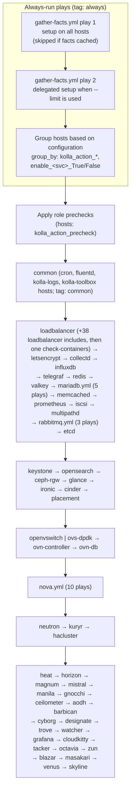
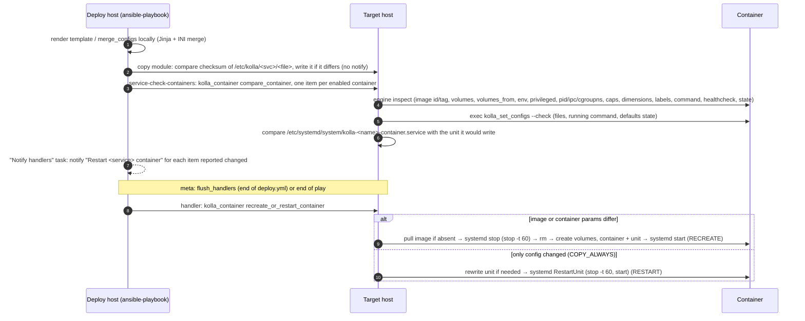

# Repository architecture

This page explains *how the machine is built*: which entry points exist, how a CLI command becomes an
`ansible-playbook` run, how `site.yml` is laid out, what every service role has in common, and which custom modules
actually touch the hosts. The other pages build on the vocabulary defined here.

> [!NOTE]
> **Key answers**
>
> - **Changed in 2025.1: the CLI is a Python program.** `tools/kolla-ansible` is gone; `kolla-ansible` is a `cliff`
>   application whose sub-commands are classes in `kolla_ansible/cli/commands.py`, and `kolla_ansible/ansible.py`
>   builds the `ansible-playbook` command line. The action comes first: `kolla-ansible deploy -i <inventory>` [CODE]
>   ([§2](#2-from-cli-to-ansible-playbook)).
> - **`reconfigure` is `deploy`.** Of the 54 roles that have a `reconfigure.yml`, 52 only import `deploy.yml`, so
>   `reconfigure` re-runs Keystone registration, DB creation and the bootstrap (DB sync) container of most services
>   [CODE] ([§4.2](#42-reconfigure-is-deploy)).
> - **Changed in 2025.1: one shared step decides restarts.** The config step of almost every role no longer notifies a
>   handler. Every role's `check-containers.yml` imports `service-check-containers`, which compares each container
>   (image, parameters, `kolla_set_configs --check`, systemd unit) and notifies only the handlers of the containers
>   that differ [CODE] ([§4.3](#43-the-config--check--handler-pattern)).
> - **A config change is applied by a full stop/start, never a reload.** The handler recreates the container when the
>   image or parameters differ and otherwise restarts its systemd unit; the stop timeout is the 60 s of
>   `docker_graceful_timeout`, written into the unit [CODE]
>   ([§6](#6-custom-modules--container-lifecycle-via-kolla_container)).
> - **`deploy` and `reconfigure` pull an image only if it is absent locally.** A rebuilt image pushed under the same
>   tag takes an explicit `pull` [CODE] ([§6](#6-custom-modules--container-lifecycle-via-kolla_container)).
> - **Changed in 2025.1: `ANSIBLE_SERIAL` is gone.** `reconfigure` and `upgrade` add `-e kolla_serial=0` after the
>   user's `-e` options, and ansible-core keeps the last value, so these two commands always run each play on all its
>   hosts at once; `deploy` and the others pass no `kolla_serial`, so `-e kolla_serial=N` still batches them [CODE]
>   ([§2](#2-from-cli-to-ansible-playbook)).
> - **Changed in 2025.1: the first 2025.1 compare reports every systemd unit as changed.** The unit template gained
>   `PartOf=kolla.target`, and `compare_container` compares the whole unit text, so each container with a unit written
>   by 2024.1 is restarted by the first `deploy`, `reconfigure` or `upgrade` that checks it; on hosts that are not
>   Red Hat family, a new default `ulimits` dimension also makes each such container differ and be recreated [CODE]
>   ([§6](#6-custom-modules--container-lifecycle-via-kolla_container)).
> - **`common` is a play of its own, tagged `common`.** No role has a meta dependency on it: `-t common reconfigure`
>   renders and restarts the common containers, and `-t nova` does not run `common` [CODE]
>   ([§5.1](#51-the-common-role-and-the-common_run-guard)).
> - **Host bootstrap lives outside the repository.** `bootstrap-servers` runs `openstack.kolla.baremetal` from
>   ansible-collection-kolla, which `kolla-ansible install-deps` installs from `requirements.yml`; the collection
>   installs Docker or Podman [CODE] ([§1](#1-top-level-layout)).

> Scope: the `2025.1-eom` tag of `openstack/kolla-ansible` (commit `7222f0f`), with ansible-collection-kolla at the
> `stable/2025.1` branch that `requirements.yml` pins (studied at its `2025.1-eom` tag, commit `09189c7`). Unprefixed
> paths are relative to the `ansible/` directory of the kolla-ansible checkout (`site.yml`, `roles/…`,
> `group_vars/…`, `library/…`, `module_utils/…`); paths that start with `kolla_ansible/`, `tools/`, `etc/` or `doc/`,
> and `setup.cfg`, `requirements.txt`, `requirements.yml` and `requirements-core.yml`, are at the root of the
> checkout. Paths prefixed `ansible-collection-kolla`, `kolla` or `ansible-core 2.18.20` point into the collection, the
> kolla image repository (`2025.1-eom`, commit `c4b53a2`) or the Ansible source. The evidence labels **[CODE]** and
> **[NOT AVAILABLE]** are defined once, in [Evidence labels](../start/conventions.md#evidence-labels).

---

## 1. Top-level layout

| Path | What it is | Why it matters for Day 2 |
|---|---|---|
| `kolla_ansible/cmd/kolla_ansible.py`, `kolla_ansible/cli/commands.py`, `kolla_ansible/ansible.py` | **New in 2025.1.** The `kolla-ansible` console script (`setup.cfg:43-48`) is a `cliff` application (`kolla_ansible/cmd/kolla_ansible.py:15, :21-29`). Each sub-command is a class in `commands.py`, registered under `kolla_ansible.cli` (`setup.cfg:50-77`); `ansible.py` builds and runs the `ansible-playbook` command (`kolla_ansible/ansible.py:232-304`). `tools/kolla-ansible` no longer exists | Decides which playbook runs and which extra vars are added ([§2](#2-from-cli-to-ansible-playbook)) |
| `requirements.txt` | Python requirements of the package, among them `ansible-core>=2.17,<2.19` (`requirements.txt:14`) | The ansible-core range is a pip requirement only: the CLI does not check the installed version at run time (no version check in `kolla_ansible/`; the 2024.1 Bash wrapper refused versions outside its range) |
| `requirements.yml` | Ansible Galaxy requirements: one collection, `https://opendev.org/openstack/ansible-collection-kolla`, `type: git`, `version: stable/2025.1` (`requirements.yml:2-5`) | Installed by `kolla-ansible install-deps` (`kolla_ansible/cli/commands.py:91-96`, `kolla_ansible/ansible.py:307-318`), which now retries `ansible-galaxy collection install --force` up to five times (`kolla_ansible/utils.py:96-127`). Without it `bootstrap-servers` cannot find its role. A branch, not a tag: what is installed is whatever the branch holds at install time |
| `requirements-core.yml` | Seven Galaxy collections with upper bounds: `ansible.netcommon`, `ansible.posix`, `ansible.utils`, `community.crypto`, `community.general`, `community.docker`, `containers.podman` (`requirements-core.yml:2-23`) | **Changed in 2025.1:** `install-deps` always installs it, after `requirements.yml` (`kolla_ansible/ansible.py:315-318`); 2024.1 installed it only when the `ansible` package was absent |
| ansible-collection-kolla (`openstack.kolla`, `galaxy.yml:2-3`) | Separate repository, roles only (no modules or plugins): `apparmor_libvirt`, `baremetal`, `docker`, `docker_sdk`, `etc_hosts`, `kolla_user`, `packages`, `podman`, `podman_sdk` | Holds the host-bootstrap code. kolla-ansible references it in one place: `kolla-host.yml:13` (`role: openstack.kolla.baremetal`). `baremetal` imports `etc_hosts`, `packages`, `openstack.kolla.{{ container_engine }}`, `kolla_user`, `openstack.kolla.{{ container_engine }}_sdk` and `apparmor_libvirt`, with `container_engine` defaulting to `kolla_container_engine` or `docker` (ansible-collection-kolla `roles/baremetal/tasks/main.yml:2-3`, `install.yml:34-38`, `post-install.yml:2-19`, `defaults/main.yml:37`) |
| `site.yml` | The main playbook (71 plays once `gather-facts.yml`, `mariadb.yml`, `rabbitmq.yml` and `nova.yml` are expanded: 51 + 2 + 5 + 3 + 10) | Every `deploy`, `reconfigure`, `upgrade`, `pull`, `stop`, `prechecks`, `check`, `genconfig`, `validate-config`, `deploy-containers` run goes through it |
| `gather-facts.yml` | Imported first by `site.yml` (`site.yml:2`) and by `kolla-host.yml` (`kolla-host.yml:2`) | Fact gathering, including the special `--limit` path (see [Compute scaling](compute-scaling-and-performance.md)) |
| `mariadb.yml`, `rabbitmq.yml` | Imported by `site.yml:415` and `:483` | MariaDB in 5 plays, RabbitMQ in 3 plays; the restart plays use `serial: "33%"` (`mariadb.yml:24, :42`; `rabbitmq.yml:36`) |
| `nova.yml` | Imported by `site.yml:667` | Nova is split into 10 plays (see [Nova deep dive](../components/nova-deep-dive.md)) |
| `kolla-host.yml` | `bootstrap-servers`: `gather-facts.yml`, then one play on `baremetal` with `serial: kolla_serial` applying `openstack.kolla.baremetal` (`kolla-host.yml:1-14`) | Installs the container engine and changes the host OS. Can restart or reload the Docker daemon (ansible-collection-kolla `roles/docker/handlers/main.yml:10-15`) |
| `destroy.yml`, `prune-images.yml`, `mariadb_backup.yml`, `mariadb_recovery.yml`, `post-deploy.yml`, `certificates.yml`, `octavia-certificates.yml`, `bifrost.yml`, `nova-libvirt-cleanup.yml`, `rabbitmq-reset-state.yml`, `rabbitmq-upgrade.yml`, and, new in 2025.1, `migrate-container-engine.yml` and `migrate-valkey.yml` | Single-purpose playbooks. `rabbitmq-upgrade.yml` is still shipped, but no CLI command runs it any more (`setup.cfg:50-77`) | See [Operations](../operations/index.md) |
| `roles/` | 76 roles, none with a `meta/` directory. 54 are applied by the plays of `site.yml` (51 service roles plus `prechecks`, `common` and `loadbalancer`); 6 by their own playbooks (`bifrost`, `certificates`, `octavia-certificates`, `destroy`, `prune-images`, and the new `container-engine-migration`); 16 are helper roles imported by the others. Gone since 2024.1: `swift`; new: `valkey` (service), `container-engine-migration`, and the helpers `service-check`, `service-check-containers`, `service-image-info` and `service-uwsgi-config` | [§4](#4-anatomy-of-a-service-role) and [§5](#5-shared-helper-roles) |
| `group_vars/all.yml` | 1,468 lines of defaults (every `enable_*`, ports, transport URLs, container options, `kolla_container_engine: "docker"` at `group_vars/all.yml:100`) | Lowest-priority defaults. `globals.yml` overrides them |
| `inventory/{all-in-one,multinode}` | Example inventories that define 177 groups each | Group membership drives where every container runs ([§8](#8-inventory-model)) |
| `library/` | Custom modules: `kolla_container`, `kolla_toolbox`, `kolla_container_facts`. **Changed in 2025.1:** `kolla_container_volume_facts` is gone; its job and the old `get_container_env`/`get_container_state` actions moved to `kolla_container_facts` | Main container interface: the service roles' container lifecycle goes through `kolla_container`. Many role tasks also run `{{ kolla_container_engine }} exec`/`inspect` directly ([§6](#6-custom-modules--container-lifecycle-via-kolla_container)) |
| `module_utils/` | `kolla_container_worker.py` (shared comparison logic), `kolla_docker_worker.py` (Docker SDK calls), `kolla_podman_worker.py` (Podman SDK calls), `kolla_systemd_worker.py` (one systemd unit per container) | Where `kolla_container` actually decides and acts ([§6](#6-custom-modules--container-lifecycle-via-kolla_container)) |
| `action_plugins/` | `merge_configs` (INI merge) and `merge_yaml` | How `/etc/kolla/config` overrides are merged ([§7](#7-configuration-generation-and-overrides)) |
| `filter_plugins/`, `kolla_ansible/*.py` | Jinja filters: `service_enabled_and_mapped_to_host`, `select_services_enabled_and_mapped_to_host`, `kolla_address`, `kolla_url`, `put_address_in_context`, `database_shards_info`; role-local filters in `roles/common/filter_plugins/` and `roles/nova-cell/filter_plugins/` | Decide placement of a service on a host ([§4.4](#44-containers-and-placement)) |
| `etc/kolla/globals.yml`, `etc/kolla/passwords.yml` | Templates copied to `/etc/kolla/` by the operator | `globals.yml`, `passwords.yml` and every `.yml`, `.yaml` or `.json` file in `/etc/kolla/globals.d/` are passed as **extra-vars** ([§2.1](#21-variable-precedence-that-matters)) |
| `tools/cleanup-*`, `tools/kolla-libvirt-guests-{docker,podman}.service`, `tools/virt-guest-shutdown.target` | Host utilities | `cleanup-host` deletes network namespaces and links (`tools/cleanup-host:5-22`; see [Risk register](../risk/risk-register.md)) |
| `doc/source/` | Documentation (`user/ansible-tuning.rst`, `reference/deployment-and-bootstrapping/bootstrap-servers.rst`, …) | Used only to cross-check, never as the source of truth |

No `ansible.cfg` is shipped for operators [CODE: the only `ansible.cfg` mentions in the kolla-ansible tree are in
`doc/source/user/ansible-tuning.rst`, `tests/run.yml` and `contrib/dev/vagrant/bootstrap.sh`]. Forks, pipelining,
fact caching and SSH settings come from whatever `ansible.cfg` or environment the operator provides; **changed in
2025.1**, the CLI no longer has a `--forks` option (`kolla_ansible/ansible.py:30-124`), so forks can only be set
that way.

---

## 2. From CLI to `ansible-playbook`

`run_playbooks` (`kolla_ansible/ansible.py:285-304`) validates the paths, then `build_args`
(`kolla_ansible/ansible.py:232-282`) builds one argument list, in this order:

```python
args += ["-" + "v" * verbose_level]            # if any
args += ["--list-tasks"]                       # with -lt / --list-tasks
args += ["--inventory", inventory]             # for each -i, or <configdir>/ansible/inventory/all-in-one
args += ["-e", "@<configdir>/globals.yml"]
args += ["-e", "@<configdir>/passwords.yml"]
args += ["--vault-id", ...], ["--vault-password-file", ...], ["--ask-vault-password"]
args += ["-e", "@<configdir>/globals.d/<file>"]    # .yml/.yaml/.json, sorted by name
args += ["-e", <each user -e>]
args += ["-e", "<name>=<value>"]               # the command's own extra vars (kolla_action, kolla_serial, ...)
args += ["-e", "CONFIG_DIR=<configdir>"]
args += ["--become"], ["--check"], ["--diff"], ["--limit", ...], ["--skip-tags", ...], ["--tags", ...]
args += [" ".join(playbooks)]
```

`<configdir>` is `--configdir`, or `$KOLLA_CONFIG_PATH`, or `/etc/kolla` (`kolla_ansible/ansible.py:23-25,
:127-136`). The command is run with `subprocess.run(..., check=True)`, and a failure exits with the playbook's return
code (`kolla_ansible/utils.py:174-191`, `kolla_ansible/ansible.py:297-304`).

| Command | Playbook | Extra vars added | `kolla_serial` passed? | Evidence |
|---|---|---|---|---|
| `prechecks` | `site.yml` | `kolla_action=precheck` | no | `kolla_ansible/cli/commands.py:99-110` |
| `check` | `site.yml` | `kolla_action=check` (**new in 2025.1**: was absent in 2024.1) | no | `:495-506` |
| `bootstrap-servers` | `kolla-host.yml` | `kolla_action=bootstrap-servers`, `ansible_python_interpreter=auto_silent` (dropped when the user passes their own `-e ansible_python_interpreter=…`, `:67-77`) | no (the playbook has its own `serial: kolla_serial`) | `:158-170` |
| `deploy` | `site.yml` | `kolla_action=deploy` | **no** | `:231-242` |
| `deploy-containers` | `site.yml` | `kolla_action=deploy-containers` | no | `:245-256` |
| `pull` | `site.yml` | `kolla_action=pull` | no | `:173-184` |
| `upgrade` | `site.yml` | `kolla_action=upgrade`, `kolla_serial=0` | **yes, always 0** | `:270-282` |
| `reconfigure` | `site.yml` | `kolla_action=reconfigure`, `kolla_serial=0` | **yes, always 0** | `:128-140` |
| `genconfig` | `site.yml` | `kolla_action=config` | no | `:113-125` |
| `validate-config` | `site.yml` | `kolla_action=config_validate` | no | `:143-155` |
| `stop` | `site.yml` | `kolla_action=stop`, `kolla_action_stop_ignore_missing=yes\|no` (needs `--yes-i-really-really-mean-it`; `--ignore-missing` is new) | no | `:285-315` |
| `destroy` | `destroy.yml` | `kolla_action=destroy`, `destroy_include_dev`, `destroy_include_images` (needs `--yes-i-really-really-mean-it`) | no | `:318-359` |
| `mariadb-recovery` (was `mariadb_recovery`) | `mariadb_recovery.yml` | `kolla_action=deploy` | no | `kolla_ansible/cli/commands.py:470-481`; name at `setup.cfg:73` |
| `mariadb-backup` (was `mariadb_backup`) | `mariadb_backup.yml` | `kolla_action=backup`, `mariadb_backup_type=full\|incremental` (`--full` is the default) | no | `kolla_ansible/cli/commands.py:437-467`; name at `setup.cfg:72` |
| `post-deploy` | `post-deploy.yml` | – | no | `kolla_ansible/cli/commands.py:259-267` |
| `prune-images` | `prune-images.yml` | (needs `--yes-i-really-really-mean-it`) | no | `kolla_ansible/cli/commands.py:362-381` |
| `install-deps` | – | runs `ansible-galaxy collection install` for `requirements.yml` and `requirements-core.yml`, then exits | – | `kolla_ansible/cli/commands.py:91-96`; `kolla_ansible/ansible.py:307-318` |

The 2025.1 CLI also has `gather-facts`, `certificates`, `octavia-certificates` (`--check-expiry <days>` adds
`octavia_certs_check_expiry=yes` and `octavia_certs_expiry_limit`), `deploy-bifrost`, `deploy-servers`,
`upgrade-bifrost`, `rabbitmq-reset-state`, `nova-libvirt-cleanup`, and the new `migrate-container-engine` and
`migrate-valkey` (`kolla_ansible/cli/commands.py:80-88, :187-228, :384-434, :484-532`), none of which passes
`kolla_serial`. `rabbitmq-upgrade` and `bash-completion` are no longer commands (`setup.cfg:50-77`).

Consequences [CODE]:

- **The action comes first.** `kolla-ansible` is a `cliff` application, so the sub-command name is the first word and
  its options follow it (`kolla-ansible deploy -i multinode`); the options are declared per command
  (`kolla_ansible/cli/commands.py:39-54`, `kolla_ansible/ansible.py:30-141`).
- **`ANSIBLE_SERIAL` is gone; `upgrade` and `reconfigure` always pass `kolla_serial=0`.** `ANSIBLE_SERIAL` is now a
  constant of the module, not an environment variable (`kolla_ansible/cli/commands.py:20-22`), and `Reconfigure` and
  `Upgrade` add `kolla_serial` with that value (`:136, :278`). The command's extra vars come after the user's `-e`
  options (`kolla_ansible/ansible.py:261-266`), and ansible-core merges the `-e` options in the order given, a later
  value replacing an earlier one (ansible-core 2.18.20 `lib/ansible/utils/vars.py:94-105, :198-224`). So
  `kolla-ansible reconfigure -e kolla_serial=1` still runs with `kolla_serial=0`, which means *all hosts of a play in
  one batch*: ansible-core turns a serial value of 0 or less into a single batch of every host (ansible-core 2.18.20
  `lib/ansible/executor/playbook_executor.py:290-297`). How a real run behaves is checked in no lab [NOT AVAILABLE].
- **Other commands take a user `kolla_serial`.** `deploy` and the rest pass no `kolla_serial`, so a user
  `-e kolla_serial=N` reaches the plays; without it they fall back to `kolla_serial|default("0")`.
- **`--tags`, `--skip-tags`, `--limit`, `--check`, `--diff` and the new `--become` pass straight through**
  (`kolla_ansible/ansible.py:269-280`). `--forks` and the `EXTRA_OPTS` environment variable of 2024.1 are gone; the
  only other Ansible option is `-lt`/`--list-tasks` (`:88-94, :240-241`). There is no way to pass `--list-tags` or
  `--list-hosts` through the CLI.
- **`-i` can be given several times; without it the CLI uses `<configdir>/ansible/inventory/all-in-one`**
  (`kolla_ansible/ansible.py:144-152, :242-244`), and exits if that path is neither a readable directory nor a
  readable file (`:167-180`). **Changed in 2025.1:** in 2024.1 a command without `-i` passed no inventory at all.
- **`-p`/`--playbook` replaces the playbook of any command** (`kolla_ansible/cli/commands.py:30-36`). Several `-p`
  are joined with spaces into a single argument (`kolla_ansible/ansible.py:281`), which `ansible-playbook` receives as
  one path; whether that can work is [NOT AVAILABLE].
- **`/etc/kolla/globals.d/*` are extra-vars too**, now loaded *after* `passwords.yml` and the vault options and
  before the user's `-e` (`kolla_ansible/ansible.py:209-229, :257-260`); in 2024.1 they came before `passwords.yml`.
- **`--passwords` is checked but not used.** `_validate_args` looks for the file named by `--passwords` and only logs
  an error when it is missing (`kolla_ansible/ansible.py:191-199`); `build_args` always passes
  `<configdir>/passwords.yml` (`:248-250`). A missing `globals.yml` is also only logged (`:201-206`).
- **Output is shown by default.** Cliff's default verbosity maps to no `-v`; each extra `-v` given to `kolla-ansible`
  adds one to Ansible, and `-q` sends the playbook's output to `/dev/null`
  (`kolla_ansible/cli/commands.py:56-65`, `kolla_ansible/utils.py:186-189`).
- **The `--ask-vault-pass` bug of 2024.1 is gone with the Bash wrapper.** Vault options are `--vault-id`,
  `--vault-password-file` and `-J`/`--ask-vault-password`, each passed as such (`kolla_ansible/ansible.py:102-124,
  :251-256`); `--key` no longer exists.

### 2.1 Variable precedence that matters

`globals.yml`, `passwords.yml` and the `globals.d/` files are passed with `-e @file`. That is **extra-vars, the
highest precedence in Ansible**: ansible-core merges role defaults first, group vars and host vars later, and
extra-vars last (ansible-core 2.18.20 `lib/ansible/vars/manager.py:204-224, :288-306, :418-419`). Consequences
[CODE]:

- A value in `globals.yml` cannot be overridden per host or per group in the inventory. Per-host variation
  must come from variables that are *not* set in `globals.yml`. Inventory `host_vars` override role defaults and
  `group_vars/all.yml`, but not extra-vars.
- Anything placed in `globals.yml` (or `globals.d/`) applies to **every play and every host**. This is why "global"
  switches such as `enable_barbican`, `openstack_tag`, `nova_compute_virt_type` or `kolla_container_engine` have
  fleet-wide effects (see [Operations](../operations/index.md)).
- Among extra-vars, the later file wins: a `globals.d/` file overrides `globals.yml` and `passwords.yml`, and a
  user `-e` overrides all three (order above; ansible-core 2.18.20 `lib/ansible/utils/vars.py:198-224`).
- The same holds for the collection: `openstack.kolla.baremetal` and the roles it imports read the variables of the
  run, so a Docker, Podman or host setting placed in `globals.yml` overrides the collection's role defaults.

---

## 3. Anatomy of `site.yml`



Facts about the structure [CODE, `site.yml`]:

1. **One play per service, in a fixed order.** There is no dependency resolver. The deployment order *is* the order of
   plays in `site.yml` (see [Execution flow](deployment-execution-flow.md)). **Changed in 2025.1:** the
   `openvswitch`, `ovs-dpdk`, `ovn-controller` and `ovn-db` plays now run *before* `nova.yml` (`site.yml:605-665`,
   import at `:667`), and `neutron` follows `nova.yml` (`:669-691`); in 2024.1 the four network plays came after
   Nova. The `swift` play is gone and a `valkey` play follows `redis` (`site.yml:399-411`).

   The loadbalancer play (`site.yml:105-327`) runs *before* the services it fronts and configures all of their
   frontends in one place through 38 `include_role … tasks_from: loadbalancer`, run only when `enable_haproxy` is
   true and for `deploy`, `reconfigure`, `upgrade` and `config` (`site.yml:325-327`). **New in 2025.1:** the block
   ends with one `include_role` of `loadbalancer`'s `check-containers` (skipped for `config`), whose comment says it
   "will notify handlers if any changes to the configuration have been made" (`site.yml:319-324`).
2. **The "group by configuration" optimisation.** The play at `site.yml:7-75` puts every host into groups such as
   `enable_nova_True`. Every service play then intersects its host list with `&enable_<svc>_True`, for example
   `hosts: [compute, …, '&enable_neutron_True']` (`site.yml:669-681`). If a service is disabled, the play matches no
   host and Ansible skips it entirely, which avoids evaluating hundreds of `when:` clauses per host. The NOTE at
   `site.yml:4-6` says this exists because "in large environments, even tasks that are skipped can take a significant
   amount of time".
3. **Serial, failure threshold and tags differ between plays.** Almost every play has
   `serial: '{{ kolla_serial|default("0") }}'`.
   - **Exceptions:** the setup plays `Group hosts based on configuration` and `Apply role prechecks`
     (`site.yml:7-86`) have no `serial` key, and neither has the `etcd` play (`site.yml:485-496`). Outside `upgrade`
     (and `config`), etcd's handlers restart the non-leaders in four index-modulo-4 waves, then the leader
     (`roles/etcd/handlers/main.yml:38-62`); on `upgrade` a handler loops over the `etcd` group for the non-leaders
     without using the loop item, so each non-leader includes the restart tasks once per etcd member (`:27-36`);
     whether the members really restart one after another depends on how ansible-core orders those includes across
     hosts, which is [NOT AVAILABLE]. MariaDB and RabbitMQ are not single plays: their *apply* and
     *post-configuration* plays have no `serial` key (all members in one batch), while their *restart* plays use a
     fixed `serial: "33%"` that `kolla_serial` does not change (`mariadb.yml:18-52`, `rabbitmq.yml:30-49`). The
     handlers only sort hosts into the `mariadb_restart`/`rabbitmq_restart` groups; the restart itself happens in
     those plays
     ([fact sheet B §1–2](../reference/factsheets/b-mariadb-rabbitmq-keystone.md#1-mariadb-ansiblerolesmariadb);
     [Tags](../risk/tags.md)).
   - **Bug: `cyborg` (`site.yml:874`)** uses `serial|default("0")`, not `kolla_serial`, so `-e kolla_serial=N` has no
     effect on cyborg. Still present in 2025.1.
   - **`max_fail_percentage` on every play.** Every play of `site.yml` (and those of `mariadb.yml`, `rabbitmq.yml`,
     `nova.yml` and `kolla-host.yml`) sets `max_fail_percentage` to
     `<name>_max_fail_percentage | default(kolla_max_fail_percentage) | default(100)` (e.g. `site.yml:10-13, :96-99`;
     `kolla-host.yml:8-11`). Neither variable is defined under `ansible/` (`kolla_max_fail_percentage` is only a
     commented example, `etc/kolla/globals.yml:31`), so the value is 100. ansible-core stops a batch only when the
     share of failed hosts is *greater than* the percentage (ansible-core 2.18.20
     `lib/ansible/plugins/strategy/linear.py:335-349`), so by default no play is cut short by failures of other
     hosts. This matters for the new `check` command, which fails a host when one of its containers is missing,
     stopped or unhealthy ([§5](#5-shared-helper-roles)).
   - **Tag placement varies:**
     - Most plays tag the *role*, e.g. `roles: - { role: kuryr, tags: kuryr }`.
     - The `common` and loadbalancer plays, the `mariadb.yml` and `rabbitmq.yml` plays and all `nova.yml` plays put
       tags at *play* level (`site.yml:100-101, :115-118`; `mariadb.yml:12-13`; `nova.yml:34-38`).
     - `memcached` has two tags, `[memcache, memcached]` (`site.yml:428-429`); `ovn-controller` and `ovn-db` share
       `ovn` (`site.yml:646-647, :662-663`).
     - The `prechecks` play has no tag at all (`site.yml:77-86`), and the new `valkey` play tags its role `valkey`.
4. **`common` is a play, not a dependency.** No role has a `meta/` directory, so nothing pulls `common` in. It runs in
   its own play, `Apply role common`, on the hosts of `cron`, `fluentd`, `kolla-logs` and `kolla-toolbox`
   (`site.yml:88-103`), which in the example inventories are children of `common` = control, network, compute,
   storage, monitoring (`inventory/multinode:49-54, :202-212`)
   ([§5.1](#51-the-common-role-and-the-common_run-guard)).

The complete table of plays (hosts, tags, serial) is generated from the source in [Generated inventory
§1](../reference/generated-inventory.md#1-plays-executed-by-siteyml-in-order).

---

## 4. Anatomy of a service role

Every service role follows the same skeleton. `glance` is a typical example (`nova` keeps its bootstrap in separate
`nova.yml` plays, so its `deploy.yml` has no bootstrap step, `roles/nova/tasks/deploy.yml:1-9`):

```text
roles/<svc>/
  defaults/main.yml      <svc>_services dict (containers), images, volumes, healthchecks, ks users/endpoints, ports
  vars/main.yml          project_name (and, for nova-cell, kolla_role_name)
  handlers/main.yml      "Restart <service-key> container" handlers (kolla_container recreate_or_restart_container)
  tasks/main.yml         - include_tasks: "{{ kolla_action }}.yml"          <-- dynamic dispatch
  tasks/deploy.yml       register.yml → config.yml → check-containers.yml → bootstrap.yml → flush_handlers
  tasks/reconfigure.yml  - import_tasks: deploy.yml                          <-- reconfigure == deploy
  tasks/upgrade.yml      service-specific (stop/rolling, DB migrations, check-containers, flush)
  tasks/deploy-containers.yml  - import_tasks: check-containers.yml
  tasks/check-containers.yml   import_role: service-check-containers     <-- new shared step (2025.1)
  tasks/check.yml        import_role: service-check (kolla_action=check, `kolla-ansible check`)   <-- new (2025.1)
  tasks/pull.yml         import_role: service-images-pull
  tasks/stop.yml         import_role: service-stop
  tasks/precheck.yml     import_role: service-precheck + port and container checks
  tasks/config.yml       (also run alone for kolla_action=config, i.e. `genconfig`); no longer notifies handlers
  tasks/config_validate.yml  import_role: service-config-validate (kolla_action=config_validate, `validate-config`)
  tasks/copy-certs.yml   import_role: service-cert-copy (from config.yml, when CA copy or backend TLS is enabled)
  tasks/loadbalancer.yml import_role: loadbalancer-config (tags: always)  <-- called from the loadbalancer play
  templates/             <service>.json.j2 (kolla_set_configs manifest), <svc>.conf.j2, …
```

There is no `meta/main.yml`: no role in `roles/` has a `meta/` directory [CODE]. Evidence for glance:
`roles/glance/tasks/main.yml:2`, `deploy.yml:2-15`, `reconfigure.yml:2`, `check-containers.yml:2-3`, `check.yml`,
`pull.yml:2-3`, `deploy-containers.yml:2`, `precheck.yml:2-15`, `config.yml:35-37`, `loadbalancer.yml:2-7`,
`handlers/main.yml:2-16`; for nova: `roles/nova/tasks/deploy.yml`, `config_validate.yml`, `vars/main.yml`.

### 4.1 `kolla_action` dispatch

`tasks/main.yml` is a **dynamic** `include_tasks: "{{ kolla_action }}.yml"`. Two consequences follow [CODE]:

- **`--list-tasks` is blind to role internals.** It shows only the `include_tasks` placeholder of every role: the
  listing walks the statically compiled play (`play.compile()`) and does not load dynamically included files
  (ansible-core 2.18.20 `lib/ansible/cli/playbook.py:192-218`); dynamic includes are loaded at run time
  (`lib/ansible/plugins/strategy/linear.py:249-252`). You cannot use `--list-tasks` (now `kolla-ansible <action>
  -lt`, whose own help says it "has no affect on kolla-ansible", `kolla_ansible/ansible.py:88-94`) to see what a tag
  will do in Kolla-Ansible.
- **Tags reach the role's tasks only through inheritance.** The included tasks inherit the *role and play* tags (e.g.
  `nova`), not tags written on the `include_tasks` statement itself (see [Tags
  §2](../risk/tags.md#2-ansible-29-semantics-that-kolla-relies-on)). An include is not statically loaded, so the block
  of included tasks skips the include's tags and inherits those of the role, its dependency chain and the play
  (ansible-core 2.18.20 `lib/ansible/playbook/task_include.py:48`, `lib/ansible/playbook/block.py:308-359`).

### 4.2 `reconfigure` is `deploy`

Of the 54 roles that have a `reconfigure.yml`, 51 contain only `import_tasks: deploy.yml` and `valkey` does the same
under a task name (`roles/valkey/tasks/reconfigure.yml`). `skyline` uses `include_tasks` instead
(`roles/skyline/tasks/reconfigure.yml:2`). Only `bifrost` has its own reconfigure logic; the `swift` role, the other
2024.1 exception, is gone.

The bifrost copy still cannot work and no `kolla-ansible` command runs it: it uses a group and a container named
`bifrost-deploy` (`roles/bifrost/tasks/reconfigure.yml:2-24`), but the container is `bifrost_deploy`
(`roles/bifrost/tasks/start.yml:8`), the example inventory has a `bifrost` group but no `bifrost-deploy` group
(`inventory/multinode:170`), `roles/bifrost/templates/` holds no `config.json` template, and the CLI sends
`reconfigure` to `site.yml`, which has no bifrost play (`kolla_ansible/cli/commands.py:128-140`).

See the generated column "reconf→deploy" in [Generated inventory
§3](../reference/generated-inventory.md#3-role-task-structure-handlers-and-helper-role-usage). So `reconfigure` re-runs
Keystone registration, DB creation and the **bootstrap (DB sync) container** of most services, exactly like `deploy`
[CODE] (e.g. `roles/glance/tasks/reconfigure.yml:2`, `roles/glance/tasks/deploy.yml:2-15`). The only built-in
differences between `deploy` and `reconfigure` are:

- **`kolla_serial`** is forced to 0 for `reconfigure` ([§2](#2-from-cli-to-ansible-playbook)).
- **No `when: kolla_action == ...` condition separates them.** Every condition under `ansible/` that names `deploy`
  or `reconfigure` names both (`nova.yml:55, :91, :172`; `mariadb.yml:86`; `rabbitmq.yml:67`; `site.yml:327`).
  Neutron's DB-sync container (`bootstrap_neutron`) is imported without any condition
  (`roles/neutron/tasks/bootstrap.yml:38`), so it runs on every `deploy` and `reconfigure`;
  `neutron_enable_rolling_upgrade` (`roles/neutron/defaults/main.yml:707`) is read only by
  `roles/neutron/tasks/upgrade.yml:5, :8`. Nova's bootstrap plays run on both `deploy` and `reconfigure`
  (`nova.yml:49-55, :85-91`).

### 4.3 The config → check → handler pattern

This is the heart of Day-2 behaviour, and **it changed in 2025.1**: the config step writes files, and one shared
step decides which containers to restart.



- **Files are rendered on the deploy host and copied.** The `template` and `merge_configs` steps render on the deploy
  host, then the `copy` logic compares checksums on the target (`action_plugins/merge_configs.py:168-218`). So
  *every* config task costs one SSH round trip per host per item, even when nothing changes (see [Compute
  scaling](compute-scaling-and-performance.md)).
- **Changed in 2025.1: the config step no longer notifies.** Only two config tasks still notify a restart handler:
  Placement's WSGI file, only with `placement_wsgi_provider: apache` (`roles/placement/tasks/config.yml:58-74`), and
  the Cinder Huawei XML files (`roles/cinder/tasks/external_huawei.yml:2-11`); the class `writes-config` of
  [Conventions](../start/conventions.md#operation-impact-classes) lists what that means for `genconfig`. Outside the
  config step, a few tasks still notify (for example `roles/openvswitch/tasks/post-config.yml:2-23`, run by
  `deploy` and `upgrade`).
- **One shared step compares every container.** Every role's `check-containers.yml` (52 roles) imports
  `service-check-containers`, which runs `compare_container` once per enabled container mapped to the host, built
  from the `<role>_services` dict (`roles/service-check-containers/tasks/main.yml:4-29`). A separate debug task then
  notifies `Restart <key> container` for **only the items reported changed**
  (`roles/service-check-containers/tasks/main.yml:34-41`). Services marked `iterate` (in the 2025.1 defaults, only
  the `ovn-db` role uses it) go through `iterated.yml` (`:43-51`). `compare_container`
  (`module_utils/kolla_container_worker.py:58-65`) reports a change when:
  - the container is missing; or
  - its definition differs (`check_container_differs`, `kolla_container_worker.py:67-89`: capabilities, security
    options, image ID or tag, ipc/pid/cgroupns mode, labels, privileged, tmpfs, volumes, `volumes_from`,
    environment, state, dimensions, command, healthcheck); or
  - **`kolla_set_configs --check`** inside the running container reports a difference. With Docker
    (`module_utils/kolla_docker_worker.py:146-181`) a container that cannot be exec'd into counts as changed
    (`:155-163`) and so does exit code 137 (`:173-177`); with Podman (`module_utils/kolla_podman_worker.py:524-552`)
    a container that is not `running` counts as changed (`:528-529`). **Changed in 2025.1**, `--check` now also
    fails when the command the container runs differs from `config.json` and when a file of the defaults state is no
    longer listed in `config.json` (kolla `docker/base/set_configs.py:580-586, :589-642, :655-657`). The defaults
    state is never pruned, so that second test keeps failing, and restarting the container, until the container is
    recreated ([Findings F21](../reference/findings.md#f21)); or
  - the container's systemd unit file is missing or differs from the one the module would write
    (`module_utils/kolla_systemd_worker.py:155-168`), for example after `docker_graceful_timeout`,
    `docker_restart_policy` or `docker_client_timeout` changed, since all three are written into the unit
    (`kolla_systemd_worker.py:20-40, :57-80`); a policy change between `unless-stopped` and `always` renders the
    same `Restart=always` and changes nothing (`:57-59`).

  So a config file changed by an earlier `genconfig`, or by hand, still restarts the container on the next
  `deploy`/`reconfigure`/`deploy-containers`, through `--check` [CODE].
- **No more restarts by loop-notify.** In 2024.1 a looped check task notified the handlers of every item as soon as
  one item changed, so unchanged sibling containers restarted too. The 2025.1 notify list holds the changed items
  only, so a change that concerns one container no longer restarts the other containers of the role on that host
  [CODE: the list is built from `container_check.results | select('changed')`,
  `roles/service-check-containers/tasks/main.yml:41`]. Whether that holds on a real run is [NOT AVAILABLE].
- **Restart and recreate are both full stop/start cycles.** A config change is applied only by stopping and starting
  the container; `kolla_container` has no reload action (`library/kolla_container.py:272-285`). The only signal
  Kolla-Ansible sends to a running containerised service is SIGHUP to `nova_scheduler` (cell-cache refresh), through
  `kill -HUP` on the PID read with `{{ kolla_container_engine }} inspect`. It is sent only on a `deploy`/`reconfigure`
  that runs the `nova`, `nova-api` or `nova-refresh-scheduler-cell-cache` tag (or no tag) and whose `--limit`, if any,
  includes the `nova-scheduler` hosts (`roles/nova/tasks/refresh_scheduler_cell_cache.yml:10-12`,
  `nova.yml:152-172`). It loads no new config files. (Outside containers, the `Reload libvirtd` handler reloads a
  *host* libvirtd when the external-Ceph tasks change its secrets and `enable_nova_libvirt_container` is false,
  `roles/nova-cell/handlers/main.yml:135-141`, `roles/nova-cell/tasks/external_ceph.yml:166, :191, :202-205`.)
  The handler calls `recreate_or_restart_container` (`module_utils/kolla_docker_worker.py:352-374`; Podman
  `kolla_podman_worker.py:609-626`):
  - **recreate** when the image or parameters differ (or `COPY_ONCE`): pull the image if absent, stop, remove, start;
  - otherwise **restart**: rewrite the unit if needed and ask systemd to restart it (`restart_container`,
    `kolla_docker_worker.py:450-470`, `kolla_podman_worker.py:704-719`; `kolla_systemd_worker.py:107-114`).

  The stop timeout is **`docker_graceful_timeout`, 60 s by default**
  ([§6](#6-custom-modules--container-lifecycle-via-kolla_container)).
- **Handlers run in definition order, on every notified host of the batch at once.** Unless `kolla_serial` is set,
  "Restart nova-compute container" restarts nova_compute on all notified computes in the same step [CODE: ansible-core
  2.18.20 `lib/ansible/executor/play_iterator.py:198` copies the play's handlers in definition order and `:424-443`
  walks them per host; the linear strategy runs tasks, and the handlers inserted at `flush_handlers`, in lockstep
  across the hosts of the batch, `lib/ansible/plugins/strategy/linear.py:47-90`]. Since `reconfigure` and `upgrade`
  force `kolla_serial=0` ([§2](#2-from-cli-to-ansible-playbook)), only a `deploy` (or another command that passes no
  `kolla_serial`) can batch these restarts.

### 4.4 Containers and placement

Each role's `defaults/main.yml` defines a `<role>_services` dict with an entry per container. The fields are
`container_name`, `group` *or* `host_in_groups`, `enabled`, `image`, `volumes`, `dimensions`, `privileged`,
`pid_mode`/`ipc_mode`/`cgroupns_mode`, `healthcheck` and `haproxy`, plus `iterate`/`iterate_var` for the services
started once per item. The filter `service_enabled_and_mapped_to_host` (`kolla_ansible/filters.py:88-97`, with
`service_mapped_to_host` at `:60-85`) decides placement:

- `host_in_groups` (a per-host boolean expression) wins over `group` (`filters.py:73-75`).
- `group: all` means every host (`filters.py:77-79`).

`select_services_enabled_and_mapped_to_host` (`filters.py:100-110`) applies the same test to a whole dict; the helper
roles `service-check-containers`, `service-images-pull`, `service-stop`, `service-config-validate` and others loop
over its result (e.g. `roles/service-check-containers/tasks/main.yml:27`,
`roles/service-images-pull/tasks/main.yml:14`, `roles/service-stop/tasks/main.yml:14`).

The 2025.1 roles define 161 containers (159 in 2024.1: `swift`'s containers are gone, and `valkey`, `nova_metadata`
and `ovn_sb_db_relay` are among the new ones). They are listed in [Generated inventory
§2](../reference/generated-inventory.md#2-containers-defined-by-each-role-role_services-in-defaultsmainyml).

---

## 5. Shared helper roles

| Role | Used by | What it does | Scope |
|---|---|---|---|
| `common` | its own play (`site.yml:88-103`); no role depends on it | Deploys `fluentd`, `kolla_toolbox`, `cron` on the hosts of their groups (children of `common`: every host of the example inventory). Renders `fluentd.conf` (was `td-agent.conf`) and `logrotate.conf`; **new in 2025.1**, installs `/etc/systemd/system/kolla.target` (`roles/common/tasks/config.yml:54-58`) | Once per host per run that executes the `common` play ([§5.1](#51-the-common-role-and-the-common_run-guard)) |
| `service-check-containers` | **New in 2025.1.** The `check-containers.yml` of 52 roles (e.g. `roles/glance/tasks/check-containers.yml:2-3`) | `compare_container` for every enabled container mapped to the host, then notifies the restart handlers of the changed ones only (`roles/service-check-containers/tasks/main.yml:4-51`) | per host × per container ([§4.3](#43-the-config--check--handler-pattern)) |
| `service-check` | **New in 2025.1.** The `check.yml` of 52 roles (e.g. `roles/keystone/tasks/check.yml`) | `kolla-ansible check`: reads the containers with `kolla_container_facts` and fails the host when one is missing, not running or unhealthy (`roles/service-check/tasks/main.yml:2-40`) | per host |
| `service-ks-register` | 30 roles | Creates the Keystone service, endpoints, project, user, role and grants through `kolla_toolbox` | `run_once`: once per play, or once per batch when `kolla_serial` is set (`roles/service-ks-register/tasks/main.yml:129`) |
| `service-rabbitmq` | nova-cell only (`roles/nova-cell/tasks/rabbitmq.yml:3-29`, imported from `bootstrap.yml:37`) | Creates RabbitMQ vhost and user through `kolla_toolbox`, for the cell's RPC and notify transports | once per cell, on the cell's first nova-conductor host |
| `service-images-pull` | the `pull.yml` of 52 roles | `kolla_container pull_image` for every enabled container mapped to the host, with retries (`roles/service-images-pull/tasks/main.yml:2-18`) | per host × per container |
| `service-stop` | the `stop.yml` of 52 roles | `kolla_container stop_container`, honouring `skip_stop_containers` and, new, `--ignore-missing` (`roles/service-stop/tasks/main.yml:2-14`) | per host × per container |
| `service-precheck` | the `precheck.yml` of 48 roles | Validates that the inventory groups exist | per host |
| `service-cert-copy` | `copy-certs.yml` of 40 roles | Copies the CA (and backend certs) into each service config dir when `kolla_copy_ca_into_containers` or the service's backend TLS is set (e.g. `roles/glance/tasks/config.yml:35-37`, `roles/glance/defaults/main.yml:308`) | per host × per service |
| `service-config-validate` | `config_validate.yml` of 28 roles | `validate-config`: runs the oslo-config validator for each enabled service mapped to the host (`roles/service-config-validate/tasks/main.yml:2-13`) | per host × per service |
| `service-uwsgi-config` | **New in 2025.1.** `nova`, `placement`, `cinder`, from `config.yml` (e.g. `roles/placement/tasks/config.yml:76-80`) | Renders the uWSGI configuration of the API services that use the default `uwsgi` provider | per host × per service |
| `service-image-info` | **New in 2025.1.** `nova-cell` only (`roles/nova-cell/tasks/version-check.yml`) | Reads image information for the `nova_libvirt` version check | per host |
| `loadbalancer-config` | every role's `loadbalancer.yml` (38 roles) | Imports `haproxy-config` (when `haproxy_config_install`) and `proxysql-config` (when `enable_proxysql`, **now `yes` by default**, `group_vars/all.yml:958`) (`roles/loadbalancer-config/tasks/main.yml:2-8`) | per loadbalancer host |
| `haproxy-config` | `loadbalancer-config` only | Renders `/etc/kolla/haproxy/services.d/<svc>.cfg` (custom templates under `/etc/kolla/config/haproxy-config/` win), adds the service to `external-frontend-map` when `haproxy_single_external_frontend` is set, and opens external ports in firewalld when enabled (`roles/haproxy-config/tasks/main.yml:2-67`) | per loadbalancer host |
| `proxysql-config` | `loadbalancer-config` only | Renders the ProxySQL users and rules files for the service | per loadbalancer host |
| `module-load` | nova-cell, neutron, openvswitch, loadbalancer, ironic, iscsi, multipathd, from each role's `config-host.yml` | `modprobe` and persistence in `/etc/modules-load.d` | per host |
| `sysctl` | neutron and loadbalancer, from `config-host.yml` (`roles/neutron/tasks/config-host.yml:20-34`, `roles/loadbalancer/tasks/config-host.yml:8`) | Sets or removes kernel parameters in `kolla_sysctl_conf_path`; a value `KOLLA_UNSET` removes the key, `KOLLA_SKIP` leaves it alone (`roles/sysctl/tasks/main.yml:7-20`) | per host |

### 5.1 The `common` role and the `common_run` guard

The guard does not exist in 2025.1 either. `roles/common/tasks/main.yml:1-2` is only:

```yaml
- include_tasks: "{{ kolla_action }}.yml"
```

No file under `ansible/` mentions `common_run`, and `roles/common/defaults/main.yml` starts directly with
`common_services` [CODE]. How `common` runs:

- **`common` runs in one play of its own** (`site.yml:88-103`: hosts `cron`, `fluentd`, `kolla-logs`,
  `kolla-toolbox`; `serial: kolla_serial`; play tag `common`). It runs before the loadbalancer play and before any
  service play, on every host of those groups, once per run.
- **`-t common` selects that play and nothing else.** The included tasks inherit the play tag `common` (ansible-core
  2.18.20 `lib/ansible/playbook/block.py:350-359`; included blocks are filtered by tag at
  `lib/ansible/plugins/strategy/linear.py:274`), so `-t common reconfigure` renders the common configs and restarts
  what changed [CODE].
- **Service tags do not drag `common` in.** No role has a `meta/` directory, so `-t nova` (or any service tag)
  skips the common play, which carries only `common` [CODE; [Tags
  §2.1](../risk/tags.md#21-dynamic-include_tasks-and-tag-inheritance-code)].
- **`fluentd` and `cron` configs are global.** `fluentd.conf` and `logrotate.conf` are rendered from the **global**
  `enable_*` flags (`roles/common/tasks/config.yml:104-170, :171-240`). Enabling a service listed in
  `fluentd_input_openstack_services` (`roles/common/defaults/main.yml:146-202`) and/or `cron_logrotate_services`
  (`roles/common/tasks/config.yml:178-228`), such as nova, neutron or barbican, changes `fluentd.conf` and/or
  `logrotate.conf` on *every* host. Services only in the logrotate list (e.g. mariadb, rabbitmq, zun, prometheus,
  redis, and the new `valkey` and `proxysql`) change only `logrotate.conf`. **Changed in 2025.1:** `enable_valkey`
  also adds an input file to `fluentd.conf` (`config.yml:136-137`), a uWSGI input file is always rendered
  (`config.yml:134-135`), and `logrotate.conf` can be replaced by `/etc/kolla/config/cron/cron-logrotate-global.conf`
  or a per-host copy (`config.yml:237-240`). A flag such as `enable_memcached` still changes neither file (no mention
  in the `common` role).

  Since `common` does not run with a service tag, enabling a service with `-t <svc> deploy` does **not** update
  these files; they change on the next run that executes the common play (a full run or `-t common`). That run
  restarts the container whose file changed (`fluentd` and/or `cron`), through `kolla_set_configs --check`. **Changed
  in 2025.1:** the common role's check step is the shared `service-check-containers`
  (`roles/common/tasks/check-containers.yml:2-3`), so `kolla_toolbox` and the other common container are no longer
  restarted with it by loop-notify [CODE; see [§4.3](#43-the-config--check--handler-pattern) and [Tags
  §2.4](../risk/tags.md#24-loop-notify-is-gone-in-20251-code)].

---

<a id="6-custom-modules--container-lifecycle-via-kolla_docker"></a>

## 6. Custom modules — container lifecycle via `kolla_container`

| Module | Purpose | Key behaviour (evidence) |
|---|---|---|
| `kolla_container` (`library/kolla_container.py`, 429 lines, plus `module_utils/kolla_container_worker.py` 554, `kolla_docker_worker.py` 526, `kolla_podman_worker.py` 791, `kolla_systemd_worker.py` 217) | Every container lifecycle operation of the service roles (275 `kolla_container:` tasks under `roles/`, against 364 in 2024.1, since the shared helper roles replaced per-role tasks) | Actions: `compare_container`, `compare_image`, `create_volume`, `ensure_image`, `pull_image`, `recreate_or_restart_container`, `remove_container`, `remove_image`, `remove_volume`, `restart_container`, `start_container`, `stop_container`, `stop_and_remove_container` (`kolla_container.py:272-285`); **changed in 2025.1**, `get_container_env` and `get_container_state` moved to `kolla_container_facts`, and a new `ignore_missing` parameter lets `stop_container` skip a missing container (`:334`; `kolla_docker_worker.py:432-436`). Picks `DockerWorker` when `container_engine` is `docker`, `PodmanWorker` otherwise (`kolla_container.py:411-416`); `container_engine` comes from `docker_common_options` (`group_vars/all.yml:162`) and defaults to `docker` in the module (`kolla_container.py:368`). Uses host networking with both engines (`kolla_docker_worker.py:287`; `kolla_podman_worker.py:77`). Every non-oneshot container gets a systemd unit `kolla-<name>-container.service` that starts, stops and restarts it ([below](#how-kolla_container-decides)) |
| `kolla_toolbox` (`library/kolla_toolbox.py`) | Runs an Ansible module *inside* the `kolla_toolbox` container (`ansible localhost -m <module>`, `kolla_toolbox.py:142-149`), through the engine's `exec_run` for both Docker and Podman, with the JSON stdout callback (`:153-157, :206-212`) | **Rewritten in 2025.1.** Used for MySQL, Keystone (`os_*`), RabbitMQ (`rabbitmq_user/vhost`) and Open vSwitch operations. Takes a required `container_engine` parameter, `docker` or `podman` (`:262-264`). Supports check mode and passes `--check` to the inner command (`:148-149, :273`). Needs a running `kolla_toolbox` on the target |
| `kolla_container_facts` | Actions `get_containers`, `get_containers_env`, `get_containers_state`, `get_containers_names`, `get_volumes`; takes a required `container_engine` (`kolla_container_facts.py:225-231, :246-249`) | Used by prechecks, `check`, upgrade logic and bifrost (61 files under `roles/`; e.g. `roles/glance/tasks/precheck.yml:8-15`); `get_volumes` replaces the removed `kolla_container_volume_facts` (`roles/neutron/tasks/neutron_plugin_agent_check.yml:17`, `roles/ovn-db/tasks/lookup_cluster.yml:6`) |

The `bslurp` module of Ussuri is still absent from `library/`. Fernet keys are distributed by `fernet-push.sh`, run
with `{{ kolla_container_engine }} exec` in the keystone_fernet container
(`roles/keystone/tasks/distribute_fernet.yml:14`).

These modules are not the only container interface. Many role tasks call the container CLI directly through
`command`/`shell` as `{{ kolla_container_engine }} exec|inspect` (21 roles, among them keystone, mariadb, rabbitmq,
etcd, openvswitch, ovn-db, nova-cell, valkey and bifrost): `fernet-push.sh`, `ovs-vsctl`, `kolla_set_configs --check`
(bifrost), `rabbitmqctl` calls of the RabbitMQ role (e.g. `roles/rabbitmq/tasks/version-check.yml:15`), the
`mariadb` client during cluster recovery (`roles/mariadb/tasks/recover_cluster.yml:149`), `etcdctl`
(`roles/etcd/tasks/restart_services.yml:32-34`), and `inspect` plus `kill -HUP` for `nova_scheduler`. The MariaDB
restart path now waits for WSREP sync through `kolla_toolbox`'s `mysql_query` module
(`roles/mariadb/tasks/restart_services.yml:31-45`). Outside the service roles, `destroy` stops and removes containers
with the `tools/cleanup-containers` script, passing the engine (`roles/destroy/tasks/cleanup_containers.yml:3`; the
script accepts `docker` or `podman`, `tools/cleanup-containers:4-10`); `prune-images` uses the `docker_prune` module
with Docker and `podman image prune` with Podman (`roles/prune-images/tasks/prune_images.yml:2-16`). `docker_prune`
is not part of ansible-core 2.18.20 (`lib/ansible/modules/` has no docker module); `requirements-core.yml:18-20`
lists `community.docker`, but which collection provides `docker_prune` is not read in this study [NOT AVAILABLE].
And `bootstrap-servers` runs `docker start` on the previously running containers after a Docker package upgrade
(ansible-collection-kolla `roles/docker/tasks/install.yml:44-75`) [CODE].

<a id="how-kolla_container-decides"></a><a id="how-kolla_docker-decides"></a>How `kolla_container` decides [CODE]:

- **`start_container`** pulls the image **only if it is absent locally** (Docker
  `module_utils/kolla_docker_worker.py:377-378`, where `check_image` looks for the exact `repository:tag` among the
  local images, `:71-79`; Podman `ensure_image`, `kolla_podman_worker.py:629, :789-791`). A rebuilt image pushed
  under the same tag is therefore *not* fetched by `deploy` or `reconfigure`. It takes an explicit `pull`
  (`kolla-ansible pull`) to download it, after which `compare_image` sees a new image ID and recreates the container
  (`kolla_docker_worker.py:107-122, :352-374`). It then creates the container and its unit if needed and starts it
  through systemd, failing with "Container timed out" if the unit is not `running` within `client_timeout` (120 s)
  (`kolla_docker_worker.py:380-400`; `kolla_systemd_worker.py:65, :98-105, :206-217`). One-shot containers
  (`restart_policy: oneshot`) get no unit and are started directly (`kolla_docker_worker.py:349-350, :392-393`).
- **New in 2025.1: named volumes are created first, with a label.** With Docker, `create_container` creates every
  named volume of the container before the container itself (`kolla_docker_worker.py:342-350, :479-487`).
- **`compare_image` compares image ID and tag**, using the local image for that reference
  (`kolla_docker_worker.py:107-122`).
- **`pull_image` reports changed only if the local image changed** (Docker: image ID, `kolla_docker_worker.py:197-231`;
  Podman: image attributes, `kolla_podman_worker.py:554-573`).
- **`docker_graceful_timeout` and `docker_client_timeout` take effect.**
  - `generate_module()` starts from `common_options` (= `docker_common_options`, which carries
    `graceful_timeout: "{{ docker_graceful_timeout }}"`, `client_timeout: "{{ docker_client_timeout }}"` and
    `container_engine: "{{ kolla_container_engine }}"`, `group_vars/all.yml:151-162`). It overwrites a key only when
    the task sets that parameter; a parameter the task leaves unset keeps the `common_options` value, and only when
    that is absent too does the module default (10 s, 120 s, `docker`) apply (`kolla_container.py:357-402`).
  - `graceful_timeout` and `client_timeout` have no default in the argument spec (`kolla_container.py:311, :333`).
    Handlers pass `common_options` (e.g. `roles/placement/handlers/main.yml:2-14`), so the effective stop timeout is
    `docker_graceful_timeout`, **60 s** by default (`group_vars/all.yml:148`).
  - The value is written into the unit: `ExecStop=/usr/bin/<engine> stop <name> -t <graceful_timeout>`
    (`kolla_systemd_worker.py:33, :75`). With Docker, `stop_container` uses systemd when the unit exists and
    `docker stop` with the same timeout otherwise (`kolla_docker_worker.py:426-442`); with Podman, it writes the unit
    if needed and stops through systemd for every non-oneshot container (`kolla_podman_worker.py:677-695`).
    `restart_container` asks systemd to restart the unit (`kolla_docker_worker.py:450-470`,
    `kolla_podman_worker.py:704-719`).
  - Practical effect: a container still running 60 s after SIGTERM is killed. This holds for handler restarts,
    recreates and `stop` [CODE; the SIGTERM-then-SIGKILL meaning of the timeout is kolla-ansible's own comment,
    `group_vars/all.yml:147`: "Timeout after Docker sends SIGTERM before sending SIGKILL."]. The unit sets no
    `TimeoutStopSec`, so systemd's own stop timeout also applies; its value is host configuration [NOT AVAILABLE].
- **The restart policy lives in the unit, not in the engine.** Docker's `build_host_config` passes no restart policy
  (`kolla_docker_worker.py:285-320`) and the Podman worker drops it (`kolla_podman_worker.py:143`);
  `docker_restart_policy: "unless-stopped"` (`group_vars/all.yml:126`) becomes `Restart=always` in the unit, with
  `StartLimitBurst` = `docker_restart_policy_retry` (`kolla_systemd_worker.py:29, :34, :57-59`). The FIXME
  "restart_policy is *not* checked in the container" is still in `kolla_container.py:19`, but a changed policy
  changes the unit, which `compare_container` does detect ([§4.3](#43-the-config--check--handler-pattern)).
- **Changed in 2025.1: the unit is part of `kolla.target`.** The template adds `PartOf=kolla.target`
  (`kolla_systemd_worker.py:20-40`, line `:27`), and the `common` role installs that target
  (`roles/common/tasks/config.yml:54-58`). Because `compare_container` compares the whole unit text (`kolla_systemd_worker.py:155-168`), a
  unit written by 2024.1, which has no such line, is reported as changed at the first 2025.1 check, and the handler
  restarts its container after rewriting the unit [CODE]. On a platform upgraded from 2024.1 that means every
  container with a unit, at the first `deploy`, `reconfigure`, `upgrade` or `deploy-containers` that reaches it;
  how this combines with the upgrade's own restarts on a real platform is [NOT AVAILABLE].
- **Changed in 2025.1: default `ulimits` on every host.** `default_container_dimensions` now sets
  `nofile` 1048576 with Docker and `RLIMIT_NOFILE`/`RLIMIT_NPROC` with Podman on every host
  (`group_vars/all.yml:201-224`); in 2024.1 it did so only on Red Hat family hosts and was empty elsewhere. Most
  services use it as their `dimensions` (e.g. `roles/glance/defaults/main.yml:168`), and `compare_dimensions` compares
  ulimits (`module_utils/kolla_container_worker.py:274-303, :326-336`). So, with Docker on a host that is not Red Hat
  family, each such container created by 2024.1 differs and is **recreated** at the first 2025.1 check [CODE]. The
  Podman worker filters out `RLIMIT_NOFILE` and `RLIMIT_NPROC` on both sides of the comparison
  (`kolla_podman_worker.py:219-228, :484-500`), so Podman containers are not affected by this default.
- **`kolla_container_engine` is an engine switch.** It defaults to `"docker"` (`group_vars/all.yml:100`). It selects
  the worker of `kolla_container`, the engine of `kolla_toolbox` and `kolla_container_facts`, the CLI of the
  `exec`/`inspect` tasks, the volume path (`container_engine_volumes_path`, `group_vars/all.yml:165-167`),
  engine-specific dimensions and `/run` mounts (`group_vars/all.yml:174-188, :201-224`), and, in
  ansible-collection-kolla, which engine `bootstrap-servers` installs. **New in 2025.1:** `kolla-ansible
  migrate-container-engine` runs `migrate-container-engine.yml` with the `container-engine-migration` role
  (`kolla_ansible/cli/commands.py:509-519`). How the Podman path and the migration behave on a real host is
  [NOT AVAILABLE] (source only, nothing was run).

---

## 7. Configuration generation and overrides

1. **INI files go through `merge_configs`.** `merge_configs` (`action_plugins/merge_configs.py`) renders each listed
   source as a Jinja template *on the deploy host*, merges them as INI (later sources win), then calls the `copy`
   action (`merge_configs.py:168-218`). For nova-compute the sources are
   (`roles/nova-cell/tasks/config.yml:120-136`): `templates/nova.conf.j2` → `/etc/kolla/config/global.conf` →
   `/etc/kolla/config/nova.conf` → `/etc/kolla/config/nova/nova-compute.conf` →
   `/etc/kolla/config/nova/<inventory_hostname>/nova.conf` →
   `/etc/kolla/config/nova/<inventory_hostname>/nova-compute.conf`.
   The last, per-host per-service source exists only in `nova-cell`; the `nova` role stops at
   `nova/<inventory_hostname>/nova.conf` (`roles/nova/tasks/config.yml:60-69`).
2. **Overrides are scoped by file location.** Putting a value into `/etc/kolla/config/nova.conf` affects **every nova
   container that has a `nova.conf` on every host** (nova-api, the new nova-metadata, scheduler, super-conductor,
   conductor, novncproxy and every nova-compute). The content of `/etc/kolla/config/nova/nova-compute.conf` is merged
   only into nova-compute's `nova.conf`, so the control-plane nova services are untouched [CODE: the `nova` and
   `nova-cell` roles each merge `nova/<service>.conf` only into that service's own `nova.conf`,
   `roles/nova/tasks/config.yml:60-69`, `roles/nova-cell/tasks/config.yml:120-136`,
   `roles/nova-cell/defaults/main.yml:496-502`]. **Changed in 2025.1:** `-t nova reconfigure` after changing it
   restarts only `nova_compute` on the compute hosts, the container whose `kolla_set_configs --check` reports the
   changed file; `nova_libvirt` and `nova_ssh` are no longer restarted by loop-notify
   ([§4.3](#43-the-config--check--handler-pattern)) [CODE]. A real run is [NOT AVAILABLE].
3. **Some overrides do not reach other services.** Neutron's `ml2_conf.ini` (template plus `neutron/ml2_conf.ini` and
   `neutron/<host>/ml2_conf.ini` overrides) is rendered only for `neutron-server` and `neutron-infoblox-ipam-agent`
   (`roles/neutron/tasks/config.yml:134-150`), and `openvswitch_agent.ini` merges its own template,
   `neutron/openvswitch_agent.ini` and, **new in 2025.1**, `neutron/<host>/openvswitch_agent.ini` (`:152-162`). A
   change meant for `neutron-server` therefore does not restart `neutron_openvswitch_agent` [CODE; [Reconfigure
   Neutron](../operations/reconfigure-neutron.md)]. The file-location scoping of point 2 is still the rule:
   `/etc/kolla/config/neutron.conf` or `global.conf` reach every container whose template merges them.
4. **The container receives its config through a manifest.** The `config.json` (rendered from `<service>.json.j2`)
   tells `kolla_set_configs`, inside the image, which files to copy from `/var/lib/kolla/config_files` (bind-mounted
   from `/etc/kolla/<service>/`) to their final location, and which command to start; the command is written to
   `/run_command` (kolla `docker/base/set_configs.py:315-335`). With `config_strategy: COPY_ALWAYS`
   (`group_vars/all.yml:49`) the copy happens at every container start (`set_configs.py:559-577`). That is why a
   restart is enough to apply a changed or added config file, and why Kolla-Ansible never applies config by
   reloading a service.

   A restart also applies most removals [CODE]. Before copying, `kolla_set_configs` (kolla 2025.1-eom) reads a state
   file kept inside the container, `/etc/kolla/defaults/state`, and for every destination it has ever written either
   restores the image's original file (saved under `/etc/kolla/defaults/`) or deletes it when the image had none; it
   then records any new destinations (kolla `docker/base/set_configs.py:37-38, :413-474, :476-499, :501-538,
   :540-556`). So a file whose entry was dropped from `config.json` (e.g. a removed Keystone policy file,
   `roles/keystone/templates/keystone.json.j2:31-37`), or whose optional source is gone (the copy then skips it,
   `set_configs.py:149-157`), returns to the image default or disappears at the next start. **Changed in 2025.1:**
   `kolla_set_configs --check` now reports a dropped entry by itself: it fails with `StateMismatch` when a destination
   of the state file is no longer in `config.json` (`set_configs.py:589-636`), and with `ConfigFileCommandDiffers`
   when `/run_command` differs from the manifest's command (`:580-586`), so either change restarts the container
   through [§4.3](#43-the-config--check--handler-pattern). Limits:
   - The state lives in the container's own filesystem, so a **recreate** starts with an empty state. A stale file on a
     **named volume** (e.g. nova-compute's SASL `auth.conf` under `/var/lib/nova`,
     `roles/nova-cell/templates/nova-compute.json.j2:70-76`, which is the `nova_compute` volume when libvirt runs in a
     container, `group_vars/all.yml:1254`) whose entry was dropped is then neither restored nor deleted.
   - Deleting a custom file such as `/etc/kolla/config/keystone/keystone-paste.ini` leaves its rendered copy in
     `/etc/kolla/keystone/` (`roles/keystone/tasks/config.yml:141-161`), and the optional manifest entry
     (`keystone.json.j2:18-24`) keeps copying it in, even after a recreate.

   The image-side start path and `--check` are described in [Kolla images
   §2-§3](kolla-images.md#2-start-path-common-to-every-image).

---

## 8. Inventory model

- **Groups are mostly aliases of a few physical groups.** The physical groups are `control`, `network`, `compute`,
  `storage`, `monitoring` and `deployment` (`inventory/multinode:3-33`). Service groups are defined as children.
  Examples:
  - `[nova-api:children] nova`, `[nova:children] control` (`multinode:226-227, :99-100`).
  - `[loadbalancer:children] network` (`multinode:84-85`). In the 2025.1 example inventory, HAProxy, keepalived and
    ProxySQL sit on the **network** nodes; there is no `haproxy` group. `[letsencrypt:children]` is `loadbalancer`
    (`multinode:188-189`).
  - `[openvswitch:children] network, compute, manila-share` (`multinode:105-108`).
  - `[common:children]` = control, network, compute, storage, monitoring, and `cron`, `fluentd`, `kolla-logs`,
    `kolla-toolbox` are children of `common` (`multinode:49-54, :202-212`).
  - **New in 2025.1:** `[valkey:children] control`, `[nova-metadata:children] nova` and
    `[ovn-sb-db-relay:children] ovn-database` (`multinode:191-192, :232-233, :601-602`). An inventory copied from
    2024.1 lacks them.
- **Groups that include `compute` in the example inventory** (26 in total, computed with ansible-core 2.18.20's
  `ansible-inventory` on `inventory/multinode` with only `compute01` left as a host):
  - `compute` itself and the groups that list it directly as a child: `baremetal`, `common`, `collectd`, `telegraf`,
    `hacluster-remote`, `openvswitch`, `neutron-ovn-metadata-agent`, `neutron-ovn-agent`, `iscsid`,
    `ceilometer-compute`, `ceilometer-ipmi`, `cyborg-agent`, `multipathd`, `zun-compute`, `zun-cni-daemon`,
    `prometheus-node-exporter`, `prometheus-cadvisor`, `prometheus-libvirt-exporter`, `masakari-instancemonitor`,
    `ovn-controller-compute`.
  - Through nesting: `cron`, `fluentd`, `kolla-logs` and `kolla-toolbox` (via `common`), and `ovn-controller` (via
    `ovn-controller-compute`). **Changed in 2025.1:** `cyborg` is now `control` only (`multinode:146-147`), so
    `cyborg`, `cyborg-api` and `cyborg-conductor` no longer land on compute hosts; only `cyborg-agent` does
    (`multinode:411-418`).
- **The neutron play also targets every compute host.** It lists `compute` and `manila-share` explicitly
  (`site.yml:669-681`); the agents' `host_in_groups` decides what lands there.
- **Inventory order is semantically significant** [CODE]. `groups['<grp>'][0]` is the target of almost every
  `run_once`/`delegate_to` bootstrap step. Examples: `groups[nova_cell_conductor_group][0]` for cell creation and
  compute discovery (`roles/nova-cell/tasks/bootstrap.yml:15, :34`); the first `glance-api` host as the only glance
  host with the default file backend (`group_vars/all.yml:1146`; [fact sheet
  C](../reference/factsheets/c-glance-placement-cinder-horizon-heat.md)); the first host of the MariaDB shard as the
  backup host (`roles/mariadb/defaults/main.yml:123`). Other index-sensitive logic:
  - keepalived priority is the index in `groups['loadbalancer']` plus 1
    (`roles/loadbalancer/templates/keepalived/keepalived.conf.j2:15`; [fact sheet A
    §1.8](../reference/factsheets/a-infra-lb-ovn.md#18-operationally-notable-behaviour) C);
  - **changed in 2025.1, ProxySQL is the default database load balancer** (`enable_proxysql: "yes"`,
    `group_vars/all.yml:958`; `mariadb_loadbalancer` follows it, `:554`). ProxySQL gets every host of a shard as a
    writer, weight 100 for the first host and 10 for the others, with `max_writers: 1`
    (`roles/loadbalancer/templates/proxysql/proxysql.yaml.j2:78-112`); which host ProxySQL then sends writes to is
    ProxySQL behaviour, [NOT AVAILABLE] here. With `mariadb_loadbalancer: haproxy`, HAProxy's single active MariaDB
    backend is still the first host of the default shard, the others being `backup`
    (`roles/mariadb/defaults/main.yml:64-65`). MariaDB restarts in the `serial: "33%"` batches of the
    `Restart mariadb services` play (`mariadb.yml:18-34`); in which batch the first host restarts is
    [NOT AVAILABLE] ([R9](../risk/risk-register.md#r9); [fact sheet B §1.5][sheet-b-15]);
  - outside `upgrade` and `config`, etcd's rolling restart waves of non-leaders are
    `groups.etcd.index(inventory_hostname) % 4`, and the leader restarts after them
    (`roles/etcd/handlers/main.yml:38-62`).

## Related

- [Tags](../risk/tags.md) (how tags select this work)
- [Execution flow](deployment-execution-flow.md) (execution order and the action matrix)
- [Generated inventory](../reference/generated-inventory.md) (every play, container, role and handler)
- [Tag index](../risk/tag-index.md), [Components](../components/index.md) and [Glossary](../reference/glossary.md) (tag
  index, service index, glossary)

[sheet-b-15]: ../reference/factsheets/b-mariadb-rabbitmq-keystone.md#15-handlers-ansiblerolesmariadbhandlersmainyml-in-definition-order
