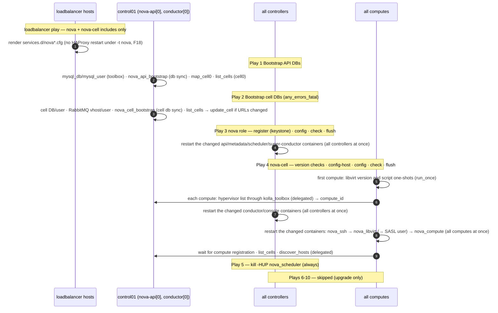

# Reconfigure Nova

What `kolla-ansible -t nova reconfigure` does on the loadbalancer hosts, on the controllers and on every compute, with
the two narrower commands `-t nova-api reconfigure` (only the Nova control plane, no compute impact) and
`-t nova-cell reconfigure` (only the cell part: conductors, consoles, computes), and the batched form, which in 2025.1
is a `deploy`.

The scenario sections are written for the [assumed deployment](index.md#assumed-deployment); the page uses the
[conventions of the command sections](index.md#conventions-used-by-the-command-sections), the definition of
[drift](index.md#drift) and the notion of [code guarantees and environment
dependence](index.md#code-guarantees-and-environment-dependence).

> [!NOTE]
> **Key answers**
>
> - **`-t nova reconfigure` ([§2 to §6](#2-execution-sequence-kolla-ansible--t-nova-reconfigure)):** every compute runs
>   the tasks, all computes in one batch. Restarts happen only where drift is detected, and in 2025.1 only for the
>   container that drifted: a `nova_compute` change no longer restarts `nova_libvirt` and `nova_ssh`
>   ([§4](#4-are-all-compute-nodes-affected-does-nova-compute-restart-on-every-compute)). Whether running VMs survive a
>   `nova_libvirt` restart is [NOT AVAILABLE] ([§5](#5-running-vms-live-migration-scheduling)).
> - **Changed in 2025.1: `reconfigure` cannot be batched.** It always runs with `kolla_serial=0`; use
>   `deploy -t nova -e kolla_serial=N` ([§1.4](#14-a-batched-run-deploy-with-kolla_serial);
>   [F19](../reference/findings.md#f19)).
> - **First 2025.1 run after 2024.1:** expect drift on every Nova container, computes included: the systemd unit text
>   changed ([F16](../reference/findings.md#f16)), the queue and catalog settings of `nova.conf` changed
>   ([F17](../reference/findings.md#f17)), `nova_compute` gets a `compute_id` file and `nova_libvirt` a new command and
>   new libvirt settings ([§3](#3-what-changes-per-type-of-change-code)).
> - **New in 2025.1, every run needs the Nova API:** each compute reads the hypervisor list through the first conductor,
>   in `genconfig` too ([F20](../reference/findings.md#f20)).
> - **Nova without touching computes:** `-t nova-api reconfigure`
>   ([§1.2](#12-reconfigure-only-the-nova-control-plane-no-compute-impact)).

> [!WARNING]
> [R1](../risk/risk-register.md#r1): a change common to all computes restarts the drifted container on every compute in
> the same handler step, since `reconfigure` cannot be batched — see
> [§4](#4-are-all-compute-nodes-affected-does-nova-compute-restart-on-every-compute). For a change that touches
> `nova_libvirt`, batch it with [§1.4](#14-a-batched-run-deploy-with-kolla_serial) or `deploy-containers --limit`.

## 1. Commands

### 1.1 Reconfigure Nova (control plane and computes)

```bash
kolla-ansible reconfigure -i multinode -t nova
```

- **Scope:**
  - loadbalancer play: the nova and nova-cell frontend includes (`site.yml:252-265`, inside a block that runs for
    `deploy`, `reconfigure`, `upgrade` and `config` when `enable_haproxy` is set, `site.yml:325-327`). **Changed in
    2025.1:** they write `services.d/nova*.cfg` but HAProxy is not restarted under `-t nova`; the final
    `check-containers` include of the loadbalancer play carries only its own play tags
    ([F18](../reference/findings.md#f18));
  - the 10 nova plays (`nova.yml:29-302`), the nova-cell play on **every compute** (`nova.yml:125-147`);
  - `common` does not run under `-t nova`: it is its own play, tagged `common` only (`site.yml:88-103`).
- **One-shot:** on `control01`, the API DB sync, `map_cell0`, `list_cells` for cell0, the cell DB sync and
  `list_cells` ×2, plus RabbitMQ user/vhost, Keystone registration, SIGHUP of `nova_scheduler` and `discover_hosts`
  [CODE, when cell0 is mapped with an unchanged connection and the cell is unchanged:
  `roles/nova/tasks/bootstrap.yml:53-56`, `roles/nova/tasks/map_cell0.yml:2-30`,
  `roles/nova-cell/tasks/bootstrap.yml:37-43`, `roles/nova-cell/tasks/create_cells.yml:2-4`,
  `roles/nova-cell/tasks/discover_computes.yml:4-18`, `roles/nova/tasks/deploy.yml:1`]. **New in 2025.1:** two
  one-shots from the new `nova_libvirt` image on the first compute (`libvirt_version_check`,
  `nova_libvirt_script_check`, `roles/nova-cell/tasks/version-check.yml:2-21`,
  `roles/nova-cell/tasks/version-check.yml:79-98`), and a hypervisor list through `kolla_toolbox` on the first conductor
  for every compute (`roles/nova-cell/tasks/config.yml:59-73`) [CODE].
- **Restarts:** only the containers whose check reports a change
  ([§3](#3-what-changes-per-type-of-change-code)): `check-containers.yml` imports `service-check-containers`, which
  notifies `Restart <service> container` for the changed items only (`roles/nova-cell/tasks/check-containers.yml:2-3`,
  `roles/service-check-containers/tasks/main.yml:4-41`; [Tags
  §2.4](../risk/tags.md#24-loop-notify-is-gone-in-20251-code)) [CODE].
- **Failures:** seven of the ten plays set `max_fail_percentage` (default 100, which never stops a play early); the
  cell DB bootstrap play and the two online-data-migration plays set `any_errors_fatal: true` instead
  (`nova.yml:40-43`, `nova.yml:79`, `nova.yml:141-144`, `nova.yml:269-270`, `nova.yml:294-295`) [CODE]. **New in
  2025.1:** the libvirt version check fails the run when the new `nova_libvirt` image carries an older libvirt than
  the running container, and the script check fails it when the image lacks `kolla_nova_libvirt_start`
  (`roles/nova-cell/tasks/version-check.yml:58-73`, `roles/nova-cell/tasks/version-check.yml:100-116`).

### 1.2 Reconfigure only the Nova control plane (no compute impact)

```bash
kolla-ansible reconfigure -i multinode -t nova-api
```

- **Scope:** the `nova-api`-tagged plays (API DB bootstrap, nova role, scheduler refresh, and the API reload and
  online-migration plays, which do nothing outside `upgrade`) on controllers (`nova.yml:29-65`, `nova.yml:103-122`,
  `nova.yml:152-172`, `nova.yml:180-201`, `nova.yml:231-277`), plus the loadbalancer nova include (`site.yml:252-258`).
  The nova role now also manages `nova_metadata`, on the hosts that are in both `nova-metadata` and one of the play's
  groups (`roles/nova/defaults/main.yml:33-61`, `nova.yml:103-108`).
- **Not touched:** conductors and computes (`nova-cell` plays, `nova.yml:67-100`, `nova.yml:124-147`).

### 1.3 Reconfigure only the cell part (conductors, consoles, computes)

```bash
kolla-ansible reconfigure -i multinode -t nova-cell
```

- **Scope:** the `nova-cell`-tagged plays (cell DB bootstrap, nova-cell role, and the cell reload and online-migration
  plays, which do nothing outside `upgrade`) (`nova.yml:67-100`, `nova.yml:124-147`, `nova.yml:203-229`,
  `nova.yml:283-302`), plus the loadbalancer nova-cell include for the console proxies (`site.yml:259-265`). The
  nova-cell play reaches every compute, as with `-t nova`, and runs the version checks and the hypervisor list.

### 1.4 A batched run: `deploy` with `kolla_serial`

```bash
kolla-ansible deploy -i multinode -t nova -e kolla_serial=10
```

- **Why `deploy`:** **new in 2025.1**, `reconfigure` adds `kolla_serial=0` after your own `-e`
  (`kolla_ansible/cli/commands.py:128-140`), and the last value wins, so `reconfigure -e kolla_serial=10` still runs
  each play on all its hosts at once ([F19](../reference/findings.md#f19)). For the nova tags, `deploy` runs the same
  tasks: both nova roles' `reconfigure.yml` import `deploy.yml`, and the bootstrap and refresh plays act for both
  actions (`roles/nova-cell/tasks/reconfigure.yml:2`, `nova.yml:53-55`, `nova.yml:89-91`, `nova.yml:170-172`)
  ([F5](../reference/findings.md#f5)) [CODE].
- **What batching repeats:** the API DB sync and `map_cell0` once per batch of the nova play when the controller groups
  are larger than the batch, the version checks and compute discovery once per batch of the nova-cell play ([Write
  config first, apply in controlled
  batches §1.2](controlled-batches.md#12-rolling-runs-with-kolla_serial-not-with-reconfigure);
  [F10](../reference/findings.md#f10)) [CODE].
- **Stop on failures:** set `nova_cell_max_fail_percentage` (cell plays) or `kolla_max_fail_percentage` lower than 100
  (`nova.yml:141-144`; [Write config first, apply in controlled
  batches §1.3](controlled-batches.md#13-stop-a-rolling-run-on-failures-max_fail_percentage)).
- **Alternative without bootstrap work:** `genconfig`, then `deploy-containers --limit` per batch ([Write config
  first, apply in controlled batches §2](controlled-batches.md#2-separate-write-config-from-apply-recommended-pattern)).

## 2. Execution sequence (`kolla-ansible -t nova reconfigure`)



Read from the 2025.1 code [CODE]: the loadbalancer includes render the frontends without notifying
(`roles/nova/tasks/loadbalancer.yml:2-7`, `roles/haproxy-config/tasks/main.yml:2-21`); play 1 (`nova.yml:29-65`;
`roles/nova/tasks/bootstrap.yml:2-56`, `roles/nova/tasks/map_cell0.yml:2-67`); play 2 (`nova.yml:67-100`;
`roles/nova-cell/tasks/bootstrap.yml:2-43`, `roles/nova-cell/tasks/create_cells.yml:2-55`); play 3
(`nova.yml:103-122`; `roles/nova/tasks/deploy.yml:1-9`); play 4 (`nova.yml:125-147`;
`roles/nova-cell/tasks/deploy.yml:1-40`, `roles/nova-cell/tasks/version-check.yml:2-120`,
`roles/nova-cell/tasks/config.yml:53-110`, `roles/nova-cell/tasks/wait_discover_computes.yml:7-90`,
`roles/nova-cell/tasks/discover_computes.yml:4-23`); play 5 (`nova.yml:152-172`;
`roles/nova/tasks/refresh_scheduler_cell_cache.yml:4-12`); plays 6 to 10 run their tasks only when `kolla_action` is
`upgrade` (`nova.yml:199-201`, `:227-229`, `:251-253`, `:275-277`, `:300-302`). `reconfigure` sets `kolla_serial` to
0, so each play takes all its hosts in one batch (`kolla_ansible/cli/commands.py:136`, `nova.yml:140`).

## 3. What changes, per type of change [CODE]

| Change | Files rewritten | Restarted on controllers | Restarted on **every compute** | Source |
|---|---|---|---|---|
| none | – | none unless a container check reports a change | none unless a container check reports a change | the config tasks of both roles no longer notify; `service-check-containers` notifies only the containers whose `compare_container` reported a change: a missing container, a differing compared parameter, a `kolla_set_configs --check` exit 1/137 or Docker client error, or a missing or different systemd unit file (`roles/service-check-containers/tasks/main.yml:4-41`, `module_utils/kolla_container_worker.py:58-65`, `module_utils/kolla_docker_worker.py:146-181`, `module_utils/kolla_systemd_worker.py:155-168`; [Tags §3](../risk/tags.md#3-what-a-tag-really-executes-master-table)); [NOT AVAILABLE] whether every task reports unchanged on an unchanged cloud, and a config file that disappears from `config.json` makes the check report a change on every run ([F21](../reference/findings.md#f21)) |
| first 2025.1 run after 2024.1, no operator change (new in 2025.1) | `nova.conf` of every nova service (queue manager, transient quorum and stream options; `catalog_info = block-storage::internalURL`; on the API side `www_authenticate_uri` to the public URL); `nova-compute/config.json` and the new `compute_id`; `nova-libvirt/config.json` (new command), `qemu.conf` (`stdio_handler = "logd"`), `libvirtd.conf` (`max_workers`, `max_client_requests`); uWSGI files for `nova_api`; with Ceph, the libvirt secret XML | every nova container (unit text, `nova.conf`); `nova_metadata` is created where the group exists | **nova_compute, nova_libvirt, nova_ssh**, each through its own check | unit text: [F16](../reference/findings.md#f16) (`module_utils/kolla_systemd_worker.py:20-40`, `:155-168`); queues: [F17](../reference/findings.md#f17) (`roles/nova/templates/nova.conf.j2:141-157`, `roles/nova-cell/templates/nova.conf.j2:191-206`); catalog: `roles/nova-cell/templates/nova.conf.j2:112`, `roles/nova/templates/nova.conf.j2:67`; `compute_id`: [F20](../reference/findings.md#f20) (`roles/nova-cell/tasks/config.yml:53-110`, `roles/nova-cell/templates/nova-compute.json.j2:10-15`); libvirt: `roles/nova-cell/templates/nova-libvirt.json.j2:2`, `roles/nova-cell/templates/qemu.conf.j2:1`, `roles/nova-cell/templates/libvirtd.conf.j2:36-37`; [Nova deep dive §2.4](../components/nova-deep-dive.md#24-operational-dependencies-what-restarts-what). In an `upgrade`, the new images recreate the containers anyway |
| `/etc/kolla/config/nova.conf` (global override) | `nova.conf` of every nova service | nova_api, nova_metadata, nova_scheduler, nova_super_conductor (with `enable_cells`), nova_conductor, the console proxies | **nova_compute** (`nova_libvirt` and `nova_ssh` do not read `nova.conf`) | both `Copying over nova.conf` loops merge `{{ node_custom_config }}/nova.conf` (`roles/nova/tasks/config.yml:56-69`, `roles/nova-cell/tasks/config.yml:120-136`); which cell services get a `nova.conf`: `nova_cell_services_require_nova_conf` (`roles/nova-cell/tasks/config.yml:134`, `roles/nova-cell/defaults/main.yml:496-502`) |
| `/etc/kolla/config/nova/nova-compute.conf` | `nova-compute/nova.conf` only | – | **nova_compute only** (2024.1: also nova_libvirt and nova_ssh, by loop-notify) | `roles/nova-cell/tasks/config.yml:120-136`, source at `:129`; [Tags §2.4](../risk/tags.md#24-loop-notify-is-gone-in-20251-code) |
| `/etc/kolla/config/nova/<host>/nova-compute.conf` | `nova-compute/nova.conf` of that host only | – | **nova_compute** on that compute only | `roles/nova-cell/tasks/config.yml:131`; the nova role has a per-host `nova.conf` source but no per-host, per-service one (`roles/nova/tasks/config.yml:61-66`) |
| `/etc/kolla/config/nova/nova-scheduler.conf` | `nova-scheduler/nova.conf` only | **nova_scheduler only** (2024.1: also nova_api) | – | `roles/nova/tasks/config.yml:56-69`; [Tags §2.4](../risk/tags.md#24-loop-notify-is-gone-in-20251-code) |
| a libvirt setting (`qemu.conf` or `libvirtd.conf` override under `/etc/kolla/config/nova/`) | `nova-libvirt/qemu.conf` or `libvirtd.conf` | – | **nova_libvirt** (its `kolla_set_configs --check` reports the file) | `roles/nova-cell/tasks/config.yml:150-180`; [Nova deep dive §2.3](../components/nova-deep-dive.md#23-configuration-dependencies-inputs-that-change-novas-files) |
| `enable_barbican: yes` (Barbican not even deployed) | `nova.conf` everywhere (adds `[barbican]`). `fluentd.conf` and the cron `logrotate` config change too, but only when the `common` play runs (no tag or `-t common`), not under `-t nova` | every nova container that reads `nova.conf` (fluentd and cron only at the next `common` run) | **nova_compute** (same for fluentd and cron) | `roles/nova/templates/nova.conf.j2:205-210`, `roles/nova-cell/templates/nova.conf.j2:249-254`; `roles/common/defaults/main.yml:149-150`, `roles/common/tasks/config.yml:104-170`, `roles/common/tasks/config.yml:171-240`; `site.yml:88-103` |
| same as the global `nova.conf` override, with `deploy -e kolla_serial=1` | same | one controller at a time | **one compute at a time**; API DB sync and `map_cell0` repeated per batch (3×) | `nova.yml:39, :115, :140`; `roles/nova/tasks/bootstrap_service.yml:21`, `roles/nova/tasks/map_cell0.yml:63-64`; [Tags §2.5](../risk/tags.md#25-run_once-with-serial-code). With `reconfigure`, the value is overridden to 0 ([F19](../reference/findings.md#f19)) |

## 4. Are all compute nodes affected? Does nova-compute restart on every compute?

- **Tasks:** yes. The nova-cell play targets the whole `compute` group (`nova.yml:125-147`). Read from the 2025.1 task
  files, a no-change run makes 29 remote module invocations per compute and 36 on the first compute (default service
  set with Cinder LVM, `kvm`, Docker and a non-Ubuntu host); 2024.1 made 27 and 31. The additions are the container
  facts call of the version check, the hypervisor list (run on the first conductor) and the `compute_id` copy ([Compute
  scaling §2](../concepts/compute-scaling-and-performance.md#2-work-per-compute-host-read-from-the-task-files)). Its
  number of task results is [NOT AVAILABLE].
- **Restarts:** only where drift is detected, and only the drifted container. Most Nova-related changes are global
  ([Component dependencies §5](../components/dependencies.md#5-compute-node-dependency-summary), [Nova deep dive
  §2.3](../components/nova-deep-dive.md#23-configuration-dependencies-inputs-that-change-novas-files)), so in
  practice either *no* compute restarts it or *all* computes do, in the same handler step: `reconfigure` cannot be
  batched (`kolla_ansible/cli/commands.py:136`, `nova.yml:140`; [F19](../reference/findings.md#f19)). Use
  [§1.4](#14-a-batched-run-deploy-with-kolla_serial) or `--limit` to spread it.
- **libvirt no longer goes with it.** **Changed in 2025.1** [CODE]: a `nova_compute` drift restarts `nova_compute`
  only; `nova_libvirt` restarts when its own check reports a change (its files, its image, its container definition
  or unit), as at the first 2025.1 run ([Tags §2.4](../risk/tags.md#24-loop-notify-is-gone-in-20251-code)). When
  several restart in the same flush, the handlers run in definition order: `nova_ssh`, then `nova_libvirt`, then
  `nova_compute` (`roles/nova-cell/handlers/main.yml:70-158`; ansible-core 2.18.20
  `lib/ansible/executor/play_iterator.py:193-198`, `lib/ansible/executor/play_iterator.py:424-438`). With
  `libvirt_enable_sasl` (default `true`, `roles/nova-cell/defaults/main.yml:578`), the libvirt handler also notifies a
  readiness check and the SASL user creation, defined before the nova-compute handler
  (`roles/nova-cell/handlers/main.yml:90`, `roles/nova-cell/handlers/main.yml:108-133`).

## 5. Running VMs, live migration, scheduling

| Effect | Guaranteed by code | Depends on environment |
|---|---|---|
| nova-compute stop/start (stop with `docker_graceful_timeout`, 60 s by default, `group_vars/all.yml:148`) | yes, when `nova_compute` drifts | [NOT AVAILABLE] Whether VMs are unaffected, whether in-flight operations on that host fail or are left mid-task, and whether the service is reported down only if the restart exceeds `service_down_time` ([Nova deep dive §5](../components/nova-deep-dive.md#5-nova-libvirt-why-its-restart-is-special)) |
| libvirtd stop/start | yes, when `nova_libvirt` drifts (no longer with every nova-compute drift) | [NOT AVAILABLE] Whether VMs survive. [CODE] The container has `pid_mode: host`, `cgroupns_mode: host`, the host `/run` bind mount and `/sys/fs/cgroup` mounted rw (`roles/nova-cell/defaults/main.yml:10-11`, `roles/nova-cell/defaults/main.yml:385`, `roles/nova-cell/defaults/main.yml:388`), and the image's start scripts do nothing to QEMU, cgroups or `/var/run/libvirt` (kolla `docker/base/start.sh:1-24`, `docker/nova/nova-libvirt/extend_start.sh:1-11`; [Kolla images §5.1](../concepts/kolla-images.md#51-nova-libvirt-the-start-path-is-passive)). **New in 2025.1:** virtlogd runs in the same container (`roles/nova-cell/templates/nova-libvirt.json.j2:2`) and QEMU's console output goes through it (`roles/nova-cell/templates/qemu.conf.j2:1`); what happens to guest console logging across the restart is [NOT AVAILABLE] ([Q22](../troubleshooting/open-questions.md#q22)). The stop goes through the container's systemd unit `kolla-<name>-container.service`, whose `ExecStop` is `/usr/bin/<engine> stop <name> -t <graceful_timeout>`; a restart of an unchanged container restarts that unit, a recreate stops it, removes the container and starts a new one (`module_utils/kolla_systemd_worker.py:20-40`, `module_utils/kolla_docker_worker.py:352-374`, `module_utils/kolla_docker_worker.py:426-442`, `module_utils/kolla_docker_worker.py:450-470`). [NOT AVAILABLE] Whether live migrations in progress fail, and whether libvirt API calls fail until libvirtd is back |
| nova-ssh stop/start | yes, when `nova_ssh` drifts | [NOT AVAILABLE] Whether resize or cold-migration disk copies over port 8022 (`roles/nova-cell/defaults/main.yml:491`) are interrupted |
| Scheduling | API, metadata and scheduler restarts are parallel on all controllers (serial 0, `nova.yml:115`) | [NOT AVAILABLE] Whether API calls fail during the restart window. [CODE] The scheduler gets SIGHUP on every deploy or reconfigure run that reaches its hosts (cell-cache refresh, `nova.yml:152-172`, `roles/nova/tasks/refresh_scheduler_cell_cache.yml:4-12`); [NOT AVAILABLE] whether that is harmless |
| Metadata | `nova_metadata` restarts only when its own check reports a change (`roles/nova/handlers/main.yml:53`) | [NOT AVAILABLE] Whether instances that boot during its restart get their metadata |
| Host mapping | `discover_hosts` runs every time | runs `nova-manage cell_v2 discover_hosts --by-service` to map newly registered computes (`roles/nova-cell/tasks/discover_computes.yml:14-18`, through `kolla_container_engine exec -t nova_conductor`); [NOT AVAILABLE] whether it affects existing instances |

## 6. Operational risks and verification

- **Risks:** [R1](../risk/risk-register.md#r1), [R2](../risk/risk-register.md#r2), [R3](../risk/risk-register.md#r3),
  [R24](../risk/risk-register.md#r24) in [Risk register](../risk/risk-register.md); after an upgrade from 2024.1,
  [F16](../reference/findings.md#f16), [F17](../reference/findings.md#f17) and [F20](../reference/findings.md#f20).
- **Before:**
  - `kolla-ansible genconfig -t nova` (restarts nothing: `kolla_action` is `config`,
    `kolla_ansible/cli/commands.py:113-125`, which runs each role's `config.yml` only, whose tasks no longer notify,
    `roles/nova-cell/tasks/main.yml:2`), then diff `/etc/kolla/nova-*/nova.conf` on one controller and one compute.
    `genconfig` still reads the hypervisor list from the Nova API for every compute
    ([F20](../reference/findings.md#f20)).
  - `docker exec -u root nova_compute /usr/local/bin/kolla_set_configs --check; echo $?` on a few computes (with
    `kolla_container_engine: podman`, `podman exec`), and the same in `nova_libvirt`: exit 1 means that container *will*
    restart ([Kolla images
    §3](../concepts/kolla-images.md#3-kolla_set_configs---check-what-it-compares-and-its-exit-codes)). The check does
    not see the unit-file drift of [F16](../reference/findings.md#f16), which the module compares on the host
    (`module_utils/kolla_container_worker.py:58-65`).
  - No active live migrations: `openstack server list --all-projects --status MIGRATING`.
- **Apply in batches:** `deploy-containers --limit` ([Write config first, apply in controlled batches
  §2](controlled-batches.md#2-separate-write-config-from-apply-recommended-pattern)) or `deploy -e kolla_serial=N`
  ([§1.4](#14-a-batched-run-deploy-with-kolla_serial)); not `reconfigure`, which ignores `kolla_serial`
  ([F19](../reference/findings.md#f19)).
- **After:**
  - `openstack compute service list` (all up);
  - `docker ps --filter name=nova_ -a` (all `Up`, recent `Created`/`Started` only where a change was expected);
  - `virsh list --all` inside `nova_libvirt` on a sample of computes (domains running), with guest pings;
  - `nova-manage cell_v2 list_hosts` count equals the number of computes;
  - after a run that restarted the controllers, a metadata request from an instance (the `nova_metadata` container).
- [NOT AVAILABLE] Confirmation that a `nova_compute`-only change leaves `nova_libvirt` and `nova_ssh` running, and the
  duration of a `-t nova` run with many computes; to be confirmed by the community.

## Related

- [Risk register](../risk/risk-register.md) — the risks this page names: [R1](../risk/risk-register.md#r1) (any config
  change touching nova-compute), [R2](../risk/risk-register.md#r2) (fleet-wide restarts after an `enable_*` change),
  [R3](../risk/risk-register.md#r3) (changing RabbitMQ group membership, password or port) and
  [R24](../risk/risk-register.md#r24) (container stop timeout: `docker_graceful_timeout`, 60 s by default)
- [Technical findings](../reference/findings.md) — [F16](../reference/findings.md#f16) (the changed systemd unit),
  [F17](../reference/findings.md#f17) (queue settings), [F19](../reference/findings.md#f19) (no batched `reconfigure`)
  and [F20](../reference/findings.md#f20) (`compute_id`)
- [Nova](../components/nova.md) — service cards of the roles `nova` and `nova-cell`, what changed in 2025.1, and where
  to look
- [Nova deep dive §5](../components/nova-deep-dive.md#5-nova-libvirt-why-its-restart-is-special) — nova-libvirt: why
  its restart is special
- [Pre-execution checklist](pre-execution-checklist.md) — the checks before every production run
- [Write config first, apply in controlled batches](controlled-batches.md) — `genconfig`, then
  `deploy-containers --limit` batch by batch, rolling runs with `deploy -e kolla_serial=N`, and `max_fail_percentage`
- [Tags §2.4](../risk/tags.md#24-loop-notify-is-gone-in-20251-code) — loop-notify is gone: a change restarts the
  changed container only
- [Compute scaling
  §2](../concepts/compute-scaling-and-performance.md#2-work-per-compute-host-read-from-the-task-files) — work per
  compute host, read from the task files: the source of the per-compute counts of §4
