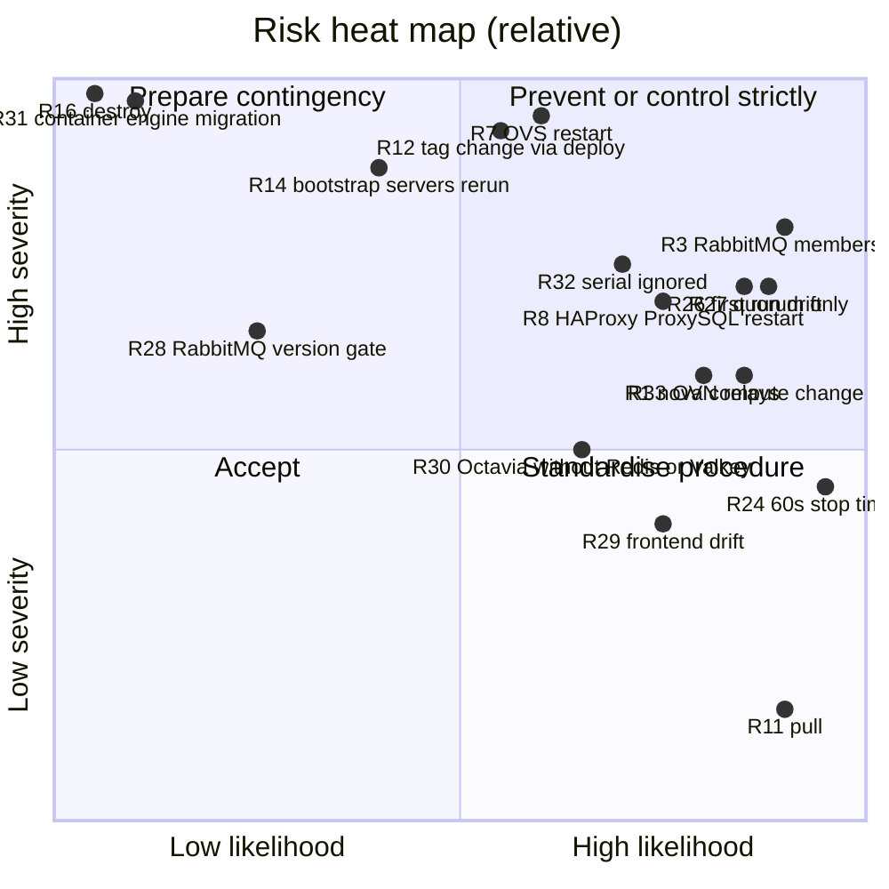

# Risk register

Potentially dangerous operations on a running Kolla-Ansible 2025.1 platform: their impact and the precautions to take
before running them. Ratings are relative to a production cloud with running VMs. The risk IDs are those of the earlier
studies; each entry says whether the risk still applies to 2025.1, with the code that shows it. R31 to R33 are new in
this study.

> [!NOTE]
> **Key answers**
>
> - **33 risks (R1–R33)**, each with what actually happens, its blast radius, VM and API impact, likelihood, severity,
>   precautions and evidence ([Matrix](#matrix)).
> - **Rated Critical:** [R7](#r7) (`openvswitch_vswitchd` restart or recreate), [R12](#r12) (changing the image tag and
>   running `deploy` instead of `upgrade`), [R14](#r14) (`bootstrap-servers` re-run on a live host), [R15](#r15)
>   (`kolla-ansible stop`), [R16](#r16) (`kolla-ansible destroy`) and, new, [R31](#r31) (`kolla-ansible
>   migrate-container-engine`).
> - **Computes and VMs:** [R1](#r1). Changed in 2025.1: a config change touching nova-compute restarts `nova_compute`
>   only, on every affected compute, all at once with the default serial 0; `nova_libvirt` restarts only when its own
>   files, image or container definition change, as on the first 2025.1 run ([R26](#r26)). Whether live migrations in
>   flight fail and whether running VMs keep running are [NOT AVAILABLE].
> - **Network data plane:** [R6](#r6) (with `enable_neutron_agent_ha: yes`, the L3 agent wrapper runs
>   `neutron-netns-cleanup --force --agent-type l3` before the agent starts), [R7](#r7) and, new, [R33](#r33) (the OVN
>   chassis move to the Southbound relays); whether VM traffic is interrupted is [NOT AVAILABLE].
> - **New in 2025.1:** `migrate-container-engine` ([R31](#r31)); `reconfigure` and `upgrade` cannot be batched with
>   `kolla_serial` ([R32](#r32), [F19](../reference/findings.md#f19)); the OVN Southbound relays are on by default
>   ([R33](#r33)).
> - **Changed in 2025.1:** loop-notify is gone, so [R1](#r1), [R5](#r5) and [R13](#r13) restart fewer containers; a
>   tagged service run no longer restarts HAProxy ([R8](#r8), [R29](#r29), [F18](../reference/findings.md#f18));
>   ProxySQL carries the database traffic by default ([R8](#r8), [R9](#r9)); the first 2025.1 run restarts or
>   recreates containers for a new unit text and new default ulimits ([R26](#r26)); quorum queues are the only choice
>   ([R27](#r27)); RabbitMQ moves to 4.0 and the CLI has no `rabbitmq-upgrade` ([R10](#r10), [R28](#r28)); Swift is
>   removed ([R21](#r21)); the Octavia jobboard accepts Valkey ([R30](#r30)); `destroy` keeps the inventories by
>   their absolute paths ([R16](#r16)). [R24](#r24) still does not hold as written and [R25](#r25) still does not
>   apply.
> - **Likelihood × severity at a glance:** the [heat map](#heat-map-likelihood--severity).

- **Likelihood** = how likely the operation is to cause the impact *when the triggering condition is present*.
- **Severity** = worst realistic outcome.
- **Evidence** cites the 2025.1 source lines, or the study section that cites them. Nothing was run. [NOT AVAILABLE]
  marks outcomes that the sources do not establish; they are left for the community to confirm.

## Matrix

| # | Risk | Likelihood | Severity |
|---|---|---|---|
| [R1](#r1) | Config change touching nova-compute | High | Medium–High |
| [R2](#r2) | Enabling or disabling a service with a logrotate or fluentd entry | High | Medium |
| [R3](#r3) | Changing RabbitMQ membership, password or port | Certain | High |
| [R4](#r4) | Changing memcached membership | Certain | High |
| [R5](#r5) | `ml2_conf.ini` override meant for neutron-server | Certain (neutron-server hosts only) | Medium |
| [R6](#r6) | `neutron_l3_agent` restart with `enable_neutron_agent_ha: yes` | Certain (if HA flag) | High |
| [R7](#r7) | `openvswitch_vswitchd` restart or recreate | Certain on image change | Critical |
| [R8](#r8) | HAProxy, ProxySQL or keepalived config change | Certain if changed | High |
| [R9](#r9) | MariaDB config change or image change | Certain if changed | High |
| [R10](#r10) | RabbitMQ image change (`upgrade`) | Certain on upgrade | Medium–High |
| [R11](#r11) | `kolla-ansible pull` | – | Low (bandwidth) |
| [R12](#r12) | Image tag change run with `deploy` instead of `upgrade` | Certain | Critical |
| [R13](#r13) | Rebuilt image under the same tag, then `deploy`/`reconfigure` without `pull` | – | Medium (drift) |
| [R14](#r14) | `bootstrap-servers` re-run on a live host | Medium | Critical |
| [R15](#r15) | `kolla-ansible stop` | Certain | Critical |
| [R16](#r16) | `kolla-ansible destroy` | Certain | Critical |
| [R17](#r17) | `prune-images` | Low | Low |
| [R18](#r18) | `mariadb-recovery` | Certain | High |
| [R19](#r19) | Keystone `reconfigure` | Certain if changed | Medium–High |
| [R20](#r20) | Glance reconfigure / deploy | Certain | Medium |
| [R21](#r21) | Changing the Glance backend on a running cloud (Swift removed) | High | High |
| [R22](#r22) | Inventory reordering | Medium | High |
| [R23](#r23) | Any run with `--limit` on a large inventory | Certain | Low (time), Medium (drift) |
| [R24](#r24) | Effective container stop timeout is 10 s (60 s since 2023.1) | Certain | Medium |
| [R25](#r25) | `-t common` believed to reconfigure fluentd/cron | Does not apply in 2025.1 | – |
| [R26](#r26) | First 2025.1 run on containers that the 2025.1 code has not touched | Certain (such containers) | High |
| [R27](#r27) | Quorum queues only, on a cloud with classic queues | Certain (2024.1 defaults) | High |
| [R28](#r28) | RabbitMQ version step refused by the version check | Low on the default images; Certain after a move to 4.1 | High |
| [R29](#r29) | HAProxy frontend change written by `genconfig` or a tagged run | High | Medium (drift) |
| [R30](#r30) | Octavia with the amphora provider and no Redis or Valkey | Certain (default) | Medium |
| [R31](#r31) | `kolla-ansible migrate-container-engine` (new) | Certain | Critical |
| [R32](#r32) | `reconfigure` or `upgrade` expected to honour `kolla_serial` (new) | High | High |
| [R33](#r33) | First 2025.1 run with OVN: chassis move to the Southbound relays (new) | Certain (OVN) | Medium–High |

### R1 — Config change touching nova-compute

**Still applies to 2025.1, with a smaller reach** [CODE]: loop-notify is gone
([Tags §2.4](tags.md#24-loop-notify-is-gone-in-20251-code), [F1](../reference/findings.md#f1)), so only the container
whose check reports a change restarts.

| | |
|---|---|
| **Operation / trigger** | Any config change touching **nova-compute** (override, global flag, password, RabbitMQ list, the messaging options of [R27](#r27)) followed by `deploy`/`reconfigure` with a nova tag or no tag |
| **What actually happens** | `nova_compute` restarts on every affected compute, **all at once** (serial 0; `reconfigure` cannot be batched, [R32](#r32)). The config tasks notify nothing; `service-check-containers` compares every nova-cell container in one loop and then notifies `Restart <key> container` for the changed ones only, so `nova_libvirt` and `nova_ssh` restart only when their own files, image or container definition changed. They do on the first 2025.1 run ([R26](#r26)). `nova_libvirt` is a container only when `enable_nova_libvirt_container` is true, the default for `nova_compute_virt_type` `kvm`/`qemu` |
| **Blast radius** | all computes |
| **VM impact** | none from the libvirt side when only `nova_compute` restarts; when `nova_libvirt` restarts (retried up to 5 times: "when guests running, nova_libvirt will raise error even though it is removed"), [NOT AVAILABLE] whether live migrations in flight fail and whether running VMs keep running |
| **API impact** | nova-compute restarts on each host; [NOT AVAILABLE] how long it is down |
| **Likelihood** | High |
| **Severity** | Medium–High (High when `nova_libvirt` restarts too) |
| **Precautions** | `genconfig` + `diff`, then `deploy-containers --limit` in batches, or `deploy -e kolla_serial=<n>` (not `reconfigure`, [R32](#r32)); drain live migrations first; before a change that also reaches `nova_libvirt`, plan as R26 |
| **Evidence** | `roles/nova-cell/tasks/check-containers.yml:2-3`; `roles/service-check-containers/tasks/main.yml:4-41` (one compare loop, then a notify built from the changed items, `:34-41`); `roles/nova-cell/tasks/config.yml:120-136`; `roles/nova-cell/defaults/main.yml:5-23`; `roles/nova-cell/handlers/main.yml:86-108` (libvirt restart and retries), `:143-158` (nova-compute); `group_vars/all.yml:945,1253`; `nova.yml:125-147` (`serial` at `:140`); `kolla_ansible/cli/commands.py:20-22, :136`; ansible-core 2.18.20 `lib/ansible/executor/playbook_executor.py:294-296` (serial 0 = one batch); [Tags §2.4](tags.md#24-loop-notify-is-gone-in-20251-code); [Nova deep dive §5](../components/nova-deep-dive.md#5-nova-libvirt-why-its-restart-is-special) |

### R2 — Enabling or disabling a service with a logrotate or fluentd entry

**Still applies to 2025.1** [CODE]: `common` is its own play, tagged `common` only, on the `cron`, `fluentd`,
`kolla-logs` and `kolla-toolbox` groups. **Changed in 2025.1:** loop-notify is gone, so a fluentd-only change restarts
`fluentd` alone, and the common config step no longer pulls the fluentd image.

| | |
|---|---|
| **Operation / trigger** | Enabling or disabling a service that has a fluentd input entry (`fluentd_input_openstack_services`, e.g. barbican) or a logrotate entry (`enable_X` for most services) in `globals.yml`, then running the `common` play (an untagged run, or `-t common`) |
| **What actually happens** | `fluentd.conf` (its `00-global` input lists the enabled OpenStack services; `td-agent.conf` in 2024.1) and `logrotate.conf` render differently on **every host of the `common` play**; the shared check then finds `fluentd` and `cron` changed and restarts those two. `kolla_toolbox` restarts only if its own files changed. With the `multinode` inventory these are the `control`, `network`, `compute`, `storage` and `monitoring` hosts. A tagged service run (`-t nova`) does **not** run the `common` play: the files keep the old content until a later untagged or `-t common` run. Nova/Cinder/Glance configs gain sections (e.g. `[barbican]`), so those services restart when their play runs. New in 2025.1: `enable_valkey` adds a fluentd input, and a uWSGI input lists the services that run under uWSGI |
| **Blast radius** | fleet-wide (untagged run or `-t common`); none for fluentd/cron on a tagged service run |
| **VM impact** | fluentd and cron are none of the containers that [Tags §3.1](tags.md#31-per-tag-answers-files-vms-apis-networkingstorage-safety-prerequisites) traces to running VMs [CODE]; [NOT AVAILABLE] whether their restart affects VMs another way ([Apply `common` changes (fluentd, cron, kolla_toolbox) §3](../operations/apply-common-changes.md#3-how-common-actually-reaches-hosts)); Nova restarts as R1 |
| **API impact** | the services whose configs changed restart (stop with the `docker_graceful_timeout` of 60 s, then start; [R24](#r24)); [NOT AVAILABLE] how long their APIs are unavailable, and for how long logs are not collected while fluentd restarts |
| **Likelihood** | High |
| **Severity** | Medium |
| **Precautions** | Treat `enable_*` changes as fleet-wide changes. Roll out with `--limit` batches or `deploy -e kolla_serial=N` ([R32](#r32)); apply the `common` side deliberately with `-t common` |
| **Evidence** | `site.yml:88-103` (`Apply role common`, hosts `cron`/`fluentd`/`kolla-logs`/`kolla-toolbox`, `serial` at `:95`, `tags: common`); `inventory/multinode:49-54,202-212`; `roles/common/tasks/config.yml:104-170` (fluentd.conf), `:171-237` (logrotate.conf), `roles/common/defaults/main.yml:146-201` (fluentd service list), `roles/common/templates/conf/input/13-uwsgi.conf.j2:2-5`, `roles/common/tasks/check-containers.yml:2-3`; `roles/service-check-containers/tasks/main.yml:34-41`; `roles/nova-cell/templates/nova.conf.j2:249-254`; [Apply `common` changes §3](../operations/apply-common-changes.md#3-how-common-actually-reaches-hosts) |

### R3 — Changing RabbitMQ membership, password or port

**Still applies to 2025.1** [CODE].

| | |
|---|---|
| **Operation / trigger** | Changing RabbitMQ group membership (adding/removing a controller), RabbitMQ password or port |
| **What actually happens** | `rpc_transport_url` and `notify_transport_url` (one entry per host of the `rabbitmq` group, with user, password and port) change in **every** messaging service on every host, so every container that renders them restarts: nova, neutron and the compute-side agents included. `Update cell` rewrites the cell's MQ URL when it differs. Changed in 2025.1: only the containers whose files changed restart, but every messaging container renders the URL, so the reach is the same |
| **Blast radius** | all hosts |
| **VM impact** | `nova_compute` and neutron agent restarts; [NOT AVAILABLE] their effect on flows |
| **API impact** | yes |
| **Likelihood** | Certain |
| **Severity** | High |
| **Precautions** | Plan as a maintenance; batch with `--limit` or `deploy -e kolla_serial=N` ([R32](#r32)); verify RabbitMQ cluster health first |
| **Evidence** | `group_vars/all.yml:271-284`; `roles/nova-cell/defaults/main.yml:217-218`, `roles/nova-cell/templates/nova.conf.j2:37`; `roles/nova-cell/tasks/create_cells.yml:31-55`; `roles/service-check-containers/tasks/main.yml:34-41` |

### R4 — Changing memcached membership

**Still applies to 2025.1** [CODE]; 26 roles loop over the list (swift is gone); a 27th, telegraf, names the group only
to test whether its own host runs memcached (`roles/telegraf/templates/telegraf.conf.j2:54-57`).

| | |
|---|---|
| **Operation / trigger** | Changing memcached membership |
| **What actually happens** | 26 roles loop over `groups['memcached']` in their templates or defaults (grep of `groups['memcached']` in `roles/*/templates` and `roles/*/defaults` gives 27 roles, telegraf only testing its own host: aodh, barbican, blazar, ceilometer, cinder, cloudkitty, cyborg, designate, glance, gnocchi, heat, horizon, ironic, keystone, magnum, manila, masakari, mistral, neutron, nova, octavia, placement, tacker, telegraf, venus, watcher, zun), so their services restart when their plays run; [NOT AVAILABLE] whether cached tokens are lost. Not only the control plane: `neutron.conf` is rendered for every neutron agent, so `neutron_openvswitch_agent` restarts on every compute and network node, and the dhcp, l3 and metadata agents, which get the same file, restart on network nodes; `cinder.conf` reaches every cinder service (cinder-volume/backup included) and `ceilometer.conf` every ceilometer service (ceilometer-compute included). Compute `nova.conf` (nova-cell) has no memcached list |
| **Blast radius** | controllers + network nodes + all computes (+ storage) |
| **VM impact** | OVS agent restart; [NOT AVAILABLE] its effect on flows, and whether router/DHCP traffic is interrupted on network nodes; with `enable_neutron_agent_ha`, the R6 netns cleanup |
| **API impact** | memcached server list changes; [NOT AVAILABLE] effect on auth latency and Horizon sessions |
| **Likelihood** | Certain |
| **Severity** | High |
| **Precautions** | Plan as a dataplane change, like R3: batch with `--limit` or `deploy -e kolla_serial=N`, network nodes one at a time; low-traffic window |
| **Evidence** | [fact sheet B §3.9](../reference/factsheets/b-mariadb-rabbitmq-keystone.md#39-operationally-notable-behaviour-risks-and-oddities) item 2; [Memcached](../components/memcached.md); `roles/neutron/templates/neutron.conf.j2:121`, `roles/neutron/tasks/config.yml:73-103`; `roles/cinder/tasks/config.yml:90-103`, `roles/cinder/templates/cinder.conf.j2:135`; `roles/ceilometer/tasks/config.yml:172-185`, `roles/ceilometer/templates/ceilometer.conf.j2:60` |

### R5 — `ml2_conf.ini` override meant for neutron-server

**Still applies to 2025.1, narrower** [CODE]: `ml2_conf.ini` is rendered only for `neutron-server` and
`neutron-infoblox-ipam-agent`, `openvswitch_agent.ini` has its own template and override files
([F11](../reference/findings.md#f11)), and, new in 2025.1, an agent sharing the host is no longer restarted by
loop-notify.

| | |
|---|---|
| **Operation / trigger** | `/etc/kolla/config/neutron/ml2_conf.ini` override (meant for neutron-server) |
| **What actually happens** | `neutron_server` (and `neutron_infoblox_ipam_agent` if enabled) restarts. Changed in 2025.1: on a host that also runs neutron agents, the agents keep running, since their files did not change. The OVS agent override is `neutron/openvswitch_agent.ini` |
| **Blast radius** | neutron-server hosts |
| **VM impact** | none |
| **API impact** | neutron-server restart |
| **Likelihood** | Certain (neutron-server hosts only) |
| **Severity** | Medium |
| **Precautions** | Put server-only options in `neutron/neutron-server.conf` or `neutron/ml2_conf.ini`; agent options in `neutron/openvswitch_agent.ini`; check the rendered diff |
| **Evidence** | `roles/neutron/tasks/config.yml:134-150` (`ml2_conf.ini`), `:152-164` (`openvswitch_agent.ini`), `roles/neutron/tasks/check-containers.yml:2-3`; `roles/service-check-containers/tasks/main.yml:34-41`; [Reconfigure Neutron](../operations/reconfigure-neutron.md) |

### R6 — `neutron_l3_agent` restart with `enable_neutron_agent_ha: yes`

**Still applies to 2025.1** [CODE]; `neutron_l3_agent_failover_delay` (default `0`) can stagger the restarts
([F12](../reference/findings.md#f12)). New in 2025.1, `neutron_agents_wrappers` runs keepalived, haproxy and dnsmasq
in child containers ([Neutron](../components/neutron.md)).

| | |
|---|---|
| **Operation / trigger** | Any restart of `neutron_l3_agent` with `enable_neutron_agent_ha: yes` (default `no`) |
| **What actually happens** | the wrapper runs `neutron-netns-cleanup --force --agent-type l3` **before** the agent starts (the wrapper's comment: "Remove all l3 related netns in case of multiple active routers in l3 high available mode"), then `neutron-l3-agent` starts [CODE]. The handler first starts stopped agents, then restarts running agents in a loop over the hosts with a running L3 agent, pausing `neutron_l3_agent_failover_delay` seconds between items (default `0`: no spacing) [CODE]. [NOT AVAILABLE] What the command deletes: it is neutron code, which is not in these sources ([F12](../reference/findings.md#f12)) |
| **Blast radius** | network nodes (and computes with `enable_neutron_dvr`) |
| **VM impact** | [NOT AVAILABLE] whether north-south and floating-IP traffic of the routers on that node stops, whether and when `neutron-l3-agent` rebuilds the namespaces, and whether HA routers fail over |
| **API impact** | none |
| **Likelihood** | Certain (if HA flag) |
| **Severity** | High |
| **Precautions** | Restart network nodes one at a time; fail routers over first; set `neutron_l3_agent_failover_delay` to space the restarts |
| **Evidence** | `roles/neutron/templates/neutron-l3-agent-wrapper.sh.j2:6-22`; `group_vars/all.yml:931,934`; `roles/neutron/handlers/main.yml:67-134` (delay at `:106`, `:133`), `roles/neutron/defaults/main.yml:70-88`, `:626` |

### R7 — `openvswitch_vswitchd` restart or recreate

**Still applies to 2025.1** [CODE]. **Changed in 2025.1:** both containers run the daemon directly under kolla's
`ovs_wrapper`, whose stop path does not reach the daemon ([F22](../reference/findings.md#f22)), and an
`openvswitch_db`-only change no longer restarts vswitchd.

| | |
|---|---|
| **Operation / trigger** | `openvswitch_vswitchd` restart or recreate: image change, change of its command or container definition, `-t openvswitch` with a changed image, the first 2025.1 run on a container that the 2025.1 code has not touched ([R26](#r26)), or a change reported by the post-config step (`system-id`, `hostname`, `hw-offload`) |
| **What actually happens** | `ovs-vswitchd` (the userspace daemon) restarts. The image only runs `modprobe openvswitch` (the kernel module is loaded, never unloaded or reloaded), and the command starts `ovs-vswitchd` with no flow save/restore. Bridges and ports persist in `conf.db` on the `openvswitch_db` volume; the db image creates `conf.db` if absent and runs `ovsdb-tool convert` when a conversion is needed. On stop, `ovs_wrapper` builds a wrong control path, so the daemon ends when the container's processes are killed ([F22](../reference/findings.md#f22)). [NOT AVAILABLE] Whether the OpenFlow tables held by the old daemon are lost, and whether `neutron-openvswitch-agent` (or `ovn-controller` with OVN) reprograms them |
| **Blast radius** | per host (all OVS hosts at once with serial 0) |
| **VM impact** | [NOT AVAILABLE] whether **all VM network traffic on the host** is interrupted until flows are restored, and for how long |
| **API impact** | none |
| **Likelihood** | Certain on image change |
| **Severity** | Critical |
| **Precautions** | Upgrade or recreate OVS host by host (`--limit`) with evacuation or acceptance; never fleet-wide with serial 0 |
| **Evidence** | `roles/openvswitch/handlers/main.yml:2-40` (a db restart does not notify vswitchd, `:14-15`), `roles/openvswitch/tasks/check-containers.yml:2-3`, `roles/openvswitch/tasks/deploy.yml:2-11`, `roles/openvswitch/tasks/post-config.yml:22-23`; `roles/openvswitch/templates/openvswitch-vswitchd.json.j2:2`; kolla `docker/openvswitch/openvswitch-vswitchd/extend_start.sh:8`, `docker/openvswitch/openvswitch-db-server/extend_start.sh:3-10`, `docker/openvswitch/openvswitch-base/ovs_wrapper.sh:3-19`; [Open vSwitch](../components/openvswitch.md); [Kolla images §5](../concepts/kolla-images.md#5-per-image-start-behaviour) |

### R8 — HAProxy, ProxySQL or keepalived config change

**Still applies to 2025.1, with the staged restart** [CODE]: the `loadbalancer` handlers restart the backups before the
node that holds the VIP. **Changed in 2025.1:** ProxySQL is on by default and carries the database traffic, and its
container is staged with HAProxy; a tagged service run (`-t keystone`) rewrites the service frontend but no longer
restarts HAProxy ([F18](../reference/findings.md#f18), [R29](#r29)).

| | |
|---|---|
| **Operation / trigger** | HAProxy, ProxySQL or keepalived config change applied by a run that includes the loadbalancer play's final check (`-t haproxy`, `-t loadbalancer`, `-t keepalived` or no tag): any service frontend, certs, `haproxy.cfg`, ProxySQL users or backends; also the first 2025.1 run on a 2024.1 cloud: new unit text ([R26](#r26)), new TLS settings, `haproxy_run.sh` and layer-7 checks |
| **What actually happens** | the containers are **stopped and started** (never reloaded). The handlers first find which host holds `kolla_internal_vip_address`; every backup host stops and restarts its changed containers (all backups at once) and waits for `haproxy_monitor_port` and the ProxySQL admin port; then the VIP holder does the same. On a haproxy-only change keepalived is not stopped, so the VIP stays on a node whose haproxy is down until it is back. Every stop and start handler is skipped under `kolla_action` `config` ([R29](#r29)). Last, `Restart haproxy-ssh container` (Let's Encrypt only) runs on every host at once. [NOT AVAILABLE] Whether the keepalived track script moves the VIP during the master restart, and for how long the APIs and the database are unreachable |
| **Blast radius** | all APIs; **all DB traffic** when ProxySQL restarts (`enable_proxysql` defaults to `yes`, and ProxySQL then serves `database_address`) |
| **VM impact** | none directly; [NOT AVAILABLE] whether nova/neutron get DB errors while ProxySQL restarts |
| **API impact** | yes |
| **Likelihood** | Certain if changed |
| **Severity** | High |
| **Precautions** | `--skip-tags haproxy` when you don't intend to change frontends; apply a frontend change deliberately with `-t haproxy` in a window; batch with `--limit` (one loadbalancer host at a time) |
| **Evidence** | `roles/loadbalancer/handlers/main.yml:9-34` (VIP lookup), `:54-68,90-118` (backup haproxy), `:70-88,121-153` (backup proxysql), `:181-195,226-254` (master haproxy), `:197-210` (master proxysql), `:212-224` (master keepalived only on `Restart keepalived container`), `:333-347` (haproxy-ssh); `site.yml:105-328` (final check at `:319-324`); `roles/haproxy-config/tasks/main.yml:2-22`; `group_vars/all.yml:958`; `roles/loadbalancer-config/defaults/main.yml:2`; [HAProxy and keepalived](../components/haproxy-keepalived.md); [fact sheet A §1.8](../reference/factsheets/a-infra-lb-ovn.md#18-operationally-notable-behaviour) |

### R9 — MariaDB config change or image change

**Still applies to 2025.1** [CODE]: the handlers only group hosts; the restart is a separate play with `serial: "33%"`.
**Changed in 2025.1:** with ProxySQL by default, `mariadb_clustercheck` is off, and the first 2025.1 run changes
`galera.cnf` and the container command.

| | |
|---|---|
| **Operation / trigger** | MariaDB config change or image change; the first 2025.1 run on a 2024.1 cloud ([R26](#r26)) |
| **What actually happens** | `restart mariadb` puts running nodes in group `mariadb_restart` and new nodes in `mariadb_start`. The `Restart mariadb services` play then restarts them in batches of `int(33% × hosts)` or at least 1 (one node at a time for 3 nodes); each node waits for its port and for WSREP `Synced`. If every host of a batch fails, ansible-core stops the playbook, so later batches are not restarted. ProxySQL gives one writer per shard, weight 100 for the first host of the shard; in HAProxy mode the single active backend is the first host of the default shard. [NOT AVAILABLE] In which order `group_by` places the hosts, hence whether the writer restarts first |
| **Blast radius** | DB cluster |
| **VM impact** | none directly |
| **API impact** | DB connection resets |
| **Likelihood** | Certain if changed |
| **Severity** | High |
| **Precautions** | Check `wsrep_cluster_size` and `Synced` on all nodes before; take a backup (`mariadb-backup`); watch between batches |
| **Evidence** | `roles/mariadb/handlers/main.yml:59-74`, `mariadb.yml:18-34` (`serial` at `:24`), `roles/mariadb/tasks/restart_services.yml:2-53`, `roles/mariadb/defaults/main.yml:64`, `:132`; `roles/loadbalancer/templates/proxysql/proxysql.yaml.j2:77-110`; ansible-core 2.18.20 `lib/ansible/utils/helpers.py:25-34` (percentage → `int(...) or 1`), `lib/ansible/executor/playbook_executor.py:196-209` (a fully failed batch ends the playbook); [MariaDB](../components/mariadb.md); [fact sheet B §1.8](../reference/factsheets/b-mariadb-rabbitmq-keystone.md#18-operationally-notable-behaviour-risks-and-oddities) |

### R10 — RabbitMQ image change (`upgrade`)

**Still applies to 2025.1, with the rolling restart** [CODE]: `upgrade` does not stop all brokers; it restarts them in
`serial: "33%"` batches, draining each one first. **Changed in 2025.1:** the default image moves from RabbitMQ 3.13 to
4.0, `upgrade` enables every stable feature flag first, and the CLI has no `rabbitmq-upgrade` command.

| | |
|---|---|
| **Operation / trigger** | RabbitMQ image change (`upgrade`), including the 2024.1 → 2025.1 step from 3.13 to 4.0, or a move to the `rabbitmq-4-1` image with `upgrade -t rabbitmq` |
| **What actually happens** | `upgrade.yml` runs `version-check` ([R28](#r28)), `remove-ha-all-policy`, `config`, `feature-flags` (every stable feature flag enabled on the running brokers) and `check-containers`; the restart handler only adds the host to `rabbitmq_restart`. The `Restart rabbitmq services` play then, per batch of `int(33% × hosts)` or at least 1, puts the node into maintenance mode (`drain`), recreates the container and waits. [NOT AVAILABLE] whether clients reconnect without errors while a broker is drained, and what RabbitMQ 4.0 does with a mixed-version cluster during the roll |
| **Blast radius** | all RPC |
| **VM impact** | [NOT AVAILABLE] whether nova-compute heartbeats are lost and services are reported down |
| **API impact** | [NOT AVAILABLE] whether API calls fail while a broker restarts |
| **Likelihood** | Certain on upgrade |
| **Severity** | Medium–High |
| **Precautions** | Maintenance window; migrate the queues first ([R27](#r27)); check the running RabbitMQ version first ([R28](#r28)); watch for agent and compute services reported down |
| **Evidence** | `roles/rabbitmq/tasks/upgrade.yml:1-10`, `roles/rabbitmq/tasks/feature-flags.yml:2-5`, `roles/rabbitmq/tasks/remove-ha-all-policy.yml:2-30`, `roles/rabbitmq/handlers/main.yml:2-5`, `rabbitmq.yml:30-49`, `roles/rabbitmq/tasks/restart_services.yml:10-49`; `roles/rabbitmq/defaults/main.yml:30`; kolla `docker/rabbitmq/rabbitmq/apt_preferences_rabbitmq.ubuntu:1-3`; `setup.cfg:50-77` (no `rabbitmq-upgrade`); [RabbitMQ](../components/rabbitmq.md); [fact sheet B §2.8](../reference/factsheets/b-mariadb-rabbitmq-keystone.md#28-operationally-notable-behaviour-risks-and-oddities) |

### R11 — `kolla-ansible pull`

**Still applies to 2025.1** [CODE]; the pull goes to Docker or Podman per `kolla_container_engine`.

| | |
|---|---|
| **Operation / trigger** | `kolla-ansible pull` |
| **What actually happens** | downloads images on every host: one `pull_image` per enabled container mapped to the host (retried `service_images_pull_retries` times, default 3). New in 2025.1: with ProxySQL on by default, network nodes that run the loadbalancer also pull the `proxysql` image ([Update container images](../operations/update-container-images.md)) |
| **Blast radius** | registry + network |
| **VM impact** | none |
| **API impact** | none |
| **Likelihood** | – |
| **Severity** | Low (bandwidth) |
| **Precautions** | Run ahead of maintenance; limit parallelism with `ANSIBLE_FORKS` or `forks` in `ansible.cfg` (the 2025.1 CLI has no `--forks` option); local registry mirror |
| **Evidence** | `roles/service-images-pull/tasks/main.yml:2-18`, `roles/service-images-pull/defaults/main.yml:6`; `module_utils/kolla_docker_worker.py:197-231`; `module_utils/kolla_podman_worker.py:554-573`; `library/kolla_container.py:406-416` (engine dispatch) |

### R12 — Image tag change run with `deploy` instead of `upgrade`

**Still applies to 2025.1** [CODE]. On a cloud deployed by 2024.1, the new `openstack_release` default makes every
`deploy` of a role that the upgrade has not reached yet such a tag change
([Predict and inspect a run §2](../operations/predict-a-run.md#2-the-first-20251-run-on-a-cloud-deployed-by-20241)).

| | |
|---|---|
| **Operation / trigger** | Changing `openstack_release`, `openstack_tag` or a `*_tag` and running `deploy` (or `reconfigure`, `deploy-containers`) instead of `upgrade` |
| **What actually happens** | every container is **recreated** (fleet-wide); upgrade-specific steps (the Nova reload plays and the online data migrations, except Placement's, which run inside `bootstrap_placement`) do **not** run. Neutron: instead of the rolling expand → restart → contract (default `neutron_enable_rolling_upgrade: yes`), `bootstrap_neutron` runs `neutron-db-manage … upgrade head` for neutron and each enabled subproject with the new image **before** the handlers restart the old `neutron_server` containers; [NOT AVAILABLE] whether `upgrade head` applies the expand and contract branches together, which would run contract migrations under live old-version servers |
| **Blast radius** | fleet-wide |
| **VM impact** | as R1 + R7 + R8 together |
| **API impact** | yes |
| **Likelihood** | Certain |
| **Severity** | Critical |
| **Precautions** | Use `pull` then `upgrade` (the 2025.1 docs also recommend `prechecks` before it); per-service tags or `--limit` batches (`upgrade` ignores `kolla_serial`, [R32](#r32)) |
| **Evidence** | `group_vars/all.yml:795-797`; `module_utils/kolla_container_worker.py:75`, `module_utils/kolla_docker_worker.py:352-372` (new image → recreate); `nova.yml:180-302` (reload and online-migration plays, `kolla_action == 'upgrade'` only); `roles/neutron/tasks/deploy.yml:13-23`, `roles/neutron/tasks/bootstrap_service.yml:2-21`, `roles/neutron/defaults/main.yml:707`, `roles/neutron/tasks/upgrade.yml:4-8`, `roles/neutron/tasks/rolling_upgrade.yml:13-89`; kolla `docker/neutron/neutron-server/extend_start.sh:5-13`, `docker/placement/placement-api/extend_start.sh:5-9`; [Kolla images §4](../concepts/kolla-images.md#4-one-shot-containers-what-the-environment-variables-run); [F15](../reference/findings.md#f15) |

### R13 — Rebuilt image under the same tag, then `deploy`/`reconfigure` without `pull`

**Still applies to 2025.1** [CODE], with Docker and with Podman ([F4](../reference/findings.md#f4)).

| | |
|---|---|
| **Operation / trigger** | Rebuilt image pushed under the **same tag**, then `deploy`/`reconfigure` without `pull` |
| **What actually happens** | nothing changes (only absent images are pulled; the comparison uses the local image of that tag). After `pull`: the containers of that image are recreated, and, changed in 2025.1, only those |
| **Blast radius** | – / the containers of the rebuilt image |
| **VM impact** | as R1 for a nova-compute image, R7 for an Open vSwitch image |
| **API impact** | – |
| **Likelihood** | – |
| **Severity** | Medium (drift) |
| **Precautions** | Use immutable tags; always `pull` deliberately |
| **Evidence** | `module_utils/kolla_docker_worker.py:71-79` (local image lookup), `:107-122` (image id compare), `:352-383` (pull only if absent); `module_utils/kolla_podman_worker.py:263-277`, `:609-629`; [F4](../reference/findings.md#f4) |

### R14 — `bootstrap-servers` re-run on a live host

**Still applies to 2025.1** [CODE]; the work comes from ansible-collection-kolla. **Changed in 2025.1:** the Docker
handlers are flushed right after the `daemon.json` write, the role reads `docker system info`, and on hosts that use
the containerd image store it rewrites `/etc/containerd/config.toml` and restarts containerd.

| | |
|---|---|
| **Operation / trigger** | `bootstrap-servers` re-run on a live host; also the CI pattern of re-running it before an upgrade to bring the Python libraries to the new versions |
| **What actually happens** | with Docker, can **restart the Docker daemon** (if `daemon.json` or the registry CA changes; `docker_systemd_reload: false` by default, so the handler restarts rather than reloads), now right after the `daemon.json` write, on every notified host of the batch at once → [NOT AVAILABLE] whether every container on the host stops and how the `kolla-<name>-container.service` units bring them back. With the containerd image store, containerd restarts too. Also disables firewalld/ufw (`disable_firewall: true`), sets SELinux permissive, and removes host packages: on Debian/Ubuntu `lxd`, `lxc`, `open-iscsi` and, with the libvirt container, `libvirt-bin`; on RedHat, with the libvirt container, `libvirt`, `libvirt-daemon`, `iscsi-initiator-utils`. The Docker SDK requirement is now `docker>=7.0.0` |
| **Blast radius** | per host / fleet (all hosts at once by default) |
| **VM impact** | a Docker restart affects `nova_libvirt` and OVS → see R1/R7 |
| **API impact** | yes |
| **Likelihood** | Medium |
| **Severity** | Critical |
| **Precautions** | Run only with `--limit` on new hosts, or `-e kolla_serial=1` (the command passes no serial of its own); diff `daemon.json` first; check whether the host uses the containerd image store |
| **Evidence** | `kolla-host.yml:4-14`; `kolla_ansible/cli/commands.py:158-170`; ansible-collection-kolla `roles/baremetal/tasks/install.yml:3-32`, `roles/baremetal/tasks/post-install.yml:21-28`, `roles/baremetal/defaults/main.yml:25-30`, `roles/packages/tasks/main.yml:14-22`, `roles/packages/defaults/main.yml:22-31`, `roles/docker/tasks/config.yml:9-55` (flush at `:55`), `:57-63` (`docker system info`), `:69-87` (containerd), `roles/docker/handlers/main.yml:10-15`, `roles/docker/defaults/main.yml:71`, `roles/docker_sdk/defaults/main.yml:35-40`; `tests/upgrade.sh:16-20`; [fact sheet E §0](../reference/factsheets/e-host-bootstrap-ops-playbooks.md#0-most-important-findings) items 1 and 7 |

### R15 — `kolla-ansible stop`

**Still applies to 2025.1** [CODE]. **New in 2025.1:** `--ignore-missing` skips containers that do not exist.

| | |
|---|---|
| **Operation / trigger** | `kolla-ansible stop --yes-i-really-really-mean-it` |
| **What actually happens** | stops all Kolla containers (incl. nova_libvirt, OVS, MariaDB) on targeted hosts, except those named in `skip_stop_containers`; each stop goes through the container's systemd unit when it exists, and the unit stays enabled |
| **Blast radius** | targeted hosts |
| **VM impact** | `nova_libvirt` and OVS containers stopped; [NOT AVAILABLE] whether VM network traffic stops (see R7) |
| **API impact** | yes |
| **Likelihood** | Certain |
| **Severity** | Critical |
| **Precautions** | Use `--limit` + tags + `skip_stop_containers`; MariaDB then needs `mariadb-recovery` |
| **Evidence** | `kolla_ansible/cli/commands.py:285-315`; `roles/service-stop/tasks/main.yml:2-14`; `module_utils/kolla_docker_worker.py:426-442`; [Stop and destroy](../operations/stop-and-destroy.md); [fact sheet B §1.8](../reference/factsheets/b-mariadb-rabbitmq-keystone.md#18-operationally-notable-behaviour-risks-and-oddities) |

### R16 — `kolla-ansible destroy`

**Still applies to 2025.1** [CODE]. **Changed in 2025.1:** the inventories kept under `/etc/kolla` are Ansible's
absolute `ansible_inventory_sources`, so an inventory in a subdirectory of `/etc/kolla` is removed.

| | |
|---|---|
| **Operation / trigger** | `kolla-ansible destroy --yes-i-really-really-mean-it` |
| **What actually happens** | disables, stops and removes containers and their `kolla-*-container.service` units, volumes, `/etc/kolla/*` (except `passwords.yml`, `globals.yml`, `globals.d`, `kolla-build.conf`, `config`, `certificates` and the entries equal to an inventory path), **all network namespaces and tap/brq/vxlan links** (`tools/cleanup-host`). `tools/cleanup-containers` stops before anything when qemu processes run next to `nova_libvirt` |
| **Blast radius** | targeted hosts incl. deploy host (`hosts: all`) |
| **VM impact** | total |
| **API impact** | total |
| **Likelihood** | Certain |
| **Severity** | Critical |
| **Precautions** | Never on production; there is no `--limit` safety net beyond what you pass |
| **Evidence** | `destroy.yml:2-9`; `kolla_ansible/cli/commands.py:318-359`; `roles/destroy/tasks/cleanup_containers.yml:2-3`, `roles/destroy/tasks/cleanup_host.yml:2-16`; `tools/cleanup-containers:16-22`, `:43-67`, `tools/cleanup-host:5-23`, `:65-97`; [Stop and destroy](../operations/stop-and-destroy.md); [fact sheet E §6](../reference/factsheets/e-host-bootstrap-ops-playbooks.md#6-destroy-ansibledestroyyml-role-destroy-toolscleanup-) |

### R17 — `prune-images`

**Still applies to 2025.1** [CODE]; the playbook and role are unchanged from 2024.1.

| | |
|---|---|
| **Operation / trigger** | `prune-images --yes-i-really-really-mean-it` |
| **What actually happens** | with Docker, runs `docker_prune` with `images: yes` and the filter `label: kolla_version` on the `baremetal` hosts; with Podman, `podman image prune --force --filter 'label=kolla_version'`. [NOT AVAILABLE] Whether only *dangling* images are removed: that is the behaviour of the `docker_prune` module (community.docker) and of Podman, neither of which is in these sources |
| **Blast radius** | per host |
| **VM impact** | none |
| **API impact** | none |
| **Likelihood** | Low |
| **Severity** | Low |
| **Precautions** | – |
| **Evidence** | `kolla_ansible/cli/commands.py:362-381`; `prune-images.yml:1-13`; `roles/prune-images/tasks/prune_images.yml:2-16`; [fact sheet E §7](../reference/factsheets/e-host-bootstrap-ops-playbooks.md#7-prune-images-ansibleprune-imagesyml-role-prune-images) |

### R18 — `mariadb-recovery`

**Still applies to 2025.1** [CODE]; the command is now `mariadb-recovery`, with a hyphen.

| | |
|---|---|
| **Operation / trigger** | `kolla-ansible mariadb-recovery` |
| **What actually happens** | unless `mariadb_recover_inventory_name` is given, **stops every MariaDB node**, even healthy ones, runs a wsrep recovery container on each, and bootstraps from the host with the highest seqno |
| **Blast radius** | DB cluster |
| **VM impact** | none directly |
| **API impact** | full DB outage |
| **Likelihood** | Certain |
| **Severity** | High |
| **Precautions** | Only when the cluster is fully down; identify the node with the highest seqno manually first |
| **Evidence** | `kolla_ansible/cli/commands.py:470-481`; `setup.cfg:72-73`; `mariadb_recovery.yml:12-13`; `roles/mariadb/tasks/recover_cluster.yml:18-96`, `:98-100`; [Database operations](../operations/database-operations.md); [fact sheet B §1.8](../reference/factsheets/b-mariadb-rabbitmq-keystone.md#18-operationally-notable-behaviour-risks-and-oddities) |

### R19 — Keystone `reconfigure`

**Still applies to 2025.1** [CODE].

| | |
|---|---|
| **Operation / trigger** | Keystone `reconfigure` (any keystone change, including memcached/RabbitMQ membership) |
| **What actually happens** | the changed keystone containers restart in the handler order `keystone_ssh`, `keystone_fernet`, `keystone`, each on all keystone hosts at once (serial 0, which `reconfigure` always uses, [R32](#r32)); Fernet keys are pushed with `rsync --delete` from the first host where a `keystone_fernet` container was listed (else the first keystone host), deleting others' keys; the bootstrap container (db sync) runs once. On the first 2025.1 run, the messaging options and the unit text change, so every keystone container restarts |
| **Blast radius** | identity |
| **VM impact** | none |
| **API impact** | [NOT AVAILABLE] whether authentication fails while keystone restarts |
| **Likelihood** | Certain if changed |
| **Severity** | Medium–High |
| **Precautions** | Batch with `deploy -t keystone -e kolla_serial=N`; verify Fernet key consistency before and after |
| **Evidence** | `site.yml:498-510`; `roles/keystone/tasks/deploy.yml:2-21`, `roles/keystone/tasks/bootstrap_service.yml:2-31`, `roles/keystone/tasks/distribute_fernet.yml:12-16`, `roles/keystone/templates/fernet-push.sh.j2:17-22`, `roles/keystone/handlers/main.yml:29-69`; [Keystone](../components/keystone.md); [fact sheet B §3.9](../reference/factsheets/b-mariadb-rabbitmq-keystone.md#39-operationally-notable-behaviour-risks-and-oddities) |

### R20 — Glance reconfigure / deploy

**Still applies to 2025.1** [CODE].

| | |
|---|---|
| **Operation / trigger** | Glance reconfigure / deploy |
| **What actually happens** | toggles **global** MariaDB `log_bin_trust_function_creators` 1→0 around db sync (unless `use_preconfigured_databases`); with the file backend on the default named volume (`glance_file_datadir_volume: "glance"`) only the first `glance-api` host runs glance-api → any restart is a full Image API outage |
| **Blast radius** | DB + glance |
| **VM impact** | [NOT AVAILABLE] whether snapshots in progress fail |
| **API impact** | Image API outage |
| **Likelihood** | Certain |
| **Severity** | Medium |
| **Precautions** | Avoid during image-heavy operations |
| **Evidence** | `roles/glance/tasks/bootstrap_service.yml:2-54`; `group_vars/all.yml:1137`, `:1142`, `:1146`, `:1321`; `roles/glance/defaults/main.yml:6`, `:90`; [Glance](../components/glance.md); [fact sheet C §1](../reference/factsheets/c-glance-placement-cinder-horizon-heat.md#1-glance) |

### R21 — Changing the Glance backend on a running cloud (Swift removed)

**Still applies to 2025.1, without Swift** [CODE]: the swift role and `glance_backend_swift` are gone, so a cloud whose
only store was Swift falls back to the file store at its first 2025.1 run, with no check
([Swift](../components/swift.md)).

| | |
|---|---|
| **Operation / trigger** | Setting `glance_backend_ceph`, `glance_backend_s3` or `glance_backend_vmware` on a running cloud; or upgrading a 2024.1 cloud whose Glance used Swift |
| **What actually happens** | silently switches Glance's backend: `glance_backend_file` becomes false as soon as any other backend is on, and true again when none is, which is the case of a former Swift-only cloud. With the file store on the default named volume, only the first `glance-api` host runs glance-api ([R20](#r20)). [NOT AVAILABLE] whether existing images of the old store stay readable |
| **Blast radius** | glance |
| **VM impact** | [NOT AVAILABLE] whether boots from existing images fail |
| **API impact** | yes |
| **Likelihood** | High |
| **Severity** | High |
| **Precautions** | Set `glance_backend_*` explicitly before the change; before upgrading a cloud that runs Swift, decide where its images go ([Swift](../components/swift.md)) |
| **Evidence** | `group_vars/all.yml:1137-1140`, `:1146`; `roles/glance/defaults/main.yml:250`; [Glance](../components/glance.md); [fact sheet C §1.8](../reference/factsheets/c-glance-placement-cinder-horizon-heat.md#18-operational-notes) |

### R22 — Inventory reordering

**Still applies to 2025.1** [CODE].

| | |
|---|---|
| **Operation / trigger** | Inventory reordering (loadbalancer, mariadb, glance, nova-conductor, keystone groups) |
| **What actually happens** | keepalived priorities change (priority = position in `loadbalancer` + 1); the MariaDB preferred writer moves (first host of the shard: weight 100 in ProxySQL, the only active backend in HAProxy mode); glance moves (file backend: first `glance-api` host); bootstrap/discovery targets (`groups[...][0]`, e.g. cell creation on the first nova-conductor host, Fernet push fallback to the first keystone host, the Fernet rotation schedule of each keystone host) change |
| **Blast radius** | per group |
| **VM impact** | indirect |
| **API impact** | possible |
| **Likelihood** | Medium |
| **Severity** | High |
| **Precautions** | Treat inventory order as configuration; never reorder casually |
| **Evidence** | `roles/loadbalancer/templates/keepalived/keepalived.conf.j2:15`; `roles/loadbalancer/templates/proxysql/proxysql.yaml.j2:80-84`, `roles/mariadb/defaults/main.yml:64`; `group_vars/all.yml:1146`; `roles/nova-cell/tasks/create_cells.yml:4`, `:28`; `roles/keystone/tasks/distribute_fernet.yml:16`, `roles/keystone/tasks/config.yml:163-174`; fact sheets [A §1.8](../reference/factsheets/a-infra-lb-ovn.md#18-operationally-notable-behaviour), [B §1.8](../reference/factsheets/b-mariadb-rabbitmq-keystone.md#18-operationally-notable-behaviour-risks-and-oddities), [C §1](../reference/factsheets/c-glance-placement-cinder-horizon-heat.md#1-glance) |

### R23 — Any run with `--limit` on a large inventory

**Still applies to 2025.1** [CODE] ([F9](../reference/findings.md#f9)); **new in 2025.1**,
`kolla_ansible_delegate_facts_hosts` can narrow the hosts whose facts are gathered.

| | |
|---|---|
| **Operation / trigger** | Any run **with `--limit`** on a large inventory |
| **What actually happens** | fact gathering for the hosts of `kolla_ansible_delegate_facts_hosts` (default every host) is executed **sequentially** by the limited hosts (delegated loop) → long runtime; cross-host files are not updated on non-limited hosts |
| **Blast radius** | – |
| **VM impact** | none |
| **API impact** | none |
| **Likelihood** | Certain |
| **Severity** | Low (time), Medium (drift) |
| **Precautions** | Enable fact caching (`ansible-tuning.rst`, section "Fact caching"), or narrow `kolla_ansible_delegate_facts_hosts` to the hosts whose facts the run needs (section "Delegated fact gathering"); follow up with a full run when cross-host config changed |
| **Evidence** | `gather-facts.yml:34-62` (`:47`: each limited host loops over its share of `kolla_ansible_delegate_facts_hosts`), `group_vars/all.yml:43`; ansible-core 2.18.20 `lib/ansible/executor/task_executor.py:299,347` (loop items run one after another); `doc/source/user/ansible-tuning.rst:36-85`, `:164-203`; [fact sheet E §4](../reference/factsheets/e-host-bootstrap-ops-playbooks.md#4-ansiblegather-factsyml-confirmed-and-its-cost-model) |

### R24 — Effective container stop timeout is 10 s

**No longer holds as written in 2025.1** [CODE], as since 2023.1: containers (except one-shot ones) run under a systemd
unit `kolla-<name>-container.service` whose `ExecStop` is `/usr/bin/<engine> stop <name> -t <graceful_timeout>`
(`docker` or `podman`), and `graceful_timeout` comes from `docker_common_options`, i.e. `docker_graceful_timeout`
(60 s). The 10 s value remains only as the module default when no `graceful_timeout` is passed, which plays using
`docker_common_options` do not hit ([F3](../reference/findings.md#f3)).

| | |
|---|---|
| **Operation / trigger** | Any container restart or stop (`recreate_or_restart_container`, `restart_container`, `stop_container`) |
| **What actually happens** | the restart goes through systemd `RestartUnit`/`StopUnit`; `<engine> stop -t 60` sends SIGTERM and kills a service still running after 60 s (heat-engine, cinder-volume copies, glance uploads); the module waits up to `client_timeout` (`docker_client_timeout`: 120 s) for the unit state and fails with "Container timed out" otherwise. A stop uses the timeout written in the existing unit file; a restart rewrites the unit first. Changing `docker_graceful_timeout` changes the unit text, so the next check restarts every long-running container whose role runs the check step ([R26](#r26)). [NOT AVAILABLE] systemd's own stop timeout for these units (the unit sets none, and systemd defaults are not in these sources). [NOT AVAILABLE] Whether services started by a shell wrapper that does not `exec` them (e.g. `neutron-l3-agent`) receive SIGTERM at all, and how the Open vSwitch daemons end under `ovs_wrapper` ([F22](../reference/findings.md#f22), [Kolla images §2.6](../concepts/kolla-images.md#26-signals-and-pid-1)). Changed in 2025.1: `haproxy_run.sh` now `exec`s HAProxy |
| **Blast radius** | all restarts |
| **VM impact** | in-flight operations killed after 60 s |
| **API impact** | – |
| **Likelihood** | Certain |
| **Severity** | Medium |
| **Precautions** | Drain long operations before restarts; raise `docker_graceful_timeout` if needed (it reaches the unit on the next restart, and restarts every container whose unit it changes) |
| **Evidence** | `module_utils/kolla_systemd_worker.py:20-40` (template, `ExecStop` at `:33`), `:98-126`, `:150-186`; `module_utils/kolla_docker_worker.py:352-374`, `:426-470`; `library/kolla_container.py:357-369`; `group_vars/all.yml:114,148,151-162`; [Repository architecture §6](../concepts/repository-architecture.md#6-custom-modules--container-lifecycle-via-kolla_container); kolla `docker/base/Dockerfile.j2:398`, `docker/base/start.sh:27`; `roles/neutron/templates/neutron-l3-agent-wrapper.sh.j2:18-22` |

### R25 — `-t common` believed to reconfigure fluentd/cron

**Does not apply to 2025.1** [CODE], as since 2023.1: `common` is the `Apply role common` play in `site.yml`, with
play-level `tags: common`, so `-t common` runs its tasks on the `cron`, `fluentd`, `kolla-logs` and `kolla-toolbox`
hosts ([F2](../reference/findings.md#f2)). There is still no `chrony` role (the Ussuri workaround `-t chrony`).

| | |
|---|---|
| **Operation / trigger** | `-t common` believed to reconfigure fluentd/cron |
| **What actually happens** | `-t common` does reconfigure fluentd, cron and kolla_toolbox (config → check-containers → handlers). The reverse surprise exists instead: a tagged service run (e.g. `-t nova`) does not run the `common` play, so a fluentd/logrotate change waits for an untagged or `-t common` run ([R2](#r2)) |
| **Blast radius** | the `common` hosts |
| **VM impact** | – |
| **API impact** | – |
| **Likelihood** | Does not apply in 2025.1 |
| **Severity** | – |
| **Precautions** | Use `-t common` to apply fluentd/cron changes; verify with `docker exec … kolla_set_configs --check` |
| **Evidence** | `site.yml:88-103`; `roles/common/tasks/main.yml:1-2`; [Apply `common` changes §2](../operations/apply-common-changes.md#2-the-tag-does-nothing); [Tags §2.1](tags.md#21-dynamic-include_tasks-and-tag-inheritance-code) |

### R26 — First 2025.1 run on containers that the 2025.1 code has not touched

**Still applies to 2025.1, with new causes** [CODE] ([F16](../reference/findings.md#f16)): the unit template changed
again, and Docker hosts outside the Red Hat family get default `nofile` ulimits. In 2024.1 the entry covered the first
2024.1 run on units that 2023.1 wrote.

| | |
|---|---|
| **Operation / trigger** | The first 2025.1 run that checks a container that no 2025.1 run has created, recreated or restarted yet: e.g. a service left out of a tagged or `--limit` upgrade, then any `deploy`, `reconfigure`, `deploy-containers` or `upgrade` that reaches its role. Later, any change of `docker_graceful_timeout`, `docker_client_timeout`, `docker_restart_policy_retry`, or of `docker_restart_policy` to a value that renders differently, has the same effect (`unless-stopped` and `always` both render `Restart=always`) |
| **What actually happens** | `compare_container` reports a change when `check_unit_change` finds that the unit file on disk differs from the rendered template, whole text compared: the 2025.1 template adds `PartOf=kolla.target`, so every unit that 2024.1 wrote differs. On Docker hosts outside the Red Hat family, `default_container_dimensions` now sets `nofile` ulimits, which `compare_dimensions` compares, so most containers created by 2024.1 are **recreated**, not only restarted; Podman hosts are not affected by this second cause. The shared check then notifies the restart handler of each such container. A container that the 2025.1 code creates, recreates or restarts gets the new unit then and is not flagged again; one-shot containers have no unit. A service that `upgrade` has not reached also moves to its 2025.1 image ([R12](#r12)) |
| **Blast radius** | every host of the run, role by role; on computes `nova_libvirt` and, through the `openvswitch` role, `openvswitch_vswitchd` |
| **VM impact** | as R1 (with `nova_libvirt`) and R7 for the containers concerned; [NOT AVAILABLE] whether running VMs or their traffic are affected |
| **API impact** | the restarted services; [NOT AVAILABLE] for how long |
| **Likelihood** | Certain (such containers) |
| **Severity** | High |
| **Precautions** | Before the run, list the units without `PartOf=kolla.target` and, on Docker, the containers whose ulimits are empty ([Predict and inspect a run §2](../operations/predict-a-run.md#2-the-first-20251-run-on-a-cloud-deployed-by-20241)); upgrade every role before any `deploy`/`reconfigure`; treat the first run of a role the upgrade did not reach as a restart of that role: per role (`-t`), in `--limit` batches or with `deploy -e kolla_serial=N` ([R32](#r32)), OVS hosts one at a time. Treat a change of the `docker_*` timeouts or restart policy the same way |
| **Evidence** | `module_utils/kolla_systemd_worker.py:20-40` (template, `PartOf` at `:27`), `:155-168` (`check_unit_change`: whole text), `:173-186` (`create_unit_file`: write, reload, enable); `roles/common/tasks/config.yml:54-58` (`kolla.target`); `module_utils/kolla_container_worker.py:58-65` (`compare_container`), `:274-303`, `:326-336` (ulimits compared); `group_vars/all.yml:201-224`; `module_utils/kolla_podman_worker.py:219-228`, `:484-500`; `module_utils/kolla_docker_worker.py:350`, `:395`, `:462`; `roles/service-check-containers/tasks/main.yml:4-41`; [Repository architecture §6](../concepts/repository-architecture.md#6-custom-modules--container-lifecycle-via-kolla_container); [Pre-execution checklist §2](../operations/pre-execution-checklist.md#2-first-20251-run-on-a-cloud-deployed-by-20241) |

### R27 — Quorum queues only, on a cloud with classic queues

**Changed in 2025.1** [CODE] ([F17](../reference/findings.md#f17)): the `om_enable_rabbitmq_high_availability`,
`om_enable_rabbitmq_quorum_queues` and `om_enable_rabbitmq_transient_quorum_queue` variables are gone; every service
renders quorum queues, transient quorum queues and, by default, stream fanout.

| | |
|---|---|
| **Operation / trigger** | The first 2025.1 `upgrade`, `deploy` or `reconfigure` on a cloud upgraded from 2024.1; also `kolla-ansible prechecks` on such a cloud |
| **What actually happens** | every service template that renders `[oslo_messaging_rabbit]` (26 templates in 24 roles) now writes `use_queue_manager`, `rabbit_quorum_queue`, `rabbit_transient_quorum_queue` and, while `om_enable_rabbitmq_stream_fanout` keeps its default, `rabbit_stream_fanout`: on a cloud that ran the 2024.1 defaults (quorum queues already on) the config still changes, so those services restart when their plays run, computes included, with the reach of R3. When a `rabbitmq` container exists, `prechecks` asserts with no switch that every non-`reply_`, non-fanout queue and every `reply_` queue is a quorum queue, and that fanout queues are streams; it fails while classic queues exist, and its message calls the migration manual and says it may take several hours. `upgrade`, `deploy` and `reconfigure` do not run these checks. [NOT AVAILABLE] What oslo.messaging does with existing classic transient queues when the services restart with the new options |
| **Blast radius** | all hosts that run a messaging service |
| **VM impact** | `nova_compute` and neutron agent restarts; [NOT AVAILABLE] their effect on VMs |
| **API impact** | [NOT AVAILABLE] whether RPC fails while queues are redeclared |
| **Likelihood** | Certain (2024.1 defaults) |
| **Severity** | High |
| **Precautions** | Run `prechecks` before the upgrade; migrate the remaining classic queues first, as the precheck message asks; then roll the messaging config out like R3. Setting the removed `om_enable_rabbitmq_*` variables does nothing |
| **Evidence** | `group_vars/all.yml:292`; `roles/nova-cell/templates/nova.conf.j2:201-206`, `roles/neutron/templates/neutron.conf.j2:139-144`; `roles/rabbitmq/tasks/precheck.yml:110-164` (message at `:121-125`, tag at `:164`); `site.yml:77-86` (the prechecks play runs only for `kolla_action` `precheck`), `kolla_ansible/cli/commands.py:99-110`; [RabbitMQ](../components/rabbitmq.md) |

### R28 — RabbitMQ version step refused by the version check

**Still applies to 2025.1** [CODE]: `deploy`, `reconfigure` and `upgrade` run the version check. **Changed in 2025.1:**
the default image moves from RabbitMQ 3.13 to 4.0, a step the check allows; the CLI no longer has `rabbitmq-upgrade`,
which the failure message still names.

| | |
|---|---|
| **Operation / trigger** | `kolla-ansible upgrade` (or `deploy`/`reconfigure`) while the running RabbitMQ is more than one minor version behind the target image, or newer than it: e.g. a 2024.1 cloud that moved to the `rabbitmq-4-1` image (4.1) against the default 2025.1 image (4.0) |
| **What actually happens** | when a `rabbitmq` container exists, once on the first host of the group (`run_once`), the check reads the running version with `rabbitmqctl --version` and the new one from a one-shot `rabbitmq_version_check` container of the target image, then asserts the same major version and at most one minor version between them, or the step 3.13 → 4.0/4.1; a second assert refuses a downgrade. Under `--check` none of this runs: the `Get container facts` task that gates the block has no `check_mode: false`, and `kolla_container_facts` declares no check-mode support, so it is skipped. A failed `run_once` task fails every host of the play, so the whole batch fails and ansible-core ends the playbook. The RabbitMQ plays come after the common, loadbalancer, Redis, Valkey, MariaDB, memcached and other plays of `site.yml`, which an untagged run has already applied. [NOT AVAILABLE] Which version a given cloud runs |
| **Blast radius** | the run: every play after the RabbitMQ play is not applied |
| **VM impact** | none directly; [NOT AVAILABLE] the effect of a cloud left half-upgraded |
| **API impact** | [NOT AVAILABLE] |
| **Likelihood** | Low on the default images; Certain after a move to 4.1 |
| **Severity** | High |
| **Precautions** | Before the upgrade, read the running RabbitMQ version (`rabbitmqctl --version`); a cloud on 4.1 keeps `rabbitmq_image` on the `rabbitmq-4-1` image. Running the upgrade with `-t rabbitmq` first runs the same check, but before any other play. `--skip-tags rabbitmq-version-check` skips the check entirely |
| **Evidence** | `roles/rabbitmq/tasks/deploy.yml:2`, `roles/rabbitmq/tasks/upgrade.yml:2`, `roles/rabbitmq/tasks/version-check.yml:2-83` (one-shot `:13-38`, asserts `:45-65` and `:67-74`, message `:64`, condition `:76`, `run_once` and tag `:79-80`), `:3-10` (facts task); `library/kolla_container_facts.py:238-242` (no `supports_check_mode`); ansible-core 2.18.20 `lib/ansible/module_utils/basic.py:447-448` (such a module is skipped under `--check`), `lib/ansible/plugins/strategy/__init__.py:590-594` (`run_once` failure marks every host failed), `lib/ansible/executor/playbook_executor.py:202-204`; `site.yml:483`, `:88-481` (earlier plays); `roles/rabbitmq/defaults/main.yml:30`; kolla `docker/rabbitmq/rabbitmq/apt_preferences_rabbitmq.ubuntu:1-3`, `docker/rabbitmq/rabbitmq-4-1/rabbitmq_packages_rpm.rocky:1-4`; `setup.cfg:50-77`; [RabbitMQ](../components/rabbitmq.md) |

### R29 — HAProxy frontend change written by `genconfig` or a tagged run

**Wider in 2025.1** [CODE] ([F18](../reference/findings.md#f18)): besides `genconfig`, any tagged service run now writes
a frontend without restarting HAProxy.

| | |
|---|---|
| **Operation / trigger** | A change that alters a service's HAProxy frontend (port, TLS, external FQDN, single external frontend, health check), written by `genconfig` (`kolla_action=config`) or by a run tagged with the service (`-t keystone`) |
| **What actually happens** | each service's `loadbalancer.yml` imports `loadbalancer-config` with `tags: always`, so `/etc/kolla/haproxy/services.d/<svc>.cfg` is rewritten. The `haproxy-config` tasks no longer notify; the restart comes only from the final `check-containers` include of the loadbalancer play, which carries only the play tags (`haproxy`, `keepalived`, `loadbalancer`) and is skipped under `config`. HAProxy keeps the old frontend until a run with `-t haproxy`, `-t loadbalancer` or no tag, whose check compares `services.d` and restarts HAProxy (staged, [R8](#r8)). On the first 2025.1 run, the new `option httpchk` lines change most frontends this way |
| **Blast radius** | the service's API (old frontend) |
| **VM impact** | none |
| **API impact** | the old frontend stays live; [NOT AVAILABLE] whether clients fail against it |
| **Likelihood** | High |
| **Severity** | Medium (drift) |
| **Precautions** | Copy `/etc/kolla/haproxy/services.d/` before the run and diff after; apply a frontend change deliberately with `-t haproxy` (staged restart, R8) |
| **Evidence** | `kolla_ansible/cli/commands.py:113-125`; `site.yml:105-328` (final check at `:319-324`); e.g. `site.yml:203-207`; `roles/loadbalancer-config/tasks/main.yml:2-8`; `roles/haproxy-config/tasks/main.yml:2-22`; `roles/loadbalancer/handlers/main.yml:9-34` (`kolla_action != "config"` at `:16-17`); `roles/loadbalancer/templates/haproxy/haproxy.json.j2:17-18`; `roles/service-check-containers/tasks/main.yml:34-41`; [Predict and inspect a run](../operations/predict-a-run.md); [Reconfigure a single service](../operations/reconfigure-a-service.md) |

### R30 — Octavia with the amphora provider and no Redis or Valkey

**Still applies to 2025.1** [CODE]; **changed in 2025.1:** the jobboard runs on Valkey or Redis, and `upgrade` no
longer creates the persistence database.

| | |
|---|---|
| **Operation / trigger** | `prechecks`, `deploy`, `reconfigure` or `upgrade` with `enable_octavia: yes`, the default amphora provider, and `enable_redis` and `enable_valkey` both left at `no` |
| **What actually happens** | `enable_octavia_jobboard` is on by default with the amphora provider, so `octavia.conf` gets a `[task_flow]` section whose jobboard lists the `valkey` hosts (with `enable_valkey`) or else the `redis` hosts, and a `persistence_connection` to the `octavia_persistence` database, which `deploy` and `reconfigure` create. `prechecks` fails until Redis or Valkey is enabled; `deploy`, `reconfigure` and `upgrade` do not run that assert and render the section whether or not the Redis or Valkey play runs. The sentinel name is written as `kolla`, which matches only the default `valkey_sentinel_monitor_name`. [NOT AVAILABLE] How Octavia behaves when the jobboard points at hosts with no Redis or Valkey, and whether running flows survive a move from Redis to Valkey |
| **Blast radius** | Octavia (load balancer create/update) |
| **VM impact** | [NOT AVAILABLE] for amphora instances |
| **API impact** | [NOT AVAILABLE] |
| **Likelihood** | Certain (default) |
| **Severity** | Medium |
| **Precautions** | Before the upgrade, choose: `enable_valkey: yes` or `enable_redis: yes` (deployed by their own plays, before Octavia), or `enable_octavia_jobboard: no`; make sure `passwords.yml` has `octavia_persistence_database_password`; run `prechecks` |
| **Evidence** | `group_vars/all.yml:950`, `:959`, `:965`, `:751`; `roles/octavia/templates/octavia.conf.j2:168-186` (sentinel name at `:183`); `roles/octavia/tasks/precheck.yml:68-74`; `roles/octavia/tasks/upgrade.yml:1-9`; `site.yml:385-411`; [Octavia](../components/octavia.md) |

### R31 — `kolla-ansible migrate-container-engine`

**New in 2025.1** [CODE].

| | |
|---|---|
| **Operation / trigger** | `kolla-ansible migrate-container-engine` after changing `kolla_container_engine` (Docker to Podman or back) |
| **What actually happens** | on every `baremetal` host in one play (no `serial`): fails if the target engine's package is already installed, installs the target engine and SDK, cleans the OVS bridges when Open vSwitch runs, **stops every container** of the current engine, moves the volumes, removes the RabbitMQ Mnesia tables, removes all containers and images and uninstalls the old engine; then redeploys everything with `site.yml` (`kolla_action: deploy`) and runs `post-deploy`. The CLI asks for no confirmation. [NOT AVAILABLE] What happens to running guests while `nova_libvirt` is stopped, and how long the cloud is down |
| **Blast radius** | the whole cloud |
| **VM impact** | `nova_libvirt` and OVS stopped on every compute at once; [NOT AVAILABLE] the effect on guests |
| **API impact** | total, until the redeploy ends |
| **Likelihood** | Certain |
| **Severity** | Critical |
| **Precautions** | Treat as a full outage; take a database backup first; there is no batching and no confirmation guard |
| **Evidence** | `kolla_ansible/cli/commands.py:509-519`; `migrate-container-engine.yml:1-21`; `roles/container-engine-migration/defaults/main.yml:15-17`; [fact sheet E §6.1](../reference/factsheets/e-host-bootstrap-ops-playbooks.md#61-migrate-container-engine-new-in-20251); [Database operations](../operations/database-operations.md) |

### R32 — `reconfigure` or `upgrade` expected to honour `kolla_serial`

**New in 2025.1** [CODE] ([F19](../reference/findings.md#f19)).

| | |
|---|---|
| **Operation / trigger** | `kolla-ansible reconfigure` or `upgrade` run with `-e kolla_serial=N`, or with `ANSIBLE_SERIAL` set in the environment as in 2024.1, to roll the change host by host |
| **What actually happens** | `ANSIBLE_SERIAL` is now a constant `0` in the Python CLI; `reconfigure` and `upgrade` put it in their own extra vars as `kolla_serial`, after the user's `-e`, and the later value wins. Every play then runs all its hosts in one batch. The environment variable is not read. `deploy`, which runs the same tasks as `reconfigure`, passes no serial of its own, so `-e kolla_serial=N` still batches it |
| **Blast radius** | every host of each play, at once |
| **VM impact** | as the restarts of the run (R1, R7) |
| **API impact** | as the restarts of the run |
| **Likelihood** | High (procedures written for 2024.1) |
| **Severity** | High |
| **Precautions** | Batch with `deploy -e kolla_serial=N` instead of `reconfigure`, or with `--limit`; for `upgrade`, use per-service tags and `--limit` |
| **Evidence** | `kolla_ansible/cli/commands.py:20-22`, `:134-136`, `:276-278`; [fact sheet E §11](../reference/factsheets/e-host-bootstrap-ops-playbooks.md#11-kolla-ansible-cli); [Write config first, apply in controlled batches §1.2](../operations/controlled-batches.md#12-rolling-runs-with-kolla_serial-not-with-reconfigure) |

### R33 — First 2025.1 run with OVN: chassis move to the Southbound relays

**New in 2025.1** [CODE].

| | |
|---|---|
| **Operation / trigger** | The first 2025.1 `upgrade` or `deploy` on a cloud with `enable_ovn: yes` that keeps the new default `enable_ovn_sb_db_relay` |
| **What actually happens** | the `ovn-controller` play sets `ovn-remote` of every chassis to a relay, picked per host, before the `ovn-db` play has created the relay containers, which start on the `ovn-sb-db-relay` hosts, one per 50 `ovn-controller` hosts. The Neutron OVN metadata and OVN agents also move to a relay; `ovn-northd`, neutron-server and Octavia stay on the Southbound cluster. `ovn_controller` itself is not restarted by the move. [NOT AVAILABLE] How long each chassis stays without a Southbound connection, and what that does to the data plane |
| **Blast radius** | every OVN chassis |
| **VM impact** | [NOT AVAILABLE] |
| **API impact** | [NOT AVAILABLE] whether port bindings are delayed meanwhile |
| **Likelihood** | Certain (OVN) |
| **Severity** | Medium–High |
| **Precautions** | Decide on the relays before the upgrade; to keep the 2024.1 layout, set `enable_ovn_sb_db_relay: no`; otherwise plan the first run as a network change |
| **Evidence** | `group_vars/all.yml:953`, `:640-648`; `roles/ovn-controller/tasks/setup-ovs.yml:42`; `site.yml:635`, `:649-663`; `roles/ovn-db/defaults/main.yml:31-41`; [OVN](../components/ovn.md) |

## Heat map (likelihood × severity)

R25 is left out of the heat map: it does not apply to 2025.1.

## Related

- [Operations](../operations/index.md) — the scenario walk-throughs and the commands
- [Pre-execution checklist](../operations/pre-execution-checklist.md) — what to check before a run
- [Technical findings](../reference/findings.md) — F16 to F19 behind R26, R27, R29 and R32
- [Open questions](../troubleshooting/open-questions.md) — the open questions behind the [NOT AVAILABLE] cells
- [Tag index](tag-index.md) — from a tag to its component page, which lists the risks of the tag
- [What a tag really executes](tags.md) — the shared check that replaced loop-notify, and the other tag semantics
  that the evidence cells cite
- [2024.1 risk register](../../2024.1/risk/risk-register/) — the same page for 2024.1
