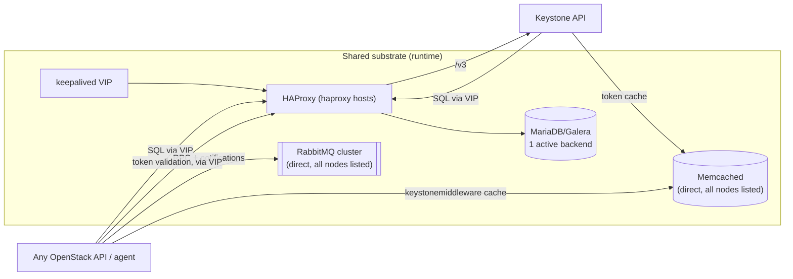
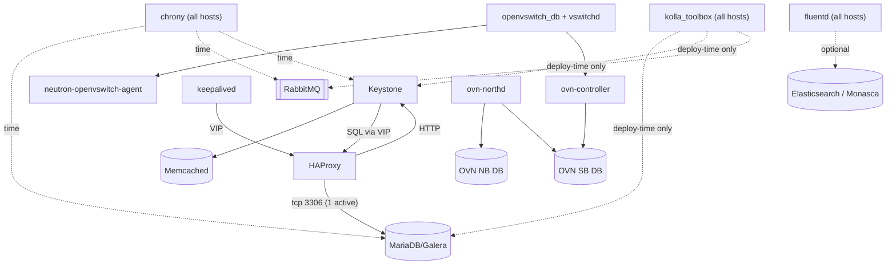
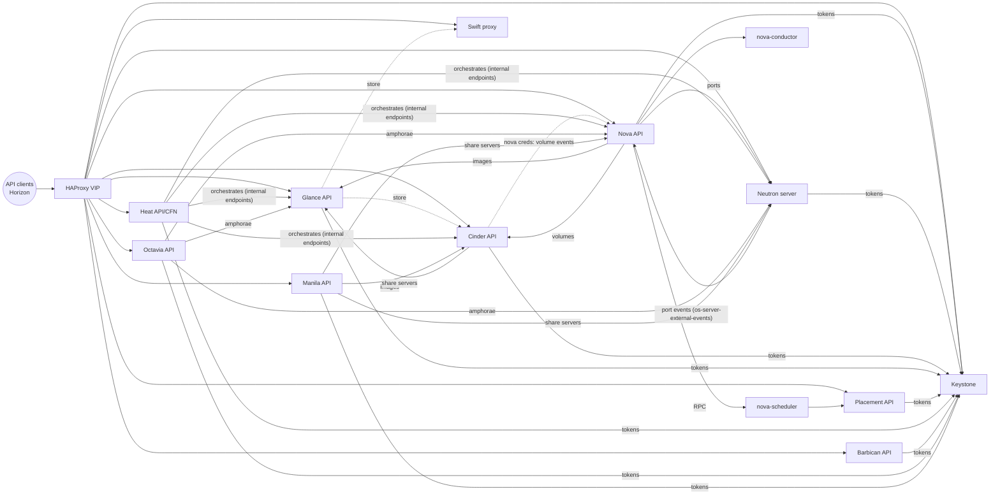
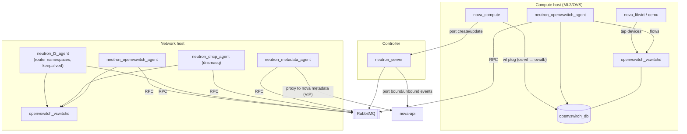

# Component dependencies

This page maps **what depends on what**, and keeps four kinds of dependency apart:

| Kind | Question it answers | Where it lives in the code |
|---|---|---|
| **Installation (deploy-time) dependency** | What must already run for the *role* to succeed? | `kolla_toolbox` calls to MariaDB, Keystone and RabbitMQ in `bootstrap.yml`/`register.yml`, bootstrap containers, `delegate_to` targets |
| **Configuration dependency** | Whose hosts, addresses, flags or passwords end up in *my* config files? | `templates/*.j2`, `group_vars/all.yml` (e.g. `rpc_transport_url`) |
| **Runtime dependency** | What must be reachable for the *service* to work? | The same templates (URLs, connections); upstream OpenStack behaviour |
| **Operational dependency** | Which Kolla action on X changes or restarts Y? | Handlers, global `enable_*` flags, `common`, haproxy, loop-notify (see [Operations](../operations/index.md)) |

Kolla-Ansible **never declares inter-service dependencies** explicitly. Role meta lists only `common`. Every dependency
below is implicit: play order in `site.yml`, a variable, a template, or a `delegate_to`.

> [!NOTE]
> **Key answers**
>
> - **The database is reached through the internal VIP and HAProxy; RabbitMQ and memcached hosts are listed one by one
>   in the configs of the services that use them.** Adding or removing a RabbitMQ node therefore changes the config of
>   every messaging service, including `nova-compute` and the neutron agents on every compute
>   ([§1](#1-the-shared-substrate-what-every-openstack-service-uses)).
> - **A compute host's configuration depends on global state** (enabled services, the membership of the RabbitMQ,
>   memcached and etcd groups, the internal VIP and external NTP servers, service passwords), not only on the compute
>   host itself. That is why changes that look small trigger fleet-wide restarts [CODE]
>   ([§5](#5-compute-node-dependency-summary)).
> - **What lands on a compute host**, container by container, with the global config source of each
>   ([§5](#5-compute-node-dependency-summary)).
> - **Per-service dependencies:** control-plane services with their use of the DB, RabbitMQ, memcached and Keystone and
>   their deploy-time actions ([§3](#3-control-plane-services)); infrastructure components
>   ([§2](#2-infrastructure-components)); networking containers and their placement
>   ([§4](#4-networking-components-ml2ovs-default-ml2ovn-optional)).
> - **L3 agent:** with `enable_neutron_agent_ha: yes`, the L3 agent wrapper runs
>   `neutron-netns-cleanup --force --agent-type l3` before the agent starts, on every restart or recreate of
>   `neutron_l3_agent` on that host [CODE]; what that command deletes, and the DHCP and router outage per agent
>   restart, are [NOT AVAILABLE] ([§4](#4-networking-components-ml2ovs-default-ml2ovn-optional)).
> - **Deployment order mostly respects runtime dependencies, with caveats:** Nova is deployed before Open vSwitch and
>   Neutron, and nothing enforces a dependency when you use tags [CODE]
>   ([§6](#6-deployment-order-vs-runtime-dependency)).

A compact card per service (role, play, tags, task flow, templates, handlers, key variables, node types) is in
[Components](index.md). Per-role detail with line references is in the fact sheets
([A](../reference/factsheets/a-infra-lb-ovn.md), [B](../reference/factsheets/b-mariadb-rabbitmq-keystone.md),
[C](../reference/factsheets/c-glance-placement-cinder-horizon-heat.md),
[D](../reference/factsheets/d-barbican-octavia-swift-manila-compute-roles.md),
[E](../reference/factsheets/e-host-bootstrap-ops-playbooks.md)). Nova is covered in depth in [Nova deep
dive](nova-deep-dive.md).

---

## 1. The shared substrate: what every OpenStack service uses

| Shared component | How services reach it | Evidence | Consequence |
|---|---|---|---|
| **MariaDB / Galera** | `database_address: "{{ kolla_internal_fqdn }}"`, i.e. through the **internal VIP and HAProxy** | `ansible/group_vars/all.yml:105` | Every DB connection depends on HAProxy and keepalived as well as on Galera. HAProxy sends DB traffic to **one** active backend; the others are `backup` (`roles/mariadb/defaults/main.yml:58`, [fact sheet B §1.2](../reference/factsheets/b-mariadb-rabbitmq-keystone.md#12-mariadb_services-ansiblerolesmariadbdefaultsmainyml2-47)) |
| **RabbitMQ** | `rpc_transport_url` / `notify_transport_url` list **every host** of `groups['rabbitmq']` directly. Clients use their own failover, **not** the VIP | `ansible/group_vars/all.yml:206,216` | Adding or removing a RabbitMQ node changes the config of every messaging service, including `nova-compute` and the neutron agents on **every compute** ([Change control-plane membership §2](../operations/change-control-plane-membership.md#2-change-control-plane-membership-add-or-remove-a-controller)) |
| **Memcached** | Templates loop `` for `keystone_authtoken` / `[cache]` | e.g. `roles/ceilometer/templates/ceilometer.conf.j2:55`; templates of 37 roles contain this loop, and monasca builds the same list in `roles/monasca/defaults/main.yml:127` | Membership change = config change in about 38 services. [NOT AVAILABLE] Whether a memcached restart empties the token caches and the Horizon sessions kept there ([fact sheet A §3.8](../reference/factsheets/a-infra-lb-ovn.md#38-operationally-notable), [Kolla images §6](../concepts/kolla-images.md#6-day-2-consequences) item 14) |
| **Keystone** | `www_authenticate_uri`/`auth_url` → internal/admin VIP endpoints; `service-ks-register` at deploy time | `roles/service-ks-register/tasks/main.yml` (39 roles use it) | Hard deploy-time dependency (registration runs `run_once` against the admin endpoint). Runtime: the services' `[keystone_authtoken]` sections point keystonemiddleware at Keystone, with memcached as token cache (e.g. `roles/nova/templates/nova.conf.j2:116-130`); [NOT AVAILABLE] whether API requests fail while Keystone is down |
| **HAProxy + keepalived** | Every internal/admin/public endpoint and the DB address resolve to the VIPs | `roles/*/defaults/main.yml` `haproxy:` dicts → `roles/haproxy-config` | A single point of *path* failure for APIs and DB. HAProxy is **restarted, never reloaded**, on all haproxy hosts at once ([fact sheet A §1.8](../reference/factsheets/a-infra-lb-ovn.md#18-operationally-notable-behaviour)) |
| **fluentd / cron / kolla_toolbox** (`common`) | Deployed on every host (`group: all`) | `roles/common/defaults/main.yml:6-36` | `kolla_toolbox` is a **deploy-time** dependency of every role that touches MySQL, Keystone or RabbitMQ (`kolla_toolbox` module needs it running). fluentd is runtime-optional (logging only) |

---

## 2. Infrastructure components

| Component | Role / play | Hosts (example inventory) | Deploy-time needs | Runtime needs | Who depends on it |
|---|---|---|---|---|---|
| **Keepalived** | `haproxy` role, `site.yml:126` | `haproxy` → `network` | `ip_vs` module, sysctl `ip_nonlocal_bind` | VRRP between haproxy hosts (multicast default, router id 51) | Everything addressed by VIP |
| **HAProxy** | `haproxy` role + 49 `loadbalancer.yml` includes | `haproxy` | facts of **all backend hosts** (backend lists use `hostvars[host].ansible_facts.hostname`) | backends | All APIs, MariaDB (DB address = VIP) |
| **MariaDB/Galera** | `mariadb` role, `site.yml:471` (no `serial`) | `mariadb` → `control` | `kolla_toolbox`; Galera bootstrap logic ([fact sheet B §1](../reference/factsheets/b-mariadb-rabbitmq-keystone.md#1-mariadb-ansiblerolesmariadb)) | HAProxy (clustercheck on port 4569) | Every service with a DB |
| **RabbitMQ** | `rabbitmq` role, `site.yml:535` (no `serial`) | `rabbitmq` → `control` | erlang cookie, `/etc/hosts` (from `bootstrap-servers`) | – | Every service with RPC/notifications |
| **Memcached** | `memcached` role, `site.yml:481` (no `common` dependency) | `memcached` → `control` | – | – | Keystone, all keystonemiddleware users, Horizon sessions |
| **Fluentd** | `common` | all | – | (optional) Elasticsearch/Monasca outputs | Logging only. HAProxy syslogs to fluentd UDP |
| **Open vSwitch** | `openvswitch` role, `site.yml:712` | `openvswitch` → `network`, `compute`, `manila-share` | kernel module `openvswitch`; `neutron_bridge_name`/`neutron_external_interface` on network nodes (and computes if `computes_need_external_bridge`) | – | neutron-openvswitch-agent, OVN controller, DHCP/L3 agents |
| **OVN** (if `neutron_plugin_agent: ovn`) | `ovn` role, `site.yml:734` | `ovn-database` → `control`; `ovn-controller` → `compute`, `network` | OVS running (ovn-controller writes OVS external_ids through `docker exec` into the OVS containers) | NB/SB DB cluster (Raft) | neutron-server (ML2/OVN), neutron-ovn-metadata-agent |
| **Chrony** | `chrony` role, `site.yml:114` (enabled by default) | `chrony-server` → `haproxy`; `chrony` → all physical groups | – | upstream NTP (`pool.ntp.org` by default) | Galera, RabbitMQ, Keystone token expiry, Ceph |
| **iscsid / tgtd** | `iscsi` role, `site.yml:512` | `iscsid` → `compute`, `storage` | only if `enable_iscsid` (cinder LVM/iSCSI or ironic) | – | nova-compute (volume attach), cinder-volume (LVM) |

### 2.1 Infrastructure dependency graph (runtime)

---

## 3. Control-plane services

Legend: **DB** = MariaDB through the VIP, **MQ** = RabbitMQ (all nodes listed), **MC** = memcached, **KS** = Keystone. A
✔ means the role's config templates (`roles/<role>/templates/*.j2`) reference it [CODE]. What each bootstrap container
runs inside the image is listed in [Kolla images
§4](../concepts/kolla-images.md#4-one-shot-containers-what-the-environment-variables-run).

| Service | DB | MQ | MC | KS | Other services referenced in config | Deploy-time actions | Notes (fact sheet) |
|---|---|---|---|---|---|---|---|
| **Keystone** | ✔ | ✔ (notifications) | ✔ | – | – | bootstrap container (db sync) **every deploy/reconfigure**; fernet keys distributed from first running node; admin bootstrap through `kolla_keystone_bootstrap` | [B §3.6–3.10](../reference/factsheets/b-mariadb-rabbitmq-keystone.md#36-fernet-key-lifecycle-fact-unless-marked) |
| **Glance** | ✔ | ✔ | ✔ | ✔ | Cinder (store), Ceph, Swift, Barbican | db sync + `db_load_metadefs` on every deploy/reconfigure (kolla `docker/glance/glance-api/extend_start.sh:5-9`); toggles **global** MariaDB `log_bin_trust_function_creators` | [C §1](../reference/factsheets/c-glance-placement-cinder-horizon-heat.md#1-glance). With the file backend only `groups['glance-api'][0]` runs glance |
| **Placement** | ✔ | ✔ (unused) | ✔ | ✔ | (Nova credentials in migration helper) | db sync **and online data migrations** on every deploy/reconfigure (one `KOLLA_BOOTSTRAP` container, kolla `docker/placement/placement-api/extend_start.sh:5-9`) | [C §2](../reference/factsheets/c-glance-placement-cinder-horizon-heat.md#2-placement) |
| **Nova** | ✔ | ✔ | ✔ (API side only) | ✔ | Glance, Neutron, Placement, Cinder, Barbican, Ceph | API/cell0/cell DB sync on every deploy/reconfigure; cell create/update; host discovery | [Nova deep dive](nova-deep-dive.md) |
| **Neutron** | ✔ (server) | ✔ | ✔ | ✔ | Nova (notifications to Nova), Placement, OVN | DB, user and grants on every deploy/reconfigure; db sync container on **deploy only** while `neutron_enable_rolling_upgrade` is on (the default; `roles/neutron/tasks/bootstrap_service.yml:21-22`) | [§4](#4-networking-components-ml2ovs-default-ml2ovn-optional) below |
| **Cinder** | ✔ | ✔ | ✔ | ✔ | Glance, Nova (uses **nova** credentials), Barbican, Swift (backup), Ceph; etcd (first etcd host only) | db sync on every deploy/reconfigure | [C §3](../reference/factsheets/c-glance-placement-cinder-horizon-heat.md#3-cinder) |
| **Horizon** | only if `horizon_backend_database` | – | ✔ (sessions) | ✔ | every enabled API (internal endpoint type) | no Keystone registration | [C §4](../reference/factsheets/c-glance-placement-cinder-horizon-heat.md#4-horizon) |
| **Heat** | ✔ | ✔ | ✔ | ✔ | every API used by templates (internal); instances need the **external** CFN endpoint | db sync on every deploy/reconfigure; heat domain admin setup only when `heat_user_domain` does not exist yet (kolla `docker/heat/heat-api/extend_start.sh:8-14`): a changed `heat_domain_admin_password` reaches `heat.conf` (`roles/heat/templates/heat.conf.j2:13`) but is never applied in Keystone | [C §5](../reference/factsheets/c-glance-placement-cinder-horizon-heat.md#5-heat) |
| **Barbican** | ✔ | ✔ | ✔ | ✔ | – | db sync on every deploy/reconfigure; `barbican_crypto_key` from `passwords.yml` | [D §1](../reference/factsheets/d-barbican-octavia-swift-manila-compute-roles.md#1-barbican) |
| **Octavia** | ✔ | ✔ | ✔ | ✔ | Nova, Neutron, Glance (amphora image, flavor, network, secgroup — **all manual in Ussuri**) | db sync; no OpenStack resources created | [D §2](../reference/factsheets/d-barbican-octavia-swift-manila-compute-roles.md#2-octavia) |
| **Swift** | – | ✔ | ✔ | ✔ | – | rings are operator-built; old-style role with no handlers | [D §3](../reference/factsheets/d-barbican-octavia-swift-manila-compute-roles.md#3-swift) |
| **Manila** | ✔ | ✔ | ✔ | ✔ | Glance, Neutron, Nova, Cinder, Ceph (CephFS) | db sync; manila-share hosts also get neutron agents | [D §4](../reference/factsheets/d-barbican-octavia-swift-manila-compute-roles.md#4-manila) |

### 3.1 Control-plane runtime graph

The dotted edges are configuration couplings that are easy to overlook:

- **Cinder → Nova** with Nova's own credentials (`roles/cinder/templates/cinder.conf.j2:83-93`).
- **Glance → Cinder or Swift** as image stores. Enabling Swift *changes Glance's default backend*
  (`group_vars/all.yml:862-869`, [fact sheet C
  §1.8](../reference/factsheets/c-glance-placement-cinder-horizon-heat.md#18-operational-notes)).
- **Nova and Neutron → Placement** with the placement user (`roles/nova-cell/templates/nova.conf.j2:203-213`).

---

## 4. Networking components (ML2/OVS default, ML2/OVN optional)

| Container | Placement rule (`host_in_groups`) | Needs | Data-plane role |
|---|---|---|---|
| `openvswitch_db`, `openvswitch_vswitchd` | compute, manila-share (generic backend), dhcp/l3/metadata agent hosts (`roles/openvswitch/defaults/main.yml:2-31`) | kernel module, `/run/openvswitch` | **Forwards all VM traffic** |
| `neutron_openvswitch_agent` | compute (non-xenapi), manila-share (generic), dhcp/l3/metadata hosts (`roles/neutron/defaults/main.yml`) | OVS, RabbitMQ, (neutron-server via RPC) | Programs OVS flows; [NOT AVAILABLE] whether and how it resyncs them after a restart ([Kolla images §5](../concepts/kolla-images.md#5-per-image-start-behaviour)) |
| `neutron_l3_agent` | `neutron-l3-agent`; **plus every compute** when `enable_neutron_dvr` | OVS, `/run/netns` | Routers (namespaces, keepalived for HA routers) |
| `neutron_dhcp_agent` | `neutron-dhcp-agent` | OVS | dnsmasq per network |
| `neutron_metadata_agent` | `neutron-metadata-agent`; plus computes with DVR | nova-api metadata via VIP (`nova_metadata`) | metadata proxy |
| `neutron_server` | `neutron-server` | DB, MQ, KS, Nova, Placement | control plane only |
| `ovn_controller` (OVN) | `ovn-controller` (compute + network) | OVS, SB DB | Programs OVS from SB DB |
| `neutron_ovn_metadata_agent` (OVN) | `neutron-ovn-metadata-agent` → compute | OVS, SB DB | metadata per chassis |

Runtime facts [CODE]:

- **The L3 agent wrapper runs a namespace cleanup on start.** With `enable_neutron_agent_ha: yes`, its start wrapper
  runs `neutron-netns-cleanup --force --agent-type l3` *before* starting the agent
  (`roles/neutron/templates/neutron-l3-agent-wrapper.sh.j2:5-12`), on every restart or recreate of `neutron_l3_agent`
  on such a host (the wrapper's comment: "Remove all l3 related netns"). [NOT AVAILABLE] What the command deletes: it
  is neutron code, which is not in these sources ([F12](../reference/findings.md#f12)); whether and when
  `neutron-l3-agent` rebuilds the namespaces ([Risk register R6](../risk/risk-register.md#r6)).
- **Agent containers do not share the host PID namespace.** They have no `pid_mode` (`roles/neutron/defaults/main.yml`).
  Processes they spawn (dnsmasq, keepalived, haproxy for metadata) live in the container's PID namespace.
  [NOT AVAILABLE] Whether they die with the container and are respawned by the agent on start. For the L3 agent, its
  wrapper starts `neutron-l3-agent` without `exec`, and dumb-init runs with `--single-child` (kolla
  `docker/base/Dockerfile.j2:434`; `roles/neutron/templates/neutron-l3-agent-wrapper.sh.j2:14-18`) [CODE].
  [NOT AVAILABLE] Whether the SIGTERM of `docker stop` then reaches only bash and not the agent, and so whether the
  agent gets a graceful shutdown: that depends on how dumb-init forwards signals, which these sources do not show
  ([Kolla images §2.6](../concepts/kolla-images.md#26-signals-and-pid-1),
  [§5.3](../concepts/kolla-images.md#53-neutron-l3-agent-the-wrapper)). [NOT AVAILABLE] The DHCP and router outage per
  agent restart.
- **The OVS bridge layout is set in a post-config step.** It is ensured on every deploy/reconfigure by
  `kolla_ensure_openvswitch_configured` (`roles/openvswitch/tasks/post-config.yml:7-17`). The command reports
  `changed` only when it actually changes the bridge.

---

## 5. Compute-node dependency summary

Everything that lands on a compute host in a default Ussuri deployment (`enable_*` defaults in
`ansible/group_vars/all.yml:569-713`, placement from each role's `<role>_services`):

| Container | Role | Config source that is *global* (changes fleet-wide) |
|---|---|---|
| `fluentd`, `cron`, `kolla_toolbox` | common | `td-agent.conf` and `logrotate.conf` built from **all** `enable_*` flags |
| `chrony` | chrony | `kolla_internal_vip_address` and `external_ntp_servers` (`roles/chrony/templates/chrony.conf.j2:3-9`). `groups['chrony-server']` only selects the host's own server or client stanza (`:30-39`), so other hosts joining or leaving that group do not alter a compute's `chrony.conf` |
| `iscsid` | iscsi (if cinder LVM/iSCSI or ironic) | – |
| `nova_libvirt`, `nova_ssh`, `nova_compute` | nova-cell | `nova.conf`: `rpc_transport_url` (all RabbitMQ hosts), `enable_barbican/ceilometer/designate/watcher/cinder/osprofiler…` sections, Glance, Neutron and Placement endpoints, service passwords |
| `openvswitch_db`, `openvswitch_vswitchd` | openvswitch | – (bridge mappings only if `computes_need_external_bridge`) |
| `neutron_openvswitch_agent` | neutron | `neutron.conf` (all RabbitMQ hosts, memcached list) **and** `openvswitch_agent.ini`, which also merges the operator's `ml2_conf.ini` override |

Optional compute-side containers come from ceilometer, collectd, telegraf, prometheus exporters, masakari, zun, kuryr,
cyborg, skydive and monasca ([fact sheet D
§5](../reference/factsheets/d-barbican-octavia-swift-manila-compute-roles.md#50-summary-table-compute-side)). Each of
them embeds host lists from other groups (RabbitMQ, memcached, influxdb, etcd, prometheus) in its config. The full list
of templates that loop over groups is in [Generated inventory
§4](../reference/generated-inventory.md#4-templates-that-reference-inventory-groups).

**Rule of thumb [CODE]:** a compute host's configuration depends on *global* state (enabled services, the membership of
the RabbitMQ, memcached and etcd groups, the internal VIP and external NTP servers, service passwords), not only on the
compute host itself. That is why changes that look small trigger fleet-wide restarts ([Compute
scaling](../concepts/compute-scaling-and-performance.md), [Operations](../operations/index.md)).

---

## 6. Deployment order vs runtime dependency

Deployment order is the play order in `site.yml` ([Execution flow](../concepts/deployment-execution-flow.md)). It mostly
respects runtime dependencies, with these caveats [CODE]:

| Observation | Evidence | Effect |
|---|---|---|
| HAProxy is configured for **all** services before any of them exists | `site.yml:126-392` | The first deploy puts frontends in place for backends not yet started. Each backend server is health-checked (`check inter 2000 rise 2 fall 5`, `roles/haproxy-config/defaults/main.yml:13`); how HAProxy treats a backend that is not up yet is [NOT AVAILABLE] |
| **Placement is deployed before Nova; Glance and Cinder too** | `site.yml:657-706` | Nova bootstrap can use Placement and Glance at once |
| **Nova is deployed *before* Open vSwitch and Neutron** | `site.yml:710` (`nova.yml`) vs `:712-780` | On a first deploy nova-compute starts before the OVS agent exists, and Kolla waits for its registration in the nova-cell play, before the OVS and Neutron plays run (`roles/nova-cell/tasks/wait_discover_computes.yml:8-42`). [NOT AVAILABLE] Whether instances can be scheduled there before those plays finish ([Execution flow §2.4](../concepts/deployment-execution-flow.md#24-compute-node-deployment-what-one-compute-host-experiences)). The NOTE at `site.yml:759-760` forbids changing the order ("workaround to fix bug 1546789") |
| Heat, Horizon and Octavia come after Nova and Neutron | `site.yml:793-1195` | – |
| Nothing enforces a dependency when you **use tags** | `--tags` filters plays | `-t nova` on a fresh cloud fails at Keystone registration if Keystone was never deployed. On an existing cloud it assumes MariaDB, RabbitMQ and Keystone are healthy |
| Bootstrap and registration tasks target `groups[...][0]` | e.g. `nova-cell/tasks/bootstrap.yml:14,32` | The first host of a group is a hidden dependency: it must be reachable and have `kolla_toolbox` running |

## Related

- [Nova deep dive](nova-deep-dive.md) (Nova in depth)
- [Operations](../operations/index.md) (what these dependencies do to a Day-2 run)
- [Execution flow](../concepts/deployment-execution-flow.md) (deployment order)
- [Components](index.md) (service index)
