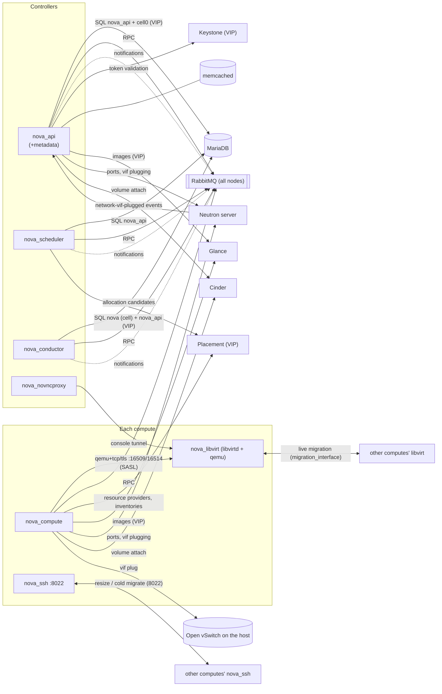

# Nova deep dive

Nova is split into two roles and ten plays. It is the component with the most hosts (every compute), the most coupling
(Glance, Neutron, Placement, Cinder, Keystone, RabbitMQ, MariaDB) and the highest VM-impact risk.

> [!NOTE]
> **Key answers**
>
> - **What restarts what:** any change of nova-compute's `nova.conf`, `config.json` or image restarts `nova_compute`
>   and, through loop-notify, `nova_libvirt` and `nova_ssh` [CODE]
>   ([§2.4](#24-operational-dependencies-what-restarts-what)).
> - **Do running VMs survive a `nova_libvirt` restart?** [NOT AVAILABLE]. What the code shows about the container is
>   [CODE]: `pid_mode: host`, state on named volumes, a start path that is passive towards running guests, the 10 s stop
>   timeout, the restart handler's retries ([§5](#5-nova-libvirt-why-its-restart-is-special)).
> - **Which inputs change `nova.conf` on every compute** (RabbitMQ group membership, several global `enable_*` flags,
>   endpoints and service passwords, operator overrides) and which do not reach the nova containers on compute hosts
>   (the memcached membership, MariaDB settings, `nova_keystone_password`):
>   [§2.3](#23-configuration-dependencies-inputs-that-change-novas-files).
> - **The ten nova plays:** which play runs on which action (plays 6–10 run on upgrade only), what the bootstrap
>   one-shots run, and how compute discovery works, once per batch
>   ([§4](#4-the-nova-plays-step-by-step-ansiblenovayml)).
> - **Live migration, resize and consoles:** the containers each one depends on; whether a `nova_libvirt` or `nova_ssh`
>   restart interrupts operations in progress is [NOT AVAILABLE] ([§6](#6-live-migration-resize-and-consoles)).
> - **Upgrade:** the image pull is not part of `upgrade`; run `kolla-ansible pull` first
>   ([§7](#7-upgrade-path-specifics)).

---

## 1. Components, roles, containers and placement

| Component | Container | Role | Inventory group (default) | Placement variable | Notable container flags | Evidence |
|---|---|---|---|---|---|---|
| nova-api (+ metadata API) | `nova_api` | `nova` | `nova-api` → `nova` → `control` | `group: nova-api` | **privileged**, `/lib/modules` | `roles/nova/defaults/main.yml:3-41` |
| nova-scheduler | `nova_scheduler` | `nova` | `nova-scheduler` | `group` | – | `:42-48` |
| nova-super-conductor | `nova_super_conductor` | `nova` | `nova-super-conductor` | `enabled: enable_cells` (default `no`) | – | `:49-55` |
| nova-conductor (cell) | `nova_conductor` | `nova-cell` | `nova-conductor` | `group: nova_cell_conductor_group` | – | `roles/nova-cell/defaults/main.yml:40-46` |
| nova-novncproxy | `nova_novncproxy` | `nova-cell` | `nova-novncproxy` | `enabled: nova_console == 'novnc'` | – | `:19-25` |
| nova-spicehtml5proxy | `nova_spicehtml5proxy` | `nova-cell` | `nova-spicehtml5proxy` | `nova_console == 'spice'` | – | `:26-32` |
| nova-serialproxy | `nova_serialproxy` | `nova-cell` | `nova-serialproxy` | `enable_nova_serialconsole_proxy` | – | `:33-39` |
| nova-compute | `nova_compute` | `nova-cell` | `compute` | `group: nova_cell_compute_group` | **privileged**, **`ipc_mode: host`**, `/dev`, `/run:shared`, `/lib/modules`, `iscsi_info` (if iscsid), `nova_compute` volume `/var/lib/nova`, `libvirtd` volume | `:47-57` |
| nova-libvirt | `nova_libvirt` | `nova-cell` | `compute` | `enabled: nova_compute_virt_type in ['kvm','qemu']` | **privileged**, **`pid_mode: host`**, `/dev`, `/run:shared`, **`/sys/fs/cgroup` (rw)**, `libvirtd:/var/lib/libvirt`, `nova_libvirt_qemu:/etc/libvirt/qemu`, instance datadir | `:3-11`, volumes `:237-250` |
| nova-ssh | `nova_ssh` | `nova-cell` | `compute` | `enable_nova_ssh` (default yes) | sshd on `migration_interface_address:8022` | `:12-18`; `templates/sshd_config.j2:1-2` |
| nova-compute-ironic | `nova_compute_ironic` | `nova-cell` | `nova-compute-ironic` | `enable_ironic` and cell match | – | `:58-64` |

Cells: `nova_cell_name` is empty by default (a single cell named `''`, the pre-Train layout). For multi-cell, every
`nova_cell_*_group` variable points at a per-cell group (`roles/nova-cell/defaults/main.yml:87-126`). `enable_cells`
then deploys `nova_super_conductor` at the API level.

---

## 2. Dependency classification

### 2.1 Installation (deploy-time) dependencies

What must work **while Kolla runs** the nova plays:

| Dependency | Used by | Evidence | Failure mode |
|---|---|---|---|
| MariaDB (through the VIP) + `kolla_toolbox` on the first `nova-api` and first `nova-conductor` host | `mysql_db` / `mysql_user` | `roles/nova/tasks/bootstrap.yml:2-45`; `roles/nova-cell/tasks/bootstrap.yml:2-33` | play aborts; cell play has `any_errors_fatal: true` (`nova.yml:75`) |
| RabbitMQ (first host of `nova_cell_rpc_group_name`) | vhost/user creation via `service-rabbitmq`, delegated | `roles/nova-cell/tasks/rabbitmq.yml:2-29` | cell bootstrap fails, all hosts fail |
| Keystone admin endpoint | `service-ks-register` (services `nova`, `nova_legacy`, user `nova`) | `roles/nova/tasks/register.yml`; `defaults/main.yml:155-176` | retries 5 × 10 s, then fail |
| Docker registry (only if the image is absent) | bootstrap and service containers | `kolla_docker.start_container` pulls if absent | fail |
| **Running `nova_conductor` on `groups[nova_cell_conductor_group][0]`** | `discover_hosts` uses `docker exec nova_conductor` | `roles/nova-cell/tasks/discover_computes.yml:14-21` | discovery fails (`any_errors_fatal`) |
| **Running `kolla_toolbox` on that conductor** + Keystone + nova-api | `openstack compute service list` to wait for compute registration | `roles/nova-cell/tasks/wait_discover_computes.yml:8-42` | 20 retries × 10 s, then fail only the hosts that did not register |
| Facts of all RabbitMQ, memcached and haproxy hosts | transport URLs, memcache lists, haproxy backends | `group_vars/all.yml:206,216`; `roles/nova-cell/defaults/main.yml:174-175` | templating error. This is why `gather-facts.yml` gathers facts for all hosts even with `--limit` |

### 2.2 Runtime dependencies (what Nova needs to *operate*)

| Nova component | Requires at runtime | Evidence (template) |
|---|---|---|
| nova-api | MariaDB (`nova_api` and `nova_cell0`), RabbitMQ, Keystone (authtoken + memcached), Placement, Glance, Neutron, Cinder | `roles/nova/templates/nova.conf.j2:30,60-61,67,80,97-105,110-136,169` |
| nova-scheduler | MariaDB (`nova_api`), RabbitMQ, Placement. Filters: Kolla leaves `[filter_scheduler] enabled_filters` unset by default, so Nova's upstream Ussuri default applies (`AvailabilityZone`, `Compute`, `ComputeCapabilities`, `ImageProperties`, `ServerGroupAntiAffinity`, `ServerGroupAffinity`) | `nova.conf.j2:32-40` overrides `enabled_filters` only when `enable_blazar` (adds `BlazarFilter`) or `enable_nova_fake` is set; both default to `no`. `discover_hosts_in_cells_interval = -1` (`:166`): **the scheduler never discovers hosts by itself** |
| nova-conductor (cell) | MariaDB (cell DB, and the API DB because `nova_cell_conductor_has_api_database: yes`), RabbitMQ | `roles/nova-cell/templates/nova.conf.j2:142-157` |
| nova-compute | RabbitMQ (**no DB access**: the `[database]` section is excluded for `nova-compute*`), Keystone, Placement, Glance, Neutron, Cinder, local libvirt, local OVS | `nova-cell/templates/nova.conf.j2:42,105-139,142,203-213`; libvirt `connection_uri` in `nova.conf.d/libvirt.conf.j2:1-7` |
| nova-libvirt | `/dev/kvm` (udev rule `99-kolla-kvm.rules`), the `br_netfilter` module, Ceph (if `nova_backend: rbd`: `ceph.conf`, secret XML/base64 in `nova-libvirt/secrets`) | `nova-cell/tasks/config-host.yml`, `external_ceph.yml` |
| nova-novncproxy | Reaches libvirt VNC on each compute (`server_listen`/`server_proxyclient_address = api_interface_address`) | `nova-cell/templates/nova.conf.j2:48-63` |

### 2.3 Configuration dependencies (inputs that change Nova's files)

These change `nova.conf` on **every compute**. The result is a restart of `nova_compute` (and, through loop-notify,
`nova_libvirt` and `nova_ssh`) on every compute during the next run that executes the nova-cell play:

| Input | Template line | Why it is "global" |
|---|---|---|
| RabbitMQ group membership, user, password, port | `transport_url` (`nova-cell/templates/nova.conf.j2:42,184`) | `nova_cell_rpc_transport_url` / `nova_cell_notify_transport_url` list every host of `nova_cell_rpc_group_name`, default `om_rpc_group` = `rabbitmq` (`roles/nova-cell/defaults/main.yml:156-175`). Within Nova, the global `rpc_transport_url` (`group_vars/all.yml:206`) is used only by the API-level nova role, so overriding it does not change the compute `nova.conf` |
| `enable_ceilometer`, `enable_searchlight`, `enable_designate`, `enable_neutron_infoblox_ipam_agent` | `[notifications]` / notification driver (`:34-40,215-225`) | global flags |
| `enable_watcher`, `enable_cinder`, `enable_osprofiler`, `enable_barbican` | `:37,111,226,234` | global flags. `enable_barbican` also changes the `common` role's `td-agent.conf` (fluentd input paths, `roles/common/defaults/main.yml:108-109,187`) and cron `logrotate.conf` (`roles/common/tasks/config.yml:173`). `common` is a meta dependency of nova and nova-cell (`roles/nova/meta/main.yml:3`, `roles/nova-cell/meta/main.yml:3`), so its container check also restarts `cron`, `fluentd` and `kolla_toolbox` on every nova host (loop-notify, `roles/common/tasks/check-containers.yml:2-17`) [CODE] |
| Glance, Neutron, Placement, Keystone endpoints and service passwords (`placement_keystone_password`, `neutron_keystone_password`, `cinder_keystone_password`, `metadata_secret`) | `[glance]`, `[neutron]`, `[placement]`, `[cinder]` (`:121,126,138,207`) | `passwords.yml` and VIP/FQDN settings |
| `nova_console`, `enable_nova_serialconsole_proxy`, `kolla_external_fqdn`, `public_protocol` | `[vnc]`/`[spice]`/`[serial_console]` (`:48-88`) | console URLs embed the external FQDN |
| `libvirt_tls`, `libvirt_enable_sasl`, `migration_interface`, `nova_backend`, Ceph settings | `nova.conf.d/libvirt.conf.j2`, `libvirtd.conf.j2`, `qemu.conf.j2` | change the libvirt **and** compute containers |
| Operator overrides | `/etc/kolla/config/global.conf`, `nova.conf`, `nova/nova-compute.conf`, `nova/<host>/nova.conf` | merge order in `nova-cell/tasks/config.yml:63-75` |

Inputs that do **not** reach the nova containers on compute hosts: the memcached membership (no memcache settings
in the nova-cell template; it does reach computes through `neutron.conf` of the Neutron agents and `ceilometer.conf`),
MariaDB settings (no `[database]` on computes) and `nova_keystone_password`. Among the nova templates, the latter
appears only in `[keystone_authtoken]` of the API-level template (`roles/nova/templates/nova.conf.j2:124`), rendered for
`nova_api`, `nova_scheduler` and `nova_super_conductor`, so rotating it restarts no nova container on the computes. It
does reach computes through the `[nova]` section of the Neutron agents' `neutron.conf`
(`roles/neutron/templates/neutron.conf.j2:85`).

### 2.4 Operational dependencies (what restarts what)

| Trigger | Restarted on computes | Restarted on controllers | Evidence |
|---|---|---|---|
| Any change of `nova-compute`'s `nova.conf` / `config.json` / image | `nova_compute` **+ `nova_libvirt` + `nova_ssh`** (loop-notify), then "Create libvirt SASL user" | – | [CODE] `roles/nova-cell/tasks/config.yml:43-82`, `check-containers.yml:2-20`, `handlers/main.yml:70-140`; loop-notify, [Tags §2.4](../risk/tags.md#24-loop-notify-one-changed-item-notifies-the-handlers-of-all-items-code) |
| Change of `/etc/kolla/config/nova.conf` or a global flag | all three on every compute; a global `enable_*` flag that changes the `common` role's fluentd/logrotate config also restarts `cron`, `fluentd`, `kolla_toolbox` | nova_api, nova_scheduler, nova_conductor, nova_novncproxy (+ super conductor if `enable_cells`); same `common` restarts for such a flag | [CODE] only the nova and nova-cell roles merge `/etc/kolla/config/nova.conf` (`roles/nova/tasks/config.yml:59`, `roles/nova-cell/tasks/config.yml:71`), so a plain override restarts only nova containers; a flag such as `enable_barbican` also changes `common`'s files ([§2.3](#23-configuration-dependencies-inputs-that-change-novas-files)), and `common` is a meta dependency (`roles/nova/meta/main.yml:3`, `roles/nova-cell/meta/main.yml:3`) |
| Scheduler-only override | – | `nova_scheduler` **+ `nova_api`** (loop-notify) | [CODE] `roles/nova/tasks/config.yml:51-69`, `check-containers.yml:2-20`; loop-notify, [Tags §2.4](../risk/tags.md#24-loop-notify-one-changed-item-notifies-the-handlers-of-all-items-code) |
| New image for nova-compute (after `pull`) | `nova_compute` recreated, `nova_libvirt` + `nova_ssh` restarted | – | [CODE] `compare_image` makes the check report changed (`library/kolla_docker.py:403-418`); `recreate_or_restart_container` recreates `nova_compute`, whose image differs, and restarts the other two under `COPY_ALWAYS` (`kolla_docker.py:781-803`, `group_vars/all.yml:43`); loop-notify, [Tags §2.4](../risk/tags.md#24-loop-notify-one-changed-item-notifies-the-handlers-of-all-items-code) |
| Any `deploy`/`reconfigure` with `nova` or `nova-api` tag, even with no change | – | `nova_scheduler` receives `SIGHUP` (cell-cache refresh) | `roles/nova/tasks/refresh_scheduler_cell_cache.yml:10`; play tags and `kolla_action` condition in `nova.yml:140-156` |
| Libvirt TLS certificate change | `nova_libvirt` + `nova_compute` (+ `nova_ssh` by loop-notify) | – | `nova-cell/tasks/config-libvirt-tls.yml` |
| Ceph keyring / `ceph.conf` / secret change | `nova_compute` **+ `nova_libvirt` + `nova_ssh`**, then "Create libvirt SASL user". The files are listed in the `config.json` of nova-compute or nova-libvirt, so "Check nova-cell containers" finds `kolla_set_configs --check` drift and loop-notifies all three. Exception: the cinder keyring file is not in nova-compute's `config.json`, and its key reaches libvirt only through the cinder secret in `nova-libvirt/secrets`. A key change therefore still restarts all three; an edit that leaves the key unchanged restarts only `nova_compute` (direct notify) | – | `nova-cell/tasks/external_ceph.yml`, `check-containers.yml:2-20`, `templates/nova-compute.json.j2`, `nova-libvirt.json.j2` (same mechanism as the first row) |

---

## 3. What must be available before Nova can operate

Ordered by necessity. What Kolla configures is [CODE] (templates cited in
[§2.2](#22-runtime-dependencies-what-nova-needs-to-operate)); upstream Nova behaviour is not in these sources and is
marked [NOT AVAILABLE]:

1. **MariaDB (through HAProxy and the VIP)** with the `nova_api`, `nova_cell0` and `nova` (cell) schemas migrated.
   [NOT AVAILABLE] Whether API, scheduler and conductor fail without it, and whether computes keep running VMs and
   whether their state reporting through the conductor fails.
2. **RabbitMQ** with the cell vhost and user. All RPC between API, scheduler, conductor and compute uses it.
   [NOT AVAILABLE] Whether computes also report liveness over it, with the service heartbeat going through the
   conductor.
3. **Keystone + memcached.** The API-side `nova.conf` has `[keystone_authtoken]` with memcached as token cache
   (`roles/nova/templates/nova.conf.j2:116-130`); nova-compute's `[cinder]`, `[neutron]` and `[placement]` sections
   carry Keystone credentials (`roles/nova-cell/templates/nova.conf.j2:115,131,205`). [NOT AVAILABLE] Whether API
   requests, and nova-compute's calls to those services, fail without Keystone.
4. **Placement.** The scheduler's allocation candidates and nova-compute's resource-provider updates.
   [NOT AVAILABLE] Whether scheduling stops and computes log errors without it.
5. **Cell mapping and host mapping.** `map_cell0`, `create_cell` and **`discover_hosts`**. The scheduler does not
   discover hosts by itself (`discover_hosts_in_cells_interval = -1`). [NOT AVAILABLE] Whether a compute that was not
   discovered, and so is not in a host mapping, gets no instances.
6. **Neutron server + an L2 agent on the compute** (neutron-openvswitch-agent + OVS, or ovn-controller).
   [NOT AVAILABLE] Whether instance boot waits for the `network-vif-plugged` event: Kolla sets `vif_plugging_is_fatal`
   only for Hyper-V (`roles/nova-hyperv/templates/nova_hyperv.conf.j2:15`), and Nova's default is not in these sources.
7. **Glance** for image-backed boots. **Cinder** for volume-backed boots.
8. **libvirt (+ KVM, `br_netfilter`, udev rule)** on the compute. [NOT AVAILABLE] Whether nova-compute fails to start
   its driver without libvirt.

---

## 4. The nova plays step by step (`ansible/nova.yml`)

| # | Play (lines) | Hosts | Runs on | Key tasks (evidence) |
|---|---|---|---|---|
| 1 | Bootstrap nova API databases (`29-61`) | `nova-api` | deploy, reconfigure; upgrade → `bootstrap_upgrade` | `mysql_db` nova_api/cell0 (`run_once`); grants; `nova-api-bootstrap` config (`run_once`); `nova_api_bootstrap` one-shot container (`roles/nova/tasks/bootstrap_service.yml:4-23`); `map_cell0` delegated to `groups['nova-api'][0]` (`map_cell0.yml:2-26`) |
| 2 | Bootstrap nova cell databases (`63-96`) | `nova-conductor` | deploy, reconfigure; upgrade | cell DB/user on the first conductor; RabbitMQ vhost/user; `nova_cell_bootstrap` one-shot (cell DB sync); `list_cells` → `create_cell` or `update_cell` (only if the MQ or DB URL changed) |
| 3 | Apply role nova (`99-114`) | `nova-api`, `nova-scheduler`, `nova-super-conductor` | every action | standard role: register, config, check-containers, flush |
| 4 | Apply role nova-cell (`117-135`) | `compute`, `nova-compute-ironic`, `nova-conductor`, consoles | every action | config-host, config, check, flush, **wait for compute registration + discover_hosts** |
| 5 | Refresh scheduler cell cache (`140-156`) | `nova-scheduler` | deploy, reconfigure | `kill -HUP $(docker inspect … nova_scheduler)` |
| 6 | Reload super conductor (`164-181`) | `nova-super-conductor` | upgrade | `recreate_or_restart` to drop the RPC pin |
| 7 | Reload cell services (`183-205`) | computes, conductors, consoles | upgrade | same |
| 8 | Reload API services (`207-225`) | api, scheduler | upgrade | same |
| 9 | API online data migrations (`230-247`) | `nova-api[0]` | upgrade | `nova_api_online_data_migrations` one-shot |
| 10 | Cell online data migrations (`253-272`) | `nova-conductor` (first) | upgrade | `any_errors_fatal` |

**Bootstrap one-shots.** `nova_api_bootstrap` and `nova_cell_bootstrap` run with `KOLLA_UPGRADE` set on deploy,
reconfigure and upgrade alike (`roles/nova/tasks/bootstrap_service.yml:13`,
`roles/nova-cell/tasks/bootstrap_service.yml:11`). The nova-api image then runs `nova-manage api_db sync` and
`nova-manage db sync`, whose `[database]` is cell0 (kolla `docker/nova/nova-api/extend_start.sh:16-20`;
`roles/nova/templates/nova.conf.j2:97-98`). The nova-conductor image runs `nova-manage db sync --local_cell` (kolla
`docker/nova/nova-conductor/extend_start.sh:9-12`). Neither runs online data migrations. Only plays 9 and 10 do, on
upgrade, by setting `KOLLA_OSM` (`roles/nova*/tasks/online_data_migrations.yml:11`). No nova task sets
`KOLLA_BOOTSTRAP`, so the images' bootstrap branches, which would add online data migrations, are never used. See [Kolla
images §4](../concepts/kolla-images.md#4-one-shot-containers-what-the-environment-variables-run).

**Discovery mechanics** (`roles/nova-cell/tasks/deploy.yml:24-42`, `wait_discover_computes.yml`,
`discover_computes.yml`):

- It runs once per **batch** on the first compute of the batch (`all_computes_in_batch[0]`), delegated to the first
  conductor of the cell.
- It waits until `openstack compute service list --service nova-compute` contains every compute of the batch, keyed
  by `ansible_facts.nodename`. It tries 20 times at 10 s intervals (up to about 200 s).
- Then it runs `nova-manage cell_v2 discover_hosts --by-service --cell_uuid …` once.
- A compute that did not register **fails only that host**, unless `nova_compute_registration_fatal: true`.

---

## 5. nova-libvirt: why its restart is special

Facts [CODE]:

- **`pid_mode: host`, privileged, `/sys/fs/cgroup` mounted read-write**
  (`roles/nova-cell/defaults/main.yml:3-11,237-250`). QEMU processes are started by libvirtd *inside* this container.
- **Persistent state lives on named volumes.** The `libvirtd` volume holds `/var/lib/libvirt` and the
  `nova_libvirt_qemu` volume holds domain XML in `/etc/libvirt/qemu`. Instance disks sit in
  `nova_instance_datadir_volume` (`/var/lib/nova`). All of them survive a container recreate. One more location
  matters for a restart and is not a named volume. The host's `/run` is bind-mounted `:shared`
  (`defaults/main.yml:242`), so whatever libvirtd writes under `/run` is on the host and survives a restart or
  recreate. [NOT AVAILABLE] Whether the image's `/var/run` is a symlink to `/run`, which would put the running-domain
  state in `/var/run/libvirt` on that bind mount, lost only on a host reboot. The Dockerfiles do not show this. The
  SASL DB, by contrast, stays in the container layer (see below).
- **The image start path is passive towards running guests.** `kolla_start` runs `kolla_set_configs`,
  `kolla_copy_cacerts` and the nova-libvirt `extend_start.sh`, then `exec`s `/usr/sbin/libvirtd --listen` (kolla
  `docker/base/start.sh:8-21`; `templates/nova-libvirt.json.j2:2`). `kolla_set_configs` deletes and rewrites only the
  `dest` paths of `nova-libvirt.json.j2`, which are all config files (kolla `docker/base/set_configs.py:147-148`).
  `extend_start.sh` only fixes `/dev/kvm` ownership, mounts xenfs if that module is loaded and creates the log file
  (kolla `docker/nova/nova-libvirt/extend_start.sh:6-24`). None of these steps touches cgroups, QEMU processes,
  `/var/run/libvirt`, `/var/lib/libvirt` or `/etc/libvirt/qemu`, and `qemu.conf.j2`/`libvirtd.conf.j2` set no cgroup
  option. Whether guests survive is therefore decided by the stop path, by where libvirt's defaults placed QEMU, and by
  libvirtd's reconnect on start. Start path in detail: [Kolla images
  §5](../concepts/kolla-images.md#5-per-image-start-behaviour).
- **The restart handler retries 5 times.** "Restart nova-libvirt container" uses `retries: 5 / until: success`. The
  in-code note says: *"retry 5 to remove nova_libvirt container because when guests running, nova_libvirt will raise
  error even though it is removed"* (`roles/nova-cell/handlers/main.yml:87-109`). The authors therefore expect running
  guests during libvirt restarts.
- **After every libvirt restart or recreate, `Create libvirt SASL user` runs** when `libvirt_enable_sasl` is true (the
  default) (`saslpasswd2` inside the container, `handlers/main.yml:91,111-122`). The SASL DB is `/etc/libvirt/passwd.db`
  (`templates/sasl.conf.j2:2`). It is on no volume (under `/etc/libvirt` only `qemu/` is, `defaults/main.yml:249`) and
  no kolla image step creates it. It survives a plain restart (stop and start of the same container) and is lost on
  every recreate: changed image or parameters, or `config_strategy: COPY_ONCE`
  (`library/kolla_docker.py:793-803,892-904`). The in-code note says the SASL user must exist for nova-compute to
  start (`handlers/main.yml:111`).
- **Effective stop timeout is 10 s** ([Repository architecture
  §6](../concepts/repository-architecture.md#6-custom-modules--container-lifecycle-via-kolla_docker)), and both signals
  go to dumb-init. The container's main process is `dumb-init --single-child -- kolla_start` (kolla
  `docker/base/Dockerfile.j2:433-435,455`; `use-dumb-init` defaults to True, kolla `kolla/common/config.py:170`).
  `kolla_start` `exec`s libvirtd (kolla `docker/base/start.sh:21`), so libvirtd is dumb-init's direct child.
  `docker stop` (timeout 10, `library/kolla_docker.py:871-884,892-904`) sends SIGTERM to dumb-init and, after 10 s,
  SIGKILL to dumb-init. [NOT AVAILABLE] Whether libvirtd itself is SIGKILLed if it is still running then (the cgroup
  kill below).
- **Libvirt is restarted before nova-compute.** In the handler order `nova-libvirt` comes before `nova-compute`, so
  during the window nova-compute is still running against a libvirtd that is going away.
- **Kolla ships, but does not install by default, a guest shutdown helper.** `tools/kolla-libvirt-guests.service`
  (with `virt-guest-shutdown.target`) is for host shutdown. The optional standalone playbook
  `tools/setup-compute-libvirt.yml` (hosts: `compute`) copies both units to `/usr/lib/systemd/system` and enables and
  starts them, but no kolla-ansible action (deploy, reconfigure, upgrade, ...) runs it, and `setup.cfg` `data_files`
  leaves all three files out of a pip install. The units exist on a compute only if the operator runs that playbook
  by hand from a source checkout.

What happens to running VMs is **not established by these sources** [NOT AVAILABLE]:

- [NOT AVAILABLE: dumb-init and containerd behaviour are not in these sources] Whether dumb-init forwards SIGTERM to
  libvirtd only and exits when libvirtd does, so that the 10 s SIGKILL matters only if libvirtd hangs; whether QEMU
  gets either signal directly; and whether, under `pid_mode: host`, the runtime kills whatever is still in the
  container's cgroup when its init exits, which would make VM survival depend on QEMU's cgroup membership at stop
  time rather than on the 10 s timer.
- [NOT AVAILABLE: libvirt and systemd behaviour are not in these sources] Where libvirtd puts QEMU processes, and so
  whether QEMU survives the stop of the libvirtd container: with libvirt's systemd integration, libvirtd may ask the
  host's systemd-machined over D-Bus to put each QEMU process in its own `machine.slice` scope on the *host* cgroup
  tree, or, without machined, write the cgroups directly. [CODE] Three settings give the container the host's view:
  the host `/run` bind mount (`defaults/main.yml:242`), `pid_mode: host` (`:8`, QEMU PIDs are host PIDs) and
  `/sys/fs/cgroup` mounted rw (`:244`). [NOT AVAILABLE] Whether, on start, libvirtd re-attaches to running domains
  from the status XML under `/var/run/libvirt/qemu` (on the host `/run` only if `/var/run` is that symlink, see above)
  and the monitor sockets under `/var/lib/libvirt/qemu` (the `libvirtd` volume, `:246`) rather than from the
  persistent definitions in `/etc/libvirt/qemu`, and whether it stops a domain whose monitor it cannot reconnect to.
  [CODE] `stdio_handler = "file"` (`qemu.conf.j2:1`), and the container runs only `libvirtd --listen`
  (`templates/nova-libvirt.json.j2:2`), so Kolla starts no virtlogd in it. [NOT AVAILABLE] Whether running QEMU
  therefore does not depend on a virtlogd. [CODE] The handler note above and `tools/cleanup-containers:5-9` both
  expect QEMU processes to still be running when `nova_libvirt` is stopped or removed.
- [NOT AVAILABLE] Whether surviving QEMU processes keep the old container's mount namespace, so that after a recreate
  with a new image they keep running the old QEMU binary until the guest is stopped and started, hard-rebooted or
  migrated, and whether a reboot inside the guest keeps the same QEMU process.
- [NOT AVAILABLE] Possible risk windows, that is, whether:
  - live migrations in flight fail;
  - attach/detach and snapshot operations in progress fail;
  - `virsh` and nova-compute calls fail until libvirtd is back;
  - on cgroup v2 hosts, or wherever QEMU is still in the container's cgroup at stop, QEMU processes are killed;
  - a libvirtd that does not exit within 10 s of SIGTERM is killed with the container (SIGKILL to dumb-init, then
    the cgroup kill described above), possibly while it writes domain state.

nova-compute start [CODE]: with the default `config_strategy: COPY_ALWAYS` (`group_vars/all.yml:43`), every start of
`nova_compute`, a plain restart included, runs `kolla_set_configs`, and its `permissions` block chowns `/var/lib/nova`
to `nova:nova` recursively: one `chown` per directory and file of the instance datadir
(`roles/nova-cell/templates/nova-compute.json.j2:72-76`; kolla `docker/base/set_configs.py:378-385,391-393`). Under
`COPY_ONCE` this happens only on the container's first start. A failed chown is only logged (kolla
`docker/base/set_configs.py:359-363`). [NOT AVAILABLE] Whether, with `enable_shared_var_lib_nova_mnt` (cinder NFS or
Quobyte, `roles/nova-cell/defaults/main.yml:294,450`), the walk also enters the cinder shares still mounted under
`/var/lib/nova/mnt`, and whether start time grows with the number of files, in particular on NFS-backed trees such as
those shares ([Kolla images §6](../concepts/kolla-images.md#6-day-2-consequences) item 10).

nova-compute restart [NOT AVAILABLE: upstream Nova behaviour is not in these sources]:

- Whether running VMs are affected.
- Whether the service is marked down only if the restart exceeds `service_down_time` (Kolla does not set it).
- Whether in-flight operations owned by that compute (boot, resize, migration) fail or are left in a transitional
  task_state.
- Whether, on start, `init_host` reconciles instance state and power state.

---

## 6. Live migration, resize and consoles

| Function | Mechanism in Ussuri Kolla | Dependency |
|---|---|---|
| Live migration | libvirt `qemu+tcp://<migration_interface_address>/system` (or `qemu+tls://<migration_hostname>` with `libvirt_tls`), SASL auth by default (`libvirt_enable_sasl: true`) | `nova_libvirt` on **both** source and destination computes, the `migration_interface` network, matching SASL credentials, and with TLS, hostnames resolvable on every compute (`/etc/hosts` from `bootstrap-servers`, [fact sheet E §3](../reference/factsheets/e-host-bootstrap-ops-playbooks.md#3-etchosts-generation)) |
| Cold migration / resize | `nova_ssh` sshd on port 8022, with keys from `passwords.yml` (`nova_ssh_key`) | `nova_ssh` on both hosts and a shared instance datadir layout |
| VNC console | `nova_novncproxy` (controllers) → compute `server_proxyclient_address` | `api_interface` reachable from the proxy hosts. Public URL is built from `kolla_external_fqdn` |
| Scheduling | `nova_scheduler` + Placement + host mappings | discovery must have run for new computes |

Impact of a Kolla run on these:

- A run that restarts `nova_libvirt` (any nova-compute change, by loop-notify) does so on every affected compute.
  With `serial: 0`, that is every compute at once. [NOT AVAILABLE] Whether this **interrupts every live migration in
  progress** there ([§5](#5-nova-libvirt-why-its-restart-is-special)).
- [NOT AVAILABLE] Whether a `nova_ssh` restart interrupts resizes or cold migrations that are copying disks.
- Every `deploy`/`reconfigure` with `-t nova` or no tag SIGHUPs the schedulers and runs `discover_hosts`
  (`-t nova-api` only SIGHUPs, `-t nova-cell` only discovers). [NOT AVAILABLE] Whether either affects existing
  instances.

---

## 7. Upgrade path specifics

| Item | Behaviour | Evidence |
|---|---|---|
| `nova-status upgrade check` | Runs on `nova-api[0]`. The play fails if rc ∉ {0,1} | `roles/nova/tasks/upgrade.yml:2-16` |
| `nova_safety_upgrade: yes` | Stops `nova_api`, `nova_scheduler` and `nova_super_conductor`, and on the cell hosts `nova_conductor`, `nova_novncproxy`, `nova_spicehtml5proxy` and `nova_serialproxy`, before the upgrade. `nova_compute`, `nova_compute_ironic`, `nova_libvirt` and `nova_ssh` keep running. Handlers skip restarts of the stopped services during upgrade; the reload plays start them again. Until then the API, the cell conductors and the consoles are all down | `roles/nova/tasks/upgrade.yml:18-28`; `roles/nova-cell/tasks/upgrade.yml:2-14`; handlers `when: kolla_action != "upgrade" or not nova_safety_upgrade` (`nova-cell/handlers/main.yml:17,34,51,68`) |
| Rolling upgrade | `config` → `check-containers` → `flush_handlers`. Restarts happen per batch only if `ANSIBLE_SERIAL` is set. The TODO in `rolling_upgrade.yml:7-10` admits they are not serialised | `roles/nova/tasks/rolling_upgrade.yml` |
| RPC version pin removal | After upgrade, the reload plays restart conductors → computes → API (`recreate_or_restart`), after waiting `nova_compute_startup_delay` (30 s) for computes to report versions | `nova.yml:158-225`; `nova-cell/handlers/main.yml:187-196` |
| Online data migrations | After all cells are upgraded | `nova.yml:227-272` |
| Image pull | Not part of `upgrade`. `start_container` pulls only if the image is absent. **Run `kolla-ansible pull` first.** Otherwise each host downloads lazily during the handler phase, which lengthens every restart window | `kolla_docker.py:805-808` |

## Related

- [Reconfigure Nova](../operations/reconfigure-nova.md) (reconfigure Nova, step by step)
- [Tags §2.4](../risk/tags.md#24-loop-notify-one-changed-item-notifies-the-handlers-of-all-items-code) (loop-notify)
- [Risk register](../risk/risk-register.md) ([R1](../risk/risk-register.md#r1))
- [Kolla images §5.1](../concepts/kolla-images.md#51-nova-libvirt-the-start-path-is-passive) (nova-libvirt start path)
- [Nova](nova.md#nova-api-level--role-nova) (service cards)
- [Conventions and evidence labels](../start/conventions.md#evidence-labels) (evidence labels)
