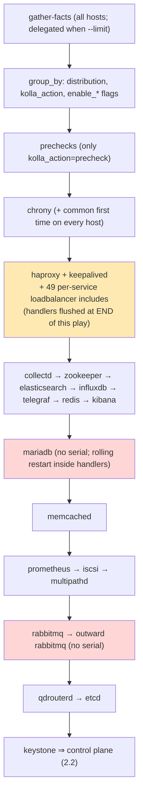
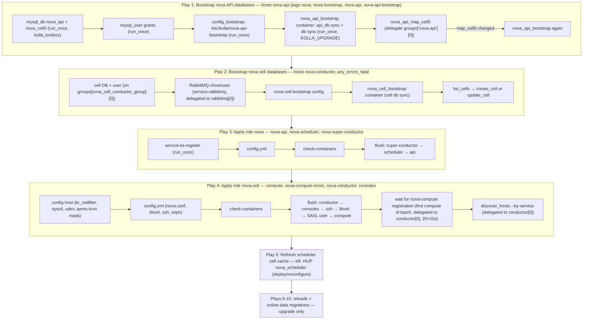
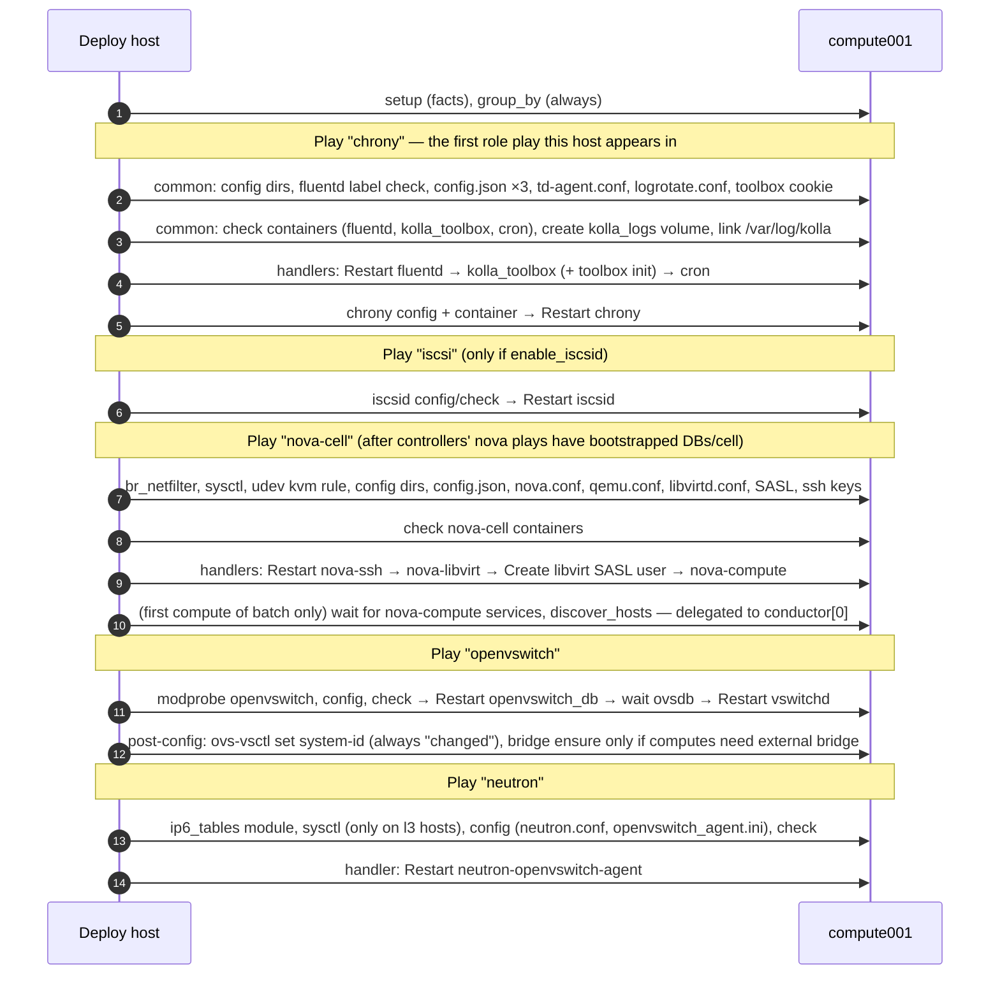
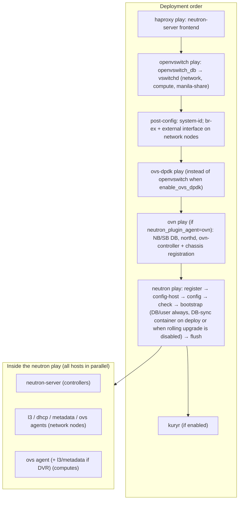

# Deployment execution flow

How Kolla-Ansible Ussuri decides *what runs when*: play order, the steps inside each role, handler flush points,
batching, and how `deploy`, `reconfigure`, `upgrade`, `deploy-containers`, `genconfig`, `pull` and `stop` differ.

> [!NOTE]
> **Key answers**
>
> - **There is no dependency resolution.** Order comes from five mechanisms only: play order, the `common` meta
>   dependency, task order inside a role, handler flush points and `serial` [CODE] ([§1](#1-how-the-order-is-decided)).
> - **What each action does** (`deploy`, `reconfigure`, `upgrade`, `deploy-containers`, `genconfig`, `pull`, `stop`,
>   `precheck`, `check`): the action matrix ([§4](#4-action-matrix-what-each-kolla_action-does)). `genconfig`, then
>   `deploy-containers --limit <batch>`, is the only built-in way to separate "write the config" from "apply it"
>   ([§4](#4-action-matrix-what-each-kolla_action-does)).
> - **Batching:** a batch runs the complete play, handler restarts included, before the next batch starts, but each play
>   is still traversed batch by batch for the whole fleet before the next play starts. mariadb and rabbitmq always run
>   all hosts in one batch ([§5](#5-batching-serial-and-its-interaction-with-order)).
> - **`reconfigure` on a running cloud still runs the DB sync containers** of keystone, glance, cinder, placement, nova,
>   heat and others [CODE]; Neutron's DB sync is skipped by default
>   ([§6](#6-initial-deployment-vs-reconfiguration-what-actually-differs)).
> - **What one compute host goes through in a full `deploy`**, in order
>   ([§2.4](#24-compute-node-deployment-what-one-compute-host-experiences)). On a fresh compute, `nova_compute` is
>   started before `openvswitch` and `neutron_openvswitch_agent` exist on that host.
> - **Restart order is handler definition order**, not notification order [CODE], and the handlers of a play run on all
>   notified hosts in parallel ([§7](#7-dependencies-introduced-by-handlers)).

> Deployment order (this page) ≠ runtime communication (see [Component
> dependencies](../components/dependencies.md)). Arrows in the diagrams below mean "runs before", unless a diagram
> explicitly says it shows runtime calls.

---

## 1. How the order is decided

There is **no dependency resolution** in Kolla-Ansible Ussuri. Order comes from five mechanisms only [CODE]:

| Mechanism | Effect | Evidence |
|---|---|---|
| Play order in `site.yml` / `nova.yml` | Services are applied strictly in file order. Ansible's default `linear` strategy runs play N on all its hosts (per batch) before play N+1 | `ansible/site.yml`, generated list in [Generated inventory §1](../reference/generated-inventory.md#1-plays-executed-by-siteyml-in-order) |
| Role meta dependency on `common` | `common` runs *before* the first role a host meets | `roles/*/meta/main.yml`, `roles/common/tasks/main.yml:1-10` |
| Task order inside a role | Fixed sequence: register → config(-host) → check-containers → bootstrap → flush handlers ([§3](#3-inside-a-role-the-standard-deploy-sequence)) | `roles/*/tasks/deploy.yml` |
| Handler flush points | Restarts happen at `meta: flush_handlers` (end of most `deploy.yml`) or at the end of the play. haproxy deliberately defers to the end of its play | e.g. `roles/nova/tasks/deploy.yml:8-9`; haproxy `deploy.yml:8-11` |
| `serial` / `kolla_serial` | Splits a play into batches; each batch completes the whole play, handlers included, before the next starts | `serial: '{{ kolla_serial\|default("0") }}'` on every service play except mariadb, rabbitmq and outward rabbitmq (no `serial` key) and cyborg, which reads `serial: '{{ serial\|default("0") }}'` (`site.yml:1028`), so `kolla_serial` never batches it. The group_by, CentOS-check and prechecks plays have no `serial` key either |

Conditions only *remove* work, never reorder it:

- `when: enable_<svc>` on the role;
- the host-pattern intersection `&enable_<svc>_True`;
- per-task `when:` on `kolla_action`;
- placement filters (`inventory_hostname in groups[...]` / `host_in_groups`).

---

## 2. The five diagrams

### 2.1 Infrastructure services (deployment order)

### 2.2 OpenStack control plane (deployment order)

```mermaid
flowchart LR
  KS["keystone"] --> KF["kafka → storm → karbor"] --> SW["swift"] --> GL["glance"] --> IR["ironic"] --> CI["cinder"] --> PL["placement"] --> NOVA["nova.yml (2.3)"]
  NOVA --> NET["openvswitch / ovs-dpdk → ovn → nova-hyperv → neutron → kuryr (2.5)"]
  NET --> HE["heat"] --> HO["horizon"] --> MISC["murano → solum → magnum → mistral → qinling → sahara → mongodb → panko"]
  MISC --> MA["manila"] --> TEL["gnocchi → ceilometer → monasca → aodh"] --> BA["barbican"] --> MORE["congress → cyborg → tempest → designate → rally → vmtp → trove → watcher → grafana → cloudkitty → freezer → senlin → searchlight → tacker"]
  MORE --> OC["octavia"] --> TAIL["zun → skydive → vitrage → blazar → masakari"]
```

Notable order facts [CODE]:

- **Keystone comes after MariaDB, RabbitMQ and memcached, but before any service that registers with it.**
  `service-ks-register` targets the admin endpoint through the VIP.
- **Placement, Glance and Cinder come before Nova.** Neutron comes *after* Nova (see [§2.5](#25-networking-components)).
- **Barbican comes after Nova, Cinder and Glance**, even though they can be configured to use it as a key manager.
  With `enable_barbican`, Nova and Cinder render a `[barbican]` section (`roles/nova/templates/nova.conf.j2:200-203`,
  `roles/nova-cell/templates/nova.conf.j2:234-237`, `roles/cinder/templates/cinder.conf.j2:198-201`), and their
  plays run before the barbican play (`site.yml:683,710,995`). On a first deploy they therefore start configured
  with a `[barbican]` section before Barbican exists. [NOT AVAILABLE] Whether this has any effect before encrypted
  volumes are used.
- **Octavia is near the end.** Its amphora resources (image, flavor, network, security group, keypair, certificates) are
  not created by Kolla in Ussuri; they are manual ([fact sheet
  D](../reference/factsheets/d-barbican-octavia-swift-manila-compute-roles.md)).

### 2.3 Nova deployment (`ansible/nova.yml`)

Details and Nova runtime dependencies: [Nova deep dive](../components/nova-deep-dive.md).

### 2.4 Compute node deployment (what one compute host experiences)

Sequence on one compute host during a full `deploy`, with the default enable flags and the `multinode` inventory
groups (`iscsi` only with `enable_iscsid`) [CODE: facts and `group_by` first (`site.yml:2,7-95`); play order
`site.yml:114-124,512-522,710-721,761-780`; task and
handler order in each role's `tasks/deploy.yml` and `handlers/main.yml`; `common` once per host,
`roles/common/tasks/main.yml:1-10`; discovery on the first compute of the batch only, delegated to the first
conductor, `roles/nova-cell/tasks/wait_discover_computes.yml:41-42,86-89` and `discover_computes.yml:20-21`]:

[NOT AVAILABLE] How many task results, skips and handlers a compute host or a controller produces in a full
`deploy`: that depends on the inventory, the enable flags and the `when:` conditions met at run time. The first
controller also runs the `run_once` and delegated bootstrap tasks (e.g. `roles/nova/tasks/map_cell0.yml:22-23`).

**Ordering consequence:** on a fresh compute, `nova_compute` is started (and its registration awaited) *before*
`openvswitch` and `neutron_openvswitch_agent` exist on that host. [NOT AVAILABLE] Whether instances can be scheduled
there successfully before the later plays finish ([Nova deep dive
§3](../components/nova-deep-dive.md#3-what-must-be-available-before-nova-can-operate) item 6). On a running cloud this
ordering matters when you add computes with `--limit` (see [Add a compute node
§2](../operations/add-a-compute-node.md#2-add-a-compute-node)).

### 2.5 Networking components

The neutron play deploys the server and *all* agents in a single play and a single handler flush. Agents are not
deployed after the server has been verified. [NOT AVAILABLE] Whether the RPC layer tolerates the agents starting
first.

---

## 3. Inside a role: the standard `deploy` sequence

Typical `deploy.yml` (Nova shown; Neutron adds `config-host`, and by default skips its DB-sync container on
reconfigure):

| Step | Typical task file | Scope | Runs on `reconfigure`? |
|---|---|---|---|
| 1. Keystone registration | `register.yml` → `service-ks-register` | `run_once` (per batch) via `kolla_toolbox` on the first host of the play | **yes** |
| 2. Host configuration | `config-host.yml` (sysctl, modules, udev) | per host | yes |
| 3. Config generation | `config.yml` (dirs, `config.json`, INI merges, policy, certs) | per host × per service × per file | yes |
| 4. Container check | `check-containers.yml` (`compare_container` + `kolla_set_configs --check`) | per host × per container | yes |
| 5. Bootstrap | `bootstrap.yml` (DB, user, grants) + `bootstrap_service.yml` (one-shot container: DB sync) | `run_once` / first host of the group | **yes** for most roles (Neutron: DB/user/grants yes. The `bootstrap_neutron` DB-sync container only when `neutron_enable_rolling_upgrade` is false, default `yes`, `roles/neutron/tasks/bootstrap_service.yml:21-22`) |
| 6. Flush handlers | `meta: flush_handlers` | notified hosts, in handler definition order | yes |
| 7. Post steps | e.g. openvswitch `post-config.yml`, nova-cell discovery | varies | yes |

Order caveats:

- **Some roles bootstrap *before* containers start, some after.** Nova bootstraps in separate plays before the service
  plays (`nova.yml:24-96`). Neutron runs its bootstrap *after* check-containers but *before* the flush
  (`roles/neutron/tasks/deploy.yml:11-21`). Keystone, Glance and Cinder vary (fact sheets
  [B](../reference/factsheets/b-mariadb-rabbitmq-keystone.md),
  [C](../reference/factsheets/c-glance-placement-cinder-horizon-heat.md)).
- **haproxy does not flush in `deploy.yml`.** The NOTE in `roles/haproxy/tasks/deploy.yml:8-11` explains that site.yml
  handles all haproxy changes in that play, so the restart happens once, after all per-service frontends are
  rendered.

---

## 4. Action matrix: what each `kolla_action` does

| Action (CLI) | Config written | Containers compared | Handlers (restarts) | Bootstrap / DB sync | Keystone registration | Images pulled | Notes |
|---|---|---|---|---|---|---|---|
| `deploy` | yes | yes | yes | yes | yes | only if absent | Full flow |
| `reconfigure` | yes | yes | yes | yes (most roles) | yes | only if absent | Identical to deploy in most roles ([Repository architecture §4.2](repository-architecture.md#42-reconfigure-is-deploy)). `kolla_serial` passed |
| `upgrade` | yes | yes | yes | yes: most roles re-run the deploy `KOLLA_BOOTSTRAP` one-shot with the new image (cinder, heat, barbican, octavia, manila, horizon, placement, legacy glance/neutron). Upgrade-only one-shots: keystone `KOLLA_UPGRADE` (expand + migrate) then `KOLLA_FINISH_UPGRADE` (contract); neutron rolling (default) `NEUTRON_DB_EXPAND`/`NEUTRON_DB_CONTRACT`; glance rolling (opt-in) `GLANCE_DB_EXPAND`/`MIGRATE`/`CONTRACT`; mariadb `mysql_upgrade`; `KOLLA_OSM` online migrations (nova, placement, cinder, rolling ironic). Nova `bootstrap_upgrade` re-runs its deploy db-sync container, minus DB creation and cell0 mapping ([Kolla images §4](kolla-images.md#4-one-shot-containers-what-the-environment-variables-run)) | yes (some roles) | only if absent → run `pull` first | Nova reload plays and the separate `KOLLA_OSM` online-migration containers are active only here. Placement's bootstrap container also runs `placement-manage db online_data_migrations` on every deploy/reconfigure (kolla `docker/placement/placement-api/extend_start.sh:5-9`); so does Ironic's with `ironic_enable_rolling_upgrade: no` |
| `deploy-containers` | **no** | yes (incl. drift of the files listed in `config_files`; not `command`/`permissions` changes inside `config.json`, see below) | yes | no | no | only if absent | `tasks/deploy-containers.yml` = `check-containers.yml`. haproxy includes skipped (`site.yml:392`) |
| `genconfig` (`config`) | yes | no | **all container restarts skipped** (`when: kolla_action != "config"`; only the deprecated nova-hyperv Windows-service handlers can actually run, since the other unguarded handlers are chained to guarded ones or never notified by genconfig, [Pre-execution checklist](../operations/pre-execution-checklist.md)) | no | no | no | Fluentd label check still pulls the fluentd image if missing (`roles/common/tasks/config.yml:26-37`) |
| `pull` | no | no | no | no | no | **yes**, every enabled container mapped to the host, plus `common` | `service-images-pull` |
| `stop` | no | no | no | no | no | no | `stop_container` for every enabled container on the host, honouring `skip_stop_containers` |
| `precheck` | no | no | no | no | no | no | `prechecks` role + each role's `precheck.yml` (port checks, group validation) |
| `check` | no | no | no | no | no | no | `check.yml` (mostly empty; sanity checks disabled by default) |

The combination **`genconfig` → (review the diff) → `deploy-containers --limit <batch>`** is the only built-in way to
separate "write the config" from "apply it", and to apply in controlled batches. It works because `compare_container`
detects drift in the files listed in each `config.json`'s `config_files` (content, mode, owner) through
`kolla_set_configs --check` [CODE `kolla_docker.py:543-578`, kolla `docker/base/set_configs.py:160-235,407-410`].

Changes confined to `config.json` itself (`command`, `permissions`; e.g. every memcached setting,
`roles/memcached/templates/memcached.json.j2:2-3`) are NOT detected. `deploy-containers` therefore does not apply them
after `genconfig`, and a later `deploy`/`reconfigure` does not either: the config tasks that notify the restart, the
`config.json` template task included (memcached's only one, `roles/memcached/tasks/config.yml:13-26`), are then
unchanged. Such changes take effect only at the next restart for another reason.

An `optional` file that newly appears, and whose destination does not exist in the container yet, makes the check exit 2
and the task fail, unless an entry listed before it already differs (then exit 1 and a restart that copies the file)
[CODE kolla `docker/base/set_configs.py:162-167,407-410,430-432`, `kolla_docker.py:575-578`]. See [Write config first,
apply in controlled batches
§2](../operations/controlled-batches.md#2-separate-write-config-from-apply-recommended-pattern) and [Kolla images
§3](kolla-images.md#3-kolla_set_configs---check-what-it-compares-and-its-exit-codes).

---

## 5. Batching (`serial`) and its interaction with order

```mermaid
gantt
  dateFormat X
  axisFormat %s
  title Play execution with kolla_serial=2 (illustrative, 4 computes)
  section nova-cell play
  batch 1 (compute001-002) config→check→flush→discover :a1, 0, 30s
  batch 2 (compute003-004) config→check→flush→discover :a2, after a1, 30s
  section openvswitch play
  batch 1 :b1, after a2, 15s
  batch 2 :b2, after b1, 15s
```

- **A batch runs the complete play before the next batch starts.** That includes handler restarts and the compute
  discovery. Batches therefore bound the number of simultaneous restarts *per play*, but **each play is still
  traversed batch by batch for the whole fleet before the next play starts**. The neutron agents on compute001 are
  restarted only after *all* computes have finished the nova-cell and openvswitch plays.
- **`run_once` tasks run once per batch** ([Tags §2.5](../risk/tags.md#25-run_once-with-serial-code)). Examples: DB
  sync, Keystone registration, compute discovery (`wait_discover_computes.yml` runs for `all_computes_in_batch[0]`).
- **mariadb and rabbitmq always run all hosts in one batch** (no `serial` key). Their handlers implement the rolling
  restart themselves ([fact sheet B](../reference/factsheets/b-mariadb-rabbitmq-keystone.md)). cyborg is not batched by
  `kolla_serial` either: its play reads `serial` instead.
- **How `kolla_serial` is set depends on the action.** For `reconfigure` and `upgrade` the wrapper sets it from
  `ANSIBLE_SERIAL` (`tools/kolla-ansible:430,439`), after your own `-e`, so use the environment variable. For `deploy`
  the wrapper does not set it: pass `-e kolla_serial=N` yourself.

---

## 6. Initial deployment vs reconfiguration: what actually differs

| Aspect | Initial `deploy` (empty hosts) | `reconfigure` on a running cloud |
|---|---|---|
| Containers | All `create+start`: the container check finds no container, and the restart handler then starts a new one [CODE `kolla_docker.py:326-332,781-791`]. Exception: on the bootstrap host (`groups['mariadb'][0]`), mariadb runs first as the one-shot `bootstrap_mariadb`, then its handlers start it with `--wsrep-new-cluster` and run `recreate_or_restart_container` on it (`roles/mariadb/tasks/bootstrap.yml:4-7`, `bootstrap_cluster.yml:2-23`, `roles/mariadb/handlers/main.yml:2-20,89-91`, `tasks/restart_services.yml:2-13`). [NOT AVAILABLE] Container counts, which depend on the inventory and the enable flags | Restart (config) or recreate (image or params) **only if** drift is detected; otherwise none [CODE `kolla_docker.py:326-332,781-803`] |
| One-shot containers | DB bootstrap for every service, MariaDB and RabbitMQ bootstrap, fernet key generation, cell creation | DB sync containers **still run** for keystone, glance, cinder, placement, nova (API and cell DB sync, plus map_cell0 and list_cells ×2), heat, plus barbican, octavia and others [CODE: in these roles `reconfigure.yml` imports `deploy.yml` and the bootstrap containers have no `kolla_action` guard, e.g. `roles/keystone/tasks/bootstrap_service.yml:32-49`; nova: `nova.yml:45-51,81-87`, `roles/nova/tasks/map_cell0.yml:2-23`, `list_cells` from `roles/nova-cell/tasks/create_cells.yml:2` and `discover_computes.yml:5`]. MariaDB/RabbitMQ bootstrap are not re-run |
| Handler order effects | Every handler fires | Only notified handlers fire, but loop-notify widens them to all containers of the role on that host ([Tags §2.4](../risk/tags.md#24-loop-notify-one-changed-item-notifies-the-handlers-of-all-items-code)) |
| Neutron DB sync (`bootstrap_neutron`) | runs | skipped by default (`neutron_enable_rolling_upgrade: yes`). The DB/user/grant tasks still run |
| Nova cell | `create_cell` | `update_cell` only if the transport URL or DB URL changed (`roles/nova-cell/tasks/create_cells.yml:31-55`) |
| Fernet keys | generated | **re-distributed** from the first running keystone_fernet node to the others ([fact sheet B §3.6](../reference/factsheets/b-mariadb-rabbitmq-keystone.md#36-fernet-key-lifecycle-fact-unless-marked), task flow in [§3.3](../reference/factsheets/b-mariadb-rabbitmq-keystone.md#33-task-flow-per-kolla_action)) |
| MariaDB | Galera bootstrap on the first host | cluster lookup; rolling restart waves if config changed |
| Duration drivers | image pulls, first container starts | per-task SSH overhead across all hosts, `compare_container` exec per container (see [Compute scaling](compute-scaling-and-performance.md)) |

---

## 7. Dependencies introduced by handlers

Handlers create ordering that is not visible in task files:

1. **Within a role, restart order = handler definition order, not notification order.**
   - nova-cell restarts `nova_ssh` → `nova_libvirt` (→ SASL user) → `nova_compute`
     (`roles/nova-cell/handlers/main.yml`).
   - openvswitch restarts `openvswitch_db` → waits → `openvswitch_vswitchd`.
   - [CODE] Ansible 2.9.27 runs the notified handlers in the order of the play's handler list
     (`lib/ansible/plugins/strategy/__init__.py:979-985`).
2. **Handlers of a play run on all notified hosts in parallel** (ansible 2.9.27
   `lib/ansible/plugins/strategy/__init__.py:1019-1035`). With `serial: 0`, every compute restarts `nova_compute`
   (and, through loop-notify, `nova_libvirt`) in the same step.
3. **Handler chains:**
   - Restart nova-libvirt → Create libvirt SASL user.
   - Restart openvswitch-db → Waiting for openvswitch_db.
   - Restart kolla-toolbox → Initializing toolbox.
   - Restart haproxy → Waiting for haproxy.
   - Restart keepalived → Waiting for virtual IP.
4. **Handlers can cross roles.** `haproxy-config` (called from every service's `loadbalancer.yml`) notifies the
   haproxy role's `Restart haproxy container`. This is why the haproxy play includes the haproxy role even for
   `-t <svc>`.
5. **The MariaDB restart is itself a sequence of handler-driven waves** (`index % 4`), with port and WSREP waits
   between waves ([fact sheet B §1.5][sheet-b-15]).

## Related

- [Component dependencies](../components/dependencies.md) (runtime dependencies)
- [Tags §2.5](../risk/tags.md#25-run_once-with-serial-code) (`run_once` with `serial`)
- [Nova deep dive](../components/nova-deep-dive.md) (the nova plays)
- [Write config first, apply in controlled batches
  §2](../operations/controlled-batches.md#2-separate-write-config-from-apply-recommended-pattern) (`genconfig` then
  `deploy-containers`)
- [Glossary](../reference/glossary.md) (glossary)

[sheet-b-15]: ../reference/factsheets/b-mariadb-rabbitmq-keystone.md#15-handlers-ansiblerolesmariadbhandlersmainyml-in-definition-order
