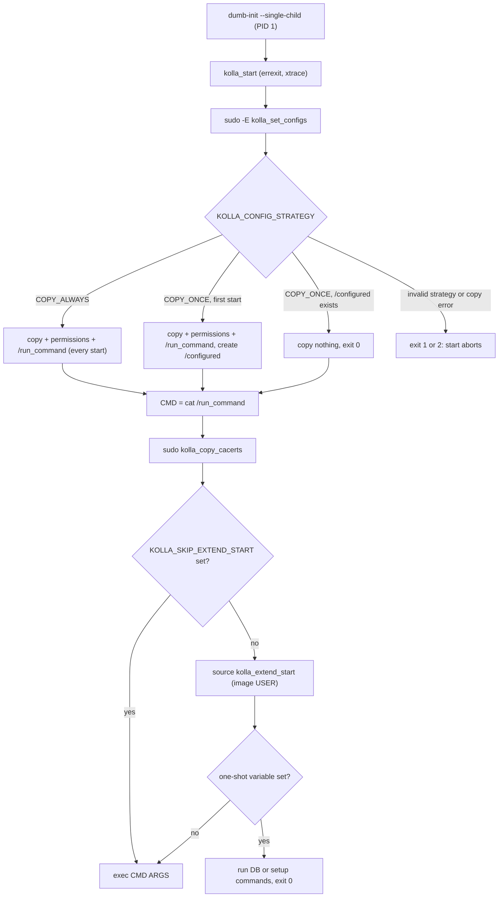

# Kolla images: start path and one-shot containers

This page answers open question [Q14](../troubleshooting/open-questions.md#q14) of the [Open
questions](../troubleshooting/open-questions.md): what the kolla images do when a container starts, and what the
one-shot containers that Kolla-Ansible starts with `KOLLA_BOOTSTRAP`, `KOLLA_UPGRADE`, `KOLLA_OSM` and similar variables
actually run. It was read from the kolla image repository (`openstack/kolla`, tag `ussuri-eol`, commit `9107c5f`) and
matched against Kolla-Ansible `ussuri-eol` (`8a94fe9`). The images were read, not built or run.

> [!NOTE]
> **Key answers**
>
> - **What every container start does:** `kolla_start` runs `kolla_set_configs`, `kolla_copy_cacerts` and the image's
>   `kolla_extend_start`, then execs the service command ([§2.2](#22-kolla_start-step-by-step)).
> - **`kolla_set_configs --check` compares only the `config_files` entries of `config.json`** (content, mode, owner)
>   [CODE] ([§3.1](#31-what-is-compared)). It never compares `command`, `permissions` or removed entries
>   ([§3.2](#32-what-is-never-compared)). Exit codes 0, 1, 2 and 137, and what `kolla_docker` does with each:
>   [§3.3](#33-exit-codes). Run by hand, it needs `docker exec -u root` ([§3.4](#34-running-it-by-hand-needs-root)).
> - **What a `COPY_ALWAYS` restart applies:** changed or added files, mode and owner changes and a changed command
>   [CODE]; removals do not apply ([§3.5](#35-what-a-restart-applies)).
> - **One-shot containers:** what `KOLLA_BOOTSTRAP`, `KOLLA_UPGRADE`, `KOLLA_OSM` and the other variables run in each
>   image, and which Kolla-Ansible task sets them ([§4](#4-one-shot-containers-what-the-environment-variables-run)).
> - **Per-image start behaviour:** the table in [§5](#5-per-image-start-behaviour). The nova-libvirt start path is
>   passive towards running guests ([§5.1](#51-nova-libvirt-the-start-path-is-passive)); with `enable_neutron_agent_ha`,
>   the L3 agent wrapper runs `neutron-netns-cleanup --force --agent-type l3` on every container start
>   ([§5.3](#53-neutron-l3-agent-the-wrapper)).
> - **Day-2 consequences:** 19 items ([§6](#6-day-2-consequences)). **What is not available from the sources:**
>   [§7](#7-what-is-not-available-from-the-sources).

Citation convention: kolla image paths carry a `kolla` prefix (kolla `docker/base/start.sh:8`). Kolla-Ansible paths have
no prefix and are relative to its `ansible/` directory (`roles/nova/tasks/bootstrap_service.yml:13`,
`library/kolla_docker.py:543-578`, `nova.yml:45-61`), except `tools/...`. Ansible source paths carry an `ansible 2.9.27`
prefix. Evidence labels are those of [Conventions and evidence labels](../start/conventions.md#evidence-labels):
[CODE] (a kolla or Ansible path counts as [CODE]) and [NOT AVAILABLE] (the sources do not establish it).

---

## 1. Scope and method

- **Read in full** [CODE]: kolla `docker/base` (`Dockerfile.j2`, `start.sh`, `set_configs.py`, `copy_cacerts.sh`,
  `httpd_setup.sh`, `sudoers`, `healthcheck_*`), and the `Dockerfile.j2` and start scripts of the images in
  [§5](#5-per-image-start-behaviour): Keystone, Glance, Placement, Cinder, Heat, Horizon, Barbican, Octavia, Manila,
  Swift, Nova, Neutron, Open vSwitch, OVN, MariaDB, RabbitMQ, memcached, HAProxy, keepalived (with `check_alive.sh`),
  fluentd, cron, kolla-toolbox, chrony, iscsid and tgtd. Of the other images only the `ironic-api` bootstrap branch
  ([§4](#4-one-shot-containers-what-the-environment-variables-run)) and the `bifrost-deploy` `ENTRYPOINT`/`CMD`
  ([§2.1](#21-image-wiring)) were read, and every Dockerfile was searched for `HEALTHCHECK`
  ([§2.7](#27-healthcheck-scripts)) and for `ENTRYPOINT`/`CMD` overrides. The rest were not.
- **Matched to Kolla-Ansible.** Each one-shot variable was traced to the task that sets it
  ([§4](#4-one-shot-containers-what-the-environment-variables-run)) [CODE].
- **`kolla_set_configs --check` was read, not run**: exit codes 0, 1 and 2 of [§3.3](#33-exit-codes) are read from kolla
  `docker/base/set_configs.py`; 137 and the exec client error are `kolla_docker` outcomes
  (`library/kolla_docker.py:543-578`).
- **Not covered**: behaviour against real services and data, signal delivery, timing. These are [NOT AVAILABLE] and
  are listed in [§7](#7-what-is-not-available-from-the-sources).

---

## 2. Start path common to every image

### 2.1 Image wiring

Every kolla image inherits from kolla `docker/base/Dockerfile.j2` [CODE]:

- `ENTRYPOINT ["dumb-init", "--single-child", "--"]` when `use_dumb_init` is on (`:433-435`; default True, kolla
  `kolla/common/config.py:170`), and `CMD ["kolla_start"]` (`:455`). The MariaDB image drops `--single-child`
  ([§2.6](#26-signals-and-pid-1)). bifrost-deploy resets both (`ENTRYPOINT []`, `CMD [ "/sbin/init" ]`, kolla
  `docker/bifrost/bifrost-deploy/Dockerfile.j2:29-30`), so `bifrost_deploy` never runs `kolla_start` or
  `kolla_set_configs`.
- The base scripts are installed as `kolla_start` (`start.sh`), `kolla_set_configs` (`set_configs.py`),
  `kolla_copy_cacerts` (`copy_cacerts.sh`) and `kolla_httpd_setup` (`httpd_setup.sh`); `sudoers` becomes
  `/etc/sudoers`, mode 0440 (`:427-431,448`).
- `/usr/local/bin/kolla_extend_start` is created empty by `touch` (`:446`). An image gets start logic only by
  overwriting it.
- `/var/log/kolla` gets group `kolla` and mode 2775 (`:449-451`).
- Service users are added to group `kolla` (kolla `docker/macros.j2:50`). The base `sudoers` lets members of that
  group run two commands as root without a password, keeping their environment: `kolla_set_configs` and
  `kolla_copy_cacerts` (kolla `docker/base/sudoers:7,16,19`). It also includes `/etc/sudoers.d` (`:21`), where many
  images add entries of their own, e.g. cinder-volume's `chown -R` and `chmod` (kolla
  `docker/cinder/cinder-volume/cinder_sudoers:2-5`) and mariadb's `kolla_security_reset` (kolla
  `docker/mariadb/mariadb/mariadb_sudoers:1`). The `kolla_set_configs` entry restricts no arguments, so
  `sudo kolla_set_configs --check` is allowed.
- Kolla-Ansible passes `KOLLA_CONFIG_STRATEGY` to every container through `docker_common_options`
  (`group_vars/all.yml:43,162-163`; default `COPY_ALWAYS`).

### 2.2 `kolla_start` step by step

1. `set -o errexit; set -o xtrace` (kolla `docker/base/start.sh:2-3`). Any failing command ends the container, including
   commands in the sourced `kolla_extend_start`. xtrace is on in that script, and in the `kolla_<service>_extend_start`
   it sources ([§2.5](#25-the-extend_start-chain)), where some one-shots put a secret on a command line: heat's
   `--password ${HEAT_DOMAIN_ADMIN_PASSWORD}` (kolla `docker/heat/heat-api/extend_start.sh:12`) and the MariaDB root
   password (kolla `docker/mariadb/mariadb/extend_start.sh:23-25`) [CODE]. [NOT AVAILABLE: bash semantics, not in these
   sources] Whether the trace on stderr shows those commands with their variables expanded, and so writes the secret
   there.

   `kolla_docker` returns the container's stderr in the task result (`library/kolla_docker.py:832-836,840-845,1070`).
   Ansible's default callback prints a failed result, `stderr` included, and an ok or changed one only with `-v`
   (ansible 2.9.27 `lib/ansible/plugins/callback/default.py:94-114,152-153`,
   `lib/ansible/plugins/callback/__init__.py:101-123`); a task with `no_log` reaches the callback with its result
   replaced by a `censored` message (ansible 2.9.27 `lib/ansible/executor/task_queue_manager.py:373`,
   `lib/ansible/executor/task_result.py:131-139`). `bootstrap_heat` and `bootstrap_mariadb` set no `no_log`
   (`roles/heat/tasks/bootstrap_service.yml:2-29`, `roles/mariadb/tasks/bootstrap_cluster.yml:2-23`), `upgrade_mariadb`
   does (`roles/mariadb/tasks/upgrade.yml:26`) [CODE].
2. `sudo -E kolla_set_configs` (`:8`) runs as root whatever the image `USER`, copies the configuration
   ([§2.3](#23-kolla_set_configs-copy-and-permissions)) and writes `config.json`'s `command` to `/run_command`.
3. `CMD=$(cat /run_command)` (`:9`).
4. `sudo kolla_copy_cacerts` (`:13`, [§2.4](#24-kolla_copy_cacerts-and-kolla_httpd_setup)), on every start whatever the
   strategy.
5. Unless `KOLLA_SKIP_EXTEND_START` is set, `. kolla_extend_start` (`:15-18`). The script is sourced: it runs in the
   same shell, as the image `USER`, with errexit on. It can set `ARGS` or `CMD`, or `exit`. An `exit 0` ends the
   container before the service starts, which is how every one-shot branch in
   [§4](#4-one-shot-containers-what-the-environment-variables-run) works. The test is `${!KOLLA_SKIP_EXTEND_START[@]}`,
   the idiom that kolla's own comments describe as catching "all cases of the ... variable being set, including empty"
   (kolla `docker/keystone/keystone/extend_start.sh:40-42`), so any value, even empty or `false`, skips the script and
   every one-shot branch with it [CODE]. Kolla-Ansible never sets this variable (grep of `ansible/`).
6. `exec ${CMD} ${ARGS}`, unquoted (`:20-21`). The service replaces the shell and becomes dumb-init's only child.

### 2.3 `kolla_set_configs`: copy and permissions

Without arguments, `kolla_set_configs` loads `config.json` (the `KOLLA_CONFIG` variable as a JSON string if set,
otherwise `KOLLA_CONFIG_FILE`, default `/var/lib/kolla/config_files/config.json`), validates it (`command` is
required; each `config_files` entry needs `source` and `dest`, plus `owner` and `perm` unless `preserve_properties`)
and applies the strategy (kolla `docker/base/set_configs.py:238-253,272-307,388-404`) [CODE]:

- `COPY_ALWAYS` (`:391-393`): copy and permissions on every start.
- `COPY_ONCE` (`:394-402`): on the first start, copy, permissions and `mknod /configured`. On any later start of the
  same container `ImmutableConfig` is raised with exit code 0: nothing is copied, permissions are not re-applied and
  `/run_command` keeps its first value. `kolla_start` continues normally.
- Unset or any other value: `InvalidConfig`, exit 1 (`:403-404`).

Copy, per `config_files` entry (`ConfigFile.copy`, `:131-158`):

- The source is a glob. A non-optional entry that matches nothing raises `MissingRequiredSource` (exit 1). An optional
  one is skipped silently (`:133-139`).
- A `dest` ending in `/` means `dest/<basename of source>` (`:145-146`).
- Unless `merge` is set, the destination is deleted first, a whole tree for a directory, then parent directories are
  created (`:147-149`). No Kolla-Ansible `config.json` template uses `merge` (grep of `roles/*/templates/*.json.j2`).
- Directory sources are copied recursively. Every directory and file gets the entry's `owner` and `perm` (so
  directories get the file mode), or the source's mode and owner with `preserve_properties` (`:85-99,115-129`).
- An `OSError` during the copy is logged and re-raised: exit 2 (`:150-158,430-432`).
- Finally `command` is written to `/run_command`, mode 0644 (`:319-329`).

Permissions, per `permissions` entry (`handle_permissions`, `:342-385`):

- `path` is a glob. A path that matches nothing is skipped without a warning (`:378`).
- `owner` is `user[:group]`, the group defaulting to the user (`:332-339`). An unknown user or group raises
  `KeyError`: exit 2 (`:349-351,430-432`).
- `chown` always, `chmod` only if `perm` is given. A failing chown or chmod is only logged (`:359-376`).
- With `recurse`, the same is applied to every directory and file below, one unconditional `os.chown` per entry
  (`:380-385`). Several manifests do this on data volumes ([§6](#6-day-2-consequences) item 10).

A failure here (missing required source, bad JSON, unknown user) aborts `kolla_start` through errexit. The default
restart policy is `unless-stopped` (`group_vars/all.yml:134`) [CODE]. [NOT AVAILABLE] Whether the container then
restarts in a loop until the input is fixed.

### 2.4 `kolla_copy_cacerts` and `kolla_httpd_setup`

- `kolla_copy_cacerts` deletes every `kolla-customca-*` file from the system trust store, copies each file of
  `/var/lib/kolla/config_files/ca-certificates/` back under that prefix, and runs `update-ca-certificates`
  (Debian/Ubuntu) or `update-ca-trust` (CentOS/RHEL) (kolla `docker/base/copy_cacerts.sh:7-27`) [CODE]. The update
  command runs only when that directory exists and is not empty (`:10-11`). [NOT AVAILABLE] Whether, once the last
  custom CA is removed, the generated trust bundle in the container layer keeps it until the container is recreated.
- `kolla_httpd_setup` acts only when the shell runs as root (`whoami`, kolla `docker/base/httpd_setup.sh:7`). It
  empties `/var/run/apache2/` (Debian/Ubuntu) or removes `/var/run/httpd/*`, `/run/httpd/*` and `/tmp/httpd*`, so a
  restarted httpd does not trip on stale run files. On CentOS it also creates `localhost.crt` if missing (`:10-26`).
  In images that run as a service user (nova-api, barbican-api, octavia-api, manila-api) it does nothing.

### 2.5 The extend_start chain

Most service families layer two scripts [CODE]. The service base image installs its `extend_start.sh` as
`kolla_extend_start`, creates an empty `/usr/local/bin/kolla_<service>_extend_start`, and its last line sources that
file (e.g. kolla `docker/cinder/cinder-base/Dockerfile.j2:73-79`, `docker/cinder/cinder-base/extend_start.sh:10`).
The API image overwrites `kolla_<service>_extend_start` with the one-shot branches. On those images
`kolla_extend_start` prepares the log directory (neutron-base also selects the iptables backend,
[§5](#5-per-image-start-behaviour)), and the DB commands are in `kolla_<service>_extend_start`. Keystone,
keystone-fernet, keystone-ssh, horizon, mariadb, rabbitmq, swift-rsyncd, keepalived, chrony, iscsid, fluentd, ovn-base,
nova-libvirt and nova-ssh put everything in `kolla_extend_start` instead.

### 2.6 Signals and PID 1

- PID 1 is `dumb-init --single-child`, and `kolla_start` execs the service, so the service is dumb-init's direct
  child (kolla `docker/base/Dockerfile.j2:434`, `docker/base/start.sh:21`) [CODE]. [NOT AVAILABLE: dumb-init
  semantics, not in these sources] Whether in this mode dumb-init forwards `docker stop`'s SIGTERM only to that child.
  A comment in the mariadb image describes the other mode: without `--single-child`, "the TERM signal is sent to all
  subprocesses" (kolla `docker/mariadb/mariadb/Dockerfile.j2:67-71`).
- MariaDB overrides the entrypoint to `dumb-init --` without `--single-child` (kolla
  `docker/mariadb/mariadb/Dockerfile.j2:65-76`) [CODE]. Its comment gives the reason: `mysqld_safe` ignores SIGTERM,
  and without `--single-child` TERM also reaches `mysqld` [CODE for the comment; NOT AVAILABLE: dumb-init and
  mysqld_safe semantics].
- Some Kolla-Ansible commands are shell wrappers that do not `exec` the service, so dumb-init's child is bash:
  `neutron-l3-agent-wrapper.sh` (`roles/neutron/templates/neutron-l3-agent-wrapper.sh.j2:14-18`), `start-ovs` and
  `start-ovsdb-server` (`roles/openvswitch/templates/start-ovs.j2:2`, `start-ovsdb-server.j2:11`) and `haproxy_run.sh`
  (`roles/haproxy/templates/haproxy_run.sh.j2:7-9`) [CODE]. [NOT AVAILABLE] Whether the service then gets any SIGTERM
  before the container stops. `kolla_docker` stops containers with the Docker client's `stop` and a 10 s timeout
  (`library/kolla_docker.py:871-884,892-904`, [Repository architecture
  §6](repository-architecture.md#6-custom-modules--container-lifecycle-via-kolla_docker)) [CODE].

### 2.7 Healthcheck scripts

The base image installs `healthcheck_curl` (`curl --fail`, 10 s maximum), `healthcheck_filemod`,
`healthcheck_listen`, `healthcheck_port` and `healthcheck_socket` when `docker_healthchecks` is on (kolla
`docker/base/Dockerfile.j2:437-444`; default True, kolla `kolla/common/config.py:253`). No kolla Dockerfile has a
`HEALTHCHECK` instruction, and nothing in Kolla-Ansible `ussuri-eol` configures a container healthcheck (grep of
`ansible/` for `healthcheck` hits only monasca and swift service settings) [CODE]. Ussuri containers therefore have no
Docker health status. The mariadb image's own `healthcheck_mariadb` exits 0 whether the node is synced or not (kolla
`docker/mariadb/mariadb/healthcheck_mariadb:10-17`).

---

## 3. `kolla_set_configs --check`: what it compares and its exit codes

`kolla_docker`'s `compare_container` runs `/usr/local/bin/kolla_set_configs --check` inside the running container with
`docker exec` as root, and its exit code decides config drift (`library/kolla_docker.py:244,326-332,543-578`;
[Repository architecture §4.3](repository-architecture.md#43-the-config--check--handler-pattern)). `--check` loads and
validates `config.json` like a normal start, then calls `ConfigFile.check` for each `config_files` entry (kolla
`docker/base/set_configs.py:407-426`).

### 3.1 What is compared

For each entry whose source glob matches something (`:213-235`) [CODE]:

- **File source** (`_cmp_file`, `:160-191`): destination missing on a non-optional entry (drift); byte-for-byte
  content; mode, as the last four octal digits of `st_mode` against the entry's `perm` string; owner user and group
  names.
- **Directory source** (`_cmp_dir`, `:193-211`): every file below, as above. For subdirectories the `relpath`
  arguments are reversed (`:197-198`), so the mode checked is that of the destination's parent against the file
  `perm`. A directory source that contains a subdirectory therefore reports drift on every run.
- **`preserve_properties` entries** carry no `perm` (`:60-65`), so the mode test always fails (`:175`) and they report
  drift on every run. Example: `prometheus_server`'s `extras/*` entry whenever extras exist
  (`roles/prometheus/templates/prometheus-server.json.j2:10-15`).

### 3.2 What is never compared

- `config.json`'s `command` and `permissions`: `--check` iterates only `config_files` (`:407-410`). A manifest with
  `"config_files": []`, like memcached's, whose settings are all in its command, always returns 0
  (`roles/memcached/templates/memcached.json.j2:2-3`).
- Entries removed from `config.json`, and optional entries whose source no longer exists (`:219-220`), even while
  their old destination is still in the container.
- Extra files in a destination directory, and the mode and owner of the destination directories themselves (for
  subdirectories `_cmp_dir` checks the mode of a directory above the destination instead, [§3.1](#31-what-is-compared)).
  A file destination's mode and owner are compared ([§3.1](#31-what-is-compared)).

### 3.3 Exit codes

| Exit code | Raised when | What `kolla_docker` does | Day-2 meaning |
|---|---|---|---|
| 0 | Every listed entry matches. Also a manifest with empty `config_files`, and any difference confined to `command`, `permissions`, removed entries or optional entries without a source | no drift (`kolla_docker.py:566-567`) | "No drift" covers the listed files only. A `config.json`-only change written by `genconfig` makes neither `deploy-containers` nor a later run restart the container ([§6](#6-day-2-consequences) item 1) |
| 1 | `ConfigFileBadState`: a listed file differs in content, mode or owner, or a non-optional destination is missing. Also `MissingRequiredSource` (a non-optional source matches nothing, `set_configs.py:217-218`) and `InvalidConfig` (bad JSON, no `command`, an entry without `owner`/`perm`; `:238-253,282,295`) | drift: the handler restarts the container (`kolla_docker.py:568-569`) | Usually real drift. For a missing source or an invalid `config.json` the restarted container then fails in `kolla_set_configs` at every start (errexit; whether it then restarts in a loop is [NOT AVAILABLE], [§2.3](#23-kolla_set_configs-copy-and-permissions)). `preserve_properties` entries and directory sources with subdirectories return 1 on every run |
| 2 | Any other exception (`set_configs.py:430-432`): an optional entry whose source exists but whose destination is not in the container yet (`open()` raises at `:167`); a `config.json` that cannot be opened (`:291`, e.g. run as a service user); a uid or gid with no passwd or group entry | raises: the check task fails on that host (`kolla_docker.py:575-578,1071-1073`) | Real drift reported as an error, e.g. a newly rendered nova-compute `release` file (`roles/nova-cell/templates/nova-compute.json.j2:52-57`). The run fails instead of restarting the container. Entries are checked in order and the first difference ends the check (`set_configs.py:407-410,427-429`), so if an entry listed before the optional one differs, the result is 1 and the restart also copies the new file |
| 137 | the exec was killed because the container exited | drift (`kolla_docker.py:570-574`) | the container is unstable; Kolla restarts it |
| none | `docker exec` fails with a client error (container stopped or restarting) | drift (`kolla_docker.py:552-558`) | a stopped container is restarted by the next run |

Read from `main` (kolla `docker/base/set_configs.py:413-433`) [CODE]: rc 0 for a match, for empty `config_files`
with a changed `command` (`:407-410`), for an optional entry without a source (`:219-220`), and for a flat directory
with an extra file in the destination (`_cmp_dir` walks the source only, `:193-211`); rc 1 for a content, mode or
missing required destination difference (`:162-178`), a missing required source (`:217-218`), a
`preserve_properties` entry (`:175`), a directory with a subdirectory (`:197-198`), a missing `command` (`:241-242`)
and bad JSON (`:294-296`); rc 2 for a new optional file (`:167`) and a missing `config.json` (`:291`).

### 3.4 Running it by hand needs root

Kolla-Ansible writes the files in `/etc/kolla/<service>/` with mode 0660 into directories with mode 0770, owned by
`config_owner_user` `root` (`group_vars/all.yml:20-21`; e.g. `roles/nova/tasks/config.yml:2-9`,
`roles/keystone/tasks/config.yml:45-50`), and mounts them read-only (e.g. `roles/nova-cell/defaults/main.yml:284`).
In an image with a service `USER` (e.g. `USER nova`, kolla `docker/nova/nova-compute/Dockerfile.j2:196`) a plain
`docker exec <c> kolla_set_configs --check` cannot open them and exits 2. `kolla_docker` execs as root
(`library/kolla_docker.py:545-549`). By hand, use `docker exec -u root` as the swift reconfigure does
(`roles/swift/tasks/reconfigure.yml:47`), or `sudo kolla_set_configs --check` inside the container
([§2.1](#21-image-wiring)). The bifrost reconfigure omits `-u root` (`roles/bifrost/tasks/reconfigure.yml:17`), but its
check cannot work anyway: it execs into `bifrost-deploy`, while the container is `bifrost_deploy`
(`roles/bifrost/tasks/start.yml:8`), which runs `/sbin/init` and mounts no `config.json` ([§2.1](#21-image-wiring)). No
`kolla-ansible` command runs that file.

### 3.5 What a restart applies

- A `COPY_ALWAYS` restart (stop and start of the same container, `library/kolla_docker.py:892-904`) re-copies the
  listed entries and rewrites `/run_command`. Changed or added files, mode and owner changes and a changed command
  apply [CODE]. Stale files inside a listed directory destination go too, because the destination is deleted first.
- Removals do not apply. The destinations of entries dropped from `config.json`, and of optional sources that are
  gone, are never deleted (kolla `docker/base/set_configs.py:135-148,310-315`). They stay in the container's writable
  layer until the container is recreated; a destination on a volume survives recreates as well, e.g.
  nova-compute's SASL `auth.conf` (`roles/nova-cell/templates/nova-compute.json.j2:58-64`), left behind when
  `libvirt_enable_sasl` is turned off, is under `/var/lib/nova`, by default the `nova_compute` volume
  (`roles/nova-cell/defaults/main.yml:293`, `group_vars/all.yml:967`). `--check` does not flag them [CODE].
  [NOT AVAILABLE] Whether Keystone still reads a removed policy file (`roles/keystone/templates/keystone.json.j2:30-36`)
  after the restart.
- CA certificates are purged and re-added on every start ([§2.4](#24-kolla_copy_cacerts-and-kolla_httpd_setup)), from
  `/etc/kolla/<svc>/ca-certificates/`. A CA deleted from `kolla_certificates_dir/ca/`, or left there after
  `kolla_copy_ca_into_containers` is turned off, stays in that directory, because the `copy` task never deletes files
  (`roles/service-cert-copy/tasks/main.yml:2-12`; the copy action only walks the source tree, ansible 2.9.27
  `lib/ansible/plugins/action/copy.py:485-582`) [CODE], so it is re-added at every start until it is deleted there by
  hand. [NOT AVAILABLE] Whether, once the last custom CA is removed there, the generated trust bundle keeps it
  ([§2.4](#24-kolla_copy_cacerts-and-kolla_httpd_setup)).
- `COPY_ONCE`: `/configured` lives in the container layer, so only a recreate re-applies config. `kolla_docker`
  always recreates under `COPY_ONCE` (`library/kolla_docker.py:793-801`).

---

## 4. One-shot containers: what the environment variables run

Kolla-Ansible starts one-shot containers with `kolla_docker` `start_container`, `detach: False`,
`restart_policy: no`, a label such as `BOOTSTRAP` or `UPGRADE`, and a variable that selects a branch of the image's
start script. The variables are sent with an empty value (`library/kolla_docker.py:758-760`) and every branch tests
only whether they are set (`${!VAR[@]}`). The one-shot runs the whole of `kolla_start` first: `kolla_set_configs`
with the config directory mounted into it, `kolla_copy_cacerts`, then the branch, which ends in `exit 0` before the
service command ([§2.2](#22-kolla_start-step-by-step)) [CODE]. That directory is the service's own, except for Nova: its
one-shots mount a dedicated `nova-api-bootstrap` or `nova-cell-bootstrap` directory whose `command` is `"false"`
(`roles/nova/defaults/main.yml:116-117`, `roles/nova-cell/defaults/main.yml:303-304`).

| Image | `KOLLA_BOOTSTRAP` | `KOLLA_UPGRADE` / other one-shot variables | Set by Kolla-Ansible (task, action) | Day-2 note |
|---|---|---|---|---|
| keystone | `keystone-manage db_sync`, as user keystone (kolla `docker/keystone/keystone/extend_start.sh:43-46`) | `KOLLA_UPGRADE`: `db_sync --expand`, then `--migrate` (`:24-31`). `KOLLA_FINISH_UPGRADE`: `db_sync --contract` (`:36-39`) | `bootstrap_keystone`, deploy/reconfigure, run_once (`roles/keystone/tasks/bootstrap_service.yml:32-49`). Handlers `init_upgrade_database` and `finish_upgrade_database`, upgrade only (`roles/keystone/handlers/main.yml:5-27,74-95`) | Schema sync on every deploy/reconfigure. `EXTRA_KEYSTONE_MANAGE_ARGS` (`:21`) is never set by Kolla-Ansible |
| glance-api | `glance-manage db_sync`, then `db_load_metadefs` (kolla `docker/glance/glance-api/extend_start.sh:5-9`) | `KOLLA_UPGRADE` with `GLANCE_DB_EXPAND`, `GLANCE_DB_MIGRATE` or `GLANCE_DB_CONTRACT`: `glance-manage db expand`, `migrate` or `contract` (`:13-27`) | `bootstrap_glance`, deploy/reconfigure and legacy upgrade (`roles/glance/tasks/bootstrap_service.yml:18-36`, `legacy_upgrade.yml:6`). Rolling containers only with `glance_enable_rolling_upgrade` (default `no`, `group_vars/all.yml:868`; `rolling_upgrade.yml:29-101`) | `glance-manage db_load_metadefs` runs on every deploy/reconfigure; whether, without `--merge`, it only adds namespaces not yet in the DB is [NOT AVAILABLE] |
| placement-api | `placement-manage db sync`, then `db online_data_migrations` (kolla `docker/placement/placement-api/extend_start.sh:5-9`) | `KOLLA_UPGRADE`: `db sync` only (`:11-15`), never used. `KOLLA_OSM`: `db online_data_migrations` (`:17-21`) | `bootstrap_placement`, deploy/reconfigure and upgrade (`roles/placement/tasks/bootstrap_service.yml:2-20`, `deploy.yml:11`, `reconfigure.yml:2`, `upgrade.yml:11`). `KOLLA_OSM` after the restart, upgrade only (`upgrade.yml:16-34`) | Online data migrations on every deploy/reconfigure, and twice on upgrade |
| cinder-api | `cinder-manage db sync` (kolla `docker/cinder/cinder-api/extend_start.sh:6-9`) | No `KOLLA_UPGRADE`. `KOLLA_OSM`: `db online_data_migrations`, with `--max_count` only if `MAX_NUMBER` is set (`:11-18`) | `bootstrap_cinder`, deploy/reconfigure and upgrade (`roles/cinder/tasks/bootstrap_service.yml:2-20`, `upgrade.yml:7`). `KOLLA_OSM` without `MAX_NUMBER`, so unbounded, upgrade only (`upgrade.yml:16-34`) | A tag change applied by deploy/reconfigure syncs the schema without the online migrations |
| heat-api | `heat-manage db_sync`, then, only if `heat_user_domain` is absent, creates that domain, user `heat_domain_admin` (password `HEAT_DOMAIN_ADMIN_PASSWORD`) and its `admin` role (kolla `docker/heat/heat-api/extend_start.sh:5-17`) | none; upgrade re-runs the bootstrap | `bootstrap_heat` with admin `OS_*` credentials, deploy/reconfigure and upgrade (`roles/heat/tasks/bootstrap_service.yml:10-21`, `upgrade.yml:6`) | Needs a reachable Keystone. A changed `heat_domain_admin_password` never reaches Keystone ([§6](#6-day-2-consequences) item 7) |
| horizon | `manage.py migrate --noinput`, after the settings symlinks (kolla `docker/horizon/extend_start.sh:24-49`) | none; `FORCE_GENERATE` is a start-time switch ([§5.2](#52-horizon-static-assets)) | `bootstrap_horizon` only when `horizon_backend_database` (= `enable_murano`, `group_vars/all.yml:982`; `roles/horizon/tasks/deploy.yml:10-11`, `upgrade.yml:10-11`) | Usually never runs |
| barbican-api | `barbican-db-manage upgrade` (kolla `docker/barbican/barbican-api/extend_start.sh:5-8`) | none | `bootstrap_barbican`, deploy/reconfigure and upgrade (`roles/barbican/tasks/bootstrap_service.yml:2-20`, `upgrade.yml:6`) | Schema upgrade on every deploy/reconfigure |
| octavia-api | `octavia-db-manage upgrade head` (kolla `docker/octavia/octavia-api/extend_start.sh:5-8`) | none | `bootstrap_octavia`, deploy/reconfigure and upgrade (`roles/octavia/tasks/bootstrap_service.yml:2-20`, `upgrade.yml:6`) | Schema upgrade on every deploy/reconfigure |
| manila-api | `manila-manage db sync` (kolla `docker/manila/manila-api/extend_start.sh:6-9`) | none | `bootstrap_manila`, deploy/reconfigure and upgrade (`roles/manila/tasks/bootstrap_service.yml:2-20`, `upgrade.yml:6`) | Schema sync on every deploy/reconfigure |
| nova-api | `nova-manage api_db sync`, `db sync`, `db online_data_migrations` (kolla `docker/nova/nova-api/extend_start.sh:9-14`). Unreachable: Kolla-Ansible never sets it for Nova | `KOLLA_UPGRADE`: `api_db sync`, `db sync` (`:16-20`). `KOLLA_OSM`: `db online_data_migrations` (`:22-25`) | `nova_api_bootstrap` with `KOLLA_UPGRADE`, run_once, deploy/reconfigure and upgrade (`roles/nova/tasks/bootstrap_service.yml:4-23`, `nova.yml:45-61`), again when `map_cell0` reports a change (`roles/nova/tasks/map_cell0.yml:25-26`). `KOLLA_OSM`, upgrade only (`nova.yml:230-247`) | `db sync` targets cell0: the bootstrap `nova.conf` has `[database]` = cell0 (`roles/nova/templates/nova.conf.j2:97-98`). The bootstrap command is `"false"` (`nova-api-bootstrap.json.j2:2`), so success relies on the `exit 0` |
| nova-conductor | `nova-manage db sync --local_cell`, `db online_data_migrations` (kolla `docker/nova/nova-conductor/extend_start.sh:3-7`). Unreachable | `KOLLA_UPGRADE`: `db sync --local_cell` (`:9-12`). `KOLLA_OSM`: `db online_data_migrations` (`:14-17`) | `nova_cell_bootstrap` with `KOLLA_UPGRADE` on the first conductor, deploy/reconfigure and upgrade (`roles/nova-cell/tasks/bootstrap_service.yml:2-21`, `nova.yml:81-96`). `KOLLA_OSM`, upgrade only (`nova.yml:253-272`) | The same image runs `nova_super_conductor` (`roles/nova/defaults/main.yml:80`) |
| neutron-server | `neutron-db-manage` with `neutron.conf` and `ml2_conf.ini`, `upgrade head` for neutron, neutron-dynamic-routing, neutron-fwaas and neutron-vpnaas, whether or not they are enabled (kolla `docker/neutron/neutron-server/extend_start.sh:5-12`) | `NEUTRON_SFC_BOOTSTRAP`: networking-sfc `upgrade head` (`:17-20`). `KOLLA_UPGRADE` with `NEUTRON_DB_EXPAND` or `NEUTRON_DB_CONTRACT`: `upgrade --expand` or `--contract` for each `NEUTRON_ROLLING_UPGRADE_SERVICES` entry, without `--config-file` (`:24-40`) | `bootstrap_neutron` on deploy, or on any action when `neutron_enable_rolling_upgrade` is off (default on) (`roles/neutron/tasks/bootstrap_service.yml:2-22`, `roles/neutron/defaults/main.yml:411`). `bootstrap_neutron_sfc` whenever `enable_neutron_sfc` (`:24-46`). Expand and contract containers in `rolling_upgrade.yml:13-33,69-89` | `upgrade` never migrates neutron-dynamic-routing ([§6](#6-day-2-consequences) item 8) |
| mariadb | `mysql_install_db`, a temporary `mysqld_safe --wsrep-new-cluster --skip-networking --wsrep-on=OFF`, `kolla_security_reset` (root password), grants to `root@localhost` and `root@'%'`, shutdown (kolla `docker/mariadb/mariadb/extend_start.sh:5-26,37-41`) | `KOLLA_UPGRADE`: removes `/var/lib/mysql/.pki`, runs `mysql_upgrade` over TCP against the running local server (`:44-54`). `BOOTSTRAP_ARGS`: appended to `mysqld_safe` on any start (`:56-58`) | `bootstrap_mariadb` when a new cluster is bootstrapped (`roles/mariadb/tasks/bootstrap_cluster.yml:2-23`), then a handler starts `mariadb` with `BOOTSTRAP_ARGS=--wsrep-new-cluster` (`handlers/main.yml:2-20`). `upgrade_mariadb` on every host on upgrade (`tasks/upgrade.yml:4-26`). `--wsrep-recover` and `--wsrep-new-cluster` in `mariadb_recovery` (`recover_cluster.yml:41,122`) | The image forms no cluster itself and has no Galera recovery logic ([§5.4](#54-mariadb-what-the-image-does-not-do)) |
| rabbitmq | writes `RABBITMQ_CLUSTER_COOKIE` to `/var/lib/rabbitmq/.erlang.cookie`, mode 400; nothing else: no `rabbitmqctl`, no join, no users (kolla `docker/rabbitmq/extend_start.sh:7-18`) | none | `<project_name>_bootstrap`, only when the volume was just created on that host (`roles/rabbitmq/tasks/bootstrap.yml:10-26`) | A normal start never rewrites the cookie ([§6](#6-day-2-consequences) item 9) |

No one-shot branch exists in: keystone-fernet, keystone-ssh, cinder-volume, cinder-scheduler, cinder-backup,
heat-api-cfn, heat-engine, the barbican, octavia and manila worker images, all swift images, nova-scheduler,
nova-compute, nova-compute-ironic, nova-libvirt, nova-ssh, the Nova console proxies, every neutron agent,
openvswitch, ovn, mariadb-clustercheck, memcached, haproxy, keepalived, fluentd, cron, kolla-toolbox, chrony, iscsid
and tgtd [CODE]. The only DB step in the OVS and OVN images is at start ([§5](#5-per-image-start-behaviour)).

Note on ironic (only this branch was read): `ironic-api`'s `KOLLA_BOOTSTRAP` runs `ironic-dbsync upgrade` and
`online_data_migrations`, `KOLLA_UPGRADE` only `upgrade`, `KOLLA_OSM` only `online_data_migrations` (kolla
`docker/ironic/ironic-api/extend_start.sh:5-19`). `bootstrap_ironic` sends `KOLLA_UPGRADE` unless
`ironic_enable_rolling_upgrade` (default `yes`) is turned off (`roles/ironic/tasks/bootstrap_service.yml:2-25`,
`roles/ironic/defaults/main.yml:206`).

### 4.1 One-shots that bypass `kolla_start`

A few one-shots replace the container command with `bash -c 'sudo -E kolla_set_configs && ...'` [CODE]. The config
is copied, but `kolla_copy_cacerts` and `kolla_extend_start` do not run, and the `config.json` `command` is written to
`/run_command` but never executed. Custom CA certificates are therefore not installed in these containers.

| Container | Image | What runs after `kolla_set_configs` | Kolla-Ansible task |
|---|---|---|---|
| `bootstrap_keystone_fernet` | keystone-fernet | `keystone-manage fernet_setup` | `roles/keystone/tasks/bootstrap_service.yml:51-75` |
| `nova_api_map_cell0` | nova-api | `nova-manage cell_v2 map_cell0` | `roles/nova/tasks/map_cell0.yml:2-23` |
| `nova_list_cells`, cell create and update | nova-conductor | `nova-manage cell_v2 list_cells`, `create_cell`, `update_cell` | `roles/nova-cell/tasks/get_cell_settings.yml:8`, `create_cells.yml:12,38` |
| `mariabackup` | mariadb | `/usr/local/bin/kolla_mariadb_backup.sh` ([§5](#5-per-image-start-behaviour)) | `roles/mariadb/tasks/backup.yml:1-22` |

The keystone-fernet image ships its own `kolla_keystone_bootstrap`, a `fernet_setup` wrapper, which Kolla-Ansible does
not use. Its changed detection is inverted: it reports `changed` when "Key repository is already initialized"
appears (kolla `docker/keystone/keystone-fernet/keystone_bootstrap.sh:35-41`). In this pairing that is dead code.
`discover_hosts` is a `docker exec` into the running `nova_conductor`, not a one-shot
(`roles/nova-cell/tasks/discover_computes.yml:14-18`).

---

## 5. Per-image start behaviour

"Runs as" is the image `USER`; root when the image and its parents set none. Every row starts with the common path of
[§2](#2-start-path-common-to-every-image). "Log dir" means: create `/var/log/kolla/<service>` if missing and set
mode 755.

| Image | Runs as | What its start script does on every start | Day-2 note |
|---|---|---|---|
| base, openstack-base | root | Nothing: empty `kolla_extend_start` (kolla `docker/base/Dockerfile.j2:446`) | No `USER` in base, openstack-base or nova-base |
| keystone | root | Log dir and `keystone.log` with owners fixed, `kolla_httpd_setup`, `ARGS=-DFOREGROUND` (kolla `docker/keystone/keystone/extend_start.sh:3-19,48-50`). The command `keystone-startup.sh` waits up to 36 × 5 s for fernet key 0, then execs httpd (`roles/keystone/templates/keystone-startup.sh.j2:9-24`) | Stale httpd run files are removed, so a restart is safe |
| keystone-fernet | root | Runs `/usr/bin/fernet-node-sync.sh` if present, then chowns the key directory (kolla `docker/keystone/keystone-fernet/extend_start.sh:6-12`). Kolla-Ansible installs that script; it waits up to 10 × 60 s for key 0, then exits 1 (`roles/keystone/templates/fernet-node-sync.sh.j2:6-19`) | Without key 0 on the node the start waits up to 10 × 60 s and the script exits 1 before the cron command is exec'd ([§2.2](#22-kolla_start-step-by-step)), so no rotation cron runs there meanwhile [CODE]; whether the container then restarts is [NOT AVAILABLE] |
| keystone-ssh | root | Generates any missing SSH host key (rsa, dsa, ecdsa, ed25519); creates `/var/lib/keystone/.ssh` (kolla `docker/keystone/keystone-ssh/extend_start.sh:3-16`) | `/etc/ssh` is on no volume (`roles/keystone/defaults/main.yml:37-42`): new host keys on every recreate ([§6](#6-day-2-consequences) item 18) |
| glance-api | glance | Log dir (kolla `docker/glance/glance-base/extend_start.sh:3-8`); no httpd step. `kolla_set_configs` recursively chowns `/var/lib/glance` and `/var/log/kolla/glance` (`roles/glance/templates/glance-api.json.j2:41-52`) | With the file backend `/var/lib/glance` is the image store: one chown per file on every start ([§6](#6-day-2-consequences) item 10) |
| placement-api | root | Log dir and `placement-api.log`; `chown -R` only if the top-level owner differs (kolla `docker/placement/placement-base/extend_start.sh:3-13`); `kolla_httpd_setup` (`placement-api/extend_start.sh:23`) | – |
| cinder-api | root | Log dir (kolla `docker/cinder/cinder-base/extend_start.sh:3-8`); `kolla_httpd_setup` (`cinder-api/extend_start.sh:20`) | – |
| cinder-volume | cinder | Log dir; `sudo chown -R cinder:kolla` of `/var/lib/cinder` and `/etc/iscsi` only if the top-level owner differs, `chmod 2775` if needed (kolla `docker/cinder/cinder-volume/extend_start.sh:3-14`) | Not only on a fresh volume: `kolla_set_configs` first chowns `/var/lib/cinder` recursively to `cinder:cinder` (`roles/cinder/templates/cinder-volume.json.j2:38-43`), so the `cinder:kolla` test always fails and `chown -R` walks the `cinder` volume a second time on every start |
| cinder-scheduler, cinder-backup | cinder | Log dir only (empty `kolla_cinder_extend_start`, kolla `docker/cinder/cinder-base/Dockerfile.j2:78`) | – |
| heat-api, heat-api-cfn, heat-engine | root (APIs), heat (engine) | Log dir (kolla `docker/heat/heat-base/extend_start.sh:3-8`); the two API images run `kolla_httpd_setup` (`heat-api/extend_start.sh:19`, `heat-api-cfn/extend_start.sh:3`) | – |
| horizon | root | Settings symlinks, plugin files from `ENABLE_*`, conditional static-asset regeneration, log dir, `kolla_httpd_setup` (kolla `docker/horizon/extend_start.sh:24-42,51-388`; [§5.2](#52-horizon-static-assets)) | Assets are regenerated after a recreate or a settings change ([§5.2](#52-horizon-static-assets)); how long that start takes is [NOT AVAILABLE] |
| barbican, octavia and manila images | barbican, octavia, manila (API images) | Log dir (barbican also chowns it, kolla `docker/barbican/barbican-base/extend_start.sh:4-13`). The API images call `kolla_httpd_setup`, a no-op as a service user (`barbican-api/Dockerfile.j2:48`, `octavia-api/Dockerfile.j2:78`, `manila-api/Dockerfile.j2:71`) | Worker images do the log-dir step only |
| swift-rsyncd | swift | `sudo find /srv/node/ -maxdepth 1 -type d -execdir chown swift:swift {} +` (not recursive) and `mkdir -p /var/lib/swift/lock` (kolla `docker/swift/swift-rsyncd/extend_start.sh:3-4`) | Only rsyncd fixes the ownership of the disk mount points |
| swift account, container, object, object-expirer, proxy-server | swift | Nothing of their own | Config and rings are copied only at container start, and the swift role notifies no handler ([fact sheet D](../reference/factsheets/d-barbican-octavia-swift-manila-compute-roles.md)) |
| nova-base | – | Log dir, then sources `kolla_nova_extend_start` (kolla `docker/nova/nova-base/extend_start.sh:3-10`) | Parent of every nova image except nova-libvirt |
| nova-api | nova | nova-base step; `kolla_httpd_setup` (kolla `docker/nova/nova-api/extend_start.sh:27`), a no-op as `nova` (`Dockerfile.j2:71`) | No DB action on a normal start |
| nova-conductor, nova-scheduler | nova | nova-base step only | Also `nova_super_conductor`. The scheduler `SIGHUP` comes from Kolla-Ansible (`nova.yml:140-156`) |
| nova-compute | nova | `kolla_set_configs` recursively chowns `/var/log/kolla/nova` and `/var/lib/nova` (`roles/nova-cell/templates/nova-compute.json.j2:66-77`); nova-base step; `mkdir -p /var/lib/nova/instances` (kolla `docker/nova/nova-compute/extend_start.sh:3-5`) | `/var/lib/nova` is the instance datadir: one chown per file on every start ([§6](#6-day-2-consequences) item 10) |
| nova-compute-ironic | nova | nova-base step; permissions only on `/var/log/kolla/nova` (`roles/nova-cell/templates/nova-compute-ironic.json.j2:19-21`) | – |
| nova-libvirt | root | `/dev/kvm` set to 660 `root:qemu`, xenfs mounted if loaded, log file created (kolla `docker/nova/nova-libvirt/extend_start.sh:6-24`); exec `libvirtd --listen` | Passive towards running guests ([§5.1](#51-nova-libvirt-the-start-path-is-passive)) |
| nova-ssh | root | Replaces the nova-base script: generates missing SSH host keys, creates and chowns `/var/lib/nova/.ssh` (kolla `docker/nova/nova-ssh/extend_start.sh:3-16`); exec `sshd -D` | New host keys on every recreate ([§6](#6-day-2-consequences) item 18) |
| nova-novncproxy, nova-serialproxy, nova-spicehtml5proxy | nova | nova-base step only | – |
| neutron-base | – | Log dir; iptables backend: `update-alternatives --set` to the `-legacy` binaries when `KOLLA_LEGACY_IPTABLES` is `"true"`, otherwise `--auto` (kolla `docker/neutron/neutron-base/extend_start.sh:3-24`) | Only the OVS, linuxbridge and L3 agents get `KOLLA_LEGACY_IPTABLES` (`roles/neutron/defaults/main.yml:32,67,93`). Changing `neutron_legacy_iptables` recreates them; whether rules in the old backend are migrated is [NOT AVAILABLE] |
| neutron-server | neutron | neutron-base step; no branch taken; exec `neutron-server` | – |
| neutron-openvswitch-agent | neutron | neutron-base step; nothing to OVS bridges or flows | [NOT AVAILABLE] Whether and how the agent resyncs flows after a restart: agent behaviour, not in these sources |
| neutron-dhcp-agent | neutron | neutron-base step; no dnsmasq or namespace handling | [NOT AVAILABLE] Whether dnsmasq children die with the container and whether `qdhcp-` namespaces persist on the shared `/run/netns` |
| neutron-l3-agent | neutron | neutron-base step; the command is Kolla-Ansible's wrapper ([§5.3](#53-neutron-l3-agent-the-wrapper)) | Namespace cleanup on every start with `enable_neutron_agent_ha` ([Risk register R6](../risk/risk-register.md#r6)) |
| neutron-metadata-agent (also the OVN metadata agent) | neutron | neutron-base step; recursive chown of `/var/lib/neutron/kolla`, the socket volume shared with the L3 and DHCP agents (`roles/neutron/templates/neutron-metadata-agent.json.j2:29-33`) | Ussuri runs the OVN metadata agent from this image (`roles/neutron/defaults/main.yml:200`) |
| neutron-sriov-agent, neutron-linuxbridge-agent | neutron | neutron-base step | – |
| openvswitch-base | root | Log dir, then `kolla_openvswitch_extend_start` (kolla `docker/openvswitch/openvswitch-base/extend_start.sh:3-10`) | – |
| openvswitch-db-server | root | `mkdir -p /run/openvswitch`; `ovsdb-tool create` if `conf.db` is absent (kolla `docker/openvswitch/openvswitch-db-server/extend_start.sh:3-6`). `start-ovsdb-server` converts the schema when needed, then runs `ovsdb-server` without `exec` (`roles/openvswitch/templates/start-ovsdb-server.j2:5-11`) | `conf.db` is on the `openvswitch_db` volume: bridges and ports survive restart and recreate |
| openvswitch-vswitchd | root | `modprobe openvswitch` (kolla `docker/openvswitch/openvswitch-vswitchd/extend_start.sh:3`). `start-ovs` runs `ovs-vswitchd` without `exec` and without flow save or restore (`roles/openvswitch/templates/start-ovs.j2:2`) | The kernel module stays loaded; whether flows are lost is [NOT AVAILABLE] ([§6](#6-day-2-consequences) item 13) |
| ovn-base | root | Replaces the OVS script: creates `/run/ovn` and the log dir (kolla `docker/ovn/ovn-base/extend_start.sh:3-11`) | `/run/ovn` is on no volume |
| ovn-controller | root | ovn-base step; exec `ovn-controller` (`roles/ovn/templates/ovn-controller.json.j2:2`) | Chassis settings are set by Kolla-Ansible with `ovs-vsctl` (`roles/ovn/tasks/bootstrap.yml:2-45`), not by the image |
| ovn-northd | root | ovn-base step; exec `ovn-northd` | Stateless |
| ovn-nb-db-server, ovn-sb-db-server | root | ovn-base step. Kolla-Ansible calls `/usr/share/ovn/scripts/ovn-ctl run_nb_ovsdb` (or `run_sb_ovsdb`) directly, not the image's `start-nb-db-server` wrapper (`roles/ovn/templates/ovn-nb-db.json.j2:2`, `ovn-sb-db.json.j2:2`) | The wrapper's comment says `ovn-ctl` creates the DB file when absent and updates it when the schema changes (kolla `docker/ovn/ovn-nb-db-server/start_nb_db_server.sh:9-12`); whether the direct call does so is [NOT AVAILABLE] |
| mariadb | mysql | `kolla_set_configs` recursively chowns `/var/lib/mysql` and `/var/log/kolla/mariadb` (`roles/mariadb/templates/mariadb.json.j2:18-29`); log dir; exec `mysqld_safe` plus `BOOTSTRAP_ARGS` if set (kolla `docker/mariadb/mariadb/extend_start.sh:28-34,56-58`) | No Galera recovery in the image ([§5.4](#54-mariadb-what-the-image-does-not-do)) |
| mariadb (backup) | mysql | [§4.1](#41-one-shots-that-bypass-kolla_start). `backup.sh`: `mariabackup --backup --stream=xbstream`, gzipped into `/backup`, full or incremental from `BACKUP_TYPE` (kolla `docker/mariadb/mariadb/backup.sh:7-51`) | No retention or rotation in the image |
| mariadb-clustercheck | root | No start script. `xinetd` runs `/usr/bin/clustercheck` as `mysql` per connection (`roles/mariadb/templates/mariadb-clustercheck.json.j2:2`, `xinetd-clustercheck.j2:9-12`) | Stateless. The clustercheck script is not in the kolla source |
| rabbitmq | rabbitmq | Recursive chown of `/var/lib/rabbitmq` and `/var/log/kolla/<project_name>` (`roles/rabbitmq/templates/rabbitmq.json.j2:37-44`); log dir (kolla `docker/rabbitmq/extend_start.sh:20-26`); cookie untouched | Clustering is `classic_config` peer discovery (`roles/rabbitmq/templates/rabbitmq.conf.j2:11-14`), not the image |
| memcached | memcached | Nothing: no start script, empty `config_files`, all settings in the command (`roles/memcached/templates/memcached.json.j2:2-3`) | No volume; whether a restart empties the cache is [NOT AVAILABLE] ([§6](#6-day-2-consequences) item 14) |
| haproxy | root | No start script. `kolla_set_configs` replaces `haproxy.cfg` and the whole `services.d/` (`roles/haproxy/templates/haproxy.json.j2:11-21`); `haproxy_run.sh` starts `haproxy -W -db` (`haproxy_run.sh.j2:7-9`) | The image's reload helper `kolla_ensure_haproxy_latest_config` (kolla `docker/haproxy/ensure_latest_config.sh:5-14`) is never called: config applies by restart only ([Risk register R8](../risk/risk-register.md#r8)) |
| keepalived | root | Removes a stale `/run/keepalived.pid` (kolla `docker/keepalived/extend_start.sh:3-6`); exec `keepalived -nld` | VIP health is `check_alive.sh`, the haproxy stats socket only ([§6](#6-day-2-consequences) item 15) |
| fluentd | td-agent or fluentd | Sets owner and mode 2775 on `/var/log/kolla`, the `kolla_logs` volume every container shares, and chowns `/var/lib/<binary>`, through sudo (kolla `docker/fluentd/extend_start.sh:9-28`); recursive chowns of its log dirs and `/var/lib/fluentd/data` (`roles/common/templates/fluentd.json.j2:26-58`) | [NOT AVAILABLE] Whether read positions under `/var/run/<binary>/` are lost on recreate but kept on a restart |
| cron | root | No start script; copies `logrotate.conf`, exec `crond -s -n` or `cron -f` | A restart only delays rotation |
| kolla-toolbox | ansible | No start script. When RabbitMQ is enabled, copies the Erlang cookie from `passwords.yml` (`roles/common/templates/kolla-toolbox.json.j2:1-10`); command `sleep infinity` | Gets the current cookie on every start, unlike the brokers ([§6](#6-day-2-consequences) item 9) |
| chrony | root | Removes `/var/run/chronyd.pid`; log dir owned `chrony:chrony` (kolla `docker/chrony/extend_start.sh:3-16`) | `docker restart` is safe |
| iscsid | root | Writes `/etc/iscsi/initiatorname.iscsi` with a new IQN only if the file is missing (kolla `docker/iscsid/extend_start.sh:3-7`) | `/etc/iscsi` is the `iscsi_info` volume: the IQN is stable ([§6](#6-day-2-consequences) item 19) |
| tgtd | root | No start script, empty `config_files`; exec `tgtd` (`roles/iscsi/templates/tgtd.json.j2:2-3`) | [NOT AVAILABLE] Whether the target table survives a restart, or exported targets drop until re-created |

### 5.1 nova-libvirt: the start path is passive

The image is built from `base`, not `nova-base` (kolla `docker/nova/nova-libvirt/Dockerfile.j2:1`), and runs as root
[CODE]. On every start `kolla_set_configs` deletes and re-copies only the files listed in
`roles/nova-cell/templates/nova-libvirt.json.j2:3-70` (`libvirtd.conf`, `qemu.conf`, `/etc/libvirt/secrets`, Ceph, SASL
and TLS files); the manifest has no `permissions` block. `extend_start.sh` then changes `/dev/kvm`, which is the host's
`/dev`, mounts xenfs only if `lsmod` shows it, and creates the log file (kolla
`docker/nova/nova-libvirt/extend_start.sh:6-24`). Nothing touches cgroups, running QEMU processes, `/var/run/libvirt`,
`/var/lib/libvirt` or `/etc/libvirt/qemu`, and no virtlogd or virtlockd is started. `qemu.conf.j2:1-7` and
`libvirtd.conf.j2:1-23` set no cgroup option. Whether guests survive a restart is therefore decided by the stop path,
where libvirt placed QEMU, and libvirtd's reconnect on start ([Nova deep dive
§5](../components/nova-deep-dive.md#5-nova-libvirt-why-its-restart-is-special),
[Q1](../troubleshooting/open-questions.md#q1)). The SASL DB `/etc/libvirt/passwd.db` is on no volume; only
`/etc/libvirt/qemu` is (`roles/nova-cell/defaults/main.yml:249`). It survives a restart and is lost on every recreate,
and the `Create libvirt SASL user` handler re-creates it (`roles/nova-cell/handlers/main.yml:91,111-122`).

### 5.2 horizon: static assets

On every start the script copies or removes each plugin's `enabled/*.py` file according to its `ENABLE_*` variable;
any change sets `FORCE_GENERATE=yes` (kolla `docker/horizon/extend_start.sh:51-65,339-366`) [CODE]. It runs
`manage.py collectstatic --noinput --clear` and `compress --force` only when `/var/lib/kolla/.settings.md5sum.txt` is
missing, the md5 of `local_settings`, `custom_local_settings` and `local_settings.d` differs from it, or
`FORCE_GENERATE` is `yes`; then it stores the new hash (`:322-337,368-372`). Kolla-Ansible sets `FORCE_GENERATE=yes`
only with `horizon_dev_mode` (`roles/horizon/defaults/main.yml:36`). `/var/lib/kolla` is not a volume (`:90-98`), so
the hash file lives in the container layer; only the start script writes it (`HASH_PATH`, kolla
`docker/horizon/extend_start.sh:6,371`). A recreate (new image, changed parameters) or a settings change therefore
makes the next start regenerate the assets; a plain restart with unchanged settings does not [CODE]. [NOT AVAILABLE]
How long such a start takes.

### 5.3 neutron-l3-agent: the wrapper

The command is Kolla-Ansible's `/usr/local/bin/neutron-l3-agent-wrapper.sh`
(`roles/neutron/templates/neutron-l3-agent.json.j2:2-9`) [CODE]. It sets errexit. With `enable_neutron_agent_ha`
(default `no`) it first runs `neutron-netns-cleanup --force --agent-type l3` (the wrapper's comment: "Remove all l3
related netns"); it then runs `neutron-l3-agent` without `exec` (`neutron-l3-agent-wrapper.sh.j2:3-18`). The cleanup
runs on every container start: handler restart, recreate, Docker restart policy, reboot. A cleanup failure aborts the
start. [NOT AVAILABLE] What the command deletes: it is neutron code, which is not in these sources
([F12](../reference/findings.md#f12)).
Because the wrapper does not `exec` the agent, bash stays dumb-init's only child ([§2.6](#26-signals-and-pid-1)) [CODE].
[NOT AVAILABLE] Whether `docker stop`'s SIGTERM then reaches only bash, so that the agent gets no graceful shutdown, and
whether its keepalived, haproxy and radvd children die with the container.

### 5.4 MariaDB: what the image does not do

The image has no Galera recovery logic: no `grastate.dat` or `safe_to_bootstrap` handling, no seqno comparison, no
new-cluster decision [CODE: kolla `docker/mariadb/mariadb/extend_start.sh` has none]. All of that is in Kolla-Ansible
(`roles/mariadb/tasks/recover_cluster.yml`, `lookup_cluster.yml`). A normal start is `mysqld_safe` with the rendered
`galera.cnf`, whose `gcomm://` lists every MariaDB host, or is empty on a single node
(`roles/mariadb/templates/galera.cnf.j2:29`). `BOOTSTRAP_ARGS` is read from the container environment on every start
(`extend_start.sh:56-58`), and the containers started with `--wsrep-new-cluster` have `restart_policy: no`
(`roles/mariadb/handlers/main.yml:2-20`, `recover_cluster.yml:115-127`). The mariadb bootstrap, upgrade and
`--wsrep-recover` one-shots also run the recursive `/var/lib/mysql` chown of [§5](#5-per-image-start-behaviour), since
they use the same manifest.

---

## 6. Day-2 consequences

1. **`config.json`-only changes written by `genconfig` never cause a restart.** A normal deploy or reconfigure applies
   them, because the changed `config.json` template task notifies the restart handler (e.g.
   `roles/memcached/tasks/config.yml:13-26`). After a separate `genconfig`, `--check` ignores `command` and
   `permissions`, so `deploy-containers` sees no drift, and later runs do not restart for them either because the
   template task is then unchanged. Memcached is the extreme case. The change applies at the next restart for another
   reason [CODE] ([Predict and inspect a run](../operations/predict-a-run.md), [Execution flow
   §4](deployment-execution-flow.md#4-action-matrix-what-each-kolla_action-does), [Write config first, apply in
   controlled batches §2](../operations/controlled-batches.md#2-separate-write-config-from-apply-recommended-pattern)).
2. **Some containers restart on every deploy/reconfigure.** A `preserve_properties` entry, such as prometheus `extras`,
   or a directory source with subdirectories makes `--check` exit 1 on every run ([§3.1](#31-what-is-compared),
   [§3.3](#33-exit-codes)) [CODE] ([Tags §3](../risk/tags.md#3-what-a-tag-really-executes-master-table)).
3. **A new optional file fails the run.** `--check` exits 2 when an optional file is rendered for the first time (e.g.
   nova-compute `release`) and no entry listed before it differs, and the check-containers task fails on that host
   instead of restarting [CODE] ([Pre-execution checklist](../operations/pre-execution-checklist.md), [Predict and
   inspect a run](../operations/predict-a-run.md)).
4. **A restart does not remove a dropped file.** Destinations of entries removed from `config.json` stay in the
   container until it is recreated, and on a volume even after that ([§3.5](#35-what-a-restart-applies)); `--check` does
   not report them. CA certificate files are purged and re-added on every start, but only from
   `/etc/kolla/<svc>/ca-certificates/`, where a CA deleted from `kolla_certificates_dir/ca/` stays (the `copy` task
   never deletes, [§3.5](#35-what-a-restart-applies)) and is re-added; whether the generated bundle keeps the last
   custom CA once it is removed there by hand is not known ([§2.4](#24-kolla_copy_cacerts-and-kolla_httpd_setup)) [CODE;
   bundle and service effect NOT AVAILABLE] ([Repository architecture
   §7](repository-architecture.md#7-configuration-generation-and-overrides)).
5. **Nova's online data migrations never run outside `upgrade`.** Deploy and reconfigure run the Nova bootstrap
   containers with `KOLLA_UPGRADE` (`api_db sync` + `db sync`, `db sync --local_cell`); the images' `KOLLA_BOOTSTRAP`
   branches are unreachable ([§4](#4-one-shot-containers-what-the-environment-variables-run)) [CODE] ([Nova deep dive
   §4](../components/nova-deep-dive.md#4-the-nova-plays-step-by-step-ansiblenovayml), [Findings
   F15](../reference/findings.md#f15)).
6. **Placement's online data migrations run on every deploy/reconfigure**, inside `bootstrap_placement`, and twice on
   upgrade. A tag change applied with `deploy` therefore runs them; cinder's bootstrap does not
   ([§4](#4-one-shot-containers-what-the-environment-variables-run)) [CODE] ([Update container
   images](../operations/update-container-images.md)).
7. **A changed `heat_domain_admin_password` never reaches Keystone.** The bootstrap only creates the user when
   `heat_user_domain` is absent, and a domain left without its user by a partial run is never repaired, while
   `heat.conf` gets the new value (`roles/heat/templates/heat.conf.j2:12-13`) [CODE]. [NOT AVAILABLE] Whether
   stack-domain operations then fail authentication ([Known bugs and
   limitations](../troubleshooting/known-bugs-and-limitations.md)).
8. **Neutron upgrade gaps.** The default rolling `upgrade` never migrates neutron-dynamic-routing, which only the
   `deploy` bootstrap migrates. If `has_offline_migrations` returns non-zero for any subproject, or its `docker exec`
   fails (`ignore_errors`), every `neutron_server` is stopped until the final flush: a Neutron API outage
   (`roles/neutron/tasks/rolling_upgrade.yml:43-93`) [CODE] ([Known bugs and
   limitations](../troubleshooting/known-bugs-and-limitations.md)).
9. **The RabbitMQ cookie is fixed at bootstrap.** The image writes `.erlang.cookie` only in the bootstrap container on a
   new volume. A changed `rabbitmq_cluster_cookie` recreates the brokers (env compare) but their cookie file keeps the
   old value, while `kolla_toolbox` gets the new one [CODE; consequences NOT AVAILABLE] ([fact sheet B
   §2](../reference/factsheets/b-mariadb-rabbitmq-keystone.md#2-rabbitmq-ansiblerolesrabbitmq-used-twice)).
10. **Recursive chown on data volumes at every start.** `kolla_set_configs` makes one `chown` per file of the glance
    image store, of `/var/lib/nova` on computes, of the MariaDB datadir, of the RabbitMQ mnesia directory and of the
    `cinder` volume (twice for cinder-volume, [§5](#5-per-image-start-behaviour)), on every `COPY_ALWAYS` start [CODE].
    [NOT AVAILABLE] Whether, with `enable_shared_var_lib_nova_mnt`, the walk also enters the shares still mounted under
    `/var/lib/nova/mnt`, and how start time grows with the number of files, especially on NFS-backed trees ([fact sheet
    C](../reference/factsheets/c-glance-placement-cinder-horizon-heat.md), [Nova deep dive
    §5](../components/nova-deep-dive.md#5-nova-libvirt-why-its-restart-is-special)).
11. **nova-libvirt's start path is passive**; VM survival is decided on the stop path
    ([§5.1](#51-nova-libvirt-the-start-path-is-passive)) [CODE for the start path; NOT AVAILABLE for survival] ([Nova
    deep dive §5](../components/nova-deep-dive.md#5-nova-libvirt-why-its-restart-is-special),
    [Q1](../troubleshooting/open-questions.md#q1)).
12. **The L3 agent wrapper does not `exec` the agent.** [NOT AVAILABLE] Whether SIGTERM then reaches only bash, so that
    the agent is killed without a graceful shutdown. With `enable_neutron_agent_ha` every start also runs
    `neutron-netns-cleanup --force --agent-type l3` before the agent starts [CODE]; what that command deletes is
    [NOT AVAILABLE] ([Risk register R6](../risk/risk-register.md#r6), [Component dependencies
    §4](../components/dependencies.md#4-networking-components-ml2ovs-default-ml2ovn-optional)).
13. **An `openvswitch_vswitchd` restart replaces only the userspace daemon.** The kernel module stays loaded and
    `conf.db` keeps bridges and ports [CODE]. [NOT AVAILABLE] Whether the OpenFlow tables are lost and must be
    reprogrammed by the OVS agent or `ovn-controller` ([Risk register R7](../risk/risk-register.md#r7),
    [Q3](../troubleshooting/open-questions.md#q3)).
14. **memcached has no data volume and no persistence option.** The container mounts no data volume
    (`roles/memcached/defaults/main.yml:37-40`) and its command has no persistence option
    (`roles/memcached/templates/memcached.json.j2:2`) [CODE]. [NOT AVAILABLE: memcached semantics] Whether every restart
    therefore empties the cache, with token-cache misses and lost Horizon sessions where they are kept in memcached
    ([Risk register R4](../risk/risk-register.md#r4)).
15. **The VIP follows the HAProxy stats socket only.** keepalived's `check_alive.sh` asks the socket on the shared
    `haproxy_socket` volume (kolla `docker/keepalived/check_alive.sh:6`); with `interval 2`, `fall 2`, `rise 10`
    (`roles/haproxy/templates/keepalived.conf.j2:1-6`) [CODE]. [NOT AVAILABLE: keepalived semantics] Whether an HAProxy
    restart puts the node in FAULT, and for how long ([Risk register R8](../risk/risk-register.md#r8)).
16. **MariaDB has no automatic Galera recovery** ([§5.4](#54-mariadb-what-the-image-does-not-do)). [NOT AVAILABLE]
    Whether, after all DB containers stopped (power loss, Docker restart on every DB host), they come back as plain
    `mysqld_safe` with the cluster non-primary until `mariadb_recovery`. A container left with
    `BOOTSTRAP_ARGS=--wsrep-new-cluster` by an interrupted run passes that option to `mysqld_safe` again on any manual
    `docker start` ([§5.4](#54-mariadb-what-the-image-does-not-do)) [CODE]; whether that bootstraps a new cluster
    (split-brain risk) is [NOT AVAILABLE] ([fact sheet B
    §1](../reference/factsheets/b-mariadb-rabbitmq-keystone.md#1-mariadb-ansiblerolesmariadb), [Risk register
    R18](../risk/risk-register.md#r18)).
17. **No Docker HEALTHCHECK is wired in Ussuri** ([§2.7](#27-healthcheck-scripts)). `docker ps` shows no health status;
    service health must be checked from outside [CODE] ([Pre-execution
    checklist](../operations/pre-execution-checklist.md) item 5, health gates).
18. **SSH host keys of `nova_ssh` and `keystone_ssh` change on every recreate**, because `/etc/ssh` is on no volume. The
    clients set `StrictHostKeyChecking no` and keep no known-hosts file (`UserKnownHostsFile /dev/null`,
    `roles/nova-cell/templates/ssh_config.j2:2-3`, `roles/keystone/templates/ssh_config.j2:2-3`) [CODE]; whether the SSH
    client then accepts the new keys without failing is [NOT AVAILABLE: OpenSSH semantics] ([Nova deep dive
    §6](../components/nova-deep-dive.md#6-live-migration-resize-and-consoles)).
19. **The iSCSI initiator name is stable per `iscsi_info` volume** across restart and recreate [CODE]. [NOT AVAILABLE]
    Whether removing the volume produces a new IQN at the next start (the start script writes one when the file is
    missing, [§5](#5-per-image-start-behaviour)), and whether that breaks backend ACLs keyed on the old one ([Component
    dependencies §5](../components/dependencies.md#5-compute-node-dependency-summary)).

---

## 7. What is not available from the sources

- **dumb-init signal forwarding.** Whether `--single-child` forwards SIGTERM to the direct child only, and what
  happens to grandchildren (dnsmasq, keepalived and haproxy under the agents, services behind non-`exec` wrappers).
- **Whether the runtime kills the container's cgroup when its init exits**, and how that applies under `pid_mode: host`
  (`nova_libvirt`).
- **QEMU survival across a `nova_libvirt` restart or recreate** ([Q1](../troubleshooting/open-questions.md#q1)):
  placement in `machine.slice` through the host D-Bus and systemd-machined, reconnect from the runtime state, the old
  QEMU binary kept after a recreate ([Nova deep dive
  §5](../components/nova-deep-dive.md#5-nova-libvirt-why-its-restart-is-special)).
- **Whether OVS flows are lost** on an `openvswitch_vswitchd` restart and, if so, how long reprogramming takes
  ([Q3](../troubleshooting/open-questions.md#q3)).
- **Horizon regeneration time** after a recreate or a settings change ([§5.2](#52-horizon-static-assets)).
- **Cost of the recursive chown** on large trees: glance store, NFS instance directory, MariaDB datadir, RabbitMQ
  mnesia.
- **Upstream semantics of `keystone-manage bootstrap`**: whether it resets the admin password to
  `keystone_admin_password`, and whether the wrapper, which counts nine "already exists"/"skipping" lines (kolla
  `docker/keystone/keystone/keystone_bootstrap.sh:43-56`), then still reports unchanged.
- **`ovn-ctl` schema creation and upgrade** with Kolla-Ansible's direct call, and its hard-coded
  `/usr/share/ovn/scripts/` path on distributions that ship `ovn-ctl` elsewhere.
- **`/var/run` as a symlink to `/run`** in the images, which would put libvirt's runtime state on the host `/run`
  bind mount. The Dockerfiles do not show it.
- **Whether a failing `kolla_set_configs` causes a restart loop** ([§2.3](#23-kolla_set_configs-copy-and-permissions))
  and **the CA bundle after the last custom CA is removed** ([§2.4](#24-kolla_copy_cacerts-and-kolla_httpd_setup)).
- **Service-side effects of the one-shot findings**: heat stack-domain authentication after a changed
  `heat_domain_admin_password` ([§6](#6-day-2-consequences) item 7); whether `rabbitmq-server` ignores
  `RABBITMQ_CLUSTER_COOKIE` and uses only the cookie file ([§6](#6-day-2-consequences) item 9); Galera after a full
  stop, or a manual start left with `--wsrep-new-cluster` ([§6](#6-day-2-consequences) item 16).

## Related

- [Open questions](../troubleshooting/open-questions.md) ([Q14](../troubleshooting/open-questions.md#q14))
- [Repository architecture §4.3](repository-architecture.md#43-the-config--check--handler-pattern) (how Kolla-Ansible
  uses `--check`)
- [Predict and inspect a run](../operations/predict-a-run.md) (running `--check` by hand)
- [Nova deep dive §5](../components/nova-deep-dive.md#5-nova-libvirt-why-its-restart-is-special) (nova-libvirt restarts)
- [Glossary](../reference/glossary.md) and [Components](../components/index.md) (glossary, service index)
