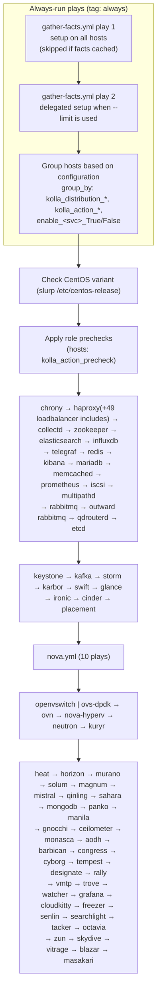
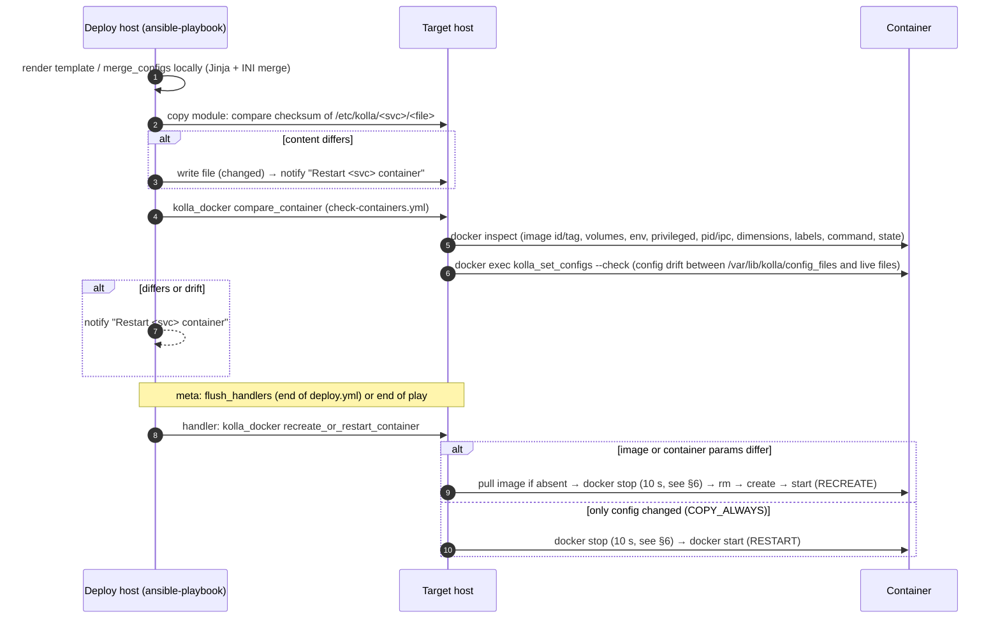

# Repository architecture

This page explains *how the machine is built*: which entry points exist, how a CLI command becomes an
`ansible-playbook` run, how `site.yml` is laid out, what every service role has in common, and which custom modules
actually touch the hosts. The other pages build on the vocabulary defined here.

> [!NOTE]
> **Key answers**
>
> - **`reconfigure` is `deploy`.** Of the 72 roles that have a `reconfigure.yml`, 67 only do `import_tasks: deploy.yml`,
>   so `reconfigure` re-runs Keystone registration, DB creation and the bootstrap (DB sync) container of most services
>   [CODE] ([§4.2](#42-reconfigure-is-deploy)).
> - **A config change is applied by a full stop/start, never a reload.** A changed file, a changed container definition
>   or drift reported by `kolla_set_configs --check` notifies the restart handler, which recreates the container when
>   the image or parameters differ and otherwise restarts it [CODE] ([§4.3](#43-the-config--check--handler-pattern)).
> - **The effective stop timeout is 10 s**, not the 60 s of `docker_graceful_timeout`, which is silently ignored [CODE]
>   ([§6](#6-custom-modules--container-lifecycle-via-kolla_docker)).
> - **`deploy` and `reconfigure` pull an image only if it is absent locally** (`start_container`). A rebuilt image
>   pushed under the same tag is not fetched by `deploy` or `reconfigure`; it takes an explicit `pull` [CODE]
>   ([§6](#6-custom-modules--container-lifecycle-via-kolla_docker)).
> - **Batching is off by default.** `ANSIBLE_SERIAL` defaults to 0, which means all hosts of a play in one batch, and
>   the wrapper passes `kolla_serial` only for `reconfigure` and `upgrade` [CODE]
>   ([§2](#2-from-cli-to-ansible-playbook)).
> - **`common` runs in the first play in which a host appears**, guarded by the `common_run` fact; `-t common
>   reconfigure` renders and restarts nothing [CODE] ([§5.1](#51-the-common-role-and-the-common_run-guard)).

> Scope: the `ussuri-eol` tag of `openstack/kolla-ansible` (HEAD `8a94fe9`). Every path below is relative to the root of
> that checkout; paths prefixed `kolla` or `ansible 2.9.27` point into the kolla image repository or the Ansible source.
> The evidence labels **[CODE]** and **[NOT AVAILABLE]** are defined once, in [Evidence
> labels](../start/conventions.md#evidence-labels).

---

## 1. Top-level layout

| Path | What it is | Why it matters for Day 2 |
|---|---|---|
| `tools/kolla-ansible` | Bash wrapper. Maps sub-commands to a playbook plus `-e kolla_action=<action>` | Decides which playbook runs and whether `kolla_serial` is passed ([§2](#2-from-cli-to-ansible-playbook)) |
| `ansible/site.yml` | The main playbook (84 plays once `nova.yml` and `gather-facts.yml` are expanded) | Every `deploy`, `reconfigure`, `upgrade`, `pull`, `stop`, `prechecks`, `genconfig`, `deploy-containers` run goes through it |
| `ansible/gather-facts.yml` | Imported first by `site.yml` | Fact gathering, including the special `--limit` path (see [Compute scaling](compute-scaling-and-performance.md)) |
| `ansible/nova.yml` | Imported by `site.yml:710` | Nova is split into 10 plays (see [Nova deep dive](../components/nova-deep-dive.md)) |
| `ansible/kolla-host.yml` + `roles/baremetal` | `bootstrap-servers` | Installs Docker and changes the host OS. Can restart the Docker daemon |
| `ansible/destroy.yml`, `prune-images.yml`, `mariadb_backup.yml`, `mariadb_recovery.yml`, `post-deploy.yml`, `certificates.yml`, `bifrost.yml` | Single-purpose playbooks | See [Operations](../operations/index.md) |
| `ansible/roles/` | 85 roles: 68 with a `common` meta-dependency (service roles); 17 without — the helper or utility roles plus `memcached` and `multipathd` | [§4](#4-anatomy-of-a-service-role) and [§5](#5-shared-helper-roles) |
| `ansible/group_vars/all.yml` | 1,130 lines of defaults (every `enable_*`, ports, transport URLs, Docker options) | Lowest-priority defaults. `globals.yml` overrides them |
| `ansible/inventory/{all-in-one,multinode}` | Example inventories that define 235 groups each | Group membership drives where every container runs |
| `ansible/library/` | Custom modules: `kolla_docker`, `kolla_toolbox`, `kolla_container_facts`, `bslurp` | Main Docker interface: the service roles' container lifecycle goes through `kolla_docker`. Many role tasks also run `docker exec`/`docker inspect` directly ([§6](#6-custom-modules--container-lifecycle-via-kolla_docker)) |
| `ansible/action_plugins/` | `merge_configs` (INI merge) and `merge_yaml` | How `/etc/kolla/config` overrides are merged ([§7](#7-configuration-generation-and-overrides)) |
| `ansible/filter_plugins/`, `kolla_ansible/*.py` | Jinja filters: `service_enabled_and_mapped_to_host`, `kolla_address`, `extract_cell`, `customise_fluentd`, … | Decide placement of a service on a host ([§4.4](#44-containers-and-placement)) |
| `etc/kolla/globals.yml`, `etc/kolla/passwords.yml` | Templates copied to `/etc/kolla/` by the operator | `globals.yml` is passed as **extra-vars** ([§2.1](#21-variable-precedence-that-matters)) |
| `tools/cleanup-*`, `tools/kolla-libvirt-guests.service`, `tools/virt-guest-shutdown.target` | Host utilities | `cleanup-host` deletes network namespaces and links (see [Risk register](../risk/risk-register.md)) |
| `doc/source/` | Documentation (`ansible-tuning.rst`, `bootstrap-servers.rst`, …) | Used only to cross-check, never as the source of truth |

No `ansible.cfg` is shipped for operators [CODE, [fact sheet E
§12](../reference/factsheets/e-host-bootstrap-ops-playbooks.md#12-ansible-configuration-and-documented-tuning)]. Forks,
pipelining, fact caching and SSH settings come from whatever `ansible.cfg` or environment the operator provides.

---

## 2. From CLI to `ansible-playbook`

`tools/kolla-ansible` builds a single command line (`tools/kolla-ansible:483-486`):

```bash
CONFIG_OPTS="-e @${CONFIG_DIR}/globals.yml -e @${PASSWORDS_FILE} -e CONFIG_DIR=${CONFIG_DIR}"
CMD="ansible-playbook -i $INVENTORY $CONFIG_OPTS $EXTRA_OPTS $PLAYBOOK $VERBOSITY"
```

| Command | Playbook | Extra vars added | `kolla_serial` passed? | Evidence |
|---|---|---|---|---|
| `prechecks` | `site.yml` | `kolla_action=precheck` | no | `tools/kolla-ansible:360-363` |
| `check` | `site.yml` | `kolla_action=check` | no | `:364-367` |
| `bootstrap-servers` | `kolla-host.yml` | `kolla_action=bootstrap-servers` | no (the playbook has its own `serial: kolla_serial`) | `:397-401` |
| `deploy` | `site.yml` | `kolla_action=deploy` | **no** | `:402-405` |
| `deploy-containers` | `site.yml` | `kolla_action=deploy-containers` | no | `:411-414` |
| `pull` | `site.yml` | `kolla_action=pull` | no | `:424-427` |
| `upgrade` | `site.yml` | `kolla_action=upgrade -e kolla_serial=${ANSIBLE_SERIAL}` | **yes** | `:428-431` |
| `reconfigure` | `site.yml` | `kolla_action=reconfigure -e kolla_serial=${ANSIBLE_SERIAL}` | **yes** | `:437-440` |
| `genconfig` | `site.yml` | `kolla_action=config` | no | `:458-461` |
| `stop` | `site.yml` | `kolla_action=stop` (needs `--yes-i-really-really-mean-it`) | no | `:441-453` |
| `destroy` | `destroy.yml` | (needs `--yes-i-really-really-mean-it`) | no | `:378-396` |
| `mariadb_recovery` | `mariadb_recovery.yml` | `kolla_action=deploy common_run=true` | no | `:368-372` |
| `mariadb_backup` | `mariadb_backup.yml` | `kolla_action=backup common_run=true` | no | `:373-377` |
| `post-deploy` | `post-deploy.yml` | – | no | `:420-423` |
| `prune-images` | `prune-images.yml` | (needs `--yes-i-really-really-mean-it`) | no | `:462-473` |

Consequences [CODE]:

- **`ANSIBLE_SERIAL` defaults to 0** (`tools/kolla-ansible:234-236`), which means *all hosts of a play in one batch*.
  The comment there reads "Serial is not recommended and disabled by default".
- **`kolla_serial` is overridden for `reconfigure` and `upgrade`.** The wrapper appends
  `-e kolla_serial=${ANSIBLE_SERIAL}` *after* the user's `-e` options. For those two commands a user-supplied
  `-e kolla_serial=N` is therefore silently replaced by `ANSIBLE_SERIAL`. Use the environment variable instead ([fact
  sheet E §11](../reference/factsheets/e-host-bootstrap-ops-playbooks.md#11-toolskolla-ansible-cli)).
- **Other commands default to 0.** For `deploy` and the rest, `kolla_serial` is not passed, and the plays fall back
  to `kolla_serial|default("0")`.
- **`--tags`, `--skip-tags`, `--limit` and `--forks` pass straight through** (`:251-259`, `:305-313`). `EXTRA_OPTS` from
  the environment is passed through as well, which is the only way to reach `--check`, `--diff`, `--list-tasks` or
  `--list-hosts` through the wrapper.
- **Bug: `--ask-vault-pass`.** The branch sets `VERBOSITY="$EXTRA_OPTS --ask-vault-pass"` (`:320-323`), which
  duplicates all options seen so far and drops earlier `-v` flags.

### 2.1 Variable precedence that matters

`globals.yml` and `passwords.yml` are passed with `-e @file`. That is **extra-vars, the highest precedence in Ansible**:
Ansible merges role defaults first, group vars and host vars later, and extra-vars last (ansible 2.9.27
`lib/ansible/vars/manager.py:187-206,288-300,411-412`). Consequences [CODE]:

- A value in `globals.yml` cannot be overridden per host or per group in the inventory. Per-host variation
  must come from variables that are *not* set in `globals.yml`. Inventory `host_vars` override role defaults and
  `group_vars/all.yml`, but not extra-vars.
- Anything placed in `globals.yml` applies to **every play and every host**. This is why "global" switches such as
  `enable_barbican`, `openstack_tag` or `nova_compute_virt_type` have fleet-wide effects (see
  [Operations](../operations/index.md)).

---

## 3. Anatomy of `site.yml`



Facts about the structure [CODE, `ansible/site.yml`]:

1. **One play per service, in a fixed order.** There is no dependency resolver. The deployment order *is* the order of
   plays in `site.yml` (see [Execution flow](deployment-execution-flow.md)). The only exception is the haproxy play
   (`site.yml:126-392`): it runs *before* the services it fronts, and configures all of their frontends in one place.
2. **The "group by configuration" optimisation.** The play at `site.yml:7-95` puts every host into groups such as
   `enable_nova_True`. Every service play then intersects its host list with `&enable_<svc>_True`, for example
   `hosts: [compute, …, '&enable_nova_True']`. If a service is disabled, the play matches no host and Ansible skips
   it entirely, which avoids evaluating hundreds of `when:` clauses per host. The NOTE at `site.yml:4-6` says this
   exists because "in large environments, even tasks that are skipped can take a significant amount of time".
3. **Serial and tags differ between plays.** Almost every play has `serial: '{{ kolla_serial|default("0") }}'`.
   - **Exceptions with no `serial` key:** the setup plays `Group hosts based on configuration`, `Check CentOS variant`
     and `Apply role prechecks` (`site.yml:7-112`), plus `mariadb` (`site.yml:471-479`), `rabbitmq` and
     `outward rabbitmq` (`:535-572`). The clustering logic of the last three needs all members in one batch. Rolling
     behaviour is implemented *inside* their handlers instead ([fact sheet B
     §1–2](../reference/factsheets/b-mariadb-rabbitmq-keystone.md#1-mariadb-ansiblerolesmariadb)).
   - **Bug: `cyborg` (`:1028`)** uses `serial|default("0")`, not `kolla_serial`, so `ANSIBLE_SERIAL` has no effect on
     cyborg.
   - **Tag placement varies:**
     - Most plays tag the *role*, e.g. `roles: - { role: nova-hyperv, tags: nova-hyperv }`.
     - The haproxy play and all `nova.yml` plays put tags at *play* level.
     - `memcached` has two tags, `[memcache, memcached]` (`site.yml:489`).
     - The `prechecks` play has no tag at all.
4. **`common` is reached through meta dependencies.** Almost every service role declares
   `dependencies: - { role: common }` in `meta/main.yml`. Exceptions are the helper roles plus `memcached` and
   `multipathd`, which have no `meta/`. `common` therefore runs in the *first* play in which a host appears, guarded by
   a host fact ([§5.1](#51-the-common-role-and-the-common_run-guard)).

The complete table of 84 plays (hosts, tags, serial) is generated from the source in [Generated inventory
§1](../reference/generated-inventory.md#1-plays-executed-by-siteyml-in-order).

---

## 4. Anatomy of a service role

Every service role follows the same skeleton. `nova` is a typical example:

```text
roles/<svc>/
  defaults/main.yml      <svc>_services dict (containers), images, volumes, ks users/endpoints, ports
  meta/main.yml          dependencies: [ { role: common } ]
  vars/main.yml          project_name (and, for nova-cell, kolla_role_name)
  handlers/main.yml      "Restart <service-key> container" handlers (kolla_docker recreate_or_restart_container)
  tasks/main.yml         - include_tasks: "{{ kolla_action }}.yml"          <-- dynamic dispatch
  tasks/deploy.yml       register.yml → config.yml → check-containers.yml → bootstrap.yml → flush_handlers
  tasks/reconfigure.yml  - import_tasks: deploy.yml                          <-- reconfigure == deploy
  tasks/upgrade.yml      service-specific (stop/rolling, DB migrations, check-containers, flush)
  tasks/deploy-containers.yml  - import_tasks: check-containers.yml
  tasks/pull.yml         import_role: service-images-pull
  tasks/stop.yml         import_role: service-stop
  tasks/precheck.yml     import_role: service-precheck + port checks
  tasks/check.yml        (usually empty)
  tasks/config.yml       (also run alone for kolla_action=config, i.e. `genconfig`)
  tasks/loadbalancer.yml import_role: haproxy-config (tags: always)  <-- called from the haproxy play
  templates/             <service>.json.j2 (kolla_set_configs manifest), <svc>.conf.j2, …
```

### 4.1 `kolla_action` dispatch

`tasks/main.yml` is a **dynamic** `include_tasks: "{{ kolla_action }}.yml"`. Two consequences follow [CODE]:

- **`--list-tasks` is blind to role internals.** It shows only the `include_tasks` placeholder of every role
  ([list-tasks-nova.txt](../reference/listings/list-tasks-nova.txt), e.g. lines 226-230): the listing walks the compiled
  play and does not load dynamically included files (ansible 2.9.27 `lib/ansible/cli/playbook.py:159-182`). You cannot
  use `--list-tasks` to see what a tag will do in Kolla-Ansible.
- **Tags reach the role's tasks only through inheritance.** The included tasks inherit the *role and play* tags (e.g.
  `nova`), not tags written on the `include_tasks` statement itself (see [Tags
  §2](../risk/tags.md#2-ansible-29-semantics-that-kolla-relies-on)). An include is not statically loaded, so the block
  of included tasks skips the include's tags and inherits those of the role, its dependency chain and the play (ansible
  2.9.27 `lib/ansible/playbook/task_include.py:56`, `lib/ansible/playbook/block.py:311-314,329-360`).

### 4.2 `reconfigure` is `deploy`

Of the 72 roles that have a `reconfigure.yml`, 67 only do `import_tasks: deploy.yml`. `congress`, `mongodb` and
`nova-hyperv` do the same with `include_tasks`. `swift` and `bifrost` have their own reconfigure logic: swift fails if a
container is down, runs `kolla_set_configs --check` and restarts only drifted containers
(`roles/swift/tasks/reconfigure.yml`).

The bifrost copy cannot work and no `kolla-ansible` command runs it: it uses a group and a container named
`bifrost-deploy`, but the container is `bifrost_deploy`, which runs `/sbin/init` with no `config.json`
(`roles/bifrost/tasks/reconfigure.yml:2-23`, `start.yml:8`).

See the generated column "reconf→deploy" in [Generated inventory
§3](../reference/generated-inventory.md#3-role-task-structure-handlers-and-helper-role-usage). So `reconfigure` re-runs
Keystone registration, DB creation and the **bootstrap (DB sync) container** of most services, exactly like `deploy`
[CODE] (e.g. `roles/glance/tasks/reconfigure.yml:2`, `roles/glance/tasks/deploy.yml:2-12`). The only built-in
differences between `deploy` and `reconfigure` are:

- **`kolla_serial`** is passed from `ANSIBLE_SERIAL` ([§2](#2-from-cli-to-ansible-playbook)).
- **A few `when: kolla_action == ...` conditions.** Example: Neutron's DB-sync container (`bootstrap_neutron`) runs
  only on `deploy` while `neutron_enable_rolling_upgrade` keeps its default `yes`
  (`roles/neutron/tasks/bootstrap_service.yml:21-22`, `roles/neutron/defaults/main.yml:411`). Neutron's DB, user and
  grant tasks (`roles/neutron/tasks/bootstrap.yml`) still run on `reconfigure`. Nova's bootstrap plays run on both
  `deploy` and `reconfigure` (`ansible/nova.yml:49-51,85-87`).

### 4.3 The config → check → handler pattern

This is the heart of Day-2 behaviour:



- **Files are rendered on the deploy host and copied.** The `template` and `merge_configs` steps render on the deploy
  host, then the `copy` logic compares checksums on the target. So *every* config task costs one SSH round trip per host
  per item, even when nothing changes (see [Compute scaling](compute-scaling-and-performance.md)).
- **Two independent triggers lead to the same handler.** A changed file notifies directly. The `compare_container`
  task (`ansible/library/kolla_docker.py:326-350`) also notifies when:
  - the container's definition differs (image ID or tag, volumes, environment, privileged, pid/ipc, dimensions,
    labels, command, state); or
  - **`kolla_set_configs --check`** inside the running container reports drift (`kolla_docker.py:244,543-578`).

  The second path means a config file changed by an earlier `genconfig`, or by hand, will still restart the container
  on the next `deploy`/`reconfigure`/`deploy-containers` [CODE].
- **Restart and recreate are both full stop/start cycles.** A config change is applied only by stopping and starting
  the container; `kolla_docker` has no reload action. The only signal Kolla-Ansible sends to a running service is
  SIGHUP to `nova_scheduler` (cell-cache refresh). It is sent only on a `deploy`/`reconfigure` that runs the `nova`,
  `nova-api` or `nova-refresh-scheduler-cell-cache` tag (or no tag) and whose `--limit`, if any, includes the
  `nova-scheduler` hosts (`roles/nova/tasks/refresh_scheduler_cell_cache.yml:10`, `ansible/nova.yml:140-156`). It
  loads no new config files. The handler calls `recreate_or_restart_container` (`kolla_docker.py:781-803`):
  - **recreate** when the image or parameters differ;
  - otherwise **restart** (`dc.stop(timeout=graceful_timeout)` then `dc.start`, `:892-904`).

  The effective stop timeout is **10 s**, not the 60 s of `docker_graceful_timeout`
  ([§6](#6-custom-modules--container-lifecycle-via-kolla_docker)).
- **Handlers run in definition order, on every notified host of the batch at once.** Unless `kolla_serial` is set,
  "Restart nova-compute container" restarts nova_compute on all notified computes in the same step [CODE: ansible
  2.9.27 `lib/ansible/plugins/strategy/__init__.py:979-986` walks the play's handlers in order; `:1019-1035` queues
  one handler on every notified host, then waits for all of them].

### 4.4 Containers and placement

Each role's `defaults/main.yml` defines a `<role>_services` dict with an entry per container. The fields are
`container_name`, `group` *or* `host_in_groups`, `enabled`, `image`, `volumes`, `dimensions`, `privileged`,
`pid_mode`/`ipc_mode`, and `haproxy`. The filter `service_enabled_and_mapped_to_host`
(`kolla_ansible/filters.py:42-79`) decides placement:

- `host_in_groups` (a per-host boolean expression) wins over `group`.
- `group: all` means every host.

All 195 container definitions are listed in [Generated inventory
§2](../reference/generated-inventory.md#2-containers-defined-by-each-role-role_services-in-defaultsmainyml).

---

## 5. Shared helper roles

| Role | Used by | What it does | Scope |
|---|---|---|---|
| `common` | meta dependency of 68 roles | Deploys `fluentd`, `kolla_toolbox`, `cron` on **every** host (`group: all`). Renders `td-agent.conf` and `logrotate.conf` | Once per host per run (guarded by the `common_run` fact) |
| `service-ks-register` | 39 roles | Creates the Keystone service, endpoints, project, user, role and grants through `kolla_toolbox` | `run_once`: once per play, or once per batch when `kolla_serial` is set (`roles/service-ks-register/tasks/main.yml:125-126`) |
| `service-rabbitmq` | nova-cell only (`roles/nova-cell/tasks/rabbitmq.yml`, imported from `bootstrap.yml`) | Creates RabbitMQ vhost and user through `kolla_toolbox`, delegated to the first host of the cell's RPC (or notify) RabbitMQ group | once per cell, on the cell's first nova-conductor host (the notify pass only when its group or users differ from RPC) |
| `service-images-pull` | every role's `pull.yml` | `kolla_docker pull_image` for every enabled container mapped to the host | per host × per container |
| `service-stop` | every role's `stop.yml` | `kolla_docker stop_container`, honouring `skip_stop_containers` | per host × per container |
| `service-precheck` | every role's `precheck.yml` | Validates that the inventory groups exist | per host |
| `service-cert-copy` | `copy-certs.yml` of 52 roles | Copies the CA (and backend certs) into each service config dir when `kolla_copy_ca_into_containers` is set | per host × per service |
| `haproxy-config` | every role's `loadbalancer.yml` | Renders `/etc/kolla/haproxy/services.d/<svc>*.cfg` | per haproxy host |
| `module-load` | nova-cell, neutron, openvswitch, haproxy, ironic (`iscsi_tcp`), iscsi (`configfs`), multipathd (`dm-multipath`) | `modprobe` and persistence in `/etc/modules-load.d` | per host |

### 5.1 The `common` role and the `common_run` guard

`roles/common/tasks/main.yml:1-10`:

```yaml
- include_tasks: "{{ kolla_action }}.yml"
  tags: common
  when: not common_run
- name: Registering common role has run
  set_fact:
    common_run: True
  tags: common
  when: not common_run
```

- **`common_run` is a per-host fact** (`roles/common/defaults/main.yml:4`), and facts persist across plays: Ansible
  keeps `set_fact` values per host for the whole run (ansible 2.9.27 `lib/ansible/plugins/strategy/__init__.py:696-700`,
  `lib/ansible/vars/manager.py:398-399`). `common` therefore executes **in the first play in which a host appears**, and
  is skipped (as cheap `skipped` results) in all later plays. Example: on a compute host, `common` runs in the `chrony`
  play for a full `deploy` (`site.yml:114-124`; `chrony` includes `compute` in `ansible/inventory/multinode:50-55`) but
  in the `nova-cell` play for `-t nova` (`ansible/nova.yml:117-135`). The tasks of the `chrony` play carry only the
  `chrony` and `common` tags, and the `nova-cell` play is the first play tagged `nova` whose hosts include `compute`
  ([list-tags-site.txt](../reference/listings/list-tags-site.txt) line 122;
  [list-tasks-nova.txt](../reference/listings/list-tasks-nova.txt) lines 127 and 226-228) [CODE].
- **`common` inherits the play or role tags of whatever play reaches the host first.** `-t nova` therefore runs the
  whole `common` role (fluentd, cron, kolla_toolbox config and container checks) on every nova host, computes included
  [CODE: a role dependency inherits the tags of the roles that pull it in and of the play, ansible 2.9.27
  `lib/ansible/playbook/block.py:329-360`; the `common` include in the `nova-cell` play carries the `nova` tag,
  [list-tasks-nova.txt](../reference/listings/list-tasks-nova.txt) line 228].
- **`fluentd` and `cron` configs are global.** `td-agent.conf` (inputs per enabled service) and `logrotate.conf` are
  rendered from the **global** `enable_*` flags (`roles/common/tasks/config.yml:109-240`). Enabling a service listed in
  `fluentd_input_openstack_services` (`roles/common/defaults/main.yml:105-185`) and/or `cron_logrotate_services`
  (`roles/common/tasks/config.yml:170-233`), such as nova, neutron or barbican, changes `td-agent.conf` and/or
  `logrotate.conf` on *every* host. Services only in the logrotate list (e.g. chrony, mariadb, rabbitmq, zun, vitrage)
  change only `logrotate.conf`, and some flags change neither file (e.g. `enable_placement`, `enable_prometheus`,
  `enable_redis`, `enable_memcached`, `enable_ovn`).

  The next run that actually executes `common` on a host restarts the container whose file changed (`fluentd` and/or
  `cron`) there. Through loop-notify on the looped `Check common containers` task
  (`roles/common/tasks/check-containers.yml:2-17`) it also restarts the other common containers (`kolla_toolbox`, plus
  `fluentd` or `cron` when only one of the two files changed), although their config did not change [CODE: when any item
  of a looped task changes, Ansible notifies the handlers of every item that was not skipped, ansible 2.9.27
  `lib/ansible/executor/task_executor.py:118-121,557-559,789-790`, `lib/ansible/plugins/strategy/__init__.py:613-623`].

  `-t common reconfigure` is not such a run: the tag on the dynamic include does not reach the included tasks, so
  nothing is rendered or restarted [CODE: `roles/common/tasks/main.yml:3,9` are the only `tags:` lines in
  `roles/common/tasks/`; included blocks are filtered by tag, ansible 2.9.27
  `lib/ansible/plugins/strategy/linear.py:371`, and do not inherit the include's tags,
  `lib/ansible/playbook/block.py:311-314`].

---

## 6. Custom modules — container lifecycle via `kolla_docker`

| Module | Purpose | Key behaviour (evidence) |
|---|---|---|
| `kolla_docker` (`ansible/library/kolla_docker.py`, 1,077 lines) | Every container lifecycle operation of the service roles | Actions: `compare_container`, `compare_image`, `create_volume`, `ensure_image`, `get_container_env`, `get_container_state`, `pull_image`, `recreate_or_restart_container`, `remove_container`, `remove_image`, `remove_volume`, `restart_container`, `start_container`, `stop_container`, `stop_and_remove_container`. Uses host networking (`build_host_config`). `restart_policy` defaults from `docker_restart_policy: unless-stopped`, and is **not compared** (FIXME at `:21`). |
| `kolla_toolbox` (`library/kolla_toolbox.py`) | Runs an Ansible module *inside* the `kolla_toolbox` container (`docker exec … ansible localhost -m <module>`) | Used for MySQL, Keystone (`os_*`) and RabbitMQ (`rabbitmq_user/vhost`) operations. Needs a running `kolla_toolbox` on the target |
| `kolla_container_facts` | Returns the running containers by name | Used by prechecks and upgrade logic |
| `bslurp` | Single-shot file transfer between hosts: reads a whole file (zlib + base64) and writes it out on other hosts with sha1/sha256 checks | Ships in `ansible/library/` but no Ussuri playbook or role calls it. Swift rings are copied with `copy` from `{{ node_custom_config }}/swift` (`roles/swift/tasks/config.yml:183-197`). Fernet keys are distributed by `fernet-push.sh`, run with `docker exec` in the keystone_fernet container (`roles/keystone/tasks/distribute_fernet.yml:14`) |

These modules are not the only Docker interface. Many role tasks call the docker CLI directly through
`command`/`shell`: `docker exec` for `fernet-push.sh`, `ovs-vsctl`, `kolla_set_configs --check` (swift, bifrost) and
the `mysql`/`rabbitmqctl` calls of the MariaDB and RabbitMQ roles, and `docker inspect` plus `kill -HUP` for
`nova_scheduler`. The `common` role also uses Ansible's upstream `docker_image_info` module
(`roles/common/tasks/config.yml:44`). Outside the service roles, `destroy` stops and removes containers with the
`tools/cleanup-containers` script (`roles/destroy/tasks/cleanup_containers.yml:3`), `prune-images` uses the upstream
`docker_prune` module, and `bootstrap-servers` runs `docker start` on the previously running containers after a
Docker engine upgrade (`roles/baremetal/tasks/install.yml:119-120`) [CODE].

How `kolla_docker` decides [CODE]:

- **`start_container`** pulls the image **only if it is absent locally** (`kolla_docker.py:805-808`). A rebuilt image
  pushed under the same tag is therefore *not* fetched by `deploy` or `reconfigure`. It takes an explicit `pull`
  (`kolla-ansible pull`) to download it, after which `compare_image` sees a new image ID and recreates the container
  [CODE] (`kolla_docker.py:326-350,781-803`).
- **`compare_image` compares image ID and tag**, using the local image for that reference (`:403-418`).
- **`pull_image` reports changed only if the local image ID changed** (`:599-633`).
- **`docker_graceful_timeout` and `docker_client_timeout` are silently ignored.**
  - `generate_module()` starts from `common_options` (= `docker_common_options`, which carries
    `graceful_timeout: 60` and `client_timeout: {{ docker_client_timeout }}`, `group_vars/all.yml:157-167`). It then
    overwrites every key whose module parameter is not `None` (`kolla_docker.py:1037-1047`).
  - `graceful_timeout` has `default=10` and `client_timeout` has `default=120` in the argument spec
    (`kolla_docker.py:991,1011`), so the module defaults always win.
  - Handlers pass `common_options` but no `graceful_timeout` (e.g. `roles/nova-cell/handlers/main.yml:124-140`), and
    no file under `ansible/roles/` sets `graceful_timeout`. The effective value is therefore the module default of
    10, which `stop_container` and `restart_container` pass to `dc.stop` (`kolla_docker.py:871-884,892-904`).
  - Practical effect: **every `docker stop` issued through `kolla_docker` in Ussuri SIGKILLs a container still
    running 10 s after SIGTERM**. This holds for handler restarts, recreates and `stop`. The release note
    `docker-stop-timeout-c8089f6bf92d6c28.yaml` claims the default was raised to 60 s; it has no effect. A service
    needing a longer graceful shutdown (in-flight image uploads, cinder copies, heat-engine) is killed after 10 s.
    [CODE; the SIGTERM-then-SIGKILL meaning of the timeout is kolla-ansible's own comment,
    `ansible/group_vars/all.yml:153`: "Timeout after Docker sends SIGTERM before sending SIGKILL."]

---

## 7. Configuration generation and overrides

1. **INI files go through `merge_configs`.** `merge_configs` (`ansible/action_plugins/merge_configs.py`) renders each
   listed source as a Jinja template *on the deploy host*, merges them as INI (later sources win), then calls the
   `copy` action. For nova-compute the sources are (`roles/nova-cell/tasks/config.yml:63-75`):
   `templates/nova.conf.j2` → `/etc/kolla/config/global.conf` → `/etc/kolla/config/nova.conf` →
   `/etc/kolla/config/nova/nova-compute.conf` → `/etc/kolla/config/nova/<inventory_hostname>/nova.conf`.
2. **Overrides are scoped by file location.** Putting a value into `/etc/kolla/config/nova.conf` affects **every nova
   container on every host** (nova-api, scheduler, conductor, novncproxy and every nova-compute). The content of
   `/etc/kolla/config/nova/nova-compute.conf` is merged only into nova-compute's `nova.conf`, so the control-plane
   nova services are untouched [CODE: the `nova` and `nova-cell` roles each merge `nova/<service>.conf` only into
   that service's own `nova.conf`, `roles/nova/tasks/config.yml:51-69`, `roles/nova-cell/tasks/config.yml:63-82`,
   `roles/nova/defaults/main.yml:2-55`]. Operationally, `-t nova reconfigure`
   after changing it still restarts `nova_compute`, `nova_libvirt` and `nova_ssh` on every compute host [CODE]. The
   changed file makes `kolla_set_configs --check` report drift in `nova_compute` (`kolla_docker.py:543-578`). libvirt
   and ssh restart through loop-notify in the looped "Check nova-cell containers" task
   (`roles/nova-cell/tasks/check-containers.yml:2-20`, handlers `roles/nova-cell/handlers/main.yml:70-140`; Ansible
   lines in [§5.1](#51-the-common-role-and-the-common_run-guard)), not because their config changed.
3. **Some overrides leak to other services.** Neutron's `openvswitch_agent.ini` merges
   `/etc/kolla/config/neutron/ml2_conf.ini` on top of the agent template (`roles/neutron/tasks/config.yml:172-190`,
   "TODO(mnasiadka): Remove in V"). A change meant for `neutron-server` therefore also restarts
   `neutron_openvswitch_agent` on every compute and network node [CODE].
4. **The container receives its config through a manifest.** The `config.json` (rendered from `<service>.json.j2`) tells
   `kolla_set_configs`, inside the image, which files to copy from `/var/lib/kolla/config_files` (bind-mounted from
   `/etc/kolla/<service>/`) to their final location. It also names the command to start. With `config_strategy:
   COPY_ALWAYS` (`group_vars/all.yml:43`) the copy happens at every container start. That is why a restart is enough to
   apply a changed or added config file, and why Kolla-Ansible never applies config by reloading a service.

   A restart does not apply a removal [CODE]. `kolla_set_configs` rewrites only the destinations listed in the current
   `config.json` and skips an optional entry whose source is missing (kolla
   `docker/base/set_configs.py:135-148,310-315`). A file whose entry was dropped (e.g. a removed Keystone policy file,
   `roles/keystone/templates/keystone.json.j2:30-36`), or whose optional source is gone, keeps its old copy in the
   container until the container is recreated, or even after that when the destination is on a named volume (e.g.
   nova-compute's SASL `auth.conf` under `/var/lib/nova`), and `kolla_set_configs --check` does not flag it
   (`set_configs.py:217-220,407-410`). Deleting a custom file such as `/etc/kolla/config/keystone/keystone-paste.ini`
   also leaves its rendered copy in `/etc/kolla/keystone/` (`roles/keystone/tasks/config.yml:165-187`), which is copied
   in again even after a recreate.

   The image-side start path and `--check` are described in [Kolla images
   §2-§3](kolla-images.md#2-start-path-common-to-every-image).

---

## 8. Inventory model

- **Groups are mostly aliases of a few physical groups.** The physical groups are `control`, `network`, `compute`,
  `storage`, `monitoring` and `deployment` (`ansible/inventory/multinode`). Service groups are defined as children.
  Examples:
  - `[nova-api:children] nova`, `[nova:children] control`.
  - `[haproxy:children] network`. In the Ussuri example inventory, HAProxy and keepalived sit on the **network**
    nodes.
  - `[openvswitch:children] network, compute, manila-share`.
- **Groups that include `compute` in the example inventory** (27 in total):
  - `compute` itself and the groups that list it directly as a child: `baremetal`, `openvswitch`, `cyborg`,
    `neutron-ovn-metadata-agent`, `iscsid`, `multipathd`, `chrony`, `collectd`, `telegraf`, `monasca-agent`,
    `ceilometer-compute`, `ceilometer-ipmi`, `cyborg-agent`, `zun-compute`, `zun-cni-daemon`, `skydive-agent`,
    `prometheus-node-exporter`, `prometheus-cadvisor`, `masakari-monitors`, `ovn-controller-compute`.
  - Through nesting: `cyborg-api` and `cyborg-conductor` (children of `cyborg`, which is control + compute, so they
    also land on compute hosts), `monasca-agent-collector`, `monasca-agent-forwarder` and `monasca-agent-statsd` (via
    `monasca-agent`), and `ovn-controller` (via `ovn-controller-compute`).
- **The neutron play also targets every compute host.** It lists `compute` and `manila-share` explicitly
  (`site.yml:761-780`); the agents' `host_in_groups` decides what lands there.
- **Inventory order is semantically significant** [CODE]. `groups['<grp>'][0]` is the target of almost every
  `run_once`/`delegate_to` bootstrap step. Examples: `groups['nova-conductor'][0]` for cell creation and compute
  discovery; `groups['glance-api'][0]` as the only glance host with the default file backend ([fact sheet
  C](../reference/factsheets/c-glance-placement-cinder-horizon-heat.md)). Other index-sensitive logic:
  - keepalived priority is the index in `groups['haproxy']` ([fact sheet A
    §1.8](../reference/factsheets/a-infra-lb-ovn.md#18-operationally-notable-behaviour) C);
  - MariaDB restart waves use the index modulo 4 ([fact sheet B §1.5][sheet-b-15]).

## Related

- [Tags](../risk/tags.md) (how tags select this work)
- [Execution flow](deployment-execution-flow.md) (execution order and the action matrix)
- [Generated inventory](../reference/generated-inventory.md) (every play, container, role and handler)
- [Tag index](../risk/tag-index.md), [Components](../components/index.md) and [Glossary](../reference/glossary.md) (tag
  index, service index, glossary)

[sheet-b-15]: ../reference/factsheets/b-mariadb-rabbitmq-keystone.md#15-handlers-ansiblerolesmariadbhandlersmainyml-in-definition-order
