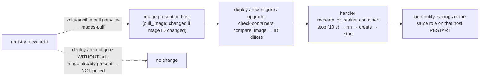

# Update container images

How `kolla-ansible pull`, `deploy`, `reconfigure` and `upgrade` treat container images: `pull` never changes running
containers, and after a `pull` that downloaded something the next `deploy`, `reconfigure` or `upgrade` recreates the
affected containers.

The image counts per host in [§2](#2-how-image-pulling-and-recreation-work-code) are for the service set of the [assumed
deployment](index.md#assumed-deployment).

> [!NOTE]
> **Key answers**
>
> - **Images ([§2 to §5](#2-how-image-pulling-and-recreation-work-code)):** a `deploy` without `pull` does not download
>   a rebuilt image, and a new `openstack_tag` applied with `deploy` recreates every container on every host [CODE]
>   ([§2](#2-how-image-pulling-and-recreation-work-code)). Risks of doing so: [§4](#4-risks).
> - **Images:** `pull` never changes running containers, and `deploy`/`reconfigure` never pull an image that is already
>   present locally [CODE] ([§1.1](#11-images)).

> [!CAUTION]
> [R12](../risk/risk-register.md#r12): changing the tag and running `deploy` (instead of `upgrade`) recreates the whole
> fleet in one go, without the upgrade-specific ordering — see [§4](#4-risks).

## 1. Commands

### 1.1 Images

```bash
kolla-ansible -i multinode pull                         # all enabled images on all hosts
kolla-ansible -i multinode -t nova pull --limit compute # nova-cell + common images on computes
kolla-ansible -i multinode upgrade                      # recreate from new images (after pull)
ANSIBLE_SERIAL=20 kolla-ansible -i multinode -t nova upgrade
```

- `pull` never changes running containers [CODE `roles/service-images-pull/tasks/main.yml:2-14`,
  `kolla_docker.py:599-633`].
- `deploy`/`reconfigure` never pull an image that is already present locally, even if the registry has a newer
  build under the same tag [CODE `kolla_docker.py:299-307,797-798,805-808`].
- After a `pull` that downloaded something, the next `deploy`, `reconfigure` or `upgrade` **recreates** the affected
  containers. Loop-notify restarts their siblings [CODE `kolla_docker.py:403-418,781-803`; [Tags
  §2.4](../risk/tags.md#24-loop-notify-one-changed-item-notifies-the-handlers-of-all-items-code)].

## 2. How image pulling and recreation work [CODE]



| Case | Who downloads | What restarts | Source |
|---|---|---|---|
| Same tag, rebuilt image, `deploy` without `pull` | nobody (image already present) | nothing | the local tag still resolves to the image the container runs (`library/kolla_docker.py:299-307, :403-418`) |
| `-t nova pull` | every host in the nova plays, for nova images **and the 3 common images** | nothing | `roles/common/tasks/pull.yml:1-13`, `roles/nova/tasks/pull.yml:1-3`, `roles/nova-cell/tasks/pull.yml:1-3`; `roles/service-images-pull/tasks/main.yml:2-16` (no `notify`) |
| `-t nova deploy` after that pull (only the nova-compute image rebuilt) | – | nova_compute **recreated**, nova_libvirt + nova_ssh **restarted** on every compute | recreate if the container differs, else restart (`library/kolla_docker.py:781-803`); [Tags §2.4](../risk/tags.md#24-loop-notify-one-changed-item-notifies-the-handlers-of-all-items-code) |
| New `openstack_tag`, `pull` | every host: 11 images per compute, 24 per controller, 12 per network node for this service set, counted as the enabled services mapped to each host | nothing | `roles/service-images-pull/tasks/main.yml:14`, `kolla_ansible/filters.py:82-91`; the hosts are mapped by the groups in `inventory/multinode` and the `<role>_services` defaults (e.g. `roles/mariadb/defaults/main.yml:36-39, :118` for `mariadb_clustercheck`); [Compute scaling §2](../concepts/compute-scaling-and-performance.md#2-work-per-compute-host-read-from-the-task-files) (per compute) |
| New `openstack_tag`, `deploy` | – | **every container on every host recreated**: fluentd, cron, toolbox, chrony, iscsid, all nova, OVS db + vswitchd, neutron agents, haproxy, keepalived, MariaDB (rolling), RabbitMQ… | every `<svc>_tag` defaults to `openstack_tag` (e.g. `roles/nova/defaults/main.yml:78`); `library/kolla_docker.py:403-418`; `roles/mariadb/handlers/main.yml:66-78`, `roles/rabbitmq/handlers/main.yml:6-26` |

## 3. Which nodes download

Every host that runs at least one container whose image reference changed:

- **computes:** nova-compute, nova-libvirt, nova-ssh, OVS db/vswitchd, the neutron OVS agent, plus common, chrony and
  iscsid;
- **network nodes:** agents, OVS, haproxy, keepalived;
- **controllers:** everything else.

`pull` itself never restarts anything. It is safe to run in advance; the Ussuri docs recommend `pull` before
`upgrade`.

## 4. Risks

- **Changing the tag and running `deploy`** (instead of `upgrade`) recreates the whole fleet in one go, without the
  upgrade-specific ordering (one-shot containers per image: [Kolla images
  §4](../concepts/kolla-images.md#4-one-shot-containers-what-the-environment-variables-run)):
  - no `nova-status upgrade check`;
  - no RPC-pin reload plays;
  - no online data migrations, except Placement's: its bootstrap container (`KOLLA_BOOTSTRAP`,
    `roles/placement/tasks/bootstrap_service.yml:10-11`) runs `placement-manage db online_data_migrations` on every
    deploy (kolla `docker/placement/placement-api/extend_start.sh:5-9`). Ironic's does the same only with
    `ironic_enable_rolling_upgrade: no` (default `yes`, `roles/ironic/defaults/main.yml:206`;
    `roles/ironic/tasks/bootstrap_service.yml:16`, kolla `docker/ironic/ironic-api/extend_start.sh:5-9`);
  - RabbitMQ is not stopped cluster-wide, but restarted node by node (`roles/rabbitmq/handlers/main.yml:6-26`);
  - Neutron (default `neutron_enable_rolling_upgrade: yes`): instead of expand → restart → contract
    (`roles/neutron/tasks/rolling_upgrade.yml:13-93`), `bootstrap_neutron` runs `neutron-db-manage … upgrade head` for
    neutron, neutron-dynamic-routing, neutron-fwaas and neutron-vpnaas with the new image **before** the handlers
    restart the old `neutron_server` containers (kolla `docker/neutron/neutron-server/extend_start.sh:5-12`;
    `roles/neutron/tasks/deploy.yml:18-21`, `bootstrap_service.yml:2-22`) [CODE]. [NOT AVAILABLE] Whether
    `upgrade head` then applies contract migrations under live old-version servers, and what that does to them.
- **An OVS image change** recreates `openvswitch_vswitchd` on every OVS host simultaneously (serial 0). [NOT AVAILABLE]
  Whether VM networking is interrupted on every compute at the same time. Upgrade OVS per batch:

  ```bash
  ANSIBLE_SERIAL=<n> kolla-ansible -t openvswitch upgrade
  ```

  or use `--limit` batches.
- **Upgrade without a prior pull:** hosts download lazily inside the handler phase (`recreate_or_restart_container`
  pulls *before* stopping, `kolla_docker.py:793-799`), which lengthens and staggers the restart window.

## 5. Verification

- Before:
  - `docker images | grep <tag>` on a sample of hosts after `pull`;
  - the image IDs match the registry.
- After:
  - `docker ps --format '{{.Names}} {{.Image}}'` shows the new tag everywhere;
  - `docker inspect -f '{{.Image}}' nova_compute` equals the pulled image ID.

## Related

- [Risk register](../risk/risk-register.md) — the risk items for these operations: [R11](../risk/risk-register.md#r11)
  (`kolla-ansible pull`), [R12](../risk/risk-register.md#r12) (changing `openstack_tag` and running `deploy` instead of
  `upgrade`), [R13](../risk/risk-register.md#r13) (rebuilt image pushed under the same tag) and
  [R7](../risk/risk-register.md#r7) (`openvswitch_vswitchd` restart or recreate)
- [Open vSwitch](../components/openvswitch.md) — service card and where to look for the OVS image change of §4
- [Pre-execution checklist](pre-execution-checklist.md) — the checks before every production run, including "Pull
  first"
- [Write config first, apply in controlled batches
  §1.2](controlled-batches.md#12-rolling-reconfigure-with-ansible_serial) — which plays `ANSIBLE_SERIAL` runs in
  batches
- [Kolla images §4](../concepts/kolla-images.md#4-one-shot-containers-what-the-environment-variables-run) — one-shot
  containers per image: what the environment variables run
- [Repository architecture
  §6](../concepts/repository-architecture.md#6-custom-modules--container-lifecycle-via-kolla_docker) — how
  `kolla_docker` decides to pull an image and to recreate a container
- [Tags §2.4](../risk/tags.md#24-loop-notify-one-changed-item-notifies-the-handlers-of-all-items-code) — loop-notify,
  which restarts the siblings of a recreated container
