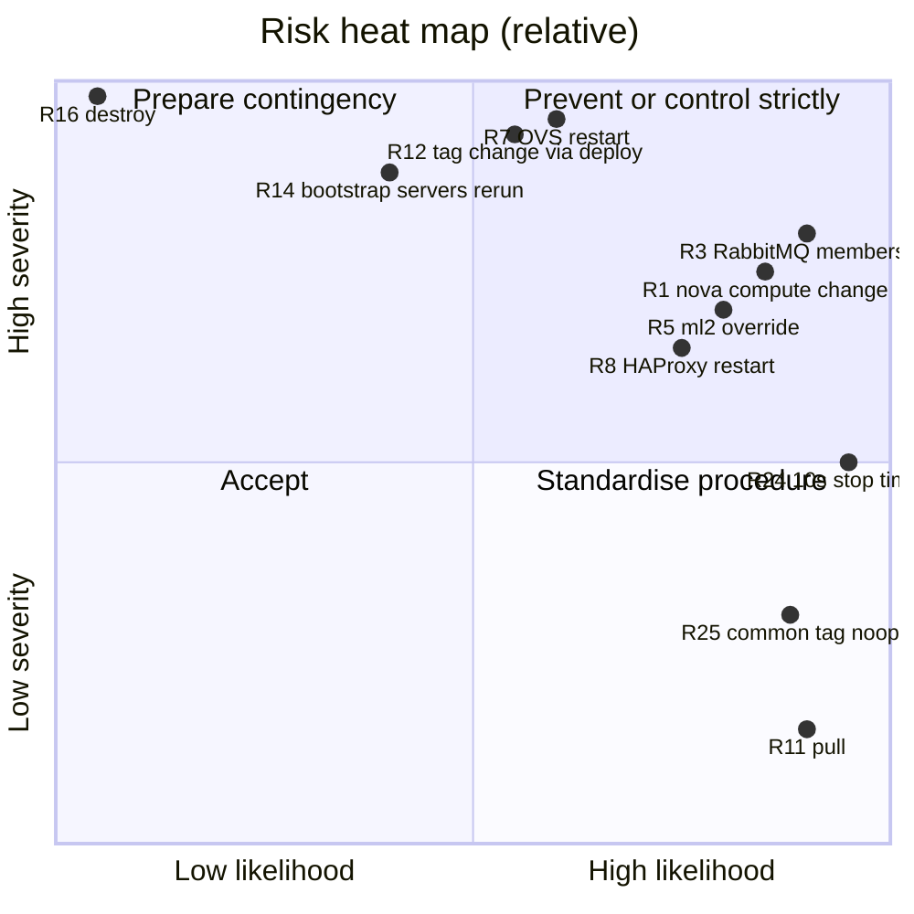

# Risk register

Potentially dangerous operations on a running Kolla-Ansible Ussuri platform: their impact and the precautions to take
before running them. Ratings are relative to a production cloud with running VMs.

> [!NOTE]
> **Key answers**
>
> - **25 risks (R1–R25)**, each with what actually happens, its blast radius, VM and API impact, likelihood, severity,
>   precautions and evidence ([Matrix](#matrix)).
> - **Rated Critical:** [R7](#r7) (`openvswitch_vswitchd` restart or recreate), [R12](#r12) (changing the image tag and
>   running `deploy` instead of `upgrade`), [R14](#r14) (`bootstrap-servers` re-run on a live host), [R15](#r15)
>   (`kolla-ansible stop`) and [R16](#r16) (`kolla-ansible destroy`).
> - **Computes and VMs:** [R1](#r1). Any config change touching nova-compute, followed by a `deploy`/`reconfigure` with
>   a nova tag or no tag, restarts `nova_compute`, `nova_libvirt` and `nova_ssh` on every affected compute, all at once
>   with the default serial 0; whether live migrations in flight fail and whether running VMs keep running are
>   [NOT AVAILABLE].
> - **Network data plane:** [R5](#r5) (an `ml2_conf.ini` override restarts every OVS agent), [R6](#r6) (with
>   `enable_neutron_agent_ha: yes`, the L3 agent wrapper runs `neutron-netns-cleanup --force --agent-type l3` before
>   the agent starts) and [R7](#r7); whether VM traffic is interrupted is [NOT AVAILABLE].
> - **Likelihood × severity at a glance:** the [heat map](#heat-map-likelihood--severity).

- **Likelihood** = how likely the operation is to cause the impact *when the triggering condition is present*.
- **Severity** = worst realistic outcome.
- **Evidence** cites the source lines, or the study section that cites them. Nothing was run. [NOT AVAILABLE] marks
  outcomes that the sources do not establish.

## Matrix

| # | Risk | Likelihood | Severity |
|---|---|---|---|
| [R1](#r1) | Config change touching nova-compute | High | High |
| [R2](#r2) | Enabling or disabling a service with a logrotate or fluentd entry | High | Medium–High |
| [R3](#r3) | Changing RabbitMQ membership, password or port | Certain | High |
| [R4](#r4) | Changing memcached membership | Certain | High |
| [R5](#r5) | `ml2_conf.ini` override meant for neutron-server | Certain | High |
| [R6](#r6) | `neutron_l3_agent` restart with `enable_neutron_agent_ha: yes` | Certain (if HA flag) | High |
| [R7](#r7) | `openvswitch_vswitchd` restart or recreate | Certain on image change | Critical |
| [R8](#r8) | HAProxy config change | Certain if changed | High |
| [R9](#r9) | MariaDB config change or image change | Certain if changed | High |
| [R10](#r10) | RabbitMQ image change (`upgrade`) | Certain on upgrade | High |
| [R11](#r11) | `kolla-ansible pull` | – | Low (bandwidth) |
| [R12](#r12) | Image tag change run with `deploy` instead of `upgrade` | Certain | Critical |
| [R13](#r13) | Rebuilt image under the same tag, then `deploy`/`reconfigure` without `pull` | – | Medium (drift) |
| [R14](#r14) | `bootstrap-servers` re-run on a live host | Medium | Critical |
| [R15](#r15) | `kolla-ansible stop` | Certain | Critical |
| [R16](#r16) | `kolla-ansible destroy` | Certain | Critical |
| [R17](#r17) | `prune-images` | Low | Low |
| [R18](#r18) | `mariadb_recovery` | Certain | High |
| [R19](#r19) | Keystone `reconfigure` | Certain if changed | Medium–High |
| [R20](#r20) | Glance reconfigure / deploy | Certain | Medium |
| [R21](#r21) | Enabling Swift (or `glance_backend_ceph`) on a running cloud | High | High |
| [R22](#r22) | Inventory reordering | Medium | High |
| [R23](#r23) | Any run with `--limit` on a large inventory | Certain | Low (time), Medium (drift) |
| [R24](#r24) | Effective container stop timeout is 10 s | Certain | Medium |
| [R25](#r25) | `-t common` believed to reconfigure fluentd/cron | Certain | Low–Medium (surprise) |

### R1 — Config change touching nova-compute

| | |
|---|---|
| **Operation / trigger** | Any config change touching **nova-compute** (override, global flag, password, RabbitMQ list) followed by `deploy`/`reconfigure` with a nova tag or no tag |
| **What actually happens** | `nova_compute` **and `nova_libvirt` and `nova_ssh`** restart on every affected compute, **all at once** (serial 0). The cause is the loop-notify behaviour |
| **Blast radius** | all computes |
| **VM impact** | libvirtd restart; [NOT AVAILABLE] whether live migrations in flight fail and whether running VMs keep running |
| **API impact** | nova-compute restarts on each host; [NOT AVAILABLE] how long it is down |
| **Likelihood** | High |
| **Severity** | High |
| **Precautions** | `genconfig` + `diff`, then `deploy-containers --limit` in batches, or `ANSIBLE_SERIAL`; drain live migrations first; validate libvirt restart behaviour in staging |
| **Evidence** | `roles/nova-cell/tasks/check-containers.yml:2-20`, `roles/nova-cell/defaults/main.yml:3-54`, `nova.yml:132`; ansible 2.9.27 `lib/ansible/executor/playbook_executor.py:276-278` (serial 0 = one batch); [Tags §2.4](tags.md#24-loop-notify-one-changed-item-notifies-the-handlers-of-all-items-code); [Nova deep dive §5](../components/nova-deep-dive.md#5-nova-libvirt-why-its-restart-is-special) |

### R2 — Enabling or disabling a service with a logrotate or fluentd entry

| | |
|---|---|
| **Operation / trigger** | Enabling or disabling a service that has a logrotate or fluentd input entry (`enable_X` for most OpenStack services, e.g. barbican) in `globals.yml`, then running any play that includes `common` |
| **What actually happens** | `td-agent.conf` and `logrotate.conf` render differently on **every host** → `fluentd`, `cron` **and `kolla_toolbox`** restart (loop-notify) on every host where a play that runs `common` executes: the whole fleet for an untagged run, only the tagged service's hosts for a tagged run (`-t nova` with the `multinode` inventory: the `control` and `compute` hosts, which the `nova.yml` plays target; the others keep the old files until a later run includes `common` there). Nova/Cinder/Glance configs gain sections (e.g. `[barbican]`) → those services restart too. Flags in neither list (e.g. `enable_prometheus`, `enable_ovn`, `enable_openvswitch`, `enable_memcached`, `enable_placement`, `enable_redis`) leave both files unchanged |
| **Blast radius** | fleet-wide (untagged run); the service's hosts (tagged run) |
| **VM impact** | fluentd, cron and kolla_toolbox are none of the containers that [Tags §3.1](tags.md#31-per-tag-answers-files-vms-apis-networkingstorage-safety-prerequisites) traces to running VMs [CODE]; [NOT AVAILABLE] whether their restart affects VMs another way ([Apply `common` changes (fluentd, cron, kolla_toolbox) §3](../operations/apply-common-changes.md#3-how-common-actually-reaches-hosts)); Nova restarts as R1 |
| **API impact** | the services whose configs changed restart (stop up to 10 s, then start; [R24](#r24)); [NOT AVAILABLE] how long their APIs are unavailable, and whether the fluentd, cron and kolla_toolbox restarts affect APIs ([Apply `common` changes (fluentd, cron, kolla_toolbox) §3](../operations/apply-common-changes.md#3-how-common-actually-reaches-hosts)) |
| **Likelihood** | High |
| **Severity** | Medium–High |
| **Precautions** | Treat `enable_*` changes as fleet-wide changes. Roll out with `--limit` batches |
| **Evidence** | `roles/common/tasks/config.yml:109-240`, `roles/common/defaults/main.yml:105-187`, `roles/common/tasks/check-containers.yml:2-17` (loop-notify, [Tags §2.4](tags.md#24-loop-notify-one-changed-item-notifies-the-handlers-of-all-items-code)); `roles/nova-cell/templates/nova.conf.j2:234-239`; `site.yml:132-133`, `nova.yml:29-132`, `inventory/multinode:138-139,287-309` |

### R3 — Changing RabbitMQ membership, password or port

| | |
|---|---|
| **Operation / trigger** | Changing RabbitMQ group membership (adding/removing a controller), RabbitMQ password or port |
| **What actually happens** | `rpc_transport_url` changes in **every** messaging service on every host → all nova, neutron (and any compute-side agent) containers restart; `update_cell` rewrites the cell's MQ URL |
| **Blast radius** | all hosts |
| **VM impact** | as R1 plus neutron agent restart; [NOT AVAILABLE] its effect on flows |
| **API impact** | yes |
| **Likelihood** | Certain |
| **Severity** | High |
| **Precautions** | Plan as a maintenance; batch with `--limit`; verify RabbitMQ cluster health first |
| **Evidence** | `group_vars/all.yml:206,216`; `roles/nova-cell/tasks/create_cells.yml:31-55`; loop-notify ([Tags §2.4](tags.md#24-loop-notify-one-changed-item-notifies-the-handlers-of-all-items-code)) |

### R4 — Changing memcached membership

| | |
|---|---|
| **Operation / trigger** | Changing memcached membership |
| **What actually happens** | 38 roles embed the memcached host list in their configs (37 template loops plus monasca's `monasca_memcached_servers`; [fact sheet B §3.10](../reference/factsheets/b-mariadb-rabbitmq-keystone.md#310-runtime-dependency-of-other-services-on-keystone-grep-across-ansiblerolestemplates) counts 36, corrected in [Per-role fact sheets](../reference/factsheets/index.md)), so their services restart when their plays run; [NOT AVAILABLE] whether cached tokens are lost. Not only the control plane: `neutron.conf` is shared by every neutron agent, so `neutron_openvswitch_agent` restarts on every compute and network node, and the dhcp, l3 and metadata agents, which get the same file, restart on network nodes; `cinder.conf` reaches cinder-volume/backup and `ceilometer.conf` ceilometer-compute. Compute `nova.conf` has no memcached list |
| **Blast radius** | controllers + network nodes + all computes (+ storage) |
| **VM impact** | as R5: OVS agent restart; [NOT AVAILABLE] its effect on flows, and whether router/DHCP traffic is interrupted on network nodes; with `enable_neutron_agent_ha`, the R6 netns cleanup |
| **API impact** | memcached server list changes; [NOT AVAILABLE] effect on auth latency and Horizon sessions |
| **Likelihood** | Certain |
| **Severity** | High |
| **Precautions** | Plan as a dataplane change, like R3/R5: batch with `--limit` or `ANSIBLE_SERIAL`, network nodes one at a time; low-traffic window |
| **Evidence** | [fact sheet B §3.9](../reference/factsheets/b-mariadb-rabbitmq-keystone.md#39-operationally-notable-behaviour-risks-and-oddities) item 2, [§3.10](../reference/factsheets/b-mariadb-rabbitmq-keystone.md#310-runtime-dependency-of-other-services-on-keystone-grep-across-ansiblerolestemplates); `roles/neutron/templates/neutron.conf.j2:119`, `roles/neutron/tasks/config.yml:73-98` |

### R5 — `ml2_conf.ini` override meant for neutron-server

| | |
|---|---|
| **Operation / trigger** | `/etc/kolla/config/neutron/ml2_conf.ini` override (meant for neutron-server) |
| **What actually happens** | also merged into `openvswitch_agent.ini` → **every OVS agent** restarts (computes + network). On network nodes, loop-notify also restarts dhcp, l3 and metadata agents |
| **Blast radius** | network + all computes |
| **VM impact** | OVS agent restart; [NOT AVAILABLE] its effect on flows, and whether router/DHCP traffic is interrupted on network nodes |
| **API impact** | neutron-server restart |
| **Likelihood** | Certain |
| **Severity** | High |
| **Precautions** | Put server-only options in `neutron/neutron-server.conf`, or check the rendered `openvswitch_agent.ini` diff |
| **Evidence** | `roles/neutron/tasks/config.yml:172-190`, `roles/neutron/tasks/check-containers.yml:2-18` (loop-notify, [Tags §2.4](tags.md#24-loop-notify-one-changed-item-notifies-the-handlers-of-all-items-code)) |

### R6 — `neutron_l3_agent` restart with `enable_neutron_agent_ha: yes`

| | |
|---|---|
| **Operation / trigger** | Any restart of `neutron_l3_agent` with `enable_neutron_agent_ha: yes` |
| **What actually happens** | the wrapper runs `neutron-netns-cleanup --force --agent-type l3` **before** the agent starts (the wrapper's comment: "Remove all l3 related netns"), then `neutron-l3-agent` starts [CODE]. [NOT AVAILABLE] What the command deletes: it is neutron code, which is not in these sources ([F12](../reference/findings.md#f12)) |
| **Blast radius** | network nodes (and DVR computes) |
| **VM impact** | [NOT AVAILABLE] whether north-south and floating-IP traffic of the routers on that node stops, whether and when `neutron-l3-agent` rebuilds the namespaces, and whether HA routers fail over |
| **API impact** | none |
| **Likelihood** | Certain (if HA flag) |
| **Severity** | High |
| **Precautions** | Restart network nodes one at a time; fail routers over first |
| **Evidence** | `roles/neutron/templates/neutron-l3-agent-wrapper.sh.j2:5-18` |

### R7 — `openvswitch_vswitchd` restart or recreate

| | |
|---|---|
| **Operation / trigger** | `openvswitch_vswitchd` restart or recreate (image change, `start-ovs` change, `-t openvswitch` with a changed image; also any `openvswitch_db`-only drift, e.g. a `start-ovsdb-server` change or a db image, volume or dimension change: `check-containers` loops over both OVS services, so loop-notify ([Tags §2.4](tags.md#24-loop-notify-one-changed-item-notifies-the-handlers-of-all-items-code)) also notifies the vswitchd handler, which runs after the db restart and wait) |
| **What actually happens** | `ovs-vswitchd` (the userspace daemon) restarts. The image only runs `modprobe openvswitch` (the kernel module is loaded, never unloaded or reloaded), and `start-ovs` launches `ovs-vswitchd` with no flow save/restore. Bridges and ports persist in `conf.db` on the `openvswitch_db` volume. [NOT AVAILABLE] Whether the OpenFlow tables held by the old daemon are lost, and whether `neutron-openvswitch-agent` (or `ovn-controller` with OVN) reprograms them |
| **Blast radius** | per host (all OVS hosts at once with serial 0) |
| **VM impact** | [NOT AVAILABLE] whether **all VM network traffic on the host** is interrupted until flows are restored, and for how long |
| **API impact** | none |
| **Likelihood** | Certain on image change |
| **Severity** | Critical |
| **Precautions** | Upgrade or recreate OVS host by host with evacuation or acceptance; never fleet-wide with serial 0 |
| **Evidence** | `roles/openvswitch/handlers/main.yml:2-42`, `roles/openvswitch/tasks/check-containers.yml:2-17`, `roles/openvswitch/templates/start-ovs.j2:2`, `roles/openvswitch/defaults/main.yml:59`; kolla `docker/openvswitch/openvswitch-vswitchd/extend_start.sh:3`; [Kolla images §5](../concepts/kolla-images.md#5-per-image-start-behaviour) |

### R8 — HAProxy config change

| | |
|---|---|
| **Operation / trigger** | HAProxy config change (any service frontend, certs, `haproxy.cfg`) |
| **What actually happens** | `haproxy` **restarted** (never reloaded) on all haproxy hosts at once; [NOT AVAILABLE] whether keepalived drops or moves the VIP, and for how long |
| **Blast radius** | all APIs + **all DB traffic** (DB address is the VIP) |
| **VM impact** | none directly; [NOT AVAILABLE] whether nova/neutron get DB errors while haproxy restarts |
| **API impact** | yes |
| **Likelihood** | Certain if changed |
| **Severity** | High |
| **Precautions** | `ANSIBLE_SERIAL=1` for haproxy changes; `--skip-tags haproxy` when you don't intend to change frontends |
| **Evidence** | [fact sheet A §1.8](../reference/factsheets/a-infra-lb-ovn.md#18-operationally-notable-behaviour) |

### R9 — MariaDB config change or image change

| | |
|---|---|
| **Operation / trigger** | MariaDB config change or image change |
| **What actually happens** | rolling restart in 4 waves by `index % 4`, one wave after another; each wave waits up to 10 × 6 s for WSREP Synced. A node that fails its wait marks only its own host failed, so the next wave still restarts its nodes. HAProxy's single active backend is node 0. [NOT AVAILABLE] Whether node 0's wave runs first |
| **Blast radius** | DB cluster |
| **VM impact** | none directly |
| **API impact** | DB connection resets |
| **Likelihood** | Certain if changed |
| **Severity** | High |
| **Precautions** | Check `wsrep_cluster_size` and `Synced` on all nodes before; take a backup (`mariadb_backup`); watch between waves |
| **Evidence** | [fact sheet B §1.2](../reference/factsheets/b-mariadb-rabbitmq-keystone.md#12-mariadb_services-ansiblerolesmariadbdefaultsmainyml2-47), [§1.5](../reference/factsheets/b-mariadb-rabbitmq-keystone.md#15-handlers-ansiblerolesmariadbhandlersmainyml-in-definition-order), [§1.8](../reference/factsheets/b-mariadb-rabbitmq-keystone.md#18-operationally-notable-behaviour-risks-and-oddities) items 1 and 3; `roles/mariadb/handlers/main.yml:66-78`, `roles/mariadb/tasks/restart_services.yml:28-39`; ansible 2.9.27 `lib/ansible/playbook/included_file.py:51-56,92-95` (one included file per loop item), `lib/ansible/plugins/strategy/__init__.py:1045-1063` (included files run one after another); `:548-561` (a failure marks only that host failed), `:1019-1020` (each notified host is checked on its own); no MariaDB play sets `any_errors_fatal` (only `nova.yml:75,265`) |

### R10 — RabbitMQ image change (`upgrade`)

| | |
|---|---|
| **Operation / trigger** | RabbitMQ image change (`upgrade`) |
| **What actually happens** | **all brokers stopped**, full message-bus outage during upgrade; config change → one-by-one restart |
| **Blast radius** | all RPC |
| **VM impact** | [NOT AVAILABLE] whether nova-compute heartbeats are lost and services are reported down |
| **API impact** | yes |
| **Likelihood** | Certain on upgrade |
| **Severity** | High |
| **Precautions** | Maintenance window; watch for agent and compute services reported down |
| **Evidence** | [fact sheet B §2.8](../reference/factsheets/b-mariadb-rabbitmq-keystone.md#28-operationally-notable-behaviour-risks-and-oddities) items 1–2 |

### R11 — `kolla-ansible pull`

| | |
|---|---|
| **Operation / trigger** | `kolla-ansible pull` |
| **What actually happens** | downloads images on every host: one `pull_image` per enabled container mapped to the host |
| **Blast radius** | registry + network |
| **VM impact** | none |
| **API impact** | none |
| **Likelihood** | – |
| **Severity** | Low (bandwidth) |
| **Precautions** | Run ahead of maintenance; rate-limit with `--forks`; local registry mirror |
| **Evidence** | `roles/service-images-pull/tasks/main.yml:2-14`; `kolla_docker.py:599-633` |

### R12 — Image tag change run with `deploy` instead of `upgrade`

| | |
|---|---|
| **Operation / trigger** | Changing `openstack_tag` / `*_tag` and running `deploy` instead of `upgrade` |
| **What actually happens** | every container is **recreated** (fleet-wide); upgrade-specific steps (RPC pin removal, nova-status check, online migrations except Placement's, which run inside `bootstrap_placement`, and, with the non-default `ironic_enable_rolling_upgrade: no`, Ironic's inside `bootstrap_ironic`) do **not** run. Neutron: instead of the rolling expand → restart → contract (default `neutron_enable_rolling_upgrade: yes`), `bootstrap_neutron` runs `neutron-db-manage … upgrade head` for neutron, neutron-dynamic-routing, neutron-fwaas and neutron-vpnaas with the new image **before** the old `neutron_server` containers restart; [NOT AVAILABLE] whether `upgrade head` applies the expand and contract branches together, which would run contract migrations under live old-version servers |
| **Blast radius** | fleet-wide |
| **VM impact** | as R1 + R7 + R8 together |
| **API impact** | yes |
| **Likelihood** | Certain |
| **Severity** | Critical |
| **Precautions** | Use `pull` then `upgrade` (Ussuri docs); per-service tags; `ANSIBLE_SERIAL` |
| **Evidence** | `kolla_docker.py:403-418,781-803` (new image → recreate); `doc/source/user/operating-kolla.rst:119-142`; `roles/neutron/tasks/deploy.yml:18-21`, `roles/neutron/tasks/bootstrap_service.yml:2-22`, `roles/neutron/tasks/rolling_upgrade.yml:13-93`; kolla `docker/neutron/neutron-server/extend_start.sh:5-12`, `docker/placement/placement-api/extend_start.sh:5-9`, `docker/ironic/ironic-api/extend_start.sh:5-8`; `roles/ironic/tasks/bootstrap_service.yml:16`, `roles/ironic/defaults/main.yml:206`; [Kolla images §4](../concepts/kolla-images.md#4-one-shot-containers-what-the-environment-variables-run) |

### R13 — Rebuilt image under the same tag, then `deploy`/`reconfigure` without `pull`

| | |
|---|---|
| **Operation / trigger** | Rebuilt image pushed under the **same tag**, then `deploy`/`reconfigure` without `pull` |
| **What actually happens** | nothing changes (only absent images are pulled). After `pull`: recreate, plus loop-notify restarts |
| **Blast radius** | – / role-wide |
| **VM impact** | as R1 |
| **API impact** | – |
| **Likelihood** | – |
| **Severity** | Medium (drift) |
| **Precautions** | Use immutable tags; always `pull` deliberately |
| **Evidence** | `kolla_docker.py:299-307,403-418,781-808`; loop-notify ([Tags §2.4](tags.md#24-loop-notify-one-changed-item-notifies-the-handlers-of-all-items-code)) |

### R14 — `bootstrap-servers` re-run on a live host

| | |
|---|---|
| **Operation / trigger** | `bootstrap-servers` re-run on a live host |
| **What actually happens** | can **restart the Docker daemon** (if `daemon.json` changes) → every container on the host restarts, on **all hosts at once** by default; also disables firewalld/ufw, sets SELinux permissive, removes host packages (`open-iscsi`, `libvirt*`, `chrony`, …) |
| **Blast radius** | per host / fleet |
| **VM impact** | Docker restart = nova_libvirt + OVS restart → see R1/R7 |
| **API impact** | yes |
| **Likelihood** | Medium |
| **Severity** | Critical |
| **Precautions** | Run only with `--limit` on new hosts, or `-e kolla_serial=1`; diff `daemon.json` first |
| **Evidence** | [fact sheet E §1–2](../reference/factsheets/e-host-bootstrap-ops-playbooks.md#1-ansiblekolla-hostyml-the-bootstrap-servers-command) |

### R15 — `kolla-ansible stop`

| | |
|---|---|
| **Operation / trigger** | `kolla-ansible stop` |
| **What actually happens** | stops all Kolla containers (incl. nova_libvirt, OVS, MariaDB) on targeted hosts |
| **Blast radius** | targeted hosts |
| **VM impact** | `nova_libvirt` and OVS containers stopped; [NOT AVAILABLE] whether VM network traffic stops (see R7) |
| **API impact** | yes |
| **Likelihood** | Certain |
| **Severity** | Critical |
| **Precautions** | Use `--limit` + tags + `skip_stop_containers`; MariaDB then needs `mariadb_recovery` |
| **Evidence** | `tools/kolla-ansible:441-453`; [fact sheet B §1.3](../reference/factsheets/b-mariadb-rabbitmq-keystone.md#13-task-flow-per-kolla_action) (stop), [§1.8](../reference/factsheets/b-mariadb-rabbitmq-keystone.md#18-operationally-notable-behaviour-risks-and-oddities) item 4 |

### R16 — `kolla-ansible destroy`

| | |
|---|---|
| **Operation / trigger** | `kolla-ansible destroy` |
| **What actually happens** | removes containers, volumes, `/etc/kolla/*` (except a few files), **all network namespaces and tap/brq/vxlan links** (`tools/cleanup-host`) |
| **Blast radius** | targeted hosts incl. deploy host (`hosts: all`) |
| **VM impact** | total |
| **API impact** | total |
| **Likelihood** | Certain |
| **Severity** | Critical |
| **Precautions** | Never on production; there is no `--limit` safety net beyond what you pass |
| **Evidence** | [fact sheet E §6](../reference/factsheets/e-host-bootstrap-ops-playbooks.md#6-destroy-ansibledestroyyml-role-destroy-toolscleanup-) |

### R17 — `prune-images`

| | |
|---|---|
| **Operation / trigger** | `prune-images` |
| **What actually happens** | removes *dangling* Kolla images only |
| **Blast radius** | per host |
| **VM impact** | none |
| **API impact** | none |
| **Likelihood** | Low |
| **Severity** | Low |
| **Precautions** | – |
| **Evidence** | [fact sheet E §7](../reference/factsheets/e-host-bootstrap-ops-playbooks.md#7-prune-images-ansibleprune-imagesyml-role-prune-images) |

### R18 — `mariadb_recovery`

| | |
|---|---|
| **Operation / trigger** | `mariadb_recovery` |
| **What actually happens** | **stops every MariaDB node**, even healthy ones, and bootstraps from the highest seqno |
| **Blast radius** | DB cluster |
| **VM impact** | none directly |
| **API impact** | full DB outage |
| **Likelihood** | Certain |
| **Severity** | High |
| **Precautions** | Only when the cluster is fully down; identify the node with the highest seqno manually first |
| **Evidence** | [fact sheet B §1.3](../reference/factsheets/b-mariadb-rabbitmq-keystone.md#13-task-flow-per-kolla_action) (Recovery step 3), [§1.8](../reference/factsheets/b-mariadb-rabbitmq-keystone.md#18-operationally-notable-behaviour-risks-and-oddities) item 5 |

### R19 — Keystone `reconfigure`

| | |
|---|---|
| **Operation / trigger** | Keystone `reconfigure` (any keystone change, including memcached/RabbitMQ membership) |
| **What actually happens** | all keystone containers restart on all hosts at once; fernet keys re-pushed from the first running node, deleting others' keys; db sync runs |
| **Blast radius** | identity |
| **VM impact** | none |
| **API impact** | [NOT AVAILABLE] whether authentication fails while keystone restarts |
| **Likelihood** | Certain if changed |
| **Severity** | Medium–High |
| **Precautions** | `ANSIBLE_SERIAL`; verify fernet key consistency before and after |
| **Evidence** | [fact sheet B §3.5](../reference/factsheets/b-mariadb-rabbitmq-keystone.md#35-handlers-ansibleroleskeystonehandlersmainyml-order-is-load-bearing-comment-2-3), [§3.6](../reference/factsheets/b-mariadb-rabbitmq-keystone.md#36-fernet-key-lifecycle-fact-unless-marked), [§3.7](../reference/factsheets/b-mariadb-rabbitmq-keystone.md#37-bootstrap-db-and-registration-what-re-runs-on-reconfigure), [§3.9](../reference/factsheets/b-mariadb-rabbitmq-keystone.md#39-operationally-notable-behaviour-risks-and-oddities) items 1–2 |

### R20 — Glance reconfigure / deploy

| | |
|---|---|
| **Operation / trigger** | Glance reconfigure / deploy |
| **What actually happens** | toggles **global** MariaDB `log_bin_trust_function_creators` 1→0 around db sync; with the file backend only `glance-api[0]` exists → any restart is a full Image API outage |
| **Blast radius** | DB + glance |
| **VM impact** | [NOT AVAILABLE] whether snapshots in progress fail |
| **API impact** | Image API outage |
| **Likelihood** | Certain |
| **Severity** | Medium |
| **Precautions** | Avoid during image-heavy operations |
| **Evidence** | [fact sheet C §1](../reference/factsheets/c-glance-placement-cinder-horizon-heat.md#1-glance) |

### R21 — Enabling Swift (or `glance_backend_ceph`) on a running cloud

| | |
|---|---|
| **Operation / trigger** | Enabling Swift (or `glance_backend_ceph`) on a running cloud |
| **What actually happens** | silently switches Glance's backend; [NOT AVAILABLE] whether existing file-store images stay readable |
| **Blast radius** | glance |
| **VM impact** | [NOT AVAILABLE] whether boots from existing images fail |
| **API impact** | yes |
| **Likelihood** | High |
| **Severity** | High |
| **Precautions** | Set `glance_backend_*` explicitly before enabling Swift |
| **Evidence** | [fact sheet C §1.8](../reference/factsheets/c-glance-placement-cinder-horizon-heat.md#18-operational-notes) |

### R22 — Inventory reordering

| | |
|---|---|
| **Operation / trigger** | Inventory reordering (haproxy, mariadb, glance, nova-conductor, keystone groups) |
| **What actually happens** | keepalived priorities change; MariaDB restart waves and active backend move; glance moves (file backend); bootstrap/discovery target changes |
| **Blast radius** | per group |
| **VM impact** | indirect |
| **API impact** | possible |
| **Likelihood** | Medium |
| **Severity** | High |
| **Precautions** | Treat inventory order as configuration; never reorder casually |
| **Evidence** | fact sheets [A §1.8](../reference/factsheets/a-infra-lb-ovn.md#18-operationally-notable-behaviour), [B §1.2](../reference/factsheets/b-mariadb-rabbitmq-keystone.md#12-mariadb_services-ansiblerolesmariadbdefaultsmainyml2-47), [§1.5](../reference/factsheets/b-mariadb-rabbitmq-keystone.md#15-handlers-ansiblerolesmariadbhandlersmainyml-in-definition-order), [C §1](../reference/factsheets/c-glance-placement-cinder-horizon-heat.md#1-glance) |

### R23 — Any run with `--limit` on a large inventory

| | |
|---|---|
| **Operation / trigger** | Any run **with `--limit`** on a large inventory |
| **What actually happens** | fact gathering for **all** hosts is executed **sequentially** by the limited hosts (delegated loop) → long runtime; `/etc/hosts` and other cross-host files are not updated on non-limited hosts |
| **Blast radius** | – |
| **VM impact** | none |
| **API impact** | none |
| **Likelihood** | Certain |
| **Severity** | Low (time), Medium (drift) |
| **Precautions** | Enable fact caching (`ansible-tuning.rst`); follow up with a full run when cross-host config changed |
| **Evidence** | `gather-facts.yml:29-50` (each limited host loops over its share of `groups['all']`: one delegated `setup` per host without facts); ansible 2.9.27 `lib/ansible/executor/task_executor.py:317-367` (loop items run one after another) |

### R24 — Effective container stop timeout is 10 s

| | |
|---|---|
| **Operation / trigger** | Effective container stop timeout is **10 s**, not `docker_graceful_timeout` |
| **What actually happens** | on every restart, a service still running 10 s after SIGTERM is SIGKILLed (heat-engine, cinder-volume copies, glance uploads); for `nova_libvirt` this matters only if libvirtd has not exited by then ([Nova deep dive §5](../components/nova-deep-dive.md#5-nova-libvirt-why-its-restart-is-special)). [NOT AVAILABLE] Whether services started by a shell wrapper that does not `exec` them (e.g. `neutron-l3-agent`, `haproxy`, `ovs-vswitchd`, `ovsdb-server`) receive SIGTERM at all ([Kolla images §2.6](../concepts/kolla-images.md#26-signals-and-pid-1)) |
| **Blast radius** | all restarts |
| **VM impact** | in-flight operations killed |
| **API impact** | – |
| **Likelihood** | Certain |
| **Severity** | Medium |
| **Precautions** | Drain long operations before restarts; patch `kolla_docker` or pass `graceful_timeout` if needed |
| **Evidence** | `kolla_docker.py:871-884,892-904,991,1037-1047`; `group_vars/all.yml:153`; [Repository architecture §6](../concepts/repository-architecture.md#6-custom-modules--container-lifecycle-via-kolla_docker); kolla `docker/base/Dockerfile.j2:434`, `docker/base/start.sh:21` |

### R25 — `-t common` believed to reconfigure fluentd/cron

| | |
|---|---|
| **Operation / trigger** | `-t common` believed to reconfigure fluentd/cron |
| **What actually happens** | **no-op** → config drift remains and is applied unexpectedly later by an unrelated service run |
| **Blast radius** | – |
| **VM impact** | – |
| **API impact** | – |
| **Likelihood** | Certain |
| **Severity** | Low–Medium (surprise) |
| **Precautions** | Use `-t chrony` (all hosts) or a service tag; verify with `docker exec … kolla_set_configs --check` |
| **Evidence** | `roles/common/tasks/main.yml:1-10`; [Tags §2.1](tags.md#21-dynamic-include_tasks-and-tag-inheritance-code) |

## Heat map (likelihood × severity)

## Related

- [Operations](../operations/index.md) — the scenario walk-throughs and the commands
- [Pre-execution checklist](../operations/pre-execution-checklist.md) — what to check before a run
- [Open questions](../troubleshooting/open-questions.md) — the open questions behind the [NOT AVAILABLE] cells
- [Tag index](tag-index.md) — from a tag to its component page, which lists the risks of the tag
- [What a tag really executes](tags.md) — loop-notify and the other tag semantics that the evidence cells cite
