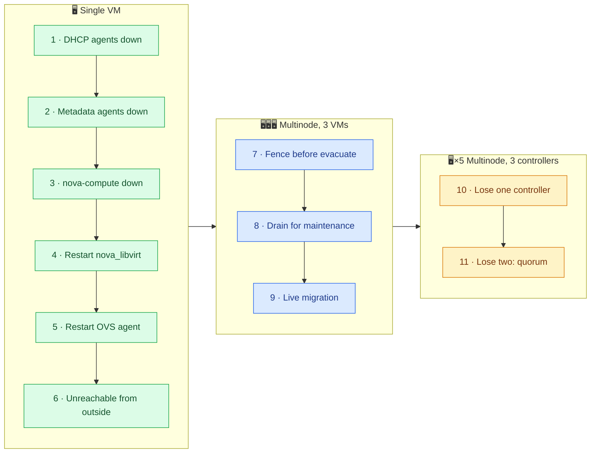

# 🧪 Quick lab

**Scripts that build a complete, disposable OpenStack (2026.1) on a cloud VM in about an hour, exercises to break
and repair it, and one command that deletes it all.**

[Pick a lab](#pick-your-lab) · [Commands](#-the-three-commands) · [Exercises](#-exercises) ·
[Delete it all](#delete-everything-when-you-are-done)


> [!NOTE]
> **Status: early, tested on one cloud.** Both variants and all eleven exercises were run end to end between
> 2026-10-23 and 2026-10-25 by OzarLand's AI lab agents (exercises 10 and 11 were edited after their run and not
> run again), on one OpenStack cloud (Felcloud, the reference cloud
> below), with OpenStack 2026.1, Kolla-Ansible 22.2.0 and Ubuntu 24.04, in a project reaching the Internet through an
> HTTPS proxy. Not tested yet: other clouds, a project with direct Internet access, and a run by a person following the
> guide. Known script gaps are tracked in [issue #25](https://github.com/OzarLand/openstack-quick-lab/issues/25).
> Reports from your cloud are the most useful contribution.


On a prepaid cloud you cannot spend more than your credit; on any other cloud, set a budget alert first.

## Pick your lab


| | [Single VM](variants/openstack-cloud/index.md) (`openstack-cloud`) | [Multinode](variants/openstack-cloud-multinode/index.md) (`openstack-cloud-multinode`) |
|---|---|---|
| 🎯 **What you can practise** | The core services: DHCP, metadata, Nova, Open vSwitch, security groups and floating IPs (exercises 1 to 6) | 3 VMs: live migration, a failed compute, host maintenance (exercises 7 to 9). 5 VMs: also a failed controller, Galera and RabbitMQ, VIP failover (exercises 10 and 11) |
| 🖥️ **VMs and quota** | 1 VM: 4 vCPU, 16 GB RAM, 50 GB disk | 3 VMs: 12 vCPU, 32 GB RAM. 5 VMs (`CONTROLLERS="3"`): 20 vCPU, 64 GB RAM |
| ⏱️ **Time** | About 1 hour (57 min measured, `create.sh` to `destroy.sh`) | Measured, `create.sh` to `destroy.sh`: 65 min with 3 VMs, about 75 min with 5 VMs |
| 💶 **Cost of one run** | 0.19 TND (0.05 EUR); 0.20 TND (0.06 EUR) with a floating IP | 3 VMs: 0.52 TND (0.15 EUR). 5 VMs: 1.08 TND (0.32 EUR) |
| 🔥 **Cost of each forgotten day** | 4.70 TND (1.37 EUR); 5.06 TND (1.49 EUR) with a floating IP | 3 VMs: 11.42 TND (3.34 EUR). 5 VMs: 20.83 TND (6.07 EUR) |

🌱 **New to OpenStack? Start with the single VM.** The costs are the measured duration multiplied by the reference cloud's listed prices on
2026-10-23 (not an invoice); each guide has the details. Felcloud, OzarLand's first sponsor, provides the cloud credit used to
build and test OzarLand's labs, and has no say over the content; its prepaid model fits a lab with no surprise bill.
No provider is required: every variant works on any OpenStack cloud that meets its requirements. Its [pricing page](https://felcloud.io/pricing) says: "Top up your
balance and spend only what you loaded." (checked on 2026-10-23).

> [!CAUTION]
> On any cloud: on a **prepaid** one, load only the credit you are ready to spend; on a **pay-as-you-go** one, you are
> billed for every hour the VMs, their volumes and floating IPs exist, so **set a budget alert** in your provider's
> console before you start. A variant for a personal machine with KVM, with no cloud cost, is
> [wanted](https://github.com/OzarLand/openstack-quick-lab/issues/5).

## 🔄 How it works


`create.sh` shows the estimated cost per hour and asks before creating anything. `deploy.sh` deploys OpenStack with
[Kolla-Ansible](https://docs.openstack.org/kolla-ansible/latest/). `destroy.sh` deletes what `create.sh` created and
fails loudly if anything is left.

## 💻 The three commands

You need an OpenStack cloud account, its `clouds.yaml`, `bash`, `ssh`, `python3` and the OpenStack client: the
guide lists them. The scripts are in the repository of OzarLand Academy, under `docs/lab/variants/`:

```bash
git clone https://github.com/OzarLand/ozarland-academy.git
cd ozarland-academy/docs/lab/variants/openstack-cloud    # or openstack-cloud-multinode
```

In the variant's directory:

```bash
cp config.example.env config.env && $EDITOR config.env   # your cloud, network and price per hour
./create.sh     # shows what it will create and the cost, asks, creates
./deploy.sh     # about an hour; run it again after a failure, it resumes
./destroy.sh    # when you are done: deletes everything, after asking
```

Then do your first exercise: [DHCP agents down](exercises/01-dhcp-agents-down.md).

## Delete everything when you are done

> [!CAUTION]
> 🛑 **A lab left running keeps costing money** on a pay-as-you-go cloud, and keeps using credit on a prepaid one.
>
> 1. Run `./destroy.sh` in the variant's directory. After asking, it deletes everything `create.sh` created (VMs,
>    key, security group, ports, floating IP, root volumes if any, and the multinode variant's lab network and subnet) and fails loudly if anything is left.
> 2. Check in your provider's console, or with `openstack server list`, `openstack volume list` and
>    `openstack floating ip list`, that nothing from the lab is left.
> 3. On a pay-as-you-go cloud, check the next day that the usage really stopped.

Every exercise ends with the same reminder: **Done with the lab for today?** Delete everything: a running lab keeps
costing.

## 🧪 Exercises

Each exercise breaks one thing on purpose and repairs it with a runbook from
[openstack-vm-runbooks](../runbooks/), or, for 10 and 11, a page of
[kolla-ansible-deployment-patterns](../deploy/). [All the exercises](exercises/index.md).



| # | Exercise | Needs | Runbook |
|---|---|---|---|
| 1 | [DHCP agents down: a new instance gets no address](exercises/01-dhcp-agents-down.md) | 🖥️ Single VM | [New instance gets no IP](../runbooks/networking/new-instance-gets-no-ip-dhcp-agents-down/) |
| 2 | [Metadata agents down: a new instance gets no SSH key](exercises/02-metadata-agents-down.md) | 🖥️ Single VM | [New instance boots without metadata](../runbooks/networking/new-instance-boots-without-metadata/) |
| 3 | [nova-compute down: instances keep running](exercises/03-nova-compute-down.md) | 🖥️ Single VM | [nova-compute down, instances still running](../runbooks/recovery/nova-compute-down-instances-still-running/) |
| 4 | [Restarting nova_libvirt without stopping instances](exercises/04-restart-nova-libvirt.md) | 🖥️ Single VM | [Restarting nova_libvirt does not stop instances](../runbooks/lifecycle/restarting-nova-libvirt-does-not-stop-instances/) |
| 5 | [Restarting the Open vSwitch agent without cutting the network](exercises/05-restart-ovs-agent.md) | 🖥️ Single VM | [Restarting the OVS agent does not cut instances](../runbooks/networking/restarting-the-ovs-agent-does-not-cut-instances/) |
| 6 | [An instance unreachable from outside](exercises/06-instance-unreachable-from-outside.md) | 🖥️ Single VM | [Instance unreachable from outside](../runbooks/networking/instance-unreachable-from-outside/) |
| 7 | [A compute goes down: fence it before you evacuate](exercises/07-compute-down-fence-before-evacuate.md) | 🖥️🖥️🖥️ Multinode | [Fence it before you evacuate](../runbooks/recovery/compute-host-failure-fence-before-evacuate/) |
| 8 | [Drain a compute for planned maintenance](exercises/08-drain-a-compute-for-maintenance.md) | 🖥️🖥️🖥️ Multinode | [Moving instances off a host for maintenance](../runbooks/migration/moving-instances-off-a-host-for-maintenance/) |
| 9 | [Live migration between the two computes](exercises/09-live-migration-between-computes.md) | 🖥️🖥️🖥️ Multinode | [Moving instances off a host for maintenance](../runbooks/migration/moving-instances-off-a-host-for-maintenance/) |
| 10 | [Lose one controller: what keeps working](exercises/10-lose-one-controller.md) | 🖥️×5 Multinode, 3 controllers | Pattern (`draft`): [three controllers, two computes](../deploy/topologies/three-controllers-two-computes-nested-in-an-openstack-cloud/) |
| 11 | [Lose two controllers: quorum lost, and recovered](exercises/11-lose-two-controllers-quorum.md) | 🖥️×5 Multinode, 3 controllers | Procedure: [MariaDB cluster recovery](../deploy/deployment-errors/unattended-upgrades-during-deploy-breaks-the-mariadb-cluster/#recover-the-failed-deploy) |

> [!TIP]
> **In one minute (for managers)**
>
> - **What:** a complete, disposable OpenStack for learning and for trying a procedure before production.
> - **Cost:** one run on the single VM measured about 0.05 EUR (0.19 TND) for 57 minutes. The script shows the cost
>   per hour and asks first.
> - **Risk:** the VMs cost money every hour they exist. Use a prepaid cloud or a budget alert; one command deletes
>   everything.
> - **Who:** anyone comfortable with a terminal and SSH; no OpenStack knowledge needed to start.
> - **Not included:** production use, support, block storage (Cinder), load balancing (Octavia); high availability
>   only on the 5-VM multinode size.

## 🔭 Going further

| | |
|:-:|---|
| 👥 | Who this is for: newcomers who learn by doing, and operators who want a disposable lab to try a runbook. The [newcomer path](https://github.com/OzarLand/ozarland/tree/main/newcomers) explains the vocabulary as you go. |
| 🏗️ | How the labs are built: the [all-in-one lab pattern](../deploy/topologies/all-in-one-lab-on-a-single-vm/) and the [multinode pattern](../deploy/topologies/three-controllers-two-computes-nested-in-an-openstack-cloud/). Each guide states the releases its scripts were last run on. |
| 🔒 | This repository never contains credentials (`clouds.yaml` with secrets, `passwords.yml`) or marketing. Keep yours out of any fork or pull request. |
| 🤝 | New variants, exercises and fixes are welcome: [CONTRIBUTING.md](CONTRIBUTING.md). Any provider can be added as a variant on equal terms; nothing in the exercises depends on the provider. |

## 🌍 Part of OzarLand Academy


This module is the first stop of [OzarLand Academy](../), the learning path of
[OzarLand](https://github.com/OzarLand/ozarland): *a shared land for better OpenStack operations.* After the lab, the
path goes on with deployment patterns, day-2 operations with Kolla-Ansible, VM runbooks, the production guide, the
OKD lab and operator skills.
Questions, corrections and reports from your cloud are welcome in the
[Discussions](https://github.com/OzarLand/ozarland/discussions).

## ⚖️ License

[Apache-2.0](https://github.com/OzarLand/ozarland-academy/blob/main/LICENSE).
