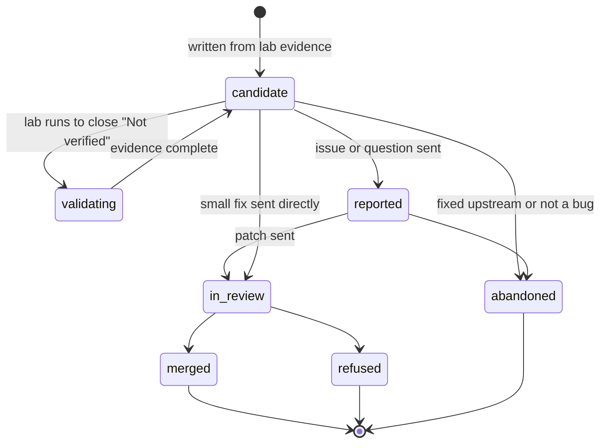

# Upstream contributions workspace

This folder prepares contributions from the lab to the projects it is
built on: the OpenStack operators (`openstack-k8s-operators`) and OKD.
It holds the method, the candidate subjects with their evidence, and the
journal of what is sent.

**Nothing here has been sent upstream.** Every topic is a prepared
candidate: what was observed on the lab, what was read upstream and
when, what remains to be verified, and a draft text. The decision to
send, and the sending, belong to the person whose name will be on the
contribution.

## Start here

Reading this folder takes about an hour:

1. This page: the status board and the suggested first three (5 min).
2. [methodology.md](methodology.md), sections 1, 2 and 6: the method and
   how trust is built (15 min). Sections 3 to 5 are reference material,
   to read when a topic targets that project.
3. The first topic of the board, in full (10 min). Every topic has the
   same ten sections, so the others read fast: start with "Summary",
   "Evidence from the lab" and its "Not verified" list.
4. [topics/rejected.md](topics/rejected.md): what was looked at and
   dropped, and why (5 min).

To work on a topic: close its "Not verified" items on the lab, re-read
the upstream state on the day, fill the
[checklist](templates/pr-checklist.md), send, and write the
[journal](log.md) entry.

## Organisation

| Path | Content |
| --- | --- |
| [methodology.md](methodology.md) | The lab method applied to upstream work; what each project requires (guides, sign-off, tests, review flow, branches, channels, review latency); how trust is built and lost |
| [topics/](topics/) | One file per candidate, same ten sections in each |
| [topics/rejected.md](topics/rejected.md) | Findings examined and not kept, with the reason |
| [templates/issue-report.md](templates/issue-report.md) | Skeleton of an upstream issue |
| [templates/pr-checklist.md](templates/pr-checklist.md) | Checklist to fill before a pull request |
| [log.md](log.md) | Journal of actions towards upstream, newest first |

Rules of the folder are the rules of the repository
([CONTRIBUTING.md](../CONTRIBUTING.md)): no detail of the hosting
environment, nothing marked as tested that was not run, and every
statement about upstream carries a pointer (repository, file, commit or
pull request number) and the date it was read.

## Status board

Upstream state of every topic was read on 2026-11-13; a topic whose
status says "lab evidence complete" was closed on the lab and re-read
upstream on the date given in its file. "Rank" is the
suggested order of work: value for a production operator, strength of
the evidence, and size of the first step.

| Id | Rank | Topic | Repository | Type | Effort | Status |
| --- | --- | --- | --- | --- | --- | --- |
| [07](topics/07-dataplane-troubleshooting-doc-removed-resource.md) | 1 | Troubleshooting page uses a resource removed in 2024 | `openstack-operator` | documentation fix | small | candidate, lab evidence complete (2026-11-14), diff ready |
| [04](topics/04-edpm-bootstrap-masked-package-failure-backport.md) | 2 | Bootstrap hides a failed package installation on CentOS Stream; fixed on `main` only | `edpm-ansible` | backport request | small | candidate, lab evidence complete (2026-11-14), issue text ready |
| [01](topics/01-galerabackup-retention-deletes-nothing.md) | 3 | GaleraBackup `retention` never deletes a file | `mariadb-operator` | bug fix, test | small | candidate, lab evidence complete (2026-11-14), diff ready, chainsaw test to write |
| [02](topics/02-galera-backup-restore-scripts-lose-errexit.md) | 4 | Backup and restore scripts lose `set -e`; a failed restore exits 0 | `mariadb-operator` | bug fix, test | small to medium | candidate, lab evidence complete (2026-11-14), diff ready, chainsaw test to write |
| [08](topics/08-dataplane-confirm-delete-annotation-undocumented.md) | 5 | Annotation required to delete a running deployment is undocumented | `openstack-operator` | documentation | small | candidate, lab evidence complete (2026-11-14), diff ready, `make docs` not run |
| [03](topics/03-nodeset-stale-certificates-after-scale-in.md) | 6 | Certificates of a removed node are left behind after scale-in | `openstack-operator` | bug fix (Go), test | medium | candidate, mechanism from code reading |
| [10](topics/10-infra-operator-crashloop-without-frr-crd.md) | 7 | Operator crash-loops when an optional resource type is absent | `infra-operator` | robustness fix (Go) | small | candidate, seen once |
| [09](topics/09-dataplane-scale-in-doc-gaps.md) | 8 | Scale-in procedure misses three steps | `openstack-operator` | documentation | small to medium | candidate |
| [11](topics/11-okd-update-service-docs.md) | 9 | FAQ and upgrade notes ignore the new update service | `okd-web` | documentation | small | candidate, switch not tested |
| [05](topics/05-ovn-agents-stuck-after-dns-outage.md) | 10 | OVN agents stay disconnected up to 15 minutes after a DNS outage | `edpm-ansible` | test report | small | candidate, lab evidence complete (cause established) |
| [06](topics/06-edpm-agent-healthchecks-not-acted-on.md) | 11 | Agent health checks: one can pass while cut off, none triggers an action | `edpm-ansible` | test report | small to medium | candidate, lower confidence |
| [12](topics/12-install-yamls-okd-path-outdated.md) | 12 | The `OKD=true` developer path dates from 2023 | `install_yamls` | test report | medium | candidate, path not run |
| [13](topics/13-okd-issue-triage-data-points.md) | 13 | Data points on three open OKD 4.22 reports | `okd` | triage help | small | candidate, modest value |

Status values: `candidate` (prepared, nothing sent), `validating` (lab
runs in progress), `reported` (issue or question sent), `in review`
(patch sent), `merged`, `refused`, `abandoned`. A change of status goes
with a journal entry.

## Suggested first three

1. **Topic 07** — a documentation page whose first command fails. Small,
   verifiable by any reviewer in a minute, and it introduces the
   contributor to the documentation and data plane approvers.
2. **Topic 04** — a backport request for a fix the maintainers wrote
   themselves. No design to defend; it shows a real user on the
   community platform and opens the backport conversation.
3. **Topic 01** — a real bug with a few-line fix and a test, in the
   backup path every production operator cares about. Best sent once
   the first two have created a contact.

Topic 08 is the fallback for the first slot if the page of topic 07 is
changed upstream in the meantime.

## Limits of this preparation

- The team's product tracker requires an account and was not read;
  duplicates may exist there for any topic.
- Lab evidence comes from the stable branch. Behaviour on `main` was
  read in the code, not run, unless a topic says otherwise.
- Each topic lists what was not verified. Those lists are the first work
  to do.
