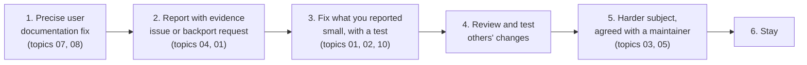

# Contribution methodology

How a finding from this lab becomes an upstream contribution that a
maintainer can accept quickly. The first part carries over the working
rules of the lab. The second part records what each upstream project
requires, as read in its own files on **2026-11-13**; every statement
has a pointer so it can be checked again, because these rules change.

Nothing in this folder has been sent upstream. The journal
([log.md](log.md)) records what is.

## 1. The lab method, applied to upstream work

The lab already works with rules that upstream reviewers value. They are
kept as they are (sources: [CONTRIBUTING.md](../CONTRIBUTING.md), the
[knowledge base conventions](../docs/knowledge-base/index.md), the
[operations conventions](../docs/operations/index.md)).

| Lab rule | What it becomes upstream |
| --- | --- |
| Evidence before claims: every statement in the validation log has an output and a date | An issue or pull request quotes the command, the output, the versions and the date. "It seems that" is replaced by what was seen |
| Reproduce on the lab first | Nothing is reported from code reading alone. If it cannot be reproduced, the report says "read in the code, not reproduced" in those words |
| `[READ-ONLY]`, `[CHANGE]`, `[DESTRUCTIVE]` labels on every command block | Reproduction steps given to a maintainer carry the same labels, so that nobody breaks a cluster by pasting them |
| Never mark something as tested unless it was run | The "Tested" line of a pull request lists exactly what was run, on which branch and version. What was not run is listed too |
| Generic placeholders, no detail of the hosting environment | Outputs are cleaned before posting: `lab.example.com`, documentation address ranges, generic node names. A public tracker is forever |
| Knowledge base entry: context, how, observed, why, pitfalls, see also | The same order makes a good issue: context, steps, observed, expected, analysis, workaround |
| Seven-section troubleshooting structure (initial symptoms, read-only investigation, expected observations, root cause, resolution, verification, risks) | The same sequence carries the analysis part of a bug report |
| Small reviewable changes, Conventional Commits | One subject per pull request, the smallest diff that fixes it; the commit convention of the target repository replaces the lab's (see below) |
| Open questions are listed, not guessed | Each topic file has "Not verified" and "Open questions"; they are copied into the issue when relevant |

Three additions specific to upstream work:

1. **Read `main` before anything else.** Half of the findings examined
   here were already fixed on `main` (see
   [rejected.md](topics/rejected.md)). The lab runs a stable branch;
   the bug may only need a backport.
2. **Search for duplicates, open and closed**, in the repository and,
   when an account is available, in the product tracker. Write the
   queries in the topic file.
3. **Ask before building.** For anything beyond a typo or a clear
   documentation error, a short issue or a question in the project's
   channel comes before the patch.

## 2. Life of a topic

| Step | Where it is recorded |
| --- | --- |
| Candidate written from lab evidence | `topics/NN-slug.md`, status "candidate" |
| Evidence completed on the lab ("Not verified" items closed) | topic file, journal entry |
| Upstream state re-read on the day | topic file, date updated |
| Issue or question sent | journal entry with the link, status "reported" |
| Patch sent | journal entry, status "in review" |
| Merged, refused or abandoned | journal entry with the reason, status board updated |

The checklist in [templates/pr-checklist.md](templates/pr-checklist.md)
is filled before any pull request; the issue skeleton is
[templates/issue-report.md](templates/issue-report.md).

## 3. What the OpenStack operators require

Scope: the GitHub organisation `openstack-k8s-operators` (repositories
read: `openstack-operator` at `1a58205d24a6`, `edpm-ansible` at
`3e5e29300384`, `mariadb-operator` at `1a1c03d292f5`, `infra-operator`
at `12c94c172a56`, `install_yamls` at `ebca8c46528d`, `dev-docs` at
`f47d3d7018ba`).

### Contribution guide, licence, sign-off

- There is **no `CONTRIBUTING.md`** in the operator repositories. The
  `openstack-operator` README still has the scaffold placeholder under
  "Contributing" (`README.md` L118-L119). The developer guidance lives
  in the `dev-docs` repository (`developer.md`, `test_strategy.md`,
  `envtest.md`, `kuttl_tests.md`, `release_and_branching.md`,
  `hotfix_process.md`) and, for the Ansible collection, in
  `edpm-ansible` `docs/source/contributing.rst`.
- Licence: Apache 2.0 in each repository. **No contributor licence
  agreement and no enforced sign-off were found**: commits without
  sign-off are merged; among the last non-merge commits on `main`,
  10 of 29 (`openstack-operator`), 27 of 48 (`edpm-ansible`), 2 of 29
  (`mariadb-operator`) and 1 of 30 (`infra-operator`) carry
  `Signed-off-by`. Recommendation: always sign off (`git commit -s`); it
  costs nothing and matches the more careful half of the team.
- Several repositories (not `edpm-ansible`) keep a file of build rules
  for automated tooling at their root, worth reading by
  anyone, for example in `openstack-operator`: "After modifying Go
  code, always run: make generate manifests fmt vet".

### Commits and pull requests

- No written commit convention was found. Observed practice: a plain
  imperative subject, sometimes prefixed by the area in brackets
  (`[bgp]`, `[18-stable]`), a body that explains why, and often a
  trailer naming the tracker ticket (`Jira: OSPRH-NNNNN`, for example
  `mariadb-operator` pull request #493). Conventional Commits are **not**
  used there; follow the style of the last twenty commits of the file
  you touch.
- One pull request per subject, against `main`. Stable branches receive
  backports only.

### Issue tracker

- The team's work is tracked in a product tracker (Jira project
  `OSPRH` at `redhat.atlassian.net`); commits and pull requests refer to
  it. It requires an account and **could not be read** for this
  preparation, so no duplicate search could be made there.
- GitHub issues are enabled but little used: 82 open issues across the
  organisation on 2026-11-13, most of them dependency dashboards, and
  about ten closed in twelve months. A GitHub issue is still the only
  public place for an outside report, and outside pull requests get
  answers (see latency below).
- Before the first report: create the tracker account, and ask in the
  first issue where the team prefers outside reports.

### Tests and linters to run locally

| Repository | Before sending | Pointer |
| --- | --- | --- |
| Go operators (`openstack-operator`, `infra-operator`, `mariadb-operator`) | `make generate manifests fmt vet`, `make golangci-lint`, `make test` (envtest functional tests); `pre-commit run -a` runs the hooks CI runs (go tidy, manifests, generate, operator lint, CRD schema check, bashate, golangci-lint) | `Makefile` and `.pre-commit-config.yaml` of each repository |
| `openstack-operator` documentation | `make docs` (AsciiDoc build), `make docs-preview` | `Makefile` L120-L128 |
| `mariadb-operator` scenario tests | Chainsaw tests under `test/chainsaw/tests/` (backup, restore) | repository tree |
| `openstack-operator` scenario tests | KUTTL tests; see `dev-docs` `kuttl_tests.md` | `dev-docs` |
| `edpm-ansible` | `make linters` (pre-commit: ansible-lint, flake8, bashate, pytest and file checks), `make execute_molecule` or `make execute_molecule_local` for the role's Molecule scenario | `Makefile` L27-L60, `docs/source/contributing.rst`, `docs/source/testing_roles.rst` |

Tool versions are pinned in each `Makefile` (Go 1.26, envtest for
Kubernetes 1.33 in `openstack-operator` on `main`); use them rather
than the workstation's.

### CI and review flow

- Prow manages the pull requests. An outside pull request receives the
  label `needs-ok-to-test`; **a member of the organisation must comment
  `/ok-to-test` before most jobs run**. Merging needs `/lgtm` from a
  reviewer and `/approve` from an approver listed in `OWNERS`.
- Zuul runs the integration jobs; `recheck` in a comment re-runs them.
  Only use it after reading the failure.
- An automated reviewer comments on pull requests in several
  repositories; maintainers expect its remarks to be answered or fixed.
- Approvers for the subjects of this folder (`openstack-operator`
  `OWNERS_ALIASES`): `openstack-approvers` (abays, dprince, stuggi),
  `dataplane-approvers` (fultonj, slagle, rabi), `docs-approvers`
  (Jenny-Anne, see `docs/OWNERS`). `edpm-ansible` `OWNERS` lists the
  aliases `edpm-approvers`, `ci-approvers`, `openstack-approvers`,
  `compute-approvers`, `network-approvers`. Read the `OWNERS` file of the
  directory you touch on the day; do not ping people by name before
  they have shown interest.

### Branches and backports

- Branches: `main` (version 19 in development), `18-stable`, feature
  release branches `18.0-fr1` to `18.0-fr7`, `19.0-beta`. The community
  catalog used by the lab follows `18-stable`.
- A fix lands on `main` first. Backports are made either by a member's
  comment `/cherry-pick <branch>`, which makes a robot open the pull
  request (`edpm-ansible` #1313, `mariadb-operator` #495), or by hand
  with a pull request titled `[18-stable] <original title>` that keeps
  the original text (`edpm-ansible` #1338, #1350).
- Whether the robot obeys a non-member is **not known** (not tested:
  nothing was posted).
- Release mechanics are described in `dev-docs`
  `release_and_branching.md` and `hotfix_process.md`.

### Communication channels

**No public chat or mailing list is named** in the READMEs or in
`dev-docs` (search for chat and list names in those files: nothing). The
public channels are the pull requests and issues themselves. Ask in the
first issue whether a public channel exists.

### Who contributes, and how fast reviews come

- About 78 distinct human authors had a pull request closed in seven
  repositories of the organisation over twelve months; almost all state
  the same employer in their public profile. **Outside contributors are
  rare**, which cuts both ways: no beaten path, but a careful outsider is
  noticed.
- Merge latency of the last 100 closed pull requests against `main`
  (human authors, merged ones only; almost all by team members):
  `openstack-operator` 47 merged, median 92 hours, 90th percentile 361
  hours; `edpm-ansible` 87 merged, median 144 hours, 90th percentile
  1183 hours.
- Outside pull requests found:

  | Pull request | What happened |
  | --- | --- |
  | `infra-operator` #687 and #688 (2026-09-22 and 23) | First maintainer answer after about two hours; both closed in favour of maintainer-written versions (#693, #689) merged within three days |
  | `edpm-ansible` #1135 | Closed by its author within a minute |
  | `install_yamls` #1055 (2025-04-29, OKD MetalLB fix) | Never admitted to testing, still open after eighteen months |

  Reading: a subject the team cares about is answered within hours, and
  the team may prefer to rewrite the change itself. A subject outside
  its priorities (OKD) can wait indefinitely. The sample is three cases;
  treat it as an indication.

## 4. What OKD requires

Scope: `okd-project/okd` (`master` at `389a9fb6dcf1`),
`okd-project/okd-web` (`main` at `749fc3abcd70`), and the OpenShift
repositories OKD is built from.

- **Where problems go:** GitHub issues of `okd-project/okd` (88 open on
  2026-11-13). Blank issues are disabled; the bug form asks for the
  version, the reproducibility and a log bundle. Troubleshooting and
  feature proposals are sent to the organisation's GitHub Discussions
  (`.github/ISSUE_TEMPLATE/config.yml`).
- **Where code goes:** OKD is built from the `openshift/*` repositories.
  A code fix is a pull request there, under that repository's rules:
  Prow with `/ok-to-test`, `/lgtm`, `/approve`, `OWNERS`, and in practice
  a ticket in the product tracker for backports (general practice, not
  re-verified here).
  Example of a current guide: `openshift/cluster-etcd-operator`
  `CONTRIBUTING.md` (commit `88baec62e2e4`, 2026-06-26). None of the topics here
  targets an `openshift/*` repository yet.
- **Contribution guide and agreement:** the `okd-project/okd` README says
  the project "does not require any contributor agreement to submit
  patches" (L131); its `CONTRIBUTING.md` is about building a payload and
  dates from early 4.x releases; `COMMUNITY-TESTING.md` describes how to
  report test results.
- **Web site:** `okd-project/okd-web` is a Docusaurus site; `npm install`
  then `npm start` or `npm run build` with Node 18 or later (README); a
  build check runs on pull requests. Review of outside pull requests
  took 11 days (#99), 18 days (#96) and 21 days (#103); two from April
  and May 2026 are still open (#107, #111).
- **Product documentation:** `openshift/openshift-docs` is closed to
  outside contributions during a migration planned to end with 2026
  (`contributing_to_docs/contributing.adoc` L12-L20 at `99763c1d88`);
  documentation bugs go to the product tracker.
- **Channels:** the `#openshift-users` channel of the Kubernetes Slack,
  GitHub Discussions of the organisation, a working group meeting listed
  in the project calendar (README L15 and L73, issue template
  configuration).

## 5. Other projects a topic may lead to

| Project | Rules to know | Pointer |
| --- | --- | --- |
| OpenStack projects on OpenDev (for example `python-openstackclient`) | Gerrit review, OpenInfra account, `Signed-off-by` under the DCO, bugs on Launchpad. Not read in detail: no topic targets them yet | project `CONTRIBUTING.rst` files |
| Open vSwitch (possible outcome of topic 05) | Patches are sent by e-mail to the `ovs-dev` list with `Signed-off-by`, tracked in Patchwork | `Documentation/internals/contributing/submitting-patches.rst` at `779c08f1436a` |

## 6. Building trust

A ladder, each step small enough to succeed:

1. **Be a precise user.** One documentation fix that is obviously right
   and tested (topics 07, 08). The goal is a first merged change and a
   first exchange with an approver.
2. **Report with evidence.** One well-prepared issue or backport request
   on a subject the team already cares about (topics 04, 01). The goal is
   to be the person whose reports can be acted on without questions.
3. **Fix what you reported**, small and with a test (topics 01, 02, 10).
4. **Review and test others' changes** in the area you now know: run an
   open pull request on the lab and report the result. This is the
   scarcest help in any project.
5. **Take a harder subject** with a maintainer's agreement (topics 03,
   05), announce the approach before coding.
6. **Stay.** Answer follow-ups months later, fix regressions of your own
   changes first, keep the lab on the current branches.

What damages trust, sometimes for good:

- Claiming a test that was not run, or presenting a guess as a fact.
- Reporting as new something fixed on `main` or already reported.
- Large or mixed pull requests; drive-by refactoring; style changes
  nobody asked for.
- Arguing with a reviewer instead of answering the question; leaving
  review comments unanswered for weeks; force-pushing over a review
  without saying what changed.
- `recheck` in a loop without reading the failure.
- Pinging maintainers by name, on several channels, or asking for
  status after two days.
- Taking over someone else's open pull request or issue without asking
  them.
- Posting outputs that expose an environment, or text that the sender
  cannot explain.
- Opening many subjects at once and finishing none.

## 7. Before sending anything: the short list

- [ ] Reproduced on the lab, evidence in the journal
- [ ] `main` read today; duplicate search done today, queries noted
- [ ] Target branch and its convention checked in the last commits
- [ ] Local linters and tests of the repository run
- [ ] Text reviewed for environment details
- [ ] "Tested" and "Not tested" both written
- [ ] One subject, smallest diff
- [ ] Time reserved in the following two weeks to answer the review
