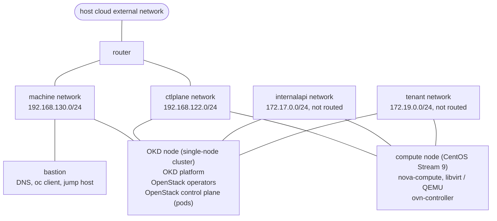
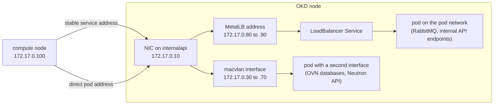

# Architecture

This document describes what the lab is made of, why it is shaped this way,
and which constraints come from running an OpenStack cloud inside virtual
machines that are themselves hosted by an OpenStack cloud.

- [Design goals](#design-goals)
- [Overview](#overview)
- [Virtual machines](#virtual-machines)
- [Networks](#networks)
- [Software layers](#software-layers)
- [Constraints of a nested lab](#constraints-of-a-nested-lab)
- [Mandatory versus optional](#mandatory-versus-optional)
- [Alternatives considered](#alternatives-considered)

## Design goals

1. **Learn OpenStack operations first.** The OKD layer must be as small and
   as boring as possible so that time is spent on OpenStack services managed
   by operators, not on cluster installation.
2. **Stay close to upstream.** Network names, address ranges and custom
   resources follow the upstream `openstack-k8s-operators` development
   environment, so upstream samples and documentation remain comparable.
3. **Run on ordinary tenant resources.** Only what a normal project member of
   an OpenStack cloud can create: instances, volumes, networks, routers. No
   access to hypervisors, no provider networks, no VLAN trunks.
4. **Reproducible.** Infrastructure is declared with Terraform; everything
   else is a short sequence of idempotent scripts.

## Overview



The OKD node has one interface on each of the four networks; the compute
node has one on each of the three OpenStack networks; the bastion sits
on the machine network only.

Three virtual machines:

- the **bastion**, the operations host of the lab;
- the **OKD node**, a single-node OKD cluster that runs the OpenStack
  operators and the whole OpenStack control plane as pods;
- one **compute node** (optional, more can be added), a plain CentOS Stream
  VM that the operators configure over SSH as an OpenStack hypervisor.

A separate **workstation** (your laptop, or any machine holding the host
cloud credentials) runs Terraform. It is not part of the lab.

## Virtual machines

| VM | Role | vCPU | RAM | Disk | OS |
|---|---|---|---|---|---|
| bastion | DNS for the cluster, `oc` client, jump host, optional time source | 2 | 4 GB | 40 GB | CentOS Stream 9 |
| OKD node | OKD control plane and worker, OpenStack control plane | 16 | 32 GB | 150 GB | CentOS Stream CoreOS (installed by OKD) |
| compute node | OpenStack data plane (nova-compute, OVN) | 8 | 16 GB | 60 GB | CentOS Stream 9 |
| **Total** | | **26** | **52 GB** | **250 GB** (plus a 2 GB volume for the installer ISO) | |

Why these sizes:

- **OKD node.** A single-node OKD cluster needs about 8 vCPU and 16 GB by
  itself to be comfortable (the documented minimum is 8 vCPU / 16 GB / 120 GB).
  The OpenStack operators add 24 pods and the minimal control plane 20
  more. Measured on the lab, the node uses about 21 GiB of its 32 GiB with
  everything deployed. The upstream development environment runs the same
  stack in a 12 vCPU / 25 GB virtual machine, so 16 vCPU / 32 GB leaves some
  headroom. 32 GB is also a common upper limit for general-purpose flavors,
  which is why the control plane is deliberately trimmed (see
  [Software layers](#software-layers)).
- **Compute node.** Sized for a handful of small test instances. If the
  compute node has no hardware virtualization, instances are emulated and
  only tiny images (CirrOS) are practical; see
  [Nested virtualization](#nested-virtualization).
- **Bastion.** Building the installer image is the heaviest thing it does.

All root disks are volumes (boot from volume). Use the fastest volume type
the host cloud offers for the OKD node: etcd is sensitive to write latency
(see [Storage performance](#storage-performance)).

### Why a single-node cluster

A three-node control plane would triple the cost and add a load balancer or
virtual IPs for the Kubernetes API, without teaching anything about
OpenStack operations. Everything the learning path needs — operators,
reconciliation, configuration changes, failures, upgrades — behaves the same
on one node. The price is that there is no high availability: rebooting the
node is an outage of the OpenStack APIs. That trade-off is itself a useful
subject, covered in [lifecycle/06-okd-maintenance-impact.md](lifecycle/06-okd-maintenance-impact.md).

### Why a bastion

- OKD requires DNS names (`api`, `api-int`, `*.apps`) to exist before it can
  install. The bastion runs a small dnsmasq for them, which keeps the lab
  independent of any DNS service of the host cloud.
- The lab networks are private. The bastion is the single entry point and
  the place where `oc` runs, so the cluster itself needs no public address.
- It separates what needs **cloud credentials** (the workstation) from what
  needs **cluster credentials** (the bastion).

## Networks

| Network | CIDR (default) | Routed | Host cloud port security | Purpose |
|---|---|---|---|---|
| machine | 192.168.130.0/24 | yes | enabled (security group) | OKD node primary interface, bastion |
| ctlplane | 192.168.122.0/24 | yes | **disabled** | SSH/Ansible and DNS to compute nodes; provider network of the lab cloud |
| internalapi | 172.17.0.0/24 | no | **disabled** | RabbitMQ, OVN southbound DB, internal API endpoints |
| tenant | 172.19.0.0/24 | no | **disabled** | Geneve tunnels between OVN chassis |

The three OpenStack networks keep the upstream names and ranges. Upstream
separates them with VLANs on one interface; here each one is a separate
network of the host cloud with **one virtual NIC per network**, because
tenant networks of a cloud do not carry VLAN-tagged traffic between
instances. The upstream `storage` network is omitted: the minimal lab has no
shared storage backend.

Address plan inside each OpenStack network:

| Range | Use |
|---|---|
| `.1` | router (ctlplane only) |
| `.10` | OKD node |
| `.30` – `.70` | pods attached to the network (NetworkAttachmentDefinition) |
| `.80` – `.90` | service addresses announced by MetalLB |
| `.100` – `.120` | compute nodes |
| `.150` – `.199` | ctlplane only: free for floating IPs of the lab cloud |
| `.200` – `.250` | host cloud DHCP pool |

### How pods reach these networks

Pods normally live on the cluster's internal pod network. Two mechanisms
connect OpenStack pods to the networks above:

- **NetworkAttachmentDefinition (Multus).** A pod that must speak on a
  network directly (OVN database servers, the Neutron API, the Ansible
  runner) gets an extra interface: a macvlan sub-interface of the node NIC
  attached to that network.
- **MetalLB.** A service that must be reachable from compute nodes at a
  stable address (RabbitMQ, internal API endpoints, DNS) is published as a
  `LoadBalancer` Service. MetalLB assigns it an address from the `.80`–`.90`
  range and the node answers ARP for it. This is the role keepalived virtual
  IPs play in a Kolla-Ansible deployment.

The two paths side by side, for a compute node talking to the control
plane:



Both mechanisms make the OKD node use MAC or IP addresses the host cloud did
not assign to it. The host cloud's anti-spoofing (Neutron *port security*)
drops such traffic, which is why port security is disabled on the three
OpenStack networks. The machine network keeps port security and a security
group.

### MTU

Tenant networks of an OpenStack cloud are usually overlays, with an MTU
below 1500 (1450 with VXLAN, 1442 with Geneve). The lab stacks further
encapsulations on top:

| Layer | Overhead | Resulting MTU (host network at 1442) |
|---|---|---|
| lab VM interface | – | 1442 |
| OKD pod network (OVN-Kubernetes, Geneve) | 100 | 1342 |
| lab OpenStack tenant networks (OVN, Geneve) | 58 | 1384 |

Nothing has to be computed by hand: Terraform reads the MTU of the networks
it created, the installer configuration sets it on the node interfaces,
OVN-Kubernetes derives the pod network MTU from it, and the Neutron
configuration of the lab cloud receives it through `customServiceConfig`.
MTU mismatches produce characteristic symptoms (small requests work, large
transfers hang); see [troubleshooting/network.md](troubleshooting/network.md).

### External access

- The workstation reaches the bastion over SSH, through a floating IP or,
  when the workstation lives in the same cloud project, through a shared
  network (`bastion_access_network`).
- The OKD API, the web console and the OpenStack public endpoints are only
  reachable from the lab networks. Use the bastion, or an SSH tunnel through
  it, to reach them.
- Lab VMs reach the internet (container registries, package repositories)
  through the router, or through an HTTP proxy when the cloud offers no
  direct outbound access (see
  [Running behind a proxy](installation/index.md#running-behind-a-proxy)).

## Software layers

```text
+----------------------------------------------------------------------+
| OpenStack data plane      nova-compute, libvirt, ovn-controller      |  compute node
|                           (containers managed by systemd + podman)   |
+----------------------------------------------------------------------+
| OpenStack control plane   keystone, glance, placement, neutron,      |
|                           nova, OVN, galera, rabbitmq, memcached     |  pods
+----------------------------------------------------------------------+
| OpenStack operators       openstack-operator + one operator per      |
|                           service, installed through OLM             |  pods
+----------------------------------------------------------------------+
| Platform services         cert-manager, MetalLB, local volumes       |
+----------------------------------------------------------------------+
| OKD                       Kubernetes, OVN-Kubernetes, Multus, OLM    |
+----------------------------------------------------------------------+
| CentOS Stream CoreOS      immutable host OS managed by OKD           |  OKD node
+----------------------------------------------------------------------+
```

| Layer | Component | Why it is needed |
|---|---|---|
| OKD | Kubernetes, OLM, Multus, OVN-Kubernetes | Runs the pods; OLM installs and upgrades operators; Multus gives pods extra interfaces |
| Platform | cert-manager | Issues the internal CAs and TLS certificates of every OpenStack service |
| Platform | MetalLB | Publishes service addresses on the OpenStack networks. The `FRRConfiguration` CRD is installed with it because the infra operator watches that kind |
| Platform | Local persistent volumes | Storage for databases, message queues, OVN databases, Glance images |
| Operators | openstack-operator | Owns the `OpenStackControlPlane`, `OpenStackVersion` and data plane resources; deploys the service operators |
| Operators | service operators | One per service; turn a service custom resource into Deployments, StatefulSets, Jobs, Secrets |
| Control plane | Galera ×2, RabbitMQ ×2, Memcached, DNS | Infrastructure services (one database and one message bus for the API level, one each for nova cell1) |
| Control plane | Keystone, Placement, Glance, Neutron, OVN, Nova | Minimal compute cloud |
| Data plane | OVN controller, metadata agent, libvirt, nova-compute | Hypervisor services, deployed by Ansible jobs that the operator launches |

Services **not** deployed by default: Horizon, Cinder, Swift, Barbican,
Heat, Telemetry, Octavia, Designate, Manila, Ironic. Reasons: memory budget
of a 32 GB node, no storage backend in the lab, and for Telemetry an image
dependency on a registry that requires a vendor account. Enabling Horizon is
used as an exercise in
[operations/05-enable-a-service.md](operations/05-enable-a-service.md).

The exact versions are listed in [versions.md](versions.md).

## Constraints of a nested lab

### Nested virtualization

The compute node is a VM. Whether it can run KVM guests depends on the host
cloud exposing hardware virtualization to instances.

Check on any instance of the host cloud:

```bash
grep -cE 'vmx|svm' /proc/cpuinfo   # > 0 means the CPU flag is exposed
ls -l /dev/kvm                      # present when the kvm module is usable
```

| Situation | Consequence for the lab |
|---|---|
| Flag exposed (`vmx` or `svm`) | nova-compute uses KVM. Instances run at near-native speed. |
| Flag not exposed | nova-compute must use QEMU emulation (`virt_type = qemu`). Instances boot, but slowly: use CirrOS-sized images, 1 vCPU, and expect minutes rather than seconds. All control plane and operational learning is unaffected. |

The deployment detects this automatically (`COMPUTE_VIRT_TYPE=auto`) and
only overrides nova's default when emulation is required. Even with nested
KVM, performance and stability depend on the host cloud hypervisors; this is
a learning environment, not a benchmark.

The OKD node does not need nested virtualization: the control plane is made
of containers only.

### Networking

| Constraint | Effect | How the lab handles it |
|---|---|---|
| No VLAN trunking to instances | Upstream single-NIC-with-VLANs layout is impossible | One NIC per network on every VM |
| Port security (anti-spoofing) | MetalLB addresses and macvlan pods are dropped | Port security disabled on the three OpenStack networks |
| Reduced MTU | Fragmentation or silent drops if ignored | MTU propagated automatically to every layer |
| No layer-2 access to the host cloud external network | The lab cloud cannot hand out publicly routable floating IPs | The ctlplane network acts as the lab's provider network; its floating IPs are reachable from the lab only |
| No DNS service assumed | OKD needs DNS records | dnsmasq on the bastion |

If the host cloud does not allow project members to disable port security,
the isolated-network design cannot work as is. The fallback is to add
*allowed address pairs* for the MetalLB range on the OKD node ports and to
replace macvlan attachments by ipvlan (which keeps the node's MAC address).
This fallback is documented as an idea only; it has not been tested.

### Storage performance

etcd requires fast synchronous writes (99th percentile `fdatasync` below
10 ms). Network-backed volumes do not always achieve that, and some flavors
cap disk IOPS. A slow disk shows up as API latency, leader elections and
flapping cluster operators rather than as a clear error.

Before installing, measure on an instance using the intended flavor and
volume type (procedure in [prerequisites.md](prerequisites.md#disk-latency)).

The OpenStack control plane stores its data in directories of the OKD node
root volume, exposed as statically provisioned local PersistentVolumes. This
is the simplest possible storage: no CSI driver, no extra operator. It is
adequate for one node and makes the PV/PVC mechanics easy to observe. It is
not how a production cluster would do it.

### Resources and overcommitment

The lab VMs are guests of shared hypervisors. CPU steal and noisy
neighbours are possible, and installation times vary accordingly. Inside
the lab, the single OKD node is close to its memory limit by design; see
[troubleshooting/resource-exhaustion.md](troubleshooting/resource-exhaustion.md)
for what happens when it is exceeded.

## Mandatory versus optional

| Item | Status | Notes |
|---|---|---|
| OKD node, 16 vCPU / 32 GB / 150 GB | **Mandatory** | Smaller sizes are not expected to hold the control plane |
| Bastion | **Mandatory** | DNS and client host |
| Router with external gateway | **Mandatory** | Image and package downloads |
| Ability to disable port security on tenant networks | **Mandatory** for the default design | See fallback above |
| Fast volume type for the OKD node | **Strongly recommended** | etcd latency |
| Compute node | Optional | Without it the lab still covers control plane operations; no instance can boot |
| Nested virtualization on the compute node | Optional | Emulation works, slowly |
| Floating IP for the bastion | Optional | Alternative: shared access network |
| Additional compute nodes | Optional | `compute_count` in Terraform; enables migration exercises |
| More services (Horizon, Cinder, ...) | Optional | Limited by the memory of the OKD node |

## Alternatives considered

| Alternative | Why it was not chosen |
|---|---|
| Three-node (compact) OKD cluster | Three times the resources and API/ingress virtual IPs to manage, for no additional OpenStack learning value |
| Installer-provisioned OKD on the host cloud (`platform: openstack`) | Couples the cluster to the host cloud API and credentials, creates many security group rules and cannot produce a single-node cluster; the lab would no longer be provider-independent |
| Upstream `install_yamls` on a local hypervisor (CRC) | Requires a bare-metal or nested-virtualization-capable host with libvirt, which a cloud tenant does not have; its OKD mode is no longer maintained |
| Control plane without network isolation (pod network only) | Simpler, but a compute node cannot join: RabbitMQ, the OVN southbound database and DNS would not be reachable from outside the cluster |
| NMState operator to configure node interfaces | Not needed: interfaces are configured once, at installation time, by the agent installer |
| Dynamic storage provisioner or LVM operator | The LVM Storage operator is not available in OKD's community catalog; static local volumes are enough for one node and easier to reason about |
