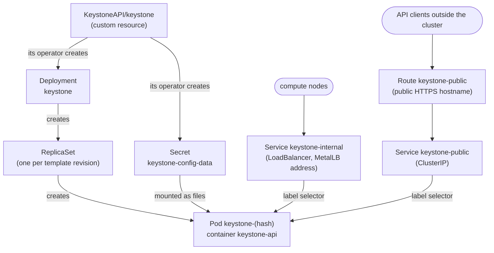

# Kubernetes building blocks, seen through OpenStack

> Status: aligned with the lab deployed on 2026-11-12 (OKD 4.22.0-okd-scos.10, operators 18-stable); explanatory page, commands spot-checked against the validated guides

## In short

- This page introduces the standard Kubernetes object types you will meet in
  the `openstack` namespace, each shown on a real OpenStack service.
- Every object has a `spec` (desired state, written by you or an operator)
  and a `status` (observed state, written by a controller).
- A pod is disposable: it is replaced, never repaired. A Deployment
  (stateless services) or a StatefulSet (stable name and volume) recreates it.
- A Service gives pods a stable address, as HAProxy does in Kolla; a Route
  publishes it outside the cluster over HTTPS.
- Configuration and passwords live in Secrets, data on volumes claimed
  through PVCs.
- `ownerReferences` tell you who created an object: change the top of the
  chain, not the children.

Every command block on this page is **[READ-ONLY]**.

| Object | Kolla-Ansible analogy | Section |
|---|---|---|
| Namespace | An OpenStack project | [Namespace](#namespace) |
| Pod | One container, or an API container with its log sidecar | [Pod](#pod) |
| Deployment | A stateless service container, kept running in N copies | [Deployment](#deployment) |
| StatefulSet | A container that keeps its name and its data volume, such as MariaDB | [StatefulSet](#statefulset) |
| DaemonSet | An agent container deployed on every host of a group | [DaemonSet](#daemonset) |
| Job | A one-shot Ansible task hidden inside `deploy` or `upgrade` | [Job](#job) |
| Service | HAProxy for internal endpoints | [Service](#service) |
| Route | HAProxy for the public endpoints | [Route](#route) |
| ConfigMap, Secret | `passwords.yml`, rendered files under `/etc/kolla/<service>/` | [ConfigMap and Secret](#configmap-and-secret) |
| PVC, PV, StorageClass | A Cinder volume request, volume and volume type | [PersistentVolumeClaim, PersistentVolume, StorageClass](#persistentvolumeclaim-persistentvolume-storageclass) |

## The shape of every Kubernetes object

Every object has the same four top-level parts. Knowing this makes any
`oc get <something> -o yaml` readable:

| Part | Content | Who writes it |
|---|---|---|
| `apiVersion`, `kind` | The type of the object | You (or an operator) |
| `metadata` | Name, namespace, labels, annotations, `ownerReferences` | You / operators |
| `spec` | The **desired** state | You (or the operator that created the object) |
| `status` | The **observed** state | Always a controller, never you |

"Desired versus observed" is the core idea of Kubernetes. Troubleshooting is
mostly finding where the two differ and why.

## Namespace

A namespace is a named scope for objects, comparable to an OpenStack project.
The lab uses two:

| Namespace | Content |
|---|---|
| `openstack-operators` | The operator programs (controllers) |
| `openstack` | The OpenStack services, their configuration, secrets and data |

```bash
oc get pods -n openstack-operators
oc get pods -n openstack
# Avoid typing -n on every command (changes only your local kubeconfig)
oc project openstack
```

The remaining examples assume the current project is `openstack`.

## Pod

A Pod is the smallest unit Kubernetes runs: one or more containers that share a
network identity (one IP address) and volumes, always scheduled together on one
node. The Kolla equivalent is one container, or a small group such as an API
container plus its log sidecar.

```bash
oc get pods -o wide                      # name, status, restarts, pod IP, node
oc get pod -l service=keystone           # select pods by label
oc describe pod <pod>                    # containers, mounts, events (first stop when a pod misbehaves)
oc get pod <pod> -o jsonpath='{.spec.containers[*].name}{"\n"}'
oc logs <pod> -c <container>             # stdout/stderr of one container
oc logs <pod> -c <container> --previous  # logs of the previous, crashed instance
```

Key facts for an OpenStack operator:

- A pod is **disposable**. It is never repaired, only replaced. Its IP changes
  on replacement, and so does its name unless a StatefulSet manages it.
- You almost never create a pod yourself. A higher-level object (Deployment,
  StatefulSet, DaemonSet, Job) creates pods from a template.
- Pods may have **init containers** that run to completion before the main
  containers start. OpenStack pods use them to prepare configuration. A pod
  shown as `Init:0/1` is waiting on one; read it with
  `oc logs <pod> -c <init-container>`.
- A pod status of `CrashLoopBackOff` means the container starts, exits, and
  Kubernetes waits increasingly longer between restarts.

## Deployment

A Deployment keeps N identical, interchangeable pods running and replaces them
progressively when the pod template changes (a *rollout*). It suits stateless
services. Pod names carry random suffixes.

OpenStack example: **Keystone**.

```bash
oc get deployment keystone
oc get pods -l service=keystone                  # e.g. keystone-7b45c49ccb-fj7ct
oc rollout status deployment/keystone
oc rollout history deployment/keystone
```

Between a Deployment and its pods sits a `ReplicaSet` (one per template
revision); you see it in `ownerReferences` but rarely act on it.

The lab has four Deployments in the `openstack` namespace: `keystone`,
`placement`, `neutron` and `dnsmasq-dns`. Horizon would be a fifth when
enabled ([Enable a service](../operations/05-enable-a-service.md)).

## StatefulSet

A StatefulSet also keeps N pods running, but each pod has a **stable identity**:
a fixed ordinal name (`-0`, `-1`...), a stable DNS name, and its own persistent
volume that follows it across restarts. Pods are started and replaced in order.

OpenStack example: **Galera**.

```bash
oc get statefulset openstack-galera
oc get pods -l app=galera                # openstack-galera-0, openstack-cell1-galera-0
oc get pvc | grep mysql-db               # one volume claim per Galera pod
```

A database node must keep its data directory and its name in the cluster, which
is exactly what a StatefulSet guarantees. RabbitMQ (`rabbitmq-server`), the
OVN databases (`ovsdbserver-nb`, `ovsdbserver-sb`) and `ovn-northd`, Glance
(`glance-default-single`), Memcached and all Nova services also run as
StatefulSets. For Nova the reason is the stable pod name rather than a volume:
the pod name is used as the service `host` in OpenStack, so
`openstack compute service list` keeps showing the same `nova-scheduler-0`
after a restart.

## DaemonSet

A DaemonSet runs one pod on every (selected) node. It suits per-node agents.

The `openstack` namespace of the lab has **no** DaemonSet: the OVN controller
runs only on the compute node, as a podman container, not on the OKD node.
The example to look at is the MetalLB **speaker**, the per-node agent that
answers ARP for the service addresses on the OpenStack networks.

```bash
oc -n metallb-system get daemonset speaker
oc -n metallb-system get pods -o wide
```

On a single-node cluster a DaemonSet has exactly one pod.

## Job

A Job runs pods until they **complete successfully**, then stops. It suits
one-shot tasks. A failed Job is retried up to its `backoffLimit`.

OpenStack examples:

- `keystone-db-sync`: runs `keystone-manage db_sync`.
- `keystone-bootstrap`: runs `keystone-manage bootstrap`.
- Every Ansible execution against a data plane node is a Job.

```bash
oc get jobs
oc get pods --field-selector=status.phase=Succeeded
oc logs job/bootstrap-edpm-deployment-openstack-edpm | tail
```

In Kolla these steps are Ansible tasks hidden inside `deploy` or `upgrade`.
Here they are objects with their own logs, which makes a failed database
migration easy to locate.

On the lab the db-sync and bootstrap Jobs are deleted once they have
succeeded. At rest `oc get jobs` lists only:

- the hourly `keystone-cron-<n>` Job, created by the CronJob `keystone-cron`
  (a CronJob creates a Job on a schedule, like a cron entry);
- the data plane Jobs, named `<service>-<deployment>-<nodeset>`.

A db-sync Job that fails stays, with its logs.

## Service

A pod IP changes whenever the pod is replaced. A Service is a stable virtual IP
and DNS name that load-balances to the pods matching a label selector. This is
the role HAProxy plays for internal endpoints in a Kolla deployment.

OpenStack example: Keystone has an internal and a public Service.

```bash
oc get svc | grep keystone
oc get endpointslices -l kubernetes.io/service-name=keystone-internal   # pod IPs behind the Service
oc describe svc keystone-internal        # shows the label selector
```

Inside the cluster a Service is reachable as
`<service>.<namespace>.svc` (for example `keystone-internal.openstack.svc`).
This is the name you find in the Keystone catalog for internal endpoints:

```bash
oc rsh openstackclient openstack endpoint list --service keystone
```

Service types you will see:

| Type | Reachable from | Used for |
|---|---|---|
| `ClusterIP` | Inside the cluster only | Public API Services (behind a Route), Galera, Memcached |
| `LoadBalancer` | Also outside the cluster, on an address assigned by MetalLB | What compute nodes must reach: the internal API endpoints, RabbitMQ and DNS |

MetalLB is the component that assigns and announces these external addresses.
On the lab:

| MetalLB address | LoadBalancer Services |
|---|---|
| 172.17.0.80 (internalapi) | The six internal API Services, which differ by port, like an internal VIP: `keystone-internal`, `glance-default-internal`, `neutron-internal`, `nova-internal`, `nova-metadata-internal`, `placement-internal` |
| 172.17.0.85 and 172.17.0.86 (internalapi) | `rabbitmq` and `rabbitmq-cell1` |
| 192.168.122.80 (ctlplane) | `dnsmasq-dns` |

A LoadBalancer Service also keeps a cluster IP, which is what pods use. The
OVN southbound database is not a LoadBalancer Service: compute nodes reach
its pod directly on its internalapi network attachment. Both mechanisms are
explained in
[Control plane and data plane](06-control-plane-and-data-plane.md#networks).

A Service with no endpoint address has no *ready* pod matching the selector:
no backend, like an HAProxy backend with all servers down.

## Route

A Route is the OKD object that publishes an HTTP(S) Service outside the cluster
through the OKD ingress router, under a hostname in the cluster's `*.apps`
domain. Public OpenStack API endpoints are exposed this way (for example the
Route `keystone-public`), as is Horizon when enabled.

```bash
oc get routes
oc rsh openstackclient openstack endpoint list --interface public
```

The public endpoint URLs in the Keystone catalog are the Route hostnames.
(On plain Kubernetes the equivalent object is an Ingress.)

## ConfigMap and Secret

Both hold small pieces of data (key/value pairs, often whole files) that pods
consume as mounted files or environment variables. A **ConfigMap** is for
non-sensitive data, a **Secret** for sensitive data. A Secret is only
base64-encoded in the API, not encrypted in what you read: access control is
what protects it.

OpenStack examples:

- `osp-secret`: the service passwords, equivalent to `passwords.yml`.
- `keystone-config-data`: the rendered Keystone configuration files. Service
  configuration is stored in Secrets, not ConfigMaps, because it contains
  database and message bus credentials.

```bash
oc get secrets | grep -E 'osp-secret|config-data'
# List the file names held by the Keystone configuration Secret
oc get secret keystone-config-data -o json | jq -r '.data | keys[]'
# Show one file (keystone.conf holds credentials: do not paste it anywhere)
oc get secret keystone-config-data -o jsonpath='{.data.custom\.conf}' | base64 -d
```

Details are in
[Configuration, secrets and data](04-configuration-secrets-and-data.md).

## PersistentVolumeClaim, PersistentVolume, StorageClass

Container filesystems are ephemeral. Data that must survive a pod replacement
is stored on a volume obtained through three objects:

| Object | Role | OpenStack analogy |
|---|---|---|
| `PersistentVolumeClaim` (PVC) | A request: "10Gi, read-write, class X". Namespaced, owned by the workload | A Cinder volume *request* |
| `PersistentVolume` (PV) | The actual piece of storage bound to one claim. Cluster-scoped | The Cinder volume |
| `StorageClass` | How PVs are provisioned (which provisioner, which parameters) | A Cinder volume type |

The lab has no provisioner: its StorageClass `local-storage` matches claims
with twelve PVs created in advance, each a directory on the OKD node.

OpenStack example: the seven claims of the lab, two for Galera, two for
RabbitMQ, two for the OVN databases and one for the Glance image store.

```bash
oc get storageclass
oc get pvc                               # STATUS must be Bound
oc get pv
oc describe pvc mysql-db-openstack-galera-0
```

A PVC in `Pending` state means no PV could be provided (wrong or missing
StorageClass, no free volume). The pod that needs it stays `Pending` too, and
the service CR never becomes ready.

Deleting a pod does **not** delete its PVC. What happens to the data when a
PVC is deleted depends on the reclaim policy of the volume: the lab uses
`Retain`, so the directory stays and the PV becomes `Released`. See the
[storage runbook](../troubleshooting/storage.md).

## Labels and selectors

Labels are free-form key/value tags in `metadata.labels`. Selectors are how
objects find each other: a Service finds its pods, a Deployment finds its pods,
and you filter with `-l`.

```bash
oc get pods -L service
oc get pods -l service=nova-api
oc get pods -l app.kubernetes.io/name=rabbitmq
```

Most service pods carry a `service=<name>` label (`keystone`, `placement`,
`glance`, `neutron`, `nova-api`, `openstack-galera`, `dnsmasq`, ...). The
RabbitMQ pods are the exception and are selected with
`app.kubernetes.io/name`.

## ownerReferences: who created this object?

Every object created by a controller carries an `ownerReferences` entry
pointing to its parent. This is how you answer "what manages this pod?", and
how garbage collection works: deleting the parent deletes its children.

```bash
oc get pod openstack-galera-0 \
  -o jsonpath='{range .metadata.ownerReferences[*]}{.kind}/{.name}{"\n"}{end}'
# StatefulSet/openstack-galera

oc get statefulset openstack-galera \
  -o jsonpath='{range .metadata.ownerReferences[*]}{.kind}/{.name}{"\n"}{end}'
# Galera/openstack

oc get galera openstack \
  -o jsonpath='{range .metadata.ownerReferences[*]}{.kind}/{.name}{"\n"}{end}'
# OpenStackControlPlane/openstack
```

The chain stops at an object you wrote yourself. Anything below it is
*managed*: change the top, not the children. The full walk, up to the operator
responsible, is in
[Operators, CRDs and reconciliation](03-operators-crds-and-reconciliation.md).

## Events

Events are short-lived records of what controllers and the node agent (the
kubelet) did or failed to do: scheduling, image pulls, volume mounts, probe
failures. They are often the fastest explanation of a pod that does not
start.

```bash
oc get events --sort-by=.lastTimestamp | tail -20
oc describe pod <pod> | sed -n '/^Events:/,$p'
```

## Summary: one service, all the blocks

How the objects of one service relate, with Keystone as the example (the
custom resource and the operator are the subject of the next document):



Keystone in the lab is the sum of:

| Object | Name | Purpose |
|---|---|---|
| Custom resource | `KeystoneAPI/keystone` | Desired state of the service (next document) |
| Secret | `keystone-config-data` | Rendered configuration |
| Job | `keystone-db-sync`, `keystone-bootstrap` | Schema migration and initial bootstrap; deleted after success |
| CronJob | `keystone-cron` | Hourly maintenance Job |
| Deployment | `keystone` | Keeps the API pods running |
| Pod | `keystone-<hash>` | The running `keystone-api` container |
| Service | `keystone-internal` (MetalLB), `keystone-public` (ClusterIP) | Stable addresses for the pods |
| Route | `keystone-public` | Public HTTPS entry point |

---

**Previous:** [From Kolla-Ansible to operators](01-from-kolla-to-operators.md) · **Next:** [Operators, CRDs and reconciliation](03-operators-crds-and-reconciliation.md)
