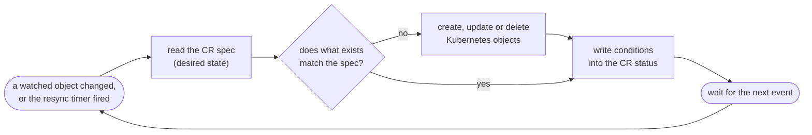
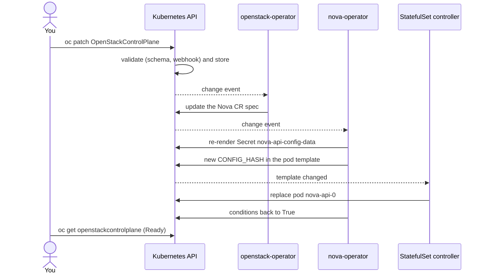

# Operators, CRDs and reconciliation

> Status: aligned with the lab deployed on 2026-11-12 (OKD 4.22.0-okd-scos.10, operators 18-stable); explanatory page, commands spot-checked against the validated guides

## In short

- A CRD adds a new object type to the Kubernetes API (`KeystoneAPI`, `Galera`,
  `OpenStackControlPlane`...). A custom resource (CR) is one object of such a
  type.
- An operator is a program running in a pod. It watches CRs and, in a loop
  that never stops, makes the cluster match their `spec`: this is
  *reconciliation*. It reports what it sees in the CR `status` conditions.
- Operators are layered: you edit one object, `OpenStackControlPlane`, and
  the change goes down to service CRs, then to Deployments and StatefulSets,
  then to pods.
- **Write at the top, read everywhere.** A manual edit of anything below the
  top is treated as drift and reverted.
- A configuration change always restarts the pods of the affected service,
  and only those.

The [previous document](02-kubernetes-building-blocks.md) covered the standard
Kubernetes objects. None of them knows what Keystone is. This document explains
the layer that does: operators and their custom resources.

Command blocks are **[READ-ONLY]** unless labelled otherwise.

## CRD and custom resource

Kubernetes ships with built-in types (Pod, Service, Secret...). A **Custom
Resource Definition (CRD)** adds a new type to the API, with its own schema.
A **custom resource (CR)** is an object of such a type.

The relationship is the same as between a database table definition and a row:

| | Example |
|---|---|
| CRD | `keystoneapis.keystone.openstack.org` — "a type named `KeystoneAPI` exists, with these fields" |
| CR | `KeystoneAPI/keystone` in namespace `openstack` — "I want one Keystone, 1 replica, using database `openstack`" |

```bash
# The types added by the OpenStack operators
oc get crd | grep openstack.org

# The fields of a type, documented from its schema
oc explain keystoneapi.spec
oc explain openstackcontrolplane.spec.nova.template

# The objects of a type
oc get keystoneapi -n openstack
oc get keystoneapi keystone -n openstack -o yaml
```

`oc explain` is your `globals.yml` reference documentation: it is generated
from the CRD installed in *your* cluster, so it always matches the version you
run.

A CRD on its own does nothing. Storing a `KeystoneAPI` object in the API has no
effect unless a program is watching for it. That program is the operator.

## What an operator actually does

An operator is an ordinary program, running in a pod, that contains one or more
**controllers**. Each controller:

1. **Watches** one CR type, and the objects it creates from it.
2. On every change (or periodically), runs a **reconcile** function for the
   affected CR.
3. In that function, **compares** the desired state (`spec`) with what exists,
   and creates, updates or deletes Kubernetes objects to close the gap.
4. **Writes** what it observed into the CR `status`, mainly as *conditions*.

The loop, for any operator:



It encodes what a human operator, or a Kolla-Ansible role, would do, but as a
loop instead of a one-shot run. For `KeystoneAPI`, one pass of the
`keystone-operator` reconcile function is roughly:

```text
is the osp-secret present and complete?          -> condition InputReady
is the database created and the account ready?   -> conditions DBReady, MariaDBAccountReady
is the RabbitMQ transport URL available?         -> condition RabbitMqTransportURLReady
render keystone.conf into Secret keystone-config-data -> condition ServiceConfigReady
has db-sync run for this configuration?          -> Job keystone-db-sync, condition DBSyncReady
has bootstrap run?                               -> Job keystone-bootstrap, condition BootstrapReady
create/update Deployment and Services            -> conditions DeploymentReady, CreateServiceReady
all of the above True?                           -> condition Ready
```

Each step that cannot complete sets its condition to `False` with a message,
and the function returns; it will run again when something it watches changes.

The set of conditions differs per service; read them from the CR rather than
from memory. The full list seen on the lab is in
[Inspect service status](../operations/01-inspect-service-status.md).

Two properties follow, and they explain most of the behaviour you will observe:

- **Level-triggered, not edge-triggered.** The operator does not react to "the
  user changed X"; it reacts to "the world differs from the spec". It does not
  matter how the difference appeared (an edit, a crash, a deletion).
- **Idempotent.** Reconciling an already-correct CR changes nothing.

## Status conditions: the operator talking to you

Conditions are the standard way a controller reports progress. Each has a
`type`, a `status` (`True`, `False`, `Unknown`), a `reason` and a `message`.

```bash
# Overall view: one line per CR, with the Ready condition message
oc get openstackcontrolplane -n openstack
oc get keystoneapi,galera,rabbitmq,glance,neutronapi,nova -n openstack

# All conditions of one CR
oc get keystoneapi keystone -n openstack \
  -o jsonpath='{range .status.conditions[*]}{.type}{"\t"}{.status}{"\t"}{.reason}{"\t"}{.message}{"\n"}{end}'

# Only what is not True
oc get openstackcontrolplane -n openstack -o json \
  | jq -r '.items[].status.conditions[] | select(.status!="True") | [.type,.status,.message] | @tsv'
```

Reading method: start at the top-level CR, find the first condition that is not
`True`, go to the CR it names, repeat. Only then read pod logs.

What you find on the `OpenStackControlPlane` CR:

- One condition per enabled service: `OpenStackControlPlaneKeystoneAPIReady`,
  `OpenStackControlPlaneMariaDBReady`, `OpenStackControlPlaneRabbitMQReady`,
  `OpenStackControlPlaneNovaReady`...
- For services with a Route, an `OpenStackControlPlaneExpose<Service>Ready`
  condition.
- No condition at all for a disabled service.

Besides `True` and `False`, a condition can be `Unknown`: the operator has not
reached that step yet, so look at an earlier one.

## The operator hierarchy in this lab

Operators are layered. From the outside in (OLM, the OKD component that
installs the operators, is described in
[OKD in brief](07-okd-in-brief.md#operator-lifecycle-manager)):

```text
Operator Lifecycle Manager (OLM, part of OKD)
└─ installs, from a catalog, the openstack-operator bundle
   └─ openstack-operator  (namespace openstack-operators)
      │
      ├─ its "controller-init" Deployment reads the "OpenStack" CR
      │  (operator.openstack.org, name: openstack)
      │  └─ deploys the controller-manager and the service operators:
      │     keystone-operator, mariadb-operator, infra-operator, nova-operator,
      │     neutron-operator, ovn-operator, glance-operator, ... (also those of
      │     services the lab does not enable)
      │
      └─ reads the OpenStackControlPlane CR  (namespace openstack)
         └─ creates one service CR per enabled service:
            KeystoneAPI, Galera, RabbitMq, Memcached, Glance, NeutronAPI, Nova, ...
            └─ each is reconciled by its service operator, which creates:
               Secrets, Jobs, Deployments/StatefulSets, Services
               └─ reconciled by built-in Kubernetes controllers, which create:
                  Pods
```

| Layer | You interact with it to... | Read-only inspection |
|---|---|---|
| OLM (`Subscription`, `InstallPlan`, `ClusterServiceVersion`) | Install and upgrade the operators | `oc get subscription,installplan,csv -n openstack-operators` |
| `OpenStack` CR | Initialise the operators; tune operator replicas/resources | `oc get openstack -n openstack-operators -o yaml` |
| Service operators | Read their logs when a reconcile fails | `oc get deployments -n openstack-operators` |
| `OpenStackControlPlane` CR | **Everything else: this is your daily interface** | `oc get openstackcontrolplane -n openstack -o yaml` |
| Service CRs (`KeystoneAPI`...) | Read status and conditions only | `oc get keystoneapi -n openstack -o yaml` |
| Deployments, StatefulSets, pods | Observe, read logs, delete a pod to restart it | `oc get deploy,sts,pods -n openstack` |

The single rule that keeps you out of trouble:

> **Write at the top (`OpenStackControlPlane`), read everywhere.**

Service CRs are themselves managed objects: `openstack-operator` owns them and
overwrites their `spec` from the control plane CR (within about three seconds
on the lab).

## How a change propagates

Take the example of enabling debug logging in Nova API.

**[CHANGE]** Restarts the `nova-api-0` pod.

```bash
oc patch openstackcontrolplane openstack -n openstack --type=merge -p '
spec:
  nova:
    template:
      apiServiceTemplate:
        customServiceConfig: |
          [DEFAULT]
          debug = true
'
```

The same change as a sequence, from your `oc patch` to the new pod:



What happens next, and how to observe each step:

| Step | Actor | Observe with |
|---|---|---|
| 1. The API server validates the object (schema, then the operator's admission webhook) and stores it | Kubernetes API | An invalid change is rejected immediately with an error message |
| 2. `openstack-operator` copies the new values into the `Nova` CR | openstack-operator | `oc get nova nova -n openstack -o yaml` |
| 3. `nova-operator` propagates to `NovaAPI`, re-renders the configuration Secret `nova-api-config-data` | nova-operator | `oc get secret nova-api-config-data -n openstack -o json \| jq -r '.data \| keys[]'` |
| 4. It computes a **hash** of all inputs (configuration, secrets) and writes it into the pod template as the `CONFIG_HASH` environment variable | nova-operator | `oc get statefulset nova-api -n openstack -o json \| jq -r '.spec.template.spec.containers[0].env[] \| select(.name == "CONFIG_HASH")'` |
| 5. The pod template changed, so the StatefulSet replaces its pods | StatefulSet controller | `oc get pods -n openstack -l service=nova-api -w` |
| 6. New pods become ready; conditions return to `True` | nova-operator | `oc get openstackcontrolplane -n openstack` |

In step 1, the *admission webhook* is a check that the operator registers
with the API server, so that an invalid object is refused before it is stored.

Step 4 is the key mechanism. A pod does not notice that a mounted Secret
changed in a way that restarts the service. The operators therefore inject a
hash of the inputs into the pod template (`CONFIG_HASH` environment variable):
when the configuration changes, the hash changes, the template changes, and
Kubernetes performs a rolling replacement.

**A configuration change is therefore always a pod restart of the affected
service**, and only of that service.

Verification from inside the new pod (for Nova the snippet is mounted as
`/etc/nova/nova.conf.d/02-nova-override.conf`):

```bash
oc exec -n openstack nova-api-0 -c nova-api-api -- grep -r '^debug' /etc/nova/nova.conf.d/
```

One limit to remember: the operator does not validate the content of
`customServiceConfig`. A wrong value is accepted and shows up later as a pod
that does not start or an API that fails; see
[Pod pending or crash loop](../troubleshooting/pod-pending-or-crashloop.md).

## Why manual edits of managed objects do not stick

Because reconciliation is level-triggered, an operator treats your manual edit
of an object it owns as drift:

| You do | What happens (observed on the lab) |
|---|---|
| `oc delete pod keystone-<hash>` | The ReplicaSet creates a replacement at once. This is the normal way to restart one pod |
| `oc scale deployment keystone --replicas=2` | Back to the CR value in under a second |
| `oc rollout restart deployment/keystone` | The annotation it adds is removed at once; on a Deployment nothing restarts, on a StatefulSet the pod restarts once. Do not use it |
| Edit the Secret `keystone-config-data` | Re-rendered within a second; the pod is not restarted and never sees your content |
| `oc edit deployment keystone` (image, env, args) | Reverted in under a second |
| `oc edit keystoneapi keystone` | Overwritten by `openstack-operator` from the `OpenStackControlPlane` CR within about three seconds |
| Delete a Deployment or StatefulSet | Recreated immediately; its pods are replaced (outage); PVCs of a StatefulSet are kept |
| `oc delete pvc mysql-db-openstack-galera-0` | **Data loss for the cloud.** A new claim is not given the old data |

Most reverts are immediate because operators watch the objects they own. Two
cases are worse than an immediate revert:

- A field the operator does not set (an annotation on the Deployment itself)
  survives as invisible drift.
- A change the operator cannot see is only corrected at some later reconcile,
  for example when the operator pod restarts.

Manual edits are therefore not only ineffective but dangerous: they create a
state that nobody declared and that disappears at an unpredictable moment. The
experiments are in
[Manual changes reverted](../troubleshooting/manual-changes-reverted.md).

There is no general "pause reconciliation" switch. Scaling an operator
Deployment to zero does not hold either: it comes back within seconds, because
the `OpenStack` initialization resource owns it. The supported way to stop one
operator is `operatorOverrides` with `replicas: 0` in that resource, an
emergency measure (nothing repairs that service meanwhile), not an operating
procedure.

## Finding which operator manages something

Start from the pod and walk up `ownerReferences`:

```bash
ns=openstack
obj=pod/nova-api-0
while [ -n "$obj" ]; do
  echo "$obj"
  obj=$(oc get "$obj" -n "$ns" \
    -o jsonpath='{.metadata.ownerReferences[0].kind}/{.metadata.ownerReferences[0].name}' 2>/dev/null)
  [ "$obj" = "/" ] && obj=""
done
```

Expected output:

```text
pod/nova-api-0
StatefulSet/nova-api
NovaAPI/nova-api
Nova/nova
OpenStackControlPlane/openstack
```

The first custom resource above the workload (`NovaAPI`) tells you the
operator: its API group is `nova.openstack.org`, managed by `nova-operator`,
which runs as the Deployment `nova-operator-controller-manager`.

```bash
# API group of a CR type
oc api-resources | grep -i novaapi

# The operator pod and its logs (filter on the CR name)
oc get pods -n openstack-operators -l openstack.org/operator-name=nova
oc logs -n openstack-operators deployment/nova-operator-controller-manager --tail=100
```

| API group | Operator | Typical CR kinds |
|---|---|---|
| `core.openstack.org` | openstack-operator | OpenStackControlPlane, OpenStackVersion |
| `dataplane.openstack.org` | openstack-operator | OpenStackDataPlaneNodeSet, -Deployment, -Service |
| `client.openstack.org` | openstack-operator | OpenStackClient |
| `keystone.openstack.org` | keystone-operator | KeystoneAPI, KeystoneService, KeystoneEndpoint |
| `mariadb.openstack.org` | mariadb-operator | Galera, MariaDBDatabase, MariaDBAccount, GaleraBackup |
| `rabbitmq.openstack.org`, `memcached.openstack.org`, `network.openstack.org` | infra-operator | RabbitMq, TransportURL, Memcached, DNSMasq, NetConfig |
| `nova.openstack.org` | nova-operator | Nova, NovaAPI, NovaScheduler, NovaConductor, NovaCell, NovaMetadata |
| `neutron.openstack.org` | neutron-operator | NeutronAPI |
| `ovn.openstack.org` | ovn-operator | OVNDBCluster, OVNNorthd, OVNController |
| `glance.openstack.org` | glance-operator | Glance, GlanceAPI |
| `placement.openstack.org` | nova-operator (no separate Deployment) | PlacementAPI |

Operators of services the lab does not enable (Cinder, Horizon, Swift...) are
installed too. Use `oc api-resources --api-group=<group>` to list the kinds
actually installed in your cluster.

## Kubernetes resource versus OpenStack resource

Two APIs coexist, with two separate databases, and it is important not to
confuse them:

| | Kubernetes resource | OpenStack resource |
|---|---|---|
| Examples | Pod, Secret, `KeystoneAPI`, `Galera` | Server, network, image, project, user |
| Stored in | etcd (the database of the Kubernetes API), on the OKD control plane | MariaDB (Galera), running *as a workload* on OKD |
| API | Kubernetes API (`oc`) | Keystone, Nova, Neutron... APIs (`openstack`) |
| Describes | How the cloud *software* is deployed | What the cloud *users* have created |
| Managed by | Operators | OpenStack services |

The Kubernetes side describes the machinery; the OpenStack side is the content.
Deleting the `nova-api-0` pod does not affect any instance. Deleting the Galera
PVC destroys the record of every instance.

A few CRs deliberately bridge the two worlds: they are Kubernetes objects whose
controller *creates an OpenStack resource*.

| CR | Creates in OpenStack |
|---|---|
| `KeystoneService` | A service entry and its service user in Keystone |
| `KeystoneEndpoint` | The catalog endpoints of a service |
| `MariaDBDatabase`, `MariaDBAccount` | A database schema and a database user in Galera |

```bash
oc get keystoneservice,keystoneendpoint -n openstack
oc rsh -n openstack openstackclient openstack service list
```

This is how each service operator registers its service in the catalog without
any `openstack endpoint create` in a playbook.

The bridge is one-way: the operator does not watch the Keystone database. Two
consequences:

- On the lab an endpoint URL changed with `openstack endpoint set` stayed
  wrong for minutes and was only put back when the operator reconciled the
  `KeystoneEndpoint` again.
- Changing a service password in `osp-secret` re-renders the configuration
  but does not change the Keystone user
  ([Passwords and secrets](../operations/07-passwords-and-secrets.md)).

---

**Previous:** [Kubernetes building blocks](02-kubernetes-building-blocks.md) · **Next:** [Configuration, secrets and data](04-configuration-secrets-and-data.md)
