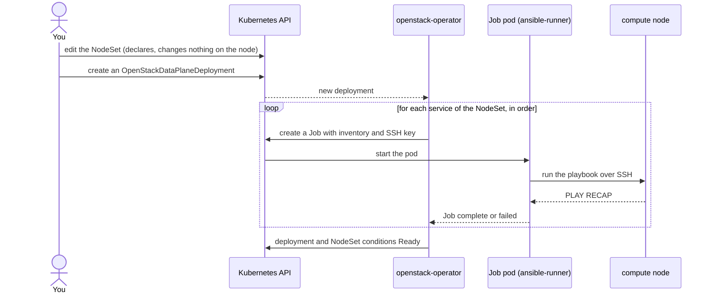

# Control plane and data plane

> Status: aligned with the lab deployed on 2026-11-12 (OKD 4.22.0-okd-scos.10, operators 18-stable); explanatory page, commands spot-checked against the validated guides

## In short

- The platform has two halves. The **control plane** (APIs, databases,
  message bus) runs as pods on OKD and is reconciled continuously. The
  **data plane** (compute nodes) stays ordinary Linux hosts outside the
  cluster, configured by Ansible over SSH.
- The data plane is close to Kolla: a NodeSet is an inventory group with its
  variables, a Deployment is one `kolla-ansible deploy` run. Nothing happens
  on a node until you create a Deployment.
- Configuration drift on a compute node is not corrected until the next
  deployment.
- Compute nodes cannot reach pod IPs. Secondary pod interfaces (NADs) and
  MetalLB virtual IPs on the OpenStack networks bridge the gap.

Knowing which half a component belongs to tells you which tools apply to it.

Every command block on this page is **[READ-ONLY]**.

## Two halves

```text
┌─────────────────────────── OKD cluster ───────────────────────────┐      ┌──── data plane node(s) ─────┐
│ namespace openstack-operators      namespace openstack            │      │ CentOS Stream 9, no kubelet │
│ ┌──────────────────────┐   ┌────────────────────────────────────┐ │      │                             │
│ │ openstack-operator   │   │ Galera  RabbitMQ  Memcached  DNS   │ │      │ podman + systemd:           │
│ │ service operators    │──▶│ Keystone Glance Placement Neutron  │ │      │  nova_compute               │
│ └──────────────────────┘   │ Nova API/scheduler/conductor       │ │      │  ovn_controller             │
│                            │ OVN NB/SB/northd                   │ │      │  ovn_metadata_agent         │
│                            │                                    │ │      │ host services:              │
│                            │ Ansible runner Jobs ───────────────┼─┼─SSH─▶│  libvirt (virtqemud...)     │
│                            └────────────────────────────────────┘ │      │  Open vSwitch               │
└───────────────────────────────────────────────────────────────────┘      └─────────────────────────────┘
        pods, reconciled continuously                                       containers configured by Ansible,
                                                                            on demand
```

| | Control plane | Data plane |
|---|---|---|
| Runs on | OKD nodes, as pods | External hosts (compute nodes), outside the cluster |
| Declared by | `OpenStackControlPlane` | `OpenStackDataPlaneNodeSet` |
| Applied by | Service operators, **continuously** | Ansible Jobs, **only when you create** an `OpenStackDataPlaneDeployment` |
| Process manager | Kubernetes (the kubelet, its agent on each node) | systemd + podman |
| Logs | `oc logs` | `journalctl` / `podman logs` on the node |
| Restart a service | `oc delete pod` (the workload recreates it) | `systemctl restart edpm_<service>` on the node |
| Self-healing | Yes (reconciliation) | Process restarts by systemd only; configuration drift is **not** corrected until the next deployment |
| Familiarity for a Kolla operator | New | Very close to what you know |

The data plane tooling is called **EDPM** (External Data Plane Management): the
`edpm-ansible` collection, run from the cluster by `openstack-operator`.

Why this split? A hypervisor must keep running instances regardless of what
happens to the Kubernetes cluster, and it needs host-level control (kernel,
libvirt, networking) that does not fit a pod well. So compute nodes stay
ordinary Linux hosts, and Kubernetes is only used as the place Ansible is
launched *from*.

## The three data plane custom resources

| CR | Short name | What it is | Kolla analogy |
|---|---|---|---|
| `OpenStackDataPlaneService` | `osdps` | A named unit of work: one playbook plus the Secrets and ConfigMaps it needs | A role / a `--tags` value |
| `OpenStackDataPlaneNodeSet` | `osdpns` | A group of similar nodes: their addresses, SSH user and key, the ordered list of services to apply, and Ansible variables | An inventory group with its `group_vars` |
| `OpenStackDataPlaneDeployment` | `osdpd` | An order to execute: "apply the services of these NodeSets now" | One `kolla-ansible deploy` invocation |

```bash
oc get osdps -n openstack           # the catalogue of services (playbooks)
oc get osdpns -n openstack          # node sets and their readiness
oc get osdpd -n openstack           # past and current deployments
oc get osdpns openstack-edpm -n openstack -o yaml | less
```

### NodeSet

The NodeSet is declarative: it describes the nodes but **creating or editing it
runs nothing on them**. Its main fields:

| Field | Purpose |
|---|---|
| `preProvisioned: true` | The nodes already exist with an OS installed (the lab case). Otherwise the operator would provision bare metal |
| `nodes.<name>.ansible.ansibleHost` | Address used for SSH |
| `nodes.<name>.networks` | Networks the node is attached to, for address allocation |
| `nodeTemplate.ansibleSSHPrivateKeySecret` | Secret holding the SSH private key used by the Jobs |
| `nodeTemplate.ansible.ansibleUser` | SSH user (needs passwordless sudo) |
| `nodeTemplate.ansible.ansibleVars` | Ansible variables (`edpm_*`): NIC configuration template, NTP servers, allowed SSH ranges... |
| `services` | Ordered list of `OpenStackDataPlaneService` names to run |

The service list of the lab NodeSet (`deployment/openstack/dataplane/nodeset.yaml.tmpl`), in execution order:

| Service | What its playbook does |
|---|---|
| `repo-setup` | A custom service defined by the lab: configures the package repositories on a CentOS Stream node |
| `bootstrap` | Base packages and prerequisites |
| `download-cache` | Pre-pulls container images |
| `configure-network`, `validate-network` | Applies the NIC configuration (os-net-config), checks connectivity |
| `install-os`, `configure-os`, `run-os` | OS packages, tuning, base host services |
| `ssh-known-hosts` | Distributes host keys between nodes (needed for migration) |
| `reboot-os` | Reboots if required |
| `install-certs` | Installs TLS certificates issued by the control plane's CA |
| `ovn` | Open vSwitch and the `ovn_controller` container |
| `neutron-metadata` | The OVN metadata agent container |
| `libvirt` | libvirt daemons |
| `nova` | The `nova_compute` container |

### Deployment

A Deployment is **imperative and one-shot**. Creating it starts the run;
once it has completed it never runs again. To apply a change you create a *new*
Deployment object with a new name.

```yaml
apiVersion: dataplane.openstack.org/v1beta1
kind: OpenStackDataPlaneDeployment
metadata:
  name: edpm-deployment
  namespace: openstack
spec:
  nodeSets:
    - openstack-edpm
```

Useful optional fields:

| Field | Effect | Kolla analogy |
|---|---|---|
| `servicesOverride` | Run only these services | `--tags` |
| `ansibleLimit` | Restrict the run to some nodes | `--limit` |

Durations observed on the lab:

| Run | Duration |
|---|---|
| First full run | About 21 minutes |
| A later full run | About 14 minutes |
| A run limited to `nova` | About two and a half minutes |

### What a run looks like

For each service of each NodeSet, the operator creates a Kubernetes **Job**
whose pod runs `ansible-runner` with the service's playbook, a generated
inventory, and the SSH key mounted from the Secret.

```bash
oc get osdpd -n openstack
oc get jobs -n openstack                       # <service>-<deployment>-<nodeset>
oc get pods -n openstack -l app=openstackansibleee
oc logs -n openstack job/nova-edpm-deployment-openstack-edpm | tail -20   # the familiar Ansible output
```

The whole chain, from the declaration to the node:



When a task fails:

- The Job fails; Kubernetes retries it up to its backoff limit and the
  Deployment's conditions report the failure.
- After fixing the cause, create a new Deployment, optionally limited with
  `servicesOverride`.
- Searching the log for `fatal:` gives false positives on ignored errors:
  read the `PLAY RECAP`.

See the [data plane runbook](../troubleshooting/dataplane.md).

### Detecting undeployed changes

Because the data plane is not continuously reconciled, a change to the NodeSet,
or to a control plane setting that feeds compute configuration, leaves the
nodes outdated until you deploy. The NodeSet status exposes this by comparing
hashes of what is declared and what was last deployed:

```bash
oc get osdpns openstack-edpm -n openstack \
  -o jsonpath='configHash={.status.configHash}{"\n"}deployedConfigHash={.status.deployedConfigHash}{"\n"}'
```

Different values mean "declared but not yet deployed", and the NodeSet is
`False` until a deployment runs. Two limits observed on the lab
([Data plane changes](../operations/08-dataplane-changes.md)):

- A run limited with `servicesOverride` also sets `deployedConfigHash` and
  turns the NodeSet `True`: the hash says that *a* deployment finished, not
  that every service was applied.
- A change to a ConfigMap consumed by a service (`nova-extra-config`) does not
  move the hash at all.

## Configuring `nova-compute`

`nova-compute` configuration is assembled from Secrets rendered by
`nova-operator` (transport URL, cell settings) plus an optional ConfigMap named
`nova-extra-config`, whose files are placed in the compute service's
configuration directory by the `nova` data plane service.

The lab runs its compute node as a virtual machine. Whether hardware
virtualisation is exposed to that VM decides the libvirt virtualisation type:

- With it (the validated lab), nova keeps its default, KVM, and the ConfigMap
  does not exist.
- Without it, the deployment script creates:

```yaml
apiVersion: v1
kind: ConfigMap
metadata:
  name: nova-extra-config
  namespace: openstack
data:
  25-nova-extra.conf: |
    [libvirt]
    virt_type = qemu
    cpu_mode = none
```

With `virt_type = qemu` instances are fully emulated; this path was not
executed on the lab. The file lands on the node as
`/etc/nova/nova.conf.d/25-nova-extra.conf` inside the `nova_compute`
container. The ConfigMap must exist before the Deployment runs; changing it
later requires a new Deployment (for example with `servicesOverride: [nova]`).

## What runs on a compute node

SSH to the node and you are back on familiar ground:

```bash
# On the compute node: ssh -i .work/dataplane-ssh-key cloud-admin@192.168.122.100
sudo podman ps --format '{{.Names}}\t{{.Status}}'
systemctl list-units 'edpm_*' 'virt*' --no-pager
sudo journalctl -u edpm_nova_compute --since '10 min ago' --no-pager
sudo podman logs --tail 50 ovn_controller
sudo ovs-vsctl show
sudo virsh list --all
```

- Three podman containers, each wrapped in a systemd unit named
  `edpm_<container>`: `nova_compute`, `ovn_controller`, `ovn_metadata_agent`.
  They log to the journal.
- Generated configuration and certificates are under `/var/lib/openstack/` on
  the host, much like `/etc/kolla/<service>/`.
- libvirt (`virtqemud` and its companions) and Open vSwitch run as host
  services.
- The hypervisor name shown by OpenStack is the name the machine reported at
  registration, not necessarily the NodeSet node name `edpm-compute-0`.
- A manual edit of these files survives until the next data plane deployment
  that covers the service, which overwrites it. As on the control plane, the
  durable change is made in the CRs.

## Networks

The lab uses three of the usual OpenStack networks, each on its own interface
(the upstream `storage` network is omitted; see the
[architecture](../architecture.md#networks)):

| Network | Carries | Who must reach it |
|---|---|---|
| `ctlplane` (192.168.122.0/24) | SSH from the Ansible Jobs to the nodes; DNS; also the lab's provider network | Ansible runner pods, compute nodes |
| `internalapi` (172.17.0.0/24) | Internal API endpoints, RabbitMQ, OVN southbound connections | Control plane pods, compute nodes |
| `tenant` (172.19.0.0/24) | Geneve tunnels between OVN chassis | Compute nodes |

The difficulty is specific to Kubernetes: **pods live on the cluster's internal
pod network, which external hosts cannot reach.** A compute node cannot open a
connection to the pod IP of RabbitMQ. Three mechanisms bridge the gap.

### NetworkAttachmentDefinition: a second NIC for a pod

By default a pod has one interface, on the pod network. Multus, the meta
network plugin included in OKD, can add more. A
`NetworkAttachmentDefinition` (NAD) describes one such secondary network:
which host interface to attach to (macvlan or bridge), and how to assign
addresses.

```bash
oc get network-attachment-definitions -n openstack
# Which secondary networks a pod is attached to, and with which IPs
oc get pod <pod> -n openstack \
  -o jsonpath='{.metadata.annotations.k8s\.v1\.cni\.cncf\.io/network-status}' | jq .
```

A service is attached through the `networkAttachments` list in its section of
the control plane CR, for example `[internalapi]`. On the lab, Neutron and the
two OVN databases are attached to `internalapi`, and the Ansible runner pods
to `ctlplane`.

Deleting a NAD does nothing to running pods; the next pod that starts fails,
and the service CR reports `NetworkAttachmentsReady` as `False`
([runbook](../troubleshooting/reconciliation-not-progressing.md)).

For a Kolla operator: a NAD plays the role of `api_interface`,
`tunnel_interface` or `storage_interface`, but per pod instead of per host.

### MetalLB: a virtual IP on an isolated network

A NAD gives each pod its own address, which can change when the pod is
replaced. Compute nodes need **stable** addresses. MetalLB provides them: it
assigns an IP from a declared pool (`IPAddressPool`) to a Kubernetes Service
of type `LoadBalancer` and announces it on the node's interface in layer 2
mode (`L2Advertisement`).

```bash
oc get ipaddresspools,l2advertisements -n metallb-system
oc get svc -n openstack | grep LoadBalancer        # EXTERNAL-IP is the VIP
```

| Address | Services |
|---|---|
| 172.17.0.80 (internalapi) | The six internal API endpoints, sharing the address on different ports (their names are in [Kubernetes building blocks](02-kubernetes-building-blocks.md#service)) |
| 172.17.0.85, 172.17.0.86 (internalapi) | `rabbitmq`, `rabbitmq-cell1` |
| 192.168.122.80 (ctlplane) | `dnsmasq-dns` |

The shared address is the functional equivalent of the keepalived internal
VIP in Kolla.

The OVN southbound database has no MetalLB address: compute nodes resolve
`ovsdbserver-sb.openstack.svc` through `dnsmasq-dns` to the internalapi
address of the database pod.

A Service whose `EXTERNAL-IP` stays `<pending>` has not obtained an address;
the causes and the real event texts are in the
[network runbook](../troubleshooting/network.md).

### Routes: public HTTP endpoints

Public API endpoints use OKD Routes on the cluster's ingress, as
described in [Kubernetes building blocks](02-kubernetes-building-blocks.md#route).

### Why the lab uses network isolation

Upstream also has a mode without NADs or MetalLB, where every Service is
`ClusterIP`. It is enough for a control plane alone, but a compute node cannot
join: nothing it needs would be reachable from outside the cluster. The lab
therefore uses network isolation from the start.

One constraint comes from running on virtual machines of a cloud: the
underlying virtual network normally only delivers traffic for the addresses
it assigned to each port. MetalLB VIPs and the addresses of pods on secondary
networks are *additional* addresses (and, with macvlan, additional MAC
addresses), so the lab disables port security on the three OpenStack
networks. VLAN tagging between VMs is not available either, so each network
is a separate virtual network and interface rather than a VLAN on a trunk.
Details and the address plan: [architecture](../architecture.md#networks).

### Connections to keep in mind when troubleshooting

| From | To | Purpose | Symptom when broken |
|---|---|---|---|
| Ansible Job pod | Compute node, SSH (22/tcp) | Deployment | Job fails with `UNREACHABLE` |
| Compute node | `dnsmasq-dns` at 192.168.122.80 (53) | Resolve control plane names | Name resolution errors in every agent |
| `nova_compute` | `rabbitmq-cell1` at 172.17.0.86 (5671/tcp, TLS) | RPC | Compute service `down` |
| `ovn_controller`, `ovn_metadata_agent` | Southbound DB pod on internalapi (6642/tcp, TLS) | Logical flows | Agent shown as not alive; ports stay `DOWN` |
| `nova_compute` | Internal API endpoints at 172.17.0.80 (HTTPS) | API calls | Errors in `nova_compute` logs at start-up or on boot |
| Compute node ↔ other chassis | Geneve (6081/udp) on `tenant` | Instance traffic | Instances up but no connectivity; check MTU first |

One real case from the lab: after a reboot of the OKD node alone, the OVN
metadata agent on the compute node did not reconnect to the southbound
database although its unit was active; restarting `edpm_ovn_metadata_agent`
fixed it ([node and OKD runbook](../troubleshooting/node-and-okd.md)).

MTU deserves special attention in a nested setup: Geneve adds overhead, and the
underlying virtual network already has a reduced MTU. The lab passes the real
MTU to Neutron through `customServiceConfig`; the chain is explained in the
[architecture](../architecture.md#mtu).

## Host discovery

After the first successful deployment of a compute node, `nova-compute`
registers itself over RabbitMQ, but it must still be mapped to its cell before
the scheduler uses it. The lab script runs the step you know:

```bash
oc rsh -n openstack nova-cell0-conductor-0 nova-manage cell_v2 discover_hosts --verbose
oc rsh -n openstack openstackclient openstack compute service list
oc rsh -n openstack openstackclient openstack hypervisor list
oc rsh -n openstack openstackclient openstack network agent list
```

---

**Previous:** [Service lifecycle reference](05-service-lifecycle-reference.md) · **Next:** [OKD in brief](07-okd-in-brief.md)
