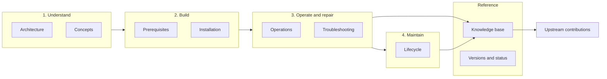

# Reading guide

This page is the map of the documentation. It tells you what each part
is for, in which order to read, and where to go when you have a precise
question.

## The documentation in one picture

The parts are ordered the way the lab is meant to be learned: understand,
build, operate, repair, maintain. The knowledge base and the contribution
workspace come after, and feed on what was observed on the running lab.

## What each part answers

| Part | Question it answers | Form | Size |
|---|---|---|---|
| [Architecture](architecture.md) | What is the lab made of, and why this shape? | One page | 20 min |
| [Concepts](concepts/index.md) | How does the operator model work, in OpenStack terms? | 7 pages, read in order | 2 to 3 h |
| [Prerequisites](prerequisites.md) | What does the host cloud project need? | Checklist | 15 min |
| [Installation](installation/index.md) | How is each layer deployed and verified? | 7 steps, one per script | Half a day with the lab |
| [Operations](operations/index.md) | How do I inspect, restart, reconfigure, scale? | 9 task pages | 1 day with the lab |
| [Troubleshooting](troubleshooting/index.md) | Something is broken: where do I look? | Runbooks by symptom | On demand |
| [Lifecycle](lifecycle/index.md) | How do updates, backups, restores and maintenance work? | 7 pages | 1 day with the lab |
| [Knowledge base](knowledge-base/index.md) | How exactly did the lab behave when we did X? | Tested question-and-answer entries | On demand |
| [Versions and status](versions.md) | Which versions, what is tested, what is not? | Tables | 10 min |
| [Upstream contributions](../contributions/index.md) | What could be sent back upstream, and how? | Method and candidate topics | 1 h |
| [Publication readiness](publication-readiness.md) | Is the repository fit to be made public? | Review report | 10 min |

## Three reading paths

### One hour: the idea

1. [README](../index.md), down to "Architecture at a glance".
2. [From Kolla-Ansible to operators](concepts/01-from-kolla-to-operators.md):
   the translation table between the two operating models.
3. [Operators, CRDs and reconciliation](concepts/03-operators-crds-and-reconciliation.md):
   the two diagrams and the section "How a change propagates".
4. [Known limitations](versions.md#known-limitations).

### One day: operate the lab

1. [Architecture](architecture.md), then concepts 1 to 3.
2. [Operations](operations/index.md), pages 1 to 4: status, logs,
   restart, configuration change.
3. [Control plane and data plane](concepts/06-control-plane-and-data-plane.md),
   then [data plane changes](operations/08-dataplane-changes.md).
4. One runbook end to end, for example
   [reconciliation not progressing](troubleshooting/reconciliation-not-progressing.md).
5. The [cheat sheet](knowledge-base/cheat-sheet.md), to keep open.

### One week: the whole learning path

| Day | Goal | Material |
|---|---|---|
| 1 | Understand the model | Architecture, all seven concept pages |
| 2 | Rebuild the lab and know what each step did | Prerequisites, installation steps 1 to 7 |
| 3 | Day-2 operations | Operations 1 to 9, with the lab |
| 4 | Failures | Troubleshooting runbooks; reproduce the safe faults |
| 5 | Lifecycle | Minor update, backup and restore, maintenance impact |
| Later | Depth and upstream | Knowledge base by topic, open questions, contributions |

## I have a precise question

| I want to... | Go to |
|---|---|
| Know whether something was really tested | [Versions and status](versions.md#validation-status), then the status line of the page |
| Find a command quickly | [Cheat sheet](knowledge-base/cheat-sheet.md) |
| Translate a Kolla-Ansible habit | [Translation table](concepts/01-from-kolla-to-operators.md#translation-table) |
| Understand why my manual edit disappeared | [Manual changes reverted](troubleshooting/manual-changes-reverted.md) |
| Change an OpenStack option | [Change service configuration](operations/04-change-service-configuration.md) |
| Know what a service is made of | [Service lifecycle reference](concepts/05-service-lifecycle-reference.md) |
| Add or remove a compute node | [Data plane scale-out and migration](knowledge-base/dataplane-scale-out-and-migration.md) |
| Back up or restore | [Backup and restore](lifecycle/05-backup-and-restore.md), then the [drills](knowledge-base/backup-and-restore-drills.md) |
| Reboot or patch the OKD node | [Maintenance impact](lifecycle/06-okd-maintenance-impact.md), [node maintenance drills](knowledge-base/okd-node-maintenance.md) |
| See what is still unexplained | [Open questions](knowledge-base/open-questions.md) |
| Know the current state of the lab | [Lab state](knowledge-base/lab-state.md) |
| Prepare a contribution upstream | [Contribution workspace](../contributions/index.md) |

## Conventions used everywhere

- **Status line.** Each guide page starts with a line saying when and how
  far it was validated on the lab. "Documented only" means not run.
- **Command labels.** Every command block is preceded by one label:

  | Label | Meaning |
  |---|---|
  | **[READ-ONLY]** | Observes only; safe at any time |
  | **[CHANGE]** | Changes the platform; reversible |
  | **[DESTRUCTIVE]** | Can lose data or cause an outage that does not repair itself |

- **Where commands run.** `terraform` and `scripts/workstation/*` on the
  workstation; `oc`, `scripts/bastion/*` and `tests/*` on the bastion;
  `podman`, `systemctl` and `journalctl` on the compute node.
- **Addresses.** Examples use the lab defaults (`192.168.130.0/24`,
  `192.168.122.0/24`, `172.17.0.0/24`, `172.19.0.0/24`) and placeholders.
- **Diagrams.** Drawn with Mermaid; they render on the repository web
  page and in editors with a Mermaid preview.
