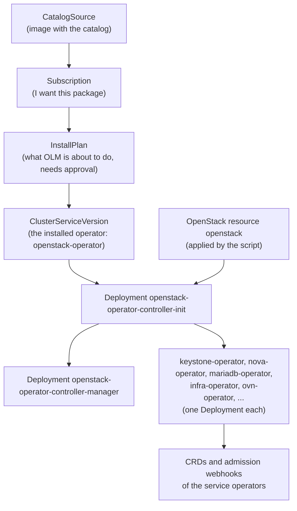

# Step 4 — OpenStack operators

**Where:** bastion. **Command:** `scripts/bastion/05-openstack-operators.sh`

## In short

- This step installs the operators, not OpenStack: about twenty controller
  pods and around a hundred new resource types, and still no OpenStack
  service.
- Two stages: OLM installs the single `openstack-operator` bundle, then the
  `OpenStack` initialization resource makes it roll out one operator per
  service.
- The Subscription uses manual approval. The script approves the first
  InstallPlan only; later ones are upgrades and are yours to approve.
- The catalog image (`OPENSTACK_OPERATOR_INDEX`) decides which operator
  version is installed. The example settings pin it by digest.

## What we deploy

The software that will deploy and manage OpenStack — not OpenStack itself.
At the end of this step there are about twenty controller pods in the
`openstack-operators` namespace and around a hundred new resource types
(CRDs) in the cluster API, and still no OpenStack service.

This is the closest equivalent to installing `kolla-ansible` and its
playbooks on a deployment host, with one essential difference: these
controllers keep running and keep comparing the declared state with the
actual state for as long as the cloud exists.

## Two stages

The chain from the catalog image to the running service operators; the
first four objects are standard OLM objects, the last two stages are
specific to OpenStack.



1. **OLM installs `openstack-operator`.** The manifest
   `deployment/openstack/operators/operators.yaml.tmpl` declares where the
   catalog is and subscribes to the package. The Subscription uses
   `installPlanApproval: Manual`; the script approves the first InstallPlan.
   Later ones (upgrades) are yours to approve:
   [../lifecycle/02-operator-upgrade.md](../lifecycle/02-operator-upgrade.md).
2. **The `OpenStack` initialization resource** asks that operator to roll
   out the per-service operators, their CRDs and their admission webhooks.

The CSV itself installs a single Deployment,
`openstack-operator-controller-init`; that controller reconciles the
`OpenStack` resource and creates the others
([details](../lifecycle/02-operator-upgrade.md#1-context)).

One extra object is installed when it is missing: the `BareMetalHost` CRD
from the Metal3 project. The bare-metal provisioning operator is part of
the bundle and fails to start without it. On OKD 4.22 the CRD is already
part of the platform and this step changes nothing. The lab never
provisions bare metal.

The whole step takes about three minutes. One operator pod may show a
transient image pull error while twenty images are pulled at once; it
recovers by itself.

## Concepts worth understanding here

- **CRD and custom resource.** After this step
  `oc api-resources | grep openstack.org` lists new kinds such as
  `KeystoneAPI` or `Galera`. A CRD teaches the Kubernetes API a new kind; a
  custom resource (CR) is an object of that kind. Details in
  [../concepts/03-operators-crds-and-reconciliation.md](../concepts/03-operators-crds-and-reconciliation.md).
- **One operator per service.** When Keystone misbehaves in step 5, the
  controller to read is `keystone-operator-controller-manager`.
- **Version pinning.** `OPENSTACK_OPERATOR_INDEX` in `lab.env` selects the
  catalog image. The example settings pin the digest validated with this
  lab. If you follow the moving tag (`18-stable-latest`) instead, record the
  digest you actually got so the lab can be rebuilt identically:

  **[READ-ONLY]**

  ```bash
  oc -n openstack-operators get pod -l olm.catalogSource=openstack-operator-index \
    -o jsonpath='{.items[0].status.containerStatuses[0].imageID}{"\n"}'
  ```

## Verify

**[READ-ONLY]**

```bash
oc -n openstack-operators get subscription,installplan,csv
oc -n openstack-operators get openstack openstack
oc -n openstack-operators get pods
oc api-resources --api-group=core.openstack.org
```

Expected: one Subscription, one approved InstallPlan and the CSV
`openstack-operator.v0.8.0` in phase `Succeeded`; the `openstack` resource
`True` with 21 deployed operators; 24 pods `Running` (the catalog, the
`openstack-operator` controller and one controller per service); the kinds
`OpenStackControlPlane` and `OpenStackVersion` in the last list.

## If something fails

| Symptom | Look at |
|---|---|
| No InstallPlan appears | The catalog pod: `oc -n openstack-operators get pods -l olm.catalogSource=openstack-operator-index`; an `ImagePullBackOff` means the index image reference is wrong or unreachable |
| CSV stuck in `Pending` / `InstallReady` | `oc -n openstack-operators describe csv` — requirements not met are listed |
| CSV `Failed` | `oc -n openstack-operators get events --sort-by=.lastTimestamp` |
| `openstack` resource not Ready | `oc -n openstack-operators get openstack openstack -o jsonpath='{range .status.conditions[*]}{.type}={.status} {.message}{"\n"}{end}'`, then the pods that are not Running |
| A controller pod in `CrashLoopBackOff` mentioning a missing kind | A CRD it watches is absent. Seen on the lab with the infra operator and `FRRConfiguration` ("failed to wait for bgpconfiguration caches to sync"): run step 3 again. The other known case is `BareMetalHost` |

---

**Previous:** [Step 3 — Platform services](03-platform-services.md) · **Next:** [Step 5 — OpenStack control plane](05-openstack-control-plane.md)
