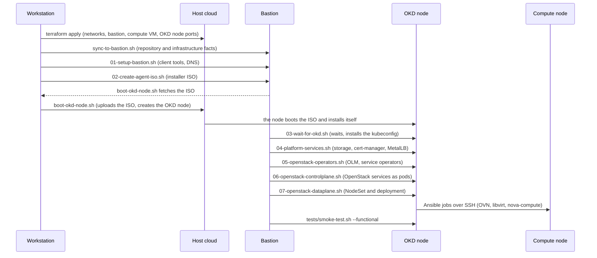

# Installation guide


**Start here** to build the lab from nothing. The installation is a
sequence of seven steps, from the virtual infrastructure to a test instance
booted on the new cloud. Follow the pages in order, one at a time: each
page explains what is deployed, why, how to verify it and what to look at
when it fails. If you have been through them once, the
[quick reference](#quick-reference) is enough.

## In short

- Seven numbered pages, run in order; each ends with a verification.
- Commands run either on the **workstation** (has cloud credentials) or on
  the **bastion** (has cluster access). Every page says which.
- Everything that ends up in the cluster is a readable manifest under
  `deployment/`; the scripts only fill in values, apply and wait.
- Re-running a script after a failure is the normal way to continue.
  Steps 1 and 2 need more care than steps 3 to 6 (see
  [Pages](#pages)).
- Count two hours for a first run, reading included.

## Before you start

| Prerequisite | Where |
|---|---|
| You know what the lab is made of: VMs, networks, software layers | [../architecture.md](../architecture.md) |
| The host cloud project has the quota, flavors, images and network features | [../prerequisites.md](../prerequisites.md) |
| The workstation has Terraform, the OpenStack client and an SSH key | [../prerequisites.md](../prerequisites.md#workstation) |
| The lab VMs reach the Internet only through an HTTP proxy | [Running behind a proxy](#running-behind-a-proxy), before the first bastion step |

## Pages

| Step | Page | What you get | Script | Where | Duration (measured on the lab) |
|---|---|---|---|---|---|
| 1 | [Infrastructure](01-infrastructure.md) | Networks, router, bastion, compute VM, ports of the OKD node | `terraform`, `sync-to-bastion.sh` | workstation | 5 min (the `apply` itself: about 1 min) |
| 2 | [OKD cluster](02-okd.md) | A single-node OKD cluster | `01-setup-bastion.sh`, `02-create-agent-iso.sh`, `boot-okd-node.sh`, `03-wait-for-okd.sh` | bastion, workstation | 55 min (bastion 1 min, ISO 3 min, installation 46 min) |
| 3 | [Platform services](03-platform-services.md) | Storage, cert-manager, MetalLB | `04-platform-services.sh` | bastion | 2 min |
| 4 | [OpenStack operators](04-openstack-operators.md) | The controllers that will run OpenStack | `05-openstack-operators.sh` | bastion | 3 min |
| 5 | [OpenStack control plane](05-openstack-control-plane.md) | The OpenStack services, as pods | `06-openstack-controlplane.sh` | bastion | 10–15 min |
| 6 | [OpenStack data plane](06-openstack-data-plane.md) | nova-compute and OVN on the compute VM | `07-openstack-dataplane.sh` | bastion | 21 min |
| 7 | [Verification](07-verification.md) | A smoke test and a booted test instance | `tests/smoke-test.sh` | bastion | 2 min |

The numbers of the bastion scripts are not the page numbers: the OKD page
uses the first three scripts, so script `04` belongs to step 3.

These figures come from one installation, behind a proxy, on fast volumes.

Running steps 3 to 6 again once they have finished takes a few seconds and
changes nothing. Steps 1 and 2 are different: the bastion setup restarts
its DNS service, and the ISO step refuses to overwrite an existing
installation unless `--force` is given.

## Who runs what, where

The sequence below shows the whole deployment: which machine starts each
script and which machine it acts on.



## Quick reference

For readers who have been through the pages once:

```bash
# --- workstation ---
cp config/lab.env.example lab.env                       # then edit
cp deployment/infrastructure/terraform.tfvars.example \
   deployment/infrastructure/terraform.tfvars           # then edit
scripts/workstation/create-dataplane-key.sh
terraform -chdir=deployment/infrastructure init
terraform -chdir=deployment/infrastructure apply
scripts/workstation/sync-to-bastion.sh
scripts/workstation/ssh-bastion.sh scripts/bastion/01-setup-bastion.sh
scripts/workstation/ssh-bastion.sh scripts/bastion/02-create-agent-iso.sh
scripts/workstation/boot-okd-node.sh

# --- bastion (scripts/workstation/ssh-bastion.sh opens a shell there) ---
scripts/bastion/03-wait-for-okd.sh
scripts/bastion/04-platform-services.sh
scripts/bastion/05-openstack-operators.sh
scripts/bastion/06-openstack-controlplane.sh
scripts/bastion/07-openstack-dataplane.sh
tests/smoke-test.sh --functional
```

## How the automation is organised

```text
config/lab.env.example        settings you choose (names, versions)
deployment/infrastructure/    Terraform: networks, router, VMs
deployment/okd/               installer templates, storage and MetalLB manifests
deployment/openstack/         operator, control plane and data plane manifests
scripts/workstation/          steps that need cloud credentials
scripts/bastion/              steps that need cluster access (numbered)
scripts/lib/                  shared shell helpers and the address plan
tests/                        smoke test and offline template check
```

Principles:

- **Manifests are templates, scripts are glue.** Everything that ends up in
  the cluster is a readable YAML file under `deployment/`. Scripts only
  substitute values (`${VARIABLE}` placeholders), apply the result and wait.
  The rendered files are kept in `.work/rendered/` on the bastion so you can
  read exactly what was applied.
- **Two sources of values.** `lab.env` holds what you decide. `.work/infra.env`
  is generated from the Terraform outputs (addresses, MAC addresses, MTU) so
  that nothing about the infrastructure is typed twice.
- **Scripts are idempotent.** Re-running a step after a failure is the
  normal way to continue.
- **No secrets in files.** Cloud credentials stay in your OpenStack client
  configuration on the workstation. Service passwords are generated directly
  into a Kubernetes Secret. `lab.env`, `terraform.tfvars` and `.work/` are
  ignored by Git.

## Running behind a proxy

Some clouds give lab VMs no direct Internet access, only an HTTP proxy.
Set `HTTP_PROXY_URL` in `lab.env` before the first bastion step:

```bash
HTTP_PROXY_URL=http://proxy.example.com:3128
```

What this changes:

| Where | Effect |
|---|---|
| Bastion | Downloads its packages, the OKD client tools and the release manifests of the platform services through the proxy, and no longer requires external names to resolve through its DNS |
| OKD cluster | Installed with a cluster-wide proxy (`proxy:` block of `install-config.yaml`), so the node pulls its images through it. The lab networks and the cluster names bypass the proxy; add your own exceptions with `NO_PROXY_EXTRA` |
| Compute nodes | The data plane Ansible runs receive the proxy settings (`edpm_playbook_environment` in the NodeSet), so the nodes install packages and pull images through it |
| Functional test | Downloads its CirrOS image through it |

The proxy must accept HTTPS (`CONNECT`) requests from every lab VM address
it sees. Plain HTTP is not required: the lab's `repo-setup` service writes
the package repositories of the compute nodes with `https://` addresses.

Related optional settings, all neutral by default:

| Setting | Where | Purpose |
|---|---|---|
| `BASTION_NTP_SERVER=true` | `lab.env` | The lab VMs cannot reach an NTP server: the bastion serves its clock to the OKD node and the compute nodes |
| `ISO_BLANK_SYSTEM_AREA=true` | `lab.env` | The image service refuses hybrid ISO files |
| `okd_floating_ip`, `compute_floating_ip` | `terraform.tfvars` | Only instances with a floating IP have outbound access. **Exposure:** the compute node's floating IP sits on a port without port security or security group, so the node is reachable from the external network until the data plane deployment has installed its own firewall; use it only where the external network is trusted or filtered upstream |
| `floating_ip_subnet_id` | `terraform.tfvars` | The external network has several subnets |
| `upstream_dns` | `terraform.tfvars` | Resolvers reachable from the lab (may be empty behind a proxy) |

## Removing the lab

**[DESTRUCTIVE]** — deletes every lab VM, volume and network:

```bash
terraform -chdir=deployment/infrastructure destroy
openstack image list --private -f value -c ID -c Name | grep agent-iso   # then delete these images
```

---

**Next:** [Step 1 — Infrastructure](01-infrastructure.md)
