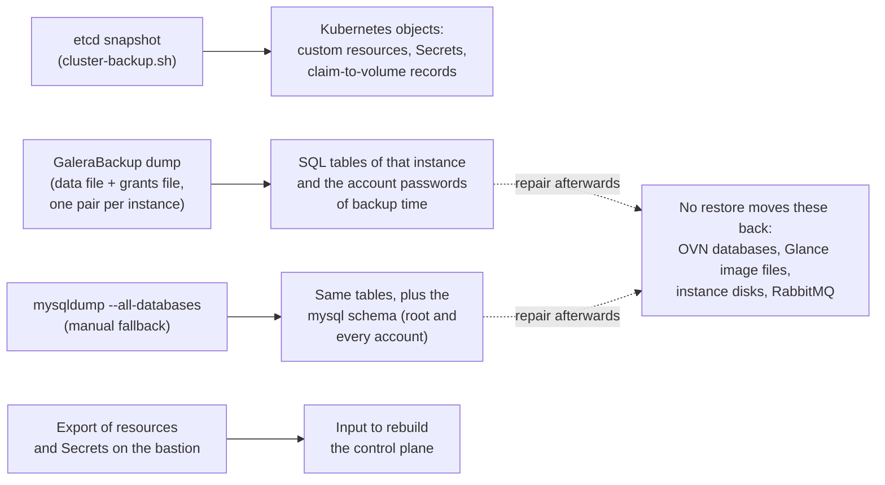

# Backup and restore drills

## In short

- Real restores, with markers that prove the result: both Galera
  instances on 2026-11-12, etcd on the single node on 2026-11-13.
- A database restore is quick (7 s for the cell, 25 s for the main
  instance) and no API request failed, but the cloud is inconsistent
  afterwards: instances, Placement allocations, Neutron and OVN, and
  Glance files have to be repaired by hand.
- `restore_galera` loads only the files you name, leaves the services
  connected, and exits with 0 even when a file is reported `FAILED`.
- The etcd restore script ends after 40 s, but etcd was unavailable
  twice (about 9 and 5 minutes). OpenStack kept answering the whole time.
- Each backup covers one layer only. Restore etcd and the databases from
  the same moment, or they disagree.

Database restores executed for real on the lab on 2026-11-12, on both
Galera instances, with markers created before and after each backup so
that the result can be proven. The procedure itself is in
[Backup and restore](../lifecycle/05-backup-and-restore.md); this file
records what happened, how long it took and what had to be repaired
afterwards. The last entry is the etcd restore executed on 2026-11-13.

Conventions and helpers are those of the [README](index.md). Two more
helpers are used here:

```bash
sql() { local i=$1; shift; oc exec -c galera $i-galera-0 -- mysql -nN -e "$*"; }
nb() { oc exec ovsdbserver-nb-0 -c ovsdbserver-nb -- ovn-nbctl --no-leader-only "$@"; }
```

`sql openstack "..."` queries the main instance, `sql openstack-cell1
"..."` the cell instance.

What each backup holds, and what its restore brings back:



| Restore | Entry | Brings back | Does not touch |
| --- | --- | --- | --- |
| Cell instance (`openstack-cell1`) | [cell restore](#how-do-i-restore-the-cell-database-and-what-is-the-result) | `nova_cell1`: instances, migrations, compute nodes, services | The API database, Placement, Neutron, the compute node |
| Main instance (`openstack`) | [main restore](#how-do-i-restore-the-main-database-instance-and-what-is-the-result) | Keystone, Glance, Neutron, `nova_api`, `nova_cell0`, Placement | OVN databases, image files, the compute node, RabbitMQ |
| Plain `mysqldump` | [manual restore](#how-do-i-restore-by-hand-from-a-plain-mysqldump) | Every schema, `mysql` included (scratch server only) | Same as the operator's restore |
| etcd | [etcd restore](#how-do-i-restore-etcd-on-the-single-node-and-what-really-happens) | Every Kubernetes object, as of the snapshot | Data in the volumes (Galera, OVN, Glance), running pods of OpenStack |

## Entries

### What do I put aside before touching the databases?

**Context**: before a restore, or any exercise that can damage the
databases. Four independent copies, all on the bastion, outside the
cluster.

**How**:

**[CHANGE]** One extra run of each backup CronJob, then the dumps copied
out of the node.

```bash
bd=~/backups/$(date -u +%Y%m%dT%H%M%SZ); mkdir -p $bd; chmod 700 $bd
for i in openstack openstack-cell1; do oc create job --from=cronjob/backup-$i safety-$i; done
oc wait job/safety-openstack job/safety-openstack-cell1 --for=condition=complete --timeout=5m
for i in openstack openstack-cell1; do
  pv=$(oc get pvc mysql-backup-$i -o jsonpath='{.spec.volumeName}')
  path=$(oc get pv $pv -o jsonpath='{.spec.local.path}')
  ssh core@192.168.130.10 "sudo tar -C ${path} -cf - data" > $bd/galera-$i-dumps.tar
done
```

**[READ-ONLY]** An independent logical dump of each instance, taken with
the client of the database pod (it reads its credentials by itself).

```bash
for i in openstack openstack-cell1; do
  oc exec -c galera $i-galera-0 -- bash -c \
    'mysqldump --all-databases --single-transaction --routines --events --flush-privileges | gzip -c' \
    > $bd/mysqldump-all-$i.sql.gz
  gunzip -c $bd/mysqldump-all-$i.sql.gz | tail -1
done
```

**[READ-ONLY]** The custom resources, the Secrets and the database
accounts, then the etcd snapshot
([lifecycle 5.1 and 5.3](../lifecycle/05-backup-and-restore.md)).

```bash
oc get mariadbaccount,mariadbdatabase -o yaml > $bd/mariadb-accounts.yaml
chmod 600 $bd/*
```

**Observed on the lab** (2026-11-12):

```text
galerabackup jobs: 15 s
mysqldump openstack: 2 s          -- Dump completed on 2026-11-12 13:52:52
mysqldump openstack-cell1: 0 s    -- Dump completed on 2026-11-12 13:52:52
export: 1 s
-rw------- 112640  galera-openstack-cell1-dumps.tar
-rw------- 983040  galera-openstack-dumps.tar
-rw------- 495377  mysqldump-all-openstack-cell1.sql.gz
-rw------- 710230  mysqldump-all-openstack.sql.gz
-rw------- 782723  secrets.yaml
```

The whole safety net, etcd snapshot included (122 MB, 4 s), took less
than a minute.

**Why / how it works**: the `GaleraBackup` dump and the `mysqldump` are
both logical dumps, but they differ: the operator's dump excludes the
`mysql` schema and stores the grants in a second file; the
`--all-databases` dump includes the `mysql` schema, so accounts and
passwords come back with it. Kolla-Ansible equivalent:
`kolla-ansible mariadb_backup` plus a copy of `/etc/kolla`.

**Pitfalls**:

- The dump files of **both** instances have the same names
  (`openstack_backup_<date>.sql.gz` and
  `openstack_backup-grants_<date>.sql.gz`, the prefix is fixed). Keep
  them in separate archives, as above, or a cell dump will one day be
  loaded into the main instance.
- A trailing `-- Dump completed` line is the only proof that a
  `mysqldump` stream was not cut.
- `secrets.yaml` and the `--all-databases` dumps contain every password.
  Directory mode 700, files 600, never in Git.

**See also**: [Backup and restore](../lifecycle/05-backup-and-restore.md),
[How do I take a database backup before a risky change?](openstack-service-administration.md#how-do-i-take-a-database-backup-before-a-risky-change)

### What does GaleraRestore really do?

**Context**: before running it. The resource has a single field and does
nothing destructive by itself; the restore is a script that you start by
hand.

**How**:

**[READ-ONLY]**

```bash
oc get crd galerarestores.mariadb.openstack.org \
  -o jsonpath='{.spec.versions[0].schema.openAPIV3Schema.properties.spec}{"\n"}'
oc get cm openstack-backup-scripts -o jsonpath='{.data.restore_galera}'
oc get cm openstack-backup-scripts -o jsonpath='{.data.backup_galera}' | grep -n mysqldump
```

**Observed on the lab** (2026-11-12, reading the script and then running
it):

- The spec has one field, `backupSource` (name of a `GaleraBackup`).
  Creating the resource makes the operator start a pod
  `restore-<name>` (Ready in about 5 s) that only sleeps. It mounts the
  backup volume on `/backup`, the scripts, and runs under its own
  service account `galerarestore-<name>` whose Role allows it to patch
  Services. Deleting the resource removes the pod, the account, the Role
  and the binding.
- `restore_galera [--yes] [--content all|data|grants] <files>` restores
  **only the files given as arguments**. It picks nothing by itself: with
  no argument it prints its usage.
- Steps of the script: read the root credentials, check the connection,
  find the Galera pod behind the Service, **empty the pod-name selector
  of the database Service** (no endpoint any more), pipe each file into
  `mysql` on the pod directly, put the selector back.
- The data file is a `mysqldump --single-transaction --databases` of every
  schema that has InnoDB tables, except `mysql`: for each schema
  `CREATE DATABASE IF NOT EXISTS`, then for each table `DROP TABLE IF
  EXISTS`, `CREATE TABLE` and the rows. There is **no `DROP DATABASE`**:
  tables are replaced one by one, a table or a schema created after the
  backup stays.
- The grants file is the output of `SHOW GRANTS` for every account except
  `root`: `GRANT USAGE ... IDENTIFIED BY PASSWORD '<hash>'` followed by
  the privileges. It sets each account password back to its value at
  backup time.
- Nothing is stopped: no OpenStack pod is scaled down, RabbitMQ and the
  OVN databases are not touched.

```text
main instance:  6 schemas (glance keystone neutron nova_api nova_cell0 placement), 407 tables, 26 grant lines
cell instance:  1 schema (nova_cell1), 110 tables, 6 grant lines
```

**Why / how it works**: the operator only prepares a pod that has the
backup volume and the credentials; the human chooses the files and takes
the decision. Kolla-Ansible equivalent: `mariabackup --prepare` and
`--copy-back` on a stopped cluster, by hand; here the server keeps
running and the restore is logical.

**Pitfalls**:

- Removing the Service endpoint only prevents **new** connections. The
  services keep their pooled connections to the pod (same eight
  connections of the Nova account before and after the restore) and go on
  reading and writing while the tables are replaced. The lab was idle; on
  a busy cloud, scale the API services down first or accept writes mixed
  into the restore.
- The script returns **exit code 0 even when a file fails to load**; only
  the word `FAILED` in its output tells
  ([entry below](#what-happens-when-a-restore-file-fails-to-load)).
- Restoring grants after a database password rotation brings the old
  passwords back while the Secrets hold the new ones: in that case
  restore with `--content data` only.
- `retention` still deletes nothing, and its file pattern does not match
  the dump names: five dumps per instance had accumulated in 14 hours of
  manual runs.

**See also**: [Backup and restore](../lifecycle/05-backup-and-restore.md),
[How do I look inside Galera?](openstack-service-administration.md#how-do-i-look-inside-galera-databases-sizes-connections-slow-queries)

### How do I restore the cell database, and what is the result?

**Context**: the cell database (`nova_cell1`: instances, migrations,
compute nodes, services) is damaged or must go back to a known state.
This is the smaller of the two instances: do the first drill here.

**How**:

**[READ-ONLY]** Know which database holds what before choosing a marker.

```bash
sql openstack-cell1 "select hostname,vm_state,deleted from nova_cell1.instances order by created_at desc limit 5"
sql openstack "select count(*) from nova_api.instance_mappings"
```

**[DESTRUCTIVE]** Start the restore pod, choose one pair of files, run
the script, remove the resource.

```bash
cat <<'YAML' | oc apply -f -
apiVersion: mariadb.openstack.org/v1beta1
kind: GaleraRestore
metadata:
  name: cell1-restore
  namespace: openstack
spec:
  backupSource: openstack-cell1
YAML
oc wait galerarestore/cell1-restore --for=condition=Ready --timeout=5m
oc wait pod/restore-cell1-restore --for=condition=Ready --timeout=3m
oc exec restore-cell1-restore -- ls -l /backup/data
oc exec restore-cell1-restore -- /var/lib/backup-scripts/restore_galera --yes \
  /backup/data/openstack_backup_<date>.sql.gz /backup/data/openstack_backup-grants_<date>.sql.gz
oc get svc openstack-cell1 -o jsonpath='{.spec.selector}{"\n"}'
oc delete galerarestore cell1-restore
```

**Observed on the lab** (2026-11-12). Markers: instance `m1` created
before the backup; instance `m3` created before and deleted after;
instance `m2` created after; one host aggregate before and one after (the
aggregates live in `nova_api`, on the other instance).

```text
13:54:05  backup job                              14 s
13:55:16  GaleraRestore created, pod Ready         2 s
## restore start 13:55:36
Get direct pod name for service openstack-cell1... selected pod openstack-cell1-galera-0
Disable traffic to Galera cluster openstack-cell1
Restore content: all
Restore backup /backup/data/openstack_backup_2026-11-12_13-54-07.sql.gz into Galera pod openstack-cell1... OK
Restore backup /backup/data/openstack_backup-grants_2026-11-12_13-54-07.sql.gz into Galera pod openstack-cell1... OK
Restore traffic to Galera cluster openstack-cell1 via endpoint openstack-cell1-galera-0
## restore end 13:55:43      (7 s)
```

| Marker | Before the restore | After the restore |
| --- | --- | --- |
| `m1` (before the backup) | ACTIVE | ACTIVE, untouched |
| `m2` (after the backup) | ACTIVE | absent from `server list`; still running on the compute node |
| `m3` (deleted after the backup) | deleted | back as ACTIVE; nothing runs on the compute node |
| aggregates before / after | both present | both present (other instance, not restored) |

A probe running `openstack server list` and `openstack token issue` in a
loop (one pass every 4 s) saw **no failed request** during the restore.
The four Nova services stayed `up`; no pod restarted; no service had to
be restarted. `tests/smoke-test.sh --functional` passed right after the
repairs of the next entry (0 failed).

**Why / how it works**: the cell database is the only place where the
instance records live; the API database (mappings, request
specifications), Placement and Neutron are on the main instance and were
not restored, so they still describe the newer state. Kolla-Ansible
equivalent: one MariaDB holds everything, so a restore there moves all
the services back together; here the two instances can be restored
separately and then disagree.

**Pitfalls**:

- Seven seconds without any error does not mean the cloud is consistent:
  see the next entry.
- List the files of the restore pod before choosing: the names carry the
  time of the backup run, in UTC.
- `oc wait pod/restore-<name>` can run before the pod exists: wait for
  the `GaleraRestore` first, as above.

**See also**: [next entry](#what-is-inconsistent-after-a-cell-database-restore-and-how-do-i-repair-it),
[Backup and restore](../lifecycle/05-backup-and-restore.md)

### What is inconsistent after a cell database restore, and how do I repair it?

**Context**: right after a restore of `openstack-cell1` to an older
state. Two kinds of instances are wrong: those created after the backup
(running, unknown to Nova) and those deleted after the backup (known to
Nova, not running).

**How**:

**[READ-ONLY]** Detect. Compare what the hypervisor runs with what Nova
lists, and ask Placement for allocations without instance.

```bash
os server list --all-projects --host edpm-compute-0.ctlplane.okd.lab.example.com -f value -c ID -c Name -c Status
compute sudo virsh list --all --uuid
oc exec nova-cell0-conductor-0 -- nova-manage placement audit --verbose
sql openstack "select instance_uuid from nova_api.instance_mappings where queued_for_delete=0" > /tmp/mapped
sql openstack-cell1 "select uuid from nova_cell1.instances where deleted=0" > /tmp/in-cell
sort /tmp/mapped /tmp/in-cell | uniq -u
```

**[DESTRUCTIVE]** Remove an instance that runs but is unknown to Nova
(created after the backup). There is no API for it any more.

```bash
compute sudo virsh dominfo instance-<n> | grep UUID
compute sudo virsh destroy instance-<n>
compute sudo virsh undefine instance-<n>
compute sudo rm -rf /var/lib/nova/instances/<instance-id>
oc exec nova-cell0-conductor-0 -- nova-manage placement audit --verbose --delete
os port delete $(os port list --device-id <instance-id> -f value -c ID)
sql openstack "delete from nova_api.request_specs where instance_uuid='<instance-id>';
               delete from nova_api.instance_mappings where instance_uuid='<instance-id>'"
```

**[CHANGE]** Remove an instance that came back (deleted after the
backup): delete it again through the API.

```bash
os server delete --wait <instance-id>
```

**Observed on the lab** (2026-11-12):

```text
$ os server show <m2-id>
No Server found for <m2-id>
$ sql openstack "select instance_uuid,cell_id from nova_api.instance_mappings where instance_uuid='<m2-id>'"
<m2-id>  2
$ nova-manage placement audit --verbose
Allocations were set against consumer UUID <m2-id> but no existing instances or active migrations are related.
Allocations for consumer UUID <m2-id> on Resource Provider <rp-id> can be deleted: {'DISK_GB': 1, 'MEMORY_MB': 256, 'VCPU': 1}
Processed 1 allocation.          (exit code 3 = something found)
$ compute sudo virsh list --all
 19   instance-00000013   running
 21   instance-00000015   running        <- m2, unknown to Nova
```

The port of `m2` was still ACTIVE in Neutron and its address still
answered. After the six commands above: one domain left, allocation
deleted (`audit --delete`, exit code 4), port deleted, project quota
usage back to the real count.

`m3` showed `ACTIVE`, power state `Running` and its old address, with no
port in Neutron, no allocation in Placement and no domain. Five minutes
later Nova had not changed its state by itself.
`nova-manage placement heal_allocations --dry-run` proposed to
**re-create** its allocation. The second `server delete` returned
normally and removed the record.

**Why / how it works**: `nova-compute` only cleans domains whose
instance is marked deleted in the database; a domain with no record at
all is left alone. `placement audit` compares allocations with instances
and migrations of every cell, which is exactly the check needed here.
Kolla-Ansible equivalent: the same commands, with `docker exec
nova_conductor nova-manage` and `virsh` in the `nova_libvirt` container.

**Pitfalls**:

- Do not run `heal_allocations` before sorting the instances that came
  back: it would reserve capacity for machines that do not exist.
- The instance directory under `/var/lib/nova/instances` holds the disk:
  check the UUID twice before `rm -rf`. The cached base image in
  `_base` is shared, leave it.
- The row left in `nova_api.instance_mappings` is harmless but makes
  later counts wrong; no `nova-manage` command removes it.
- The quota usage of the project is counted from Placement and the API
  database: it stays too high until the allocation is removed.

**See also**: [Placement entries](openstack-compute.md),
[previous entry](#how-do-i-restore-the-cell-database-and-what-is-the-result)

### How do I restore the main database instance, and what is the result?

**Context**: the instance `openstack` holds Keystone, Glance, Neutron,
the Nova API database, `nova_cell0` and Placement. Do it only after the
cell drill behaved as expected.

**How**:

**[DESTRUCTIVE]**

```bash
cat <<'YAML' | oc apply -f -
apiVersion: mariadb.openstack.org/v1beta1
kind: GaleraRestore
metadata:
  name: main-restore
  namespace: openstack
spec:
  backupSource: openstack
YAML
oc wait galerarestore/main-restore --for=condition=Ready --timeout=5m
oc wait pod/restore-main-restore --for=condition=Ready --timeout=3m
oc exec restore-main-restore -- ls -l /backup/data
oc exec restore-main-restore -- /var/lib/backup-scripts/restore_galera --yes \
  /backup/data/openstack_backup_<date>.sql.gz /backup/data/openstack_backup-grants_<date>.sql.gz
oc delete galerarestore main-restore
```

**Observed on the lab** (2026-11-12). Markers before the backup: project
`p-before`, network `net-before` with a port, network `net-deleted-after`.
After the backup: project `p-after`, flavor `flavor-after`, network
`net-after` with a port, image `image-after` (1 MiB), instance `m4`, and
`net-deleted-after` deleted.

```text
14:01:11  backup job                              15 s
## restore start 14:02:28
Restore backup /backup/data/openstack_backup_2026-11-12_14-00-57.sql.gz into Galera pod openstack... OK
Restore backup /backup/data/openstack_backup-grants_2026-11-12_14-00-57.sql.gz into Galera pod openstack... OK
## restore end 14:02:53      (24.6 s)
```

| Marker | After the restore |
| --- | --- |
| project `p-before` | present |
| project `p-after` | **gone** |
| flavor `flavor-after` | gone |
| image `image-after` | gone from the API; its file is still in the Glance store |
| network `net-after` and its port | gone from the API; still in the OVN northbound database |
| network `net-deleted-after` | back in the API; absent from OVN |
| instance `m4` | listed ACTIVE and running, but `server show` answers "No Server found"; its port is unknown to Neutron and still in OVN |
| instance `m1` | ACTIVE, untouched |

The probe (115 passes over 7 minutes covering this restore and the
failure test below) saw **no failed request**; the slowest pass took
6.8 s. Tokens issued before the restore stayed valid (Fernet keys are in
a Secret, not in the database). No pod restarted, the control plane
resource stayed `Ready`. After the repairs of the next three entries:
`tests/smoke-test.sh --functional` 0 failed, `placement audit` clean,
sync tool silent.

**Why / how it works**: same mechanism as the cell restore, with 407
tables. Everything that is not SQL keeps its newer state: OVN
databases, the image files, the compute node, RabbitMQ (which only
carries transient messages and needed nothing).

**Pitfalls**:

- `server list` goes straight to the cell and still shows an instance
  that `server show`, `delete` and every other call cannot find, because
  the mapping in `nova_api` is gone. Do not conclude from the list.
- Passwords of Keystone users changed after the backup go back to their
  old value; application credentials and role assignments created since
  are lost.
- Network quota counts the network that came back: an unexpected "Quota
  exceeded" after a restore is a sign of resurrected resources.

**See also**: [Neutron and OVN repair](#how-do-i-detect-and-repair-neutron-and-ovn-after-a-restore),
[instance repair](#how-do-i-get-rid-of-an-instance-that-the-api-no-longer-finds),
[image files](#which-image-files-are-left-in-the-glance-store-after-a-restore)

### How do I detect and repair Neutron and OVN after a restore?

**Context**: after a restore of the main instance, the Neutron database
is older than the OVN northbound database. Also useful after any doubt on
OVN content.

**How**:

**[READ-ONLY]** The sync tool in `log` mode reports and changes nothing.

```bash
np=$(oc get pod -l service=neutron -o name | head -1)
oc exec $np -c neutron-api -- neutron-ovn-db-sync-util \
  --config-file /etc/neutron/neutron.conf --config-dir /etc/neutron/neutron.conf.d \
  --ovn-neutron_sync_mode log 2>&1 | grep -E 'WARNING|ERROR|Sync'
nb --columns=external_ids list logical_switch | grep -o 'network_name"*=[^,}]*'
```

**[DESTRUCTIVE]** `repair` mode makes OVN match the Neutron database:
it creates what is missing in OVN and **deletes from OVN what Neutron
does not know**.

```bash
oc exec $np -c neutron-api -- neutron-ovn-db-sync-util \
  --config-file /etc/neutron/neutron.conf --config-dir /etc/neutron/neutron.conf.d \
  --ovn-neutron_sync_mode repair 2>&1 | grep -E 'WARNING|ERROR|Sync'
```

**Observed on the lab** (2026-11-12, `log` mode 11 s, `repair` mode 6 s):

```text
Sync for Northbound db started with mode : repair
WARNING Network found in Neutron but not in OVN DB, network_id=<id>
WARNING Metadata port <id> for network <id> found in Neutron but not in OVN
WARNING Creating metadata port <id> for network <id> in OVN
WARNING DHCP options for subnet <id> is present in Neutron but out of sync for OVN
WARNING Adding/Updating DHCP options for subnet <id> in OVN NB DB
WARNING Out of sync subnet DHCP options for subnet <id> found in OVN NB DB which needs to be deleted
WARNING Network found in OVN but not in Neutron, network_id=neutron-<id>
WARNING Port found in OVN but not in Neutron, port_id=<id>
Sync completed for Northbound db
Sync for Southbound db started with mode : repair
Sync completed for Southbound db
```

Before: logical switches `net-before`, `kb-demo-net`, `net-after`,
`kb-public`. After: `net-before`, `kb-demo-net`, `net-deleted-after`,
`kb-public`; the port of instance `m4` was removed from OVN. A second
run in `log` mode printed no warning.

**Why / how it works**: Neutron's database is the reference and OVN is
derived from it; the tool walks both and applies the difference. It runs
inside the Neutron API pod because the configuration and the OVN
certificates are there. The periodic maintenance task of the Neutron
server only fixes resources whose revision numbers differ; it does not
find objects that exist on one side only. Kolla-Ansible equivalent:
`docker exec neutron_server neutron-ovn-db-sync-util ...` with the same
options.

**Pitfalls**:

- `repair` cuts the network of every instance whose port was created
  after the backup (here `m4`): decide what to do with those instances
  first.
- Run `log` mode before and after; keep the first output, it is the list
  of what the restore lost on the network side.
- The tool logs at INFO on standard error with colour codes; filter as
  above.
- Not observed here: if the Neutron pod was replaced between the backup
  and the restore, check that new ports become ACTIVE, and restart the
  Neutron pod if they do not.

**See also**: [OVN databases](openstack-networking-ovn.md),
[Backup and restore](../lifecycle/05-backup-and-restore.md)

### How do I get rid of an instance that the API no longer finds?

**Context**: after a restore of the main instance, an instance created
after the backup is still in its cell and still running, but its mapping
in the API database is gone: `server list` shows it, nothing else works.

**How**:

**[READ-ONLY]**

```bash
sql openstack "select instance_uuid from nova_api.instance_mappings where queued_for_delete=0" > /tmp/mapped
sql openstack-cell1 "select uuid from nova_cell1.instances where deleted=0" > /tmp/in-cell
sort /tmp/mapped /tmp/in-cell | uniq -u
```

**[CHANGE]** Give the mapping back, then use the normal API.

```bash
cid=$(sql openstack "select id from nova_api.cell_mappings where name='cell1'")
pid=$(sql openstack-cell1 "select project_id from nova_cell1.instances where uuid='<instance-id>'")
uid=$(sql openstack-cell1 "select user_id from nova_cell1.instances where uuid='<instance-id>'")
sql openstack "insert into nova_api.instance_mappings
  (created_at,instance_uuid,cell_id,project_id,queued_for_delete,user_id)
  values (now(),'<instance-id>',$cid,'$pid',0,'$uid')"
os server show <instance-id> -f value -c status
os server delete --wait <instance-id>
```

**Observed on the lab** (2026-11-12):

```text
$ os server show <m4-id>
No Server found for <m4-id>
(insert: 1 row)
$ os server show <m4-id> -f value -c status
ACTIVE
$ os server delete --wait <m4-id>          -> rc 0, domain removed from the compute node
$ nova-manage placement audit               -> nothing to report
```

**Why / how it works**: the API finds the cell of an instance through
`instance_mappings`; with the row back, the delete goes through the
normal path, which removes the domain and the disk on the compute node.
The Placement allocation and the Neutron port were already lost with the
restore, and Nova tolerates their absence at delete time.
Kolla-Ansible equivalent: none, one database holds both sides.

**Pitfalls**:

- This is a hand-written row in a service database: acceptable to delete
  an instance, not to keep it. To keep it, the request specification,
  the allocation (`heal_allocations`) and the port would also have to be
  rebuilt; this was not attempted.
- Do the Neutron repair and this one in a chosen order: once `repair`
  has run, the instance has no network.

**See also**: [cell restore repairs](#what-is-inconsistent-after-a-cell-database-restore-and-how-do-i-repair-it)

### Which image files are left in the Glance store after a restore?

**Context**: after a restore of the main instance, images uploaded after
the backup have no record any more but their data is still on the
volume.

**How**:

**[READ-ONLY]** Compare the files of the store with the image
identifiers.

```bash
pv=$(oc get pvc glance-glance-default-single-0 -o jsonpath='{.spec.volumeName}')
path=$(oc get pv $pv -o jsonpath='{.spec.local.path}')
sql openstack "select id from glance.images where deleted=0" > /tmp/image-ids
ssh core@192.168.130.10 "sudo find $path -type f -printf '%f %s %TY-%Tm-%Td %TH:%TM\n'" |
  while read -r f rest; do grep -q "$f" /tmp/image-ids || echo "no record: $f $rest"; done
```

**[DESTRUCTIVE]** Remove a file that has no record.

```bash
ssh core@192.168.130.10 "sudo rm $path/<path-to-file>"
```

**Observed on the lab** (2026-11-12): the 1 MiB file of `image-after`
(14:01) had no record after the restore and was removed. The same check
found three older files of 194 kB (dated the day before and the same
morning) that match no active image either: they are not a result of the
restore and were left in place ([open questions](open-questions.md)).

**Why / how it works**: the file store names each file after the image
identifier; Glance never scans the store. The opposite case (a record
whose file is missing) would show as an image that fails at download.
Kolla-Ansible equivalent: the same check in `/var/lib/glance/images`.

**Pitfalls**:

- An image deleted after the backup comes back as `active` with no file:
  instances booted from it fail at image download. Delete the record
  through the API.

**See also**: [Images](openstack-identity-and-tenants.md),
[Storage](okd-storage.md)

### What happens when a restore file fails to load?

**Context**: a wrong, truncated or corrupt file given to
`restore_galera`.

**How**:

**[DESTRUCTIVE]** (done on the cell instance with a one-line file that is
not SQL)

```bash
oc exec restore-cell1-restore -- bash -c 'echo "THIS IS NOT SQL;" > /tmp/bad.sql'
oc exec restore-cell1-restore -- /var/lib/backup-scripts/restore_galera --yes /tmp/bad.sql; echo "rc=$?"
oc get svc openstack-cell1 -o jsonpath='{.spec.selector}{"\n"}'
```

**[CHANGE]** Repair of the Service if a restore was interrupted (pod
killed, session lost) while the endpoint was removed.

```bash
oc patch svc openstack-cell1 --type=json -p \
  '[{"op":"add","path":"/spec/selector/statefulset.kubernetes.io~1pod-name","value":"openstack-cell1-galera-0"}]'
```

**Observed on the lab** (2026-11-12):

```text
Disable traffic to Galera cluster openstack-cell1
Restore content: all
Restore backup /tmp/bad.sql into Galera pod openstack-cell1... FAILED
Restore traffic to Galera cluster openstack-cell1 via endpoint openstack-cell1-galera-0
ERROR 1064 (42000) at line 1: You have an error in your SQL syntax; ...
rc=0
{"app":"galera","cr":"galera-openstack-cell1","statefulset.kubernetes.io/pod-name":"openstack-cell1-galera-0"}
```

The file is reported `FAILED`, the script goes on with the next file,
puts the endpoint back and **exits with 0**. The API probe saw no error.
The repair command above was run for the record and answered "no
change".

**Why / how it works**: each file is piped into the `mysql` client, which
stops at the first error; what was loaded before the error stays loaded.
A dump that breaks in the middle therefore leaves a database with some
tables from the backup and some current ones.

**Pitfalls**:

- Never test the exit code alone in a script: `grep FAILED` in the
  output.
- After a `FAILED` on a data file, load a complete file again (the same
  one from the bastion copy, or an older one) before letting users in.
- The script reads the files from the backup volume or from any path in
  the pod: a dump copied back from the bastion with `oc cp` works the
  same way.

**See also**: [What does GaleraRestore really do?](#what-does-galerarestore-really-do)

### How do I restore by hand from a plain mysqldump?

**Context**: fallback when the operator's restore cannot be used (no
`GaleraBackup` volume left, operator broken) and a
`mysqldump --all-databases` file exists on the bastion. On the lab the
import was validated on a scratch server only; the live import was not
needed.

**How**:

**[READ-ONLY]** Prove that the dump loads, on a throwaway server in a pod
of the same image (nothing touches the live database).

```bash
img=$(oc get pod openstack-galera-0 -o jsonpath='{.spec.containers[0].image}')
oc run scratch-db --image=$img --restart=Never --command -- sleep 1800
oc wait pod/scratch-db --for=condition=Ready --timeout=2m
oc exec scratch-db -- bash -c 'mysql_install_db --no-defaults --auth-root-authentication-method=normal --datadir=/tmp/d >/dev/null 2>&1
  (/usr/libexec/mysqld --no-defaults --datadir=/tmp/d --skip-networking --socket=/tmp/s.sock --skip-log-error >/dev/null 2>&1 &)
  until [ -e /tmp/s.sock ]; do sleep 1; done'
oc exec -i scratch-db -- bash -c 'gunzip -c | mysql --no-defaults -uroot --socket=/tmp/s.sock' \
  < $bd/mysqldump-all-openstack.sql.gz
oc delete pod scratch-db
```

**[DESTRUCTIVE]** The live import (not executed on the lab): remove the
Service endpoint, load the dump in the Galera pod, put the endpoint
back.

```bash
i=openstack
oc patch svc $i --type=json -p '[{"op":"add","path":"/spec/selector/statefulset.kubernetes.io~1pod-name","value":""}]'
oc exec -i -c galera $i-galera-0 -- bash -c 'gunzip -c | mysql' < $bd/mysqldump-all-$i.sql.gz
oc patch svc $i --type=json -p '[{"op":"add","path":"/spec/selector/statefulset.kubernetes.io~1pod-name","value":"'$i'-galera-0"}]'
```

**Observed on the lab** (2026-11-12, scratch server, MariaDB 10.5.29):

```text
import openstack rc=0 1481 ms
glance 14  keystone 49  mysql 34  neutron 189  nova_api 32  nova_cell0 110  placement 13
import cell1 rc=0 691 ms
nova_cell1 110
```

Same table counts as the live servers, same row counts for the tables
checked (projects, networks). After the first import the scratch server
**refused its own password-less root**: the dump had replaced the `mysql`
schema and flushed the privileges, so root now had the lab's password.

**Why / how it works**: an `--all-databases` dump contains `DROP TABLE` /
`CREATE TABLE` for every table, the `mysql` schema included; with
`--flush-privileges` the accounts are active as soon as the import ends.
Kolla-Ansible equivalent: the same `mysql < dump.sql` in the `mariadb`
container.

**Pitfalls**:

- Loaded into the instance it came from, the passwords are the same and
  nothing changes. Loaded into a **rebuilt** instance, the dump replaces
  root and every account with the old passwords: the Secrets
  (`osp-secret` and the account Secrets) must be the old ones too,
  restored before the control plane is created.
- The `mysql` schema uses non-transactional tables that Galera does not
  replicate between members: with more than one Galera replica, restore
  accounts with the operator's grants file instead.
- The same caveats as the operator's restore apply afterwards
  (instances, Neutron and OVN, image files).

**See also**: [Backup and restore](../lifecycle/05-backup-and-restore.md),
[safety net](#what-do-i-put-aside-before-touching-the-databases)

### What can I verify about an etcd restore without doing it?

**Context**: the cluster has one etcd member. A restore replaces the
whole Kubernetes state. These are the facts gathered on 2026-11-12,
before the restore was run for real the next day
([next entry](#how-do-i-restore-etcd-on-the-single-node-and-what-really-happens)).

**How**:

**[READ-ONLY]**

```bash
node sudo ls -l /home/core/assets/backup/
node 'ls -l /usr/local/bin/cluster-backup.sh /usr/local/bin/cluster-restore.sh /usr/local/bin/quorum-restore.sh'
node 'sudo sed -n 1,46p /usr/local/bin/cluster-restore.sh'
node 'sudo tar -tzf /home/core/assets/backup/static_kuberesources_<date>.tar.gz | head'
```

**[CHANGE]** A fresh snapshot (writes two files on the node), then the
copy to the bastion.

```bash
oc debug --as-root node/okd-0 -- chroot /host /usr/local/bin/cluster-backup.sh /home/core/assets/backup
ssh core@192.168.130.10 "sudo tar -C /home/core/assets -cf - backup" > $bd/etcd-backup.tar
```

**Observed on the lab** (2026-11-12):

```text
-rw-------. 1 root root 93184032 Nov 12 00:26 snapshot_2026-11-12_002606.db
-rw-------. 1 root root    72350 Nov 12 00:26 static_kuberesources_2026-11-12_002606.tar.gz
Snapshot saved at /home/core/assets/backup/snapshot_2026-11-12_140740.db
{"hash":1333748517,"revision":535842,"totalKey":6061,"totalSize":122101760,"version":"3.6.0"}
snapshot db and kube resources are successfully saved to /home/core/assets/backup
```

`cluster-restore.sh <backup-directory>` exists on the node (143 lines,
written by the etcd operator). It must be started as root
on a node with a working etcd static pod definition; it moves the etcd
static pod manifest away, waits for the containers to stop, moves the
current data directory to a backup directory, then either restores the
static pod resources and starts a restore pod, or — with the variable
`ETCD_ETCDCTL_RESTORE` set, the mode its header recommends for a single
member — runs `snapshot restore` into a new data directory and puts the
manifest back. The archive `static_kuberesources` contains the static
pod resources of the control plane revision current at backup time
(certificates and keys included).

**Why / how it works**: the restore puts every Kubernetes object back to
the snapshot time: custom resources, Secrets, and the record of which
volume belongs to which claim. Data in the volumes (Galera, OVN, Glance)
is not in etcd and stays as it is. Kolla-Ansible equivalent: none; the
closest is restoring `/etc/kolla` and the inventory.

**Why the drill was first postponed**: with one member there is no
second control plane node to fall back on; a failed restore means
reinstalling the cluster and the whole lab. The first-day certificate
rotation was also due the same evening, and a snapshot taken before it
would bring back certificates about to expire. The restore was run the
day after, once the rotation was over, with the volume snapshots of the
stopped virtual machines
([lifecycle 5.4](../lifecycle/05-backup-and-restore.md)) as the last
way back.

**Pitfalls**:

- A snapshot older than the last control plane revision brings back older
  static pod resources; take the snapshot after, not before, a platform
  change.
- A snapshot contains every Secret in clear.
- An etcd restore older than a database restore (or the reverse) leaves
  operator-generated passwords and database accounts out of step: restore
  both from the same moment.

**See also**: [etcd backups](okd-cluster-health-and-etcd.md#are-there-automatic-etcd-backups-and-where-is-the-backup-script),
[OKD maintenance impact](../lifecycle/06-okd-maintenance-impact.md)

### How do I restore etcd on the single node, and what really happens?

**Context**: the last resort when Kubernetes objects were destroyed or
corrupted (a deleted namespace, a broken custom resource definition) and
a snapshot from before the damage exists. Run once on the lab, on a
healthy and idle cluster, with markers proving the result.

**How**:

**[CHANGE]** Safety net first (database dumps and exports as in the
[safety net entry](#what-do-i-put-aside-before-touching-the-databases)),
then a fresh snapshot in its own directory: the restore script wants
exactly one snapshot and one resources archive in the directory it is
given.

```bash
oc get nodes; oc get clusteroperators          # gate: everything settled
node 'sudo mkdir -p /home/core/assets/restore-src && sudo /usr/local/bin/cluster-backup.sh /home/core/assets/restore-src'
ssh core@192.168.130.10 "sudo tar -C /home/core/assets -cf - restore-src" > $bd/etcd-restore-src.tar
```

**[DESTRUCTIVE]** The restore, as root on the node. Every Kubernetes
object goes back to the snapshot; the API cannot write for several
minutes.

```bash
node 'sudo -E /usr/local/bin/cluster-restore.sh /home/core/assets/restore-src'
oc adm wait-for-stable-cluster --minimum-stable-period=3m
```

**[CHANGE]** The script leaves a restore pod in place of the regular
etcd pod. When the etcd operator does not replace it by itself, force a
new revision (second outage of etcd, about five minutes), then check.

```bash
oc -n openshift-etcd get pod etcd-okd-0 -o jsonpath='{.spec.containers[*].name}{"\n"}'
oc patch etcd cluster --type=merge -p "{\"spec\":{\"forceRedeploymentReason\":\"restore-$(date +%s)\"}}"
oc adm wait-for-stable-cluster --minimum-stable-period=2m
oc get etcd cluster -o jsonpath='{.status.latestAvailableRevision} {.status.nodeStatuses[0].currentRevision}{"\n"}'
node 'sudo ls -l /var/lib/etcd'
```

**[DESTRUCTIVE]** Once the cluster is stable on the new revision, remove
the previous data directory kept by the script, and the restore source.

```bash
node 'sudo rm -rf /var/lib/etcd-backup /home/core/assets/restore-src'
```

**Observed on the lab** (2026-11-13, times in UTC; OKD 4.22.0-okd-scos.10,
etcd 3.6, one member):

```text
05:46:11  gate: node Ready, 0 unsettled operators, control plane and node set True, etcd revision 2
05:46:35  snapshot: {"revision":974678,"totalKey":5872,"totalSize":130523136,"version":"3.6.0"}   (3 s)
05:46:50  after the snapshot: ConfigMap kb6-after created, kb6-before deleted, kb6-edit v=1 -> v=2,
          deployment kb6-web scaled 1 -> 3, OpenStack network created, instance booted with a floating IP
05:47:55  cluster-restore.sh started
          stopping etcd-pod.yaml / Waiting for container etcd to stop ... complete
          Moving etcd data-dir /var/lib/etcd/member to /var/lib/etcd-backup
          starting restore-etcd static pod
05:48:35  SNAPSHOT RESTORE COMPLETED, rc=0             (the script, 40 s)
05:48:31  etcd container stopped                       (container runtime log)
05:53:07  kubelet takes the restore pod from the manifest file
05:57:25  restore pod containers started: etcd, etcd-readyz
05:57:39  snapshot restored, "bumping revisions by 1223995", etcd serving again
06:01:45  wait-for-stable-cluster: All clusteroperators are stable
06:03:42  still the restore pod (2 containers), operator: latest revision 2, nothing in progress -> patch
06:05:06  etcd container stopped (installer of revision 3)
06:10:15  regular etcd pod started: etcdctl etcd etcd-metrics etcd-readyz etcd-rev
06:18:28  All clusteroperators are stable; etcd revision 3; /var/lib/etcd/revision.json is back
```

What came back and what did not:

```text
ConfigMap kb6-before      present again           (deleted after the snapshot)
ConfigMap kb6-edit        v=1                     (edit undone)
ConfigMap kb6-after       gone                    (created after the snapshot)
Deployment kb6-web        1/1, the original pod   (the 2 extra pods were removed by the controller)
OpenStack network         still there, ACTIVE     (lives in the database, not in etcd)
Instance                  ACTIVE, marker file intact, uptime continuous, 1880 ping answers without a gap
Keystone public endpoint  HTTP 200 every 3 s during both etcd outages
openstack namespace       same pods, restart total unchanged (61 before, 61 after)
kube-apiserver            container never restarted; at least 40 platform operator containers restarted once
```

etcd was unavailable twice: 9 min 8 s after the restore script
(05:48:31 to 05:57:39) and 5 min 9 s during the forced revision
(06:05:06 to 06:10:15). The functional smoke test reported 0 failed at
06:21.

**Why / how it works**: the script does not restore anything itself in
its default mode. It stops the etcd static pod by moving its manifest
away, moves the data directory aside, unpacks the static pod resources
of the snapshot and installs a *restore pod* as the etcd manifest. That
pod runs `etcdutl snapshot restore` into an empty data directory, with
a large revision bump and the old revisions marked compacted so that
every client cache is invalidated and reloads, then starts etcd on the
result. Most of the first outage is not the restore (14 s for 130 MB):
kubelet first tries to delete the mirror pod of the stopped etcd through
an API that has no etcd behind it, and repeats 34-second timeouts for
about five minutes before it takes the new manifest. The restore pod is
not a regular revision: the operator has to roll a new one to bring back
the five usual containers and the revision file, and on this single
member it did not start that by itself. OpenStack keeps answering
because its pods do not need the Kubernetes API to serve requests; only
operators and anything that creates, schedules or updates objects stop.
Kolla-Ansible equivalent: none (no cluster state store); the closest is
putting `/etc/kolla` and the inventory back from a backup.

**Pitfalls**:

- `oc adm wait-for-stable-cluster` returning "stable" is not the end:
  check the container names of `etcd-okd-0`. Two containers mean the
  restore pod is still there.
- Budget two interruptions of the Kubernetes API (about nine and five
  minutes here), not the 40 seconds of the script.
- A probe on `/readyz` every 3 seconds never reported a failure while
  `oc get clusteroperators` timed out and kubelet logged
  `Timeout: request did not complete`. Read the timeline in the kubelet
  and container runtime journals, not in such a probe.
- Everything created in Kubernetes after the snapshot disappears,
  including Secrets and certificates issued since then, and deleted
  objects come back. OpenStack data does not move: after a restore
  across a real change (a new node, a rotated password), the custom
  resources and the databases disagree. The drill avoided this by
  taking the snapshot one minute before.
- Pods started after the snapshot keep running on the node until the
  controllers reconcile; here the two extra replicas were removed
  within the stabilisation time.
- The way back if the restore pod never serves is the data directory
  kept in `/var/lib/etcd-backup/member`; it was not needed and not
  tested. Do not delete it before the new revision is in place.
- The restore source and the kept directory hold every Secret in clear
  and about 560 MB on the disk that etcd uses.
- Not covered: a restore after losing the node disk, a snapshot hours or
  days old, the `ETCD_ETCDCTL_RESTORE` mode, a cluster under load.

**See also**: [facts gathered before the drill](#what-can-i-verify-about-an-etcd-restore-without-doing-it),
[static pods and revisions](okd-cluster-health-and-etcd.md#where-does-the-control-plane-itself-run-and-what-are-revisions),
[Backup and restore](../lifecycle/05-backup-and-restore.md)
