# Data plane scale-out, migration and scale-in

## In short

- A second compute node was added, used and removed on 2026-11-12; three
  nodes were tried the next day. The lab is back to one node.
- Adding a node takes as long as a first deployment (21 minutes), does
  not disturb running instances, and must end with `discover_hosts`.
- Live migration without shared storage needs
  `live_migration_inbound_addr = $host` (now in the lab template). The
  instance is silent for 1.5 to 2.7 s; cold migration and resize cost
  about 25 s and a reboot; `evacuate` loses the local disk.
- Floating IPs are distributed and survive the loss of the gateway
  node. The router address does not: two chassis never fail over, three
  do in about 3 s, and the returning node takes the gateway back.
- Removing a node goes in this order: OpenStack records, NodeSet,
  infrastructure. The operator only frees addresses and DNS records.

A second compute node was added to the lab on 2026-11-12, used for
scheduling, migration, evacuation and gateway tests, then removed again.
Everything below was executed; the lab is back to its documented baseline
of one compute node. On 2026-11-13 two more nodes were added for a few
hours to test the gateway with three chassis, then removed the same way.
The procedure pages are
[OpenStack data plane](../installation/06-openstack-data-plane.md) and
[Data plane changes](../operations/08-dataplane-changes.md); this file
records what happened and what had to be fixed.

Conventions and helpers are those of the [README](index.md). More
helpers are used here:

```bash
H0=edpm-compute-0.ctlplane.okd.lab.example.com
H1=edpm-compute-1.ctlplane.okd.lab.example.com
osa() { os --os-compute-api-version 2.79 "$@"; }
compute1() { ssh -i .work/dataplane-ssh-key cloud-admin@192.168.122.101 "$@"; }
nb() { oc exec ovsdbserver-nb-0 -c ovsdbserver-nb -- ovn-nbctl --no-leader-only "$@"; }
sb() { oc exec ovsdbserver-sb-0 -c ovsdbserver-sb -- ovn-sbctl --no-leader-only "$@"; }
```

`os` is the admin client of the control plane, and it is scoped to the
admin project: it does not find an instance of another project by name.
Use the instance ID (`id=$($o server show kb-vm1 -f value -c id)`).

The two procedures at a glance, with the durations measured on the lab:

```mermaid
flowchart TD
    subgraph OUT["Scale-out"]
        A1["Workstation: compute_count + 1,<br/>terraform apply (1 min 7 s), sync"] --> A2["Bastion: 07-openstack-dataplane.sh<br/>with a new deployment name"]
        A2 --> A3["Operator: IPSet and DNS records<br/>of the node (seconds)"]
        A3 --> A4["Deployment: every service on<br/>every node (21 min)"]
        A4 --> A5["Script: discover_hosts<br/>maps the node to the cell"]
    end
    subgraph IN["Scale-in"]
        B1["Disable nova-compute,<br/>live-migrate the instances away"] --> B2["Stop the services on the node,<br/>delete agents and compute service"]
        B2 --> B3["Remove the node from the NodeSet:<br/>operator frees addresses and DNS"]
        B3 --> B4["Workstation: compute_count - 1,<br/>terraform apply, sync"]
        B4 --> B5["New deployment on the<br/>remaining nodes (13 min)"]
        B5 --> B6["Delete the leftover Certificate<br/>objects and Secrets by hand"]
    end
```



## Entries

### How do I add a second compute node?

**Context**: more capacity, or a second node to be able to migrate. The
node is a pre-provisioned virtual machine like the first one.

**How**:

**[CHANGE]** On the workstation: one more node in Terraform, then the
bastion copy of the repository and of `.work/infra.env`.

```bash
sed -i 's/^compute_count *=.*/compute_count = 2/' deployment/infrastructure/terraform.tfvars
terraform -chdir=deployment/infrastructure plan     # 6 to add: 3 ports, instance, floating IP, association
terraform -chdir=deployment/infrastructure apply
scripts/workstation/sync-to-bastion.sh
```

If the lab sits behind an HTTPS proxy with an allowlist of source
addresses, add the address the new node goes out with before the next
step; the node pulls its packages and images through it.

**[CHANGE]** On the bastion: the same script as for the first node, with
a new deployment name (a deployment is immutable and runs once).

```bash
scripts/bastion/07-openstack-dataplane.sh edpm-scale-out-1
```

Revert: [How do I remove a compute node cleanly?](#how-do-i-remove-a-compute-node-cleanly)

**Observed on the lab** (2026-11-12): Terraform apply 1 min 7 s. The
script added the node to the existing NodeSet `openstack-edpm`; the
operator created the `IPSet` of the node (three reservations) and its
three DNS records within seconds. The deployment took 21 min 4 s, the
same as the very first deployment with one node:

```text
repo-setup 18 s          configure-os 53 s       ovn 1 min 10 s
bootstrap 3 min 39 s     ssh-known-hosts 10 s    neutron-metadata 57 s
download-cache 3 min 6 s run-os 10 s             libvirt 4 min 22 s
configure-network 1 min 12 s  reboot-os 10 s     nova 2 min 42 s
install-os 44 s          install-certs 30 s
```

Every play ran on both nodes. On the node already deployed the Nova play
still reported 22 changed tasks (53 on the new node) and the OVN play 16
(34 on the new one): the containers of the first node are checked and
some are restarted. An instance running on the first node answered a
ping every 0.2 s during the whole run, without one lost packet. The OVN
chassis of the new node appeared 13 minutes after the start, its
`nova-compute` service 21 minutes after.

Two nodes at once (2026-11-12 and 13, `compute_count = 3`, deployment
`edpm-scale-out-2`): Terraform created 12 resources in 1 min 7 s, the
deployment took 27 min 30 s for three nodes, and the three
`nova-compute` services were up at the end. The return to one node
(`edpm-scale-in-2`) is in
[How do I remove a compute node cleanly?](#how-do-i-remove-a-compute-node-cleanly)

**Why / how it works**: one NodeSet describes nodes that share their
configuration; adding a node is one more key under `spec.nodes`. A new
`OpenStackDataPlaneDeployment` runs every service of the NodeSet on
every node, which is what refreshes the SSH known hosts and the name
resolution of the existing nodes. `ansibleLimit` can restrict a
deployment to the new node, but then the existing nodes do not learn
about it: run the full deployment when a node is added. Kolla-Ansible
equivalent: add the host to the inventory, `kolla-ansible bootstrap-servers
--limit` then `deploy --limit`.

**Pitfalls**:

- The script detects hardware virtualization on the first node only; all
  nodes are expected to be alike.
- Plan the same duration as a first deployment, not a shorter one.
- The node is not usable by the scheduler until it is mapped to the cell:
  see the next entry.

**See also**: [OpenStack data plane](../installation/06-openstack-data-plane.md),
[Data plane changes](../operations/08-dataplane-changes.md).

### Who maps a new compute node to the cell?

**Context**: a compute service is `up` but no instance lands on the node,
or a forced boot answers that the host cannot be found.

**How**:

**[READ-ONLY]**

```bash
nm nova-manage cell_v2 list_hosts
sql openstack-cell1 "select host, mapped from nova_cell1.compute_nodes where deleted=0"
```

**[CHANGE]** Map the unmapped nodes. The deployment script ends with this
command.

```bash
nm nova-manage cell_v2 discover_hosts --verbose
```

**Observed on the lab** (2026-11-12): the new compute service registered
at the end of the Nova play with `mapped = 0`, and was mapped 15 s later
by the `discover_hosts` call of the script ("Creating host mapping for
compute host"). To see whether the operator does it alone, the mapping
was deleted again (`nova-manage cell_v2 delete_host`), then a Nova-only
deployment limited to the new node was run to completion: no discovery
Job was created, the `nova-compute-discovery` hash in the `NovaCell`
status did not change, and the node was still unmapped 90 s after the
end of the deployment. While unmapped, a boot forced on the node was
refused with HTTP 400 "Compute host ... could not be found".

**Why / how it works**: Nova finds hosts through `nova_api.host_mappings`.
The scheduler can discover them periodically
(`[scheduler] discover_hosts_in_cells_interval`), but this option is not
set here. The operator runs a discovery Job when the NodeSet and its
Nova configuration change, not after each deployment, so a node added
later is not guaranteed to be picked up. Kolla-Ansible equivalent: the
`deploy` playbook runs `discover_hosts` at its end.

**Pitfalls**:

- `os compute service list` shows the node `up` and `enabled` while it
  is unmapped; only `list_hosts` or the `mapped` column tells.
- Run `discover_hosts` after every deployment that adds a node, even
  when you do not use the script.

**See also**: [Data plane troubleshooting](../troubleshooting/dataplane.md).

### What does a node receive so that it can work with the others?

**Context**: understanding what cold migration and live migration rely
on, and what to check when they fail between two nodes.

**How**:

**[READ-ONLY]**

```bash
compute 'grep -c compute /etc/ssh/ssh_known_hosts'
compute 'sudo sha256sum /var/lib/nova/.ssh/ssh-privatekey | cut -c1-12; sudo cat /var/lib/nova/.ssh/config'
compute 'sudo openssl x509 -in /etc/pki/qemu/server-cert.pem -noout -subject -ext subjectAltName'
compute 'sudo podman exec nova_compute getent hosts edpm-compute-1.ctlplane.okd.lab.example.com'
oc get ipset; oc get dnsdata openstack-edpm -o jsonpath='{range .spec.hosts[*]}{.hostnames}{"\n"}{end}'
```

**Observed on the lab** (2026-11-12): after the scale-out deployment,
`/etc/ssh/ssh_known_hosts` of both nodes held three key types for each
node, under its FQDN, its address and its short name. The Nova migration
key is the same file on both nodes (same hash), with an SSH client
configuration `Host * / User nova / IdentityFile`. Each node has its own
libvirt and QEMU certificate, issued for
`edpm-compute-N.ctlplane.okd.lab.example.com` and the control-plane
address. Inside the `nova_compute` container the FQDNs of the other
node on the `ctlplane` and `internalapi` networks resolve; its short
name and its operating-system host name do not.

**Why / how it works**: the `ssh-known-hosts` service writes the host
keys of every node of every NodeSet; the `nova` service installs the
Secret `nova-migration-ssh-key` used by cold migration and resize (the
disk is copied over SSH); `install-certs` installs the per-node
certificates used by libvirt and QEMU for live migration over TLS. The
names come from the `DNSData` object of the NodeSet, served by the
`dnsmasq` of the control plane. Kolla-Ansible equivalent: the
`nova-ssh` container and `/etc/hosts` managed by `bootstrap-servers`.

**Pitfalls**:

- A deployment limited to one node does not update the known hosts of
  the others.

**See also**: [OpenStack compute](openstack-compute.md).

### How does the scheduler choose between two nodes, and how do I force one?

**Context**: predicting where an instance lands; putting a test instance
on a given node.

**How**:

**[READ-ONLY]**

```bash
oc exec nova-scheduler-0 -- grep -rhE '^(enabled_filters|shuffle_best|max_attempts)' /etc/nova/
os server list --all-projects --long -c Name -c Host
```

**[CHANGE]** As admin, either form places the instance on the node
without asking the filters for another candidate:

```bash
os --os-compute-api-version 2.74 server create kb-forced --host $H1 --image kb-cirros-0.6.3 --flavor kb.tiny --network <network-id> --wait
os server create kb-forced2 --availability-zone nova:$H1 --image kb-cirros-0.6.3 --flavor kb.tiny --network <network-id> --wait
```

Revert: `os server delete kb-forced kb-forced2`.

**Observed on the lab** (2026-11-12): with one small instance already on
the first node, three instances created at the same moment went twice
out of two to "two on the first node, one on the second": identical
nodes weigh almost the same, and `shuffle_best_same_weighed_hosts =
true` picks at random among the best. Both admin forms landed on the
requested node. The same `--host` request from a project member was
refused: HTTP 403 "Policy doesn't allow
compute:servers:create:requested_destination".

**Why / how it works**: Placement returns the nodes with enough free
resources, the filters remove candidates (`ComputeFilter`,
`ImagePropertiesFilter`, server group and aggregate filters are enabled;
there is no `AvailabilityZoneFilter`, zones are resolved by Placement),
the weighers order the rest, RAM first. Kolla-Ansible equivalent: same
Nova options in `/etc/kolla/config/nova.conf`.

**Pitfalls**:

- `--host` needs compute API microversion 2.74; the client in the
  `openstackclient` pod uses a lower default, pass the version.
- `os server list -c Host` without `--long` is empty; the hypervisor
  host name shown with `--long` is the node's own host name, not the
  service host (see the live migration entry).

**See also**: [OpenStack compute](openstack-compute.md#how-do-i-create-a-host-aggregate-and-an-availability-zone).

### How do I make an aggregate or an availability zone change the placement?

**Context**: reserving a node for some workloads, or exposing a zone to
the users.

**How**:

**[CHANGE]** A zone: the users choose it by name.

```bash
os aggregate create --zone kb-az1 kb-agg-az1
os aggregate add host kb-agg-az1 $H1
$o server create kb-vm-az --availability-zone kb-az1 --image kb-cirros-0.6.3 --flavor kb.tiny --network kb-demo-net --wait
```

**[CHANGE]** Metadata matched by a flavor: the users choose the flavor.

```bash
os aggregate create kb-agg-gold
os aggregate set --property tier=gold kb-agg-gold
os aggregate add host kb-agg-gold $H0
os flavor create kb.gold --vcpus 1 --ram 256 --disk 1 --property aggregate_instance_extra_specs:tier=gold
```

Revert: delete the instances, `os aggregate remove host` for each host,
`os aggregate delete`, `os flavor delete kb.gold`.

**Observed on the lab** (2026-11-12): once the second node was in the
zone, `os compute service list` showed it in `kb-az1`, and three
instances asked for in that zone all landed there. Two instances with
the `kb.gold` flavor both landed on the first node. Asking for the gold
flavor in the zone of the other node gave an instance in `ERROR`, "No
valid host was found", and in the scheduler log "Filter
AggregateInstanceExtraSpecsFilter returned 0 hosts".

**Why / how it works**: an aggregate with a zone is mirrored as a
Placement aggregate, and the zone request becomes a Placement query; the
flavor property is checked later by `AggregateInstanceExtraSpecsFilter`.
Kolla-Ansible equivalent: identical commands.

**Pitfalls**:

- A node belongs to one zone at most, and an instance created in a zone
  stays tied to it: empty the node before changing its zone.
- A flavor without the property is not kept away from the "gold" node:
  the filter restricts tagged flavors, it does not reserve the node.

**See also**: [OpenStack compute](openstack-compute.md#how-do-i-create-a-host-aggregate-and-an-availability-zone).

### Why does live migration fail with "address resolution failed"?

**Context**: two compute nodes, no shared storage, a live migration that
comes back at once with the instance still on its source node.

**How**:

**[READ-ONLY]** The API accepts the request; the reason is on the source
node.

```bash
osa server migration list --server $id
compute 'sudo podman logs --since 10m nova_compute 2>&1 | grep -E "Live Migration failure|libvirtError: " | tail -2'
compute 'hostname; sudo podman exec nova_compute grep -rh "^host\|live_migration" /etc/nova/'
```

**[CHANGE]** Make each node announce a name the others can resolve, then
push the Nova configuration to the nodes (about two and a half minutes;
`nova_compute` restarts, the instances keep running).

```bash
oc apply -f - <<'EOF'
apiVersion: v1
kind: ConfigMap
metadata:
  name: nova-extra-config
  namespace: openstack
data:
  25-nova-extra.conf: |
    [libvirt]
    live_migration_inbound_addr = $host
EOF
oc apply -f - <<'EOF'
apiVersion: dataplane.openstack.org/v1beta1
kind: OpenStackDataPlaneDeployment
metadata:
  name: edpm-nova-inbound-1
  namespace: openstack
spec:
  nodeSets: [openstack-edpm]
  servicesOverride: [nova]
EOF
oc wait openstackdataplanedeployment edpm-nova-inbound-1 --for=condition=Ready --timeout=10m
```

The repository now ships this setting in
`deployment/openstack/dataplane/nova-extra-config.yaml.tmpl`, applied by
`07-openstack-dataplane.sh` at every run: on a lab deployed from the
current scripts there is nothing to do.

**Observed on the lab** (2026-11-12): before the change, five attempts
failed in a few seconds. Migration status `failed`, instance still
`ACTIVE` on the source, at most one ping lost. On the source node:

```text
Live Migration failure: internal error: unable to execute QEMU command
'blockdev-add': address resolution failed for
okdlab-compute-1.novalocal:61153: Name or service not known
```

After the change (deployment 2 min 28 s on two nodes), the first attempt
completed.

**Why / how it works**: the compute service is registered under the
control-plane FQDN (`host` in `nova.conf`), which resolves everywhere and
is in the TLS certificate. The hypervisor, and so the resource provider,
carries the host name of the operating system, which the lab leaves as
the host cloud set it. The libvirt control connection uses the service
host (`live_migration_uri = qemu+tls://%s/system`) and works. Without
shared storage Nova also copies the disk (block migration), and for
that stream libvirt on the destination proposes its own host name unless
`live_migration_inbound_addr` says otherwise. `$host` is expanded by
Nova on each node to its own service host. Kolla-Ansible equivalent:
`migration_interface`, which sets `live_migration_inbound_addr` to an
address.

**Pitfalls**:

- With the default microversion of the pod client the request is refused
  earlier, with a misleading message: "is not on shared storage: Shared
  storage live-migration requires either shared storage or
  boot-from-volume with no local disks". Old microversions mean "no
  block migration" unless told; use 2.25 or later (`osa`), where Nova
  decides by itself. `--host` needs 2.30.
- `server migrate --live-migration --wait` printed "Complete" for a
  migration that had failed. Check `server migration list` and the host
  of the instance.
- Setting the proper host name on the node afterwards is not the fix:
  Nova refuses to start when the hypervisor host name of an existing
  compute node changes. It has to be right before the first deployment.

**See also**: [Data plane troubleshooting](../troubleshooting/dataplane.md),
[Data plane changes](../operations/08-dataplane-changes.md).

### How long is an instance unreachable when it changes node?

**Context**: choosing between live migration, cold migration and resize
for a planned move.

**How**:

**[CHANGE]** Live migration, with or without a destination:

```bash
osa server migrate --live-migration --host $H1 $id
osa server migrate --live-migration $id
osa server migration list --server $id
```

**[CHANGE]** Cold migration and resize both stop the instance, copy its
disk and wait for a confirmation:

```bash
osa server migrate $id            # then: osa server migration confirm, or revert
$o server resize --flavor kb.small kb-vm1
$o server resize confirm kb-vm1   # or: $o server resize revert kb-vm1
```

**Observed on the lab** (2026-11-12), small CirrOS instance with a 1 GB
local disk and a floating IP, ping every 0.2 s from the bastion:

- Live migration (block migration over TLS): 30 s from request to
  `completed`, three times; longest silence 2.7 s, 1.5 s and 2.5 s. The
  marker file written on the disk was still there and the uptime of the
  guest continued.
- Cold migration: 27 s to `VERIFY_RESIZE`, confirmed at once; 25 s
  without answer; the guest rebooted, the marker file was kept. Until the
  confirmation the instance holds an allocation on both nodes.
- Resize to a larger flavor: the scheduler chose the other node; 31 s to
  `VERIFY_RESIZE`; marker kept, memory of the new flavor visible in the
  guest.
- The usage of the two resource providers followed each move.

**Why / how it works**: live migration copies memory and disk while the
guest runs, and pauses it for the last pages; the silence also includes
the time for OVN to move the port binding to the destination chassis.
Cold migration and resize are the same code path: stop, copy the disk
with the Nova SSH key, start on the destination. Kolla-Ansible
equivalent: identical commands.

**Pitfalls**:

- An unconfirmed cold migration or resize keeps resources reserved on the
  source node; nothing confirms it automatically by default.
- A live migration to a disabled node goes to `error` without touching
  the instance.

**See also**: [OpenStack compute](openstack-compute.md#can-i-resize-an-instance-when-there-is-only-one-compute-node).

### How do I empty a node for maintenance?

**Context**: a kernel update or a reboot of one compute node, with
another node available.

**How**:

**[CHANGE]**

```bash
os compute service set --disable --disable-reason "maintenance" $H0 nova-compute
for i in $(os server list --all-projects --host $H0 -f value -c ID); do
  osa server migrate --live-migration $i
done
os server list --all-projects --host $H0
```

Revert: `os compute service set --enable $H0 nova-compute`; instances do
not come back by themselves.

**Observed on the lab** (2026-11-12): with the node disabled, the live
migration without destination moved the instance to the other node in
30 s (2.5 s of silence). A migration back to the disabled node ended in
`error`, instance untouched.

**Why / how it works**: a disabled service is removed from the candidates
by Placement (the `COMPUTE_STATUS_DISABLED` trait); running instances are
not affected. Kolla-Ansible equivalent: identical commands.

**Pitfalls**:

- Start the migrations one after the other and check each result; a
  failed one leaves the instance on the node without any error on the
  command line.
- If the node also hosts the router gateway, move it too: see the gateway
  entry.

**See also**: [OpenStack compute](openstack-compute.md#how-do-i-take-a-compute-node-out-of-scheduling-and-what-does-a-restart-of-nova_compute-do).

### What happens to the instances when a compute node dies, and what does evacuate do?

**Context**: a node is lost with instances on it; there is no shared
storage and no volume service on the lab.

**How**:

**[READ-ONLY]**

```bash
os compute service list --service nova-compute --long
os server list --all-projects --host $H1 --long
```

**[DESTRUCTIVE]** Rebuild the instance on another node. Its local disk
is lost.

```bash
osa server evacuate $id
osa server migration list --server $id
```

**Observed on the lab** (2026-11-12): the virtual machine of the second
node was stopped in the host cloud with one instance on it. Nine seconds
later its compute service stopped reporting; a minute later it was
`down`, and `disabled` with the reason "AUTO: Connection to libvirt
lost" (the stop was a clean shutdown). The instance stayed `ACTIVE` in
the API, on the dead node, unreachable. `server evacuate` rebuilt it on
the other node in 23 s: same ID, same fixed and floating addresses, same
metadata identity, but a new disk from the image. The marker file was
gone. When the node was started again, `nova-compute` logged
"Destroying instance as it has been evacuated from this host but still
exists in the hypervisor", deleted the old disk and its allocation, and
the service came back `enabled` and `up` by itself, 45 s after the
start.

**Why / how it works**: evacuate is a rebuild on another node, allowed
only when the source service is `down`. With local disks there is
nothing to move: only instances booted from a volume keep their data.
Nothing triggers it automatically; the control plane has no instance
high-availability service here. Kolla-Ansible equivalent: identical
command; Masakari when automatic.

**Pitfalls**:

- Evacuating an instance whose node is in fact alive but cut from the
  control plane gives two copies with the same addresses: make sure the
  node is powered off.
- Wait for the service to be `down` (about a minute): Nova refuses to
  evacuate from a service it believes alive (not provoked here).
- Do not delete the compute service of the dead node before it has come
  back and cleaned up, or reinstall the node.

**See also**: [OpenStack compute](openstack-compute.md).

### What happens to routers and floating IPs when the node hosting the gateway goes down?

**Context**: several gateway chassis; the one that hosts the router
gateway is lost or is going to be stopped. Tested with two chassis, then
with three.

**How**:

**[READ-ONLY]** Priorities (the highest one alive is active), where the
gateway port really is, and the tunnel health seen from a node.

```bash
lrp=lrp-<router-port-id>
nb lrp-get-gateway-chassis $lrp
sb --bare --columns=chassis find port_binding type=chassisredirect
sb --columns=name,hostname list chassis
compute 'sudo ovs-vsctl --columns=name,bfd_status list interface | grep -A1 ovn-'
```

**[CHANGE]** Move the gateway on purpose before a maintenance: give the
other chassis the highest priority.

```bash
nb lrp-set-gateway-chassis $lrp <chassis-name> 3
```

Revert: set the previous priority again.

**Observed on the lab** (2026-11-12): Neutron gave the first node
priority 2 and the new node priority 1; the gateway did not move when
the node was added.

- Planned move with the command above: the gateway port was claimed by
  the other chassis at once; no ping lost to a floating IP (0.2 s
  interval).
- Loss of the node that hosts the gateway (its virtual machine stopped):
  an instance on the surviving node kept answering on its floating IP
  without one lost packet. The router's own external address, which is
  also the source address of instances without floating IP, did not
  answer during the whole absence (3 min 50 s). The surviving chassis
  saw the tunnel `down` (BFD "Control Detection Time Expired") but never
  claimed the gateway port; the Southbound database kept showing it on
  the dead chassis. Service came back 45 s after the node was started
  again.
- Clean removal: stopping `ovn-controller` on a node left its chassis
  record, its "alive" agent and even its traffic in place; deleting the
  two agents of the node in Neutron removed the chassis, Neutron
  rescheduled the gateway to the remaining node, and the router address
  did not lose a ping.

**Observed on the lab with three nodes** (2026-11-13, ping every 0.2 s
to the router address and to a floating IP):

- Neutron gave the priorities 3, 2 and 1 by itself: the first node kept
  the highest one and stayed active, the two new nodes received 2 and 1
  (not in the order of their names).
- Loss of the active gateway node (its virtual machine stopped, the
  address mapping described in the
  [next entry](#why-does-the-router-address-stop-answering-after-a-planned-gateway-move)
  removed beforehand): the chassis with the next priority claimed the
  gateway port 6 s after the stop request, and the router address was
  silent for 3.3 s (16 pings). The two survivors showed their tunnel to
  the dead node `down` and the tunnel between them `up`.
- Return of the node: it has the highest priority and took the gateway
  back by itself, 16 s after it answered on the network again. The router
  address was silent for 15.8 s: longer than the failover itself. The
  Southbound database showed no chassis for the port during the first
  8 s.
- The floating IP of an instance on another node did not lose one ping
  during the whole drill, planned moves included.

**Why / how it works**: floating IPs are distributed
(`enable_distributed_floating_ip = True`): the translation happens on
the node of the instance, with the MAC address of its port, and does not
depend on the gateway chassis. Only source NAT and the router address
live on the gateway chassis. Failover between gateway chassis is decided
by each `ovn-controller` from the BFD state of its tunnels; a chassis
that sees no working tunnel at all considers itself isolated and does
not take over. With two chassis, the survivor of a failure is always in
that situation: automatic gateway failover needs three chassis, and the
test with three confirmed it. The takeover takes the BFD detection time
plus the claim. A node that comes back with the highest priority
preempts the gateway: there is no "stay where you are" setting, which
costs a second, longer interruption.
Kolla-Ansible equivalent: same OVN behaviour; the gateway chassis are
the hosts of the `network` group.

**Pitfalls**:

- With two nodes, losing the active gateway node cuts every instance
  without floating IP from the outside until the node is back or the
  gateway is moved by hand with `lrp-set-gateway-chassis`.
- A priority changed with `ovn-nbctl` is not known to Neutron; it was
  replaced when Neutron rescheduled the router.
- With three nodes, the return of the highest-priority node interrupts
  the router address a second time. Before starting a node again after a
  failure, give it the lowest priority, or accept the cut.
- A planned move is not free on this lab: see the next entry.
- The metadata agent of a node that just started was reported not alive
  for about a minute; with no instance on the node it has nothing to
  serve. Each node serves the metadata of its own instances only: the
  loss of a node does not affect the metadata of the others.

**See also**: [OpenStack networking with OVN](openstack-networking-ovn.md#which-chassis-is-the-gateway-and-how-is-it-scheduled).

### Why does the router address stop answering after a planned gateway move?

**Context**: the gateway was moved to another chassis with
`lrp-set-gateway-chassis`. OVN shows the port on the new chassis within
a second, but the router address and the instances without floating IP
are cut off from the outside for minutes.

**How**:

**[READ-ONLY]** Compare the Ethernet source address of what the new
gateway node sends on the provider interface with the address of the
router port, and look for a chassis address mapping.

```bash
os port show <router-gateway-port-id> -c mac_address
compute 'sudo ovs-vsctl get open . external_ids:ovn-chassis-mac-mappings'
compute 'sudo timeout 20 tcpdump -eni <provider-interface> "arp or icmp" -c 20'
```

**[CHANGE]** Workaround used on the lab: remove the mapping on the node
that hosts the gateway. `ovn-controller` applies it at once.

```bash
compute 'sudo ovs-vsctl get open . external_ids:ovn-chassis-mac-mappings'     # note the value
compute 'sudo ovs-vsctl remove open . external_ids ovn-chassis-mac-mappings'
```

Revert, with the value noted before:

```bash
compute 'sudo ovs-vsctl set open . external_ids:ovn-chassis-mac-mappings="datacentre:<address>"'
```

**Observed on the lab** (2026-11-13, three chassis, four planned moves
in ten minutes):

```text
move                      port claimed   router address silent
first node -> second      within 1 s     17.5 s  (ended by the move back)
back to the first         within 1 s     23.7 s
to the third              within 1 s     124 s   (ended by the next move)
to the third again        within 1 s     191.6 s (ended by the workaround)
```

- The floating IP of an instance did not lose one ping during the four
  moves.
- From an instance without floating IP, a ping to the gateway of the
  provider network lost every packet (0 of 3, 0 of 4) while the router
  address was silent.
- Packet captures on the nodes: the new gateway node sent five
  gratuitous ARP for the router address (1, 2, 4 and 8 s apart), with
  the address of the chassis mapping as Ethernet source, not the address
  of the router port. The source-NAT packets it forwarded carried the
  same source address. The answers, sent to the router port address,
  arrived on the node that hosted the gateway before, which dropped
  them.
- After the mapping was removed on the gateway node, the first packet
  it forwarded (a ping from the instance, 10 s later) carried the router
  port address; the answers came back to the right node from the next
  packet on (2 of 3 answered), and the ping to the router address
  resumed in the same second.
- The failover and failback measured in the previous entry were done
  with the mapping removed on the three nodes.
- The data plane deployment sets the mapping on every node
  (`datacentre:<address>`); the next deployment put it back on the
  remaining node.

**Why / how it works**: the address of a router port exists once in the
provider network, on the gateway chassis. When the port moves, the
switches between the nodes must learn that the address now sits behind
another node. They learn from the source address of the frames they
see. `ovn-chassis-mac-mappings` gives each chassis its own source
address for routed traffic leaving on a provider network; it is meant
for distributed routing on VLAN networks, where the same router address
must not appear behind several nodes. Here it also replaces the source
address of the frames the gateway chassis sends for the router, so the
network of the lab never sees the router port address coming from the
new node and keeps delivering to the old one. Only the answers of the
router itself (an echo reply) carry its own address, and they are only
sent when a request arrives, which no longer happens. The network that
carries the lab nodes learns addresses and does not filter them (port
security is disabled on the node ports); a different switch may time
out or flood differently.
Kolla-Ansible equivalent: the same OVN key; Kolla-Ansible sets it on
the compute nodes when distributed floating IPs are enabled.

**Pitfalls**:

- `lrp-get-gateway-chassis` and the Southbound database show a perfect
  move. Only a ping from outside, or from an instance without floating
  IP, shows the cut.
- The cut ended by itself only when something made the gateway move
  again. Do not wait for it.
- The mapping removed by hand comes back with the next data plane
  deployment.
- A test that only pings a floating IP does not see any of this: the
  floating IPs are distributed and use the address of the instance port.

**See also**: [Open questions](open-questions.md#observed-but-not-explained).

### How do I remove a compute node cleanly?

**Context**: going back to fewer nodes. The order matters: OpenStack
first, then the operator, then the infrastructure.

**How**:

**[CHANGE]** 1. No new instance, then no instance at all.

```bash
os compute service set --disable --disable-reason "scale-in" $H1 nova-compute
for i in $(os server list --all-projects --host $H1 -f value -c ID); do osa server migrate --live-migration $i; done
os server list --all-projects --host $H1
```

**[DESTRUCTIVE]** 2. Stop the services on the node, then delete its
records in Neutron and Nova.

```bash
compute1 sudo systemctl disable --now edpm_nova_compute edpm_ovn_controller edpm_ovn_metadata_agent
for a in $(os network agent list --host $H1 -f value -c ID); do os network agent delete $a; done
os compute service delete $(os compute service list --service nova-compute --host $H1 -f value -c ID)
```

**[DESTRUCTIVE]** 3. Remove the node from the NodeSet.

```bash
oc patch openstackdataplanenodeset openstack-edpm --type=json \
  -p '[{"op":"remove","path":"/spec/nodes/edpm-compute-1"}]'
```

**[DESTRUCTIVE]** 4. On the workstation, remove the virtual machine, then
bring the remaining nodes in line with a new deployment.

```bash
sed -i 's/^compute_count *=.*/compute_count = 1/' deployment/infrastructure/terraform.tfvars
terraform -chdir=deployment/infrastructure apply     # 6 to destroy
scripts/workstation/sync-to-bastion.sh
```

```bash
scripts/bastion/07-openstack-dataplane.sh edpm-scale-in-1
```

Remove the address of the node from the proxy allowlist if there is one.

**Observed on the lab** (2026-11-12), 4 minutes from the first command to
the end of Terraform:

- Agents deleted: the chassis and its private record disappeared from the
  Southbound database within seconds, the gateway was rescheduled.
- Compute service deleted: the resource provider, the hypervisor and the
  host mapping went with it (the compute node row is soft-deleted).
- Terraform destroyed exactly the six resources of the node in 12 s.
- The final deployment on the remaining node: 13 min 5 s, NodeSet
  `True` again; `nova_compute` restarted, `ovn_controller` did not; the
  removed node was gone from `/etc/ssh/ssh_known_hosts`. The two
  instances on the node kept running.

Two nodes removed at once (2026-11-13, from three to one): steps 1 to 3
in a loop over the two nodes took 35 s, Terraform destroyed the twelve
resources in 13 s, and the deployment `edpm-scale-in-2` on the remaining
node took 14 min 26 s. The gateway went back to the remaining chassis
when the agents were deleted. The six `Certificate` objects of the two
nodes and their Secrets were still there after the deployment and were
deleted by hand, as the first time.

**Why / how it works**: deleting a compute service through the API also
deletes its resource provider when no allocation is left, which is why
the node must be empty first. The OVN agents are views of the chassis
records: deleting the agent deletes the chassis, but a running
`ovn-controller` would create it again, hence the stop first.
Kolla-Ansible equivalent: `kolla-ansible stop --limit`, the same three
deletions, then the host removed from the inventory.

**Pitfalls**:

- Deleting the compute service while instances are still on the node
  leaves allocations that nobody owns.
- Do not skip step 2 because the virtual machine is going to be deleted
  anyway: the service, the provider, the agents and the chassis stay
  forever, and the dead chassis keeps its gateway priority.

**See also**: [Data plane changes](../operations/08-dataplane-changes.md).

### What does the operator do when a node leaves the NodeSet?

**Context**: knowing what is cleaned for you and what is not.

**How**:

**[READ-ONLY]**

```bash
oc get openstackdataplanenodeset openstack-edpm
oc get ipset
oc get dnsdata openstack-edpm -o jsonpath='{range .spec.hosts[*]}{.hostnames}{"\n"}{end}'
oc get secret -o name | grep -E 'cert-.*edpm-compute'
compute 'grep -c compute-1 /etc/ssh/ssh_known_hosts'
```

**Observed on the lab** (2026-11-12), 20 s after the patch:

- Done by the operator: the `IPSet` of the node was deleted (its
  addresses are free again), its three DNS records were removed, and the
  NodeSet went to "NodeSet setup ready, waiting for
  OpenStackDataPlaneDeployment".
- Not done: nothing ran on the removed node. Its containers were as we
  had left them, libvirt, Open vSwitch and its bridges, the
  configuration under `/var/lib/openstack`, the Nova SSH key and the
  certificates were all still there. No OpenStack record is deleted
  either: that is step 2 of the previous entry.
- Left behind in the cluster: the three `Certificate` objects of the
  node and their Secrets (`cert-libvirt-default-edpm-compute-1` and the
  `ovn` and `neutron-metadata` ones), still there after the next
  deployment. Deleted by hand:
  `oc delete certificate libvirt-default-edpm-compute-1 neutron-metadata-default-edpm-compute-1 ovn-default-edpm-compute-1`,
  then the three Secrets.
- On the remaining node, the removed node stayed in
  `/etc/ssh/ssh_known_hosts` until the next deployment.

**Why / how it works**: the NodeSet is a description for Ansible, not a
reconciler of the node: the operator manages the objects it derives from
it (addresses, DNS, inventory, certificates) and runs playbooks only
through a deployment. There is no "remove" playbook. A node that leaves
must be wiped or destroyed by other means, because it still holds
credentials: the Nova migration key, the RabbitMQ transport URL, its
certificates. Kolla-Ansible equivalent: `kolla-ansible destroy --limit`.

**Pitfalls**:

- The NodeSet stays not ready until a new deployment has run, even if
  nothing has to change on the remaining nodes.
- Earlier deployments that named the node keep existing; they are
  history, not state, and can be deleted.

**See also**: [Control plane and data plane](../concepts/06-control-plane-and-data-plane.md).
