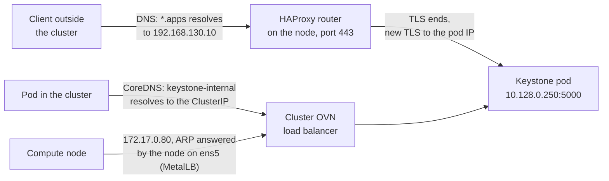

# OKD cluster networking

> Status: every command was run on the lab (single-node OKD 4.22,
> operators 18-stable, OpenStack 2023.1 Antelope) on 2026-11-12

## In short

- Two OVN deployments exist and never talk to each other: the cluster
  OVN inside the `ovnkube-node` pod, and the OpenStack OVN in the
  `ovsdbserver-*` pods with its data plane on the compute node.
- Each OpenStack network is split by convention: `.10` the node,
  `.30` to `.70` pod interfaces (whereabouts), `.80` to `.90` MetalLB
  virtual IPs, `.100` and above the compute nodes.
- Pods without a secondary interface reach the OpenStack networks
  through the host routing table, masqueraded to the node's `.10`
  address (`routingViaHost: true` is required).
- Public APIs come in through the HAProxy router (`reencrypt` Routes);
  the compute node uses the MetalLB address 172.17.0.80. Test a virtual
  IP from the compute node, never with `ping`.
- The `openstack` namespace has no NetworkPolicy.

Four network mechanisms are stacked on the OKD node: the cluster network
(OVN-Kubernetes), the ingress router, the secondary networks given to
some OpenStack pods (Multus, macvlan, whereabouts) and the virtual IPs
announced by MetalLB. This file records how each is inspected and how a
packet really travels. The OVN that serves OpenStack instances is a
different deployment, covered in
[OpenStack networking with OVN](openstack-networking-ovn.md). Commands
run on the bastion as the cluster administrator, with:

```bash
node() { ssh core@192.168.130.10 "$@"; }
compute() { ssh -i .work/dataplane-ssh-key cloud-admin@192.168.122.100 "$@"; }
```

## Entries

### What is the cluster network made of, and what are its parameters?

**Context**: first look at the pod network, or a question about an
address seen in a log (10.128.x, 172.30.x, 169.254.x).

**How**:

**[READ-ONLY]**

```bash
oc get network.config cluster -o jsonpath='{.spec.networkType} pods={.spec.clusterNetwork} services={.spec.serviceNetwork} mtu={.status.clusterNetworkMTU}{"\n"}'
oc get network.operator cluster -o jsonpath='{.spec.defaultNetwork.ovnKubernetesConfig.gatewayConfig}{"\n"}'
oc get pods -n openshift-ovn-kubernetes -o wide
oc get pods -n openshift-ovn-kubernetes -o jsonpath='{range .items[*]}{.metadata.name}: {range .spec.containers[*]}{.name} {end}{"\n"}{end}'
oc get pods -n openshift-multus; oc get pods -n openshift-network-operator
node 'ip route; ip -br addr show br-ex; ip -br addr show ovn-k8s-mp0'
```

**Observed on the lab** (2026-11-12):

```text
OVNKubernetes pods=[{"cidr":"10.128.0.0/14","hostPrefix":23}] services=["172.30.0.0/16"] mtu=1342
{"ipForwarding":"Global","ipv4":{},"ipv6":{},"routingViaHost":true}
ovnkube-control-plane-<hash>   2/2   Running   192.168.130.10
ovnkube-node-<hash>            8/8   Running   192.168.130.10
ovnkube-control-plane-<hash>: kube-rbac-proxy ovnkube-cluster-manager
ovnkube-node-<hash>: ovn-controller ovn-acl-logging kube-rbac-proxy-node kube-rbac-proxy-ovn-metrics northd nbdb sbdb ovnkube-controller
default via 192.168.130.1 dev br-ex proto static
10.128.0.0/23 dev ovn-k8s-mp0 proto kernel scope link src 10.128.0.2
10.128.0.0/14 via 10.128.0.1 dev ovn-k8s-mp0
169.254.0.0/17 dev br-ex proto kernel scope link src 169.254.0.2
172.17.0.0/24 dev ens5 proto kernel scope link src 172.17.0.10 metric 101
172.19.0.0/24 dev ens6 proto kernel scope link src 172.19.0.10 metric 102
172.30.0.0/16 via 169.254.0.4 dev br-ex src 169.254.0.2 mtu 1342
192.168.122.0/24 dev ens4 proto kernel scope link src 192.168.122.10 metric 100
192.168.130.0/24 dev br-ex proto kernel scope link src 192.168.130.10 metric 48
br-ex            UNKNOWN        192.168.130.10/24 169.254.0.2/17
```

The address plan in one place:

| Range | What it is |
|---|---|
| 192.168.130.0/24 | machine network; the node is `.10` on `br-ex` |
| 10.128.0.0/14 | pod network; this node owns 10.128.0.0/23 (510 pod addresses) |
| 172.30.0.0/16 | Service ClusterIPs (virtual, exist only in OVN) |
| 169.254.0.0/17 | internal masquerade addresses of OVN-Kubernetes |
| 192.168.122.0/24, 172.17.0.0/24, 172.19.0.0/24 | OpenStack ctlplane, internalapi, tenant on `ens4`, `ens5`, `ens6` |

**Why / how it works**: one `ovnkube-node` pod carries a complete private
OVN (north and south databases, northd, ovn-controller) for this node:
this is the "interconnect" architecture, with no central OVN database
for the cluster. `ovnkube-controller` translates pods, Services and
NetworkPolicies into OVN logical switches, load balancers and ACLs.
`ovn-k8s-mp0` is the host's own port on the pod network. The cluster MTU
is 1342: the 1442 of the underlying network minus 100 bytes of Geneve
overhead. Kolla-Ansible equivalent: none; Kolla containers use the host
network directly.

**Pitfalls**:

- `hostPrefix: 23` caps the node at 510 pod addresses; `maxPods` is 250
  and about 135 pods run, so there is room, but both numbers must be
  checked before adding many services.
- A pod address changes at every pod recreation. Never put a 10.128.x
  address in a configuration; use the Service name.
- The pod MTU (1342) is lower than the OpenStack networks' (1442).
  Large packets between a pod and the compute node are fragmented or
  rely on path MTU discovery; if a transfer hangs while small requests
  work, test with `ping -M do -s 1314`.

**See also**: [OKD in brief](../concepts/07-okd-in-brief.md),
[Network troubleshooting](../troubleshooting/network.md)

### There are two OVN deployments on the node: how do I tell them apart?

**Context**: an `ovn-nbctl show` that lists the wrong objects, or a
runbook that says "check OVN" without saying which.

**How**:

**[READ-ONLY]**

```bash
# OVN of the cluster (pods and Services): inside the ovnkube-node pod, local sockets
OVNK=$(oc get pods -n openshift-ovn-kubernetes -l app=ovnkube-node -o name)
oc exec -n openshift-ovn-kubernetes $OVNK -c nbdb -- ovn-nbctl --no-leader-only show | grep -E '^(switch|router)'
oc exec -n openshift-ovn-kubernetes $OVNK -c nbdb -- sh -c 'ovn-nbctl --no-leader-only lb-list | wc -l; ovn-nbctl --no-leader-only --format=csv --no-heading --columns=_uuid find acl | wc -l'
oc exec -n openshift-ovn-kubernetes $OVNK -c sbdb -- sh -c 'ovn-sbctl --no-leader-only show | head -5; ovn-sbctl --no-leader-only lflow-list | wc -l'
oc exec -n openshift-ovn-kubernetes $OVNK -c ovn-controller -- ovn-appctl -t ovn-controller connection-status

# OVN of OpenStack (instances, routers, floating IPs): pods of the openstack namespace
oc exec -n openstack ovsdbserver-nb-0 -c ovsdbserver-nb -- ovn-nbctl show | grep -E '^(switch|router)'
oc exec -n openstack ovsdbserver-sb-0 -c ovsdbserver-sb -- ovn-sbctl show | head -5

# the two Open vSwitch instances
node 'sudo ovs-vsctl list-br; sudo ovs-vsctl get open . external_ids:ovn-remote external_ids:ovn-encap-ip external_ids:ovn-bridge-mappings'
compute 'sudo ovs-vsctl list-br; sudo ovs-vsctl get open . external_ids:ovn-remote external_ids:ovn-encap-ip'
```

**Observed on the lab** (2026-11-12):

```text
switch <uuid> (transit_switch)             # cluster OVN
switch <uuid> (okd-0)
switch <uuid> (join)
switch <uuid> (ext_okd-0)
router <uuid> (GR_okd-0)
router <uuid> (ovn_cluster_router)
240                                        # load balancers (one per Service port and protocol)
421                                        # ACLs (NetworkPolicies)
Chassis "<uuid>"
    hostname: okd-0
    Encap geneve
        ip: "192.168.130.10"
3058                                       # logical flows
connected
switch <uuid> (neutron-<uuid>) (aka kb-demo-net)        # OpenStack OVN
switch <uuid> (neutron-<uuid>) (aka kb-public)
router <uuid> (neutron-<uuid>) (aka kb-demo-router)
Chassis "<uuid>"
    hostname: edpm-compute-0.ctlplane.okd.lab.example.com
    Encap geneve
        ip: "172.19.0.100"
br-ex  br-int                              # OKD node
"unix:/var/run/ovn/ovnsb_db.sock"  "192.168.130.10"  "physnet:br-ex"
br-ex  br-int                              # compute node
"ssl:ovsdbserver-sb.openstack.svc:6642"  "172.19.0.100"
```

How to recognise each:

| | Cluster OVN (OVN-Kubernetes) | OpenStack OVN |
|---|---|---|
| Databases | containers `nbdb`, `sbdb` of pod `ovnkube-node` | pods `ovsdbserver-nb-0`, `ovsdbserver-sb-0` in `openstack` |
| Data on disk | `/var/lib/ovn-ic/etc` on the node (rebuilt from the API if lost) | PVCs `ovndbcluster-nb/sb-etc-ovn-*` (authoritative with the Neutron database) |
| Chassis | the OKD node, tunnel IP 192.168.130.10 | the compute node, tunnel IP 172.19.0.100 |
| Objects | `ovn_cluster_router`, `join`, `GR_<node>`, one switch per node | `neutron-<uuid>` switches and routers |
| Open vSwitch | `br-int`, `br-ex` on the OKD node | `br-int`, `br-ex` on the compute node |
| Written by | `ovnkube-controller` from Kubernetes objects | Neutron (ML2/OVN) from OpenStack objects |

**Why / how it works**: the two never exchange anything. They share
only the technology and, by accident, bridge names on two different
machines. The control plane of the OpenStack OVN (databases, northd)
runs as pods and is reachable by the compute node on the internalapi
network: `ovn-remote` there is the name `ovsdbserver-sb.openstack.svc`,
which the data plane DNS (192.168.122.80) resolves to the pod's macvlan
address 172.17.0.30, port 6642; its data plane is only on
the compute node, because this lab runs no `ovn-controller` on the OKD
node (no `OVNController` DaemonSet: no provider network gateway on the
control plane). Kolla-Ansible equivalent: a Kolla deployment has only the
second one (`ovn_nb_db`, `ovn_sb_db`, `ovn_northd`, `ovn_controller`
containers).

**Pitfalls**:

- `--no-leader-only` is needed in the cluster OVN containers, otherwise
  the client waits for a clustered database leader that does not exist.
- Never write into the cluster OVN by hand (`ovn-nbctl lsp-add ...`):
  `ovnkube-controller` owns every row and removes or fights anything
  else.
- Both `br-int` on the OKD node and `br-int` on the compute node use
  Geneve, on different networks (machine network vs tenant network). A
  capture on port 6081 must be done on the right interface.
- The 421 ACLs and 240 load balancers exist before any OpenStack object:
  they come from the platform's own NetworkPolicies and Services.

**See also**:
[OpenStack networking with OVN](openstack-networking-ovn.md),
[Control plane and data plane](../concepts/06-control-plane-and-data-plane.md)

### What are `br-ex` and the secondary interfaces of the node?

**Context**: understanding which NIC carries what, before touching a
network attachment or reading a capture.

**How**:

**[READ-ONLY]**

```bash
node 'ip -br addr | grep -vE "^[0-9a-f]{15}"; nmcli -t -f NAME,TYPE,DEVICE con show --active | grep -vE "^[0-9a-f]{15}"'
node 'sudo ovs-vsctl list-ports br-ex; sudo ovs-vsctl list-ports br-int | wc -l'
oc get net-attach-def -n openstack
oc get net-attach-def -n openstack internalapi -o jsonpath='{.spec.config}{"\n"}'
```

**Observed on the lab** (2026-11-12):

```text
ens3             UP                                   # enslaved to br-ex, no address
ens4             UP   192.168.122.10/24               # ctlplane
ens5             UP   172.17.0.10/24                  # internalapi
ens6             UP   172.19.0.10/24                  # tenant
ovn-k8s-mp0      UNKNOWN  10.128.0.2/23
br-ex            UNKNOWN  192.168.130.10/24 169.254.0.2/17
ovs-if-phys0:802-3-ethernet:ens3
br-ex:ovs-bridge:br-ex
ens3  patch-br-ex_okd-0-to-br-int                     # ports of br-ex
113                                                   # ports of br-int (one per pod)
ctlplane  internalapi  tenant
{"cniVersion":"0.3.1","name":"internalapi","type":"macvlan","master":"ens5","ipam":{"type":"whereabouts","range":"172.17.0.0/24","range_start":"172.17.0.30","range_end":"172.17.0.70"}}
```

**Why / how it works**: at boot, `ovs-configuration.service` moves the
first NIC (`ens3`) and the node address into the Open vSwitch bridge
`br-ex`; pod traffic leaves through it. The three other NICs are plain
interfaces with a static address, one per OpenStack network. Pods that
need to be on an OpenStack network get a macvlan sub-interface of the
matching NIC through a NetworkAttachmentDefinition. Each /24 is split by
convention:

| Offsets | Use | Managed by |
|---|---|---|
| `.10` | the node's own address | NetworkManager |
| `.30` to `.70` | pod secondary interfaces | whereabouts (NAD) |
| `.80` to `.90` | virtual IPs of Services | MetalLB |
| `.100` to `.120` | data plane nodes | `NetConfig` / IPAM of the infra operator |

Kolla-Ansible equivalent: `network_interface`, `api_interface`,
`tunnel_interface` in `globals.yml`; here the mapping is spread over
NetworkManager, three NADs, three MetalLB pools and one NetConfig.

**Pitfalls**:

- There is no NMState operator on this lab (`oc get nncp` answers that
  the resource type does not exist): the secondary NICs are configured
  at installation, not by a cluster resource. Changing them is a host
  change.
- macvlan isolates a pod's sub-interface from its parent: the node
  cannot reach a pod's macvlan address (`ping 172.17.0.30` from the node
  fails with 100 % loss) although the compute node can. Do not test
  whereabouts addresses from the node.
- The tenant NAD exists but no pod uses it in this lab; the `ens6`
  address is unused by the control plane.

**See also**: [Architecture](../architecture.md),
[Infrastructure installation](../installation/01-infrastructure.md)

### How does a pod without a secondary interface reach the OpenStack networks?

**Context**: most OpenStack pods (Nova, Keystone, the Ansible runner
pods of the data plane) have only `eth0`, yet they reach the compute
node. Knowing the path explains which source address the compute node
sees and which firewall rule applies.

**How**:

**[READ-ONLY]**

```bash
oc get pods -n openstack -o json | python3 -c '
import json, sys
for p in json.load(sys.stdin)["items"]:
    st = p["metadata"].get("annotations", {}).get("k8s.v1.cni.cncf.io/network-status")
    if st and p["status"]["phase"] == "Running":
        print(p["metadata"]["name"], "; ".join("%s=%s" % (s["name"].split("/")[-1], ",".join(s.get("ips", []))) for s in json.loads(st)))'
# capture on every interface of the node while a pod opens a connection
oc debug node/okd-0 -q --to-namespace=default -- timeout 14 tcpdump -ni any -c 6 \
  'host 192.168.122.100 and tcp port 22 and tcp[tcpflags] & tcp-syn != 0' &
sleep 7
oc exec -n openstack openstackclient -- bash -c 'exec 3<>/dev/tcp/192.168.122.100/22 && head -c 15 <&3; echo'
wait
node 'sudo nft list table inet ovn-kubernetes | grep -A3 "chain ovn-kube-pod-subnet-masq"'
# reachability matrix from a pod
oc exec -n openstack openstackclient -- bash -c 'for t in 172.17.0.80/5000 172.17.0.85/5671 192.168.122.100/22 172.17.0.100/22 172.17.0.30/6642; do (exec 3<>/dev/tcp/$t) 2>/dev/null && echo "$t open" || echo "$t FAILED"; done'
```

**Observed on the lab** (2026-11-12):

```text
keystone-<hash> ovn-kubernetes=10.128.0.250
neutron-<hash> ovn-kubernetes=10.128.0.219; internalapi=172.17.0.32
ovsdbserver-nb-0 ovn-kubernetes=10.128.0.215; internalapi=172.17.0.31
ovsdbserver-sb-0 ovn-kubernetes=10.128.0.214; internalapi=172.17.0.30
...                                              # the 17 other pods: eth0 only
SSH-2.0-OpenSSH
<veth of the pod> P   IP 10.128.0.211.37866 > 192.168.122.100.ssh: Flags [S]
ovn-k8s-mp0 In        IP 10.128.0.211.37866 > 192.168.122.100.ssh: Flags [S]
ens4  Out             IP 192.168.122.10.37866 > 192.168.122.100.ssh: Flags [S]
ens4  In              IP 192.168.122.100.ssh > 192.168.122.10.37866: Flags [S.]
ovn-k8s-mp0 Out       IP 192.168.122.100.ssh > 10.128.0.211.37866: Flags [S.]
<veth of the pod> Out IP 192.168.122.100.ssh > 10.128.0.211.37866: Flags [S.]
    chain ovn-kube-pod-subnet-masq {
        ip saddr 10.128.0.0/23 masquerade
172.17.0.80/5000 open          # MetalLB VIP (Keystone internal)
172.17.0.85/5671 open          # MetalLB VIP (RabbitMQ)
192.168.122.100/22 open        # compute node, ctlplane
172.17.0.100/22 FAILED         # compute node, internalapi: its firewall allows SSH from ctlplane only
172.17.0.30/6642 FAILED        # macvlan address of a pod on the same node
```

Only three pods have a second interface: the two OVN databases and
Neutron, the services that the compute node or OVN must reach at a
stable address.

**Why / how it works**: with `routingViaHost: true` ("local gateway"),
a packet from a pod to anything outside the pod network leaves OVN
through `ovn-k8s-mp0` and is then routed by the **host's kernel routing
table**. The host has a directly connected route for each OpenStack
network, so the packet goes out of `ens4`, `ens5` or `ens6`, after being
masqueraded to the node's address on that network (`.10`). The compute
node therefore sees every control plane pod as 192.168.122.10 or
172.17.0.10. Without `routingViaHost` the packet would leave by `br-ex`
towards the default gateway and never reach the isolated networks — this
setting is a hard requirement of the lab design. A connection to a
MetalLB VIP from a pod is different: the capture shows it never leaves
OVN (only the pod's veth sees it), because the cluster OVN load-balances
the VIP like a ClusterIP. Kolla-Ansible equivalent: none needed; services
bind directly on `api_interface`.

**Pitfalls**:

- Firewall rules on the compute node must allow the node's `.10`
  addresses, not pod addresses. The data plane firewall allows SSH only
  from the ctlplane and machine networks: SSH to 172.17.0.100 fails from
  everywhere by design, which is easy to mistake for a routing fault
  (ping works).
- A pod cannot reach the macvlan address of another pod on the same node
  through this path (the packet would have to hairpin through the parent
  NIC). Pods talk to the OVN databases through the Service names, not
  through 172.17.0.30.
- `tcpdump` is not installed on the node; run it from the debug pod as
  above (the tools image has it), with `-i any` to see each hop.
- Disabling `routingViaHost` or `ipForwarding: Global` in the network
  operator breaks the data plane deployment and Nova's access to the
  compute node; not tested, by design.

**See also**:
[Platform services installation](../installation/03-platform-services.md),
[Data plane troubleshooting](../troubleshooting/dataplane.md)

### How does a request reach an OpenStack API, end to end?

**Context**: "Keystone does not answer" — which hop is broken? Example
with the public and internal endpoints of Keystone.

**How**:

**[READ-ONLY]**

```bash
oc get keystoneapi -n openstack keystone -o jsonpath='{.status.apiEndpoints}{"\n"}'
# 1. DNS
dig +short keystone-public-openstack.apps.okd.lab.example.com @192.168.130.5
# 2. Route
oc get route -n openstack keystone-public -o jsonpath='{.spec.host} {.spec.tls.termination} {.spec.tls.insecureEdgeTerminationPolicy} -> {.spec.to.name}:{.spec.port.targetPort} {.status.ingress[0].conditions[0].type}={.status.ingress[0].conditions[0].status}{"\n"}'
# 3. router pod
oc get pods -n openshift-ingress -o wide; node 'sudo ss -ltnp | grep -E ":(80|443) "'
# 4. Service and EndpointSlice
oc get svc -n openstack keystone-public keystone-internal
oc get endpointslices -n openstack -l kubernetes.io/service-name=keystone-public -o jsonpath='{range .items[*]}{range .endpoints[*]}{.addresses} ready={.conditions.ready} pod={.targetRef.name}{"\n"}{end}{end}'
# 5. test each hop
curl -sk -o /dev/null -w 'bastion -> route: %{http_code} %{remote_ip}:%{remote_port}\n' https://keystone-public-openstack.apps.okd.lab.example.com/v3
oc exec -n openstack openstackclient -- sh -c '
curl -s -o /dev/null -w "pod -> public Service: %{http_code} %{remote_ip}:%{remote_port}\n" https://keystone-public.openstack.svc:5000/v3
curl -s -o /dev/null -w "pod -> internal Service: %{http_code} %{remote_ip}:%{remote_port}\n" https://keystone-internal.openstack.svc:5000/v3'
compute 'curl -sk -o /dev/null -w "compute -> internal VIP: %{http_code}\n" https://172.17.0.80:5000/v3'
```

**Observed on the lab** (2026-11-12):

```text
{"internal":"https://keystone-internal.openstack.svc:5000","public":"https://keystone-public-openstack.apps.okd.lab.example.com"}
192.168.130.10
keystone-public-openstack.apps.okd.lab.example.com reencrypt Redirect -> keystone-public:keystone-public Admitted=True
router-default-<hash>   1/1   Running   192.168.130.10
0.0.0.0:443 users:(("haproxy",...))
0.0.0.0:80  users:(("haproxy",...))
keystone-public     ClusterIP      172.30.105.48   <none>        5000/TCP
keystone-internal   LoadBalancer   172.30.149.5    172.17.0.80   5000:<nodeport>/TCP
["10.128.0.250"] ready=true pod=keystone-<hash>
bastion -> route: 200 192.168.130.10:443
pod -> public Service: 200 172.30.105.48:5000
pod -> internal Service: 200 172.30.149.5:5000
compute -> internal VIP: 200
```

The three ways in, one public and two internal:



**Why / how it works**: every OpenStack API has two Services selecting
the same pod. The public one is a ClusterIP exposed by a Route: the
router (HAProxy, on the host network) goes **directly to the pod IP**
taken from the EndpointSlice, not through the ClusterIP. The internal
one is a `LoadBalancer` Service whose external IP is a MetalLB VIP on
the internalapi network, for clients outside the cluster (the compute
node); pods use its DNS name and ClusterIP. TLS is everywhere: the
pod serves a certificate for both names. Kolla-Ansible equivalent:
`kolla_external_vip_address` and `kolla_internal_vip_address` on
HAProxy/keepalived; here the router plays the external HAProxy and
MetalLB plays keepalived.

**Pitfalls**:

- A `503 Service Unavailable` HTML page from the route means the router
  works and has no ready endpoint: look at the pod's readiness, not at
  the network.
- The wildcard DNS answers for any name under `apps`; a typo in the
  hostname gives the router's 503 page, not a DNS error.
- The first request after a pod start can take seconds (2.2 s measured
  on a cold `keystone-public` call, 0.03 s after): WSGI workers load
  lazily. Do not read one slow first call as a fault.
- `oc get endpoints` still works but is deprecated; EndpointSlices are
  the source the router and OVN use.

**See also**:
[Inspect service status](../operations/01-inspect-service-status.md),
[DNS and routing troubleshooting](../troubleshooting/dns-and-routing.md)

### What does the ingress router do with a route, and where does TLS end?

**Context**: a certificate error on a public endpoint, a timeout on a
long request (image upload), or the question "which certificate does the
client see?".

**How**:

**[READ-ONLY]**

```bash
oc get ingresscontroller -n openshift-ingress-operator default -o jsonpath='{.status.endpointPublishingStrategy} domain={.status.domain} replicas={.status.availableReplicas}{"\n"}'
oc get route -n openstack -o custom-columns=NAME:.metadata.name,HOST:.spec.host,TERM:.spec.tls.termination,INSECURE:.spec.tls.insecureEdgeTerminationPolicy,SVC:.spec.to.name
RP=$(oc get pods -n openshift-ingress -o name | head -1)
oc exec -n openshift-ingress $RP -- grep -A16 '^backend be_secure:openstack:keystone-public' /var/lib/haproxy/conf/haproxy.config
oc exec -n openshift-ingress $RP -- sh -c 'grep keystone-public /var/lib/haproxy/conf/*.map; ls /var/lib/haproxy/router/certs /var/lib/haproxy/router/cacerts'
oc exec -n openshift-ingress $RP -- sh -c 'grep -E "^\s+timeout" /var/lib/haproxy/conf/haproxy.config | sort | uniq -c'
echo | openssl s_client -connect keystone-public-openstack.apps.okd.lab.example.com:443 -servername keystone-public-openstack.apps.okd.lab.example.com 2>/dev/null | openssl x509 -noout -issuer -enddate
oc logs -n openshift-ingress $RP --tail=3
```

**Observed on the lab** (2026-11-12):

```text
{"hostNetwork":{"httpPort":80,"httpsPort":443,"protocol":"TCP","statsPort":1936},"type":"HostNetwork"} domain=apps.okd.lab.example.com replicas=1
glance-default-public          ...   reencrypt   Redirect   glance-default-public
keystone-public                ...   reencrypt   Redirect   keystone-public
neutron-public                 ...   reencrypt   Redirect   neutron-public
nova-novncproxy-cell1-public   ...   reencrypt   Redirect   nova-novncproxy-cell1-public
nova-public                    ...   reencrypt   Redirect   nova-public
placement-public               ...   reencrypt   Redirect   placement-public
backend be_secure:openstack:keystone-public
  mode http
  option redispatch
  option forwardfor
  balance random
  timeout server  60s
  http-request add-header X-Forwarded-Host %[req.hdr(host)]
  ...
  cookie <hash> insert indirect nocache httponly secure attr SameSite=None
  server pod:keystone-<hash>:keystone-public:keystone-public:10.128.0.250:5000 10.128.0.250:5000 cookie <hash> weight 1 ssl verify required ca-file /var/lib/haproxy/router/cacerts/openstack:keystone-public.pem
os_edge_reencrypt_be.map:^keystone-public-openstack\.apps\.okd\.lab\.example\.com\.?(:[0-9]+)?(/.*)?$ be_secure:openstack:keystone-public
os_route_http_redirect.map:^keystone-public-openstack\.apps\.okd\.lab\.example\.com\.?(:[0-9]+)?(/.*)?$ 1
issuer=CN=rootca-public
notAfter=Nov 10 20:27:44 2031 GMT
I1112 07:40:54 router.go:664] "msg"="router reloaded" ...
```

All six public routes are `reencrypt` with HTTP redirected to HTTPS.
Server timeouts differ per route (`60s` for Keystone, Glance, Nova and
Placement, `120s` for Neutron, none for the noVNC proxy): the OpenStack
operators set them with the route annotation
`haproxy.router.openshift.io/timeout`.

**Why / how it works**: the router is one HAProxy pod on the host
network, listening on 80 and 443 of the node. For a `reencrypt` route it
terminates the client's TLS with the certificate **stored in the Route
itself** (issued by the lab's `rootca-public` through cert-manager, not
the ingress default certificate), then opens a second TLS connection to
the pod and verifies the pod's certificate against the Route's
`destinationCACertificate`. Each route becomes one `backend` with one
`server` line per ready pod; the router rewrites the file and reloads at
every endpoint change, which is what the "router reloaded" log lines
are. Kolla-Ansible equivalent: the `haproxy` container with
`kolla_enable_tls_external` and `kolla_enable_tls_backend`.

**Pitfalls**:

- Clients must trust `rootca-public`, not the cluster ingress CA: the
  certificate presented on `*.apps` for an OpenStack route differs from
  the one presented for the console.
- The Route object contains the private key of the public certificate
  (`spec.tls.key`). `oc get route -o yaml` prints it: never paste a
  route dump into a ticket.
- A long upload cut after exactly 60 s or 120 s is the route's
  `timeout server`. It is changed through the service's override in the
  OpenStackControlPlane (route annotation
  `haproxy.router.openshift.io/timeout`), not by editing the Route,
  which the operator rewrites.
- One router replica on one node: a router restart is a public API
  outage of a few seconds. Internal traffic is not affected.
- Access logging is off by default (`spec.logging` empty): the router
  log only shows reloads. Per-request lines must be read in the
  service's own log.

**See also**:
[Certificates inventory](okd-cluster-health-and-etcd.md#which-certificates-does-the-platform-use-when-do-they-expire-and-which-rotate-by-themselves),
[Change service configuration](../operations/04-change-service-configuration.md)

### How does name resolution work, from a pod to the bastion?

**Context**: a pod that cannot resolve a name, or an operator that
cannot pull an image.

**How**:

**[READ-ONLY]**

```bash
oc get dns.operator default -o jsonpath='{.spec.upstreamResolvers}{"\n"}'
oc get pods -n openshift-dns -o wide; oc get svc -n openshift-dns
oc get cm -n openshift-dns dns-default -o jsonpath='{.data.Corefile}'
node 'cat /etc/resolv.conf; cat /etc/dnsmasq.d/*.conf; systemctl is-active dnsmasq'
oc exec -n openstack openstackclient -- sh -c 'cat /etc/resolv.conf; for n in keystone-internal.openstack.svc keystone-public-openstack.apps.okd.lab.example.com api-int.okd.lab.example.com edpm-compute-0.ctlplane.okd.lab.example.com; do printf "%s -> " $n; getent hosts $n | awk "{print \$1}"; echo; done'
dig +short api.okd.lab.example.com @192.168.130.5
```

**Observed on the lab** (2026-11-12):

```text
{"policy":"Sequential","upstreams":[{"port":53,"type":"SystemResolvConf"}]}
dns-default-<hash>     2/2   Running   10.128.0.62
node-resolver-<hash>   1/1   Running   192.168.130.10
dns-default   ClusterIP   172.30.0.10   53/UDP,53/TCP,9154/TCP
.:5353 {
    kubernetes cluster.local in-addr.arpa ip6.arpa { ... }
    forward . /etc/resolv.conf { policy sequential }
    cache 900 { denial 9984 30 }
    ...
}
nameserver 192.168.130.10          # node: its own dnsmasq first
nameserver 192.168.130.5           # then the bastion
address=/apps.okd.lab.example.com/192.168.130.10
address=/api-int.okd.lab.example.com/192.168.130.10
address=/api.okd.lab.example.com/192.168.130.10
search openstack.svc.cluster.local svc.cluster.local cluster.local     # pod
nameserver 172.30.0.10
options ndots:5
keystone-internal.openstack.svc -> 172.30.149.5
keystone-public-openstack.apps.okd.lab.example.com -> 192.168.130.10
api-int.okd.lab.example.com -> 192.168.130.10
edpm-compute-0.ctlplane.okd.lab.example.com ->                         # not resolvable from a pod
192.168.130.10
```

The chain:

```text
pod -> CoreDNS (172.30.0.10; answers *.cluster.local itself)
    -> node dnsmasq (192.168.130.10; answers api, api-int, *.apps with the node IP)
    -> bastion dnsmasq (192.168.130.5; same records, forwards the rest upstream)
```

**Why / how it works**: CoreDNS runs as the `dns-default` DaemonSet and
forwards what it does not own to the resolvers of the node's
`/etc/resolv.conf`. The node's dnsmasq exists because a single-node
cluster must resolve its own API names even if the external DNS is
down. A third DNS server exists in the lab: the `dnsmasq-dns` pod of the
OpenStack infra operator, on the VIP 192.168.122.80, which serves the
data plane names (`*.ctlplane.okd.lab.example.com`) to the compute node
only; cluster DNS does not forward to it. Kolla-Ansible equivalent:
`/etc/hosts` entries generated on every host.

**Pitfalls**:

- Data plane host names are not resolvable from pods (empty answer
  above). Use addresses, or query 192.168.122.80 explicitly, when
  testing from a pod.
- `ndots:5`: a name with fewer than five dots is first tried with each
  search suffix. `quay.io` costs three failed lookups before the real
  one; the negative cache (30 s) hides most of it. To skip the search
  list in a test, end the name with a dot.
- CoreDNS caches positive answers up to 900 s: after changing a record
  on the bastion, pods may see the old value for 15 minutes.
- If the bastion is stopped, cluster-internal names and the cluster's
  own API names still resolve (CoreDNS and the node's dnsmasq), but
  image pulls and anything external fail.

**See also**:
[DNS and routing troubleshooting](../troubleshooting/dns-and-routing.md),
[Infrastructure installation](../installation/01-infrastructure.md)

### Which NetworkPolicies exist, and how do I add one safely?

**Context**: a connection refused or timing out between namespaces, or a
wish to restrict who can reach a service.

**How**:

**[READ-ONLY]**

```bash
oc get networkpolicy -A --no-headers | awk '{print $1}' | sort | uniq -c
oc get networkpolicy -n openstack; oc get networkpolicy -n openstack-operators
oc get adminnetworkpolicy,baselineadminnetworkpolicy; oc get egressfirewall -A
```

**[CHANGE]** — in a scratch namespace only. Verified sequence: a web pod
in `kb-scratch`, tested from the `openstackclient` pod.

```bash
t() { oc exec -n openstack openstackclient -- curl -s -o /dev/null -m 4 -w "$1: %{http_code}\n" http://web.kb-scratch.svc:8080/ || true; }
t "no policy"
cat <<'EOF' | oc apply -f -
apiVersion: networking.k8s.io/v1
kind: NetworkPolicy
metadata: {name: default-deny, namespace: kb-scratch}
spec: {podSelector: {}, policyTypes: [Ingress]}
EOF
t "default-deny"
cat <<'EOF' | oc apply -f -
apiVersion: networking.k8s.io/v1
kind: NetworkPolicy
metadata: {name: allow-openstack, namespace: kb-scratch}
spec:
  podSelector: {matchLabels: {app: web}}
  ingress:
  - from: [{namespaceSelector: {matchLabels: {kubernetes.io/metadata.name: openstack}}}]
    ports: [{port: 8080}]
EOF
t "allow from openstack"
oc delete networkpolicy -n kb-scratch --all
```

**Observed on the lab** (2026-11-12):

```text
     11 openshift-monitoring          # 53 namespaces of the platform have policies (1 to 11 each)
     10 openshift-machine-api
      2 openstack-operators
No resources found in openstack namespace.
openstack-operator-index-grpc-server      olm.catalogSource=openstack-operator-index,olm.managed=true
openstack-operator-index-unpack-bundles   olm.managed in (true),operatorframework.io/bundle-unpack-ref
No resources found                    # no AdminNetworkPolicy, no EgressFirewall
no policy: 200
default-deny: 000                     # curl timeout
allow from openstack: 200
from the node itself: 200             # host traffic is not filtered by the policy
```

**The `openstack` namespace has no NetworkPolicy at all**: any pod of
any namespace can open a connection to Galera, RabbitMQ, memcached or
any API pod. Authentication and TLS are the only protections.

**Why / how it works**: OVN-Kubernetes turns each policy into ACLs on
the pods' logical ports (421 ACLs exist from the platform's own
policies). Policies are additive allow-lists: as soon as one policy
selects a pod for a direction, everything not allowed is dropped for
that pod. Traffic from the node itself (kubelet probes, host-network
pods such as the router) is always allowed. Kolla-Ansible equivalent:
none; isolation there is by network interface and host firewall.

**Pitfalls**:

- A default-deny in `openstack` without a complete allow-list breaks the
  control plane within seconds, and the operators do not create allow
  rules. Needed flows include at least: every service to Galera,
  RabbitMQ, memcached and Keystone; the operators' namespace to
  everything; the router (host network, always allowed); the monitoring
  namespace if metrics are scraped; DNS egress if egress is restricted.
  Not tested on the lab; listed in the open questions.
- Policies do not apply to secondary (macvlan) interfaces: the
  internalapi addresses of the OVN databases and Neutron stay open to
  that network regardless. Filtering them needs MultiNetworkPolicy,
  which is disabled (`useMultiNetworkPolicy: false`).
- A policy does not cut established connections immediately in every
  case; test with a new connection.

**See also**:
[Access and security](okd-access-and-security.md),
[Network troubleshooting](../troubleshooting/network.md)

### Which pod holds which address on the OpenStack networks, and how do I clean a leaked one?

**Context**: a pod stuck `ContainerCreating` with "could not allocate IP
in range", or an address conflict on internalapi.

**How**:

**[READ-ONLY]**

```bash
oc get ippools.whereabouts.cni.cncf.io -n openshift-multus
oc get overlappingrangeipreservations.whereabouts.cni.cncf.io -n openshift-multus
# allocations of every pool, checked against existing pods
oc get ippools.whereabouts.cni.cncf.io -n openshift-multus -o json | python3 -c '
import json, subprocess, sys
for p in json.load(sys.stdin)["items"]:
    for off, a in p["spec"].get("allocations", {}).items():
        ns, name = a["podref"].split("/")
        rc = subprocess.run(["oc", "get", "pod", "-n", ns, name, "-o", "name"], capture_output=True).returncode
        print(p["metadata"]["name"], "offset", off, a["podref"], "OK" if rc == 0 else "LEAKED (pod not found)")'
oc get ds,cronjob,deploy -A | grep -i whereabouts || echo "no whereabouts reconciler workload"
```

**[CHANGE]** — remove one leaked allocation (both objects). The `test`
operation makes the patch fail if the offset is not the leaked one.

```bash
oc patch ippools.whereabouts.cni.cncf.io -n openshift-multus 172.17.0.0-24 --type json -p '[
  {"op":"test","path":"/spec/allocations/69/podref","value":"openstack/<ghost pod>"},
  {"op":"remove","path":"/spec/allocations/69"}]'
oc delete overlappingrangeipreservations.whereabouts.cni.cncf.io -n openshift-multus 172.17.0.69
```

**Observed on the lab** (2026-11-12):

```text
172.17.0.0-24      15h
192.168.122.0-24   15h                          # empty: no pod uses the ctlplane NAD
172.17.0.30   172.17.0.31   172.17.0.32         # reservations
172.17.0.0-24 offset 30 openstack/ovsdbserver-sb-0 OK
172.17.0.0-24 offset 31 openstack/ovsdbserver-nb-0 OK
172.17.0.0-24 offset 32 openstack/neutron-<hash> OK
no whereabouts reconciler workload
```

A leak was simulated by adding a fake allocation (offset 69, pod
`openstack/kb-ghost-pod`) and its reservation: the check printed
`LEAKED (pod not found)`, nothing removed it by itself in the following
20 seconds, and the two commands above removed it; the pool was back to
three allocations.

**Why / how it works**: whereabouts is the IPAM plugin called by Multus
when a pod with a NAD starts. It stores allocations in one `IPPool`
object per range (key = offset in the range) plus one
`OverlappingRangeIPReservation` per address, and frees them when the pod
is deleted cleanly. If the node dies or the runtime is wiped while pods
exist, the release is never called and the allocation leaks. The
StatefulSet pods get the same address back only because they are
recreated in order on a pool with free low offsets, not because the
address is reserved for them. Kolla-Ansible equivalent: none; addresses
there are the hosts'.

**Pitfalls**:

- The range has 41 addresses (`.30` to `.70`). Each crash-leak costs
  one; with three users the margin is large, but a loop of failed pod
  creations can drain it.
- The whereabouts configuration on the node contains a reconciler
  schedule (`30 4 * * *`), but no reconciler workload exists in the
  cluster (it is deployed only for networks declared in the network
  operator, and the lab's NADs are created directly). Whether anything
  cleans leaks at 04:30 is an open question; assume manual cleanup.
- Neutron's address changed when its pod was recreated (`.32` here):
  nothing may depend on Neutron's internalapi pod address. The compute
  node reaches the OVN southbound database by name
  (`ovsdbserver-sb.openstack.svc`), and the infra operator publishes
  the pod's current whereabouts address in a `DNSData` object served by
  the data plane DNS (`oc get dnsdata -n openstack`): an address change
  is followed without redeploying, but only if that DNS VIP answers.
- Edit the pool with a JSON patch and a `test`, not with `oc edit`: the
  allocation map is easy to damage.

**See also**:
[Pod pending or CrashLoop](../troubleshooting/pod-pending-or-crashloop.md),
[Data plane changes](../operations/08-dataplane-changes.md)

### Which virtual IPs does MetalLB announce, on which interface, and how do I verify from the compute node?

**Context**: the compute node cannot reach Keystone, RabbitMQ or the
DNS VIP; or a Service stays `<pending>`.

**How**:

**[READ-ONLY]**

```bash
oc get pods -n metallb-system -o wide
oc get ipaddresspool,l2advertisement -n metallb-system
oc get svc -A --field-selector spec.type=LoadBalancer -o custom-columns=NAME:.metadata.name,IP:.status.loadBalancer.ingress[0].ip,POOL:.metadata.annotations.metallb\\.universe\\.tf/address-pool,SHARE:.metadata.annotations.metallb\\.universe\\.tf/allow-shared-ip,PORTS:.spec.ports[*].port
oc get servicel2status -n metallb-system
SP=$(oc get pods -n metallb-system -l component=speaker -o name)
oc logs -n metallb-system $SP -c speaker | grep -E 'serviceAnnounced|serviceWithdrawn' | tail -4
# from the compute node: who answers ARP for the VIP?
compute 'sudo arping -c 2 -I eth1 172.17.0.80; sudo arping -c 2 -I eth1 172.17.0.85; ip neigh show 172.17.0.80'
node 'cat /sys/class/net/ens5/address; ip addr | grep -c 172.17.0.80'
```

**Observed on the lab** (2026-11-12):

```text
controller-<hash>   1/1   Running   10.128.0.28
speaker-<hash>      1/1   Running   192.168.130.10
ipaddresspool/ctlplane      false   ["192.168.122.80-192.168.122.90"]
ipaddresspool/internalapi   false   ["172.17.0.80-172.17.0.90"]
ipaddresspool/tenant        false   ["172.19.0.80-172.19.0.90"]
l2advertisement/ctlplane      ["ctlplane"]      ["ens4"]
l2advertisement/internalapi   ["internalapi"]   ["ens5"]
l2advertisement/tenant        ["tenant"]        ["ens6"]
dnsmasq-dns               192.168.122.80   ctlplane      ctlplane      53,53
glance-default-internal   172.17.0.80      internalapi   internalapi   9292
keystone-internal         172.17.0.80      internalapi   internalapi   5000
neutron-internal          172.17.0.80      internalapi   internalapi   9696
nova-internal             172.17.0.80      internalapi   internalapi   8774
nova-metadata-internal    172.17.0.80      internalapi   internalapi   8775
placement-internal        172.17.0.80      internalapi   internalapi   8778
rabbitmq                  172.17.0.85      internalapi   <none>        5671,15671,15691
rabbitmq-cell1            172.17.0.86      internalapi   <none>        5671,15671,15691
l2-<id>   okd-0   keystone-internal   openstack        # one status per Service, all on okd-0
{"event":"serviceWithdrawn","ips":["172.17.0.80"],"reason":"notOwner","ts":"2026-11-12T07:40:30Z",...}
{"event":"serviceAnnounced","ips":["172.17.0.80"],"msg":"service has IP, announcing","protocol":"layer2","ts":"2026-11-12T07:40:35Z",...}
Unicast reply from 172.17.0.80 [<mac of the node's ens5>]  1.753ms
Unicast reply from 172.17.0.85 [<mac of the node's ens5>]  1.681ms
<mac of the node's ens5>
0                                                      # the VIP is not configured on any interface
```

Four addresses carry everything: one shared VIP for the six internal
APIs (different ports, `allow-shared-ip`), one per RabbitMQ cluster, one
for the data plane DNS.

**Why / how it works**: in layer 2 mode the `speaker` pod (host
network) answers ARP requests for each VIP on the interface listed in
the L2Advertisement, with the interface's own MAC address. The VIP is
never added to an interface; once a frame arrives on the node, the
cluster OVN load balancer of the Service sends it to the pod. The
`controller` only assigns addresses to Services. The OpenStack operators
create the Services with the pool, the fixed address and the sharing key
as annotations, taken from the service overrides in the
OpenStackControlPlane. A Service is announced only while it has at least
one ready endpoint: the speaker log shows a `serviceWithdrawn` /
`serviceAnnounced` pair at each restart of a service pod (here at 07:38
and 07:40 UTC, the Neutron restarts of the morning). Kolla-Ansible
equivalent: keepalived moving `kolla_internal_vip_address`; with one
node there is no failover, only announcement.

**Pitfalls**:

- While a single-replica service pod restarts, its Service has no
  endpoint. For the shared VIP the address stays announced as long as
  another Service sharing it is ready, and the compute node gets a TCP
  reset on the restarting port; for RabbitMQ (own VIP) the ARP answer
  itself disappears for the duration.
- `ip addr | grep <VIP>` on the node finding nothing is normal. The
  proof of announcement is the ARP reply from another machine, or
  `servicel2status`.
- A Service `<pending>` means the controller could not allocate: wrong
  pool name, address outside the pool, or an address already used
  without the same `allow-shared-ip` key.
- The pools have `autoAssign: false`: a LoadBalancer Service created
  without the annotations stays pending, by design.
- From the node itself and from pods, the VIP is reachable through OVN,
  so a test from there proves nothing about the announcement. Test from
  the compute node.

**See also**:
[Platform services installation](../installation/03-platform-services.md),
[Galera and RabbitMQ troubleshooting](../troubleshooting/galera-and-rabbitmq.md)
