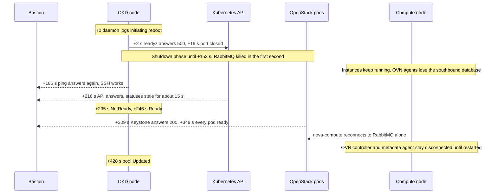

# OKD node maintenance: MachineConfig rolls, drain and recovery

> Status: every command was run on the lab (single-node OKD 4.22,
> operators 18-stable, OpenStack 2023.1 Antelope) on 2026-11-12. A
> MachineConfig was applied and removed (two full rolls, two reboots).
> Not executed: a real drain, an unclean stop of the node

## In short

- Any MachineConfig change reboots the only node 10 to 15 s after it is
  applied, without cordon or drain. Pause the pool to prepare and review
  a change first.
- One roll: API away about 3 min 35, every OpenStack pod ready after
  5 min 50, pool `Updated` after 7 min 10. Galera and RabbitMQ came back
  alone both times.
- A drain of the single node would evict 198 pods with nowhere to go and
  nothing would block it: do not drain.
- After the reboot, SSH works first, then `oc adm node-logs`, and
  `oc debug node` only about 75 s after the API.
- After any restart of the OKD node, restart `edpm_ovn_controller` and
  `edpm_ovn_metadata_agent` on every compute node.

This file records what a planned change of the host configuration does
to a cluster that has one node: how the change is prepared, what the
machine config daemon really does, how long the API and OpenStack are
away, which tools work while the API returns, and what must be repaired
on the compute node afterwards. Commands run on the bastion as the
cluster administrator, with these helpers:

```bash
node() { ssh core@192.168.130.10 "$@"; }
compute() { ssh -i .work/dataplane-ssh-key cloud-admin@192.168.122.100 "$@"; }
os() { oc -n openstack exec openstackclient -c openstackclient -- openstack "$@"; }
```

## Entries

### How do I apply a MachineConfig on the single node, and what happens step by step?

**Context**: a host file, systemd unit, kernel argument or kubelet
setting must change durably. On this lab every such change reboots the
only node: plan it as a full control-plane outage of about six minutes,
plus a repair on the compute node.

**How**:

**[READ-ONLY]** State before, to compare with afterwards.

```bash
oc get mcp master
oc get node okd-0 -o json | jq -r '.metadata.annotations | to_entries[] | select(.key|test("machineconfiguration")) | "\(.key|split("/")[1]) = \(.value)"'
oc get co --no-headers | awk '$3!="True"||$4!="False"||$5!="False"'
oc get pdb -A
```

**[CHANGE]** Safety net first: one database dump per Galera instance
and an etcd snapshot copied off the node.

```bash
oc -n openstack create job kb4-safety-openstack --from=cronjob/backup-openstack
oc -n openstack create job kb4-safety-openstack-cell1 --from=cronjob/backup-openstack-cell1
oc -n openstack wait --for=condition=complete job/kb4-safety-openstack job/kb4-safety-openstack-cell1 --timeout=300s
node sudo /usr/local/bin/cluster-backup.sh /home/core/assets/backup
```

**[CHANGE]** The MachineConfig of the drill: one harmless file. The
reboot starts a few seconds after the `oc apply` unless the pool is
paused (next entry).

```yaml
apiVersion: machineconfiguration.openshift.io/v1
kind: MachineConfig
metadata:
  name: 99-master-kb4-drill
  labels:
    machineconfiguration.openshift.io/role: master
spec:
  config:
    ignition:
      version: 3.4.0
    storage:
      files:
        - path: /etc/kb4-drill.conf
          mode: 420
          overwrite: true
          contents:
            source: data:,managed%20by%20MachineConfig%2099-master-kb4-drill%0A
```

```bash
oc apply -f kb4-mc.yaml
# follow from the bastion; the API disappears, so also follow by ping and SSH
oc get mcp master -w
oc -n openshift-machine-config-operator logs ds/machine-config-daemon -c machine-config-daemon -f
ping 192.168.130.10
# after the node is back
oc get mcp master; oc get node okd-0
node cat /etc/kb4-drill.conf
```

**[CHANGE]** Revert: deleting the MachineConfig is a second roll with a
second reboot, and brings back the original rendered config under its
original name.

```bash
oc delete mc 99-master-kb4-drill
```

**Observed on the lab** (2026-11-12, two rolls; T0 is the moment the
daemon logs `initiating reboot`):

```text
# machine-config-daemon, roll 1
Calculated node disruption actions: Reboot
Drain not required, skipping
Update prepared; requesting cordon and drain via annotation to controller
initiating reboot: Node will reboot into config rendered-master-<new>
# after the boot
Disk currentConfig rendered-master-<new> overrides node's currentConfig annotation rendered-master-<old>
Validated on-disk state
Update completed for config rendered-master-<new> and node has been successfully uncordoned
```

Timeline in seconds after T0. Roll 1 adds the file, roll 2 removes it.

| Event | Roll 1 | Roll 2 |
| --- | --- | --- |
| New rendered config exists after the change | 5 s after `oc apply` | not measured |
| Daemon starts the reboot after the change (pool not paused) | 10 s after unpause | 14 s after `oc delete mc` |
| API answers 500 on `/readyz` (shutting down) | +2 | +1 |
| API port closed | +19 | +18 |
| Node stops answering ping (end of the shutdown phase) | +153 | +152 |
| Node answers ping again | +186 | +190 |
| API answers again (403 for anonymous, then 200) | +216, +225 | +214, +225 |
| Node `NotReady`, then `Ready` | +235, +246 | +237, +247 |
| Keystone public endpoint answers 200 | +309 | +304 |
| `OpenStackControlPlane` `Ready=False` window | +307 to +351 | +304 to +349 |
| Every pod of the `openstack` namespace ready | +349 | +349 |
| Node annotation `state=Done`, `currentConfig` updated | +421 | +420 |
| Pool `Updated=True` | +428 | +426 |

The same roll as a picture (seconds after T0, roll 1):



After roll 2 the pool was back on the same `rendered-master-<old>` name
as before roll 1, the file was gone from the node, no cluster operator
was unsettled and no certificate signing request was pending. The
functional smoke test passed (16 checks, 0 failed) after the repair of
the compute node agents described in a later entry.

**Why / how it works**:

1. The machine config controller renders every MachineConfig of the pool
   into one `rendered-master-<hash>` (the hash is a function of the
   content, which is why removing the MachineConfig gives the original
   name back) and sets `spec.configuration.name` of the pool.
2. The node controller writes the annotation `desiredConfig` on the
   node. The daemon on the node sees `currentConfig != desiredConfig`,
   computes the difference and looks it up in the node disruption
   policies: only a short list of paths (registries configuration, some
   certificates, SSH keys) can be applied without a reboot; any other
   file means `Reboot`.
3. Cordon and drain: on a `SingleReplica` control plane the daemon logs
   `Drain not required, skipping`. Nothing is cordoned, nothing is
   evicted, and PodDisruptionBudgets are never consulted. The pods are
   simply stopped by the shutdown.
4. The daemon writes the files and the new `currentConfig` on disk, then
   calls `systemctl reboot`. The shutdown phase takes 2 min 30: kubelet
   stops in one second (`shutdownGracePeriod` is 0), systemd then stops
   the container scopes itself and several hit their stop timeout.
5. After the boot the daemon validates the files on disk and reports
   `Done`. The machine config controller had been stopped without
   releasing its leader lease, so it waits for the lease to expire
   (about 2 min 30 after its pod starts) before it marks the pool
   `Updated`. This wait explains why the pool reports success a minute
   after everything else already works.

The timings are the same as a plain `systemctl reboot` (see the
troubleshooting page): the MachineConfig mechanism adds about 15 seconds
before the reboot and the pool bookkeeping after it. Kolla-Ansible
equivalent: edit the host with Ansible and reboot the controller
yourself; nothing detects drift or reboots for you.

**Pitfalls**:

- The reboot is not graceful for the databases: RabbitMQ processes are
  killed within the first second and Galera is stopped by systemd, not
  by its operator. On the lab both came back alone (Galera found
  `safe_to_bootstrap: 1` and bootstrapped itself, both times), but this
  is the reason for the dumps before the change.
- The OVN agents on the compute node do not recover alone (entry below).
  Until they are restarted, existing instances keep working and new
  ports are not wired.
- For about 15 seconds after the API returns, it serves the state from
  before the shutdown: pods show `Running` and ready although nothing
  runs yet. Wait for the node to pass `NotReady` then `Ready` before
  trusting `oc get pods`.
- While the pool is `Updating`, do not apply a second MachineConfig
  unless you want a third reboot; batch changes with a paused pool.
- A few minutes after each reboot the kube-apiserver operator may roll a
  new static pod revision (seen: `configmap/kubelet-serving-ca has
  changed`), which closes the API again for some seconds. Commands that
  fail with `connection refused` five to ten minutes after the node is
  back are this, not a new fault.
- A worker-only label (`role: worker`) would do nothing here: the node
  belongs to the `master` pool only.

**See also**:
[OKD maintenance impact](../lifecycle/06-okd-maintenance-impact.md),
[Node and OKD troubleshooting](../troubleshooting/node-and-okd.md),
[OKD node and host](okd-node-and-host.md)

### How do I prepare a MachineConfig change without rebooting yet, and see what is pending?

**Context**: several host changes to group in one reboot, or a change to
review and schedule for a maintenance window.

**How**:

**[CHANGE]** Pause the pool, then apply the MachineConfig. Nothing
happens on the node until the unpause.

```bash
oc patch mcp master --type merge -p '{"spec":{"paused":true}}'
oc apply -f kb4-mc.yaml
```

**[READ-ONLY]** What is pending: the pool wants one rendered config and
still runs another.

```bash
oc get mcp master
oc get mcp master -o jsonpath='wanted={.spec.configuration.name}{"\n"}running={.status.configuration.name}{"\n"}'
oc get mcp master -o jsonpath='{range .status.conditions[*]}{.type}={.status} {.message}{"\n"}{end}'
NEW=$(oc get mcp master -o jsonpath='{.spec.configuration.name}')
OLD=$(oc get mcp master -o jsonpath='{.status.configuration.name}')
diff <(oc get mc "$OLD" -o json | jq -r '.spec.config.storage.files[].path' | sort) \
     <(oc get mc "$NEW" -o json | jq -r '.spec.config.storage.files[].path' | sort)
diff <(oc get mc "$OLD" -o json | jq -S '.spec | del(.config.storage.files)') \
     <(oc get mc "$NEW" -o json | jq -S '.spec | del(.config.storage.files)')
# which changes avoid a reboot
oc get machineconfiguration cluster -o json | jq -r '.status.nodeDisruptionPolicyStatus.clusterPolicies.files[] | "\(.path) -> \([.actions[].type]|join(","))"'
```

**[CHANGE]** Start the roll (the reboot follows within 10 seconds), or
give up by deleting the MachineConfig before the unpause.

```bash
oc patch mcp master --type merge -p '{"spec":{"paused":false}}'
```

**Observed on the lab** (2026-11-12):

```text
NAME     CONFIG                   UPDATED   UPDATING   DEGRADED   MACHINECOUNT   READYMACHINECOUNT   UPDATEDMACHINECOUNT
master   rendered-master-<old>    False     False      False      1              1                   0
wanted=rendered-master-<new>
running=rendered-master-<old>
Updating=False Pool is paused; will not update to MachineConfig rendered-master-<new>
> /etc/kb4-drill.conf            # the only difference between the two rendered configs
```

The new rendered config existed 5 seconds after the `oc apply`. The node
annotations `currentConfig` and `desiredConfig` did not move while the
pool was paused. Within the 90 seconds of pause the cluster operator
`machine-config` turned `Degraded=True` with `MachineConfigPool master
is paused and cannot sync until it is unpaused`; it cleared by itself
after the roll.

**Why / how it works**: pausing stops the node controller from writing
`desiredConfig` on the nodes; rendering continues, so the pool shows the
target and the difference can be reviewed. `UPDATED=False` together with
`UPDATING=False` is the signature of a paused pool with pending changes.
Kolla-Ansible equivalent: `kolla-ansible genconfig` then a diff of
`/etc/kolla`, before `reconfigure`.

**Pitfalls**:

- A paused pool also blocks the platform's own changes to the node,
  including the rotation of the kubelet certificate authority bundle.
  Pause for minutes or hours, not days, and never leave the lab paused.
- The `Degraded` operator raises an alert and blocks a cluster upgrade
  while it lasts.
- The pool `CONFIG` column shows the config that runs, not the one that
  is wanted; read `spec.configuration.name` for the target.

**See also**:
[OKD node and host](okd-node-and-host.md),
[OKD maintenance impact](../lifecycle/06-okd-maintenance-impact.md)

### What would a drain really evict here, and which PodDisruptionBudgets exist?

**Context**: a procedure written for a multi-node cluster asks for
"cordon and drain". This entry shows what that means on one node,
without doing it.

**How**:

**[READ-ONLY]** The server-side dry run evaluates every eviction and
changes nothing.

```bash
oc get pdb -A
oc adm drain okd-0 --dry-run=server
oc adm drain okd-0 --dry-run=server --ignore-daemonsets --delete-emptydir-data > drain-dry.txt 2>&1
grep -c '^evicting pod' drain-dry.txt
grep '^evicting pod' drain-dry.txt | awk '{print $3}' | cut -d/ -f1 | sort | uniq -c | sort -rn | head
# one service only
oc adm drain okd-0 --dry-run=server --ignore-daemonsets --delete-emptydir-data --pod-selector='service=keystone'
```

**[CHANGE]** Cordon alone, and its revert.

```bash
oc adm cordon okd-0
oc get node okd-0; oc get node okd-0 -o jsonpath='{.spec}{"\n"}'; oc get mcp master
oc adm uncordon okd-0
```

**Observed on the lab** (2026-11-12):

```text
# without flags the drain refuses
error: cannot delete DaemonSet-managed Pods (use --ignore-daemonsets to ignore) ...,
cannot delete Pods with local storage (use --delete-emptydir-data to override) ...
# with both flags
198 pods would be evicted: 83 in openstack (completed job pods included), 24 in openstack-operators
17 DaemonSet pods ignored, 5 static (mirror) pods untouched
# PodDisruptionBudgets in the whole cluster: 4, none in openstack
openshift-console                       console                     maxUnavailable 1   allowed disruptions 1
openshift-console                       downloads                   maxUnavailable 1   allowed disruptions 1
openshift-kube-storage-version-migrator migrator                    maxUnavailable 1   allowed disruptions 1
openshift-operator-lifecycle-manager    packageserver-pdb           maxUnavailable 1   allowed disruptions 1
# cordon
okd-0   Ready,SchedulingDisabled   control-plane,master,worker
{"taints":[{"effect":"NoSchedule","key":"node.kubernetes.io/unschedulable",...}],"unschedulable":true}
master   rendered-master-<hash>   False   True   False   1   0   1   0     # pool while cordoned
```

The dry run takes about 35 seconds because the client throttles its own
requests. `--force` was not needed: no pod lacks a controller.

**Why / how it works**: `drain` is cordon plus one eviction request per
pod. The eviction API refuses when a PodDisruptionBudget would be
violated. Here no OpenStack service has a budget and the four platform
budgets allow one disruption, so nothing would block: every Galera,
RabbitMQ, OVN database and API pod would be deleted at once and stay
`Pending` until the uncordon. A drain is therefore a self-inflicted
outage with no benefit, and the machine config daemon itself skips it on
a single node. Kolla-Ansible equivalent: none on one controller.

**Pitfalls**:

- An earlier version of this knowledge base said a drain would block on
  budgets. On this lab it would not: nothing protects the OpenStack
  pods from a drain.
- A cordoned node makes the `master` pool show `UPDATED=False`,
  `UPDATING=True` and zero ready machines, which looks like a
  MachineConfig roll. Check `oc get node` for `SchedulingDisabled`
  before suspecting the machine config operator.
- `--dry-run=client` only lists pods; `--dry-run=server` also evaluates
  the budgets. Use the server form.
- `--pod-selector` limits a drain to matching pods; on a single node a
  `oc delete pod` or `oc rollout restart` does the same more clearly.

**See also**:
[OKD node and host](okd-node-and-host.md) (cordon and scheduling test),
[Workloads and resources](okd-workloads-and-resources.md)

### Which tools work while the API is only partly back after a reboot?

**Context**: the node answers ping again, `oc` starts to answer, and
you want to know what is going on before every operator has settled.

**How**:

**[READ-ONLY]** In the order in which they start to work.

```bash
# 1. as soon as ping is back: SSH, journal and crictl on the node
node 'uptime; sudo systemctl is-active kubelet crio; sudo crictl ps | wc -l'
node 'sudo journalctl -u kubelet --since -5min --no-pager | tail -20'
# 2. as soon as the API answers at all
curl -sk -o /dev/null -w '%{http_code}\n' https://api.okd.lab.example.com:6443/readyz
oc get --raw '/readyz?verbose' | grep -v '^\[+\]'
oc get node okd-0
oc adm node-logs okd-0 -u kubelet --tail=20
oc adm node-logs okd-0 -u crio --since=-5m | tail
# 3. about one minute later, once the aggregated APIs answer
oc get apiservices | grep -v True
oc debug node/okd-0 -- chroot /host uptime
```

**Observed on the lab** (2026-11-12, second roll; seconds after the
first answer of the API):

```text
+0    curl /readyz -> 403 (anonymous), oc -> 200; some readyz checks still failing
+10   oc get node, oc adm node-logs -u kubelet: work
+17   aggregated API image.openshift.io: ServiceUnavailable (until about +60)
+17   oc debug node/okd-0: falls back to a default image that needs a pull secret -> ErrImagePull, or times out
+75   oc debug node/okd-0: works (debug pod created in the current project)
```

SSH as `core` worked the whole time from the return of ping, 25 to 30
seconds before the API.

**Why / how it works**: `oc adm node-logs` is a proxy call from the API
server to the kubelet, so it needs only the API server and a running
kubelet, not a schedulable node or a working pod network. `oc debug
node` needs much more: it reads the ImageStream `openshift/tools`
through the aggregated API `image.openshift.io` (served by a pod that
must first restart), then schedules and starts a pod. Kolla-Ansible
equivalent: SSH to the controller and `docker logs`; there is no
intermediate state to wait for.

**Pitfalls**:

- `oc debug node` in the first minute does not fail cleanly: when the
  ImageStream lookup fails it silently uses another image and the pod
  ends in `ErrImagePull`. Delete the leftover debug pod and retry, or
  use SSH.
- `oc adm node-logs` shows the journal of the current boot by default;
  to read the shutdown phase of the previous boot use
  `node sudo journalctl -b -1 -u kubelet`.
- The API answers before it is right: see the stale status pitfall of
  the first entry.

**See also**:
[OKD cluster health and etcd](okd-cluster-health-and-etcd.md),
[Node and OKD troubleshooting](../troubleshooting/node-and-okd.md)

### Why are the OVN agents of the compute node dead after a reboot of the OKD node, and how do I fix them?

**Context**: after any restart of the OKD node (reboot, MachineConfig
roll, stop and start of the lab), new instances get no network or no
metadata, or `openstack network agent list` shows the compute node
agents down. Reproduced on both MachineConfig rolls of 2026-11-12 and
observed again, read-only, on the start of the whole lab of 2026-11-14
(dated tally of every restart in
[Impact of OKD maintenance](../lifecycle/06-okd-maintenance-impact.md#4-explanation-what-recovers-by-itself-and-in-which-order)).

**How**:

**[READ-ONLY]** Diagnose. The agent list is not enough: it stays green
until the next change in the northbound database.

```bash
os network agent list -c 'Agent Type' -c Host -c Alive
compute 'sudo podman ps --format "{{.Names}} {{.Status}}" | grep ovn'
compute 'sudo podman exec ovn_controller ovn-appctl connection-status'
compute 'sudo journalctl -u edpm_ovn_controller -n 3 --no-pager -o cat'
compute 'sudo ss -tn | grep -c :6642'
compute 'getent hosts ovsdbserver-sb.openstack.svc'
# make the stale state visible: any northbound change, then wait a minute
os network create kb4-poke && os network delete kb4-poke
os network agent list -c 'Agent Type' -c Host -c Alive
```

**[CHANGE]** Fix: restart both services on every compute node. Running
instances keep their flows; the restart takes a few seconds. Left
alone, the agents reconnected by themselves 15 minutes after their
start on 2026-11-14 (see below): the restart only saves that wait.

```bash
compute 'sudo systemctl restart edpm_ovn_controller edpm_ovn_metadata_agent'
compute 'sudo podman exec ovn_controller ovn-appctl connection-status'
os network agent list -c 'Agent Type' -c Host -c Alive
```

**Observed on the lab** (2026-11-12):

```text
# before the fix, more than five minutes after the control plane was healthy
ovn_controller Up (unhealthy)
not connected
stream_ssl|ERR|ssl:ovsdbserver-sb.openstack.svc:6642: connect: Address family not supported by protocol   # every 8 s
0                                             # TCP connections to the southbound database
172.17.0.30     ovsdbserver-sb.openstack.svc  # the name resolves correctly
# agent list: both still "True" until a northbound change, both "False" about 75 s after it
# after the restart
connected                                     # in less than 10 s
OVN Controller Gateway agent   True
OVN Metadata agent             True           # within 30 s
```

`nova-compute` reconnected to RabbitMQ without help both times.

**Observed on the lab without the fix** (2026-11-14, start of the
whole lab, read-only, times UTC):

```text
07:38:02  both agent containers start; the DNS service is not up yet
07:39:38  ovn_controller: first "Address family not supported by protocol", then every 8 s; container unhealthy
07:43:09  southbound database pod Ready
07:43:47  dnsmasq-dns pod Ready; the name resolves on the node
07:53:02  last error of ovn_controller (900 s after its start)
07:53:10  ovn_controller: connected, container healthy again
07:54:29  ovn_metadata_agent: connected
09:03     NRestarts=0 for both units; smoke test with --functional: 16 checks, 0 failed
```

**Why / how it works**: both agents reach the southbound database by
name (`ovn-remote=ssl:ovsdbserver-sb.openstack.svc:6642`), resolved by
the `dnsmasq-dns` pod, which runs on the OKD node and disappears with
it. The error starts when that DNS service stops and goes on for
minutes after the system resolver of the compute node answers
correctly again. The error text is misleading: in the OVS library it
only means that the name did not resolve (read in the source of
version 3.3.8). The agents do not use the system resolver but their
own copy of a resolver library (libunbound), and the OVS library asks
it again at every attempt. The probable reason for the delay, not
proven on the lab: that library marks the only nameserver as down
after a few timeouts and does not query it again for 900 seconds
(its default `infra-host-ttl`); a restarted process starts with an
empty memory, which is why the restart works at once. On 2026-11-14
the controller logged its last error exactly 900 seconds after its
start and connected at the next attempt. See
the open questions for what is missing. Neutron computes
"alive" by comparing a counter that each agent copies from the
northbound database; with no northbound change the counters stay
equal and a disconnected agent still looks alive. Kolla-Ansible
equivalent: agents use IP addresses of the controllers, so a controller
reboot does not leave them stuck.

**Pitfalls**:

- The first reboot of this lab had shown only the metadata agent
  disconnected. With these two rolls both were, twice, and they were
  restarted by hand after 8 to 10 minutes, so nobody saw whether they
  would have recovered. On the start of the whole lab of 2026-11-14
  they were left alone and did, after 15 minutes; the same start on
  2026-11-12 had left both connected within two minutes, presumably
  because the DNS service came back sooner. After any restart of the OKD node,
  the compute node restarted or not: check `connection-status`, then
  either restart both services or wait a quarter of an hour and check
  again.
- Right after a quiet period the first `network agent list` can show
  an agent `XXX` although it is connected, and the next one, seconds
  later, shows it alive (seen on 2026-11-14 at 09:03): the list
  itself triggers the counter update. Read it twice.
- The smoke test passes or fails depending on whether the test creates
  a port before the agents are fixed. Do not use it as the only check;
  use `ovn-appctl connection-status`.
- Restarting only `edpm_ovn_controller` is not enough: the metadata
  agent holds its own southbound connection.

**See also**:
[OpenStack networking with OVN](openstack-networking-ovn.md),
[Node and OKD troubleshooting](../troubleshooting/node-and-okd.md),
[open questions](open-questions.md)
