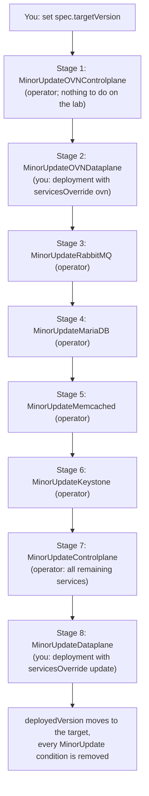

# OpenStackVersion and the minor update of OpenStack services

> Status: validated on the lab (OKD 4.22.0-okd-scos.10, operators 18-stable) on 2026-11-12, with a simulated newer version: the update mechanics ran for real, but no newer OpenStack code was available to install

## In short

- Service images are not set in the control plane resource but in
  `OpenStackVersion`. You normally edit one field: `spec.targetVersion`.
- A minor update runs in eight stages. The operator does six of them; it
  waits for **you** at stage 2 (OVN on the compute nodes) and stage 8 (the
  rest of the compute nodes).
- On the lab: about 10 minutes from the patch to `deployedVersion`, every
  service restarted once.
- The `update` service also runs a full `dnf update` of the compute node,
  kernel included, and does not reboot it.
- One image can be overridden alone (`customContainerImages`): about one
  minute for Keystone.
- Setting `targetVersion` back is accepted by the API; it is not a
  downgrade procedure.

## 1. Context

You want to change the container images the OpenStack services run: either
all of them (a *minor update* to a newer build of the same release) or a
single one (a hotfix image). The Kolla-Ansible equivalent is changing image
tags and running `kolla-ansible upgrade` or `deploy`.

Here the images are not set in the `OpenStackControlPlane` resource. They
come from a separate resource, `OpenStackVersion`, which the
openstack-operator creates automatically with the same name as the control
plane (`openstack` in the lab).

| Field | Meaning |
|---|---|
| `spec.targetVersion` | The version you want. The only field you normally edit. |
| `spec.customContainerImages` | Per-image overrides (for example `keystoneAPIImage`), applied on top of the defaults of the target version. |
| `status.availableVersion` | The newest version the *installed operator* knows. Changes when the operator is upgraded. |
| `status.deployedVersion` | The version that is fully rolled out, control plane and data plane. |
| `status.containerImages` | The effective image of every service right now (defaults plus overrides). |
| `status.containerImageVersionDefaults` | The default image set of every version this operator installation has known, keyed by version. Old keys are kept. |
| `status.trackedCustomImages` | The overrides that were in force for each version, keyed by version. |
| `status.conditions` | `Ready` and `Initialized` at rest; during an update, one condition per stage (below). |

The stages of a minor update, in order, and who acts at each one.



Update stages, in the order the operator runs them, each reported as a
condition on `OpenStackVersion`:

| Order | Condition | Who acts |
|---|---|---|
| 1 | `MinorUpdateOVNControlplane` | Operator: the `ovn-controller` pods on OKD nodes, where they exist (not on the lab, see below) |
| 2 | `MinorUpdateOVNDataplane` | **You**: a data plane deployment limited to `ovn` |
| 3 | `MinorUpdateRabbitMQ` | Operator |
| 4 | `MinorUpdateMariaDB` | Operator |
| 5 | `MinorUpdateMemcached` | Operator |
| 6 | `MinorUpdateKeystone` | Operator |
| 7 | `MinorUpdateControlplane` | Operator: all remaining services |
| 8 | `MinorUpdateDataplane` | **You**: a data plane deployment with the `update` service |

`MinorUpdateAvailable` is `True` when `availableVersion` differs from
`deployedVersion`; the condition does not exist otherwise. Only after
stage 8 does `deployedVersion` move to the target, and at that moment
**every `MinorUpdate*` condition is removed**: a finished update shows only
`Ready` and `Initialized` again.

OVN goes first because `ovn-controller` must be updated before the OVN
databases and `northd` it talks to. On the lab no `ovn-controller` runs on
the OKD node (`oc get ovncontroller` returns nothing), so stage 1 has
nothing to do and turns `True` about one second after the update starts.
The OVN database and `northd` pods are replaced later, with the rest of the
control plane (stage 7).

## 2. Read-only investigation

**[READ-ONLY]** Current versions:

```bash
oc get openstackversion openstack \
  -o custom-columns=TARGET:.spec.targetVersion,AVAILABLE:.status.availableVersion,DEPLOYED:.status.deployedVersion
```

**[READ-ONLY]** Update conditions:

```bash
oc get openstackversion openstack -o json \
  | jq -r '.status.conditions[] | "\(.type)\t\(.status)\t\(.message)"' | column -t -s $'\t'
```

**[READ-ONLY]** Image currently selected for one service, and the versions
the operator knows:

```bash
oc get openstackversion openstack -o jsonpath='{.status.containerImages.keystoneAPIImage}{"\n"}'
oc get openstackversion openstack -o json | jq -r '.status.containerImageVersionDefaults | keys[]'
```

**[READ-ONLY]** Image a pod really runs (compare with the line above):

```bash
oc get pods -l service=keystone -o jsonpath='{range .items[*]}{.metadata.name}{"\t"}{.spec.containers[*].image}{"\n"}{end}'
```

**[READ-ONLY]** Version recorded by each side:

```bash
oc get openstackcontrolplane openstack -o jsonpath='{.status.deployedVersion}{"\n"}'
oc get openstackdataplanenodeset openstack-edpm -o jsonpath='{.status.deployedVersion}{"\n"}'
```

## 3. Expected observations

- On a freshly deployed lab: target, available and deployed versions are
  identical (`0.8.0-1794211973` at validation time), the only conditions are
  `Ready` (`Setup complete`) and `Initialized`, `MinorUpdateAvailable` is
  absent, and `containerImageVersionDefaults` has a single key.
- The default images are pinned by digest
  (`quay.io/podified-antelope-centos9/openstack-keystone@sha256:...`), and
  the Keystone pod shows the same reference.
- `OpenStackControlPlane` reports `deployedVersion`. The NodeSet
  `status.deployedVersion` is **empty after the initial deployment**; it is
  only filled in by the first data plane update.
- After an operator upgrade that ships new images
  ([02](02-operator-upgrade.md)): `availableVersion` is newer than
  `deployedVersion`, `MinorUpdateAvailable` is `True`, a second key appears
  in `containerImageVersionDefaults`, and **nothing else has changed** — pods
  still run the old images.
- Upstream builds use versions such as `0.8.0-<timestamp>`; do not expect
  `18.0.x` style numbers.
- After a finished update the old key stays in
  `containerImageVersionDefaults`: the list is a history, not the list of
  what is installed.

## 4. Explanation

The operator bundle embeds one image reference per service (environment
variables named `RELATED_IMAGE_*` on the operator Deployment). At start-up
the operator records them under its own release version in
`containerImageVersionDefaults` and advertises that version as
`availableVersion`. `targetVersion` selects which recorded set is copied to
`status.containerImages`; the `OpenStackControlPlane` controller then passes
those images to each service resource, and the usual rollout happens
(see [operators and reconciliation](../concepts/03-operators-crds-and-reconciliation.md)).

An admission webhook (`vopenstackversion-v1beta1.kb.io`) rejects a
`targetVersion` that is neither the available version nor one of the
recorded versions:

```text
admission webhook "vopenstackversion-v1beta1.kb.io" denied the request:
OpenStackVersion.core.openstack.org "openstack" is invalid: spec.targetVersion:
Forbidden: Invalid value: 0.8.2-1 must be in the list of current or previous available versions.
```

A *previously* recorded version is therefore accepted (see section 7 for
what that is worth). When `customContainerImages` is not empty, the webhook
also rejects a change of `targetVersion` that leaves the overrides
identical to those tracked for the previous version: an override left in
place would silently keep an old image through the update. Setting the same
`targetVersion` again is accepted and does nothing. Try any value without
risk with `oc patch ... --dry-run=server`.

An unknown key in `customContainerImages` is not rejected: the API server
answers with `Warning: unknown field "spec.customContainerImages.<key>"`
and drops it.

## 5. Procedure

### 5.1 Minor update of all services

Prerequisites: `MinorUpdateAvailable` is `True`; the control plane and the
NodeSet are `Ready`; a backup exists ([05](05-backup-and-restore.md)); the
checklist in [operations](../operations/09-safe-change-checklist.md) is done.

**[CHANGE]** Start the update by targeting the available version:

```bash
available="$(oc get openstackversion openstack -o jsonpath='{.status.availableVersion}')"
oc patch openstackversion openstack --type=merge -p "{\"spec\":{\"targetVersion\":\"${available}\"}}"
```

If you use `customContainerImages`, update or remove them in the same patch,
otherwise the webhook refuses the change.

Within a second the stage conditions appear: `Ready` is `False` with
reason `Requested` and message "in progress", the stages not yet reached
are `Unknown` with message "not started".

**[READ-ONLY]** Wait until OVN is updated on the control plane (immediate
on the lab, see section 1):

```bash
oc wait openstackversion openstack --for=condition=MinorUpdateOVNControlplane --timeout=20m
```

**[CHANGE]** Update OVN on the compute nodes (skip both data plane steps if
the lab has no compute node):

```bash
cat <<'YAML' | oc create -f -
apiVersion: dataplane.openstack.org/v1beta1
kind: OpenStackDataPlaneDeployment
metadata:
  name: edpm-update-ovn-1
  namespace: openstack
spec:
  nodeSets:
    - openstack-edpm
  servicesOverride:
    - ovn
YAML
oc wait openstackdataplanedeployment edpm-update-ovn-1 --for=condition=Ready --timeout=30m
```

On the lab this Ansible job took about 1 min 30 s. The rest of the control
plane then proceeds automatically: RabbitMQ, MariaDB and Memcached (pods
restarted within about 20 seconds of each other), Keystone, then every
remaining service including the OVN databases, with the db-sync Jobs of
each service.

**[READ-ONLY]** Wait for the control plane:

```bash
oc wait openstackversion openstack --for=condition=MinorUpdateControlplane --timeout=60m
```

**[CHANGE]** Update the remaining services on the compute nodes:

```bash
cat <<'YAML' | oc create -f -
apiVersion: dataplane.openstack.org/v1beta1
kind: OpenStackDataPlaneDeployment
metadata:
  name: edpm-update-services-1
  namespace: openstack
spec:
  nodeSets:
    - openstack-edpm
  servicesOverride:
    - update
YAML
oc wait openstackdataplanedeployment edpm-update-services-1 --for=condition=Ready --timeout=60m
```

Deployment names must be new each time (a deployment is a one-shot run).
Finished deployments stay in the namespace as a record; deleting them is
optional.

What the `update` service does on a compute node, as observed:

- it runs a full `dnf update` of the host with the repositories already
  configured. On the lab this installed a newer kernel; **the node is not
  rebooted** (`needs-restarting -r` then reports that a reboot is needed).
  Plan the reboot yourself: after it, `edpm_ovn_controller`,
  `edpm_ovn_metadata_agent` and `edpm_nova_compute` came back by themselves
  in about 25 seconds;
- it recreates the service containers with the images of the target
  version;
- it does not re-run the custom `repo-setup` service of the lab NodeSet
  (the repository files are untouched). If the package repositories must
  change for the new version, add `repo-setup` before `update` in
  `servicesOverride`.

Timings measured on the lab (one compute node, images already reachable):

| Part | Duration |
|---|---|
| OVN data plane job | 1 min 30 s |
| Control plane stages, after it | about 2 min 30 s |
| `update` job | 4 min 45 s |
| From the patch to `deployedVersion` | about 10 minutes |

The public Keystone endpoint answered every probe sent at 5-second
intervals during the whole update. RabbitMQ and Galera restarts were short
enough not to be seen from there, which does not mean that no API call can
fail.

### 5.2 Practising in the lab

A real update needs a newer operator bundle. Two ways to get one:

- Follow the catalog: the `18-stable-latest` catalog tag moves when upstream
  merges changes. Upgrading the operator
  ([02](02-operator-upgrade.md)) then publishes a new `availableVersion`.
  On 18-stable this may never show up as an OLM upgrade; see
  [02](02-operator-upgrade.md).
- Simulate it: upstream ships `hack/fake_minor_update.sh` in the
  openstack-operator repository. It edits the installed ClusterServiceVersion
  to bump the operator release version and to replace digest-pinned image
  references with the moving `current-podified` tag. The script hard-codes
  the CSV name (`openstack-operator.v0.8.0` on 18-stable); check
  `oc -n openstack-operators get csv` and adapt it. This modifies an
  OLM-managed object by hand: acceptable in a lab, never elsewhere.

The helper was used to validate this page. What it did on the lab:

- 74 image references of the CSV went from `@sha256:...` to
  `:current-podified`, and the release version from `0.8.0-1794211973` to
  `0.8.1-1794211973`. The CSV keeps its name and the Subscription stays
  `AtLatestKnown`: OLM sees no upgrade.
- OLM reinstalled the CSV (`Installing`, then `Succeeded` in about 20
  seconds); the openstack-operator then recreated its controller manager
  **and every service operator Deployment**. About 95 seconds after the
  edit, `availableVersion` showed `0.8.1-1794211973` and
  `MinorUpdateAvailable` was `True` with message "update available". No
  OpenStack pod was touched.
- The update of 5.1 then ran to completion. The tag pointed to newer image
  builds, but with the same package versions (MariaDB, RabbitMQ, OVN and
  the OpenStack services): it exercised the whole mechanism, not a change
  of OpenStack code.

**[READ-ONLY]** Save the CSV before running the helper, so that the
original image set can be put back:

```bash
oc -n openstack-operators get csv openstack-operator.v0.8.0 -o yaml > csv-before.yaml
```

To undo it, patch the saved `spec` back
(`oc create --dry-run=client -o json -f csv-before.yaml | jq '{spec: .spec}' > spec.json`,
then `oc -n openstack-operators patch csv openstack-operator.v0.8.0 --type=merge --patch-file spec.json`;
a plain `oc apply` of the saved file is refused because of its
`resourceVersion`).

The operators are recreated once more and `availableVersion` returns to the
original value, while target and deployed stay on the simulated version:
`MinorUpdateAvailable` is `True` again, this time pointing *backwards*.

On the lab the original version was then set as target, and the same
sequence (new deployment names) brought everything back to the
digest-pinned images in about 7 minutes. This worked only because both
image sets carry the same software versions; it is not a downgrade
procedure ([04](04-rollback-limitations.md)).

### 5.3 Hotfix: override one image

**[CHANGE]** Run a specific Keystone image without changing the version:

```bash
oc patch openstackversion openstack --type=merge -p \
  '{"spec":{"customContainerImages":{"keystoneAPIImage":"quay.io/podified-antelope-centos9/openstack-keystone:current-podified"}}}'
```

**[CHANGE]** Remove the override (returns to the default of the target
version):

```bash
oc patch openstackversion openstack --type=json -p \
  '[{"op":"remove","path":"/spec/customContainerImages/keystoneAPIImage"}]'
```

On the lab the override took about 70 seconds: the operator set the image
on the `KeystoneAPI` resource, the `keystone-db-sync` and
`keystone-bootstrap` Jobs ran again, then the pod was replaced (the old pod
stays until the new one is ready). `OpenStackControlPlane` is not `Ready`
meanwhile. `targetVersion` does not change; `status.containerImages` and
`status.trackedCustomImages` show the override. Removing it took about 55
seconds and brought back the digest-pinned image. The `remove` patch fails
with "The request is invalid" when the key does not exist.

Field names are listed by `oc explain openstackversion.spec.customContainerImages`.
Images for compute nodes (`novaComputeImage`, `ovnControllerImage`,
`edpm*Image`) only reach the nodes with a new data plane deployment.

## 6. Verification

**[READ-ONLY]**

```bash
oc get openstackversion openstack \
  -o custom-columns=TARGET:.spec.targetVersion,AVAILABLE:.status.availableVersion,DEPLOYED:.status.deployedVersion
oc get openstackcontrolplane openstack
oc get openstackdataplanenodeset openstack-edpm
oc get pods --field-selector=status.phase!=Running,status.phase!=Succeeded
oc rsh openstackclient openstack compute service list
oc rsh openstackclient openstack network agent list
```

Expected: the three versions are equal, no `MinorUpdate*` condition is left
(section 1), both resources are `Ready`, no pod is failing, compute services
are `up` and agents alive. Then run `tests/smoke-test.sh --functional`.

The NodeSet now reports `status.deployedVersion`. Its
`status.containerImages` is not a reliable inventory: after the update it
showed the new OVN controller image but still the previous references for
the other images. To know what a compute node runs, ask the node
(`sudo podman ps --format '{{.Names}} {{.Image}}'`).

For a single-image override: the pod image shown by the command in section 2
matches the override, and the service resource (for example `KeystoneAPI`)
is `Ready`.

## 7. Risks and precautions

- On a single-replica control plane every updated service is briefly
  unavailable: the Galera and RabbitMQ stages interrupt all APIs. Running
  instances keep running; API calls fail during the stage.
- Database schema migrations run during the update (db-sync Jobs). They are
  not reversed by setting `targetVersion` back
  ([04](04-rollback-limitations.md)).
- The update waits indefinitely at stage 2 and stage 8 for your data plane
  deployments. A control plane left half-way is a supported but fragile
  state: finish the sequence.
- The `current-podified` tag is a moving target. Two pulls of the same tag at
  different times can give different code. Prefer digests when you need
  reproducibility.
- A wrong `customContainerImages` value is accepted by the API and fails
  later as `ImagePullBackOff`; see [03](03-failed-upgrade.md).
- The webhook accepts a previously known version as target. That makes
  "going back" *possible to request*, not safe: nothing reverses schema
  migrations or package updates.
- The `update` service updates every package of the compute node,
  including the kernel. Take it into account when you only meant to change
  containers.
- `lastTransitionTime` of the stage conditions is rewritten during the
  update (the conditions are briefly reset to `Unknown` between Keystone
  and the rest of the control plane). Measure with your own clock.

### Not tested, and limits of this validation

- The update was exercised with the upstream helper of section 5.2, from
  `0.8.0-1794211973` to a simulated `0.8.1-1794211973` and back: real image
  replacement on both planes, identical package versions. An update that
  brings new OpenStack code and real schema migrations was not available.
- The behaviour with no NodeSet deployed, and a failure in the middle of a
  stage, were not exercised.

---

**Up:** [Lifecycle management](index.md) · **Next:** [Upgrading the OpenStack operators](02-operator-upgrade.md)
