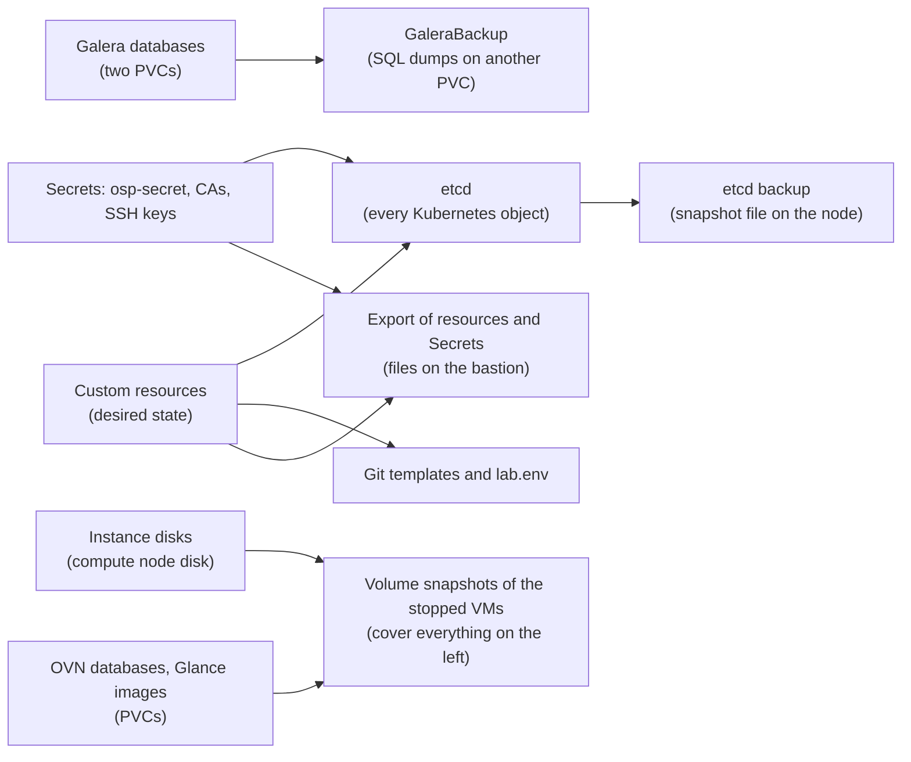

# Backup and restore

> Status: validated on the lab — the inventory and every backup procedure (5.1 to 5.4) were executed on 2026-11-12 (OKD 4.22.0-okd-scos.10, operators 18-stable), and the `GaleraRestore` of 5.5 was executed the same day on both database instances with markers proving the result; the manual import of a logical dump was validated on a scratch server only; the etcd restore was executed once on 2026-11-13, on a snapshot one minute old; the volume snapshot rollback was deliberately not run on the only lab

## In short

- State lives in several places: database volumes, Secrets generated in
  the cluster, custom resources, etcd, and the compute node disk. No single
  backup covers them all, except volume snapshots of the stopped VMs.
- Four backups to take: export of resources and Secrets (5.1),
  `GaleraBackup` (5.2), etcd backup (5.3), volume snapshots (5.4).
- On the lab every volume and etcd share one disk: copy backups off the
  node.
- `osp-secret` exists nowhere else. On a rebuild, restore the Secrets
  **before** the control plane resource.
- A database restore puts tables back, not consistency: Nova, Placement,
  Neutron, OVN and Glance must be repaired afterwards (5.5).
- Executed on the lab: every backup, `GaleraRestore` on both instances, one
  etcd restore. Not executed: a rollback to the volume snapshots.

## 1. Context

A Kolla-Ansible backup is usually "`mariadb_backup` plus `/etc/kolla` plus
the Glance store". Here the state is spread over more places, because the
deployment tool itself (the operators and the Kubernetes API) is stateful.

### Where the state lives

| State | Where | Lost if | Backup method |
|---|---|---|---|
| OpenStack databases (API DBs, cell DBs) | PVCs `mysql-db-openstack-galera-0`, `mysql-db-openstack-cell1-galera-0` | The PV directory is lost | `GaleraBackup` (logical dumps) |
| OVN northbound/southbound databases | PVCs of `ovndbcluster-nb` / `ovndbcluster-sb` | PV lost | Volume snapshot; NB can be rebuilt from the Neutron DB by Neutron's OVN sync tool, SB is derived from NB |
| Glance images | PVC of the Glance API (file store) | PV lost | Volume snapshot, or re-upload |
| RabbitMQ | PVCs of `rabbitmq` and `rabbitmq-cell1` | PV lost | None needed: queues are transient; users and vhosts are recreated by the operator |
| Service and database passwords | Secret `osp-secret` (and Secrets the operators derive from it) | Secret deleted | Export. **Generated in-cluster, exists nowhere else** |
| TLS: root CAs and issued certificates | cert-manager Secrets in `openstack` (CA Secrets, `cert-*`), bundle `combined-ca-bundle` | Secrets deleted | Export the CA Secrets. Leaf certificates are re-issued; a *new* CA means redistributing trust to compute nodes |
| Data plane SSH keys | Secrets `dataplane-ansible-ssh-private-key-secret`, `nova-migration-ssh-key` | Secret deleted | Export (the Ansible key also exists on the workstation in `.work/`) |
| Desired state of OpenStack | Custom resources: `OpenStackControlPlane`, `OpenStackVersion`, `NetConfig`, NodeSet, services, NADs, MetalLB pools | Namespace or CRs deleted | Git (templates) plus `lab.env`, and an export of the live objects |
| Everything Kubernetes knows (all of the above objects) | etcd on the OKD node | Node disk lost | etcd backup |
| Instance disks, libvirt state | Compute node local disk | Compute VM lost | Out of scope of the control plane; host-cloud snapshot of the compute volume |

On the lab every PV is a directory under `/var/lib/openstack-lab-pv` on the
single OKD node: **all persistent state and etcd share one disk**. Any
backup that stays in the cluster does not protect against losing that
volume.

Which backup covers which state; the table above has the details, and
section 4 says what each backup does not cover.



## 2. Read-only investigation

**[READ-ONLY]** Inventory of what holds state:

```bash
oc -n openstack get pvc
oc get pv -o custom-columns=NAME:.metadata.name,STATUS:.status.phase,CLAIM:.spec.claimRef.name,PATH:.spec.local.path
oc -n openstack get secrets --field-selector=type!=kubernetes.io/dockercfg | head -50
oc -n openstack get certificates,issuers
oc -n openstack get galera,galerabackup,galerarestore
oc -n openstack get cronjobs
```

**[READ-ONLY]** Is there a free volume for a backup PVC? (the lab has a
fixed number of static volumes)

```bash
oc get pv --no-headers | awk '$5 == "Available"' | wc -l
```

## 3. Expected observations

- Seven bound claims on the default lab (two Galera, two RabbitMQ, two OVN
  databases, one Glance) and the remaining volumes `Available`: five of the
  twelve static volumes on the lab as validated.
- No `GaleraBackup` and no backup CronJob (the CronJobs present are the
  database purge and Keystone token jobs of the services): nothing is
  backed up until you set it up.
- Four CA issuers (`rootca-public`, `rootca-internal`, `rootca-ovn`,
  `rootca-libvirt`) and the `selfsigned-issuer` that signs them, their CA
  Secrets, and many `cert-*` Secrets; close to a hundred Secrets in total.

## 4. Explanation: what each mechanism covers

| Mechanism | Covers | Does not cover |
|---|---|---|
| Git + `lab.env` | How to rebuild the same *empty* platform | Any data, generated passwords, certificates |
| Export of CRs and Secrets | Desired state and credentials as they are now | Data in PVs |
| `GaleraBackup` | OpenStack databases, as SQL dumps on another PVC | Stays inside the cluster (same disk on the lab) unless copied out |
| etcd backup | All Kubernetes objects of the cluster at one instant | Data in PVs; only restorable onto the same cluster |
| Host-cloud volume snapshots of the lab VMs | Everything, consistently, if taken while shut down | Nothing — but it is all-or-nothing and tied to certificate validity |

A database backup and an etcd backup taken at different times are not
consistent with each other (for example a `MariaDBAccount` may reference a
password newer than the dump). For a lab, the volume snapshot is the only
method that is consistent across all layers.

## 5. Procedure

### 5.1 Export custom resources and secrets

**[READ-ONLY]** (reads the cluster, writes local files)

```bash
backup_dir="${HOME}/backups/$(date -u +%Y%m%dT%H%M%SZ)"
mkdir -p "${backup_dir}" && chmod 700 "${backup_dir}"
oc -n openstack get openstackcontrolplane,openstackversion,netconfig,network-attachment-definitions \
  -o yaml > "${backup_dir}/openstack-crs.yaml"
oc -n openstack get openstackdataplanenodeset,openstackdataplaneservice,openstackdataplanedeployment \
  -o yaml > "${backup_dir}/dataplane-crs.yaml"
oc -n metallb-system get ipaddresspools,l2advertisements -o yaml > "${backup_dir}/metallb.yaml"
oc -n openstack-operators get subscription,catalogsource,operatorgroup,openstack -o yaml > "${backup_dir}/operators.yaml"
oc -n openstack get secrets -o yaml > "${backup_dir}/secrets.yaml"
chmod 600 "${backup_dir}"/*
```

On the lab the five files amount to about 1 MB (`secrets.yaml` 780 kB for
97 Secrets) and the export takes a few seconds.

`secrets.yaml` contains every password and private key of the platform in
base64 (which is not encryption). Never commit it; store it encrypted and
outside the lab. Exported objects carry `status`, `uid` and
`resourceVersion`; they are a reference for a rebuild, not files to
`oc apply` blindly.

### 5.2 Database backup with GaleraBackup

Provided by the mariadb-operator. One `GaleraBackup` per Galera instance;
each needs one free volume for its PVC (size inherited from the Galera
resource).

**[CHANGE]**

```bash
cat <<'YAML' | oc apply -f -
apiVersion: mariadb.openstack.org/v1beta1
kind: GaleraBackup
metadata:
  name: openstack
  namespace: openstack
spec:
  databaseInstance: openstack
  retention: 72h
---
apiVersion: mariadb.openstack.org/v1beta1
kind: GaleraBackup
metadata:
  name: openstack-cell1
  namespace: openstack
spec:
  databaseInstance: openstack-cell1
  retention: 72h
YAML
oc -n openstack wait galerabackup/openstack galerabackup/openstack-cell1 --for=condition=Ready --timeout=5m
```

Both resources are `Ready` ("Setup complete") within seconds. The operator
creates a CronJob `backup-<instance>` (schedule `@daily`), a PVC
`mysql-backup-<instance>` which binds one of the free static volumes, and
the ConfigMaps `<instance>-backup-config` and `<instance>-backup-scripts`.
Optional fields: `schedule` (cron expression, default `@daily`),
`retention` (Go duration), `storageClass`, `storageRequest`,
`transferStorage`.

**[CHANGE]** Run a backup now:

```bash
oc -n openstack create job --from=cronjob/backup-openstack manual-backup-openstack
oc -n openstack wait job/manual-backup-openstack --for=condition=complete --timeout=10m
```

For the second instance the CronJob is `backup-openstack-cell1`. Each job
took 15 seconds on the lab.

Each run writes two files under `data/` on the backup PVC, for example
`openstack_backup_2026-11-12_00-25-07.sql.gz` (all databases except `mysql`;
240 kB on a nearly empty lab) and
`openstack_backup-grants_2026-11-12_00-25-07.sql.gz` (user grants). The
prefix `openstack_backup` is fixed: **both instances produce files with the
same names**, each on its own PVC, so never mix their copies.

The dump is not taken from the live server directly. The job receives a
full state transfer from the Galera node into `transfer/` on the same PVC
(about 200 MB per instance on the lab, kept and overwritten at each run),
starts a temporary local server on it and dumps from there. Size the backup
volume for a full copy of the database plus the dumps.

The backup PVC is deliberately not deleted with the `GaleraBackup`
resource.

The script shipped with 18-stable at validation time does not delete
anything when applying `retention`: it only lists candidates, and its file
pattern (`*.sql`) does not match the compressed dumps. Until this changes
upstream, **old dumps accumulate**: prune them yourself.

To get the dumps off the node, either copy them from a pod that mounts the
backup PVC — the restore pod of 5.5 does — with `oc cp`, or, on the lab,
read the directory of the local volume on the node:

**[READ-ONLY]**

```bash
pv="$(oc -n openstack get pvc mysql-backup-openstack -o jsonpath='{.spec.volumeName}')"
path="$(oc get pv "${pv}" -o jsonpath='{.spec.local.path}')"
ssh core@192.168.130.10 "sudo tar -C ${path} -cf - data" > "${backup_dir}/galera-openstack-dumps.tar"
```

### 5.3 etcd backup (OKD)

**[CHANGE]** (writes files on the node; does not alter the cluster)

```bash
node="$(oc get nodes -o jsonpath='{.items[0].metadata.name}')"
oc debug --as-root "node/${node}" -- chroot /host /usr/local/bin/cluster-backup.sh /home/core/assets/backup
```

It takes a few seconds and produces `snapshot_<timestamp>.db` (the etcd
snapshot, about 90 MB on the lab) and
`static_kuberesources_<timestamp>.tar.gz` under `/home/core/assets/backup`
on the node. `oc debug` prints a PodSecurity warning that can be ignored.

Nothing schedules this backup: the lab has no automatic etcd backup
([knowledge base](../knowledge-base/okd-cluster-health-and-etcd.md#are-there-automatic-etcd-backups-and-where-is-the-backup-script)).

Copy them off the node — a backup on the disk it protects is not a backup.
The files belong to root with mode `0600`, so a plain `scp core@<node>:...`
fails with "Permission denied". From the bastion:

**[READ-ONLY]**

```bash
ssh core@192.168.130.10 "sudo tar -C /home/core/assets -cf - backup" > "${backup_dir}/etcd-backup.tar"
chmod 600 "${backup_dir}/etcd-backup.tar"
```

### 5.4 Full-lab backup: volume snapshots in the host cloud

1. Shut the cluster down cleanly
   ([06-okd-maintenance-impact.md](06-okd-maintenance-impact.md), section
   5.3), and stop the compute VM.
2. **[CHANGE]** From the workstation, snapshot the root volumes of the OKD
   node and of the compute node with the host cloud client:

   ```bash
   openstack volume snapshot create --volume <okd-root-volume-id> --force okdlab-okd-$(date -u +%Y%m%d)
   openstack volume snapshot create --volume <compute-root-volume-id> --force okdlab-compute-$(date -u +%Y%m%d)
   ```

   `--force` is required for attached volumes even when the instance is
   stopped; without it the volume service answers "status must be
   available, but current status is: in-use". Wait until both snapshots are
   `available` (`openstack volume snapshot list`); on the lab this took a
   few seconds for a 150 GB and a 60 GB volume, but it depends entirely on
   the storage backend of the host cloud.
3. Start the VMs again and follow the restart checks of
   [06](06-okd-maintenance-impact.md).

Snapshots are host-cloud resources outside Terraform state: list and delete
them yourself. They count against the snapshot and gigabyte quotas of the
project, and on most backends a volume cannot be deleted while it has
snapshots — delete them before destroying the lab.

On the lab the whole cycle — shutdown, snapshots, restart, platform back to
`Ready` — took about ten minutes.

### 5.5 Restore

Restore order after a loss, from the bottom up:

1. **Infrastructure**: Terraform (networks, VMs).
2. **OKD**: reinstall, or restore volumes from snapshots (which restores
   everything below at once — stop here in that case).
3. **Platform services**: storage volumes, cert-manager, MetalLB.
4. **Operators**: same catalog digest as before.
5. **Secrets first**: `osp-secret`, CA Secrets, SSH key Secrets — *before*
   the control plane resource, otherwise new passwords and a new CA are
   generated and no longer match the database content or the compute nodes.
6. **Control plane** resource, wait for `Ready`.
7. **Database content** with `GaleraRestore` (below).
8. **Data plane**: NodeSet and a new deployment.

**[DESTRUCTIVE]** Restore database content into a running Galera instance
(replaces current data with the dump):

```bash
cat <<'YAML' | oc apply -f -
apiVersion: mariadb.openstack.org/v1beta1
kind: GaleraRestore
metadata:
  name: openstack-restore
  namespace: openstack
spec:
  backupSource: openstack
YAML
oc -n openstack wait galerarestore/openstack-restore --for=condition=Ready --timeout=5m
oc -n openstack wait pod/restore-openstack-restore --for=condition=Ready --timeout=5m
oc -n openstack exec restore-openstack-restore -- ls -l /backup/data
oc -n openstack exec restore-openstack-restore -- \
  /var/lib/backup-scripts/restore_galera --yes /backup/data/<chosen-backup-files>.gz
oc -n openstack delete galerarestore/openstack-restore
```

`backupSource` is the name of the `GaleraBackup` resource and the only
field of the spec. The resource only starts a pod that mounts the backup
volume; the restore is the script, which loads **only the files given as
arguments**. It asks for confirmation unless `--yes` is given, removes the
database Service endpoint, pipes each file into the server, then puts the
endpoint back. `--content data` or `--content grants` restores only one of
the two files. If several backups are on the PVC, pass only the pair you
want.

Executed on the lab on 2026-11-12, first on `openstack-cell1`
(`backupSource: openstack-cell1`), then on `openstack`:

| Instance | Tables | Duration of the script | Failed API requests during the restore |
| --- | --- | --- | --- |
| `openstack-cell1` | 110 | 7 s | 0 |
| `openstack` | 407 | 25 s | 0 |

What the drills showed
([details and repairs](../knowledge-base/backup-and-restore-drills.md)):

- The data file recreates each table (`DROP TABLE IF EXISTS`, `CREATE
  TABLE`, rows); it never drops a database. Objects created after the
  backup disappear, objects deleted after it come back.
- Nothing is stopped. Removing the endpoint blocks new connections only:
  the services keep their open connections and keep working during the
  restore. On a cloud with activity, scale the API services down first.
- No service needed a restart afterwards and the control plane stayed
  `Ready`.
- A file that fails to load is reported as `FAILED`, the script continues
  and **exits with 0**: read its whole output.
- The grants file sets every database account back to its password at
  backup time. After a password rotation, restore with `--content data`.

After the restore, repair what the databases no longer describe:

**[READ-ONLY]** then **[DESTRUCTIVE]** (the second command deletes from OVN
whatever the restored Neutron database does not know)

```bash
oc -n openstack exec nova-cell0-conductor-0 -- nova-manage placement audit --verbose
np="$(oc -n openstack get pod -l service=neutron -o name | head -1)"
oc -n openstack exec "${np}" -c neutron-api -- neutron-ovn-db-sync-util \
  --config-file /etc/neutron/neutron.conf --config-dir /etc/neutron/neutron.conf.d \
  --ovn-neutron_sync_mode log
oc -n openstack exec "${np}" -c neutron-api -- neutron-ovn-db-sync-util \
  --config-file /etc/neutron/neutron.conf --config-dir /etc/neutron/neutron.conf.d \
  --ovn-neutron_sync_mode repair
```

- Cell restore: instances created after the backup still run on the
  compute node but are unknown to Nova (remove the domain, the instance
  directory, the Placement allocation with `placement audit --delete`,
  the port); instances deleted after the backup come back as `ACTIVE`
  with nothing behind them (delete them again).
- Main restore: instances created after the backup are still listed but
  cannot be shown or deleted until their row in
  `nova_api.instance_mappings` is put back; networks and ports differ
  between Neutron and OVN until the sync tool runs in `repair` mode;
  image files uploaded after the backup stay in the Glance store without
  a record.

**Fallback without the operator**: a `mysqldump --all-databases` taken as
in the [drills](../knowledge-base/backup-and-restore-drills.md) can be
loaded with `mysql` in the Galera pod after removing the Service endpoint
by hand. The import was validated on a scratch server only (1.5 s for the
main instance); it also replaces the accounts and the root password with
those of the dump.

etcd restore on a single-node cluster is a disaster-recovery procedure of
OKD itself: it puts every Kubernetes object back to the snapshot and
leaves the databases and the instances alone.

**[DESTRUCTIVE]**

```bash
ssh core@192.168.130.10 'sudo -E /usr/local/bin/cluster-restore.sh /home/core/assets/<directory-with-one-snapshot>'
oc adm wait-for-stable-cluster --minimum-stable-period=3m
oc -n openshift-etcd get pod etcd-okd-0 -o jsonpath='{.spec.containers[*].name}{"\n"}'
# two containers only: the restore pod is still in place, force a regular revision
oc patch etcd cluster --type=merge -p "{\"spec\":{\"forceRedeploymentReason\":\"restore-$(date +%s)\"}}"
oc adm wait-for-stable-cluster --minimum-stable-period=2m
```

Executed once on the lab, on 2026-11-13, on a snapshot one minute old:

- the script returned in 40 s, etcd was unavailable for 9 minutes, then
  for 5 more minutes during the forced revision;
- objects created after the snapshot disappeared and deleted ones came
  back;
- Keystone and a running instance were never interrupted and no OpenStack
  pod restarted;
- the previous data directory stays in `/var/lib/etcd-backup` until
  removed by hand.

Details and timeline are in the
[drill](../knowledge-base/backup-and-restore-drills.md#how-do-i-restore-etcd-on-the-single-node-and-what-really-happens).
A restore from an older snapshot leaves the custom resources and the
databases out of step and remains untested: on the lab, prefer volume
snapshots for that case.

## 6. Verification

**[READ-ONLY]** A backup exists and is plausible:

```bash
oc -n openstack get galerabackup
oc -n openstack get jobs | grep backup
oc -n openstack logs job/manual-backup-openstack --tail=20
oc -n openstack get pvc | grep mysql-backup
```

**[READ-ONLY]** After a restore:

```bash
oc -n openstack exec -c galera openstack-galera-0 -- mysql -nN -e 'show databases;'
oc -n openstack get openstackcontrolplane openstack
oc -n openstack rsh openstackclient openstack token issue
oc -n openstack rsh openstackclient openstack server list --all-projects
```

Then the audit and the sync tool of 5.5 until both are silent, and
`tests/smoke-test.sh --functional` (0 failed after each of the two drills
once the repairs were done). A backup that has never been restored is an
assumption: this one has been restored once, on an idle lab.

## 7. Risks and precautions

- `GaleraRestore` overwrites live data table by table while the services
  stay connected. No API request failed on the idle lab; under load,
  writes can land in the middle of the restore.
- Restoring a database dump older than the current state desynchronises
  Nova, Placement, Neutron, OVN and the Glance store from each other and
  from what really runs on compute nodes (5.5). Restoring one instance and
  not the other adds a disagreement between the cell and the API
  databases.
- The restore script exits with 0 even when a file failed to load.
- The exported Secrets file is the most sensitive artefact of the lab.
- Each `GaleraBackup` consumes one of the static volumes (two of the five
  free ones on the lab, leaving three); with `Retain`, deleting the PVC
  later leaves a `Released` volume to clean by hand
  ([storage troubleshooting](../troubleshooting/storage.md)).
- The backup volume receives a full copy of the database at each run, and
  nothing prunes old dumps (5.2). On the lab all volumes share the node
  disk.
- Volume snapshots of a running cluster are only crash-consistent.
- A snapshot contains the cluster certificates as they were. One taken
  during the first 24 hours of the cluster holds the short-lived initial
  certificates and cannot simply be booted days later
  ([06](06-okd-maintenance-impact.md)).

### Not tested, and limits of this document

- `GaleraRestore` was executed on both instances, on an idle lab with a
  single Galera replica and a few test resources: behaviour under load,
  with three replicas, or with a dump of realistic size is not known.
- The restore order of 5.5 (steps 1 to 6 and 8) and a rollback to the
  volume snapshots remain assumptions on this lab. The etcd restore was
  executed once, on an idle cluster and a snapshot one minute old: a
  restore across real changes, or after losing the node disk, is not
  known.
- The manual import of a `mysqldump --all-databases` file was only run on
  a scratch server, not on a live instance.
- A restore after a database password rotation, and a restore after the
  Neutron pod was replaced, were not exercised.
- The scheduled run of the backup CronJobs was not waited for; the jobs
  were started by hand.
- The interaction between restored Secrets and operator-generated Secrets
  (step 5 of the restore order) is inferred from how the operators consume
  `osp-secret`; it must be exercised.
- The upstream operator also ships an `OpenStackBackupConfig` resource
  (`backup.openstack.org`) that labels resources for external backup tools
  and defines a restore order. Pairing it with a backup tool is not covered
  by upstream documentation in the 18-stable branch and is not used here.
- No backup of the OVN databases other than volume snapshots is described.

---

**Previous:** [Rollback: what can and cannot be undone](04-rollback-limitations.md) · **Up:** [Lifecycle management](README.md) · **Next:** [Impact of OKD maintenance on OpenStack](06-okd-maintenance-impact.md)
