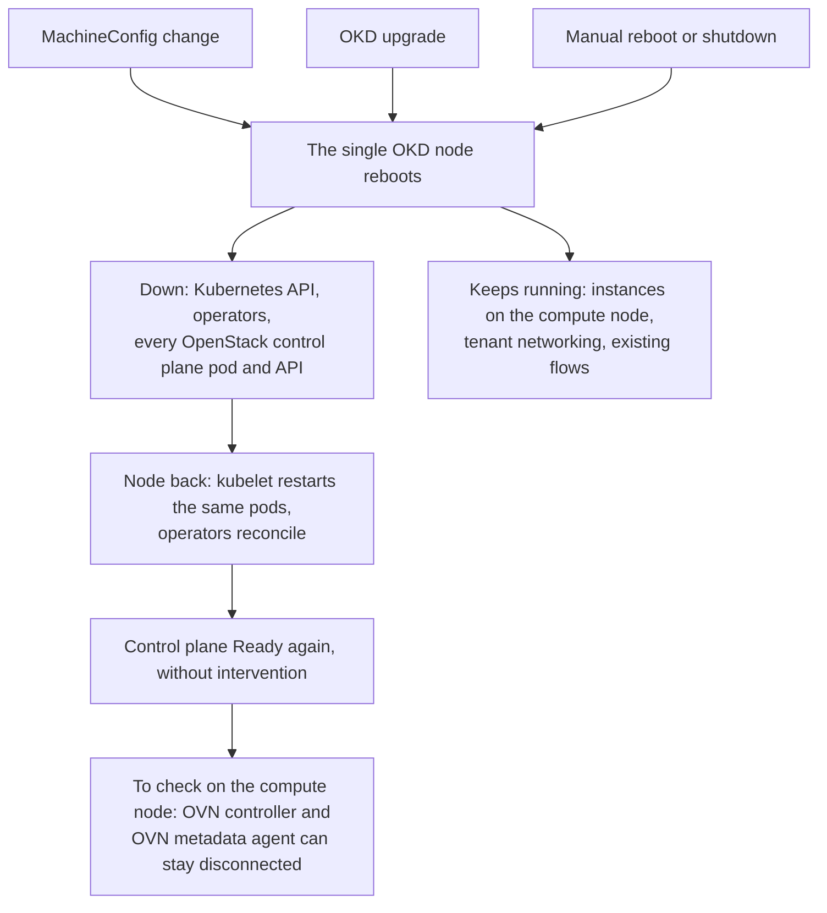

# Impact of OKD maintenance on OpenStack

> Status: partially validated on the lab — the read-only commands, a planned node reboot (2026-11-11), a graceful shutdown and restart of the whole lab and a compute node reboot (2026-11-12) and a MachineConfig change applied then removed (2026-11-12, two rolls) were executed on OKD 4.22.0-okd-scos.10 with operators 18-stable; a start of the whole lab after a power-off that was not initiated from inside the nodes was observed with read-only commands on 2026-11-14, not provoked; not executed: a deliberate unclean stop, and a restart after a power-off long enough to need certificate approval

## In short

- The lab has one OKD node: a reboot, a MachineConfig change or an OKD
  upgrade is a full outage of the Kubernetes API and of every OpenStack
  API.
- Instances on the compute node keep running, with their network.
- Everything comes back by itself, as the same pods restarted: about 6
  minutes for a planned reboot on the lab.
- One thing comes back late: the OVN agents of the compute node can
  stay disconnected after the control plane is healthy (metadata agent
  after four node restarts out of five, OVN controller after three or
  four; tally in section 4). Left alone they reconnected after 15
  minutes; a restart reconnects them in seconds. Check them after
  every restart of the OKD node.
- Always shut down cleanly, from inside the node. Leave a new cluster
  running for a day before a long power-off (certificate window, section
  7).

## 1. Context

In a Kolla-Ansible deployment, rebooting a controller is an OpenStack
operation: you know which containers run there and HAProxy fails over. Here
the "controller" is an OKD node, and OKD has its own reasons to reboot it:

- a **MachineConfig** change (node-level configuration: kernel arguments,
  files, systemd units) — the Machine Config Operator drains and reboots
  the node;
- an **OKD upgrade** — a new node OS image means a reboot
  ([07-okd-upgrade.md](07-okd-upgrade.md));
- a **manual reboot or shutdown** — typical for a lab that is switched off
  between sessions.

The lab has **one** node. Every one of these is a full control plane outage:
the Kubernetes API, all operators and every OpenStack control plane pod stop
together. This is the main difference from a production layout with three
control plane nodes, where the same operations are rolling.

What keeps running during the outage: instances on the compute node, their
tenant networking and existing flows (OVN programmes the data path locally
on the compute node). What does not: every OpenStack API, DHCP/metadata for
new requests, any change to networks or instances.

What an OKD maintenance operation does to OpenStack on the single-node lab,
from the trigger to the check that is left to you.



## 2. Read-only investigation

Before a planned operation, all **[READ-ONLY]**:

```bash
oc get nodes
oc get clusteroperators
oc get machineconfigpool
oc -n openstack get openstackcontrolplane openstack
oc -n openstack get pods --field-selector=status.phase!=Running,status.phase!=Succeeded
oc -n openstack get galera,rabbitmq -o wide
```

How long may the cluster stay powered off? The node (kubelet) client
certificates are the limit; check the signer expiry:

**[READ-ONLY]**

```bash
oc -n openshift-kube-apiserver-operator get secret kube-apiserver-to-kubelet-signer \
  -o jsonpath='{.metadata.annotations.auth\.openshift\.io/certificate-not-after}{"\n"}'
```

During the first day of a cluster a much shorter limit applies; this lists
the signer of the kubelet certificates and its expiry:

**[READ-ONLY]**

```bash
oc -n openshift-kube-controller-manager-operator get secrets -o json \
  | jq -r '.items[] | select(.metadata.annotations["auth.openshift.io/certificate-not-after"] != null)
      | "\(.metadata.name)\t\(.metadata.annotations["auth.openshift.io/certificate-not-after"])"'
```

After a restart:

**[READ-ONLY]**

```bash
oc get nodes
oc get csr
oc get clusteroperators
oc -n openstack get pods -o wide --sort-by=.status.startTime
```

## 3. Expected observations

- Before: node `Ready`, all cluster operators `Available=True`,
  `Degraded=False`, machine config pool `UPDATED=True`, control plane
  `Ready`.
- During a reboot: `oc` cannot reach the API at all (connection refused or
  timeout). This is normal on a single node.
- After boot: the API answers first, with stale statuses for a few seconds;
  the node becomes `Ready`; the OpenStack pods are **the same pods,
  restarted** (restart counter increased), not new ones; the control plane
  goes back to `Ready` without intervention. No cluster operator was
  reported degraded during the recoveries observed.
- Measured on the lab, counted from the start of the VM after a graceful
  shutdown: API after 1 min 15 s, node `Ready` after 1 min 45 s, control
  plane `Ready` after about 3 minutes, every pod ready after 3 min 10 s.
  A reboot from inside (5.1) took about 6 minutes from the command to a
  fully ready platform, of which 2 min 30 s is the node shutting down.
- The signer of section 2 is valid for one year
  (`kube-apiserver-to-kubelet-signer`). On a cluster less than a day old,
  the second command shows `csr-signer` certificates valid for only 24
  hours, like the kubelet client certificate on the node.
- After short stops (minutes), `oc get csr` shows no `Pending` request and
  nothing has to be approved. After a long power-off it may list `Pending`
  requests, and the node stays `NotReady` until they are approved (not
  reproduced on the lab).

## 4. Explanation: what recovers by itself, and in which order

Nothing in OpenStack is started by a script after a reboot. The kubelet
restarts pods from the desired state stored in etcd, and the operators
reconcile once they are up. Dependencies are handled by retries: a
`keystone` pod that starts before Galera simply fails its readiness check
and is restarted until the database answers.

| Component | Behaviour after a full stop | What to check |
|---|---|---|
| etcd, Kubernetes API | Start from the node disk | `oc get clusteroperators` |
| Galera (one replica per instance) | The operator detects that no node is running, reads the last recorded sequence number of each replica and bootstraps the cluster from the most advanced one. With a single replica this is automatic. | `oc get galera`; see [Galera and RabbitMQ](../troubleshooting/galera-and-rabbitmq.md) |
| RabbitMQ | Restarts from its PVC; queues are re-declared by services | `oc get rabbitmq`; services reconnecting |
| OVN NB/SB databases | Restart from their PVCs | `oc get ovndbcluster` |
| OVN controllers on compute nodes | Lose the southbound connection during the outage. **Stayed disconnected** after the control plane was back on three of the five restarts of the OKD node (tally below): for 15 minutes when left alone, until a manual restart otherwise; reconnected at once after a compute reboot. Existing flows keep working, new ports are not wired | `sudo podman exec ovn_controller ovn-appctl connection-status` on the compute node; `sudo systemctl restart edpm_ovn_controller` |
| OVN metadata agent on compute nodes | **Stayed disconnected** after the control plane was back on four of the five restarts of the OKD node (tally below), including each of the three reboots of the OKD node alone: for 16 minutes when left alone, until a manual restart otherwise; reconnected at once after a compute reboot. The agent list keeps showing it alive until the next change in OVN | [node and OKD troubleshooting](../troubleshooting/node-and-okd.md); `sudo systemctl restart edpm_ovn_metadata_agent` on the compute node |
| nova-compute on compute nodes | Loses RabbitMQ, retries; reported `down` until it reconnects | `openstack compute service list` |
| MetalLB addresses | Announced again when the speaker pod is running | Services of type `LoadBalancer` have their address |
| Certificates | Unchanged if within validity | cert-manager pods running |
| Local persistent volumes | Directories on the node disk; unaffected by a reboot | `oc get pv` |

The order is not strict: on the lab `nova-scheduler` started before
RabbitMQ and went through a few restarts before settling.

Tally of the OVN agents of the compute node after each restart of the
OKD node or outage of the control plane on this lab (times in UTC). No
restart was provoked to complete it; the last line was observed with
read-only commands. "Disconnected until restarted" means that the
agent was restarted by hand before anyone knew whether it would have
recovered: the journal of the compute node, re-read on 2026-11-14,
gives the delays.

| Date | Event | OVN controller | OVN metadata agent |
|---|---|---|---|
| 2026-11-11 23:54 | Planned reboot of the OKD node, compute node running | Reported alive by the agent list after a change in OVN; `connection-status` was not read that time | **Disconnected** until restarted, about fifteen minutes later (notes of that day; journal no longer available) |
| 2026-11-12 00:27 | Graceful shutdown and start of the whole lab (compute node restarted too) | Reconnected alone | Reconnected alone |
| 2026-11-12 19:06 | MachineConfig roll (reboot of the OKD node), compute node running | **Disconnected** until restarted, 9 min 28 s after the connection dropped | **Disconnected** until restarted, 10 min 28 s after the drop |
| 2026-11-12 19:18 | Second MachineConfig roll, compute node running | **Disconnected** until restarted, 8 min 03 s after the drop | **Disconnected** until restarted, 8 min 03 s after the drop |
| 2026-11-13 05:48 to 06:10 | etcd restore: two outages of the API, no node reboot, the OVN database pods kept running | Reported alive by the agent list after changes in OVN; `connection-status` was not read | Reported alive, same remark |
| 2026-11-14 07:37 | Start of the whole lab after a power-off requested from outside the nodes; the compute node booted at the same time as the OKD node, five minutes before the southbound database answered | **Disconnected for 15 min 08 s**, then reconnected alone at 07:53:10, 9 min 23 s after the DNS service was back; container `unhealthy` in between | **Disconnected for 16 min 27 s**, then reconnected alone at 07:54:29; both agents `XXX` in the agent list at 07:45:56 and 07:47:45, alive at 09:03 |

Counted over the five restarts of the OKD node (the etcd restore is
not one): the metadata agent stayed disconnected four times, the OVN
controller three times for certain. The first line rests on the agent
list alone, which this page shows to be a late indicator, so "three out
of five" for the controller is a minimum. A restart of the whole lab
is **not** safe either: the agents were connected two minutes after
their start on 2026-11-12 and only after 15 minutes on 2026-11-14.
The difference that the journal shows: on 2026-11-12 the agents
connected about 100 seconds after they started, so the DNS service of
the control plane answered by then; on 2026-11-14 it answered after
almost six minutes (the node had to pull
every image again, see below). On 2026-11-14 the agents were left as
found, which is how their recovery without help was seen: the
controller logged its last error exactly 900 seconds after its start.
The mechanism (the resolver library of the agents ignores a
nameserver that timed out for 900 seconds) was shown the same day
with a provoked DNS outage and a capture on the compute node; see the
[open questions](../knowledge-base/open-questions.md).

An **unclean** stop (VM powered off or crashed) is different: databases have
to recover, and an open OKD issue on recent releases reports nodes staying
`NotReady` after an unclean shutdown because of a container-runtime/network
plugin deadlock. Always shut down cleanly.

One such stop happened on the lab without being provoked. On 2026-11-13
at 09:09:31 UTC the OKD node received a power-off request from outside
(`systemd-logind: Power key pressed short`); its journal ends 31
seconds later, where a clean shutdown of this node takes 2 min 30. At
the next start (2026-11-14 07:37:31) the filesystem replayed its
journal and CRI-O logged `Wiping storage directory
/var/lib/containers/storage because of suspected unclean shutdown`:
every image was pulled again through the proxy, with transient
`ErrImagePull` and `ImagePullBackOff` on many pods. The node was
`Ready` at 07:42:23 and every cluster operator, the control plane and
the NodeSet were settled at 07:44:53, a little over seven minutes after
the boot, without any action and without the `NotReady` deadlock
mentioned above. Two kubelet certificate requests were approved
automatically. Without a reachable registry or proxy the node would
have had nothing to start. The only thing that recovered late was the
OVN agents: eight to ten minutes after everything else (last line of
the tally).

## 5. Procedures

### 5.1 Planned node reboot

**[CHANGE]** (full control plane outage)

```bash
node="$(oc get nodes -o jsonpath='{.items[0].metadata.name}')"
oc debug "node/${node}" -- chroot /host systemctl reboot
```

Draining the node first (`oc adm drain`) is the normal practice on a
multi-node cluster. On a single node there is nowhere to move pods to, so a
drain only evicts them slightly earlier than the reboot would. A real drain
was never executed on the lab; what it would evict was evaluated with a
server-side dry run
([knowledge base](../knowledge-base/okd-node-maintenance.md#what-would-a-drain-really-evict-here-and-which-poddisruptionbudgets-exist)).

### 5.1b Compute node reboot

Not an OKD operation, but the usual companion of a data plane update that
installed a new kernel
([01](01-openstack-version-and-minor-update.md)).

**[CHANGE]** (stops the instances of that node) On the compute node:

```bash
sudo systemctl reboot
```

On the lab the node answered SSH again after about 20 seconds; the units
`edpm_ovn_controller`, `edpm_ovn_metadata_agent` and `edpm_nova_compute`
were active, `nova-compute` was `up` and both OVN agents alive without any
action. Instances are not restarted automatically.

### 5.2 MachineConfig change

Applying a MachineConfig makes the Machine Config Operator reboot the node
by itself. On the lab, treat "apply a MachineConfig" as "reboot the
control plane now": measured on 2026-11-12, the reboot started 10 to 15
seconds after the change, without cordon or drain (the daemon logs `Drain
not required, skipping` on a single-node control plane).

The outage is the one of a planned reboot (5.1):

| Measure | Value |
|---|---|
| API away | for about 3 min 35 |
| Keystone answering again | after about 5 min 10 |
| Every OpenStack pod ready | after about 5 min 50 |
| Pool reported `Updated` | after about 7 min 10 |

Removing the MachineConfig is a second roll of the same length and brings
the original rendered configuration back. After each roll both OVN
services of the compute node were found disconnected and restarted
(section 4;
[diagnosis and fix](../knowledge-base/okd-node-maintenance.md#why-are-the-ovn-agents-of-the-compute-node-dead-after-a-reboot-of-the-okd-node-and-how-do-i-fix-them)
in the knowledge base).

To group several changes in one reboot, pause the pool
(`oc patch mcp master --type merge -p '{"spec":{"paused":true}}'`), apply
them, compare `spec.configuration.name` with `status.configuration.name`
of the pool, then unpause. Do not leave the pool paused. The full
mechanism, the timeline of both rolls and the commands are in the
knowledge base:
[OKD node maintenance](../knowledge-base/okd-node-maintenance.md).

**[READ-ONLY]** Follow it:

```bash
oc get machineconfigpool -w
```

### 5.3 Graceful shutdown of the lab

1. Optional but recommended: backups
   ([05-backup-and-restore.md](05-backup-and-restore.md)).
2. Stop workloads you care about: instances keep running on the compute
   node only as long as that VM runs.
3. **[CHANGE]** Shut the OKD node down from inside:

   ```bash
   node="$(oc get nodes -o jsonpath='{.items[0].metadata.name}')"
   oc debug "node/${node}" -- chroot /host shutdown -h 1
   ```

   The command returns at once ("Shutdown scheduled for ..."); the API
   stops answering one minute later and the VM reached `SHUTOFF` about
   three minutes after that. Wait for it.

4. **[CHANGE]** Once the VM reports `SHUTOFF` in the host cloud, stop the
   compute VM and, if desired, the bastion, from the workstation
   (`openstack server stop <name>`). Do not use a hard power-off on a
   running OKD node.

### 5.4 Restart of the lab

1. **[CHANGE]** Start the bastion first (it is the DNS server of the
   cluster), then the OKD node, then the compute node:
   `openstack server start <name>`. On the host cloud used for the
   validation, stop and start kept the ports, their MAC addresses and
   fixed IPs, and the volumes.
2. **[READ-ONLY]** Wait for the API, then look for pending certificate
   requests:

   ```bash
   oc get nodes
   oc get csr
   ```

3. **[CHANGE]** If requests are `Pending`, approve them (repeat: kubelet
   client requests come first, serving requests follow):

   ```bash
   oc get csr -o json | jq -r '.items[] | select(.status == {}) | .metadata.name' \
     | xargs --no-run-if-empty oc adm certificate approve
   ```

4. Run the verification below.

## 6. Verification

**[READ-ONLY]**

```bash
oc get nodes
oc get clusteroperators | awk 'NR == 1 || $3 != "True" || $5 != "False"'
oc -n openstack get openstackcontrolplane openstack
oc -n openstack get galera,rabbitmq,ovndbcluster
oc -n openstack get pods --field-selector=status.phase!=Running,status.phase!=Succeeded
oc -n openstack rsh openstackclient openstack compute service list
oc -n openstack rsh openstackclient openstack network agent list
```

Expected: only the header line from the cluster operator filter, control
plane `Ready`, compute services `up`, agents alive. Then
`tests/smoke-test.sh`. If compute services stay `down` several minutes after
the control plane is `Ready`, see
[data plane troubleshooting](../troubleshooting/dataplane.md).

## 7. Risks and precautions

- **Certificate window.** During its first 24 hours a cluster runs on
  short-lived initial certificates: on the lab, five hours after
  installation, the kubelet client certificate and its signer
  (`csr-signer`) expired exactly 24 hours after the installation started. A
  short stop inside that window is harmless (done on the lab), but a
  cluster — or a volume snapshot — put aside during the first day and
  started after that expiry comes back with expired node certificates.
  Leave a new cluster running for a day before a long power-off, and check
  the dates with the commands of section 2. Afterwards, a powered-off
  cluster can be restarted without special recovery only while the kubelet
  certificates are valid; the one-year signer of section 2 is the outer
  limit. After a long stop, expect to approve CSRs.
- **Never hard-stop the OKD VM** (host-cloud "stop" on a running node is a
  power cut after a timeout if the guest does not react). Shut down from
  inside, then confirm the `SHUTOFF` state.
- **Do not "shelve" the VMs** unless you have verified that the host cloud
  keeps port MAC addresses, fixed IPs and volumes unchanged across
  shelve/unshelve; the node network configuration is bound to MAC
  addresses.
- A reboot is the moment latent problems appear (a pod that cannot pull its
  image again, a PVC whose directory was altered). Check health *before*:
  the question after a failed restart is always "was it healthy before?".
- Workloads on the compute node lose API-driven functions during the
  outage; anything with a short timeout against the APIs fails.
- With a single replica of Galera there is no quorum problem, but also no
  second copy: disk corruption after an unclean stop is unrecoverable
  without a backup.

### Not tested, and limits of this validation

- The MachineConfig change of 5.2 added and removed one file. A change of
  kernel arguments or kubelet settings, and a roll that fails half-way,
  were not executed.
- An unclean stop was not provoked: the behaviour of etcd, Galera and the
  node after a power cut is not validated.
- A power-off longer than a certificate lifetime, and therefore the CSR
  approval of 5.4, was not reproduced. The rotation after the first 24
  hours was not waited for.
- Shelving the VMs was not tried.
- Galera bootstrapped by itself after both clean stops.

---

**Previous:** [Backup and restore](05-backup-and-restore.md) · **Up:** [Lifecycle management](README.md) · **Next:** [Upgrading OKD](07-okd-upgrade.md)
