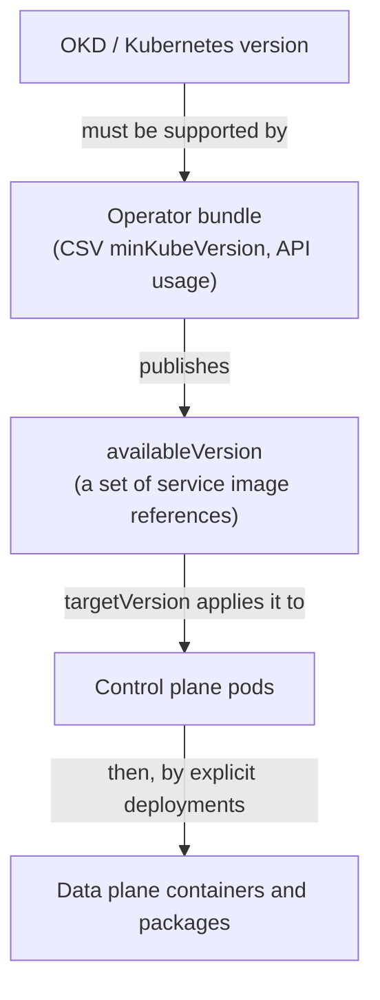

# Lifecycle management

> Status: partially validated on the lab — the pages of this directory were run against the lab on 2026-11-12 (OKD 4.22.0-okd-scos.10, operators 18-stable); each page states in its status line what was not executed (an operator upgrade through OLM, a rollback to volume snapshots, provoked failures, the OKD upgrade). The database restores (2026-11-12) and one etcd restore (2026-11-13) were executed: see [05](05-backup-and-restore.md)

**Start here** before changing a version, taking a backup or rebooting the
OKD node. Read this page first: it explains the four version axes that the
other pages rely on. Then read [05](05-backup-and-restore.md) before any
change of version, and the page of the axis you want to move.

## In short

- There are four independent version axes: OKD, the OpenStack operators,
  the OpenStack service images, and the compute node packages.
- Upgrading the operators does not upgrade OpenStack: it only makes a
  newer set of images *available*. You apply it with `targetVersion`.
- The data plane never updates by itself: you create a deployment.
- No axis has a supported downgrade. Prepare the way back (backups,
  volume snapshots) before the change.
- On the single-node lab, any reboot of the OKD node is a full outage of
  the OpenStack APIs; instances keep running.
- Change one axis at a time and wait for `Ready` in between.

## Prerequisites

| Prerequisite | Where |
|---|---|
| The lab is deployed and `tests/smoke-test.sh` passes | [Installation, step 7](../installation/07-verification.md) |
| You can read conditions and follow a rollout | [Operations 01](../operations/01-inspect-service-status.md), [04](../operations/04-change-service-configuration.md) |
| You know how a data plane deployment is created | [Operations 08](../operations/08-dataplane-changes.md) |
| The safe change checklist is at hand | [Operations 09](../operations/09-safe-change-checklist.md) |

## Why four axes

With Kolla-Ansible, "the version of the platform" is essentially one thing:
the `openstack_release` and image tags in `globals.yml`, applied by one
command. In an operator-managed deployment there are **four independent
version axes**, each with its own mechanism, its own pace and its own failure
modes. Most lifecycle mistakes come from confusing them.

## The four axes

| Axis | What it versions | Who changes it | How you trigger it | Where you read it |
|---|---|---|---|---|
| 1. OKD | Kubernetes, the node OS (CentOS Stream CoreOS), cluster operators | Cluster Version Operator | `oc adm upgrade` | `oc get clusterversion` |
| 2. OpenStack operators | The controllers (openstack-operator and the service operators), their CRDs and webhooks | OLM (Operator Lifecycle Manager) | New catalog content, then approving an InstallPlan | `oc -n openstack-operators get csv` |
| 3. OpenStack services | The service container images (Keystone, Nova, Galera, OVN, ...) on the control plane and on compute nodes | openstack-operator, through the `OpenStackVersion` resource | Setting `spec.targetVersion` | `oc -n openstack get openstackversion` |
| 4. Data plane host | Packages and OS of the compute nodes (CentOS Stream) | Ansible jobs started by a data plane deployment | An `OpenStackDataPlaneDeployment` with the update services | The node itself (`rpm`, `podman ps`) |

Key consequences:

- **Upgrading the operators does not upgrade OpenStack.** A new operator
  bundle only *publishes* a newer set of service images as
  `status.availableVersion`. Service containers keep running the old images
  until you set `spec.targetVersion`
  ([01](01-openstack-version-and-minor-update.md),
  [02](02-operator-upgrade.md)).
- **Upgrading OKD does not upgrade the operators or OpenStack**, but it
  restarts everything, because the single node reboots
  ([06](06-okd-maintenance-impact.md)).
- **The control plane does not update compute nodes by itself.** The data
  plane only changes when you create a deployment
  ([01](01-openstack-version-and-minor-update.md)).

## How the axes depend on each other

Each axis constrains the one below it; read the arrows as "comes before".



Ordering rules that follow from this:

1. Before an OKD upgrade, check that the installed operator bundle supports
   the target Kubernetes version ([07](07-okd-upgrade.md)).
2. Upgrade operators before services: a service update is only possible to a
   version the running operator knows about.
3. Within a service update, OVN on the control plane goes first, then OVN on
   the data plane, then the rest of the control plane, then the rest of the
   data plane. The operator enforces the control plane part of this order
   and waits for you between the stages. (On the lab the first stage is
   empty: see [01](01-openstack-version-and-minor-update.md).)
4. Change one axis at a time and let the platform return to `Ready` before
   touching the next one.

## Mapping from Kolla-Ansible

| Kolla-Ansible | Operator-managed lab | Notes |
|---|---|---|
| Edit `globals.yml` / config overrides, `kolla-ansible reconfigure` | Edit the `OpenStackControlPlane` CR; reconciliation applies it | No command to run; see [operations](../operations/README.md) |
| Bump `openstack_release`, `kolla-ansible pull` + `upgrade` | Operator upgrade (new images become *available*), then `targetVersion` (images are *applied*) | Two separate decisions |
| `kolla-ansible upgrade --limit compute01` | `OpenStackDataPlaneDeployment` with `servicesOverride` and optionally `ansibleLimit` | Each run is a new resource |
| Upgrade the deployment tool itself (`pip install kolla-ansible==...`) | Operator upgrade through OLM | The "tool" runs permanently inside the cluster |
| Host OS upgrade of controllers | OKD upgrade (node OS is part of the OKD release) | Not managed with a package manager |
| Host OS/package update of computes | Data plane deployment with the `update` service | |
| `mariabackup` via `kolla-ansible mariadb_backup` | `GaleraBackup` / `GaleraRestore` resources | [05](05-backup-and-restore.md) |
| Roll back by redeploying the previous tag | No supported downgrade on any axis | [04](04-rollback-limitations.md) |

## Pages

| Page | Phase | Topic | Lab validation |
|---|---|---|---|
| [01 — OpenStackVersion and minor update](01-openstack-version-and-minor-update.md) | 3 | The `OpenStackVersion` resource and the staged service update | Validated, with a simulated newer version |
| [02 — Operator upgrade](02-operator-upgrade.md) | 3 | Upgrading the operators through OLM | Partial: no newer bundle was offered |
| [03 — Failed upgrade](03-failed-upgrade.md) | 3 | Investigating an update that stalls | Partial: no failure provoked |
| [04 — Rollback limitations](04-rollback-limitations.md) | 3 | What can and cannot be undone | Partial: no rollback to volume snapshots, no real downgrade |
| [05 — Backup and restore](05-backup-and-restore.md) | 3 | State inventory, backups, restore order | Validated: all backups taken, `GaleraRestore` on both instances, etcd restore once; no rollback to volume snapshots |
| [06 — OKD maintenance impact](06-okd-maintenance-impact.md) | 3 | What OKD operations do to OpenStack | Partial: reboot, shutdown and restart, MachineConfig change done; no unclean stop |
| [07 — OKD upgrade](07-okd-upgrade.md) | 4 | Upgrading OKD itself | Partial: read-only checks only, upgrade not executed |

The restores and the maintenance operations are recorded step by step in
the knowledge base:
[backup and restore drills](../knowledge-base/backup-and-restore-drills.md)
and [OKD node maintenance](../knowledge-base/okd-node-maintenance.md).

How long each operation takes, as measured on the lab (one OKD node, one
compute node):

| Operation | Page | Duration | Effect seen from outside |
|---|---|---|---|
| Override of one image (Keystone) | 01 | about 1 min | Service resource not `Ready` meanwhile; rolling replacement |
| Staged minor update, both planes | 01 | about 10 min | Every service restarted once; compute packages updated |
| Database backup job (`GaleraBackup`) | 05 | 15 s per instance | None |
| etcd backup | 05 | a few seconds | None |
| Database restore (`GaleraRestore` script) | 05 | 7 s (cell), 25 s (main) | No failed API request on the idle lab |
| etcd restore | 05 | etcd unavailable 9 min, then 5 min more | Keystone and a running instance not interrupted |
| Planned reboot of the OKD node | 06 | about 6 min | All OpenStack APIs down |
| MachineConfig change (one roll) | 06 | about 7 min until the pool is `Updated` | All OpenStack APIs down |
| Graceful shutdown, volume snapshots, restart | 05, 06 | about 10 min | All OpenStack APIs down |

## Conventions

Command blocks are tagged:

- **[READ-ONLY]** — inspects, never modifies.
- **[CHANGE]** — modifies the platform in a way the platform is designed for.
- **[DESTRUCTIVE]** — can lose data or cause an outage that does not heal by
  itself. Read the risks section first.

Unless stated otherwise, commands run on the bastion, and OpenStack resources
live in the `openstack` namespace:

```bash
oc project openstack
```

Every document ends with what was not tested. A procedure that was not
executed is described from upstream source and documentation and says so.

---

**Previous:** [Operating OpenStack on OKD (Day 2)](../operations/README.md) · **Next:** [OpenStackVersion and the minor update](01-openstack-version-and-minor-update.md)
