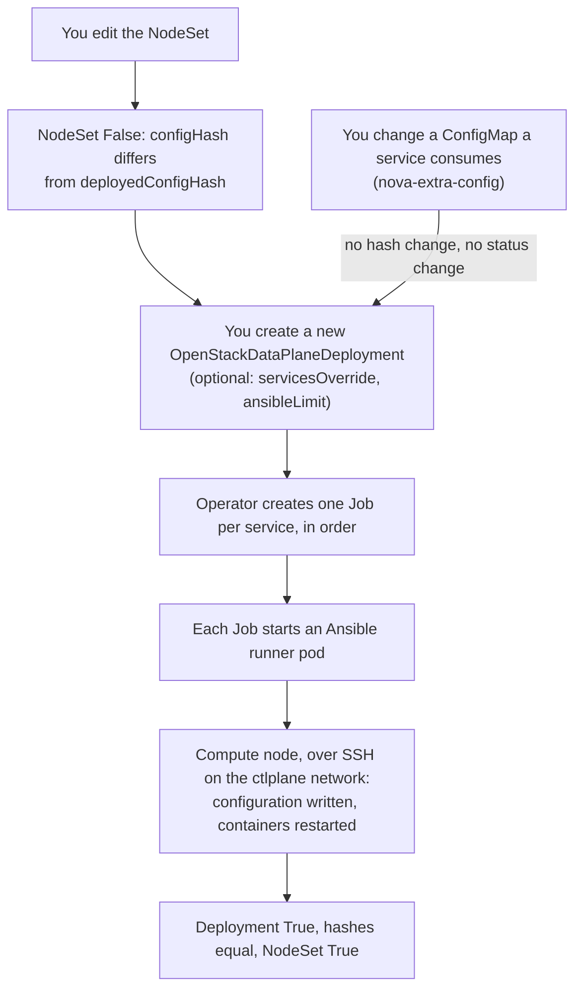

# Data plane changes

> Status: validated on the lab (OKD 4.22.0-okd-scos.10, operators 18-stable) on 2026-11-11

The control plane reconciles continuously. The data plane does not: compute
nodes are changed only when an Ansible run is started, exactly like
`kolla-ansible reconfigure --limit compute01`. The run is represented by an
`OpenStackDataPlaneDeployment` resource, and each new run is a **new**
resource.

## In short

- Nothing changes on a compute node until you create a new
  `OpenStackDataPlaneDeployment`. Each run is a new resource with a new
  name.
- An edited NodeSet shows `False` until a deployment finishes. A changed
  ConfigMap (`nova-extra-config`) shows nothing at all: you have to know
  that a run is needed.
- Use `servicesOverride` to run the smallest set of services: about two
  and a half minutes for `nova` alone, against about 14 minutes for a full
  run.
- The lab script re-applies the repository templates first: start a run
  with `oc apply` when the change is only a test patch.
- `True` after a partial run does not prove that every service was
  applied.

## 1. Initial symptoms

- You changed something that concerns compute nodes (a `nova-compute`
  option, an Ansible variable of the NodeSet, a certificate, a control plane
  setting that compute nodes consume) and nothing happened on the node.
- `oc get openstackdataplanenodeset` shows the NodeSet as not ready after an
  edit.

## 2. Read-only investigation

**[READ-ONLY]**

```bash
oc get openstackdataplanenodeset openstack-edpm
oc get openstackdataplanedeployment

# Has the NodeSet changed since it was last deployed?
oc get osdpns openstack-edpm -o jsonpath='configHash:         {.status.configHash}{"\n"}deployedConfigHash: {.status.deployedConfigHash}{"\n"}'

# What the last runs did.
oc get osdpns openstack-edpm -o json | jq '.status.deploymentStatuses | keys'
oc get pods -l app=openstackansibleee --sort-by=.status.startTime

# The services a deployment runs, in order.
oc get osdpns openstack-edpm -o jsonpath='{range .spec.services[*]}{@}{"\n"}{end}'
oc get openstackdataplaneservice
```

## 3. Expected observations

- After a successful deployment `configHash` equals `deployedConfigHash`,
  the NodeSet is `True`, "NodeSet Ready", and the deployment `True`, "Setup
  complete".
- After you edit the NodeSet the two hashes differ within seconds and the
  NodeSet shows `False`, "NodeSet setup ready, waiting for
  OpenStackDataPlaneDeployment...". This is the operator telling you
  "declared and deployed have diverged"; it will not fix it by itself.
- The hash covers the NodeSet only. Creating or changing a ConfigMap that a
  service consumes (`nova-extra-config`) changes neither the hash nor the
  status: nothing tells you that a run is needed.
- The NodeSet stays `False` until a deployment finishes, even if you take
  the edit back and the two hashes are equal again.
- The lab NodeSet runs 15 services, in this order: `repo-setup`,
  `bootstrap`, `download-cache`, `configure-network`, `validate-network`,
  `install-os`, `configure-os`, `ssh-known-hosts`, `run-os`, `reboot-os`,
  `install-certs`, `ovn`, `neutron-metadata`, `libvirt`, `nova`.
  `oc get openstackdataplaneservice` lists 37: the others exist but are not
  used by this NodeSet.
- One completed pod per service and per deployment, named
  `<service>-<deployment>-<nodeset>-<suffix>`. They are removed when their
  deployment is deleted.

## 4. Root cause

Why the data plane is not self-healing: an Ansible run on a hypervisor can
restart agents and interrupt workloads. The operators therefore never start
one on their own. They prepare everything (inventory, variables, secrets,
certificates) and wait for you to create a deployment.

What happens between a change and the compute node; the two entry points
differ only in what the NodeSet status shows.



Anatomy of a run:

- `OpenStackDataPlaneNodeSet`: inventory and variables.
- `OpenStackDataPlaneService`: one playbook, plus the ConfigMaps and Secrets
  it needs.
- `OpenStackDataPlaneDeployment`: "run these services on these NodeSets now".
  The operator creates one Kubernetes Job per service, in order; each Job
  starts an Ansible runner pod that connects to the nodes over SSH on the
  ctlplane network.

Useful deployment fields:

| Field | Effect | Kolla equivalent |
|-------|--------|------------------|
| `nodeSets` | Which NodeSets to run on | Inventory groups |
| `servicesOverride` | Run only these services instead of the NodeSet list | `--tags` |
| `ansibleLimit` | Restrict to some hosts | `--limit` |
| `ansibleTags`, `ansibleSkipTags` | Ansible tags inside the playbooks | `--tags`, `--skip-tags` |
| `backoffLimit` | Retries of a failed Job (default 6) | none |

A deployment that uses `servicesOverride` **does** update
`deployedConfigHash`. Observed on the lab: after a change of a NodeSet
variable, a deployment limited to `nova` and to one host brought the two
hashes back to equal and the NodeSet to `True`. The operator records that a
deployment finished, not which services ran. After a partial run, the
status no longer tells you whether the rest was applied: keep track of it
yourself.

Durations measured on the lab:

| Run | Duration |
|-----|----------|
| First full deployment, one node | 21 min |
| Full deployment on the already deployed node | 13 min 43 s |
| Full deployment adding a second node to the first | 21 min 4 s |
| Full deployment adding two nodes at once (three nodes) | 27 min 30 s |
| Full deployment on the remaining node after a node was removed | 13 min 5 s |
| Full deployment on the remaining node after two nodes were removed | 14 min 26 s |
| `servicesOverride: [nova]`, one or two nodes | 2 min 20 s to 2 min 30 s |

Adding and removing nodes were executed on the lab: one to two nodes and
back on 2026-11-12, then up to three nodes and back to one on 2026-11-13.
The procedure, what the operator does in each case, and the live migration
between nodes are in
[Data plane scale-out, migration and scale-in](../knowledge-base/dataplane-scale-out-and-migration.md).

## 5. Resolution

### Example: change a nova-compute option

`nova-compute` reads extra configuration from the ConfigMap
`nova-extra-config`.

**[CHANGE]** Declares the change. Nothing happens on the node yet.

```bash
cat <<'YAML' | oc apply -f -
apiVersion: v1
kind: ConfigMap
metadata:
  name: nova-extra-config
  namespace: openstack
data:
  25-nova-extra.conf: |
    [DEFAULT]
    debug = true
YAML
```

The lab script already creates this ConfigMap with a `[libvirt]` section
(hypervisor type and live migration address): the example above replaces
it. On a real change, edit it (`oc edit configmap nova-extra-config`),
keep that section and add yours.

The hashes do not move and the NodeSet stays `True`: see above.

**[READ-ONLY]**

```bash
oc get configmap nova-extra-config -o yaml
oc get osdpns openstack-edpm -o jsonpath='{.status.configHash} {.status.deployedConfigHash}{"\n"}'
```

**[CHANGE]** Runs Ansible on the compute nodes; restarts `nova_compute`.

```bash
cat <<'YAML' | oc apply -f -
apiVersion: dataplane.openstack.org/v1beta1
kind: OpenStackDataPlaneDeployment
metadata:
  name: edpm-nova-debug-1
  namespace: openstack
spec:
  nodeSets:
    - openstack-edpm
  servicesOverride:
    - nova
YAML
```

The run takes about two and a half minutes (140 tasks, 22 changed on the
lab) and restarts the `nova_compute` container.

To remove the option again, delete the ConfigMap and run the `nova` service
once more under a new name (`edpm-nova-debug-2`).

### Example: change a NodeSet variable and run everything

The lasting way is to change the repository template and let the script
apply it and start a full deployment under a new name:

**[CHANGE]** Runs every service on the compute nodes (about 14 minutes).

```bash
vi deployment/openstack/dataplane/nodeset.yaml.tmpl
scripts/bastion/07-openstack-dataplane.sh edpm-deployment-2
```

For a quick test you can patch the NodeSet directly:

**[CHANGE]** Declares the change. Nothing happens on the node yet.

```bash
oc patch openstackdataplanenodeset openstack-edpm --type=merge -p '
spec:
  nodeTemplate:
    ansible:
      ansibleVars:
        edpm_lab_test_marker: "1"
'
oc get openstackdataplanenodeset openstack-edpm
```

Then start the deployment with `oc apply`, as in the other examples of this
page, and **not** with the script. The script applies the NodeSet rendered
from the repository template first, which takes your patch back before the
run starts. It also writes `nova-extra-config` again from its template.
Whatever is not in the templates or in `lab.env` does not survive the
script.

Check the name passed to the script: with the name of an existing
deployment it only waits for that deployment and runs nothing.

### Limit a run to one node

**[CHANGE]**

```bash
cat <<'YAML' | oc apply -f -
apiVersion: dataplane.openstack.org/v1beta1
kind: OpenStackDataPlaneDeployment
metadata:
  name: edpm-compute-0-only-1
  namespace: openstack
spec:
  nodeSets:
    - openstack-edpm
  ansibleLimit: edpm-compute-0
YAML
```

### Follow the run

**[READ-ONLY]**

```bash
oc get openstackdataplanedeployment -w
oc get pods -l openstackdataplanedeployment=edpm-nova-debug-1 -w
oc logs -f -l openstackdataplanedeployment=edpm-nova-debug-1 --tail=50
```

## 6. Verification

**[READ-ONLY]**

```bash
oc get openstackdataplanedeployment edpm-nova-debug-1       # True
oc get openstackdataplanenodeset openstack-edpm             # True
oc rsh openstackclient openstack compute service list --service nova-compute
ssh -i .work/dataplane-ssh-key cloud-admin@192.168.122.100 \
  'sudo podman exec nova_compute cat /etc/nova/nova.conf.d/25-nova-extra.conf; sudo systemctl is-active edpm_nova_compute'
```

Expected: the content of the ConfigMap key, and `active`. The directory
also holds the files generated by the operator: `01-nova.conf`,
`02-nova-host-specific.conf` and `nova-blank.conf`. Files are read in
alphabetical order, so a name starting with `25-` overrides them.

`oc get osdpns openstack-edpm -o jsonpath='{.status.configMapHashes}'` lists
`nova-extra-config` once a deployment has consumed it.

## 7. Risks and precautions

- A full deployment re-runs every service, including network configuration
  and OVN. On a node with running instances, prefer `servicesOverride` with
  the smallest set that covers your change.
- Deployments are immutable history. Editing an existing one does nothing
  useful; always create a new name. Old deployments can be deleted once they
  are no longer interesting.
- The `reboot-os` service reboots nodes when required (it did not on the
  lab). Check the service list before a full run on a node that hosts
  instances. A full run restarts `ovn_controller` and `nova_compute`.
- A NodeSet shown as `True` after a partial run is not proof that every
  service was applied.
- A deployment that is still running can only be deleted after it is
  annotated with `dataplane.openstack.org/confirm-delete=true`; a finished
  one is deleted directly.
- If the run fails halfway the node is in an intermediate state, as with any
  Ansible run. Fix the cause and create another deployment; see
  [data plane troubleshooting](../troubleshooting/dataplane.md).
- Never edit configuration on the node by hand: the next run overwrites it.

---

**Previous:** [Passwords and secrets](07-passwords-and-secrets.md) · **Up:** [Operations guide](README.md) · **Next:** [Safe change checklist](09-safe-change-checklist.md)
