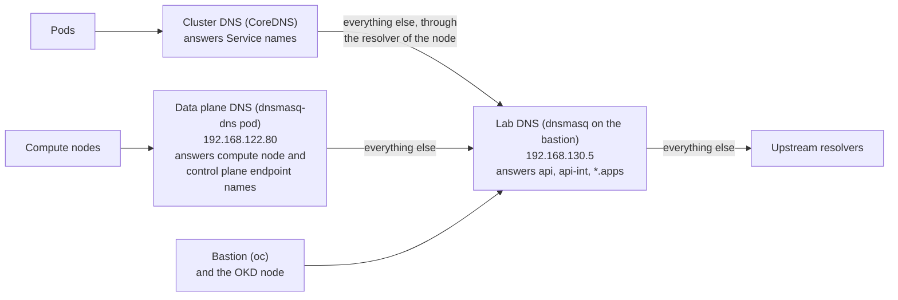

# DNS and routing problems

> Status: partially validated on the lab — validated on 2026-11-11 (OKD 4.22.0-okd-scos.10, operators 18-stable) for every read-only command and the dnsmasq stop/start reproduction; `scripts/bastion/01-setup-bastion.sh` was not re-run, and the failure patterns of scenarios B, C and D other than a stopped lab DNS were not provoked

## In short

- Three DNS services exist: the lab DNS on the bastion, the cluster DNS
  for pods, and the data plane DNS for compute nodes. Find which one the
  failing client uses before anything else.
- The lab DNS on the bastion is a single point of failure: without it
  `oc` fails with "connection refused", which looks like an API fault.
- A Route that answers 503 has no ready pod behind it: it is a pod
  fault, not a network fault.
- On a compute node use `getent hosts`; a Service name that resolves
  while an external name does not puts the fault behind the data plane
  DNS.

Three different DNS services exist in the lab. Mixing them up is the usual
source of confusion.

| DNS | Runs on | Serves | Used by |
|-----|---------|--------|---------|
| Lab DNS (dnsmasq) | The bastion, 192.168.130.5 | `api`, `api-int`, `*.apps` of the cluster; forwards everything else upstream | The bastion (`oc`), the OKD node, and through forwarding the compute nodes |
| Cluster DNS (CoreDNS) | Pods in `openshift-dns` | Service names such as `keystone-internal.openstack.svc` | Pods |
| Data plane DNS (`dnsmasq-dns` Deployment) | A pod, exposed on 192.168.122.80 | Names of compute nodes and control plane endpoints; forwards the rest to the lab DNS | Compute nodes |

Public OpenStack endpoints are Routes: names under `*.apps.<cluster domain>`
that all resolve to the OKD node, where the ingress router picks the backend
from the host name.

Who asks whom; a break anywhere on a path gives the same symptom at its
start:



## Scenario A: the lab DNS is down or wrong

### 1. Initial symptoms

- On the bastion, `oc` fails with `The connection to the server
  api.<cluster domain>:6443 was refused - did you specify the right host or
  port?` (observed with dnsmasq stopped), or with `dial tcp: lookup
  api.<cluster domain>: no such host`. The first message looks like an API
  server fault; it is a DNS fault when `curl` cannot resolve the name
  either.
- The OpenStack CLI in the client pod works for internal calls but any
  public endpoint fails to resolve.
- On the node, image pulls fail with `no such host`; new pods stay in
  `ImagePullBackOff`.
- Compute nodes cannot resolve external names (package installation fails
  during a data plane deployment).

### 2. Read-only investigation

On the bastion:

**[READ-ONLY]**

```bash
source lab.env; domain="${CLUSTER_NAME}.${BASE_DOMAIN}"
systemctl status dnsmasq --no-pager
sudo ss -lntup | grep ':53 '
cat /etc/resolv.conf
cat /etc/dnsmasq.d/okd-lab.conf
dig +short api.${domain} @127.0.0.1
dig +short api-int.${domain} @127.0.0.1
dig +short anything.apps.${domain} @127.0.0.1
dig +short quay.io @127.0.0.1
dig +short quay.io @1.1.1.1
sudo journalctl -u dnsmasq --since "30 min ago" --no-pager | tail -20
```

### 3. Expected observations

- dnsmasq is `active (running)` and listens on 127.0.0.1 and 192.168.130.5
  (UDP and TCP port 53). A systemd drop-in
  (`/etc/systemd/system/dnsmasq.service.d/okd-lab.conf`) is listed in the
  status output.
- `/etc/resolv.conf` on the bastion lists `nameserver 127.0.0.1` only.
- `/etc/dnsmasq.d/okd-lab.conf` holds `listen-address`, `bind-interfaces`,
  `no-resolv`, `domain-needed`, one `server=` line per upstream resolver,
  three `host-record` lines (`api`, `api-int` and the node name) and one
  `address=/apps.<cluster domain>/192.168.130.10` line for the wildcard.
- The three cluster names return 192.168.130.10; `quay.io` returns public
  addresses through both resolvers (the direct query to a public resolver
  only works where the host cloud allows outbound DNS).

Failure patterns:

| Observation | Cause |
|-------------|-------|
| dnsmasq inactive or failed | Service stopped, or a syntax error in its configuration |
| Cluster names fail, external names work | The lab records are missing or `resolv.conf` no longer points at 127.0.0.1 (overwritten by DHCP) |
| Cluster names work, external names fail | The upstream resolvers are unreachable from the bastion |
| Everything works on the bastion but not from the node | Port 53 on 192.168.130.5 is not reachable: dnsmasq bound to loopback only, or a firewall |

### 4. Root cause

The cluster cannot provide its own bootstrap names: the API name must
resolve before any pod runs. With `platform: none` that DNS is yours to run,
and in the lab it is a single dnsmasq on the bastion. It is therefore a
single point of failure for name resolution of the whole lab, including the
node's ability to pull images. Running pods are unaffected for a while,
which delays the symptoms.

### 5. Resolution

Re-run the bastion setup; it rewrites the configuration, restarts dnsmasq,
resets the resolver and verifies the answers.

**[CHANGE]**

```bash
scripts/bastion/01-setup-bastion.sh
```

Or only restart the service:

**[CHANGE]**

```bash
sudo dnsmasq --test && sudo systemctl restart dnsmasq
```

### 6. Verification

**[READ-ONLY]**

```bash
dig +short api.${domain} console-openshift-console.apps.${domain} quay.io
oc whoami
oc get nodes
```

### 7. Risks and precautions

- Do not point the bastion at a public resolver "temporarily": `oc` stops
  working immediately.
- Changing the cluster domain or the node address after installation is not
  supported by a simple DNS change; it means reinstalling the cluster.

### Reproduce it in the lab

**[CHANGE]** `oc` stops working from the bastion; the cluster keeps running.

```bash
sudo systemctl stop dnsmasq
oc get nodes
ssh -i .work/dataplane-ssh-key cloud-admin@192.168.122.100 'getent hosts quay.io || echo "no answer"'
sudo systemctl start dnsmasq
oc get nodes
```

Observed on the lab: `oc get nodes` fails at once with "The connection to
the server api.<cluster domain>:6443 was refused"; `curl` to a Route
reports HTTP code `000`; the compute node no longer resolves external names
(its resolver chain ends on the bastion). Pods keep running and the control
plane stays `True`. Everything works again in the second dnsmasq is
started; nothing has to be restarted. The CoreDNS log keeps a trace of the
outage (`read udp ...->192.168.130.5:53: i/o timeout`).

## Scenario B: a Route or public endpoint does not answer

### 1. Initial symptoms

- `openstack` commands from a client outside the cluster fail with a
  connection error or HTTP 503 on a `*.apps` URL.
- The console or Horizon shows "Application is not available".

### 2. Read-only investigation

**[READ-ONLY]**

```bash
oc get routes
oc get route keystone-public -o jsonpath='{.spec.host}{"\n"}{.spec.tls.termination}{"\n"}{.status.ingress[0].conditions}{"\n"}'
host=$(oc get route keystone-public -o jsonpath='{.spec.host}')
dig +short ${host}
curl -sk -o /dev/null -w '%{http_code}\n' https://${host}/v3
oc get svc keystone-public
oc get endpointslices -l kubernetes.io/service-name=keystone-public
oc get pods -l service=keystone
oc -n openshift-ingress get pods
oc get clusteroperator ingress
oc rsh openstackclient openstack endpoint list --interface public
```

### 3. Expected observations

On a healthy lab: six Routes (`keystone-public`, `glance-default-public`,
`neutron-public`, `nova-public`, `nova-novncproxy-cell1-public`,
`placement-public`), all with `reencrypt` termination and HTTP redirected to
HTTPS. The host name is `<route>-openstack.apps.<cluster domain>`, it
resolves to 192.168.130.10, the Route is `Admitted`, `curl` prints `200`,
and the public endpoint list shows the same host names (Nova with a `/v2.1`
suffix). The router is one `router-default-...` pod in `openshift-ingress`.

Follow the chain name, router, Route, Service, endpoints, pod:

| Observation | Cause |
|-------------|-------|
| The name does not resolve | Lab DNS (scenario A) |
| Connection refused or timeout on 443 | Ingress router pods not running, or the node is unreachable |
| HTTP 503 from the router | The Route exists but its Service has no ready endpoint: the pod is not ready |
| The Route does not exist | `apiOverride.route` is missing for that service, or `...Expose<Service>Ready` is `False` |
| The Route works but the catalog URL differs | The Keystone endpoint was changed by hand, or the operator has not reconciled it yet |

### 4. Root cause

A Route is only a rule in the ingress router. It answers 503 when nothing
healthy stands behind it, which makes "the URL is broken" look like a network
fault when it is a pod fault. The public URL in the Keystone catalog is
derived from the Route by the operator.

### 5. Resolution

Fix the first broken link of the chain: the pod
([runbook](pod-pending-or-crashloop.md)), the exposure
([runbook](reconciliation-not-progressing.md)), or the ingress operator
([node and OKD](node-and-okd.md)).

### 6. Verification

**[READ-ONLY]**

```bash
curl -sk -o /dev/null -w '%{http_code}\n' https://${host}/v3      # 200
oc rsh openstackclient openstack --os-interface public token issue
```

### 7. Risks and precautions

- Do not create Routes by hand for OpenStack services: the operator owns
  them and the Keystone catalog would not match.

## Scenario C: names fail inside pods

### 1. Initial symptoms

- A service log shows `Name or service not known` for another service, for
  example `keystone-internal.openstack.svc`.
- Several unrelated pods fail readiness at the same time.

### 2. Read-only investigation

**[READ-ONLY]**

```bash
oc get clusteroperator dns
oc -n openshift-dns get pods -o wide
oc rsh openstackclient getent hosts keystone-internal.openstack.svc
oc rsh openstackclient getent hosts quay.io
oc rsh openstackclient cat /etc/resolv.conf
oc get svc keystone-internal
```

### 3. Expected observations

- The `dns` cluster operator is `Available`; `openshift-dns` has one
  `dns-default-...` pod (`2/2`) and one `node-resolver-...` pod.
- Service names resolve to the Service cluster IP (the answer shows the full
  name, `keystone-internal.openstack.svc.cluster.local`); external names
  resolve through the node's resolver, which is the lab DNS.
- The pod's `resolv.conf` names 172.30.0.10 (the CoreDNS Service) with
  `options ndots:5`.
- `oc get svc keystone-internal` shows two addresses: the cluster IP that
  pods use, and the MetalLB address 172.17.0.80 that compute nodes use.

### 4. Root cause

Pods resolve through CoreDNS, which answers for cluster names itself and
forwards the rest to the resolver configured on the node (the bastion). If
CoreDNS is down, nothing resolves; if only the lab DNS is down, cluster
names still work and external ones fail.

### 5. Resolution

CoreDNS is an OKD component managed by its own operator: check the node
first ([node and OKD](node-and-okd.md)), then the operator.

**[READ-ONLY]**

```bash
oc describe clusteroperator dns | sed -n '/Conditions:/,/Extension:/p'
oc -n openshift-dns logs daemonset/dns-default -c dns --tail=30
```

### 6. Verification

**[READ-ONLY]**

```bash
oc rsh openstackclient getent hosts keystone-internal.openstack.svc
oc get openstackcontrolplane openstack
```

### 7. Risks and precautions

- Do not edit the CoreDNS ConfigMap; it is generated by the DNS operator.

## Scenario D: compute nodes cannot resolve

### 1. Initial symptoms

- A data plane deployment fails on package or image download with a name
  resolution error.
- On the compute node, `getent hosts` fails for control plane names.

### 2. Read-only investigation

**[READ-ONLY]**

```bash
oc get dnsmasq
oc get pods -l service=dnsmasq
oc get svc | grep -i dnsmasq
oc get dnsdata
oc get oscp openstack -o jsonpath='{.spec.dns.template.options}{"\n"}'
ssh -i .work/dataplane-ssh-key cloud-admin@192.168.122.100 'cat /etc/resolv.conf; getent hosts quay.io; getent hosts keystone-internal.openstack.svc; ip route'
```

`dig`, `host` and `nslookup` are not installed on the compute node: use
`getent hosts`, which goes through the configured resolver.

### 3. Expected observations

- `oc get dnsmasq` lists one resource, `dns`. The `dnsmasq-dns-...` pod runs
  and its Service `dnsmasq-dns` has the external IP 192.168.122.80 (port 53,
  UDP and TCP).
- `oc get dnsdata` lists the record sets the operators publish: `dns-svc`
  (control plane Services), `openstack-edpm` (the compute nodes),
  `ovsdbserver-nb` and `ovsdbserver-sb`.
- After the `configure-network` service has run, the compute node's
  `resolv.conf` names 192.168.122.80 and searches the `ctlplane`,
  `internalapi` and `tenant` sub-domains. Before that it uses the resolvers
  handed out by the host cloud at first boot.
- The DNS options are `server` = the bastion (192.168.130.5), which the pod
  reaches through the node and the lab router, and `local` =
  `/openstack.svc/`, so that Service names are answered from the published
  records. On the compute node `keystone-internal.openstack.svc` resolves to
  172.17.0.80, the MetalLB address, not to the cluster IP that pods get.

### 4. Root cause

Compute nodes use a chain of three resolvers: the data plane dnsmasq pod,
which forwards to the lab DNS on the bastion, which forwards upstream. A
break anywhere gives the same symptom on the node. The first link also
depends on MetalLB ([network runbook](network.md), scenario A and C).

### 5. Resolution

Test each link from the node outward, and fix the first that fails:

**[READ-ONLY]**

```bash
# On the compute node: the whole chain, then the first link only.
getent hosts quay.io
getent hosts keystone-internal.openstack.svc

# On the bastion: the lab DNS and its upstream.
dig +short quay.io @192.168.130.5
```

If the Service name resolves on the compute node and the external name does
not, the data plane DNS pod works and the fault is behind it: the lab DNS or
its upstream (scenario A).

### 6. Verification

**[READ-ONLY]**

```bash
ssh -i .work/dataplane-ssh-key cloud-admin@192.168.122.100 'getent hosts quay.io'
```

### 7. Risks and precautions

- Do not hard-code resolvers in `/etc/resolv.conf` on a compute node: the
  next data plane deployment rewrites the network configuration.
