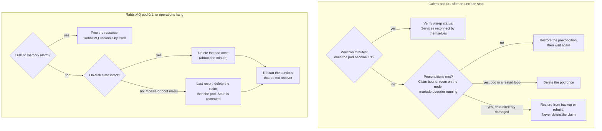

# Galera and RabbitMQ

> Status: partially validated on the lab — validated on 2026-11-11 (OKD 4.22.0-okd-scos.10, operators 18-stable) for every read-only command, the unclean stop and the clean restart of Galera, the restart of RabbitMQ and the reset of a RabbitMQ volume (executed on `rabbitmq-cell1`); the stuck-recovery and damaged-data cases of both tables were not provoked, because they would risk an unrecoverable lab

## In short

- Galera recovers by itself after an unclean stop: the mariadb operator
  picks the replica to bootstrap. The first action is to wait two
  minutes and watch (17 to 20 s on the lab).
- Recovery needs every Galera pod running and the mariadb operator
  running. If one is missing, restore that, not the database.
- Never delete the Galera claim, edit `grastate.dat` or force-delete the
  pod. The claim is the database.
- RabbitMQ holds nothing OpenStack cannot recreate: resetting its volume
  is a valid last resort. It is never one for Galera.
- A message naming Nova or a database may hide a RabbitMQ outage: check
  `oc get rabbitmq` and the pods first.

The database and the message bus are the two services where the Kolla
experience transfers most directly (`mariadb_recovery`, a RabbitMQ that will
not rejoin) and where the operator model changes the procedure most: the
recovery logic is built into the mariadb operator, and the main skill is to
let it work and to recognise when it cannot.

The lab runs two Galera servers (`openstack` for the API databases,
`openstack-cell1` for the Nova cell) and two RabbitMQ servers (`rabbitmq`,
`rabbitmq-cell1`), each with one replica and one PersistentVolume.

Recovery decisions for both services, as detailed in the two scenarios:



## Scenario A: Galera pod not ready after an unclean stop

### 1. Initial symptoms

- After a node crash, forced power-off or disk-full event,
  `openstack-galera-0` or `openstack-cell1-galera-0` is `Running` but `0/1`.
- `OpenStackControlPlaneMariaDBReady` is `False`; every API returns 500 or
  cannot start; most service conditions show `DBReady` waiting.

### 2. Read-only investigation

**[READ-ONLY]**

```bash
oc get galera
oc get pods -l app=galera -o wide
oc get galera openstack -o json | jq '.status | {bootstrapped, safeToBootstrap, stopRequired, attributes, conditions: [.conditions[] | select(.status != "True") | {type, reason, message}]}'
oc logs openstack-galera-0 -c galera --tail=60
oc logs openstack-galera-0 -c galera --previous --tail=60   # error if the container never restarted
oc describe pod openstack-galera-0 | sed -n '/^Events:/,$p'
oc -n openstack-operators logs deployment/mariadb-operator-controller-manager --since=15m | grep -i 'galera\|bootstrap\|seqno\|gcomm' | tail -30
oc get pvc | grep mysql-db

# State files of the database, inside the pod.
oc exec openstack-galera-0 -c galera -- cat /var/lib/mysql/grastate.dat
oc exec openstack-galera-0 -c galera -- ls -la /var/lib/mysql | head -30
oc exec openstack-galera-0 -c galera -- bash -c 'pgrep -a mysqld || pgrep -af detect_gcomm'
```

### 3. Expected observations

On a healthy lab:

- `oc get galera` lists `openstack` and `openstack-cell1`, both `True`,
  "Setup complete". The status shows `bootstrapped: true`; `attributes` and
  `safeToBootstrap` are empty (they are only filled during a bootstrap).
- The pods carry the labels `app=galera` and `galera/name=<name>`; each has
  one container, `galera`, and one init container, `mysql-bootstrap`.
- The last command prints `/usr/libexec/mysqld
  --wsrep-cluster-address=gcomm://`: the server was started with an empty
  cluster address, which means "form a new cluster from my own data".
- `grastate.dat` shows `seqno: -1` and `safe_to_bootstrap: 1`. A sequence
  number of -1 is normal while the server runs; the real value is written
  at clean shutdown.
- The probes are scripts provided by the operator
  (`/var/lib/operator-scripts/mysql_probe.sh`), next to the start-up script
  `detect_gcomm_and_start.sh`.

Start sequence, as designed by the operator:

1. The pod starts and its entry script (`detect_gcomm_and_start.sh`)
   **waits**; it does not start `mysqld` by itself.
2. The operator inspects each pod and records its last committed sequence
   number (`seqno`) in `status.attributes`.
3. When all replicas have reported, the operator picks the one with the
   highest `seqno`, gives that pod its cluster address (an empty `gcomm://`
   to bootstrap), and the script starts `mysqld`.
4. Other replicas, if any, then join. `status.bootstrapped` becomes `true`
   and the pod turns `1/1`.

Measured on the lab with one replica: 17 to 20 seconds from the deletion of
the pod to `1/1`, and 9 seconds after a `kill -9` of `mysqld` (see the
reproduction below). During that time the `Galera` resource shows `Unknown`,
"Deployment not started", then "Setup started", then `True`. At the default
log level the operator log shows nothing specific about the bootstrap, only
its usual "StatefulSet openstack-galera - updated" lines: follow the
resource status and the pod log instead.

What a stuck recovery looks like:

| Observation | Meaning |
|-------------|---------|
| Pod `Pending` | Its PVC cannot bind or the node has no room: [storage](storage.md), [resources](resource-exhaustion.md). The operator waits for all replicas before bootstrapping. |
| Pod waiting, no `attributes` in status, operator log shows errors retrieving the seqno | The operator cannot exec into the pod or the state files are unreadable |
| `mysqld` starts then exits; log shows InnoDB corruption or `No space left` | Data directory damaged or disk full |
| Operator pod not running | Nobody is there to give the go-ahead: the database will wait forever |
| `1/1` but services still fail | Not a Galera problem any more: restart the dependent services or check their `DBReady` condition |

### 4. Root cause

A Galera node that stopped uncleanly does not know whether its data is the
most recent in the cluster, so it refuses to form a cluster on its own
(`safe_to_bootstrap: 0` in `grastate.dat`). In Kolla you run
`kolla-ansible mariadb_recovery`, which compares sequence numbers across
hosts and bootstraps from the best one. The mariadb operator implements the
same decision as part of reconciliation, every time all pods are down. It is
automatic, but it has preconditions: every replica must be running and
inspectable, and the operator must be running.

### 5. Resolution

First, do nothing for two minutes and watch. The most common "fix" is to
stop interfering.

**[READ-ONLY]**

```bash
oc get pods -l app=galera -w
```

If a precondition is missing, restore it: free a volume, free memory, bring
the mariadb operator back.

**[READ-ONLY]**

```bash
oc -n openstack-operators get pods | grep -i mariadb
```

If the pod is stuck in a restart loop after a clean precondition check,
restart it once, cleanly, so the sequence starts over:

**[CHANGE]**

```bash
oc delete pod openstack-galera-0
```

If the data directory is damaged beyond what MariaDB recovers by itself, the
remaining options are a restore from backup or a rebuild of the database
(which for the lab means redeploying the control plane on clean volumes).
Both are described in
[backup and restore](../lifecycle/05-backup-and-restore.md); neither should
be improvised.

Once Galera is `1/1`, services reconnect by themselves. If one keeps failing
with stale connections, restart that service
([guide](../operations/03-restart-a-service.md)).

### 6. Verification

**[READ-ONLY]**

```bash
oc get galera                                   # both True
oc get pods -l app=galera                       # 1/1
oc exec openstack-galera-0 -c galera -- mysql -uroot -e "SHOW STATUS WHERE Variable_name IN ('wsrep_cluster_status','wsrep_local_state_comment','wsrep_cluster_size','wsrep_ready')"
oc get openstackcontrolplane openstack
oc rsh openstackclient openstack token issue
```

Expected: `Primary`, `Synced`, cluster size `1`, ready `ON`.

The `mysql` client needs no password option inside the container: the
operator provides a client configuration that holds the root password. The
container has no environment variable with the password, so
`-p"${DB_ROOT_PASSWORD}"` fails with "Access denied (using password: NO)".
For the same reason, do not run `mysql --print-defaults` in a shared
terminal: it prints the password. The password itself is the
`DbRootPassword` key of `osp-secret`.

The same client lists what the server holds:

**[READ-ONLY]**

```bash
oc exec openstack-galera-0 -c galera -- mysql -uroot -e "SHOW DATABASES; SELECT user, host FROM mysql.user;"
```

On the lab: the databases `keystone`, `glance`, `neutron`, `placement`,
`nova_api` and `nova_cell0`, and one user per service with a random suffix
(`keystone_c5dc`), as declared by the `MariaDBAccount` resources.

### 7. Risks and precautions

What never to do:

- **Never delete the PVC** (`mysql-db-openstack-galera-0`). It is the
  database.
- **Never edit `grastate.dat` or write `gcomm_uri` by hand** unless you are
  following a documented manual recovery with the operator stopped. You and
  the operator would both be steering the bootstrap.
- **Never use `--force --grace-period=0`** on a Galera pod.
- **Never scale Galera** up or down as a recovery attempt.
- Do not delete the `Galera` resource: it owns the StatefulSet and, through
  it, the claim template.

A single-replica Galera has no redundancy. The only protection for the data
is a backup taken before the incident.

### Reproduce it in the lab

An unclean stop of the database container, as a node crash would cause. The
data is normally intact; the point is to watch the operator decide.

**[CHANGE]** Interrupts all OpenStack APIs until recovery completes.

```bash
oc exec openstack-galera-0 -c galera -- bash -c 'kill -9 $(pgrep -x mysqld)'
oc get pods -l app=galera -w
oc get galera -w
```

Observed on the lab:

- This is a container restart, not a new pod: the pod shows `0/1 Error`,
  then `Running` with `RESTARTS 1` within three seconds, and `1/1` nine
  seconds after the kill. The init container does not run again.
  `oc describe pod` shows `Last State: Terminated`, `Reason: Error`,
  `Exit Code: 137`.
- The new container log starts with `Running command:
  '/usr/local/bin/detect_gcomm_and_start.sh'`: the same start sequence as
  for a new pod.
- The `Galera` resource passes through `Unknown` and returns to `True`. The
  control plane resource stays `True` the whole time: the outage is too
  short for the service operators to report it.
- Keystone answers HTTP 500 for about six seconds. No dependent service has
  to be restarted.
- The data is intact. `grastate.dat` shows a new cluster `uuid`: a
  single-replica server forms a new cluster at each start.

The smoke test passes afterwards without any other action.

## Scenario B: RabbitMQ not ready

### 1. Initial symptoms

- `rabbitmq-server-0` or `rabbitmq-cell1-server-0` is `0/1` or restarting.
- `OpenStackControlPlaneRabbitMQReady` is `False`.
- Nova, Neutron and others log `AMQP server ... is unreachable`; operations
  hang instead of failing (instance stuck in `BUILD`, agent `down`).

### 2. Read-only investigation

**[READ-ONLY]**

```bash
oc api-resources --api-group=rabbitmq.openstack.org
oc get statefulset rabbitmq-server rabbitmq-cell1-server
oc get pods | grep rabbitmq
oc describe pod rabbitmq-server-0 | sed -n '/^Events:/,$p'
oc logs rabbitmq-server-0 --tail=60
oc logs rabbitmq-server-0 --previous --tail=60
oc get pvc | grep persistence
oc get svc | grep rabbitmq
oc exec rabbitmq-server-0 -- rabbitmq-diagnostics ping
oc exec rabbitmq-server-0 -- rabbitmqctl cluster_status
oc exec rabbitmq-server-0 -- rabbitmqctl list_queues name messages consumers | sort -k2 -n | tail
oc exec rabbitmq-server-0 -- rabbitmq-diagnostics check_local_alarms
oc get transporturl
```

`oc exec` prints `Defaulted container "rabbitmq" out of: rabbitmq,
setup-container (init)`: that line is informational.

### 3. Expected observations

- The API group `rabbitmq.openstack.org` provides `RabbitMq` (the two
  servers: `oc get rabbitmq`), `TransportURL`, and `RabbitMQUser`,
  `RabbitMQVhost` and `RabbitMQPolicy` (none of the last three exists on the
  lab). There is no `RabbitmqCluster` resource on this version.
- Healthy: the pod is `1/1`, `ping` succeeds, the cluster has one running
  node (`rabbit@rabbitmq-server-0.rabbitmq-nodes.openstack`), no alarm, and
  each Service of type LoadBalancer has its address (`rabbitmq` on
  172.17.0.85 and `rabbitmq-cell1` on 172.17.0.86, ports 5671, 15671 and
  15691). Two headless Services, `rabbitmq-nodes` and
  `rabbitmq-cell1-nodes`, serve the node names.
- Each server has a single user, `default_user_<name>`, with full
  permissions on the vhost `/`. Its credentials are in the Secret
  `<name>-default-user`, and every `TransportURL` uses it.
- Named queues are quorum queues (durable); reply and fanout queues are
  classic.
- `notifications.info` and `barbican_notifications.info` hold a growing
  number of messages with zero consumers. On this lab that is normal: the
  services that would read them (telemetry, Barbican) are not enabled.

| Observation | Cause |
|-------------|-------|
| Pod `Pending` | Volume or resources: RabbitMQ requests 1 CPU and 2Gi per instance |
| Log: `disk_free_limit` or memory alarm, publishers blocked | Node disk or memory exhausted: [storage](storage.md), [resources](resource-exhaustion.md) |
| Log: Mnesia or boot errors after an unclean stop | Damaged on-disk state |
| Pod `1/1`, but compute nodes cannot connect | Not RabbitMQ: the MetalLB address or the network path ([network](network.md), scenario C) |
| Pod `1/1`, control plane services cannot connect | Credentials or TLS: check the `TransportURL` resources and certificates |
| Queues other than the notification queues with messages and zero consumers | The consumer service is down; RabbitMQ is the messenger, not the cause |

### 4. Root cause

RabbitMQ is run by the infra operator as a StatefulSet named
`<name>-server`. A single node has no cluster partition problems; what
remains is resource alarms (RabbitMQ blocks publishers when disk or memory
is low, which looks like a hang), on-disk state damaged by an unclean stop,
and reachability from outside the cluster through MetalLB.

OpenStack services reconnect by themselves when RabbitMQ returns. Observed
on the lab after a restart of `rabbitmq-cell1`: the Nova conductor logs
`AMQP server on rabbitmq-cell1.openstack.svc:5671 is unreachable: [Errno
111] ECONNREFUSED` (the compute node logs `EHOSTUNREACH`), then
`Reconnected`, and no service had to be restarted. That is not guaranteed
after a longer incident: oslo.messaging reply queues can stay stale, and a
service may need a restart, as in any deployment.

While a RabbitMQ pod is away the control plane resource is `False` with a
message that does not name RabbitMQ, for example "Nova: NovaCell creation
waits for DB creation for cell1". Check `oc get rabbitmq` and the pods
before believing the message.

### 5. Resolution

Resource alarm: free the resource; RabbitMQ unblocks by itself.

Unhealthy process on intact state: restart once, cleanly.

**[CHANGE]** Every service loses its connection for the duration (about
one minute on the lab: the init container alone takes 35 seconds).

```bash
oc delete pod rabbitmq-server-0
oc get pod rabbitmq-server-0 -w
```

Then restart services that do not recover (conductor, scheduler, Neutron,
and `nova-compute` on the compute node).

Damaged on-disk state: RabbitMQ holds no data OpenStack cannot recreate.
The queues are durable, but the services declare them again when they
reconnect, and the operator creates the user and its permissions again.
Resetting its volume is therefore a valid last resort, unlike for Galera.

Scaling the server to zero first is **not** possible on this version. The
admission webhook refuses it, on the control plane resource and on the
`RabbitMq` resource alike:

```text
The OpenStackControlPlane "openstack" is invalid: spec.rabbitmq.template[rabbitmq-cell1].replicas: Forbidden: scaling down from 1 to 0 replicas is not supported; RabbitMQ requires manual node removal (rabbitmqctl forget_cluster_node) before a node can be safely decommissioned
```

The procedure that works is to mark the claim for deletion, then delete the
pod. The claim is protected while a pod uses it, so the first command only
schedules the deletion (the claim shows `Terminating`); it cannot be taken
back.

**[DESTRUCTIVE]** Deletes all RabbitMQ state of that instance. In-flight RPC
calls are lost; operations in progress (instance builds, migrations) may be
left in an intermediate state and need a manual reset.

```bash
oc delete pvc persistence-rabbitmq-cell1-server-0 --wait=false
oc get pvc persistence-rabbitmq-cell1-server-0          # Terminating, still in use
oc delete pod rabbitmq-cell1-server-0
oc get pods,pvc | grep rabbitmq-cell1
```

Observed on the lab: the StatefulSet reports one `FailedCreate` event ("pvc
... is being deleted"), then creates a new claim and a new pod. The new
claim binds to another free volume, so one `Available` volume is needed. The
pod is `1/1` after about a minute and the control plane is `True` again by
itself. The user and its permissions exist again, the services re-declare
their queues, and `nova-compute` is back `up` without a restart.

The old volume stays `Released` with the old state. Recycle it as described
in [storage](storage.md), scenario B, to make it available again.

### 6. Verification

**[READ-ONLY]**

```bash
oc get pods | grep rabbitmq                    # 1/1
oc exec rabbitmq-server-0 -- rabbitmqctl cluster_status | sed -n '/Running Nodes/,/Versions/p'
oc exec rabbitmq-server-0 -- rabbitmqctl list_connections user peer_host | sort | uniq -c | sort -rn | head
oc exec rabbitmq-server-0 -- rabbitmqctl list_users
oc exec rabbitmq-server-0 -- rabbitmqctl list_permissions
oc get openstackcontrolplane openstack
oc rsh openstackclient openstack compute service list
oc rsh openstackclient openstack network agent list
```

### 7. Risks and precautions

- Do not run `rabbitmqctl reset`, `forget_cluster_node` or add users by hand
  in the pod: the operator owns that state.
- Do not delete both RabbitMQ instances at the same time.
- Deleting a claim cannot be cancelled, even while it waits in
  `Terminating`: the volume is abandoned at the next pod restart, whenever
  that happens. Do not run the first command of the reset "to see".
- A RabbitMQ restart during instance operations leaves resources in
  transitional states. Check `openstack server list --all-projects --status
  BUILD` afterwards.
- Never treat the Galera volume like the RabbitMQ volume. One is disposable,
  the other is not.
