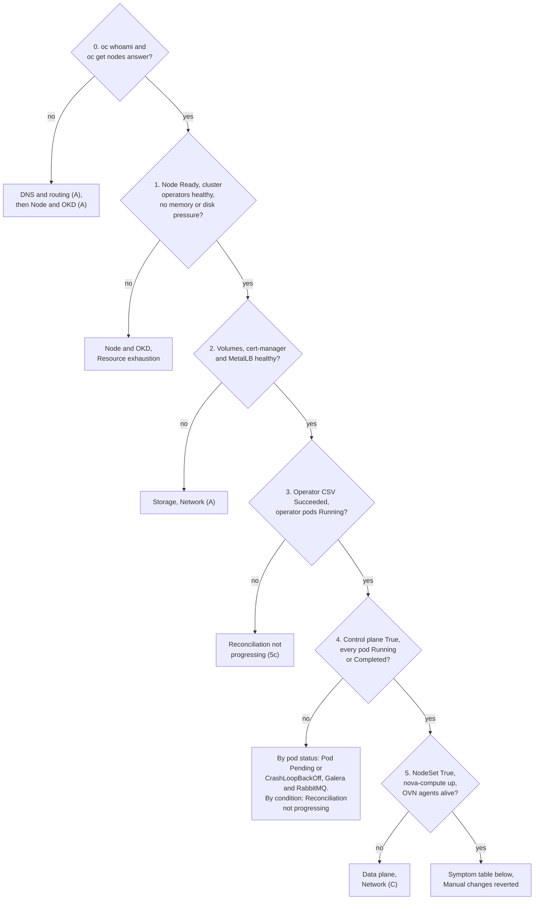

# Troubleshooting runbooks

> Status: validated on the lab (OKD 4.22.0-okd-scos.10, operators 18-stable) on 2026-11-11

These runbooks cover faults that really occur on an operator-managed
OpenStack: none of them is contrived. Each one follows the same seven
sections (initial symptoms, read-only investigation, expected observations,
root cause, resolution, verification, risks and precautions) and labels
every command block **[READ-ONLY]**, **[CHANGE]** or **[DESTRUCTIVE]** as
defined in the [operations guide](../operations/README.md#conventions).
Where useful, a "Reproduce it in the lab" section shows how to create the
fault on purpose.

Commands run on the bastion, in the `openstack` namespace unless a
namespace is given (`oc project openstack`).

## Start here

- **You have a symptom**: look it up in
  [symptom to runbook](#symptom-to-runbook).
- **You do not know where the fault is**: run the
  [triage](#triage-which-layer-is-broken) below, bottom-up, and stop at
  the first layer that is not healthy. The decision tree shows which
  runbook each failed check leads to.
- **Before any fix**: read
  [before you change anything](#before-you-change-anything).
- **You want to understand normal behaviour first**: the
  [operations knowledge base](../knowledge-base/README.md) records what a
  healthy lab answers, task by task.

## Runbooks

| Runbook | Scenarios | Use it when |
|---------|-----------|-------------|
| [Node and OKD](node-and-okd.md) | A node `NotReady`, B planned node reboot, C degraded cluster operator | `oc` does not answer, the node is not `Ready`, or you plan a reboot |
| [Resource exhaustion](resource-exhaustion.md) | one | Pods are `Evicted` or `OOMKilled`, or `Pending` for lack of memory |
| [Storage](storage.md) | A claim `Pending`, B volume `Released`, C node disk full | A stateful pod has no volume, or the disk fills |
| [Network](network.md) | A LoadBalancer without address, B pod stuck in `ContainerCreating`, C compute node cannot reach the control plane, D MTU | A MetalLB address, a network attachment or a path between nodes fails |
| [DNS and routing](dns-and-routing.md) | A lab DNS down, B Route does not answer, C names fail in pods, D compute nodes cannot resolve | A name does not resolve or a public URL does not answer |
| [Pod Pending or CrashLoopBackOff](pod-pending-or-crashloop.md) | A `Pending`, B `CrashLoopBackOff`, C `ImagePullBackOff` | One pod does not start |
| [Reconciliation not progressing](reconciliation-not-progressing.md) | one | The control plane or a service resource stays `False` |
| [Manual changes reverted](manual-changes-reverted.md) | one | An edit disappeared or a deleted object came back |
| [Galera and RabbitMQ](galera-and-rabbitmq.md) | A Galera not ready, B RabbitMQ not ready | APIs return 500 or hang, a database or broker pod is `0/1` |
| [Data plane](dataplane.md) | A deployment failed, B SSH or key problem, C `nova-compute` down, D no nested virtualization | An Ansible run failed or the compute node misbehaves |

Suggested reading order:

- **30 minutes**: this page, then
  [Reconciliation not progressing](reconciliation-not-progressing.md) and
  [Manual changes reverted](manual-changes-reverted.md). These two
  explain how operators behave, which every other runbook relies on.
- **Half a day**: the runbooks bottom-up, in the order of the triage
  (node, resources, storage, network, DNS, pods, reconciliation,
  databases and message bus, data plane), replaying the "Reproduce it in
  the lab" sections where they exist (Galera, lab DNS, `nova-compute`,
  crash loop, reconciliation, manual changes).

## Triage: which layer is broken?

A fault in a lower layer shows up as symptoms in every layer above it, so
always check bottom-up. Stop at the first layer that is not healthy.

Where to look first, following the numbered checks of the command block
below:



**[READ-ONLY]**

```bash
# 0. Can you reach the cluster at all?
oc whoami && oc get nodes

# 1. OKD: node and platform operators.
oc get nodes
oc get clusteroperators | awk 'NR==1 || $3!="True" || $5!="False"'
oc adm top node

# 2. Platform services OpenStack depends on.
oc get pv
oc -n cert-manager get pods
oc -n metallb-system get pods

# 3. OpenStack operators.
oc -n openstack-operators get csv
oc -n openstack-operators get pods | grep -v Running

# 4. Control plane: conditions, then pods.
oc get openstackcontrolplane openstack
oc get oscp openstack -o json | jq -r '.status.conditions[] | select(.status != "True") | "\(.type): \(.reason) - \(.message)"'
oc get pods --field-selector=status.phase!=Running,status.phase!=Succeeded

# 5. Data plane.
oc get openstackdataplanenodeset,openstackdataplanedeployment
oc rsh openstackclient openstack compute service list
oc rsh openstackclient openstack network agent list
```

`tests/smoke-test.sh` runs an equivalent sequence, prints PASS, FAIL or SKIP
per check and ends with `0 check(s) failed` on a healthy lab.

What a healthy lab answers:

- `oc whoami` prints `system:admin` (the bastion uses the installer
  kubeconfig); the node is `Ready`.
- The cluster operator filter prints only its header line.
- Twelve PersistentVolumes, seven of them `Bound` (nine once the two
  backup claims of the backup guide exist, see
  [OKD storage](../knowledge-base/okd-storage.md)); three cert-manager
  pods; one MetalLB `controller` and one `speaker` pod.
- One ClusterServiceVersion, `openstack-operator`, in phase `Succeeded`. The
  operator pod filter shows the header and one `Completed` pod with a long
  generated name: it is the Job that unpacked the operator bundle at
  installation, not a fault.
- The control plane is `True`, "Setup complete"; the condition filter and
  the pod filter print nothing (`No resources found in openstack
  namespace.`).
- The NodeSet and its deployment are `True`; `nova-conductor`,
  `nova-scheduler` and `nova-compute` are `up`; the network agent list
  shows an `OVN Controller Gateway agent` and an `OVN Metadata agent` on the
  compute node, both alive.

## Symptom to runbook

| Symptom | Likely layer | Runbook |
|---------|--------------|---------|
| `oc` cannot resolve or reach `api.<cluster domain>` | Bastion DNS, node | [DNS and routing](dns-and-routing.md), [Node and OKD](node-and-okd.md) |
| Node `NotReady`, many pods `Unknown` or `Terminating` | OKD node | [Node and OKD](node-and-okd.md) |
| Pods `Evicted` or `OOMKilled`, node under memory pressure | Node resources | [Resource exhaustion](resource-exhaustion.md) |
| Pod `Pending` | Scheduling, storage | [Pod Pending or CrashLoopBackOff](pod-pending-or-crashloop.md), [Storage](storage.md) |
| Pod stuck in `ContainerCreating` | Network attachment, volume | [Network](network.md), [Storage](storage.md) |
| Pod in `CrashLoopBackOff` or `Error` | Service configuration, dependency | [Pod Pending or CrashLoopBackOff](pod-pending-or-crashloop.md) |
| Pod in `ImagePullBackOff` | Registry access | [Pod Pending or CrashLoopBackOff](pod-pending-or-crashloop.md) |
| Control plane or a service resource stays `False` | Operator reconciliation | [Reconciliation not progressing](reconciliation-not-progressing.md) |
| A manual edit disappeared, or a deleted object came back | Operator ownership | [Manual changes reverted](manual-changes-reverted.md) |
| PVC `Pending`, PV `Released`, "no space left on device" | Storage | [Storage](storage.md) |
| Service of type LoadBalancer with `<pending>` external IP | MetalLB | [Network](network.md) |
| Compute node cannot reach RabbitMQ, OVN or internal APIs | OpenStack networks | [Network](network.md) |
| Large transfers hang while small requests work | MTU | [Network](network.md) |
| Routes or OpenStack public endpoints do not resolve | DNS | [DNS and routing](dns-and-routing.md) |
| Galera or RabbitMQ pod `0/1`, APIs return 500 or time out | Database, message bus | [Galera and RabbitMQ](galera-and-rabbitmq.md) |
| Data plane deployment failed, `nova-compute` down, instances fail to boot | Data plane | [Data plane](dataplane.md) |
| Everything broke after a node reboot | Node, then Galera | [Node and OKD](node-and-okd.md), [Galera and RabbitMQ](galera-and-rabbitmq.md) |
| New instances get no network or no metadata after a restart of the OKD node | OVN agents of the compute node | [Node and OKD](node-and-okd.md), scenario B |
| A compute node is `up` but gets no instance, live migration fails, a router gateway is not taken over | Several compute nodes | [Data plane scale-out, migration and scale-in](../knowledge-base/dataplane-scale-out-and-migration.md) |
| A restore left instances, ports or images inconsistent | Databases versus OVN, Placement and Glance | [Backup and restore drills](../knowledge-base/backup-and-restore-drills.md) |

## Before you change anything

1. Finish the read-only investigation. Most runbooks need only two or three
   commands to identify the cause.
2. Save evidence that a fix would destroy: `oc logs <pod> --previous`,
   `oc describe pod <pod>`, `oc get events --sort-by=.lastTimestamp`.
3. Prefer the fix at the highest level (the `OpenStackControlPlane`
   resource), and apply the [safe change checklist](../operations/09-safe-change-checklist.md).
4. Never start with a **[DESTRUCTIVE]** command. In every runbook they are
   the last resort and say what is lost.
