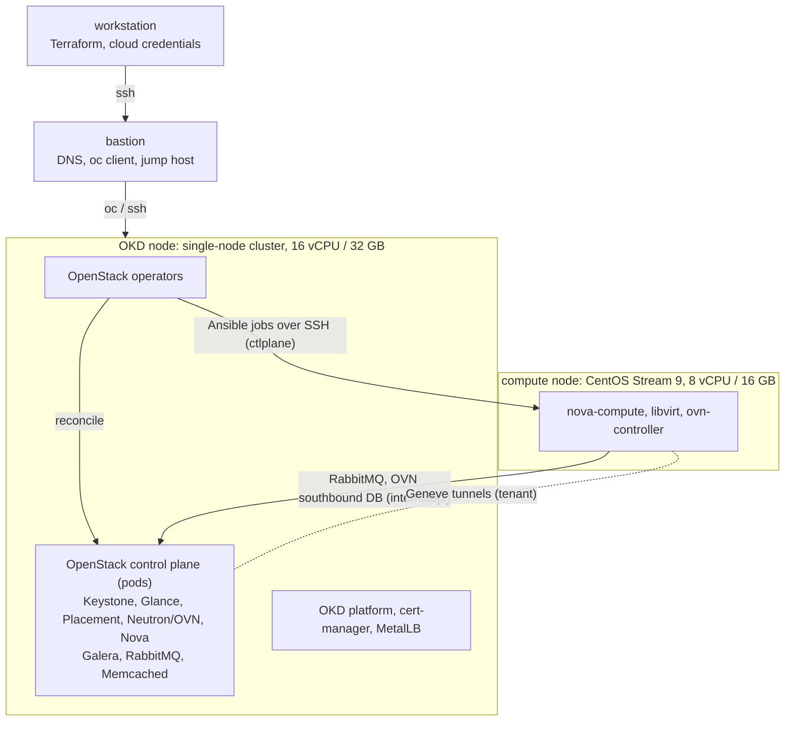

# OKD OpenStack Lab

A reproducible laboratory for learning how OpenStack is deployed, operated
and maintained when its lifecycle is managed by Kubernetes operators
([openstack-k8s-operators](https://github.com/openstack-k8s-operators)) on
[OKD](https://okd.io), the community distribution of Kubernetes that powers
OpenShift.


It is written by and for OpenStack operators who know deployment tools such
as Kolla-Ansible and want to understand the operator-based model: what a
`KeystoneAPI` resource is, why editing a ConfigMap by hand does nothing,
how a configuration change becomes a rolling restart, what an upgrade looks
like, and where to look when something is stuck.

> **Project status: validated end to end on one environment.** In November
> 2026 the lab was deployed from this repository on one host cloud, from
> the Terraform apply to an instance booted on the compute node. The
> operations, troubleshooting and lifecycle guides were then run against
> it, including database and etcd restores and a temporary scale-out to
> three compute nodes. Not exercised: an operator upgrade through OLM (no
> newer bundle was offered), the OKD upgrade, the emulation path. Every
> page carries a status line, and [docs/versions.md](docs/versions.md)
> states precisely what has been tested and what has not.

**New here?** Start with the [reading guide](docs/index.md): it gives a
map of the documentation and three reading paths (one hour, one day, one
week).

> [!NOTE]
> The lab lives in `docs/okd/` of
> ozarland-academy, with its scripts, manifests and Terraform. Clone the repository and run every command of
> these pages from that folder: `git clone https://github.com/OzarLand/ozarland-academy && cd ozarland-academy/docs/okd`.

## What you get

- A **small infrastructure** — three virtual machines in any OpenStack
  cloud project, created with Terraform, using only regular tenant
  permissions.
- A **single-node OKD cluster** installed with the agent-based installer.
- The **OpenStack operators** and a **minimal OpenStack control plane**
  (Keystone, Glance, Placement, Neutron/OVN, Nova, with Galera, RabbitMQ and
  Memcached) running as pods.
- An optional **compute node** configured by the data plane operator, able
  to boot instances (with KVM when nested virtualization is available, with
  emulation otherwise).
- **Documentation that explains** each step, each Kubernetes concept through
  an OpenStack example, and a set of **operational scenarios and runbooks**
  to practise on the running lab.

## Architecture at a glance



Details, sizing rationale and the constraints of running a cloud inside a
cloud: [docs/architecture.md](docs/architecture.md).

## Prerequisites

- A project in an OpenStack cloud with about 26 vCPU, 52 GB RAM and about 255 GB
  of volume storage, a CentOS Stream 9 image, and the right to create
  networks with port security disabled.
- A workstation with Terraform, the OpenStack client, SSH and Python 3.

Full list and pre-flight checks: [docs/prerequisites.md](docs/prerequisites.md).

## Deployment

```bash
# workstation
cp config/lab.env.example lab.env
cp deployment/infrastructure/terraform.tfvars.example deployment/infrastructure/terraform.tfvars
# edit both files, then:
scripts/workstation/create-dataplane-key.sh
terraform -chdir=deployment/infrastructure init
terraform -chdir=deployment/infrastructure apply
scripts/workstation/sync-to-bastion.sh
scripts/workstation/ssh-bastion.sh scripts/bastion/01-setup-bastion.sh
scripts/workstation/ssh-bastion.sh scripts/bastion/02-create-agent-iso.sh
scripts/workstation/boot-okd-node.sh

# bastion (scripts/workstation/ssh-bastion.sh)
scripts/bastion/03-wait-for-okd.sh
scripts/bastion/04-platform-services.sh
scripts/bastion/05-openstack-operators.sh
scripts/bastion/06-openstack-controlplane.sh
scripts/bastion/07-openstack-dataplane.sh
tests/smoke-test.sh --functional
```

Each command is explained — what it deploys, why, how to verify it, what to
check when it fails — in the [installation guide](docs/installation/index.md).

## Documentation

| Section | Content |
|---|---|
| [Reading guide](docs/index.md) | Map of the documentation, reading paths, where to find what |
| [Architecture](docs/architecture.md) | Design, sizing, networks, nested-cloud constraints, alternatives |
| [Prerequisites](docs/prerequisites.md) | Quota, features and pre-flight checks |
| [Versions and status](docs/versions.md) | Selected versions, compatibility reasoning, what is tested, limitations |
| [Installation](docs/installation/index.md) | Seven explained steps from empty project to running cloud |
| [Concepts](docs/concepts/index.md) | Kubernetes, OKD and operators explained to OpenStack operators |
| [Operations](docs/operations/index.md) | Day-2 guide: status, logs, restarts, configuration changes |
| [Troubleshooting](docs/troubleshooting/index.md) | Runbooks by symptom, with fault reproduction |
| [Lifecycle](docs/lifecycle/index.md) | Updates, operator upgrades, backup and restore, OKD maintenance |
| [Knowledge base](docs/knowledge-base/index.md) | Tested answers to day-to-day OpenStack and OKD administration questions, cheat sheet, open questions |
| [Upstream contributions](contributions/index.md) | Method, candidate subjects with evidence and journal for contributing back to the operators and OKD |
| [Publication readiness](docs/publication-readiness.md) | Review of secrets, history, licensing and open points before a public release |

## Learning roadmap


| Phase | Goal | Material |
|---|---|---|
| 1. Understand the architecture | How OKD hosts OpenStack; operators, CRDs, reconciliation | [Architecture](docs/architecture.md), [Concepts](docs/concepts/index.md), installation steps 3–6 |
| 2. Operate OpenStack | Inspect, read logs, restart, reconfigure, troubleshoot | [Operations](docs/operations/index.md), [Troubleshooting](docs/troubleshooting/index.md) |
| 3. Manage the lifecycle | Updates, operator upgrades, backup, rollback limits | [Lifecycle](docs/lifecycle/index.md) |
| 4. Deepen OKD skills | Cluster networking, storage, scheduling, upgrades | [OKD in brief](docs/concepts/07-okd-in-brief.md), [OKD upgrade](docs/lifecycle/07-okd-upgrade.md), [node and OKD runbook](docs/troubleshooting/node-and-okd.md) |

The order is deliberate: the lab keeps the OKD layer minimal so that the
first weeks are spent on OpenStack operations.

## Tested versions and limitations

| Component | Version |
|---|---|
| OKD | 4.22.0-okd-scos.10 (Kubernetes 1.35) |
| OpenStack operators | `18-stable` |
| OpenStack services | 2023.1 Antelope |
| Compute node OS | CentOS Stream 9 |

Validated on one deployment (KVM compute node, behind an HTTPS proxy):

- **Executed successfully:** infrastructure, bastion, OKD installation,
  platform services, operators, control plane, data plane, smoke and
  functional tests; the day-2 operations that do not risk the lab (see the
  status line of each page); a staged minor update of the control
  plane and the data plane (with a simulated newer version); all backup
  procedures; a database restore and an etcd restore; node reboot and
  full shutdown/restart of the lab; scale-out to two and three compute
  nodes and back, with migration and gateway failover.
- **Not executed:** a volume-snapshot rollback, an operator upgrade
  through OLM, the OKD upgrade to 5.0, rotation of the database
  passwords, faults that could leave the lab unrecoverable, the QEMU
  emulation path and the deployment without floating IPs.

The operator catalog is pinned to the digest that was validated; that
digest, the status of every part of the lab and the list of
known limitations are maintained in [docs/versions.md](docs/versions.md).
In short: single node (no high availability), no Cinder/Swift, instances
reachable from inside the lab only.

## Contributing

See [CONTRIBUTING.md](CONTRIBUTING.md). Corrections from operators running
the lab on other clouds are especially welcome.

## Acknowledgements

The control plane, data plane and network manifests are derived from the
samples of the upstream
[openstack-operator](https://github.com/openstack-k8s-operators/openstack-operator)
and [install_yamls](https://github.com/openstack-k8s-operators/install_yamls)
projects (Apache License 2.0). Each derived file names its source.

## License

[Apache License 2.0](https://github.com/OzarLand/ozarland-academy/blob/main/LICENSE).
