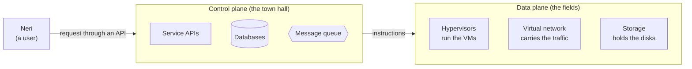

# 1. Why build a village?

*The empty plateau above the sea.*

The plateau is wide, windy and empty. Neri arrives with a small notebook and a simple wish: "I have a little service
to run. I don't want to buy a machine, wait for it, plug it in and look after it alone. I just want a place to run it."

LUMO looks at the empty ground and then at the sea, where ships come and go. One house for Neri would be easy. But
tomorrow someone else will come with another service, and the day after, ten more. Building a house by hand for each
of them would never end.

"What if the village had a town hall," LUMO says, "where anyone can ask for what they need, and the village builds
it for them, on ground it shares?" Neri frowns. "Then someone has to run the town hall." LUMO nods. "And someone has
to keep the fields where the work is done. Two different jobs."

The small lantern gives its first, uncertain light.

> [!IMPORTANT]
> **Where the picture stops.** A cloud is not one village in one place. Its services and its resources can be spread
> over many machines and many networks, in one room or in several data centres. The town hall and the fields are two
> roles, not necessarily two buildings.

## What it is in OpenStack

**OpenStack** is software that turns a set of servers, networks and disks into a **cloud**: people ask for resources
(a virtual machine, a network, a disk) through **services**, each with an **API**, and get them in minutes, without
touching the hardware.

Two words describe the two jobs LUMO saw:

- The **control plane** is the set of services that receive requests, check them, decide and keep records: the town
  hall. Keystone, Nova's API and scheduler, Neutron's server, Glance, Cinder's API, and the database and message queue
  they rely on.
- The **data plane** is where the resources actually run and the traffic actually flows: the fields. The hypervisors
  that run virtual machines, the network nodes and virtual switches that carry their traffic, the storage that holds
  their disks.

Both are functions. In a small lab one server can do both; in production they are usually separated so that a busy
or broken machine does not stop the town hall.

## From the village to OpenStack

A solid arrow is a request or an instruction in the direction shown. The two boxes are roles; one machine can belong
to both.

## See it for real

There is no single command that shows "the cloud". The operator's view is an architecture diagram that says which
machines play which role: controllers, compute nodes, network nodes, storage. The
[Deployment patterns](../deploy/) show several real ones.

**The lantern:** small and almost out. A first glow appears.

**Next:** LUMO decides to have the town hall built before welcoming the first inhabitant.
[2. The town hall takes shape →](02-the-town-hall-takes-shape.md)
