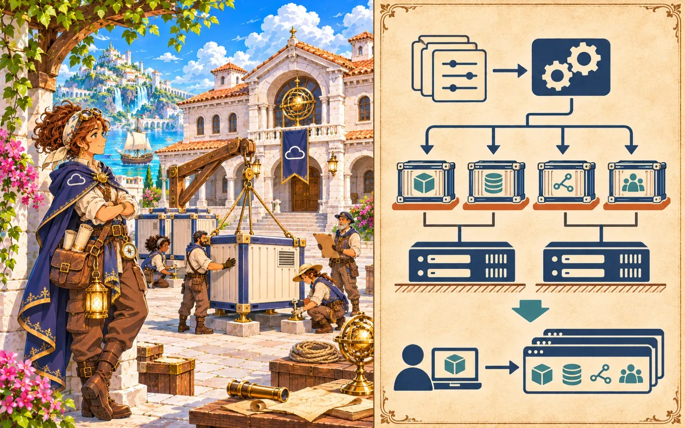
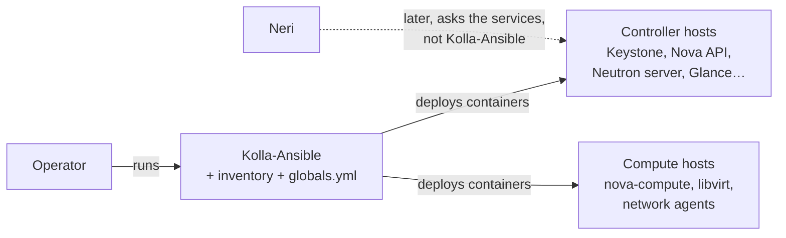

# 2. The town hall takes shape

*The central deployment yard.*


The next morning a crew arrives with crates: all the same size, all labelled the same way, all packed the same way.
Jo, the crew leader, opens one. Inside is everything one service of the town hall needs to work, ready to be set down
on a host.

"We don't build each office by hand," Jo says. "We write down once which service goes on which host and how it is
configured. Then the crew follows the list, the same way every time." LUMO watches the crates go into the hall, one
service after the other: the register, the workshop desk, the network office, the library.


Before the first crate is opened, Jo checks the ground: are the hosts reachable, is there enough room, are the
addresses right? Only then does the crew unpack. When it is done, LUMO walks through the empty offices with the
lantern. Nobody lives in the village yet, but every desk is ready.


> [!IMPORTANT]
> **Where the picture stops.** Kolla-Ansible deploys the services of the cloud. It does not create Neri's machine:
> once the services are running, users ask the services themselves, and Kolla-Ansible is out of the picture until
> the operators change or upgrade the platform.

## What it is in OpenStack

Each OpenStack service is a set of programs (an API, workers, agents) that must be installed, configured and kept
running on the right hosts. **Kolla** packages each of them as a **container image**: the crates. **Kolla-Ansible**
uses Ansible to put those containers on the hosts listed in an **inventory**, with the settings of `globals.yml`.

- The inventory says which host plays which role (controller, compute, network, storage).
- `bootstrap-servers` prepares the hosts, `prechecks` verifies them, `deploy` starts the services.
- The same files describe the platform every time, so it can be rebuilt, changed or upgraded the same way.

Kolla-Ansible is one deployment tool among several. The [OKD OpenStack lab](../okd/) shows another one, where
Kubernetes operators do this job.



## From the village to OpenStack



A dotted arrow is a later, separate interaction: users talk to the deployed services.

## See it for real

On the deployment host, with an inventory called `multinode` (operator work, not something a user runs):

```bash
kolla-ansible bootstrap-servers -i ./multinode
kolla-ansible prechecks -i ./multinode
kolla-ansible deploy -i ./multinode
```

You will run these yourself in the [Quick lab](../lab/), and the [day-2 module](../day2/) explains what each of them
really does.

**The lantern:** the flame steadies and lights the threshold of the town hall.

**Next:** the offices are ready. Now, who is allowed to use them?
[3. The register and the passes →](03-the-register-and-the-passes.md)
