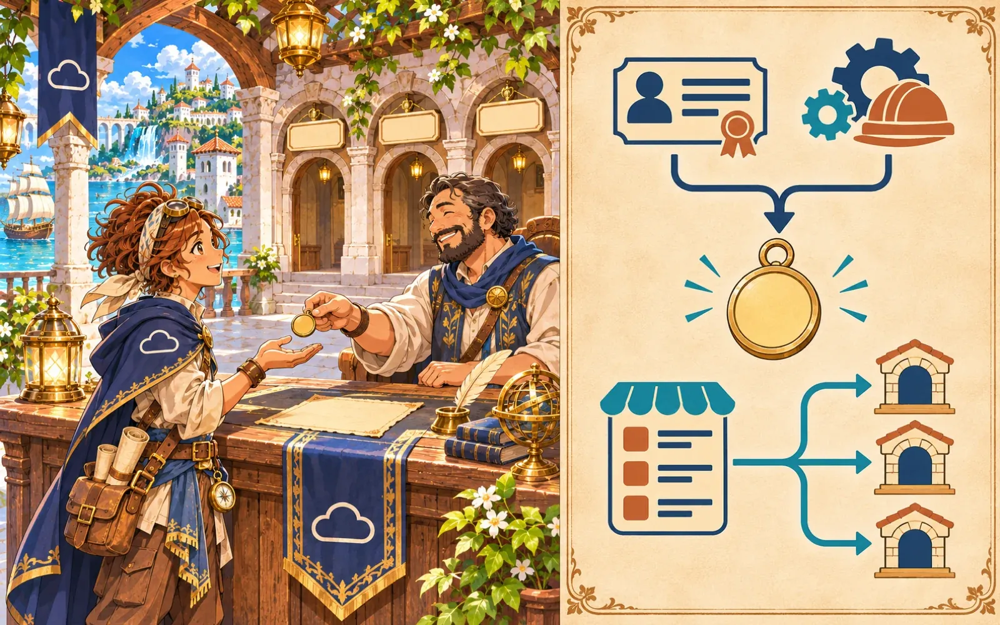
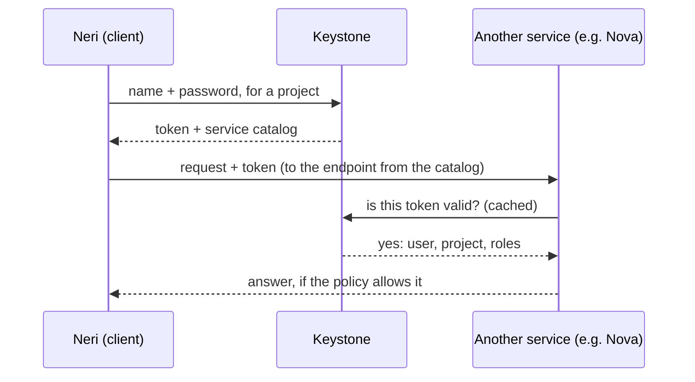

# 3. The register and the passes

*The register office of the town hall.*

The first office past the door belongs to Maë, who keeps the register. Nobody gets further without going through
it. LUMO gives a name and a password; Maë checks them against the register and hands over a small brass token, plain
and unengraved.

"With this you can ask the other offices for things," Maë says. "They will look at the token, and at your role, to
decide what you may do." LUMO turns the token over. "And how do I find the other offices?" Maë unrolls a long sheet:
the catalog. Every office of the town hall is on it, with the address where it answers.

LUMO notices something: Maë does not walk anyone to the other offices, and does not build anything. The register says
who you are, what you may do, and where to go. The rest is up to you and to the other offices.

> [!IMPORTANT]
> **Where the picture stops.** The catalog says where to reach a service; Keystone does not build the machine and
> does not route the requests itself. A token is not a key to every door: what it allows depends on the roles given
> in a scope, and on each service's own policy.

## What it is in OpenStack

**Keystone** is the identity service. Every request to any OpenStack service carries a **token** that Keystone
issued and that the service checks.

- **Users** (and groups) prove who they are, usually with a password or an application credential.
- **Roles** say what a user may do (`member`, `reader`, `admin`…), always in a **scope**: a project or a domain.
- A **token** is a short-lived proof of identity and scope. Clients get one and send it with every request.
- The **service catalog** lists each service and its **endpoints**: the URLs where its API answers. Clients read it
  to know where to send each request.



## From the village to OpenStack



## See it for real

```bash
openstack token issue
openstack catalog list
```

The first shows the token you got and the project it is scoped to; the second lists the services and their endpoints.

**The lantern:** a regular flame lights the register and several of the offices.

**Next:** Neri has a way in. In which scope will Neri's resources live?
[4. Neri's file →](04-neris-file.md)
