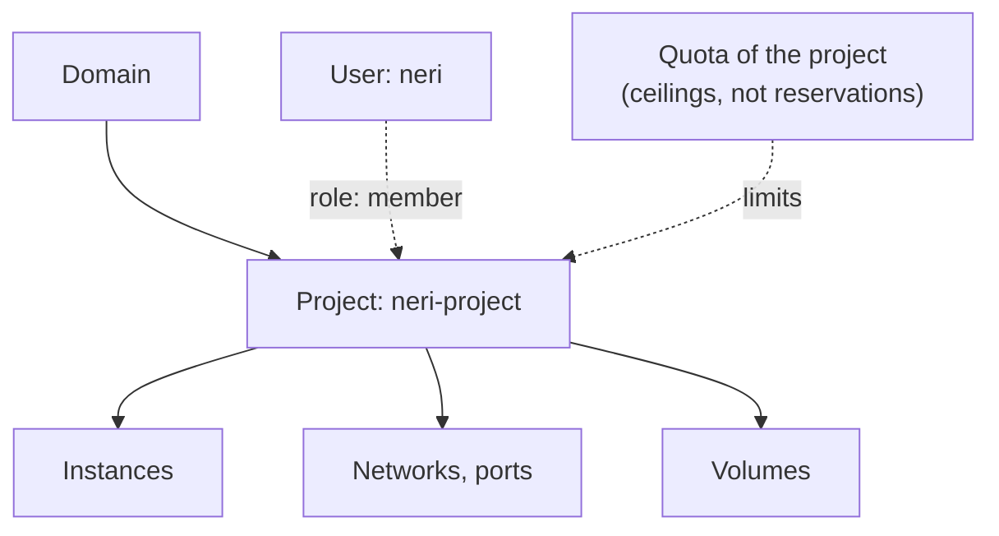

# 4. Neri's file

*The administration office.*


To let Neri ask for anything, LUMO opens a file in Neri's name at the administration office. Everything Neri asks for
will be recorded in that file: the machines, the networks, the disks. Neri may invite friends to work in the same
file later.

On the first page of the file LUMO writes limits: so many machines, so many processors, so much memory, so much disk.
"Is that what I get?" asks Neri. LUMO shakes the lantern gently. "No. That is the most you may ask for. Whether it is
there when you ask depends on what the village has left."


Neri looks out of the window at the fields. "So there is no fence around a corner of land with my name on it?"
"No fence," LUMO says. "Just a file, and a limit."


> [!IMPORTANT]
> **Where the picture stops.** A project does not reserve a physical plot or a guaranteed share of the capacity. A
> quota is a ceiling on what the project may use, not a reservation: two projects can each have room left in their
> quota while the cloud itself is full.

## What it is in OpenStack

- A **project** (once called a *tenant*) is the unit of ownership and access. Resources belong to a project; users get
  roles on a project. It lives in a **domain**, which groups projects and users.
- A **quota** is a limit per project and per resource type: instances, vCPUs, RAM, volumes, gigabytes, floating IPs,
  networks, ports… Each service enforces its own quotas.
- Neither of them says anything about *where* the resources run. The scheduler decides that, later, for each request.

## From the village to OpenStack



A dotted line is an association or a setting; a solid line is ownership.

## See it for real

```bash
openstack project show <PROJECT>
openstack quota show <PROJECT>
```

`quota show` gives the limits; whether there is room for a request depends on the cloud's free capacity too.

**The lantern:** the light falls on a file with clear edges, without drawing a fence around any field.

**Next:** LUMO can now look at the shared ground where the work is done.
[5. The shared fields →](05-the-shared-fields.md)
