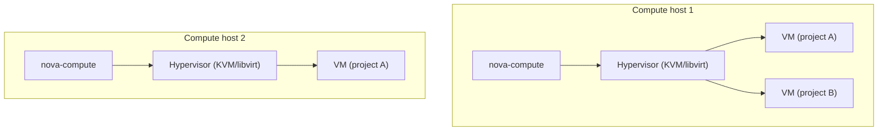

# 5. The shared fields

*The terraces of the compute workshops.*


Below the town hall, on wide terraces, stand the workshops. Each one is a solid building full of tools: processors,
memory, local disk. LUMO walks from one to the next. In each, several small houses are being built at the same time,
side by side, sharing the same tools.

"Which workshop is mine?" asks Neri. "None of them, and all of them," LUMO says. "Your houses will go wherever there is
room, like everyone else's. When a workshop is busy, the next house goes elsewhere."


Rami, who runs the workshops, adds one thing: inside each workshop a foreman keeps the houses apart, so that what
happens in one does not spill into its neighbour.


> [!IMPORTANT]
> **Where the picture stops.** A project does not own a host. Its instances land wherever the scheduler finds a fit,
> and they share each host with other projects' instances. Free capacity and usage change all the time across the
> cloud.

## What it is in OpenStack

- A **compute host** (or compute node) is a physical server that runs virtual machines for the cloud.
- On it, a **hypervisor** (in most OpenStack clouds KVM, driven through libvirt and QEMU) runs each **instance** as an
  isolated virtual machine with its own virtual CPUs, memory and disks: the foreman.
- The **nova-compute** service on each host receives instructions from the control plane and drives the hypervisor.
- The capacity of a host is shared: several instances, from any project, can run on it at once.

## From the village to OpenStack



## See it for real

Operator rights are needed:

```bash
openstack hypervisor list
openstack compute service list --service nova-compute
```

The first lists the hypervisors the cloud knows; the second shows whether `nova-compute` is up and enabled on each
host.

**The lantern:** the beam spreads over several workshops instead of a single plot.

**Next:** before asking for anything, LUMO wants to know what is actually available.
[6. The resource register and the choice of a host →](06-the-resource-register.md)
